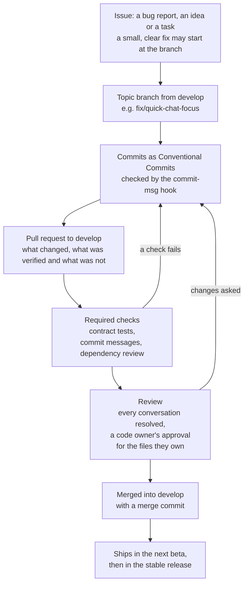

# Contributing to ASTAROT

Issues and pull requests are welcome in English or Japanese. Report security vulnerabilities privately as described in [SECURITY.md](SECURITY.md).

## Branches and releases

| Branch | Purpose | Releases |
|---|---|---|
| `develop` | Integration branch; open pull requests here | Betas, `X.Y.Z-beta.N` (GitHub prereleases) |
| `main` | Protected; changes arrive only by pull request | Stable releases, `X.Y.Z` |

Create a topic branch from `develop` (for example `fix/quick-chat-focus`) and open a pull request to `develop`.

A stable release starts from a `release/X.Y.Z` branch cut from `develop` whose only changes are the version (`X.Y.Z`, set with `utils/update_version.py`) and its CHANGELOG section. Its pull request to `main` must pass the required checks. Merging it starts the candidate builds and the release draft; publishing the release opens a pull request that merges `main` back into `develop`, and once that is merged, `develop` moves to the next `-beta.N`. See [Changelog and releases](#changelog-and-releases) and [release candidates](docs/voice-stack/release-candidates.md), which draws the whole release flow, betas included, as [one diagram](docs/voice-stack/release-candidates.md#全体の流れ).

To fix a published release in a hurry while `develop` already holds the next version's work, cut `release/X.Y.Z` from `main` instead and bring in only the fix and what `main` needs to build. The steps are in [release candidates](docs/voice-stack/release-candidates.md#公開済みの版を急いで直す).

## Pull requests

From an issue to a change in `develop`:



When a pull request changes this flow or the release flow, it updates the diagram in the same pull request: this one, or the release flow in [release candidates](docs/voice-stack/release-candidates.md#全体の流れ).

- A pull request that changes a file listed in [.github/CODEOWNERS](.github/CODEOWNERS) needs a code owner's approval before it merges. The list holds what the project publishes: building, signing and publishing releases, the release notes and the changelog, what the packages hold and the licenses shipped in them, the models the app offers for download, and the public pages (`site/` and the READMEs). Other pull requests need no approving review.
- Write every commit message as a [Conventional Commit](#commit-messages). The commit-msg hook and CI check them.
- Add or update tests for behavior changes, and describe what you verified and what you could not.
- For a change that is OS-specific or changes what is supported (packages, OS, runtimes), state in the pull request the platforms it affects, where it was checked (CI, or a real PC with OS, version and package), where it was not, and any backward-compatibility impact. CI passing does not count as a real-PC check. Keep the [support matrix](site/en/guide/support.md) and its [verification records](docs/voice-stack/platform-verification.md) in step.
- Do not commit secrets, API keys, voice recordings or model files without a redistribution license.
- New or upgraded dependencies must have a compatible license; update [NOTICE.md](NOTICE.md) when bundled components change. The app's Rust crates are pinned in the `Cargo.lock` of each Cargo workspace (`src-tauri/` and every crate under `native/`). Python dependencies, used only by the development tools and tests since 0.6.0, live in `pyproject.toml` and `uv.lock` (`uv lock`).
- Models offered for download go into the download catalog (`native/ops/src/downloads/catalog.rs`; an OCR model also goes into chat reading's table, `native/ocr-runtime/src/models.rs`, and the core's tests compare the two) with a pinned revision, file sizes, SHA-256 and the license shown before download. Do not make a model with a non-commercial or otherwise restrictive license a default.
- User-facing text goes into `locales/`. English (`en.yml`) and Japanese (`ja.yml`) are the only UI languages; update both in the same pull request, and do not fill a language you cannot translate with a guess. Korean and Chinese were dropped as UI languages in 0.2.0 (they remain translation languages).
- The UI reads its text with `t()` and does not write it into the code. `tools/i18n_gate/check.mjs`, part of `python tools/dev.py check` and CI, fails on keys missing in one language, empty text, `{{variables}}` that differ between the languages, keys the UI names that do not exist, and new text hard-coded in the UI. Text that stays untranslated on purpose (product names, units) needs a reason: see [the i18n check](docs/development.md#uiの文言と翻訳の検査).
- The brand assets are in `docs/brand/astarot/`. The app's icons and in-app logos are generated from them with `tools/astarot_app_assets.py`, and the README logos are the horizontal logo PNGs there; edit the sources in `docs/brand/astarot/`, not the generated files ([brand README](docs/brand/README.md)).

Automated checks on every pull request: the model-free contract tests and the Rust backend core tests on Linux and Windows, the commit-message check, dependency review (known vulnerabilities and licenses), and CodeQL code scanning. Pull requests to `main` must pass the required checks before merging.

## Commit messages

Commit messages follow [Conventional Commits 1.0.0](https://www.conventionalcommits.org/en/v1.0.0/). The same rules apply to people and to AI agents ([AGENTS.md](AGENTS.md)).

```text
<type>(<scope>)!: <summary>

<body: what changed and why>

<footers, such as BREAKING CHANGE: or Changelog:>
```

- Write the summary as one line in English, in the imperative, starting in lower case, with no period. Say what changed for the person affected: `fix(tts): keep the queue when the server restarts`, not `fix: bug`.
- The scope is optional and names the area, such as `tts`, `asr`, `rvc`, `ocr`, `ui`, `flow`, `site`, `dev`, `ci` or `deps`.
- Mark a breaking change with `!` after the type or scope, and add a `BREAKING CHANGE:` footer that says what users or developers must do. A change is breaking when a setting, a file format, an IPC or OSC contract, or a supported platform stops working as before.

| Type | Use it for | CHANGELOG heading |
|---|---|---|
| `feat` | Something new that users can do | Features |
| `fix` | A bug users could hit | Bug Fixes |
| `perf` | Faster or lighter, with the same behavior | Performance |
| `refactor` | Code reorganized, with the same behavior | Refactoring |
| `docs` | Documentation, the user guide included | Documentation |
| `test` | Tests only | Tests |
| `build` | Packaging, bundles, dependencies (`build(deps)`) | Build & CI, Dependencies |
| `ci` | GitHub Actions | Build & CI |
| `chore` | Upkeep that fits nothing above | Maintenance |
| `style` | Formatting only | Maintenance |
| `revert` | Undoing an earlier commit (`revert: <its summary>`) | Maintenance |

Examples:

```text
feat(asr): label who speaks in game audio captions
fix(ui)!: accept only English and Japanese as UI languages

BREAKING CHANGE: UI_LANGUAGE accepts only "en" and "ja".
build(deps): update tauri
docs(site): add the page on using your own models

Changelog: user
```

### The commit-msg hook

The hook rejects a message that is not a Conventional Commit before the commit is made. It is one of the Git hooks in [`hk.pkl`](hk.pkl), run by [hk](https://hk.jdx.dev/), and is installed per clone:

1. Run `mise install`. It installs the versions in `mise.toml`: hk, [Cocogitto](https://docs.cocogitto.io/) 7 and the tools the pre-commit hook runs.
2. In the repository, run `python tools/dev.py setup --scope hooks` (or `mise run setup:hooks`). It runs `hk install`. With Git 2.54 or later the hooks go into the clone's Git config, and with an older Git into `.git/hooks`; either way every worktree of the clone shares them. Nothing else installs them.
3. To skip the hooks for one commit, run `HK=0 git commit ...`. To remove them from the clone, run `hk uninstall`.

The same command installs the pre-commit hook, which checks the staged files for keys and tokens, the workflows, the UI's TypeScript and JavaScript, and the links in Markdown ([docs/development.md](docs/development.md#gitのフック)).

Without hk, `cog install-hook commit-msg` installs the same message check from [`cog.toml`](cog.toml) into `.git/hooks/commit-msg` (add `--overwrite` after `cog.toml` changes it). Install one or the other: with Git 2.54 or later both run, and the message is checked twice.

Merge commits pass, as `cog check` ignores them. `fixup!`, `squash!` and `amend!` commits pass locally so that `git rebase --autosquash` keeps working; squash them before you open a pull request, because CI rejects them. To check a message by hand, run `cog verify "feat(ui): ..."`.

CI checks the commits of every pull request, and the commits pushed to `develop` and `main`, with `python tools/dev.py check --scope commits --base <base>`. Old history is not rewritten.

## Changelog and releases

[`CHANGELOG.md`](CHANGELOG.md) is the record of what each stable release changed. A stable section covers everything since the previous stable release, its betas included, so betas get no section of their own; their changes are in their GitHub pre-release notes. The section is written once, when the stable release is prepared, not on every commit. Do not edit it in a feature branch.

### Preparing a release

1. Set the version in `package.json` (`X.Y.Z-beta.N` on `develop`, `X.Y.Z` on a `release/X.Y.Z` branch) and run `npm run update-version`.
2. For a stable release only, run `npm run changelog` (`python tools/changelog.py write`). It reads the commits since the previous stable release tag through Cocogitto and adds the version's section at the top of `CHANGELOG.md`, naming the betas it includes. Read the section; if a line is unclear, fix it in the file. The tool will not overwrite a section that differs from what it would write unless you pass `--force`. For a beta, skip this step; `write` refuses a beta.
3. Commit as `chore(release): version X.Y.Z` and open the pull request. Release pull requests to `main` fail if the section is missing.
4. For a stable release, merging the release pull request into `main` starts "Start ASTAROT release draft": it builds the Linux and Windows candidates at the merge commit (or uses successful manual ones already there) and then runs "Prepare verified ASTAROT release draft" with them, which checks them as before and makes a draft only. For a beta, build the candidates and run "Prepare verified ASTAROT release draft" by hand, or run "Start ASTAROT release draft" on `develop` ([release candidates](docs/voice-stack/release-candidates.md#下書きを作る)). A stable draft's notes are made from its CHANGELOG section; a beta's from its commits since the previous release tag. Run `python tools/changelog.py print` or `release-notes` to see them beforehand.
5. Before publishing the draft, check that its tag is `vX.Y.Z` and that it targets the commit the candidates were built from, and replace its body with the release notes in `docs/release-notes/X.Y.Z.md` ([format](docs/release-notes/README.md)). Publishing creates the `vX.Y.Z` tag, which cannot be moved afterwards. To start that file, run `python tools/changelog.py scaffold-notes` (`mise run changelog:notes`): it lays out the headings of the format and lists the pull requests merged since the previous stable release, sorted as in the CHANGELOG section, for you to rewrite. It never overwrites an existing file.
6. After a stable release is published, "Open ASTAROT back-merge pull request" opens the pull request from `main` into `develop`. Close and reopen it (or push to it) to run its checks, resolve any conflict on its branch, and merge it with a merge commit ([after publishing](docs/voice-stack/release-candidates.md#公開したあと)).
7. After a stable release is published, also open a pull request into `develop` that brings the support matrix (`site/*/guide/support.md`) and its records (`docs/voice-stack/platform-verification.md`) up to the published version, with the real-machine checks made before publishing. Merge it after the release is out, since the guide is published from `develop` ([steps](docs/voice-stack/release-candidates.md#公開したあとに対応環境の表を更新する)).

Running `write` again gives the same file. It stops if the tag `vX.Y.Z` already exists. Tags are created only by publishing a GitHub release; do not run `cog bump` and do not push tags by hand.

### What goes where

Each section, and each release's notes, lists "User-facing Changes" first and "Internal Changes" after. Headings without entries are left out.

| Group | Heading | Commits |
|---|---|---|
| User-facing | Breaking Changes | Any commit with `!` or `BREAKING CHANGE:` |
| User-facing | Features | `feat` |
| User-facing | Improvements | Other types marked `Changelog: user` |
| User-facing | Bug Fixes | `fix` |
| User-facing | Performance | `perf` |
| User-facing | Security | `fix(security)`, or any commit marked `Changelog: security` |
| Internal | Refactoring | `refactor` |
| Internal | Dependencies | any type with the `deps` scope |
| Internal | Build & CI | `build`, `ci`, and `feat`/`fix` with the `ci` or `build` scope |
| Internal | Tests | `test`, and `feat`/`fix` with the `test` or `tests` scope |
| Internal | Documentation | `docs` |
| Internal | Maintenance | `chore`, `style`, `revert`, and `feat`/`fix` with the `dev` or `tooling` scope |

Start from the type, then check what the change does for users. Add a `Changelog:` footer when the type alone would put a commit in the wrong place:

- `Changelog: user` lists it under User-facing (for example a dependency update that fixes a crash users see).
- `Changelog: security` lists it under Security.
- `Changelog: internal` keeps a `feat` or `fix` that only developers notice out of the user-facing headings.
- `Changelog: skip` leaves it out (noise such as a typo in a test name).

Release commits (`chore(release): ...`) and merge commits are left out. The same summary twice becomes one line with both commits linked.

### GitHub Releases

The CHANGELOG section is the full list of a stable release; the GitHub release helps users decide whether to update. Its text is written by hand in `docs/release-notes/X.Y.Z.md`. From 0.5.0 it opens with two to four sentences on the biggest change, then gives each change that matters to users its own heading (one emoji and a short title), written in plain paragraphs with lists only where they help; the upgrade notes and known issues come last among these. It ends with one heading for internal changes, a short list in technical terms with the pull request number on each line. The format is in [docs/release-notes/README.md](docs/release-notes/README.md). The draft that `tools/changelog.py` starts (Highlights, Upgrade Notes, Known Issues and the changes) is replaced with these notes before publishing. Keep the two consistent: change the CHANGELOG first, then the release text.

### Troubleshooting

- If a hook cannot find `hk`, `cog` or another tool, run `mise install`. The hooks find the tools through mise's shims, so the versions are those in `mise.toml`. To stop checking in this clone, run `hk uninstall` (or, with `cog install-hook`, delete `.git/hooks/commit-msg`).
- If `cog install-hook` refuses to replace a hook, another hook is already there. Check it, then add `--overwrite`.
- If CI rejects a commit that the hook let through, it is a `fixup!`, `squash!` or `amend!` commit, or it was made without the hook. Rewrite your branch with `git rebase -i` before it is merged; never rewrite `develop` or `main`.
- If the tool reports `changelog: no earlier release tag`, fetch the tags with `git fetch --tags`.
- If it reports `CHANGELOG.md already has a different section`, new commits arrived after you wrote the section, or someone edited it. Compare it with the output of `print`, then run `write --force`.

## Local setup and checks

The tool versions are pinned in `mise.toml`, and the routine steps are [mise](https://mise.jdx.dev/) tasks that run `tools/dev.py`. See [docs/development.md](docs/development.md):

```sh
mise install
mise run doctor
mise run setup:headless
mise run check:voice
```

## Relationship to VRCT

ASTAROT (formerly VRCT-VOX) is derived from [VRCT](https://github.com/misyaguziya/VRCT) and no longer tracks it. Send changes for ASTAROT here; report problems in upstream VRCT to its maintainers, and do not send them ASTAROT support requests.

## 日本語での概要

Issue や PR は日本語でも構いません。作業ブランチは `develop` から作り、PR は `develop` へ出してください。`main` は保護されています。正式版のときだけ、`develop` から切った `release/X.Y.Z` ブランチ（版の変更と CHANGELOG の節だけ）を PR で統合します。統合すると候補のビルドとリリースの下書きの準備が自動で始まり、公開すると `main` を `develop` へ戻す PR が自動で開きます。公開とその前の確認は人が行います。公開済みの版を急いで直すときは、`main` から切ります（[手順](docs/voice-stack/release-candidates.md#公開済みの版を急いで直す)）。

- コミットは Conventional Commits の形式で書きます。種別の選び方と例は上の「Commit messages」にあります。
- 形式の検査は commit-msg フックで行います。`mise install` のあと、複製ごとに `python tools/dev.py setup --scope hooks`（hk のフックを入れる）を一度実行してください。hk を使わないときは `cog install-hook commit-msg` でも入れられますが、両方は入れないでください。CI も PR と、develop・main への push を検査します。
- `CHANGELOG.md` に載せるのは正式版だけです。正式版のリリースを準備するときに `npm run changelog` で書きます。ベータ版の変更は GitHub のプレリリースのノートに載せます。機能のブランチでは編集しません。手順と分類は上の「Changelog and releases」にあります。
- テストと確認した内容を PR に書いてください。
- Issue から develop への統合までの流れは上の「Pull requests」に、リリースの流れは[配布候補とリリース下書き](docs/voice-stack/release-candidates.md#全体の流れ)に図があります。流れを変える PR では図も同じ PR で直します。
- OS に依存する変更や、対応する範囲（配布形式、OS、ランタイム）を変える変更では、影響する OS、確かめた環境（CI か、実機なら OS と版と配布形式）、確かめていない環境、後方互換性への影響を PR に書きます。CI の成功は実機での確認に数えません。[サポートマトリクス](site/ja/guide/support.md)と[検証の記録](docs/voice-stack/platform-verification.md)も合わせて直します。
- 表示する文言は `locales/` の英語と日本語の両方に、同じ PR で足します。訳せない文言を推測で埋めません。
- UI は文言を `t()` で取り出し、コードに直接書きません。`python tools/dev.py check` と CI が `tools/i18n_gate/check.mjs` で検査します。片方の言語にないキー、空の値、言語で食い違う補間変数、存在しないキーの参照、新しい直書きがあると失敗します。わざと訳さない文字列（製品名や単位など）には理由を書きます。書き方は [docs/development.md](docs/development.md#uiの文言と翻訳の検査) にあります。
- ダウンロードできるモデルは、版・サイズ・SHA-256・ライセンスを固定してカタログに登録します。非商用ライセンスのモデルは既定にしません。

脆弱性は SECURITY.md の手順で非公開に報告してください。
