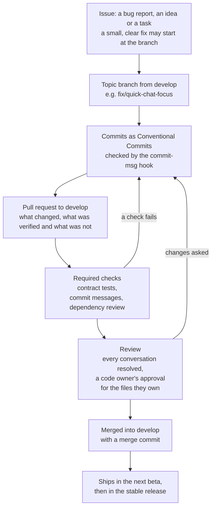
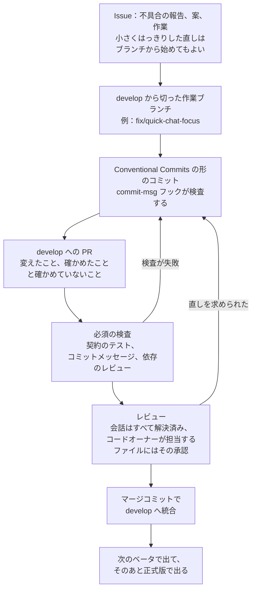

# Contributing to ASTAROT

[日本語版](#astarot-への貢献日本語版)

Issues and pull requests are welcome in English or Japanese. Report security vulnerabilities privately as described in [SECURITY.md](SECURITY.md).

## Branches and releases

| Branch | Purpose | Releases |
|---|---|---|
| `develop` | Integration branch; open pull requests here | Betas, `X.Y.Z-beta.N` (GitHub prereleases) |
| `main` | Protected; changes arrive only by pull request | Stable releases, `X.Y.Z` |

Create a topic branch from `develop` (for example `fix/quick-chat-focus`) and open a pull request to `develop`.

A stable release starts from a `release/X.Y.Z` branch cut from `develop` whose only changes are the version (`X.Y.Z`, set with `utils/update_version.py`) and its CHANGELOG section. Its pull request to `main` must pass the required checks. Merging it starts the candidate builds and the release draft; publishing the release opens a pull request that merges `main` back into `develop`, and once that is merged, `develop` moves to the next `-beta.N`. See [Changelog and releases](#changelog-and-releases) and [release candidates](docs/voice-stack/release-candidates.md), which draws the whole release flow, betas included, as [one diagram](docs/voice-stack/release-candidates.md#全体の流れ).

Between the first beta prerelease of a version (`X.Y.Z-beta.1`) and its stable release (`X.Y.Z`), only fixes for issues found in the beta merge into `develop`. New features and unrelated changes wait until the stable release is published and merged back into `develop` ([beta freeze](docs/voice-stack/release-candidates.md#ベータ期間の変更凍結)). Before publishing a stable release, check beta telemetry (`app_started` and `error` events) against the previous stable release to confirm no noticeable rise in errors ([telemetry check](docs/voice-stack/release-candidates.md#公開前にベータ期間のテレメトリを確かめる)).

To fix a published release in a hurry while `develop` already holds the next version's work, cut `release/X.Y.Z` from `main` instead and bring in only the fix and what `main` needs to build. The steps are in [release candidates](docs/voice-stack/release-candidates.md#公開済みの版を急いで直す).

## Pull requests

From an issue to a change in `develop`:



When a pull request changes this flow or the release flow, it updates the diagram in the same pull request: this one, or the release flow in [release candidates](docs/voice-stack/release-candidates.md#全体の流れ).

- A pull request that changes a file listed in [.github/CODEOWNERS](.github/CODEOWNERS) needs a code owner's approval before it merges. The list holds what the project publishes: building, signing and publishing releases, the release notes and the changelog, what the packages hold and the licenses shipped in them, the models the app offers for download, and the public pages (`site/` and the READMEs). Other pull requests need no approving review.
- Write every commit message as a [Conventional Commit](#commit-messages). The commit-msg hook and CI check them.
- Add or update tests for behavior changes, and describe what you verified and what you could not.
- For a change that is OS-specific or changes what is supported (packages, OS, runtimes), state in the pull request the platforms it affects, where it was checked (CI, or a real PC with OS, version and package), where it was not, and any backward-compatibility impact. CI passing does not count as a real-PC check. Keep the [support matrix](site/en/guide/support.md) and its [verification records](docs/voice-stack/platform-verification.md) in step.
- Do not commit secrets, API keys, voice recordings or model files without a redistribution license.
- New or upgraded dependencies must have a compatible license; update [NOTICE.md](NOTICE.md) when bundled components change. The app's Rust crates are pinned in the `Cargo.lock` of each Cargo workspace (`src-tauri/` and every crate under `native/`). Python dependencies, used only by the development tools and tests since 0.6.0, live in `pyproject.toml` and `uv.lock` (`uv lock`).
- Models offered for download go into the download catalog (`native/ops/src/downloads/catalog.rs`; an OCR model also goes into chat reading's table, `native/ocr-runtime/src/models.rs`, and the core's tests compare the two) with a pinned revision, file sizes, SHA-256 and the license shown before download. Do not make a model with a non-commercial or otherwise restrictive license a default.
- User-facing text goes into `locales/`. English (`en.yml`) and Japanese (`ja.yml`) are the only UI languages; update both in the same pull request, and do not fill a language you cannot translate with a guess. Korean and Chinese were dropped as UI languages in 0.2.0 (they remain translation languages).
- The UI reads its text with `t()` and does not write it into the code. `tools/i18n_gate/check.mjs`, part of `python tools/dev.py check` and CI, fails on keys missing in one language, empty text, `{{variables}}` that differ between the languages, keys the UI names that do not exist, and new text hard-coded in the UI. Text that stays untranslated on purpose (product names, units) needs a reason: see [the i18n check](docs/development.md#uiの文言と翻訳の検査).
- The brand assets are in `docs/brand/astarot/`. The app's icons and in-app logos are generated from them with `tools/astarot_app_assets.py`, and the README logos are the horizontal logo PNGs there; edit the sources in `docs/brand/astarot/`, not the generated files ([brand README](docs/brand/README.md)).

Automated checks on every pull request: the model-free contract tests and the Rust backend core tests on Linux and Windows, the commit-message check, dependency review (known vulnerabilities and licenses), and CodeQL code scanning. Pull requests to `main` must pass the required checks before merging.

## Commit messages

Commit messages follow [Conventional Commits 1.0.0](https://www.conventionalcommits.org/en/v1.0.0/). The same rules apply to people and to AI agents ([AGENTS.md](AGENTS.md)).

```text
<type>(<scope>)!: <summary>

<body: what changed and why>

<footers, such as BREAKING CHANGE: or Changelog:>
```

- Write the summary as one line in English, in the imperative, starting in lower case, with no period. Say what changed for the person affected: `fix(tts): keep the queue when the server restarts`, not `fix: bug`.
- The scope is optional and names the area, such as `tts`, `asr`, `rvc`, `ocr`, `ui`, `flow`, `site`, `dev`, `ci` or `deps`.
- Mark a breaking change with `!` after the type or scope, and add a `BREAKING CHANGE:` footer that says what users or developers must do. A change is breaking when a setting, a file format, an IPC or OSC contract, or a supported platform stops working as before.

| Type | Use it for | CHANGELOG heading |
|---|---|---|
| `feat` | Something new that users can do | Features |
| `fix` | A bug users could hit | Bug Fixes |
| `perf` | Faster or lighter, with the same behavior | Performance |
| `refactor` | Code reorganized, with the same behavior | Refactoring |
| `docs` | Documentation, the user guide included | Documentation |
| `test` | Tests only | Tests |
| `build` | Packaging, bundles, dependencies (`build(deps)`) | Build & CI, Dependencies |
| `ci` | GitHub Actions | Build & CI |
| `chore` | Upkeep that fits nothing above | Maintenance |
| `style` | Formatting only | Maintenance |
| `revert` | Undoing an earlier commit (`revert: <its summary>`) | Maintenance |

Examples:

```text
feat(asr): label who speaks in game audio captions
fix(ui)!: accept only English and Japanese as UI languages

BREAKING CHANGE: UI_LANGUAGE accepts only "en" and "ja".
build(deps): update tauri
docs(site): add the page on using your own models

Changelog: user
```

### The commit-msg hook

The hook rejects a message that is not a Conventional Commit before the commit is made. It is one of the Git hooks in [`hk.pkl`](hk.pkl), run by [hk](https://hk.jdx.dev/), and is installed per clone:

1. Run `mise install`. It installs the versions in `mise.toml`: hk, [Cocogitto](https://docs.cocogitto.io/) 7 and the tools the pre-commit hook runs.
2. In the repository, run `python tools/dev.py setup --scope hooks` (or `mise run setup:hooks`). It runs `hk install`. With Git 2.54 or later the hooks go into the clone's Git config, and with an older Git into `.git/hooks`; either way every worktree of the clone shares them. Nothing else installs them.
3. To skip the hooks for one commit, run `HK=0 git commit ...`. To remove them from the clone, run `hk uninstall`.

The same command installs the pre-commit hook, which checks the staged files for keys and tokens, the workflows, the UI's TypeScript and JavaScript, and the links in Markdown ([docs/development.md](docs/development.md#gitのフック)).

Without hk, `cog install-hook commit-msg` installs the same message check from [`cog.toml`](cog.toml) into `.git/hooks/commit-msg` (add `--overwrite` after `cog.toml` changes it). Install one or the other: with Git 2.54 or later both run, and the message is checked twice.

Merge commits pass, as `cog check` ignores them. `fixup!`, `squash!` and `amend!` commits pass locally so that `git rebase --autosquash` keeps working; squash them before you open a pull request, because CI rejects them. To check a message by hand, run `cog verify "feat(ui): ..."`.

CI checks the commits of every pull request, and the commits pushed to `develop` and `main`, with `python tools/dev.py check --scope commits --base <base>`. Old history is not rewritten.

## Changelog and releases

[`CHANGELOG.md`](CHANGELOG.md) is the record of what each stable release changed. A stable section covers everything since the previous stable release, its betas included, so betas get no section of their own; their changes are in their GitHub pre-release notes. The section is written once, when the stable release is prepared, not on every commit. Do not edit it in a feature branch.

### Preparing a release

1. Set the version in `package.json` (`X.Y.Z-beta.N` on `develop`, `X.Y.Z` on a `release/X.Y.Z` branch) and run `npm run update-version`.
2. For a stable release only, run `npm run changelog` (`python tools/changelog.py write`). It reads the commits since the previous stable release tag through Cocogitto and adds the version's section at the top of `CHANGELOG.md`, naming the betas it includes. Read the section; if a line is unclear, fix it in the file. The tool will not overwrite a section that differs from what it would write unless you pass `--force`. For a beta, skip this step; `write` refuses a beta.
3. Commit as `chore(release): version X.Y.Z` and open the pull request. Release pull requests to `main` fail if the section is missing.
4. For a stable release, merging the release pull request into `main` starts "Start ASTAROT release draft": it builds the Linux and Windows candidates at the merge commit (or uses successful manual ones already there) and then runs "Prepare verified ASTAROT release draft" with them, which checks them as before and makes a draft only. For a beta, build the candidates and run "Prepare verified ASTAROT release draft" by hand, or run "Start ASTAROT release draft" on `develop` ([release candidates](docs/voice-stack/release-candidates.md#下書きを作る)). A stable draft's notes are made from its CHANGELOG section; a beta's from its commits since the previous release tag. Run `python tools/changelog.py print` or `release-notes` to see them beforehand.
5. Before publishing the draft, check that its tag is `vX.Y.Z` and that it targets the commit the candidates were built from, and replace its body with the release notes in `docs/release-notes/X.Y.Z.md` ([format](docs/release-notes/README.md)). Publishing creates the `vX.Y.Z` tag, which cannot be moved afterwards. To start that file, run `python tools/changelog.py scaffold-notes` (`mise run changelog:notes`): it lays out the headings of the format and lists the pull requests merged since the previous stable release, sorted as in the CHANGELOG section, for you to rewrite. It never overwrites an existing file.
6. After a stable release is published, "Open ASTAROT back-merge pull request" opens the pull request from `main` into `develop`. Close and reopen it (or push to it) to run its checks, resolve any conflict on its branch, and merge it with a merge commit ([after publishing](docs/voice-stack/release-candidates.md#公開したあと)).
7. After a stable release is published, also open a pull request into `develop` that brings the support matrix (`site/*/guide/support.md`) and its records (`docs/voice-stack/platform-verification.md`) up to the published version, with the real-machine checks made before publishing. Merge it after the release is out, since the guide is published from `develop` ([steps](docs/voice-stack/release-candidates.md#公開したあとに対応環境の表を更新する)).

Running `write` again gives the same file. It stops if the tag `vX.Y.Z` already exists. Tags are created only by publishing a GitHub release; do not run `cog bump` and do not push tags by hand.

### What goes where

Each section, and each release's notes, lists "User-facing Changes" first and "Internal Changes" after. Headings without entries are left out.

| Group | Heading | Commits |
|---|---|---|
| User-facing | Breaking Changes | Any commit with `!` or `BREAKING CHANGE:` |
| User-facing | Features | `feat` |
| User-facing | Improvements | Other types marked `Changelog: user` |
| User-facing | Bug Fixes | `fix` |
| User-facing | Performance | `perf` |
| User-facing | Security | `fix(security)`, or any commit marked `Changelog: security` |
| Internal | Refactoring | `refactor` |
| Internal | Dependencies | any type with the `deps` scope |
| Internal | Build & CI | `build`, `ci`, and `feat`/`fix` with the `ci` or `build` scope |
| Internal | Tests | `test`, and `feat`/`fix` with the `test` or `tests` scope |
| Internal | Documentation | `docs` |
| Internal | Maintenance | `chore`, `style`, `revert`, and `feat`/`fix` with the `dev` or `tooling` scope |

Start from the type, then check what the change does for users. Add a `Changelog:` footer when the type alone would put a commit in the wrong place:

- `Changelog: user` lists it under User-facing (for example a dependency update that fixes a crash users see).
- `Changelog: security` lists it under Security.
- `Changelog: internal` keeps a `feat` or `fix` that only developers notice out of the user-facing headings.
- `Changelog: skip` leaves it out (noise such as a typo in a test name).

Release commits (`chore(release): ...`) and merge commits are left out. The same summary twice becomes one line with both commits linked.

### GitHub Releases

The CHANGELOG section is the full list of a stable release; the GitHub release helps users decide whether to update. Its text is written by hand in `docs/release-notes/X.Y.Z.md`. From 0.5.0 it opens with two to four sentences on the biggest change, then gives each change that matters to users its own heading (one emoji and a short title), written in plain paragraphs with lists only where they help; the upgrade notes and known issues come last among these. It ends with one heading for internal changes, a short list in technical terms with the pull request number on each line. The format is in [docs/release-notes/README.md](docs/release-notes/README.md). The draft that `tools/changelog.py` starts (Highlights, Upgrade Notes, Known Issues and the changes) is replaced with these notes before publishing. Keep the two consistent: change the CHANGELOG first, then the release text.

### Troubleshooting

- If a hook cannot find `hk`, `cog` or another tool, run `mise install`. The hooks find the tools through mise's shims, so the versions are those in `mise.toml`. To stop checking in this clone, run `hk uninstall` (or, with `cog install-hook`, delete `.git/hooks/commit-msg`).
- If `cog install-hook` refuses to replace a hook, another hook is already there. Check it, then add `--overwrite`.
- If CI rejects a commit that the hook let through, it is a `fixup!`, `squash!` or `amend!` commit, or it was made without the hook. Rewrite your branch with `git rebase -i` before it is merged; never rewrite `develop` or `main`.
- If the tool reports `changelog: no earlier release tag`, fetch the tags with `git fetch --tags`.
- If it reports `CHANGELOG.md already has a different section`, new commits arrived after you wrote the section, or someone edited it. Compare it with the output of `print`, then run `write --force`.

## Local setup and checks

The tool versions are pinned in `mise.toml`, and the routine steps are [mise](https://mise.jdx.dev/) tasks that run `tools/dev.py`. See [docs/development.md](docs/development.md):

```sh
mise install
mise run doctor
mise run setup:headless
mise run check:voice
```

## Relationship to VRCT

ASTAROT (formerly VRCT-VOX) is derived from [VRCT](https://github.com/misyaguziya/VRCT) and no longer tracks it. Send changes for ASTAROT here; report problems in upstream VRCT to its maintainers, and do not send them ASTAROT support requests.

---

# ASTAROT への貢献（日本語版）

Issue や PR は英語でも日本語でも構いません。セキュリティの脆弱性は [SECURITY.md](SECURITY.md) の手順で非公開に報告してください。

## ブランチとリリース

| ブランチ | 役割 | リリース |
|---|---|---|
| `develop` | 統合のブランチで、PR はここへ出します | ベータ版の `X.Y.Z-beta.N`（GitHub のプレリリース） |
| `main` | 保護されていて、変更は PR でだけ入ります | 正式版の `X.Y.Z` |

作業ブランチは `develop` から作り（たとえば `fix/quick-chat-focus`）、PR は `develop` へ出してください。

正式版は `develop` から切った `release/X.Y.Z` ブランチから始めます。このブランチで変えるのは版（`X.Y.Z`。`utils/update_version.py` で設定します）と、その版の CHANGELOG の節だけです。このブランチから `main` への PR は必須の検査に通らなければなりません。この PR を統合すると、候補のビルドとリリースの下書きの準備が自動で始まります。リリースを公開すると `main` を `develop` へ戻す PR が自動で開き、その PR を統合すると `develop` は次の `-beta.N` に進みます。詳しくは[変更履歴とリリース](#変更履歴とリリース)と[配布候補とリリース下書き](docs/voice-stack/release-candidates.md)を見てください。配布候補とリリース下書きの文書にはベータを含むリリースの流れ全体を描いた [1 つの図](docs/voice-stack/release-candidates.md#全体の流れ)があります。

ある版の最初のベータ（`X.Y.Z-beta.1`）をプレリリースとして公開してから正式版（`X.Y.Z`）を公開するまでのあいだ、`develop` へマージしてよいのはベータで見つかった問題の修正だけです。新しい機能や関係のない変更は正式版を公開して `main` を `develop` へ戻すまで待ちます（[ベータ期間の変更凍結](docs/voice-stack/release-candidates.md#ベータ期間の変更凍結)）。正式版を公開する前に、ベータ期間のテレメトリ（`app_started` と `error` のイベント）を前の正式版と比べて、エラーが目立って増えていないことを確かめます（[テレメトリの確認](docs/voice-stack/release-candidates.md#公開前にベータ期間のテレメトリを確かめる)）。

公開済みの版を急いで直したいのに `develop` にもう次の版の作業が入っているときは、代わりに `main` から `release/X.Y.Z` を切ります。そこには直しと、`main` のビルドに要るものだけを入れます。手順は[配布候補とリリース下書き](docs/voice-stack/release-candidates.md#公開済みの版を急いで直す)にあります。

## プルリクエスト

Issue から `develop` に変更が入るまでの流れです。



この流れやリリースの流れを変える PR では図も同じ PR で直します。直すのはこの図か、[配布候補とリリース下書き](docs/voice-stack/release-candidates.md#全体の流れ)にあるリリースの流れの図です。

- [.github/CODEOWNERS](.github/CODEOWNERS) に載っているファイルを変える PR は、マージの前にコードオーナーの承認が要ります。一覧に載っているのはプロジェクトが公開するもので、リリースのビルドと署名と公開、リリースノートと変更履歴、配布物の中身とそこに入れるライセンス、アプリがダウンロードを提供するモデル、公開しているページ（`site/` と README）です。ほかの PR には承認のレビューは要りません。
- コミットメッセージはすべて [Conventional Commits](#コミットメッセージ) の形式で書きます。commit-msg フックと CI が検査します。
- 振る舞いを変えるときはテストを足すか直します。PR には確かめたことと確かめられなかったことを書いてください。
- OS に依存する変更や、対応する範囲（配布形式、OS、ランタイム）を変える変更では、影響するプラットフォーム、確かめた環境（CI か、実機なら OS と版と配布形式）、確かめていない環境、後方互換性への影響を PR に書きます。CI の成功は実機での確認に数えません。[サポートマトリクス](site/ja/guide/support.md)と[検証の記録](docs/voice-stack/platform-verification.md)も合わせて直します。
- 秘密の情報、API キー、再配布のライセンスがない音声の録音やモデルのファイルはコミットしません。
- 新しく足す依存と版を上げる依存は、互換性のあるライセンスでなければなりません。同梱するものが変わったら [NOTICE.md](NOTICE.md) を直します。アプリの Rust のクレートは Cargo のワークスペースごと（`src-tauri/` と、`native/` の下のすべてのクレート）の `Cargo.lock` で版を固定しています。Python の依存は 0.6.0 から開発の道具とテストだけが使い、`pyproject.toml` と `uv.lock`（`uv lock`）にあります。
- ダウンロードできるモデルは、版、ファイルのサイズ、SHA-256、ダウンロードの前に示すライセンスを固定して、ダウンロードのカタログ（`native/ops/src/downloads/catalog.rs`）に登録します。OCR のモデルはチャット読み取りの表（`native/ocr-runtime/src/models.rs`）にも登録し、中核のテストが 2 つを比べます。非商用のライセンスや、そのほかの制限のあるライセンスのモデルは既定にしません。
- 表示する文言は `locales/` に置きます。画面の言語は英語（`en.yml`）と日本語（`ja.yml`）だけです。両方を同じ PR で更新し、訳せない言語の文言を推測で埋めません。韓国語と中国語は 0.2.0 で画面の言語から外しました（翻訳の言語としては残っています）。
- UI は文言を `t()` で取り出し、コードに直接書きません。`python tools/dev.py check` と CI に含まれる `tools/i18n_gate/check.mjs` は、片方の言語にないキー、空の文言、言語で食い違う `{{variables}}`、UI が参照する存在しないキー、UI に新しく直書きした文言があると失敗します。わざと訳さない文字列（製品名や単位など）には理由が要ります。書き方は [i18n の検査](docs/development.md#uiの文言と翻訳の検査)にあります。
- ブランドの素材は `docs/brand/astarot/` にあります。アプリのアイコンとアプリの中のロゴは `tools/astarot_app_assets.py` でそこから生成します。README のロゴはそこにある横長のロゴの PNG です。生成したファイルではなく `docs/brand/astarot/` の元のファイルを編集します（[ブランドの README](docs/brand/README.md)）。

すべての PR で次の検査が自動で動きます。Linux と Windows でのモデルを使わない契約のテストと Rust のバックエンドの中核のテスト、コミットメッセージの検査、依存のレビュー（既知の脆弱性とライセンス）、CodeQL のコードスキャンです。`main` への PR はマージの前に必須の検査に通らなければなりません。

## コミットメッセージ

コミットメッセージは [Conventional Commits 1.0.0](https://www.conventionalcommits.org/en/v1.0.0/) に従います。人にも AI エージェントにも同じ決まりを当てはめます（[AGENTS.md](AGENTS.md)）。

```text
<type>(<scope>)!: <summary>

<body: what changed and why>

<footers, such as BREAKING CHANGE: or Changelog:>
```

- 要約は英語の 1 行で書きます。命令形で書き、先頭を小文字にし、末尾にピリオドを付けません。影響を受ける人にとって何が変わったかを書きます。`fix: bug` ではなく `fix(tts): keep the queue when the server restarts` のように書きます。
- スコープは省略できます。`tts`、`asr`、`rvc`、`ocr`、`ui`、`flow`、`site`、`dev`、`ci`、`deps` のように変更の領域を示します。
- 互換性を壊す変更は種別かスコープのあとに `!` を付けて示し、利用者や開発者がしなければならないことを書いた `BREAKING CHANGE:` のフッターを付けます。設定、ファイルの形式、IPC や OSC の契約、対応するプラットフォームが前と同じに動かなくなる変更は、互換性を壊す変更です。

| 種別 | 使う場面 | CHANGELOG の見出し |
|---|---|---|
| `feat` | 利用者が新しくできるようになること | Features |
| `fix` | 利用者が出会いうる不具合 | Bug Fixes |
| `perf` | 振る舞いは同じまま、速くするか軽くする | Performance |
| `refactor` | 振る舞いは同じまま、コードを組み直す | Refactoring |
| `docs` | 文書（利用者向けのマニュアルを含む） | Documentation |
| `test` | テストだけ | Tests |
| `build` | パッケージの作成、バンドル、依存（`build(deps)`） | Build & CI, Dependencies |
| `ci` | GitHub Actions | Build & CI |
| `chore` | 上のどれにも当てはまらない保守 | Maintenance |
| `style` | 整形だけ | Maintenance |
| `revert` | 前のコミットの取り消し（`revert: <its summary>`） | Maintenance |

書き方の例です。

```text
feat(asr): label who speaks in game audio captions
fix(ui)!: accept only English and Japanese as UI languages

BREAKING CHANGE: UI_LANGUAGE accepts only "en" and "ja".
build(deps): update tauri
docs(site): add the page on using your own models

Changelog: user
```

### commit-msg フック

このフックは Conventional Commits の形でないメッセージをコミットができる前に拒否します。[`hk.pkl`](hk.pkl) にある Git のフックの 1 つで、[hk](https://hk.jdx.dev/) が動かします。フックは複製ごとに次の手順で入れます。

1. `mise install` を実行します。`mise.toml` に書いた版の hk、[Cocogitto](https://docs.cocogitto.io/) 7、pre-commit フックが動かす道具が入ります。
2. リポジトリの中で `python tools/dev.py setup --scope hooks`（または `mise run setup:hooks`）を実行します。このコマンドは `hk install` を実行します。Git 2.54 以降ではフックが複製の Git の設定に入り、それより古い Git では `.git/hooks` に入ります。どちらでも、その複製のすべての作業ツリーがフックを共有します。ほかの手順ではフックは入りません。
3. 1 回のコミットだけフックを飛ばすときは `HK=0 git commit ...` を実行します。複製からフックを外すときは `hk uninstall` を実行します。

同じコマンドで pre-commit フックも入ります。pre-commit フックはステージしたファイルのキーとトークン、ワークフロー、UI の TypeScript と JavaScript、Markdown のリンクを検査します（[docs/development.md](docs/development.md#gitのフック)）。

hk を使わないときは、`cog install-hook commit-msg` が [`cog.toml`](cog.toml) から同じメッセージの検査を `.git/hooks/commit-msg` に入れます（`cog.toml` でこの検査が変わったあとは `--overwrite` を付けます）。両方は入れず、どちらか一方だけを入れてください。Git 2.54 以降では両方が動き、メッセージを 2 回検査します。

マージコミットは `cog check` が無視するので通ります。`fixup!`、`squash!`、`amend!` のコミットは、`git rebase --autosquash` を使えるように手元では通ります。ただし CI はこれらを拒否するので、PR を開く前にまとめます。メッセージを手で確かめるときは `cog verify "feat(ui): ..."` を実行します。

CI はすべての PR のコミットと、`develop` と `main` に push したコミットを `python tools/dev.py check --scope commits --base <base>` で検査します。古い履歴は書き換えません。

## 変更履歴とリリース

[`CHANGELOG.md`](CHANGELOG.md) は正式版ごとに何が変わったかの記録です。正式版の節には前の正式版からの変更を、その間のベータの分も含めてすべて載せます。そのためベータには自分の節がなく、ベータの変更は GitHub のプレリリースのノートにあります。節はコミットのたびに書くのではなく正式版を準備するときに一度だけ書きます。機能のブランチでは編集しません。

### リリースの準備

1. `package.json` の版を設定し（`develop` では `X.Y.Z-beta.N`、`release/X.Y.Z` ブランチでは `X.Y.Z`）、`npm run update-version` を実行します。
2. 正式版のときだけ `npm run changelog`（`python tools/changelog.py write`）を実行します。このコマンドは前の正式版のタグからのコミットを Cocogitto で読み、その版の節を `CHANGELOG.md` の先頭に足します。節には含まれるベータの名前も入ります。足された節を読み、分かりにくい行があればファイルの中で直します。道具は自分が書く内容と違う節を `--force` を付けない限り上書きしません。ベータではこの手順を飛ばします。`write` はベータを拒否します。
3. `chore(release): version X.Y.Z` としてコミットし、PR を開きます。`main` へのリリースの PR は節がないと失敗します。
4. 正式版ではリリースの PR を `main` に統合すると「Start ASTAROT release draft」が始まります。このワークフローはマージコミットで Linux と Windows の候補をビルドし（手で動かして成功した候補がすでにあればそれを使います）、その候補で「Prepare verified ASTAROT release draft」を実行します。「Prepare verified ASTAROT release draft」は、これまでと同じように候補を検査し、下書きだけを作ります。ベータでは候補をビルドして「Prepare verified ASTAROT release draft」を手で実行するか、`develop` で「Start ASTAROT release draft」を実行します（[配布候補とリリース下書き](docs/voice-stack/release-candidates.md#下書きを作る)）。正式版の下書きのノートはその CHANGELOG の節から、ベータのノートは前のリリースのタグからのコミットから作ります。前もって見るときは `python tools/changelog.py print` か `release-notes` を実行します。
5. 下書きを公開する前に、タグが `vX.Y.Z` であることと、候補をビルドしたコミットを指していることを確かめます。そして本文を `docs/release-notes/X.Y.Z.md` のリリースノートに置き換えます（[書式](docs/release-notes/README.md)）。公開すると `vX.Y.Z` のタグができ、あとから動かせません。このファイルを書き始めるときは `python tools/changelog.py scaffold-notes`（`mise run changelog:notes`）を実行します。このコマンドは書式の見出しを並べ、前の正式版から統合した PR を CHANGELOG の節と同じ分け方で一覧にします。それを書き直します。このコマンドは既存のファイルを決して上書きしません。
6. 正式版を公開すると、「Open ASTAROT back-merge pull request」が `main` から `develop` への PR を開きます。検査を動かすためにその PR を閉じて開き直し（またはそのブランチに push し）、競合があればそのブランチで解消して、マージコミットで統合します（[公開したあと](docs/voice-stack/release-candidates.md#公開したあと)）。
7. 正式版を公開したら、公開の前に実機で確かめた結果を使って、サポートマトリクス（`site/*/guide/support.md`）とその記録（`docs/voice-stack/platform-verification.md`）を公開した版に合わせる PR も `develop` へ開きます。マニュアルは `develop` から公開するので、この PR はリリースが出たあとに統合します（[手順](docs/voice-stack/release-candidates.md#公開したあとに対応環境の表を更新する)）。

`write` をもう一度実行しても同じファイルになります。`vX.Y.Z` のタグがすでにあると止まります。タグは GitHub のリリースを公開したときにだけできます。`cog bump` を実行せず、タグを手で push しません。

### どの見出しに載るか

各節と各リリースのノートは「User-facing Changes」を先に、「Internal Changes」をあとに並べます。項目のない見出しは省きます。

| 区分 | 見出し | コミット |
|---|---|---|
| 利用者向け | Breaking Changes | `!` か `BREAKING CHANGE:` が付いたすべてのコミット |
| 利用者向け | Features | `feat` |
| 利用者向け | Improvements | `Changelog: user` を付けたほかの種別 |
| 利用者向け | Bug Fixes | `fix` |
| 利用者向け | Performance | `perf` |
| 利用者向け | Security | `fix(security)`、または種別を問わず `Changelog: security` を付けたコミット |
| 内部 | Refactoring | `refactor` |
| 内部 | Dependencies | スコープが `deps` のすべての種別 |
| 内部 | Build & CI | `build`、`ci`、スコープが `ci` か `build` の `feat` と `fix` |
| 内部 | Tests | `test`、スコープが `test` か `tests` の `feat` と `fix` |
| 内部 | Documentation | `docs` |
| 内部 | Maintenance | `chore`、`style`、`revert`、スコープが `dev` か `tooling` の `feat` と `fix` |

まず種別から考え、次にその変更が利用者に何をするかを確かめます。種別だけではコミットが違う場所に入るときは、`Changelog:` のフッターを付けます。

- `Changelog: user` は利用者向けの区分に載せます（たとえば、利用者が目にする異常終了を直す依存の更新）。
- `Changelog: security` は Security に載せます。
- `Changelog: internal` は開発者だけが気づく `feat` や `fix` を利用者向けの見出しから外します。
- `Changelog: skip` は載せません（テストの名前の誤字のような、雑音になる変更）。

リリースのコミット（`chore(release): ...`）とマージコミットは載せません。同じ要約が 2 回あると、両方のコミットへのリンクを付けた 1 行になります。

### GitHub のリリース

CHANGELOG の節は正式版の変更をすべて並べた一覧で、GitHub のリリースは利用者が更新するかどうかを決める助けになります。その文章は `docs/release-notes/X.Y.Z.md` に手で書きます。0.5.0 からはいちばん大きな変更についての 2〜4 文で始めます。続いて、利用者にとって意味のある変更ごとに見出し（絵文字 1 つと短い題）を立て、普通の段落で書きます。箇条書きは役に立つところでだけ使います。これらの見出しの最後には更新するときの注意と既知の問題を置きます。最後に内部の変更の見出しを 1 つ置き、技術の言葉で短い一覧を書きます。一覧の各行には PR の番号を付けます。書式は [docs/release-notes/README.md](docs/release-notes/README.md) にあります。`tools/changelog.py` が作り始める下書き（Highlights、Upgrade Notes、Known Issues と変更）は、公開の前にこのノートで置き換えます。2 つは食い違わないようにします。先に CHANGELOG を直し、次にリリースの文章を直します。

### うまくいかないとき

- フックが `hk`、`cog` やほかの道具を見つけられないときは、`mise install` を実行します。フックは mise の shim を通して道具を見つけるので、版は `mise.toml` のものになります。この複製で検査をやめるときは `hk uninstall` を実行します（`cog install-hook` で入れたときは `.git/hooks/commit-msg` を消します）。
- `cog install-hook` がフックの置き換えを拒否するときは、別のフックがすでに入っています。中身を確かめてから `--overwrite` を付けます。
- フックが通したコミットを CI が拒否するときは、そのコミットは `fixup!`、`squash!`、`amend!` のコミットか、フックなしで作ったコミットです。統合される前に自分のブランチを `git rebase -i` で書き換えます。`develop` と `main` は決して書き換えません。
- 道具が `changelog: no earlier release tag` と報告したら、`git fetch --tags` でタグを取得します。
- `CHANGELOG.md already has a different section` と報告したら、節を書いたあとに新しいコミットが入ったか、誰かが節を編集しています。`print` の出力と比べてから `write --force` を実行します。

## 手元の準備と検査

道具の版は `mise.toml` で固定しています。決まった手順は `tools/dev.py` を動かす [mise](https://mise.jdx.dev/) のタスクにしてあります。詳しくは [docs/development.md](docs/development.md) を見てください。

```sh
mise install
mise run doctor
mise run setup:headless
mise run check:voice
```

## VRCT との関係

ASTAROT（旧名 VRCT-VOX）は [VRCT](https://github.com/misyaguziya/VRCT) から派生したもので、いまは VRCT に追従していません。ASTAROT への変更はこのリポジトリへ送ってください。上流の VRCT の問題は VRCT の保守担当者へ報告し、ASTAROT のサポートの依頼は VRCT の保守担当者へ送らないでください。
