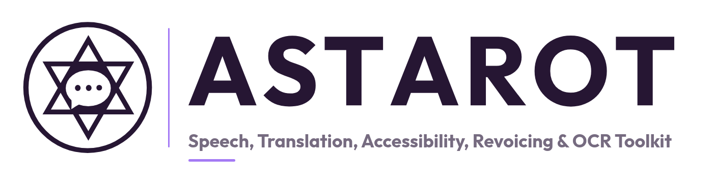

<h1 align="center">
  <picture>
    <source media="(prefers-color-scheme: dark)" srcset="docs/brand/astarot/logo-horizontal-dark.png">
    
  </picture>
</h1>

<!-- Badges read their values from GitHub (Actions, Releases, the repository, the `badges` branch
     published by publish-badges.yml, or docs/testing/badges/ for milestone measurements), except
     License and Platform: those follow LICENSE and the release files. Keep docs/readmes/README.ja.md the same.
     UI mutation (docs/testing/badges/mutation-ui.json) and E2E tests (docs/testing/badges/tests-e2e.json)
     are omitted until their initial measurements are recorded (see docs/testing/overview.md). -->

  
  
  
  

  
  
  
  
  

  
  
  
  

  
  
  
  
  

[日本語](/docs/readmes/README.ja.md)

ASTAROT (formerly VRCT-VOX) is a desktop app for VRChat that combines speech recognition (ASR), text to speech (TTS), voice conversion (RVC), chat reading (OCR) and translation. It is derived from [VRCT](https://github.com/misyaguziya/VRCT) and maintained by [kein5](https://github.com/kein5). **It is not an official VRCT release and is not endorsed by the VRCT authors or VRChat.**

## Features

- **Translated speech.** Speak your chat input and confirmed translations with [speech.cpp](https://github.com/nyosegawa/speech.cpp) TTS (Irodori-TTS for Japanese, Qwen3-TTS for other languages) into a virtual microphone that VRChat uses. Voice output and OSC chat text are configured independently, so you can, for example, keep your own voice while translated speech and text are added.
- **Hear yourself.** Optionally play the same speech on your own speakers or headphones.
- **Voice conversion.** Convert your microphone with RVC. On Windows and Linux the app fetches its runtime after showing its license and size. CUDA conversion needs an NVIDIA GeForce GTX 16 or RTX 20 series GPU or later with driver 580 or later. From 0.6.0, Windows can also use DirectML on a DirectX 12 GPU. CPU conversion has a longer delay and requires a CPU fast enough for live audio. Seed-VC is no longer offered from 0.5.0; a saved Seed-VC setting switches to RVC.
- **Realtime captions.** Transcribe your microphone and other players with bundled speech.cpp ASR servers.
- **Bundled servers.** Save, start and stop speech.cpp servers from the settings.
- **Model downloads.** Download fixed Irodori-TTS, Qwen3-TTS, RVC, translation (M2M100, NLLB-200) and speech recognition models (every recognizer speech.cpp offers, such as Qwen3-ASR, ReazonSpeech and Haas-ja) from Hugging Face. Each download asks for consent after showing its license and size. Files are checked by size and SHA-256 and applied separately. GPU/VRAM guidance suggests standard or lighter variants; it is a guide, not a guarantee.
- **Linux desktop.** Global shortcuts on Wayland (XDG portal), a managed PipeWire virtual microphone, PipeWire microphone selection, and Japanese input methods (fcitx/Mozc, ibus) in the AppImage. The VR UI, chat reading from a shared native Wayland window, and pasting in Voice Typing Mode (into X11/XWayland windows) work too.

RVC also needs its runtime, HuBERT and RMVPE. See [model downloads](/docs/voice-stack/model-downloads.md), [voice features on Windows](/docs/voice-stack/local-setup-windows.md) and [the Linux setup notes](/docs/voice-stack/local-setup-linux.md).

## Speed comparison

The chart compares eight apps that send captions of your speech to VRChat: it shows how many seconds pass from the end of your speech until the caption reaches VRChat. The times were measured in November 2026 on one PC, a Surface Laptop 5 with an external RTX 3060 Ti, and differ on other PCs. The method, the settings of each app and the notes on the results are in [issue #558](https://github.com/kein5/astarot/issues/558).

## Status and downloads

The latest release is on **[GitHub Releases](https://github.com/kein5/astarot/releases/latest)** (the release badge above shows its version). Versions count from 0.1.0, separately from upstream VRCT 3.x. Betas are published from `develop`, stable releases from `main`.

- **Linux:** AppImage, tar.gz, deb and rpm (x64, Vulkan). Versions before 0.5 were tested with real models on CachyOS (KDE Plasma Wayland).
- **Windows:** installer and zip, one package for every PC (the 0.5 releases also have a CUDA zip with the same files). Versions before 0.5 were tested with real models on Windows 11 ([record](/docs/voice-stack/windows-voice-report.md)). They are not code-signed, so SmartScreen warns on first launch.

What has been checked for the current version, per package and feature, and what CI covers versus a real PC, is on **[Platform support](https://kein5.github.io/astarot/en/guide/support)**.

`SHA256SUMS-*` lists the SHA-256 of every download (Windows ZIP packages also carry an individual `.sha256` for the installer); these are not signatures. Installer and AppImage copies update themselves after checking the update's signature; ZIP and tar.gz copies are told about new versions; deb and rpm installs update through the package manager. An AUR package is planned but not submitted.

Known limitations:
- Chat reading (OCR) needs its models, which are not shipped: download them in Settings → Chat reading (OCR) → Recognition models after agreeing to their terms. On Linux it reads the VRChat window through XWayland. A native Wayland window (VRChat inside gamescope, for example) is read after you share it: Settings → Chat reading (OCR) → "Share a window…" opens your desktop's own window dialog.
- On Linux, the VR UI and chat reading from the headset view have been checked only with a stand-in for SteamVR, not with a real headset. Linux builds have been checked on KDE Plasma (Wayland) only.
- The Google, Bing and Papago web translators are unavailable (see License).

Report bugs and ask questions on **[Issues](https://github.com/kein5/astarot/issues)**, with OS, version, steps and redacted logs. Report vulnerabilities privately (see [SECURITY.md](SECURITY.md)). Do not send ASTAROT support requests to the VRCT maintainers.

## Getting started

- [TTS quick start (Japanese)](/docs/voice-stack/tts-quickstart-ja.md)
- [Troubleshooting](/docs/voice-stack/troubleshooting.md)
- [Accessibility: help with hearing, speaking and reading, and known limits](/ACCESSIBILITY.md)
- [Model downloads and GPU/VRAM guidance](/docs/voice-stack/model-downloads.md)
- [Original VRCT documentation](https://misyaguziya.github.io/VRCT-Docs/). It covers the upstream app, not the ASTAROT voice features.

## Names and storage

From 0.7.0, the executable, the packages and the release files use the ASTAROT name too. The executable is `astarot` (`astarot.exe` on Windows), the deb and rpm package is `astarot`, the release files are `ASTAROT.zip`, `ASTAROT_setup.exe` and `ASTAROT-<version>-linux-x64-release.*`, and the application ID is `io.github.kein5.astarot`. Up to 0.6.x they were `vrct-vox`, `VRCT-VOX` and `io.github.kein5.vrct-vox`, and each 0.7.x release also carries its release files under those old names. An update moves an install to the new names: the Windows installer replaces `vrct-vox.exe` and moves an install in `%LOCALAPPDATA%\VRCT-VOX` to `%LOCALAPPDATA%\ASTAROT`, and the `astarot` package replaces the `vrct-vox` package. On Linux, settings and data live in `astarot` directories from 0.6.0 (`~/.config/astarot` and `~/.local/share/astarot`). The first start of 0.6.0 or later moves the `vrct-vox` directories of 0.5.x there and leaves links with the old names. See [names and identifiers](/docs/voice-stack/project-rename.md).

## Privacy and models

ASTAROT sends two kinds of usage events to its own receiver unless you turn that off (Settings → Advanced → "Send usage data"): that the app started, once a day, and an error by its fixed code, once a day per code. Each carries the app version, the OS and its version, the display language, and the PC's hardware (CPU, memory, GPUs and their driver versions). The app shows you exactly what it sends ("See what gets sent"). The text and audio of conversations, audio device names and user names are never sent, and nothing is sent before you have answered a one-time notice. Upstream VRCT's Aptabase telemetry is not used, even when an old upstream key file exists. Translation and speech services you choose still receive the text or audio you send them; turning off usage data does not make every feature offline. See [privacy](/site/en/guide/privacy.md).

No model is bundled. TTS, ASR and RVC models are downloaded only on request, or provided by you. Built packages contain no OCR weights. The upstream chat-bubble detector, which may not be shipped in a fork's release, was removed from the repository in 0.2.0; commits up to 0.1.0 still hold it under its own [terms](https://github.com/kein5/astarot/blob/250cec9681752c2f897d9a15a38e647c38561842/src-python/models/ocr/onnx/LICENSE.en.txt), so do not package an old checkout wholesale. The Mia2026 test voice is for local testing only and is never distributed. The bundled speech.cpp binaries carry their own notices; each model has its own license.

## License and acknowledgements

ASTAROT is under the [MIT License](/LICENSE), and the original VRCT copyright and attribution are retained. External engines and model weights have their own terms.

[NOTICE](/NOTICE.md#lgpl-and-gpl-components-in-vrct-vox-builds) lists the LGPL and GPL components included through 0.4.x, including the Seed-VC integration, with their sources and replacement instructions. Two upstream components are deliberately left out:
- PyAV, because its wheels bundle the GPL x264/x265 encoders.
- Upstream's `translator_engines`, which is licensed for official VRCT only. This is why the Google, Bing and Papago web translators are unavailable.

Thank you to the VRCT team: **みしゃ / misyaguziya** (main development), **しいな / Shiina_12siy** (UI/UX and localization), **レラ / soumt-r** (technical advice), **どね / done_vrc** (logo), and [all VRCT contributors](https://github.com/misyaguziya/VRCT/graphs/contributors). ASTAROT builds on their work. It no longer tracks upstream VRCT; nothing is sent upstream without the repository owner's explicit decision ([policy](/docs/voice-stack/publication-and-upstream.md)).

VRChat and its associated properties are trademarks or registered trademarks of VRChat Inc. ASTAROT is not affiliated with VRChat Inc.

## Development

[mise](https://mise.jdx.dev/) installs the pinned Node, Rust, Python, uv and Cocogitto from `mise.toml` (`mise install`) and runs the routine tasks (`mise tasks` lists them). Start with `mise run doctor`, install the headless checks with `mise run setup:headless`, and install the UI dependencies with `mise run setup:ui`. `mise run check` runs the developer-tool, Node and lint checks. The [developer guide](docs/development.md) covers the voice, UI, Rust and integration checks, the repository checks, browser tests and Cocogitto. See [CONTRIBUTING.md](CONTRIBUTING.md) for branches, commit messages and pull requests. What each stable release changed is in [CHANGELOG.md](CHANGELOG.md), from 0.2.0 on; betas and earlier releases are described on [GitHub Releases](https://github.com/kein5/astarot/releases).

- [Build and CI guide (Japanese)](/docs/readme_build.md)
- [Linux build pipeline](/docs/voice-stack/linux-build-pipeline.md) and [AppImage](/docs/voice-stack/appimage.md)
- [Release candidate and draft workflow](docs/voice-stack/release-candidates.md)
- [Voice licenses and distribution boundaries](/docs/voice-stack/licensing.md)
