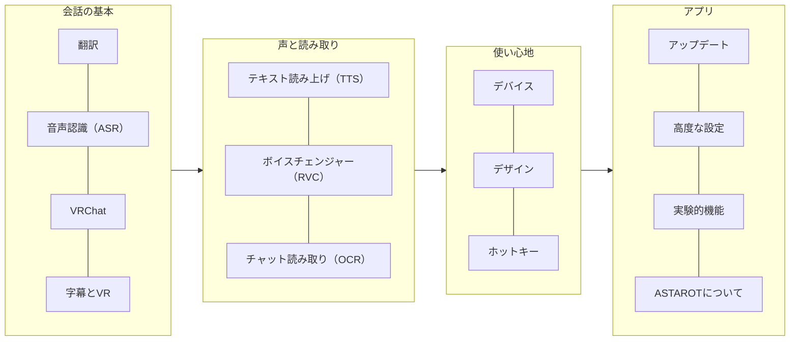
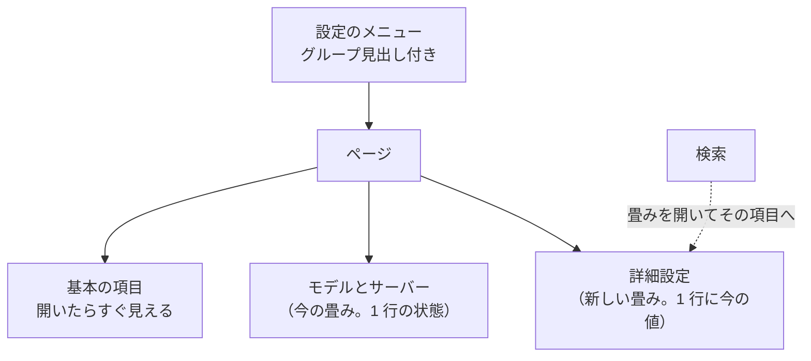
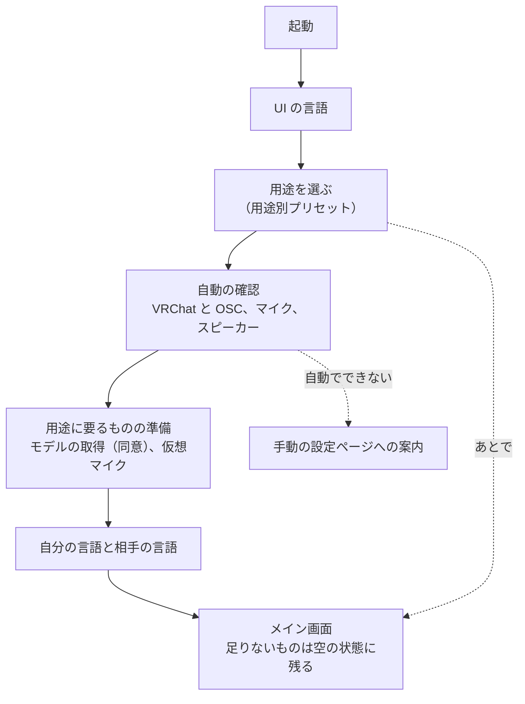

# 情報設計の見直し（#554）

機能が増え、基本の機能と高度な設定と実験的な機能が同じ重さで並んでいます。この文書は何をどこに置くかを決めるための設計案です。機能は減らしません。見せ方と届け方を整理します。

- 状態: 提案（方針は未決。下の[残課題](#残課題)を決めてから実装に移ります）
- 対象: メイン画面、設定画面、初回の導線
- 対象外: 部品と見た目（#452）。この文書は情報の置き方の層だけを扱います。
- 連動: #557 ワンクリック初期設定、#537 遷移先を明記するボタンのラベル、#515 i18n の品質ゲート

この文書の棚卸しは `develop`（`945951d2`）のコードから作りました。

## 現状の棚卸し

### メイン画面

| 場所 | 常に出るもの | 必要なときだけ出るもの |
|---|---|---|
| サイドバー（`main_function_switch/MainFunctionSwitch.jsx`） | 6 つのスイッチ: 翻訳、マイク入力、聞き取り、チャット読み取り（OCR）、テキスト読み上げ（TTS）、ボイスチェンジャー（RVC）。各スイッチの横に、設定ページを開くボタン | 準備が足りないスイッチの灰色表示と理由 |
| サイドバー（`language_settings/`） | 言語のプリセット 3 つ、自分の言語、相手の言語（最大 3 つ）、入れ替え、翻訳エンジンの選択 | 狭いウィンドウでは、アイコンの列と言語の組の表示 |
| 上部バー（`top_bar/`） | 読み上げを停止、ミュート、ヘルプ、クイック設定 | アップデートの通知、入力と出力のパネル（`io_flow`）、リアルタイム字幕の操作（`realtime_controls/`） |
| クイック設定 | 最前面固定、VRChat のマイクミュート同期、字幕オーバーレイ、VRChat と OSC の検出 | — |
| 会話欄 | ログ、入力欄、送信ボタン | 空のときの案内と、足りないモデルの一覧（`setupNeeds.ts`）、文字数の警告、ログの表示設定 |

6 つのスイッチは同じ大きさと同じ並びで常に出ます。#554 が基本とする音声認識、翻訳、字幕のほかに、OCR、TTS、RVC も同じ重さで並んでいます。

### 設定画面

左のメニューには 14 個のタブがあります（`config_page/sidebar_section/SidebarSection.jsx`）。並びは今の表示順です。区切りは「ASTAROTについて」の前の 1 か所だけです。

| # | タブ | 主な中身（見出しの順） | 畳んである部分 |
|---|---|---|---|
| 1 | デバイス | 音声経路、マイク（ホスト、デバイス、自動選択、感度の方式 VAD／自動／手動としきい値、VRC マイクミュート同期）、スピーカー（デバイス、しきい値） | なし |
| 2 | デザイン | 表示（UI 言語、UI サイズ、ログの文字サイズ、フォント、透明度）、送信ボタン（形式、再送ボタン、送信後に入力欄を消す）、読みの補助（ひらがな、ローマ字） | なし |
| 3 | 翻訳 | AI 翻訳（ローカルのモデルと計算装置）、外部の翻訳 API（DeepL、Google Cloud、Papago、Plamo、Gemini、OpenAI、OpenAI 互換、Groq、OpenRouter）、ローカルの LLM（LM Studio、Ollama） | モデルとサーバー。プロバイダはそれぞれ 1 行に畳み、使っているものだけ開く |
| 4 | 音声認識（ASR） | エンジンの選択、クラウドのエンジン、マイク（単語フィルタ、タイミング）、スピーカー（タイミング）、リアルタイム字幕（サーバー、モデル、装置、語彙）、同梱 speech.cpp サーバー（認識、VAD、話者分離のモデル）、古い Whisper の重み（残っているときだけ） | タイミング、サーバーとモデル |
| 5 | VRChat | 在席の表示、チャットボックス（送る、翻訳だけ送る、通知音、受け取ったメッセージも送る、マイクミュート同期）、メッセージの形式、OSC（IP、ポート）、音声経路、TTS の出力先、チャット読み取りへの案内 | なし |
| 6 | チャット読み取り（OCR） | 状態、読み取る言語、必要なモデル、検出（検出器、範囲、チャットボックスのフィルタ）、性能（ウィンドウ名、間隔、信頼度、最短の文字数） | 性能 |
| 7 | VR | VR オーバーレイ（1 行／複数行、有効化、位置、回転、透明度、拡大、表示時間）、共通の設定（翻訳だけ表示、音声入力モード）、フォント、デスクトップ字幕、VR UI（β版機能）の VR パネル | なし |
| 8 | ホットキー | Quick Chat、切り替え（ウィンドウの表示、翻訳、マイク入力、聞き取り）、音声（停止、ミュート、TTS、RVC） | なし |
| 9 | テキスト読み上げ（TTS） | エンジン（speech.cpp、COEIROINK）、声、生成の設定（シード、指示）、モニター、出力先と仮想マイクの案内（Windows）、同梱 speech.cpp サーバー（日本語、多言語） | モデルとサーバー |
| 10 | ボイスチェンジャー（RVC） | RVC モデルの選択、実行環境の取得、モデルの取得、ワーカーの設定 | モデルとサーバー |
| 11 | 高度な設定 | ログ（自動保存）、設定ファイル（フォルダを開く）、利用状況の送信、WebSocket（ホスト、TLS、ポート、URL、トークン）、入力音声の転送、OBS ブラウザソース（URL、ポート、表示件数、表示時間、文字の大きさと色、縁取り） | 入力音声の転送のサーバー |
| 12 | 実験的機能 | 六芒星のオーバーレイ（端、モニター） | なし |
| 13 | アップデート | 版と状態、確認、インストール、リリースのページ | なし |
| 14 | ASTAROTについて | 概要、上流 VRCT、リンク、謝辞 | なし |

操作できる行（設定、操作のボタン、リンク）を数えると、「ASTAROTについて」を除く 13 タブで約 240 行あります。多いのは音声認識（約 42 行）、TTS（約 40 行）、翻訳、VR、高度な設定（それぞれ約 25 行）です。条件で出る行と、畳みの中の行も含めています。

設定には検索欄があり、すべてのタブの項目を探せます（`search_bar/SearchBar.jsx`）。結果を選ぶと、まわりの畳み（`
`）を開いてその項目へ移ります（`logics/configs/config_page_setter/_aux/useConfigSearch.js`）。

設定画面のほかに、VR パネルの中にも設定の窓があります。そこにはデバイス、デザイン、翻訳、音声認識、VRChat、VR の一部が出ます（`views/vr/VrSettingsWindow.jsx`）。

### 初回に出る案内

初回の設定の流れ（ウィザード）はありません。初回の案内もひとまとまりになっていません。必要になった場面で、次のものがばらばらに出ます（`App.jsx` のコントローラ）。

| 案内 | 出る場面 |
|---|---|
| 利用状況の送信のお知らせ（`TelemetryNoticeController`） | 最初の起動 |
| 音声認識エンジンの選択と同意（`TranscriptionConsentController`） | エンジンが未選択のまま、マイク入力か聞き取りをオンにしたとき |
| 翻訳モデルの取得（`TranslationSetupController`） | ローカル翻訳のモデルがないまま翻訳を使うとき |
| チャット読み取りの準備（`OcrSetupController`） | OCR のモデルがないままオンにしたとき |
| 仮想マイクの案内（`VirtualMicGuideController`、Windows） | 起動したときに仮想ケーブルが見つからないとき（上の 2 つのお知らせのあと）。TTS と VRChat のページのボタンからも開く |
| ローカル音声認識の移行のお知らせ（`LocalAsrNoticeController`） | 前の版から更新したとき（1 回だけ） |
| 会話欄の空の状態 | 会話がない間。足りないモデルと、OSC を有効にする手順 |

## 見えている問題

| ID | 問題 | 根拠 |
|---|---|---|
| IA-01 | タブが 14 個あり、並びが使う順になっていません。デバイスが先頭で、TTS と RVC は後ろのほうにあります。グループの見出しもありません。 | `SidebarSection.jsx` |
| IA-02 | 「高度な設定」に性質の違うものが同居しています。ログ、設定フォルダ、利用状況の送信、外部連携（WebSocket、OBS）、音声の機能（入力音声の転送）が 1 ページにあります。 | `AdvancedSettings.jsx` |
| IA-03 | 同じ設定が複数の場所に出ます。VRC マイクミュート同期はデバイス、VRChat、クイック設定の 3 か所に出ます。音声経路はデバイスと VRChat に出て、TTS、RVC、高度な設定にもその要約が出ます。TTS の出力先は TTS と VRChat に、ログの文字サイズはデザインと会話欄に出ます。意図した配置ですが、どちらが本来の置き場所かが画面からは分かりません。 | `Vrchat.jsx`、`Device.jsx` |
| IA-04 | β 版の機能が実験的機能のページに集まっていません。VR パネルは VR ページの中で「β版機能」と書いて置かれています。 | `Vr.jsx` の `vr_ui_beta` |
| IA-05 | 1 つのページの中で、基本の項目と一度決めたら触らない項目が同じ重さで並ぶページがあります。デバイス、デザイン、VRChat、VR、ホットキーには畳む部分がありません。 | 上の表の「畳んである部分」 |
| IA-06 | メイン画面の 6 つのスイッチが、使うかどうかに関係なく同じ重さで並びます。 | `MainFunctionSwitch.jsx` |
| IA-07 | 初回の案内に順番と全体像がありません。何が済んでいて、何が残っているかを 1 か所で見られません。 | `App.jsx` のコントローラ |
| IA-08 | ほかのページへ移るボタンが、移ることをラベルで示していないものがあります。 | #537 |

## 分類の軸

項目を 2 つの軸で分けます。1 つ目の軸は「どのくらい表に出すか」（深さ）、2 つ目の軸は「何のための機能か」（機能の塊）です。

### 深さ（4 段階）

| 段階 | 意味 | 置き方 |
|---|---|---|
| 基本 | 初めての利用者が、音声認識、翻訳、字幕を使うのに要るもの | ページを開いたらすぐ見える |
| 応用 | 使い方に合わせて変えるもの。一度決めたら触らないもの | ページの中の「詳細設定」の畳みに入れる。畳みの行には今の値を出す |
| 実験的 | 確認を終えて卒業するまでの機能。既定はオフ | 「実験的機能」のページだけに置く |
| 連携と保守 | 外部のソフトとの連携、記録、設定ファイル | 「高度な設定」のページに置く |

どの段階の項目も、設定の検索で見つかるようにします。「開くまで存在を意識させないが、探せば見つかる深さ」（#554）は、畳みと検索の組み合わせで満たします。

### 機能の塊（設定のメニューのグループ）

メニューを会話で使う順の 4 つのグループに分けます。グループには見出しを付けます。

- 「VR」は中身がほとんど字幕の表示なので「字幕とVR」に改める案です（[残課題](#残課題) Q-04）。
- デバイスはマイクを選ぶ場面で要る基本の項目を含みます。ただし最初の設定は初回の導線（#557）が決めるので、メニューでは「使い心地」に置く案にしています（Q-03）。

### 項目ごとの分類案

「基本」は表に、「応用」は詳細設定の畳みに入れる案です。✱ は今の置き場所から移す案です。

| ページ | 基本 | 応用 | 実験的／連携と保守 |
|---|---|---|---|
| 翻訳 | ローカルの翻訳モデルの取得と状態 | 計算装置、外部の翻訳 API、ローカルの LLM | — |
| 音声認識（ASR） | エンジンの選択、認識モデルと VAD モデルの取得と状態 | クラウドのエンジン、単語フィルタ、タイミング、リアルタイム字幕のサーバーと語彙、話者分離 | 古い Whisper の重み（残っているときだけ。今のまま） |
| VRChat | 在席の表示、チャットボックスに送る、翻訳だけ送る | 通知音、受け取ったメッセージも送る、マイクミュート同期、メッセージの形式、音声経路と TTS の出力先（本来の置き場所への案内にする ✱） | OSC の IP とポート（連携と保守へ ✱。Q-06） |
| 字幕とVR | VR オーバーレイの有効化、デスクトップ字幕の有効化 | 位置、回転、透明度、拡大、表示時間、フォント、翻訳だけ表示、音声入力モード | VR パネル（実験的機能へ ✱。Q-05） |
| TTS | エンジン、声、出力先（仮想マイクの案内を含む）、モデルの取得 | 生成の設定、モニター、サーバーの装置 | — |
| RVC | モデルの選択、実行環境とモデルの取得 | ワーカーの設定 | — |
| OCR | 状態、読み取る言語、モデルの取得 | 検出器、範囲、フィルタ、性能 | — |
| デバイス | マイク、スピーカー | 感度の方式としきい値、音声経路 | — |
| デザイン | UI 言語、UI サイズ | ログの文字サイズ、フォント、透明度、送信ボタン、読みの補助 | — |
| ホットキー | 停止とミュート | そのほか全部 | — |
| 高度な設定 | 利用状況の送信（置き場所は Q-08） | 入力音声の転送（RVC のページへ ✱。Q-07） | ログ、設定フォルダ、WebSocket、OBS ブラウザソース |

## 用途別プリセット（表示の絞り込み）

### 考え方

用途を選ぶと、その用途で使う機能と設定だけが表に出ます。設定の値は変えません。以前に見送ったプロファイル切り替え（設定一式の切り替え）とは別のものです。

守ることは次の 4 つです。

1. 値を変えません。プリセットを選んでも切り替えても、機能のオン・オフ、デバイス、音声経路、モデルは変わりません。マイクも開きません。
2. 動いているものは隠しません。オンの機能のスイッチは、どのプリセットでも出ます。止める手段が見えなくなることはありません。停止とミュートは常に出ます。
3. 隠した設定も、探せば見つかります。検索と「すべて表示」から届きます。検索の結果から開いたページは、プリセットに関係なく全部の項目を出します。
4. 選ぶのは表示だけです。保存するのは、選んだ用途を表す UI 用の値 1 つです（キーの名前と形式は実装のときに決めます。Q-11）。

### 用途の候補

| 用途 | 想定する使い方 | メイン画面のスイッチ | 設定のメニューで表に出すページ |
|---|---|---|---|
| 基本（既定） | 自分の声を認識して翻訳し、字幕とチャットボックスに出す | 翻訳、マイク入力、聞き取り | 翻訳、音声認識、VRChat、字幕とVR、デバイス |
| 無言勢向け | 声を出さずに、文字で話す。相手の声やチャットを読む | 翻訳、聞き取り、TTS、チャット読み取り | 翻訳、音声認識、VRChat、字幕とVR、TTS、OCR |
| 多言語会話向け | 複数の言語の相手と、声で会話する | 翻訳、マイク入力、聞き取り、TTS | 翻訳、音声認識、VRChat、字幕とVR、TTS |
| RVC 向け | 自分の声を変えて話す。翻訳は任意 | RVC、翻訳、マイク入力 | RVC、デバイス、VRChat、翻訳 |
| すべて表示 | 今と同じ | 6 つすべて | 14 ページすべて |

- 「アプリ」グループ（アップデート、高度な設定、実験的機能、ASTAROTについて）とデザイン、ホットキーは、どの用途でも出します。
- 無言勢向けで TTS を使うときは、音声経路と仮想マイクの案内が要ります。TTS のページに置くので、デバイスのページは出さない案にしています。

### 評価

| 観点 | 評価 |
|---|---|
| 初めての利用者 | 用途を 1 つ選ぶだけで、関係のない機能が消えます。#554 の目的に合います。 |
| 慣れた利用者 | 「すべて表示」を選べば今と同じです。 |
| 安全 | 値を変えないので、プリセットの切り替えで音声経路やマイクが変わる事故は起きません。 |
| 費用 | どの項目がどの用途に属するかの表を、UI に 1 つ持つことになります。機能を足すたびに表の更新が要ります（Q-12）。 |
| 分かりにくさ | 用途の名前から中身が想像できないと、かえって迷います。名前と説明を利用者に試してもらう必要があります。 |
| 複数の用途 | 「無言勢向け」と「RVC 向け」のように、両方を使う人がいます。1 つだけ選ぶ形にするか、複数を選べる形にするかは未決です（Q-09）。 |

## 段階的開示の設計

### メイン画面

- 停止、ミュート、入力欄、送信、言語の設定は、どの用途でも常に出します。
- スイッチは用途に合わせて絞ります。オンのスイッチは必ず出します（上の「守ること」の 2）。
- 隠したスイッチを出すために、スイッチの列の下に「ほかの機能」を 1 行置きます。押すと隠したスイッチがその場に開きます。設定は変えません（Q-10）。
- クイック設定、入力と出力のパネル、リアルタイム字幕の操作は今のままです。

### 設定画面

- 各ページの並びは「基本の項目 → モデルとサーバー → 詳細設定」にします。今の「モデルとサーバー」の畳み（`SetupSection`）と同じ形の畳みで「詳細設定」を作り、部品を増やしません。
- 畳みの行には、変えてある値の数か主な値を出します。開かなくても、既定から変えたことが分かるようにします。
- 保存されていない変更がある項目は、畳みの中にあっても畳みの行に印を出します（今の保存バーの印と同じ規則）。
- 検索で選んだ項目が畳みの中にあれば、畳みを開いてからその項目へ移ります。今の検索はネイティブの `
` を開くので、「詳細設定」も `
` で作れば今の仕組みのまま届きます。
- ページの間で重複している設定（IA-03）は、本来の置き場所を 1 つに決めます。ほかのページには、移る先を書いたボタン（#537 の形）だけを置きます。

### 実験的機能の集約

- 「β版機能」「実験」と書いてあるものは、実験的機能のページへ集めます。今の対象は VR パネルです（Q-05）。
- 実験的機能のページの項目は、どれも既定オフのままです。今の `EXPERIMENTAL_FEATURES` の枠組み（`docs/spec/cross-cutting.md` の「実験的機能」）を使います。VR パネルをこの枠組みに入れるかどうかは、保存済みの値の移行が要るので別に決めます。

## 初回の導線（#557 との連動点）

初回の設定を 1 つの流れにまとめます。流れの中身（自動の検出、仮想マイクの導入、モデルの推奨、音量の調整）は #557 が作ります。この文書が決めるのは、流れのどこで何を聞き、何を後の設定に任せるかです。

### 初回に聞くことと、後から変えること

| 項目 | 初回に聞く | 後から設定で変える |
|---|---|---|
| UI の言語 | 聞く | デザイン |
| 用途 | 聞く（あとで、を選べる） | 設定のメニューの上、またはデザイン（Q-13） |
| 利用状況の送信 | 今のお知らせを流れの中に入れる | 高度な設定 |
| マイクとスピーカー | 自動で選び、結果だけ見せる | デバイス |
| VRChat と OSC | 自動で確かめ、オフなら手順を出す | VRChat |
| 音声認識のエンジン | 用途がマイクや聞き取りを使うときだけ。同意を含む | 音声認識（ASR） |
| モデルの取得 | 用途に要るものだけ。サイズとライセンスを示して同意を得る | 各ページの「モデルとサーバー」 |
| 仮想マイク | 用途が TTS か RVC を使うときだけ（Windows） | TTS、RVC |
| 自分の言語と相手の言語 | 聞く | メイン画面の言語の設定 |
| 字幕の位置、ホットキー、デザイン、翻訳 API | 聞かない | 各ページ |

### 守ること

- 初回の流れも、利用者が押すまでマイクを開かず、モデルを取得せず、メッセージを送らず、音声経路を変えません（`PRODUCT.md`）。
- どの段でも「あとで」で抜けられます。抜けても、足りないものは会話欄の空の状態に残ります（今の `setupNeeds.ts` の仕組み）。
- 今ばらばらに出る案内（[初回に出る案内](#初回に出る案内)）は、流れの中で済んだものは出しません。流れを抜けた人には、今と同じ場面で出します。

## 進め方

#554 の「いきなり実装に入らない」に従い、この文書で方針が決まってから実装に移ります。どの段も、終えたら基本の機能だけで使えるかを確かめます。

| 段 | 中身 | 挙動の変化 |
|---|---|---|
| 0 | この文書で分類と方針を決める | なし |
| 1 | 設定のメニューのグループ見出しと並び替え、移る先を書いたボタン（#537）、重複した設定の整理 | 表示だけ |
| 2 | 各ページの「詳細設定」の畳み、検索から畳みを開く | 表示だけ |
| 3 | 実験的機能の集約（VR パネル） | 保存済みの値の移行が要る |
| 4 | 用途別プリセット（設定のメニューとメイン画面の絞り込み） | 表示だけ。UI 用の値を 1 つ保存する |
| 5 | 初回の導線（#557 と一緒に） | 新しい流れ |

確かめ方の案: 初めて使う人に「マイクの声を英語に訳して VRChat のチャットボックスに出す」「相手の声を字幕にする」をしてもらい、迷った場所と、開いたページの数を記録します。ほかの用途も同じ形の課題を 1 つずつ用意します。

文言を変える段（1、2、4、5）は、`locales/en.yml` と `locales/ja.yml` を更新し、#515 の品質ゲートを通します。

## 残課題

判断が要る点です。この文書では決めていません。

| ID | 問い | この文書の案 |
|---|---|---|
| Q-01 | 深さを 4 段階にするか。「連携と保守」を「応用」とまとめて 3 段階にするか | 4 段階 |
| Q-02 | 設定のメニューのグループを 4 つにするか。グループの名前 | 会話の基本、声と読み取り、使い心地、アプリ |
| Q-03 | デバイスを「会話の基本」に置くか「使い心地」に置くか | 使い心地（初回の導線で決めるため） |
| Q-04 | 「VR」のページ名を「字幕とVR」に改めるか。改めると、メイン画面のスイッチとホットキーと説明書の名前もそろえる | 改める |
| Q-05 | VR パネル（VR UI β版）を実験的機能へ移すか。移すなら、今オンにしている人の値を移す | 移す |
| Q-06 | OSC の IP とポートを VRChat のページに残すか、高度な設定に戻すか | 高度な設定へ。VRChat のページには在席の表示と手順だけ |
| Q-07 | 入力音声の転送を高度な設定から RVC のページ（またはデバイス）へ移すか | RVC のページの詳細設定へ |
| Q-08 | 利用状況の送信の置き場所。高度な設定のままか、独立したプライバシーの項目にするか | 未定。プライバシーの説明（#564）と一緒に決める |
| Q-09 | 用途は 1 つだけ選ぶか、複数を選べるか | 複数を選べる（表示は和集合） |
| Q-10 | メイン画面で隠したスイッチを出す方法（「ほかの機能」の行、設定のメニューだけ、など） | 「ほかの機能」の行 |
| Q-11 | 選んだ用途の保存先。設定ファイルのキーにするか、UI だけの保存にするか | 設定ファイルのキー。IPC と設定キーの一覧（`docs/spec/reference/`）を更新する |
| Q-12 | 項目と用途の対応表をどこに持つか（UI の定数、仕様書） | UI の定数 1 か所。仕様書から参照する |
| Q-13 | 用途を後から変える場所 | 設定のメニューの最上部 |
| Q-14 | 用途の名前（「無言勢向け」は利用者に通じるか。英語の名前） | 利用者に試してもらって決める |
| Q-15 | 既定の用途。初回の導線で選ばなかった人と、前の版から更新した人の扱い | 新規は「基本」。更新した人は「すべて表示」（今と同じ見た目を保つ） |
