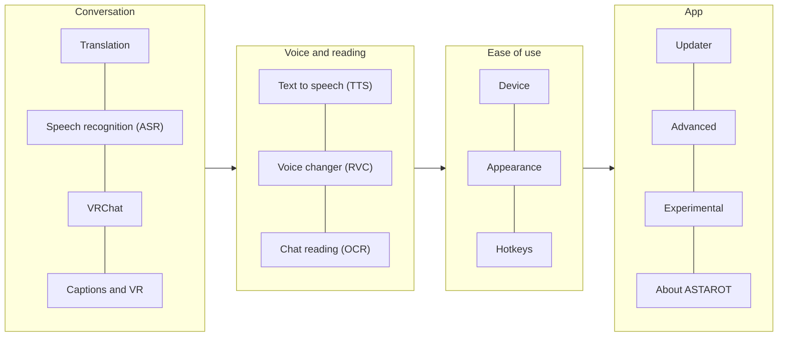
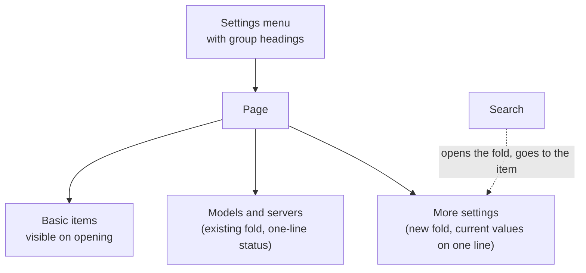
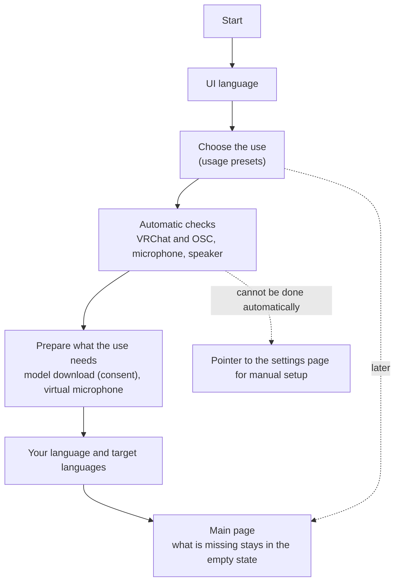
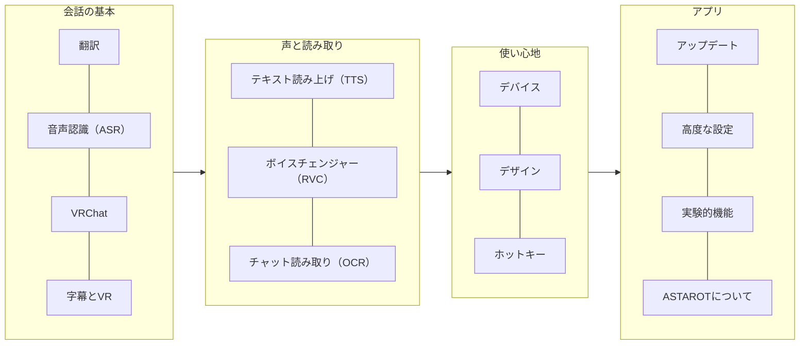
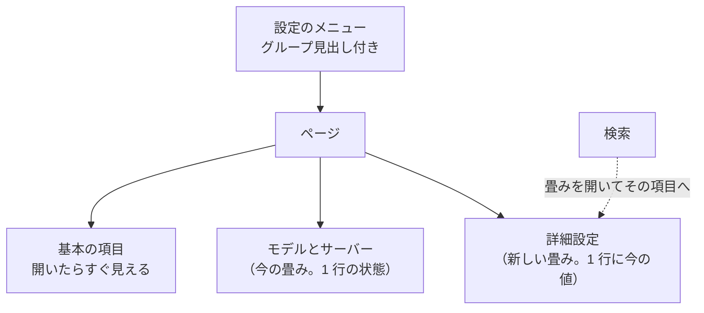
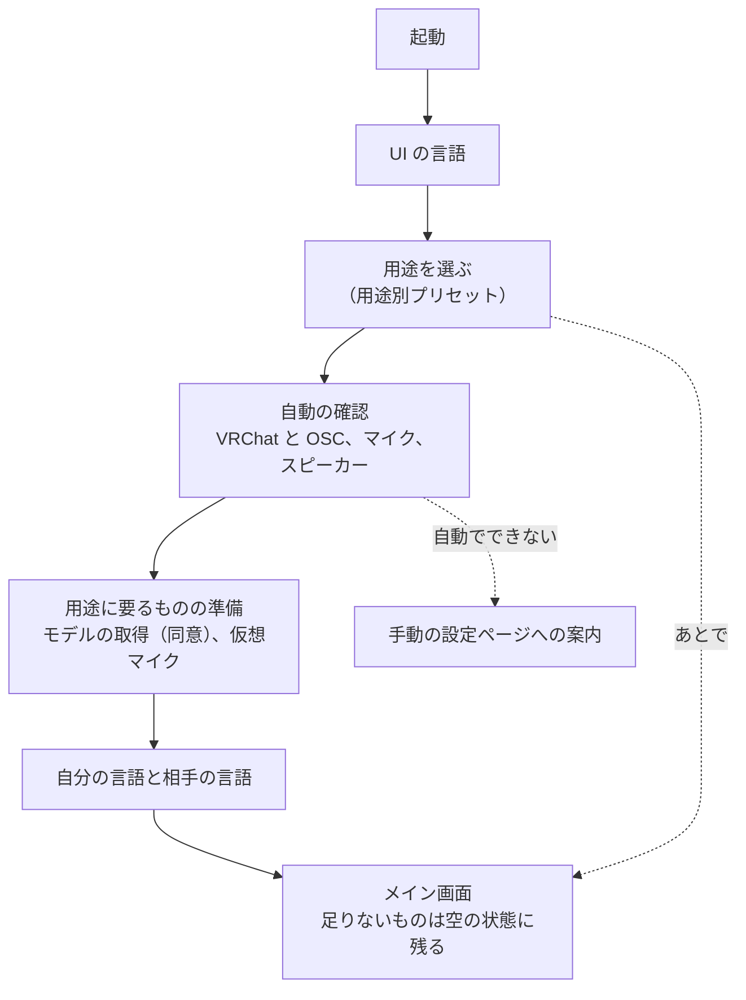

# Information architecture review (#554)

[日本語版](#情報設計の見直し554日本語版)

As features were added, the basic features, the advanced settings and the experimental features came to sit side by side with the same weight. This document is a design proposal for deciding what goes where. It removes no features. It reorganizes how they are shown and how users reach them.

- Status: the approach is decided (2026-11-18; only Q-08 is on hold). Stages 1 to 4 have been implemented. See [Decisions and implementation](#decisions-and-implementation) below.
- Scope: the main page, the settings screen and the first-run flow
- Out of scope: components and look (#452). This document covers only the layer of where information is placed.
- Linked work: #557 one-click initial setup, #537 button labels that state where the button leads, #515 the i18n quality gate

The inventory in this document was taken from the code on `develop` (`945951d2`).

## Current inventory

### Main page

| Place | Always shown | Shown only when needed |
|---|---|---|
| Rail (`main_function_switch/MainFunctionSwitch.jsx`) | 6 switches: Translation, Mic input, Listening, Chat reading (OCR), Text to speech (TTS) and Voice changer (RVC). Beside each switch, a button that opens its settings page | A switch whose setup is incomplete, grayed out, with the reason |
| Rail (`language_settings/`) | 3 language presets, your language, target languages (up to 3), swap, translator choice | In a narrow window, the icon rail and the language pair |
| Top bar (`top_bar/`) | Stop speech, Mute, Help, Quick settings | The update notice, the inputs and outputs panel (`io_flow`), the realtime captions controls (`realtime_controls/`) |
| Quick settings | Always on top, VRC mic mute sync, subtitle overlay, VRChat and OSC detection | — |
| Conversation | Log, composer, send button | The guidance shown when it is empty and the list of missing models (`setupNeeds.ts`), the character count warning, the log display settings |

The 6 switches always appear at the same size and in the same order. Besides speech recognition, translation and captions, which #554 treats as the basics, OCR, TTS and RVC are lined up with the same weight.

### Settings

The menu on the left has 14 tabs (`config_page/sidebar_section/SidebarSection.jsx`). The table lists them in the current display order. There is only one separator, before "About ASTAROT".

| # | Tab | Main contents (in heading order) | Folded parts |
|---|---|---|---|
| 1 | Device | Audio route, microphone (host, device, auto select, sensitivity mode VAD/automatic/manual and threshold, VRC mic mute sync), speaker (device, threshold) | None |
| 2 | Appearance | Display (UI language, UI size, log font size, font, transparency), send buttons (style, resend button, clear the composer after sending), reading aids (hiragana, romaji) | None |
| 3 | Translation | AI translation (local models and compute device), external translation APIs (DeepL, Google Cloud, Papago, Plamo, Gemini, OpenAI, OpenAI-compatible, Groq, OpenRouter), local LLMs (LM Studio, Ollama) | Models and servers. Each provider is folded into one line, and only the one in use is open |
| 4 | Speech recognition (ASR) | Engine choice, cloud engines, microphone (word filter, timing), speaker (timing), realtime captions (server, model, device, vocabulary), the bundled speech.cpp server (recognition, VAD and diarization models), old Whisper weights (only while they remain) | Timing; servers and models |
| 5 | VRChat | Presence readout, chatbox (send, send only the translation, notification sound, also send received messages, mic mute sync), message format, OSC (IP, port), audio route, TTS output, a pointer to chat reading | None |
| 6 | Chat reading (OCR) | State, language to read, required models, detection (detector, area, chatbox filter), performance (window name, interval, confidence, minimum number of characters) | Performance |
| 7 | VR | VR overlay (single line / multiple lines, enable, position, rotation, transparency, scale, display time), common settings (show only the translation, voice input mode), font, desktop captions, the VR UI marked as a beta feature | None |
| 8 | Hotkeys | Quick Chat, toggles (show the window, translation, mic input, listening), voice (stop, mute, TTS, RVC) | None |
| 9 | Text to speech (TTS) | Engine (speech.cpp, COEIROINK), voice, generation settings (seed, instructions), monitor, output and the virtual microphone guide (Windows), the bundled speech.cpp servers (Japanese, multilingual) | Models and servers |
| 10 | Voice changer (RVC) | RVC model choice, runtime download, model download, worker settings | Models and servers |
| 11 | Advanced | Logs (auto save), config file (open the folder), usage data, WebSocket (host, TLS, port, URL, token), input forwarding, OBS browser source (URL, port, number of messages shown, display time, text size and color, outline) | The input forwarding server |
| 12 | Experimental | Hexagram overlay (edge, monitor) | None |
| 13 | Updater | Version and state, check, install, release page | None |
| 14 | About ASTAROT | Overview, upstream VRCT, links, acknowledgments | None |

Counting the rows you can operate (settings, action buttons, links), the 13 tabs other than "About ASTAROT" have about 240 rows. The largest are speech recognition (about 42 rows), TTS (about 40 rows), then translation, VR and Advanced (about 25 rows each). The count includes rows that appear only under a condition and rows inside folds.

Settings have a search field that finds items on every tab (`search_bar/SearchBar.jsx`). Choosing a result opens the folds around the item (`
`) and moves to it (`logics/configs/config_page_setter/_aux/useConfigSearch.ts`).

Besides the settings screen, the VR UI has a settings window of its own. It shows part of Device, Appearance, Translation, Speech recognition, VRChat and VR (`views/vr/VrSettingsWindow.tsx`).

### First-run guidance

There is no first-run setup flow (wizard). The first-run guidance is not gathered in one place either. The items below appear separately, each when the situation calls for it (the controllers in `App.jsx`).

| Guidance | When it appears |
|---|---|
| The usage data notice (`TelemetryNoticeController`) | The first start |
| Choosing a speech recognition engine and consenting (`TranscriptionConsentController`) | When mic input or listening is turned on while no engine is chosen |
| Downloading a translation model (`TranslationSetupController`) | When translation is used while the local translation model is missing |
| Preparing chat reading (`OcrSetupController`) | When OCR is turned on while its models are missing |
| The virtual microphone guide (`VirtualMicGuideController`, Windows) | When no virtual cable is found at startup (after the two notices above). It also opens from buttons on the TTS and VRChat pages |
| The local speech recognition migration notice (`LocalAsrNoticeController`) | After an update from an earlier version (once) |
| The conversation's empty state | While there is no conversation. It lists the missing models and the steps to enable OSC |

## Observed problems

| ID | Problem | Evidence |
|---|---|---|
| IA-01 | There are 14 tabs, and their order does not follow the order of use. Device comes first, and TTS and RVC are near the end. There are no group headings either. | `SidebarSection.jsx` |
| IA-02 | "Advanced" holds things of different kinds. Logs, the settings folder, usage data, integrations with other software (WebSocket, OBS) and a voice feature (input forwarding) share one page. | `AdvancedSettings.jsx` |
| IA-03 | The same setting appears in several places. VRC mic mute sync appears in three: Device, VRChat and quick settings. The audio route appears on Device and VRChat, and a summary of it also appears on TTS, RVC and Advanced. The TTS output appears on TTS and VRChat, and the log font size on Appearance and in the conversation. The placement is intended, but the screen does not show which place is the setting's home. | `Vrchat.jsx`, `Device.jsx` |
| IA-04 | Beta features are not gathered on the Experimental page. The VR UI sits on the VR page, marked "Beta feature". | `vr_ui_beta` in `Vr.jsx` |
| IA-05 | On some pages, basic items and items you set once and leave sit side by side with the same weight. Device, Appearance, VRChat, VR and Hotkeys have no folded parts. | The "Folded parts" column of the table above |
| IA-06 | The 6 switches on the main page sit side by side with the same weight, whether they are used or not. | `MainFunctionSwitch.jsx` |
| IA-07 | The first-run guidance has no order and no overview. No single place shows what is done and what is left. | The controllers in `App.jsx` |
| IA-08 | Some buttons that move to another page do not say so in their labels. | #537 |

## Classification axes

Items are sorted along 2 axes. The first is how far forward an item is brought (depth). The second is what the feature is for (feature cluster).

### Depth (4 levels)

| Level | Meaning | Placement |
|---|---|---|
| Basic | What a first-time user needs to use speech recognition, translation and captions | Visible as soon as the page opens |
| Tuning | What you change to fit how you use the app; what you set once and leave | In the "More settings" fold on the page. The fold's line shows the current values |
| Experimental | Features that have not yet passed their checks and graduated. Off by default | Only on the "Experimental" page |
| Integration and maintenance | Integration with other software, logs, the settings file | On the "Advanced" page |

Every item, at every level, can be found with the settings search. The depth that #554 asks for, "not noticed until opened, but found when searched for", is met by combining folds with search.

### Feature clusters (groups in the settings menu)

The menu is split into 4 groups in the order a conversation uses them. Each group gets a heading.

- The proposal renames "VR" to "Captions and VR", because most of what the page holds is how captions are shown ([Open questions](#open-questions) Q-04).
- Device includes basic items that are needed when choosing a microphone. But the first-run flow (#557) decides the first setup, so the proposal puts Device under "Ease of use" in the menu (Q-03).

### Proposed classification of each item

The proposal puts "Basic" items in view and "Tuning" items in the "More settings" fold. ✱ marks an item that the proposal moves from where it is now.

| Page | Basic | Tuning | Experimental / integration and maintenance |
|---|---|---|---|
| Translation | Local translation model download and state, the translation catalog (adding your own models and APIs; #413; moved by #597 to the end of the page, outside the fold) | Compute device, external translation APIs, local LLMs | — |
| Speech recognition (ASR) | Engine choice, the speech.cpp system (recognition and VAD model download and state), the API system (a fold and a key for each provider; moved from Tuning by #414) | Word filter, timing, the realtime captions server and vocabulary, speaker diarization | Old Whisper weights (only while they remain; unchanged) |
| VRChat | Presence readout, send to the chatbox, send only the translation | Notification sound, also send received messages, mic mute sync, message format, the audio route and the TTS output (made into pointers to their home ✱) | OSC IP and port (to integration and maintenance ✱; Q-06) |
| Captions and VR | Enabling the VR overlay, enabling desktop captions | Position, rotation, transparency, scale, display time, font, show only the translation, voice input mode | VR UI (to Experimental ✱; Q-05) |
| TTS | Engine, voice, output (including the virtual microphone guide), model download | Generation settings, monitor, server device | — |
| RVC | Model choice, runtime and model download | Worker settings | — |
| OCR | State, language to read, model download | Detector, area, filter, performance | — |
| Device | Microphone, speaker | Sensitivity mode and threshold, audio route | — |
| Appearance | UI language, UI size | Log font size, font, transparency, send buttons, reading aids | — |
| Hotkeys | Stop and mute | Everything else | — |
| Advanced | Usage data (its place is Q-08) | Input forwarding (to the RVC page ✱; Q-07) | Logs, settings folder, WebSocket, OBS browser source |

## Usage presets (narrowing what is shown)

### Concept

When you choose a use, only the features and settings that use needs are shown in front. No setting value changes. This is different from profile switching (switching a whole set of settings), which was set aside earlier.

The presets keep these 4 rules:

1. Values do not change. Choosing or switching a preset does not turn features on or off, and does not change devices, the audio route or models. It does not open the microphone either.
2. What is running is not hidden. The switch of a feature that is on appears in every preset. The way to stop it never goes out of sight. Stop and mute always appear.
3. Hidden settings can still be found by looking. The search and "Everything" reach them. A page opened from a search result shows all its items, whatever the preset.
4. Only the display is chosen. What is saved is one UI value that stands for the chosen use (the key's name and format are decided at implementation; Q-11).

### Candidate uses

| Use | Intended way of using the app | Switches on the main page | Pages shown in the settings menu |
|---|---|---|---|
| Basic (default) | Recognize and translate your own voice, and show it in captions and the chatbox | Translation, Mic input, Listening | Translation, Speech recognition, VRChat, Captions and VR, Device |
| Nonverbal | Talk in text without speaking. Read others' voices and chat | Translation, Listening, TTS, Chat reading | Translation, Speech recognition, VRChat, Captions and VR, TTS, OCR |
| Multilingual conversation | Talk by voice with people of several languages | Translation, Mic input, Listening, TTS | Translation, Speech recognition, VRChat, Captions and VR, TTS |
| Voice changer (RVC) | Talk in a changed voice. Translation is optional | RVC, Translation, Mic input | RVC, Device, VRChat, Translation |
| Everything | Same as now | All 6 | All 14 pages |

- The "App" group (Updater, Advanced, Experimental, About ASTAROT), Appearance and Hotkeys appear for every use.
- Using TTS with Nonverbal needs the audio route and the virtual microphone guide. The proposal puts them on the TTS page, so it does not show the Device page.

### Assessment

| Aspect | Assessment |
|---|---|
| First-time users | Choosing one use is enough to remove the features they do not need. This fits the aim of #554. |
| Experienced users | Choosing "Everything" gives the same view as now. |
| Safety | Values do not change, so switching presets cannot cause accidents such as a changed audio route or microphone. |
| Cost | The UI holds one table of which item belongs to which use. Each new feature needs that table updated (Q-12). |
| Clarity | If users cannot guess what a use contains from its name, the presets confuse them instead. Users need to try the names and descriptions. |
| Several uses | Some people use both, such as "Nonverbal" and "Voice changer (RVC)". Whether to allow one choice only or several is undecided (Q-09). |

## Progressive disclosure design

### On the main page

- Stop, mute, the composer, send and the language settings always appear, whatever the use.
- The switches are narrowed to fit the use. A switch that is on always appears (rule 2 of the rules above).
- To show the hidden switches, one "Other features" row sits under the row of switches. Pressing it opens the hidden switches in place. It changes no setting (Q-10).
- Quick settings, the inputs and outputs panel and the realtime captions controls stay as they are.

### In settings

- Each page runs in the order "basic items → Models and servers → More settings". "More settings" is a fold of the same shape as the existing "Models and servers" fold (`SetupSection`), so no component is added.
- The fold's line shows how many values were changed, or the main values. You can tell that something differs from the default without opening the fold.
- An item with unsaved changes marks the fold's line even when it is inside the fold (the same rule as the save bar's mark today).
- If the item chosen in a search is inside a fold, the fold opens first and then the page moves to the item. The search today opens native `
`, so if "More settings" is built with `
` too, the existing mechanism reaches it unchanged.
- For a setting that appears on several pages (IA-03), one page is decided as its home. The other pages carry only a button that says where it leads (the form from #537).

### Gathering experimental features

- Whatever is marked "Beta feature" or "Experiment" is gathered on the Experimental page. Today that is the VR UI (Q-05).
- Every item on the Experimental page stays off by default. It uses the existing `EXPERIMENTAL_FEATURES` framework (the section on experimental features in `docs/spec/cross-cutting.md`). Whether the VR UI goes into that framework is decided separately, because it needs a migration of saved values.

## First-run flow (linked with #557)

First-run setup is combined into one flow. What goes into the flow (automatic detection, installing a virtual microphone, model recommendations, volume adjustment) is built in #557. This document decides where in the flow to ask what, and what to leave to the settings afterward.

### What the first run asks and what is changed later

| Item | Asked at the first run | Changed later in settings |
|---|---|---|
| UI language | Asked | Appearance |
| Use | Asked ("later" can be chosen) | Top of the settings menu, or Appearance (Q-13) |
| Usage data | The existing notice goes into the flow | Advanced |
| Microphone and speaker | Chosen automatically; only the result is shown | Device |
| VRChat and OSC | Checked automatically; if it is off, the steps are shown | VRChat |
| Speech recognition engine | Only when the use needs the microphone or listening. Includes consent | Speech recognition (ASR) |
| Model download | Only what the use needs. The size and license are shown and consent is asked | "Models and servers" on each page |
| Virtual microphone | Only when the use needs TTS or RVC (Windows) | TTS, RVC |
| Your language and target languages | Asked | The language settings on the main page |
| Caption position, hotkeys, appearance, translation APIs | Not asked | Each page |

### Rules for the flow

- The first-run flow, too, does not open the microphone, download models, send messages or change the audio route until the user presses a button (`PRODUCT.md`).
- Any step can be left with "later". After leaving, what is missing still stays in the conversation's empty state (the existing `setupNeeds.ts` mechanism).
- The guidance that now appears separately ([First-run guidance](#first-run-guidance)) is not shown for what the flow has finished. Users who left the flow see it in the same situations as now.

## How to proceed

Following #554's "do not go straight into implementation", implementation starts after this document settles the approach. After each stage, check that the app can be used with the basic features alone.

| Stage | Contents | Change in behavior |
|---|---|---|
| 0 | Decide the classification and the approach in this document | None |
| 1 | Group headings and a new order in the settings menu, buttons that say where they lead (#537), sorting out duplicated settings | Display only |
| 2 | A "More settings" fold on each page, search that opens folds | Display only |
| 3 | Gathering experimental features (VR UI) | Needs a migration of saved values |
| 4 | Usage presets (narrowing the settings menu and the main page) | Display only. One UI value is saved |
| 5 | First-run flow (together with #557) | A new flow |

Proposed check: ask people using the app for the first time to "translate what you say into the microphone into English and show it in the VRChat chatbox" and to "caption the other person's voice", then record where they got lost and how many pages they opened. Prepare one task of the same form for each of the other uses too.

The stages that change wording (1, 2, 4, 5) update `locales/en.yml` and `locales/ja.yml` and pass the #515 quality gate.

## Open questions

These points need a decision. This document does not decide them.

| ID | Question | This document's proposal |
|---|---|---|
| Q-01 | Whether depth has 4 levels, or 3 with "Integration and maintenance" merged into "Tuning" | 4 levels |
| Q-02 | Whether the settings menu has 4 groups, and the groups' names | Conversation, Voice and reading, Ease of use, App |
| Q-03 | Whether Device goes under "Conversation" or "Ease of use" | Ease of use (because the first-run flow decides it) |
| Q-04 | Whether to rename the "VR" page to "Captions and VR". If it is renamed, the main page's switch, the hotkeys and the user guide take the same name | Rename |
| Q-05 | Whether to move the VR UI (the VR UI beta) to Experimental. If it moves, the value of users who have it on is carried over | Move |
| Q-06 | Whether to keep the OSC IP and port on the VRChat page or return them to Advanced | To Advanced. The VRChat page keeps only the presence readout and the steps |
| Q-07 | Whether to move input forwarding from Advanced to the RVC page (or Device) | To "More settings" on the RVC page |
| Q-08 | Where usage data goes: stay in Advanced, or become a privacy item of its own | Undecided. Decided together with the privacy explanation (#564) |
| Q-09 | Whether to choose one use only or several | Several (the union is shown) |
| Q-10 | How the main page shows hidden switches (an "Other features" row, the settings menu only, and so on) | An "Other features" row |
| Q-11 | Where the chosen use is saved: a key in the settings file, or storage in the UI only | A key in the settings file. Update the list of IPC and setting keys (`docs/spec/reference/`) |
| Q-12 | Where to keep the table that maps items to uses (a UI constant, the spec) | One UI constant, referenced from the spec |
| Q-13 | Where the use is changed later | The top of the settings menu |
| Q-14 | The names of the uses (whether users understand "Nonverbal"; the English names) | Decide after users try them |
| Q-15 | The default use. How to treat people who chose nothing in the first-run flow and people who updated from an earlier version | New users get "Basic". Users who updated get "Everything" (keeping the same look as now) |

## Decisions and implementation

### Decisions (2026-11-18)

Of Q-01 to Q-15 in [Open questions](#open-questions), all except Q-08 were decided as the table's "This document's proposal" column says (comments on #554). Q-08 (where usage data goes) is decided together with the privacy explanation (#564). Until then it stays where it is now, in "Advanced".

### What was implemented

Stages 1 to 4 of [How to proceed](#how-to-proceed) have been implemented. Stage 5 (the first-run flow) is built in #557.

| Stage | Implementation |
|---|---|
| 1 | Split the settings menu into 4 groups with headings (`src-ui/logics/configs/settingsMenu.ts`). Settings open on the first page, "Translation". Renamed "VR" to "Captions and VR" and updated the user guide to match. Returned the OSC IP and port to "Advanced", and put the presence readout and a row with a button that says where it leads on the VRChat page. The audio route and the TTS output, which were on the VRChat page, and VRC mic mute sync, which was on the Device page, are now only on their home pages; the other pages have a row with a button that says where it leads (`PagePointer`) |
| 2 | Put a "More settings" fold (`AdvancedSection`) on each page. The fold's line shows the main values. When a row inside the fold has unsaved changes, the fold's line is marked too. Search and the buttons that say where they lead open the fold and move to the item (`revealSetting.ts`). Moved input forwarding to "More settings" on the RVC page |
| 3 | Moved the VR UI switch and the button that brings back the launcher to the "Experimental" page. Put a row with a button that says where it leads on the "Captions and VR" page |
| 4 | Added usage presets. The table is in `src-ui/logics/configs/usagePresets.ts`, and the choice is saved in the setting key `USAGE_PRESETS` ([spec](../../spec/cross-cutting.md#用途別プリセット)). The uses are chosen at the top of the settings menu. The main page's switches are narrowed by use, and the hidden ones are shown with the "Other features" row |

### Changes from this document's proposal

- The fold's line shows not "the number of changed values" but main values chosen for each page (on or off, counts, seconds and so on). The UI does not hold the default values of many settings, so it cannot count the changes correctly.
- The VR UI was not put in the `EXPERIMENTAL_FEATURES` dictionary. It is listed on the Experimental page with its existing saved value `OVERLAY_VR_PANEL`. The saved form does not change, so the value of users who had it on carries over as it is. Putting it in the dictionary needs a rewrite of the VR overlay processing and a check on real SteamVR hardware, so that is decided separately.
- The TTS page's "More settings" is inside the TTS settings form, so the save bar can save it together with the rest of the form. That puts it above "Models and servers".
- The worker settings on the RVC page stay in their existing fold (inside the RVC form). "More settings" holds input forwarding.
- On the "Captions and VR" page, turning on the VR captions became 2 checkboxes in view, single line and multiple lines, and "Enable" was removed from the position and look editing.
- During startup (before the use value arrives), the main page shows all 6 switches, and once the value arrives it reduces them to fit the use. Hiding switches before the use value arrives would make the switches of users who updated look as if they had disappeared.
- On the speech recognition page, #414 split the engines into 2 systems, the same idea as the translation catalog (#413). Under the engine choice come "On your PC (speech.cpp)" (Models and servers) and "API (cloud or your own server)" (a fold for each provider), in that order. The cloud engines moved from "More settings" to the API system. Whether an engine can be chosen depends on registering its key, so it is easier to understand right under the engine choice. Realtime captions are set once and left alone, so they stay in "More settings". Their "External server" is a speech.cpp server running on your PC (loopback addresses only), so it belongs to the speech.cpp system, not the API system.
- The "Translation catalog" on the Translation page (#413) was taken out of the "More settings" fold by #597 and placed as a section of its own at the end of the page, after the fold. This keeps the models and APIs users added from being hidden in the fold. The fold's heading line shows only the numbers of external translation APIs and local LLMs, so it also no longer disagrees with the fact that it does not count the added entries.

### What remains

- The names and descriptions of the uses are provisional. They are decided after users try them (Q-14).
- The check of "whether the app can be used with the basic features alone without getting lost" (the proposed check in [How to proceed](#how-to-proceed)) has not been done yet.
- The user guide's screenshots (`site/public/screenshots/`) have not been retaken to match the screen changes.
- Choosing the use in the first-run flow (stage 5, #557) is added in #557.

---

# 情報設計の見直し（#554）（日本語版）

機能が増え、基本の機能と高度な設定と実験的な機能が同じ重さで並んでいます。この文書は何をどこに置くかを決めるための設計案です。機能は減らしません。見せ方と届け方を整理します。

- 状態: 方針は決定済み（2026-11-18。Q-08 だけ保留）。段 1〜4 を実装しました。下の[決定と実装](#決定と実装)を見てください。
- 対象: メイン画面、設定画面、初回の導線
- 対象外: 部品と見た目（#452）。この文書は情報の置き方の層だけを扱います。
- 連動: #557 ワンクリック初期設定、#537 遷移先を明記するボタンのラベル、#515 i18n の品質ゲート

この文書の棚卸しは `develop`（`945951d2`）のコードから作りました。

## 現状の棚卸し

### メイン画面

| 場所 | 常に出るもの | 必要なときだけ出るもの |
|---|---|---|
| サイドバー（`main_function_switch/MainFunctionSwitch.jsx`） | 6 つのスイッチ: 翻訳、マイク入力、聞き取り、チャット読み取り（OCR）、テキスト読み上げ（TTS）、ボイスチェンジャー（RVC）。各スイッチの横に、設定ページを開くボタン | 準備が足りないスイッチの灰色表示と理由 |
| サイドバー（`language_settings/`） | 言語のプリセット 3 つ、自分の言語、相手の言語（最大 3 つ）、入れ替え、翻訳エンジンの選択 | 狭いウィンドウでは、アイコンの列と言語の組の表示 |
| 上部バー（`top_bar/`） | 読み上げを停止、ミュート、ヘルプ、クイック設定 | アップデートの通知、入力と出力のパネル（`io_flow`）、リアルタイム字幕の操作（`realtime_controls/`） |
| クイック設定 | 最前面固定、VRChat のマイクミュート同期、字幕オーバーレイ、VRChat と OSC の検出 | — |
| 会話欄 | ログ、入力欄、送信ボタン | 空のときの案内と、足りないモデルの一覧（`setupNeeds.ts`）、文字数の警告、ログの表示設定 |

6 つのスイッチは同じ大きさと同じ並びで常に出ます。#554 が基本とする音声認識、翻訳、字幕のほかに、OCR、TTS、RVC も同じ重さで並んでいます。

### 設定画面

左のメニューには 14 個のタブがあります（`config_page/sidebar_section/SidebarSection.jsx`）。並びは今の表示順です。区切りは「ASTAROTについて」の前の 1 か所だけです。

| # | タブ | 主な中身（見出しの順） | 畳んである部分 |
|---|---|---|---|
| 1 | デバイス | 音声経路、マイク（ホスト、デバイス、自動選択、感度の方式 VAD／自動／手動としきい値、VRC マイクミュート同期）、スピーカー（デバイス、しきい値） | なし |
| 2 | デザイン | 表示（UI 言語、UI サイズ、ログの文字サイズ、フォント、透明度）、送信ボタン（形式、再送ボタン、送信後に入力欄を消す）、読みの補助（ひらがな、ローマ字） | なし |
| 3 | 翻訳 | AI 翻訳（ローカルのモデルと計算装置）、外部の翻訳 API（DeepL、Google Cloud、Papago、Plamo、Gemini、OpenAI、OpenAI 互換、Groq、OpenRouter）、ローカルの LLM（LM Studio、Ollama） | モデルとサーバー。プロバイダはそれぞれ 1 行に畳み、使っているものだけ開く |
| 4 | 音声認識（ASR） | エンジンの選択、クラウドのエンジン、マイク（単語フィルタ、タイミング）、スピーカー（タイミング）、リアルタイム字幕（サーバー、モデル、装置、語彙）、同梱 speech.cpp サーバー（認識、VAD、話者分離のモデル）、古い Whisper の重み（残っているときだけ） | タイミング、サーバーとモデル |
| 5 | VRChat | 在席の表示、チャットボックス（送る、翻訳だけ送る、通知音、受け取ったメッセージも送る、マイクミュート同期）、メッセージの形式、OSC（IP、ポート）、音声経路、TTS の出力先、チャット読み取りへの案内 | なし |
| 6 | チャット読み取り（OCR） | 状態、読み取る言語、必要なモデル、検出（検出器、範囲、チャットボックスのフィルタ）、性能（ウィンドウ名、間隔、信頼度、最短の文字数） | 性能 |
| 7 | VR | VR オーバーレイ（1 行／複数行、有効化、位置、回転、透明度、拡大、表示時間）、共通の設定（翻訳だけ表示、音声入力モード）、フォント、デスクトップ字幕、VR UI（β版機能）の VR パネル | なし |
| 8 | ホットキー | Quick Chat、切り替え（ウィンドウの表示、翻訳、マイク入力、聞き取り）、音声（停止、ミュート、TTS、RVC） | なし |
| 9 | テキスト読み上げ（TTS） | エンジン（speech.cpp、COEIROINK）、声、生成の設定（シード、指示）、モニター、出力先と仮想マイクの案内（Windows）、同梱 speech.cpp サーバー（日本語、多言語） | モデルとサーバー |
| 10 | ボイスチェンジャー（RVC） | RVC モデルの選択、実行環境の取得、モデルの取得、ワーカーの設定 | モデルとサーバー |
| 11 | 高度な設定 | ログ（自動保存）、設定ファイル（フォルダを開く）、利用状況の送信、WebSocket（ホスト、TLS、ポート、URL、トークン）、入力音声の転送、OBS ブラウザソース（URL、ポート、表示件数、表示時間、文字の大きさと色、縁取り） | 入力音声の転送のサーバー |
| 12 | 実験的機能 | 六芒星のオーバーレイ（端、モニター） | なし |
| 13 | アップデート | 版と状態、確認、インストール、リリースのページ | なし |
| 14 | ASTAROTについて | 概要、上流 VRCT、リンク、謝辞 | なし |

操作できる行（設定、操作のボタン、リンク）を数えると、「ASTAROTについて」を除く 13 タブで約 240 行あります。多いのは音声認識（約 42 行）、TTS（約 40 行）、翻訳、VR、高度な設定（それぞれ約 25 行）です。条件で出る行と、畳みの中の行も含めています。

設定には検索欄があり、すべてのタブの項目を探せます（`search_bar/SearchBar.jsx`）。結果を選ぶと、まわりの畳み（`
`）を開いてその項目へ移ります（`logics/configs/config_page_setter/_aux/useConfigSearch.ts`）。

設定画面のほかに、VR パネルの中にも設定の窓があります。そこにはデバイス、デザイン、翻訳、音声認識、VRChat、VR の一部が出ます（`views/vr/VrSettingsWindow.tsx`）。

### 初回に出る案内

初回の設定の流れ（ウィザード）はありません。初回の案内もひとまとまりになっていません。必要になった場面で、次のものがばらばらに出ます（`App.jsx` のコントローラ）。

| 案内 | 出る場面 |
|---|---|
| 利用状況の送信のお知らせ（`TelemetryNoticeController`） | 最初の起動 |
| 音声認識エンジンの選択と同意（`TranscriptionConsentController`） | エンジンが未選択のまま、マイク入力か聞き取りをオンにしたとき |
| 翻訳モデルの取得（`TranslationSetupController`） | ローカル翻訳のモデルがないまま翻訳を使うとき |
| チャット読み取りの準備（`OcrSetupController`） | OCR のモデルがないままオンにしたとき |
| 仮想マイクの案内（`VirtualMicGuideController`、Windows） | 起動したときに仮想ケーブルが見つからないとき（上の 2 つのお知らせのあと）。TTS と VRChat のページのボタンからも開く |
| ローカル音声認識の移行のお知らせ（`LocalAsrNoticeController`） | 前の版から更新したとき（1 回だけ） |
| 会話欄の空の状態 | 会話がない間。足りないモデルと、OSC を有効にする手順 |

## 見えている問題

| ID | 問題 | 根拠 |
|---|---|---|
| IA-01 | タブが 14 個あり、並びが使う順になっていません。デバイスが先頭で、TTS と RVC は後ろのほうにあります。グループの見出しもありません。 | `SidebarSection.jsx` |
| IA-02 | 「高度な設定」に性質の違うものが同居しています。ログ、設定フォルダ、利用状況の送信、外部連携（WebSocket、OBS）、音声の機能（入力音声の転送）が 1 ページにあります。 | `AdvancedSettings.jsx` |
| IA-03 | 同じ設定が複数の場所に出ます。VRC マイクミュート同期はデバイス、VRChat、クイック設定の 3 か所に出ます。音声経路はデバイスと VRChat に出て、TTS、RVC、高度な設定にもその要約が出ます。TTS の出力先は TTS と VRChat に、ログの文字サイズはデザインと会話欄に出ます。意図した配置ですが、どちらが本来の置き場所かが画面からは分かりません。 | `Vrchat.jsx`、`Device.jsx` |
| IA-04 | β 版の機能が実験的機能のページに集まっていません。VR パネルは VR ページの中で「β版機能」と書いて置かれています。 | `Vr.jsx` の `vr_ui_beta` |
| IA-05 | 1 つのページの中で、基本の項目と一度決めたら触らない項目が同じ重さで並ぶページがあります。デバイス、デザイン、VRChat、VR、ホットキーには畳む部分がありません。 | 上の表の「畳んである部分」 |
| IA-06 | メイン画面の 6 つのスイッチが、使うかどうかに関係なく同じ重さで並びます。 | `MainFunctionSwitch.jsx` |
| IA-07 | 初回の案内に順番と全体像がありません。何が済んでいて、何が残っているかを 1 か所で見られません。 | `App.jsx` のコントローラ |
| IA-08 | ほかのページへ移るボタンが、移ることをラベルで示していないものがあります。 | #537 |

## 分類の軸

項目を 2 つの軸で分けます。1 つ目の軸は「どのくらい表に出すか」（深さ）、2 つ目の軸は「何のための機能か」（機能の塊）です。

### 深さ（4 段階）

| 段階 | 意味 | 置き方 |
|---|---|---|
| 基本 | 初めての利用者が、音声認識、翻訳、字幕を使うのに要るもの | ページを開いたらすぐ見える |
| 応用 | 使い方に合わせて変えるもの。一度決めたら触らないもの | ページの中の「詳細設定」の畳みに入れる。畳みの行には今の値を出す |
| 実験的 | 確認を終えて卒業するまでの機能。既定はオフ | 「実験的機能」のページだけに置く |
| 連携と保守 | 外部のソフトとの連携、記録、設定ファイル | 「高度な設定」のページに置く |

どの段階の項目も、設定の検索で見つかるようにします。「開くまで存在を意識させないが、探せば見つかる深さ」（#554）は、畳みと検索の組み合わせで満たします。

### 機能の塊（設定のメニューのグループ）

メニューを会話で使う順の 4 つのグループに分けます。グループには見出しを付けます。

- 「VR」は中身がほとんど字幕の表示なので「字幕とVR」に改める案です（[残課題](#残課題) Q-04）。
- デバイスはマイクを選ぶ場面で要る基本の項目を含みます。ただし最初の設定は初回の導線（#557）が決めるので、メニューでは「使い心地」に置く案にしています（Q-03）。

### 項目ごとの分類案

「基本」は表に、「応用」は詳細設定の畳みに入れる案です。✱ は今の置き場所から移す案です。

| ページ | 基本 | 応用 | 実験的／連携と保守 |
|---|---|---|---|
| 翻訳 | ローカルの翻訳モデルの取得と状態、翻訳のカタログ（自分のモデルと API の追加。#413。#597 で畳みの外のページの最後に移した） | 計算装置、外部の翻訳 API、ローカルの LLM | — |
| 音声認識（ASR） | エンジンの選択、speech.cpp 系（認識モデルと VAD モデルの取得と状態）、API 系（プロバイダごとの畳みとキー。#414 で応用から移した） | 単語フィルタ、タイミング、リアルタイム字幕のサーバーと語彙、話者分離 | 古い Whisper の重み（残っているときだけ。今のまま） |
| VRChat | 在席の表示、チャットボックスに送る、翻訳だけ送る | 通知音、受け取ったメッセージも送る、マイクミュート同期、メッセージの形式、音声経路と TTS の出力先（本来の置き場所への案内にする ✱） | OSC の IP とポート（連携と保守へ ✱。Q-06） |
| 字幕とVR | VR オーバーレイの有効化、デスクトップ字幕の有効化 | 位置、回転、透明度、拡大、表示時間、フォント、翻訳だけ表示、音声入力モード | VR パネル（実験的機能へ ✱。Q-05） |
| TTS | エンジン、声、出力先（仮想マイクの案内を含む）、モデルの取得 | 生成の設定、モニター、サーバーの装置 | — |
| RVC | モデルの選択、実行環境とモデルの取得 | ワーカーの設定 | — |
| OCR | 状態、読み取る言語、モデルの取得 | 検出器、範囲、フィルタ、性能 | — |
| デバイス | マイク、スピーカー | 感度の方式としきい値、音声経路 | — |
| デザイン | UI 言語、UI サイズ | ログの文字サイズ、フォント、透明度、送信ボタン、読みの補助 | — |
| ホットキー | 停止とミュート | そのほか全部 | — |
| 高度な設定 | 利用状況の送信（置き場所は Q-08） | 入力音声の転送（RVC のページへ ✱。Q-07） | ログ、設定フォルダ、WebSocket、OBS ブラウザソース |

## 用途別プリセット（表示の絞り込み）

### 考え方

用途を選ぶと、その用途で使う機能と設定だけが表に出ます。設定の値は変えません。以前に見送ったプロファイル切り替え（設定一式の切り替え）とは別のものです。

守ることは次の 4 つです。

1. 値を変えません。プリセットを選んでも切り替えても、機能のオン・オフ、デバイス、音声経路、モデルは変わりません。マイクも開きません。
2. 動いているものは隠しません。オンの機能のスイッチは、どのプリセットでも出ます。止める手段が見えなくなることはありません。停止とミュートは常に出ます。
3. 隠した設定も、探せば見つかります。検索と「すべて表示」から届きます。検索の結果から開いたページは、プリセットに関係なく全部の項目を出します。
4. 選ぶのは表示だけです。保存するのは、選んだ用途を表す UI 用の値 1 つです（キーの名前と形式は実装のときに決めます。Q-11）。

### 用途の候補

| 用途 | 想定する使い方 | メイン画面のスイッチ | 設定のメニューで表に出すページ |
|---|---|---|---|
| 基本（既定） | 自分の声を認識して翻訳し、字幕とチャットボックスに出す | 翻訳、マイク入力、聞き取り | 翻訳、音声認識、VRChat、字幕とVR、デバイス |
| 無言勢向け | 声を出さずに、文字で話す。相手の声やチャットを読む | 翻訳、聞き取り、TTS、チャット読み取り | 翻訳、音声認識、VRChat、字幕とVR、TTS、OCR |
| 多言語会話向け | 複数の言語の相手と、声で会話する | 翻訳、マイク入力、聞き取り、TTS | 翻訳、音声認識、VRChat、字幕とVR、TTS |
| RVC 向け | 自分の声を変えて話す。翻訳は任意 | RVC、翻訳、マイク入力 | RVC、デバイス、VRChat、翻訳 |
| すべて表示 | 今と同じ | 6 つすべて | 14 ページすべて |

- 「アプリ」グループ（アップデート、高度な設定、実験的機能、ASTAROTについて）とデザイン、ホットキーは、どの用途でも出します。
- 無言勢向けで TTS を使うときは、音声経路と仮想マイクの案内が要ります。TTS のページに置くので、デバイスのページは出さない案にしています。

### 評価

| 観点 | 評価 |
|---|---|
| 初めての利用者 | 用途を 1 つ選ぶだけで、関係のない機能が消えます。#554 の目的に合います。 |
| 慣れた利用者 | 「すべて表示」を選べば今と同じです。 |
| 安全 | 値を変えないので、プリセットの切り替えで音声経路やマイクが変わる事故は起きません。 |
| 費用 | どの項目がどの用途に属するかの表を、UI に 1 つ持つことになります。機能を足すたびに表の更新が要ります（Q-12）。 |
| 分かりにくさ | 用途の名前から中身が想像できないと、かえって迷います。名前と説明を利用者に試してもらう必要があります。 |
| 複数の用途 | 「無言勢向け」と「RVC 向け」のように、両方を使う人がいます。1 つだけ選ぶ形にするか、複数を選べる形にするかは未決です（Q-09）。 |

## 段階的開示の設計

### メイン画面

- 停止、ミュート、入力欄、送信、言語の設定は、どの用途でも常に出します。
- スイッチは用途に合わせて絞ります。オンのスイッチは必ず出します（上の「守ること」の 2）。
- 隠したスイッチを出すために、スイッチの列の下に「ほかの機能」を 1 行置きます。押すと隠したスイッチがその場に開きます。設定は変えません（Q-10）。
- クイック設定、入力と出力のパネル、リアルタイム字幕の操作は今のままです。

### 設定画面

- 各ページの並びは「基本の項目 → モデルとサーバー → 詳細設定」にします。今の「モデルとサーバー」の畳み（`SetupSection`）と同じ形の畳みで「詳細設定」を作り、部品を増やしません。
- 畳みの行には、変えてある値の数か主な値を出します。開かなくても、既定から変えたことが分かるようにします。
- 保存されていない変更がある項目は、畳みの中にあっても畳みの行に印を出します（今の保存バーの印と同じ規則）。
- 検索で選んだ項目が畳みの中にあれば、畳みを開いてからその項目へ移ります。今の検索はネイティブの `
` を開くので、「詳細設定」も `
` で作れば今の仕組みのまま届きます。
- ページの間で重複している設定（IA-03）は、本来の置き場所を 1 つに決めます。ほかのページには、移る先を書いたボタン（#537 の形）だけを置きます。

### 実験的機能の集約

- 「β版機能」「実験」と書いてあるものは、実験的機能のページへ集めます。今の対象は VR パネルです（Q-05）。
- 実験的機能のページの項目は、どれも既定オフのままです。今の `EXPERIMENTAL_FEATURES` の枠組み（`docs/spec/cross-cutting.md` の「実験的機能」）を使います。VR パネルをこの枠組みに入れるかどうかは、保存済みの値の移行が要るので別に決めます。

## 初回の導線（#557 との連動点）

初回の設定を 1 つの流れにまとめます。流れの中身（自動の検出、仮想マイクの導入、モデルの推奨、音量の調整）は #557 が作ります。この文書が決めるのは、流れのどこで何を聞き、何を後の設定に任せるかです。

### 初回に聞くことと、後から変えること

| 項目 | 初回に聞く | 後から設定で変える |
|---|---|---|
| UI の言語 | 聞く | デザイン |
| 用途 | 聞く（あとで、を選べる） | 設定のメニューの上、またはデザイン（Q-13） |
| 利用状況の送信 | 今のお知らせを流れの中に入れる | 高度な設定 |
| マイクとスピーカー | 自動で選び、結果だけ見せる | デバイス |
| VRChat と OSC | 自動で確かめ、オフなら手順を出す | VRChat |
| 音声認識のエンジン | 用途がマイクや聞き取りを使うときだけ。同意を含む | 音声認識（ASR） |
| モデルの取得 | 用途に要るものだけ。サイズとライセンスを示して同意を得る | 各ページの「モデルとサーバー」 |
| 仮想マイク | 用途が TTS か RVC を使うときだけ（Windows） | TTS、RVC |
| 自分の言語と相手の言語 | 聞く | メイン画面の言語の設定 |
| 字幕の位置、ホットキー、デザイン、翻訳 API | 聞かない | 各ページ |

### 守ること

- 初回の流れも、利用者が押すまでマイクを開かず、モデルを取得せず、メッセージを送らず、音声経路を変えません（`PRODUCT.md`）。
- どの段でも「あとで」で抜けられます。抜けても、足りないものは会話欄の空の状態に残ります（今の `setupNeeds.ts` の仕組み）。
- 今ばらばらに出る案内（[初回に出る案内](#初回に出る案内)）は、流れの中で済んだものは出しません。流れを抜けた人には、今と同じ場面で出します。

## 進め方

#554 の「いきなり実装に入らない」に従い、この文書で方針が決まってから実装に移ります。どの段も、終えたら基本の機能だけで使えるかを確かめます。

| 段 | 中身 | 挙動の変化 |
|---|---|---|
| 0 | この文書で分類と方針を決める | なし |
| 1 | 設定のメニューのグループ見出しと並び替え、移る先を書いたボタン（#537）、重複した設定の整理 | 表示だけ |
| 2 | 各ページの「詳細設定」の畳み、検索から畳みを開く | 表示だけ |
| 3 | 実験的機能の集約（VR パネル） | 保存済みの値の移行が要る |
| 4 | 用途別プリセット（設定のメニューとメイン画面の絞り込み） | 表示だけ。UI 用の値を 1 つ保存する |
| 5 | 初回の導線（#557 と一緒に） | 新しい流れ |

確かめ方の案: 初めて使う人に「マイクの声を英語に訳して VRChat のチャットボックスに出す」「相手の声を字幕にする」をしてもらい、迷った場所と、開いたページの数を記録します。ほかの用途も同じ形の課題を 1 つずつ用意します。

文言を変える段（1、2、4、5）は、`locales/en.yml` と `locales/ja.yml` を更新し、#515 の品質ゲートを通します。

## 残課題

判断が要る点です。この文書では決めていません。

| ID | 問い | この文書の案 |
|---|---|---|
| Q-01 | 深さを 4 段階にするか。「連携と保守」を「応用」とまとめて 3 段階にするか | 4 段階 |
| Q-02 | 設定のメニューのグループを 4 つにするか。グループの名前 | 会話の基本、声と読み取り、使い心地、アプリ |
| Q-03 | デバイスを「会話の基本」に置くか「使い心地」に置くか | 使い心地（初回の導線で決めるため） |
| Q-04 | 「VR」のページ名を「字幕とVR」に改めるか。改めると、メイン画面のスイッチとホットキーと説明書の名前もそろえる | 改める |
| Q-05 | VR パネル（VR UI β版）を実験的機能へ移すか。移すなら、今オンにしている人の値を移す | 移す |
| Q-06 | OSC の IP とポートを VRChat のページに残すか、高度な設定に戻すか | 高度な設定へ。VRChat のページには在席の表示と手順だけ |
| Q-07 | 入力音声の転送を高度な設定から RVC のページ（またはデバイス）へ移すか | RVC のページの詳細設定へ |
| Q-08 | 利用状況の送信の置き場所。高度な設定のままか、独立したプライバシーの項目にするか | 未定。プライバシーの説明（#564）と一緒に決める |
| Q-09 | 用途は 1 つだけ選ぶか、複数を選べるか | 複数を選べる（表示は和集合） |
| Q-10 | メイン画面で隠したスイッチを出す方法（「ほかの機能」の行、設定のメニューだけ、など） | 「ほかの機能」の行 |
| Q-11 | 選んだ用途の保存先。設定ファイルのキーにするか、UI だけの保存にするか | 設定ファイルのキー。IPC と設定キーの一覧（`docs/spec/reference/`）を更新する |
| Q-12 | 項目と用途の対応表をどこに持つか（UI の定数、仕様書） | UI の定数 1 か所。仕様書から参照する |
| Q-13 | 用途を後から変える場所 | 設定のメニューの最上部 |
| Q-14 | 用途の名前（「無言勢向け」は利用者に通じるか。英語の名前） | 利用者に試してもらって決める |
| Q-15 | 既定の用途。初回の導線で選ばなかった人と、前の版から更新した人の扱い | 新規は「基本」。更新した人は「すべて表示」（今と同じ見た目を保つ） |

## 決定と実装

### 決定（2026-11-18）

[残課題](#残課題)の Q-01〜Q-15 は、Q-08 を除いて表の「この文書の案」のとおりに決まりました（#554 のコメント）。Q-08（利用状況の送信の置き場所）は、プライバシーの説明（#564）と一緒に決めます。それまで「高度な設定」の今の場所から動かしません。

### 実装したこと

[進め方](#進め方)の段 1〜4 を実装しました。段 5（初回の導線）は #557 で作ります。

| 段 | 実装 |
|---|---|
| 1 | 設定のメニューを 4 つのグループと見出しに分けた（`src-ui/logics/configs/settingsMenu.ts`）。設定は先頭の「翻訳」で開く。「VR」を「字幕とVR」に改め、説明書もそろえた。OSC の IP とポートを「高度な設定」に戻し、VRChat のページには在席の表示と、移る先を書いたボタンの行を置いた。VRChat のページにあった音声経路と TTS の出力先、デバイスのページにあった VRC マイクミュート同期は、本来のページだけに置き、ほかのページには移る先を書いたボタンの行（`PagePointer`）を置いた |
| 2 | 各ページに「詳細設定」の畳み（`AdvancedSection`）を置いた。畳みの行には主な値を出す。畳みの中の行に保存していない変更があると、畳みの行にも印を出す。検索と移る先のボタンは、畳みを開いてその項目へ移る（`revealSetting.ts`）。入力音声の転送は RVC のページの「詳細設定」に移した |
| 3 | VR パネルのスイッチとランチャーを戻すボタンを「実験的機能」のページに移した。「字幕とVR」のページには移る先を書いたボタンの行を置いた |
| 4 | 用途別プリセットを入れた。対応表は `src-ui/logics/configs/usagePresets.ts`、保存は設定キー `USAGE_PRESETS`（[仕様](../../spec/cross-cutting.md#用途別プリセット)）。用途の選択は設定のメニューの最上部。メイン画面のスイッチは用途で絞り、隠したものは「ほかの機能」の行で出す |

### この文書の案と変えた点

- 畳みの行には、「変えてある値の数」ではなく、ページごとに選んだ主な値（オン・オフ、件数、秒数など）を出します。既定値を UI が持っていない設定が多く、変えた数を正しく数えられないためです。
- VR パネルは、`EXPERIMENTAL_FEATURES` の辞書には入れず、前からの保存値 `OVERLAY_VR_PANEL` のまま実験的機能のページに並べました。保存の形を変えないので、オンにしていた人の値はそのまま引き継がれます。辞書へ入れるには VR オーバーレイの処理の書き換えと SteamVR の実機での確認が要るため、別に決めます。
- TTS のページの「詳細設定」は、保存バーで一緒に保存できるように、TTS の設定のフォームの中に置きました。そのため「モデルとサーバー」より上にあります。
- RVC のページのワーカーの設定は、前からの畳み（RVC のフォームの中）のままにしました。「詳細設定」には入力音声の転送を入れています。
- 「字幕とVR」のページでは、VR の字幕の有効化を一行と複数行の 2 つのチェックボックスにして表に出し、位置や見た目の編集から「有効にする」を外しました。
- メイン画面のスイッチは、起動中（用途の値が届く前）は 6 つとも出し、値が届いたら用途に合わせて減らします。用途の値が届く前に隠すと、更新した人のスイッチが消えて見えるためです。
- 音声認識のページは、#414 でエンジンを 2 つの系に分けました。翻訳のカタログ（#413）と同じ考え方です。エンジンの選択の下に「お使いのPCで動かす（speech.cpp）」（モデルとサーバー）と「API（クラウドや自分のサーバー）」（プロバイダごとの畳み）をこの順に置きます。クラウドのエンジンは「詳細設定」から API 系へ移しました。選べるかどうかがキーの登録で決まるので、エンジンの選択のすぐ下にあるほうが分かりやすいためです。リアルタイム字幕は一度決めたら触らない設定なので、「詳細設定」に残しました。その「外部サーバー」はお使いのPCで動かす speech.cpp のサーバー（ループバックのアドレスだけ）なので、API 系ではなく speech.cpp 系に入ります。
- 翻訳のページの「翻訳のカタログ」（#413）は、#597 で「詳細設定」の畳みから出し、畳みの後ろのページの最後に独立した節として置きました。利用者が足したモデルと API が畳みに隠れないようにするためです。畳みの見出しの行は外部の翻訳 API とローカルの LLM の数だけを示すので、足した項目を数えないこととも食い違わなくなります。

### 残っていること

- 用途の名前と説明は仮のものです。利用者に試してもらって決めます（Q-14）。
- 「基本の機能だけで迷わず使えるか」の確認（[進め方](#進め方)の確かめ方）は、まだしていません。
- 説明書のスクリーンショット（`site/public/screenshots/`）は、画面の変更に合わせて撮り直していません。
- 初回の導線（段 5、#557）での用途の選択は、#557 で入れます。

