# Main screen layout audit (2026-11-15)

[日本語版](#メイン画面レイアウト監査2026-11-15日本語版)

This is the audit report for issue #327. It lists the problems of the current layout, ahead of the main screen layout revision in 0.5.0. This PR does not change any code.

- Scope: the main screen (`src-ui/views/app/main_page/`) and the title bar above it, at `03c21f3d` on `develop` (0.4.0-beta.1)
- Result: 11 problems (2 high, 5 medium, 4 low). Also recorded: 17 places that rely on fixed dimensions ([Fixed-size assumptions](#fixed-size-assumptions)).
- All automated detections: [findings.md](findings.md)
- Scripts to reproduce the audit: [audit/](audit/) (they run on a checkout of the `v0.5.2` tag. The test parts they use (`tests/voice/test_studio_ui.py`, `tests/voice/test_docs_screenshots.py`, `tests/voice/studio-entry`) were removed on 2026-11-20, so they do not run on develop)

## Conclusions

- **In a small window, the main screen cannot be used.** At tauri's minimum size of 400×200, the conversation log is only 6px tall. Of the rail's switches, only the translation switch is visible.
- **At the widths just past the switch to the wide layout, the top bar's buttons overlap.** In the English UI at 801 to 829px, the words "Stop speech" and "Mute" overlap and are cut off. The switch to the narrow layout is decided by the window width, so the difference in rail width (240px and 72px) is not taken into account.
- **Even at common sizes, the rail's language settings are off screen.** At 1280×720 and 1366×768, you have to scroll to see the target languages and the translator. Yet the scrollbar thumb has the same color as the track, so nothing tells you that there is more below.
- The page as a whole did not overflow (no horizontal scrolling) at any size. Every breakage happens inside an individual region.

## Method

### How the screen was rendered

The audit used the existing setup that "renders the production screen against a mock backend" (the same one as `tests/voice/studio-entry`, `tests/voice/test_studio_ui.py` and `tools/docs_screenshots.py`).

- The Vite dev server renders the production `MainPage`, `ConfigPage`, `WindowTitleBar` and `SnackbarController`. Playwright returns sample data in place of the backend.
- Headless Chromium takes the screenshots while the viewport size is changed. The app draws its own window frame (`decorations: false`), so the viewport size is the window size.
- The script reproduces the switch to the narrow layout and the UI size with the same processing as production: `html[data-narrow]` from `useWindow.asyncUpdateBreakPoint`, and the root font size from `UiSizeController`. `studio-entry` itself switches only `Atom_IsBreakPoint`.

### Sizes

Sizes are in CSS px. With the Windows display scale at 150%, a maximized window on a physical resolution of 1920×1080 is about 1280×720 in CSS.

| Size | Why it was chosen |
|---|---|
| 400×200 | `minWidth` and `minHeight` in `tauri.conf.json` |
| 450×220 | The initial size in `tauri.conf.json`. Used only for a moment, before the saved position and size are restored |
| 640×480 | A typical narrow layout |
| 800×600 / 801×600 | The boundary between the narrow and the wide layout (a width of 800 or less is the narrow layout) |
| 870×654 | The size at first launch (`BUILT_IN_GEOMETRY` in `windowGeometry.js`) |
| 1280×720, 1366×768, 1920×1080 | Common sizes named in the issue |
| 1280×720 (UI 150%), 1920×1080 (UI 200%) | With the "UI size" setting raised |

### States and languages

The 7 states below were captured in both Japanese and English, 154 screenshots in total.

- No conversation
- With a conversation (3 target languages, which makes the rail as long as it gets)
- Quick settings open
- The language selector
- The translator choice
- The inputs and outputs panel
- The rail toggled

### How problems were detected

`audit/detect.js` checks the following in each state at each size.

- Whether an element's bounding rectangle goes outside the visible area (the intersection of the viewport and every ancestor that clips with overflow). It tells apart what scrolling can reach and what it cannot.
- Regions that scroll.
- Text and buttons whose content is larger than their own box.
- Interactive elements that overlap each other. Elements that an overlay fully covers are left out, using `elementFromPoint`.

After that, the screenshots were checked by eye for breakage that automated detection cannot catch (how text overlaps, how hard it is to read).

### Personal information

The conversation uses only the sample sentences for tests (`CONVERSATION` in `tests/voice/test_docs_screenshots.py`). No user text or audio was used. `detect.js` does not record the text of the conversation log; it writes `(message)` instead.

## Problems

Effort levels:

- Small: a few lines of CSS fix it
- Medium: changes how one component is built
- Large: needs a new decision on the main screen's structure or on the minimum size policy

| ID | Severity | Component | Reproduced at | Symptom | Effort |
|---|---|---|---|---|---|
| L-01 | High | `TopBar` / `StopActions` | English at widths of 801 to 829. In the narrow layout with the rail opened (400×200, 450×220, in Japanese and English) | The stop and mute buttons shrink, and their text spills out and overlaps | Medium |
| L-02 | High | The whole main screen (`MessageContainer`, `SidebarSection`) | 400×200, 450×220 | The conversation log is 6px and 26px tall. Only 1 or 2 switches are visible | Medium to large |
| L-03 | Medium | `SidebarSection` (wide layout) | 801×600 to 1366×768, UI 150% and 200%. With 3 target languages, 1920×1080 too | The language settings and the translator are off screen, and the scrollbar cannot be seen either | Small (bar) / large (structure) |
| L-04 | Medium | `OpenSettings` and `SidebarSection` | All sizes (most visible at 801×600 and UI 200%) | The strip of the settings button (the gear) hides the bottom 4px of the rail (at 100%) | Small |
| L-05 | Medium | `QuickSettingsMenu` | 400×200, 450×220 | The panel's left edge is cut off and its bottom goes outside the window. It also covers the composer and the send button | Small to medium |
| L-06 | Medium | `IoFlowPanel` | 400×200, 450×220 | The panel pushes out the conversation log and the composer, and the whole conversation column scrolls | Small to medium |
| L-07 | Medium | `TranslatorSelector` | All sizes in the wide layout | A fixed-height popover covers the language buttons with a semi-transparent layer, and only 4 engines are visible. The "Default" badge spills out of its box | Medium |
| L-08 | Low | `LanguageSelector` | All sizes in the wide layout | The bottom 56px of the list's scroll region is outside its frame, and the bottom of the scrollbar cannot be seen | Small |
| L-09 | Low | `LanguageReadout` (the icon rail) | Widths of 800 or less | English language names are shortened, as in "Japane…". At 640×480 the readout is hidden at the bottom of the rail and cannot be seen | Small |
| L-10 | Low | `LanguageSwapButton` | English, wide layout | "Translate Both Languages" wraps onto 2 lines and is out of line with the arrows | Small |
| L-11 | Low (observation) | `MessageContainer`, `LogBox` | 1920×1080 | Nothing is broken. But the composer grows to 192px tall and the send button to 100×192px, and a line of the log spreads across 1640px | Medium |

### L-01 The stop and mute buttons in the top bar overlap

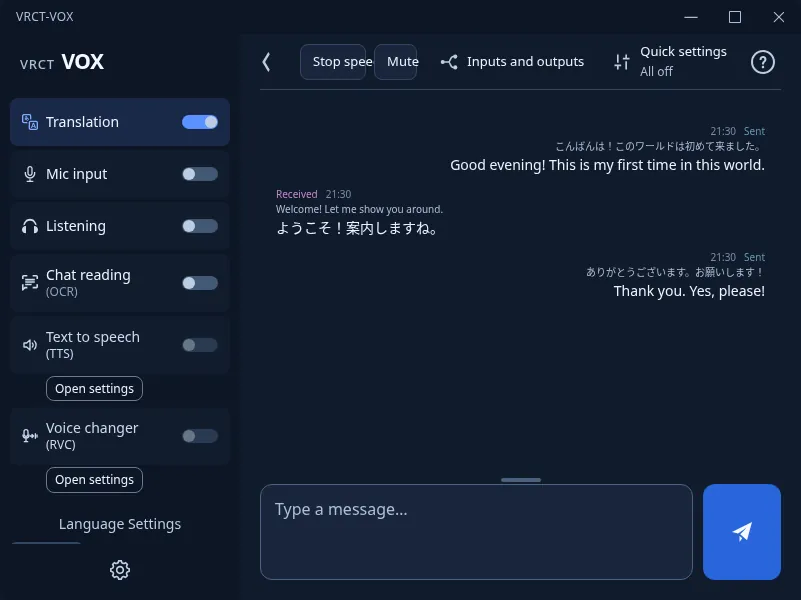

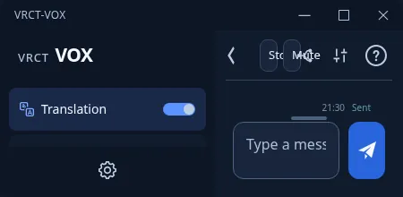

- Symptom: In the English UI at 801×600, "Stop speech" is cut off at "Stop spee", and "Mute" lies over it. Checking widths in 4px steps, it happens at 801 to 829px and not at 830px or more. When the rail is opened for a moment in the narrow layout (400×200, 450×220), the 2 buttons are squashed to 18px wide, in Japanese and in English. They also overlap the inputs and outputs button and the quick settings button.
- Likely cause:
  - The switch to the narrow layout (short wording and icon-only buttons) is decided by the window width (800 × UI size or less), not by the width of the conversation column. At 801px, the conversation column left after the 240px rail is only 561px. That is narrower than the 728px it has in the narrow layout at 800px (with the 72px rail).
  - `.stop` has `white-space: nowrap`. But its parents `.leading` and `.stop_actions` shrink with `min-width: 0`, while `RightSideComponents` on the right does not shrink, with `flex-shrink: 0`. So the buttons become narrower than their text.
  - DESIGN.md's commitment to keep the stop actions "in the same place at every window size" is kept. But the buttons do not keep a shape that can be operated.
- Effort: medium. The switch has to be based on the width of the conversation column (a container query, or a measured width). Along with that, set the buttons' `min-width` to `max-content`, or shrink the group on the right first.

### L-02 The screen does not work at the minimum and initial sizes

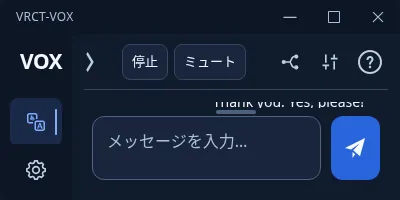

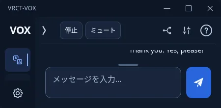

- Symptom:
  - At 400×200, the conversation log is 288×6px, and not a single line can be read. The heading shown when there is no conversation is cut off at the top and bottom too.
  - The icon rail has a visible height of 54px. Its content is 423px, and of the switches only the translation switch is visible.
  - At 450×220 too, the log is 26px, and 74px of the rail is visible.
- Likely cause: The fixed-height parts alone use up nearly all of the 200px.
  - Title bar 34px (`--title_bar_height: 3.4rem`)
  - Top bar 56px (`--main_page_topbar_height: 5.6rem`)
  - Top and bottom padding of `MessageContainer` 32px
  - Separator 8px
  - Minimum height of the composer 64px (`min-height: 6.4rem`)

  Together they come to 194px. Subtracted from 200px, that leaves 6px for the log. `minHeight: 200` is not set above this total.
- Note: The initial size of 450×220 is shown only for the short time until the saved size is restored. How much of it can be seen on a real machine was not checked ([Not verified](#not-verified)).
- Effort: medium to large. Whether to raise the minimum window size to a value at which the main screen works, and whether a small window should give priority to either the log or the input: 0.5.0 needs to decide the policy.

### L-03 The rail's language settings are off screen, and the scrollbar cannot be seen

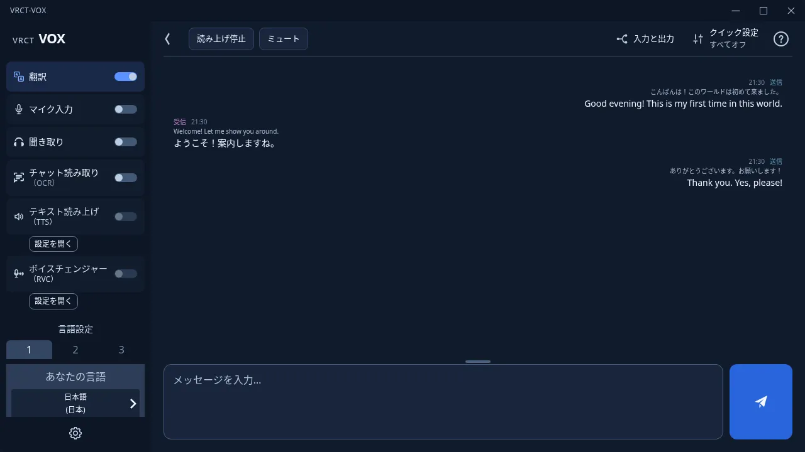

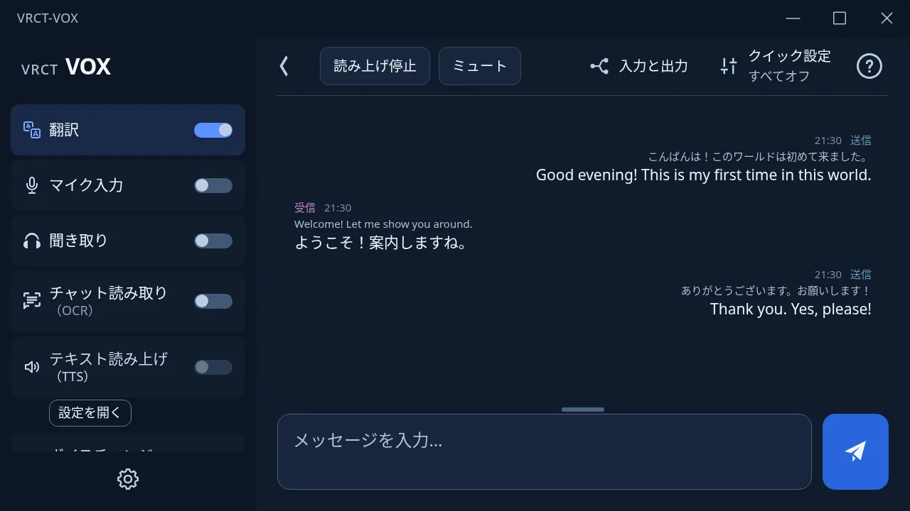

- Symptom: With a conversation and 3 target languages, the rail's visible height and content height are as follows (Japanese).

  | Size | Visible height / content height |
  |---|---|
  | 801×600 | 454 / 974 |
  | 870×654 | 508 / 974 |
  | 1280×720 | 574 / 974 |
  | 1366×768 | 622 / 974 |
  | 1920×1080 | 934 / 974 |
  | 1280×720 (UI 150%) | 501 / 1458 |
  | 1920×1080 (UI 200%) | 788 / 1947 |

  Even with 1 target language (the default), the content is 782px. At 1366×768 and below, the target language buttons and the translator cannot be seen. Even at 1920×1080, with 3 target languages the bottom 40px (Japanese) to 58px (English) goes off screen, and the translator button is hidden.

  The scrollbar, meanwhile, can hardly be seen. The track and the thumb have the same color (`--dark_888_color`), and the thumb changes color only on hover.
- Likely cause:
  - The rail only stacks the following parts of set heights vertically, and nothing marks which of them takes priority.
    - 6 switch rows (`min-height: 4.8rem`; TTS and RVC have an "Open settings" row added)
    - The preset tabs (`height: 3rem`)
    - A block for each language (about 96px)
    - The translator button
  - It has `overflow-y: scroll`, so it takes 8px for the scrollbar even when nothing overflows.
  - This matches DESIGN.md's policy that small windows "scroll rather than dropping controls". But nothing in its look shows that the rail can scroll.
- Effort: making the scrollbar visible is small. The rail's structure (where the language settings go, how several target languages are shown) is large, and is input for the 0.5.0 design decisions.

### L-04 The settings button's strip hides the bottom of the rail

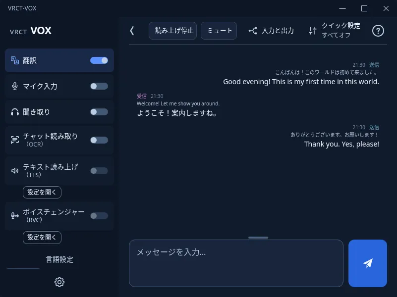

- Symptom: The lowest element in the scroll region goes 4px under the strip of the settings button (the gear, "Open settings"). Automated detection found these overlaps:
  - The preset tabs (801×600)
  - RVC's "Open settings" (1920×1080, UI 200%)
  - The swap button (English, 1366×768)
- Likely cause:
  - `.scroll_container` in `SidebarSection.module.scss` leaves room for the settings button with `margin-bottom: calc(2rem + 1.6rem + 2rem)` (5.6rem).
  - `OpenSettings`, on the other hand, is pinned to the bottom with `position: absolute`. With `min-height: 4rem` and `margin: 1rem` above and below, it is 6rem tall, so the room is 0.4rem short.
  - The dimensions are added up by hand, so changing the button's dimensions puts them out of step again.
- Effort: small. Laying out the settings button as a flex child, instead of positioning it absolutely, fixes it.

### L-05 The quick settings panel is cut off (narrow windows)

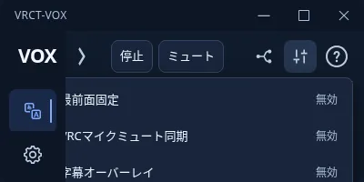

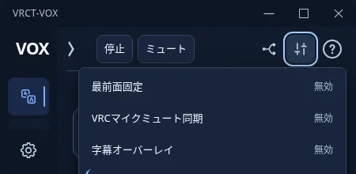

- Symptom:
  - At 400×200, 18px of the panel's left edge is cut off, and the start of an item name is missing (the 最 of 最前面固定, "Always on top").
  - The bottom of the panel goes outside the window. The items below the third one (such as the VRChat detection status) can be seen only by scrolling the conversation column.
  - The panel lies over the composer and the send button.
- Likely cause:
  - `.menu_panel` takes the viewport width as its reference, with `min-width: 26rem` and `max-width: min(34rem, calc(100vw - 2.4rem))`. It is then aligned to the right edge of the conversation column (328px wide).
  - The conversation column (`MainSection .container`) has `overflow-y: auto`. Because of this it clips horizontally too, and the panel's left edge disappears.
  - Vertically, the panel's height does not shrink to fit the height that is left.
- Effort: small to medium. Take the width of the region the panel sits in as the reference for its width. Give the panel a maximum height and let its content scroll.

### L-06 The inputs and outputs panel pushes out the conversation log and the composer (narrow windows)

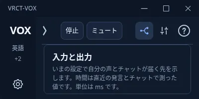

- Symptom: Opening the panel at 400×200 and 450×220 pushes the conversation log and the composer down, out of sight. The whole conversation column (`MainSection`) scrolls vertically, and the panel itself scrolls too. At 1280×720 there is no problem ([for comparison](images/ja-io-flow-1280x720.webp)).
- Likely cause: The panel is placed as one of the parts stacked vertically, with `flex-shrink: 0; max-height: 60%`. On top of the fixed-height top bar and the composer's minimum height, the panel takes 60% as well, so no room is left for the log.
- Effort: small to medium. When the window is narrow, show the panel over the content, or shrink it before the log.

### L-07 The translator choice has a fixed height and covers the language buttons below it with a semi-transparent layer

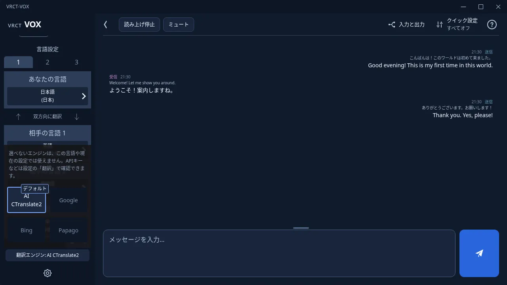

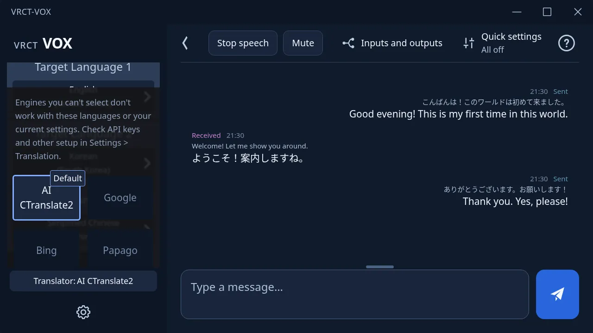

- Symptom:
  - The popover lies over the target language buttons. Its background is semi-transparent, so text underneath, such as "English (United States)", overlaps the descriptions and is hard to read.
  - Its height is fixed at 260px (390px at UI 150%). The content is 647px (970px at the same size), so only 4 engines are visible, and the others appear only after scrolling.
  - The "Default" badge of the selected engine spills 8px past the right side of its box.
- Likely cause:
  - `.container` is `position: absolute; bottom: 100%; height: 26rem`.
  - The background is `var(--dark_1000_color_dd)` (opacity 0xdd), with `backdrop-filter: blur(0.1rem)`.
  - Each engine's box is fixed at `width: 9.4rem; height: 6.2rem`.
  - It is positioned absolutely inside the rail's scroll region, so where the popover appears depends on the rail's scroll position.
- Effort: medium. Move the layer that is shown on top out of the rail, and fit its height to the free space. Make the background opaque.

### L-08 The language selector's scroll region extends 56px past its frame

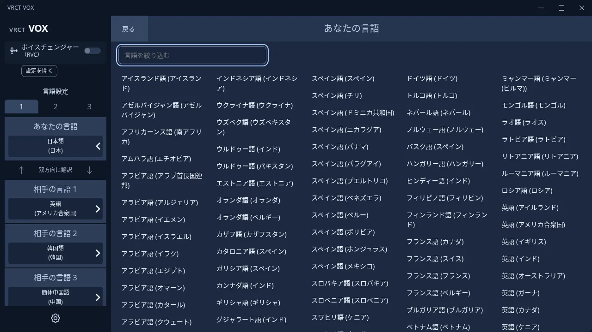

- Symptom:
  - The list's scroll region (`.language_list_scroll_wrapper`) is 56px taller than the outer frame (`.container`, `overflow-y: hidden`). So the bottom of the scrollbar cannot be seen.
  - There is 8rem of padding at the bottom, so scrolling still reaches the last language.
  - The selector covers the whole conversation column, so the composer and the send button are hidden too. This matches the current specification.
- Likely cause: The top bar (`LanguageSelectorTopBar`, 5.6rem tall) and a scroll region with `height: 100%` are stacked vertically in the same frame.
- Effort: small. Make the frame a vertical flex column, and give the scroll region `flex: 1; min-height: 0`.

### L-09 The language readout in the icon rail

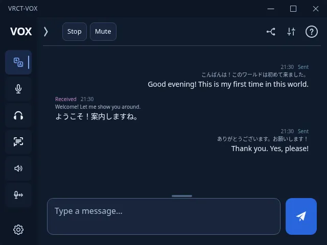

- Symptom:
  - In the icon rail at widths of 800 or less, a language name is shortened to fit one line, and the English "Japanese" is cut to "Japane…". As the CSS comment says, the shortening is intended, and the tooltip and the accessible name carry the full text.
  - At 640×480 the language readout is at the bottom of the rail and cannot be seen without scrolling. The visible height is 334px and the content 423px. The scrollbar cannot be seen, as in L-03.
- Effort: small.

### L-10 The swap button's label wraps (English)

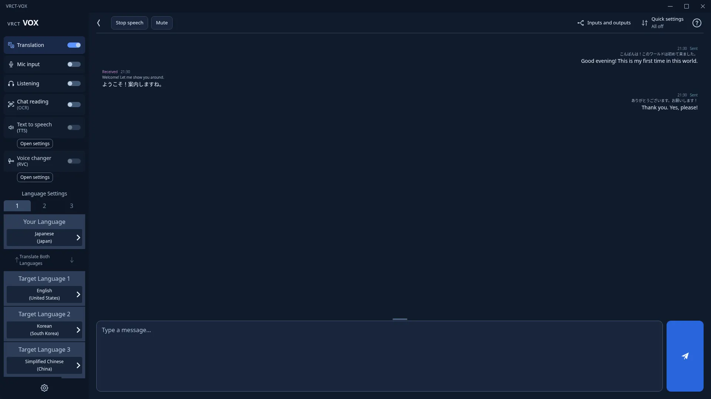

- Symptom: "Translate Both Languages" wraps onto 2 lines and is out of vertical line with the arrows on its left and right.
- Likely cause: The rail's width is fixed at 240px, while the length of the label differs by language.
- Effort: small.

### L-11 A stretched layout in a large window (observation)

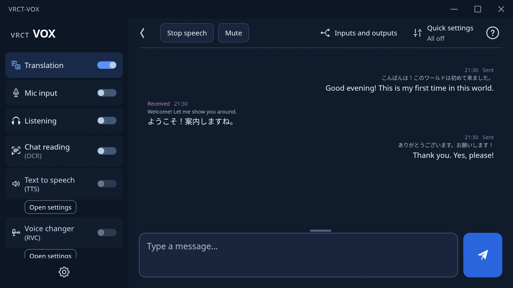

- Symptom: Nothing is broken. At 1920×1080 the screen looks like this:
  - The composer is as large as 1640×192px, and the send button 100×192px.
  - Lines of the conversation log spread to 1640px wide. Sent messages are aligned right and received ones left, so the eyes have to move far from side to side.
  - The rail stays 240px wide, and with 3 target languages its bottom cannot be seen (L-03).
- Likely cause:
  - The composer's height is a ratio of the conversation column's height (10% by default, `MESSAGE_BOX_RATIO`), with a minimum of 6.4rem and a maximum of 90%.
  - The length of a log line has no upper limit.
- Effort: medium. Use this as input when deciding in 0.5.0 how to use large windows.

## Where no problem was found

- The page as a whole did not scroll horizontally or vertically at any size or in any state (comparing `scrollWidth` and `scrollHeight` with the viewport).
- In the top bar with the rail not opened, the Japanese wording was not cut off at any size. The English was not cut off either, apart from the L-01 widths.
- The left and right edges of the composer were on screen at every size (the same result as the existing test `test_small_window_and_reduced_motion`).

Reference images:

- [640×480](images/ja-in-use-640x480.webp)
- [800×600](images/ja-in-use-800x600.webp)
- [870×654](images/ja-in-use-870x654.webp)
- [1366×768](images/ja-in-use-1366x768.webp)
- [No conversation, 1280×720](images/ja-empty-1280x720.webp)
- [The rail opened in the narrow layout, 640×480](images/ja-sidebar-toggled-640x480.webp)

## Fixed-size assumptions

As input for the 0.5.0 design decisions, these are the places that rely on hard-coded widths, heights and breakpoints. Values written in rem grow in proportion to the UI size. The window does not grow, so a larger UI size puts the screen in the same state as a narrower window.

| Place | Value | Related problems |
|---|---|---|
| `src-tauri/tauri.conf.json` | Initial 450×220, minimum 400×200 | L-02 |
| `src-ui/logics/common/windowGeometry.ts` `BUILT_IN_GEOMETRY` | First launch 870×654 | — |
| `src-ui/logics/common/useWindow.ts` `asyncUpdateBreakPoint` and the CSS `@media (max-width: 800px)` (`TopBar`, `RightSideComponents`, `LogBox`) | Window width 800px × UI size, not the width of the conversation column | L-01 |
| `SidebarSection.module.scss` `.container` | 24rem wide, 7.2rem for the icon rail | L-01, L-03, L-10 |
| `SidebarSection.module.scss` `.scroll_container` | `margin-bottom: calc(2rem + 1.6rem + 2rem)`, calculated by hand. `overflow-y: scroll` | L-03, L-04 |
| `OpenSettings.module.scss` | `position: absolute; bottom: 0`, `min-height: 4rem`, `margin: 1rem` | L-04 |
| `variables.css` `--title_bar_height` | 3.4rem | L-02 |
| `variables.css` `--main_page_topbar_height` | 5.6rem (the top bar, and the top bar of the language selector) | L-02, L-08 |
| `MainFunctionSwitch.module.scss` | Switch rows have `min-height: 4.8rem` | L-03 |
| `PresetTabSelector.module.scss` | `height: 3rem` | L-03 |
| `MessageContainer.module.scss` `.message_box_resize_wrapper` | The height is a ratio (10% by default), `min-height: 6.4rem`, `max-height: 90%` | L-02, L-11 |
| `MessageContainer.module.scss` `.container` | Padding `1.2rem 2rem 2rem`, separator 0.8rem | L-02 |
| `RightSideComponents.module.scss` `.menu_panel` | `min-width: 26rem`, `max-width: min(34rem, calc(100vw - 2.4rem))` (based on the viewport) | L-05 |
| `IoFlowPanel.module.scss` `.panel` | `max-height: 60%`, `flex-shrink: 0` | L-06 |
| `TranslatorSelector.module.scss` | `height: 26rem`, boxes of 9.4rem × 6.2rem, `position: absolute` | L-07 |
| `LanguageSelector.module.scss` | Covers the conversation column with `position: absolute`; the scroll region is `height: 100%` | L-08 |
| `root.css` | The root font size is 62.5% × UI size (the base of every rem). The corner radius of `html, body` is fixed at 10px | All |

## Not verified

- A real Tauri window: No native GUI test was run. The transparent window, its shadow and the window frame controls were not reproduced. How much of the 450×220 initial size can be seen on a real machine was not checked either.
- WebKitGTK on Linux: Only Chromium was used. Windows' WebView2 is Chromium-based too, so its results are expected to be close. WebKitGTK, however, may differ, for example in how it draws scrollbars.
- Fonts: The default font is "Yu Gothic UI" (`config.py`), but this environment does not have it, so text was drawn in Noto Sans and Noto Sans CJK. The character widths differ, so the range of 801 to 829px in L-01 may shift on Windows.
- Parts that exist only in `App.jsx`: The consent dialogs, the notices (toasts) and the startup screen are not in `studio-entry`, so they were not checked.
- Long conversations and long messages: The sample conversation has only 3 messages. A virtually scrolled log filled with a large number of messages, and long text without line breaks, were not tried.
- The rail's scroll position in the images: Opening the language selector or the translator choice scrolls the rail, because of the click. So in the images taken after that, the rail's scroll position differs from state to state.

## Measurement environment

- Linux (CachyOS, kernel 6.18)
- Google Chrome for Testing 153.0.8010.12 (headless, through Playwright 1.64.1)
- Node.js 26.13.1, the Vite dev server
- Device pixel ratio 1
- Captured with reduced motion (`prefers-reduced-motion: reduce`)
- The clock fixed at 2026-01-10 21:30 (the same as `tools/docs_screenshots.py`)

## How to reproduce

Run these from the repository root.

```sh
python tools/dev.py setup --scope browser   # prepares build/dev/browser-venv
npm ci
AUDIT_OUT=build/layout-audit ASTAROT_TEST_STUDIO_UI=1 ASTAROT_TEST_CHROMIUM=/path/to/chrome \
PYTHONPATH=tests/voice build/dev/browser-venv/bin/python -m pytest -c tests/voice/pytest.ini \
    --rootdir . docs/design/main-layout-audit/audit/layout_audit.py -q -p no:cacheprovider
python docs/design/main-layout-audit/audit/summarize.py build/layout-audit > docs/design/main-layout-audit/findings.md
```

- This produces 154 screenshots (PNG) in `build/layout-audit/shots/`.
- This report includes 23 of them, converted to WebP.
- `docs/` is excluded from pytest collection (`norecursedirs` in `pytest.ini`), so this audit script never runs in the regular `check`.

---

# メイン画面レイアウト監査（2026-11-15）（日本語版）

Issue #327 の監査レポートです。0.5.0 でメイン画面のレイアウトを見直す前に、現状の問題を洗い出しました。この PR ではコードを直していません。

- 対象: `develop` の `03c21f3d`（0.4.0-beta.1）のメイン画面（`src-ui/views/app/main_page/`）と、その上のタイトルバー
- 結果: 問題 11 件（高 2、中 5、低 4）。ほかに、固定寸法に頼っている箇所を 17 か所記録しました（[固定寸法の前提](#固定寸法の前提)）。
- 機械検出の全件: [findings.md](findings.md)
- 再現用のスクリプト: [audit/](audit/)（`v0.5.2` のタグのチェックアウトで動きます。使う試験の部品（`tests/voice/test_studio_ui.py`、`tests/voice/test_docs_screenshots.py`、`tests/voice/studio-entry`）を 2026-11-20 に消したので、develop では動きません）

## 結論

- **ウィンドウが小さいと、メイン画面は使えません。** tauri の最小サイズ 400×200 では、会話ログの高さが 6px しかありません。サイドバーのスイッチも、翻訳の 1 つしか見えません。
- **広い表示に切り替わった直後の幅で、上部バーのボタンが重なります。** 英語表示の 801〜829px で、「Stop speech」と「Mute」の文字が重なって欠けます。狭い表示への切り替えをウィンドウ幅で決めているため、サイドバーの幅（240px と 72px）の差が考慮されていません。
- **よく使うサイズでも、サイドバーの言語設定は画面の外にあります。** 1280×720 と 1366×768 では、相手の言語と翻訳エンジンを見るのにスクロールが必要です。それなのに、スクロールバーのつまみがトラックと同じ色なので、続きがあることに気づけません。
- ページ全体のはみ出し（横スクロール）は、どのサイズでも出ませんでした。崩れはすべて、個々の領域の中で起きています。

## 方法

### 表示の仕方

既存の「本番の画面をモックのバックエンドで描画する」仕組みを使いました（`tests/voice/studio-entry`、`tests/voice/test_studio_ui.py`、`tools/docs_screenshots.py` と同じものです）。

- Vite の開発サーバーで、本番の `MainPage`、`ConfigPage`、`WindowTitleBar`、`SnackbarController` を描画します。バックエンドの代わりに、Playwright がサンプルデータを返します。
- ヘッドレスの Chromium で、ビューポートの大きさを変えながら撮影します。アプリはウィンドウ枠を自前で描くので（`decorations: false`）、ビューポートの大きさがウィンドウの大きさになります。
- 狭い表示への切り替えと UI サイズは、本番と同じ処理をスクリプトで再現しました。`useWindow.asyncUpdateBreakPoint` の `html[data-narrow]` と、`UiSizeController` のルートのフォントサイズです。`studio-entry` 自体は `Atom_IsBreakPoint` しか切り替えません。

### サイズ

単位は CSS px です。Windows の表示倍率が 150% なら、物理解像度 1920×1080 の最大化ウィンドウは CSS では約 1280×720 になります。

| サイズ | 選んだ理由 |
|---|---|
| 400×200 | `tauri.conf.json` の `minWidth` と `minHeight` |
| 450×220 | `tauri.conf.json` の初期サイズ。保存した位置とサイズを戻す前に一瞬だけ使われる |
| 640×480 | 狭い表示の代表 |
| 800×600 / 801×600 | 狭い表示と広い表示の境目（幅 800 以下が狭い表示） |
| 870×654 | 初回起動時のサイズ（`windowGeometry.js` の `BUILT_IN_GEOMETRY`） |
| 1280×720、1366×768、1920×1080 | Issue で指定されたよくあるサイズ |
| 1280×720（UI 150%）、1920×1080（UI 200%） | 設定の「UI サイズ」を大きくした場合 |

### 状態と言語

日本語と英語の両方で、次の 7 つの状態を撮りました。合計 154 枚です。

- 会話なし
- 会話あり（相手の言語 3 つ。サイドバーがいちばん長くなる形）
- クイック設定を開いた状態
- 言語の選択画面
- 翻訳エンジンの選択
- 入力と出力のパネル
- サイドバーを切り替えた状態

### 検出の仕方

`audit/detect.js` が、各状態・各サイズで次を調べます。

- 要素の境界矩形が、見える範囲（ビューポートと、overflow で切る祖先の重なった範囲）からはみ出していないか。スクロールで届くものと、届かないものを分けます。
- スクロールしている領域。
- 中身が自分の枠を超えているテキストとボタン。
- 操作できる要素どうしの重なり。`elementFromPoint` で、オーバーレイに完全に覆われた要素は除きます。

そのうえで、スクリーンショットを目で見て、機械検出が拾えない崩れ（文字の重なり方、読みにくさ）を確かめました。

### 個人情報の扱い

会話は、テスト用のサンプル文（`tests/voice/test_docs_screenshots.py` の `CONVERSATION`）だけを使いました。利用者のテキストや音声は使っていません。`detect.js` は会話ログの文字列を記録せず、`(message)` と書きます。

## 問題の一覧

規模感の目安:

- 小: CSS 数行で直る
- 中: 1 つのコンポーネントの作りを変える
- 大: メイン画面の構成、または最小サイズの方針を決め直す必要がある

| ID | 重要度 | 対象コンポーネント | 再現サイズ | 症状 | 規模感 |
|---|---|---|---|---|---|
| L-01 | 高 | `TopBar` / `StopActions` | 英語 801〜829 幅。狭い表示でサイドバーを開いたとき（400×200、450×220、日英とも） | 停止とミュートのボタンが縮み、文字がはみ出して重なる | 中 |
| L-02 | 高 | メイン画面全体（`MessageContainer`、`SidebarSection`） | 400×200、450×220 | 会話ログの高さが 6px と 26px。スイッチは 1〜2 個しか見えない | 中〜大 |
| L-03 | 中 | `SidebarSection`（広い表示） | 801×600〜1366×768、UI 150% と 200%。相手の言語が 3 つなら 1920×1080 でも | 言語設定と翻訳エンジンが画面の外にあり、スクロールバーも見えない | 小（バー）／大（構成） |
| L-04 | 中 | `OpenSettings` と `SidebarSection` | 全サイズ（目立つのは 801×600、UI 200%） | 歯車ボタンの帯が、サイドバーの下端を 4px（100% のとき）隠す | 小 |
| L-05 | 中 | `QuickSettingsMenu` | 400×200、450×220 | パネルの左端が切れ、下端がウィンドウの外に出る。入力欄と送信ボタンも覆う | 小〜中 |
| L-06 | 中 | `IoFlowPanel` | 400×200、450×220 | パネルが会話ログと入力欄を押し出し、メイン部分全体がスクロールする | 小〜中 |
| L-07 | 中 | `TranslatorSelector` | 広い表示の全サイズ | 高さ固定のポップオーバーが言語ボタンを半透明で覆い、エンジンは 4 つしか見えない。「デフォルト」の札が枠からはみ出す | 中 |
| L-08 | 低 | `LanguageSelector` | 広い表示の全サイズ | 一覧のスクロール領域の下 56px が枠の外にあり、スクロールバーの下端が見えない | 小 |
| L-09 | 低 | `LanguageReadout`（アイコンの列） | 幅 800 以下 | 英語の言語名が「Japane…」と省略される。640×480 では列の下に隠れて見えない | 小 |
| L-10 | 低 | `LanguageSwapButton` | 英語、広い表示 | 「Translate Both Languages」が 2 行に折り返し、矢印と位置がずれる | 小 |
| L-11 | 低（観察） | `MessageContainer`、`LogBox` | 1920×1080 | 壊れてはいない。ただし、入力欄が高さ 192px、送信ボタンが 100×192px と大きくなり、ログの 1 行が 1640px 幅に広がる | 中 |

### L-01 上部バーの停止・ミュートボタンが重なる


- **症状**: 英語表示の 801×600 で、「Stop speech」が「Stop spee」で切れ、上に「Mute」が重なります。4px 刻みで幅を変えて調べると、801〜829px で起き、830px 以上では起きません。狭い表示でサイドバーを一時的に開くと（400×200、450×220）、日英とも 2 つのボタンが幅 18px まで潰れます。さらに、入力と出力ボタンやクイック設定ボタンとも重なります。
- **原因の見立て**:
  - 狭い表示への切り替え（短い文言とアイコンだけのボタン）は、ウィンドウの幅（800×UI サイズ以下）で決まります。メイン部分の幅では決まりません。801px では、サイドバー 240px を引いたメイン部分が 561px しかありません。800px の狭い表示（サイドバー 72px）のときの 728px より狭くなります。
  - `.stop` は `white-space: nowrap` です。ところが、親の `.leading` と `.stop_actions` は `min-width: 0` で縮むのに、右側の `RightSideComponents` は `flex-shrink: 0` で縮みません。そのため、ボタンが文字の幅より狭くなります。
  - DESIGN.md の「停止の操作はどのサイズでも同じ場所に置く」という約束は守られています。ただ、操作できる形を保てていません。
- **規模感**: 中。切り替えの基準をメイン部分の幅（コンテナクエリ、または計測した幅）に変える必要があります。あわせて、ボタンの `min-width` を `max-content` にするか、右側のグループを先に縮めます。

### L-02 最小サイズ・初期サイズでは画面が成り立たない


- **症状**:
  - 400×200 では、会話ログが 288×6px になり、1 行も読めません。会話がないときの見出しも上下が切れます。
  - サイドバーのアイコンの列は、表示できる高さが 54px です。中身は 423px あり、スイッチは翻訳の 1 つしか見えません。
  - 450×220 でも、ログは 26px、サイドバーで見えるのは 74px です。
- **原因の見立て**: 高さが固定の部品だけで、ほぼ 200px を使い切っています。
  - タイトルバー 34px（`--title_bar_height: 3.4rem`）
  - 上部バー 56px（`--main_page_topbar_height: 5.6rem`）
  - `MessageContainer` の上下の余白 32px
  - 区切り 8px
  - 入力欄の最小 64px（`min-height: 6.4rem`）

  合計すると 194px で、200px から引くと、ログに残るのは 6px です。`minHeight: 200` は、この合計より上に置かれていません。
- **補足**: 初期サイズ 450×220 は、保存したサイズを戻すまでの短い間だけ表示されます。実機でどれだけ見えるかは確かめていません（[確認していないこと](#確認していないこと)）。
- **規模感**: 中〜大。最小ウィンドウサイズを、メイン画面が成り立つ値まで上げるかどうか。小さいウィンドウではログか入力のどちらかを優先して表示する形にするか。0.5.0 で方針を決める必要があります。

### L-03 サイドバーの言語設定が画面の外にあり、スクロールバーも見えない


- **症状**: 会話あり・相手の言語 3 つのとき、サイドバーの表示できる高さと中身の高さは次のとおりです（日本語）。

  | サイズ | 表示できる高さ / 中身の高さ |
  |---|---|
  | 801×600 | 454 / 974 |
  | 870×654 | 508 / 974 |
  | 1280×720 | 574 / 974 |
  | 1366×768 | 622 / 974 |
  | 1920×1080 | 934 / 974 |
  | 1280×720（UI 150%） | 501 / 1458 |
  | 1920×1080（UI 200%） | 788 / 1947 |

  相手の言語が 1 つ（既定）でも、中身は 782px あります。1366×768 以下では、相手の言語のボタンと翻訳エンジンが見えません。1920×1080 でも、相手の言語が 3 つなら、下端の 40px（日本語）〜58px（英語）が画面の外に出て、翻訳エンジンのボタンが隠れます。

  一方、スクロールバーはほとんど見えません。トラックとつまみが同じ色（`--dark_888_color`）で、つまみの色が変わるのはホバーしたときだけです。
- **原因の見立て**:
  - サイドバーは、次の高さが決まった部品を縦に積んでいるだけで、どれを優先するかの区別がありません。
    - スイッチ 6 行（`min-height: 4.8rem`。TTS と RVC には「設定を開く」の行が付く）
    - プリセットのタブ（`height: 3rem`）
    - 言語ごとのブロック（約 96px）
    - 翻訳エンジンのボタン
  - `overflow-y: scroll` なので、溢れていなくてもスクロールバーの場所を 8px 取っています。
  - DESIGN.md の「小さいウィンドウでは操作を消さずにスクロールさせる」という方針には合っています。ただ、スクロールできることが見た目で分かりません。
- **規模感**: スクロールバーを見えるようにするのは小です。サイドバーの構成（言語設定をどこに置くか、相手の言語が複数のときの見せ方）は大で、0.5.0 の設計判断の材料になります。

### L-04 歯車ボタンの帯がサイドバーの下端を隠す


- **症状**: スクロール領域のいちばん下の要素が、歯車ボタン（設定を開く）の帯の下に 4px 入り込みます。機械検出では、次の重なりが見つかりました。
  - プリセットのタブ（801×600）
  - RVC の「設定を開く」（1920×1080、UI 200%）
  - 言語の入れ替えボタン（英語、1366×768）
- **原因の見立て**:
  - `SidebarSection.module.scss` の `.scroll_container` は、`margin-bottom: calc(2rem + 1.6rem + 2rem)`（5.6rem）で、歯車ボタンの場所を空けています。
  - 一方、`OpenSettings` は `position: absolute` で下に固定されています。高さは `min-height: 4rem` と上下の `margin: 1rem` で 6rem あり、0.4rem 足りません。
  - 寸法を手で足し合わせて決めているので、ボタンの寸法を変えると、またずれます。
- **規模感**: 小。歯車ボタンを絶対配置でなく、flex の子として並べれば直ります。

### L-05 クイック設定のパネルが切れる（狭いウィンドウ）


- **症状**:
  - 400×200 では、パネルの左端が 18px 切れ、項目名の先頭（「最前面固定」の「最」）が欠けます。
  - パネルの下端はウィンドウの外に出ます。3 項目目より下（VRChat の検出状況など）は、メイン部分をスクロールしないと見えません。
  - パネルは入力欄と送信ボタンの上に重なります。
- **原因の見立て**:
  - `.menu_panel` は、`min-width: 26rem` と `max-width: min(34rem, calc(100vw - 2.4rem))` で、ビューポートの幅を基準にしています。そのうえで、メイン部分（幅 328px）の右端にそろえて置かれています。
  - メイン部分（`MainSection .container`）は `overflow-y: auto` です。このため横方向も切り取られ、パネルの左端が消えます。
  - 縦は、パネルの高さが残りの高さに合わせて縮みません。
- **規模感**: 小〜中。幅の基準を、置かれている領域の幅にします。パネルの最大の高さを決めて、中をスクロールさせます。

### L-06 入力と出力のパネルが会話ログと入力欄を押し出す（狭いウィンドウ）


- **症状**: 400×200 と 450×220 でパネルを開くと、会話ログと入力欄が下に押し出されて見えなくなります。メイン部分全体（`MainSection`）に縦のスクロールが出て、パネル自体にもスクロールが出ます。1280×720 では問題ありません（[参考](images/ja-io-flow-1280x720.webp)）。
- **原因の見立て**: パネルは `flex-shrink: 0; max-height: 60%` で、縦に並ぶ部品の 1 つとして置かれています。高さが固定の上部バーと入力欄の最小の高さに加えて、パネルにも 60% を取るので、ログに場所が残りません。
- **規模感**: 小〜中。狭いときはパネルを重ねて表示するか、ログより先に縮めます。

### L-07 翻訳エンジンの選択が固定の高さで、下の言語ボタンを半透明で覆う


- **症状**:
  - ポップオーバーは、相手の言語のボタンの上に重なります。背景が半透明なので、下の「英語（アメリカ合衆国）」などの文字が説明文と重なって読みにくくなります。
  - 高さが 260px（UI 150% では 390px）に固定されています。中身は 647px（同 970px）あるので、エンジンは 4 つしか見えず、ほかはスクロールしないと出てきません。
  - 選んでいるエンジンの「デフォルト」の札が、枠の右に 8px はみ出します。
- **原因の見立て**:
  - `.container` が `position: absolute; bottom: 100%; height: 26rem`。
  - 背景が `var(--dark_1000_color_dd)`（不透明度 0xdd）で、`backdrop-filter: blur(0.1rem)`。
  - 各エンジンの箱は `width: 9.4rem; height: 6.2rem` の固定です。
  - サイドバーのスクロール領域の中に絶対配置で置かれているので、サイドバーのスクロール位置によって、ポップオーバーがどこに出るかが変わります。
- **規模感**: 中。重ねて表示する層をサイドバーの外に出し、高さを空いている場所に合わせます。背景は不透明にします。

### L-08 言語の選択画面のスクロール領域が枠から 56px はみ出す


- **症状**:
  - 一覧のスクロール領域（`.language_list_scroll_wrapper`）が、外側の枠（`.container`、`overflow-y: hidden`）より 56px 長くなっています。そのため、スクロールバーの下端が見えません。
  - 下に 8rem の余白があるので、最後の言語にはスクロールで届きます。
  - 選択画面はメイン部分全体を覆うので、入力欄と送信ボタンも隠れます。これは今の仕様どおりです。
- **原因の見立て**: 上部バー（`LanguageSelectorTopBar`、高さ 5.6rem）と、`height: 100%` のスクロール領域を、同じ枠の中に縦に並べているためです。
- **規模感**: 小。枠を flex の縦並びにし、スクロール領域を `flex: 1; min-height: 0` にします。

### L-09 アイコンの列の言語表示


- **症状**:
  - 幅 800 以下のアイコンの列では、言語名が 1 行の省略表示になり、英語の「Japanese」は「Japane…」と欠けます。CSS のコメントにあるとおり意図した省略で、ツールチップと読み上げ用の名前には全文が入っています。
  - 640×480 では、言語の表示が列の下にあり、スクロールしないと見えません。表示できる高さは 334px、中身は 423px です。スクロールバーが見えないことは L-03 と同じです。
- **規模感**: 小。

### L-10 言語の入れ替えボタンの文言が折り返す（英語）


- **症状**: 「Translate Both Languages」が 2 行に折り返し、左右の矢印と縦の位置がずれます。
- **原因の見立て**: サイドバーの幅 240px が固定で、文言の長さは言語によって違うためです。
- **規模感**: 小。

### L-11 大きいウィンドウでの間延び（観察）


- **症状**: 壊れてはいません。1920×1080 では次のようになります。
  - 入力欄が 1640×192px、送信ボタンが 100×192px と大きい。
  - 会話ログの行が 1640px 幅に広がり、送信は右寄せ、受信は左寄せなので、目を左右に大きく動かす必要がある。
  - サイドバーは 240px のままで、相手の言語が 3 つなら下が見えない（L-03）。
- **原因の見立て**:
  - 入力欄の高さは、メイン部分の高さに対する割合（既定 10%、`MESSAGE_BOX_RATIO`）で決まり、最小 6.4rem、最大 90% です。
  - ログの行の長さには上限がありません。
- **規模感**: 中。0.5.0 で大きいウィンドウをどう使うかを決めるときの材料にしてください。

## 問題が見つからなかった点

- ページ全体の横スクロール・縦スクロールは、すべてのサイズと状態で出ませんでした（`scrollWidth`、`scrollHeight` とビューポートの比較）。
- サイドバーを開いていない状態の上部バーでは、日本語の文言はどのサイズでも欠けませんでした。英語も、L-01 の幅を除けば欠けません。
- 入力欄の左右の端は、すべてのサイズで画面の中にありました（既存の試験 `test_small_window_and_reduced_motion` と同じ結果です）。

参考の画像:

- [640×480](images/ja-in-use-640x480.webp)
- [800×600](images/ja-in-use-800x600.webp)
- [870×654](images/ja-in-use-870x654.webp)
- [1366×768](images/ja-in-use-1366x768.webp)
- [会話なし 1280×720](images/ja-empty-1280x720.webp)
- [狭い表示でサイドバーを開いたとき 640×480](images/ja-sidebar-toggled-640x480.webp)

## 固定寸法の前提

0.5.0 の設計判断の材料として、決め打ちの幅・高さ・境目に頼っている箇所を挙げます。rem で書いたものは、UI サイズに比例して大きくなります。ウィンドウは大きくならないので、UI サイズを大きくするほど、窓が狭いのと同じ状態になります。

| 箇所 | 値 | 関係する問題 |
|---|---|---|
| `src-tauri/tauri.conf.json` | 初期 450×220、最小 400×200 | L-02 |
| `src-ui/logics/common/windowGeometry.ts` `BUILT_IN_GEOMETRY` | 初回 870×654 | — |
| `src-ui/logics/common/useWindow.ts` `asyncUpdateBreakPoint` と CSS の `@media (max-width: 800px)`（`TopBar`、`RightSideComponents`、`LogBox`） | ウィンドウ幅 800px×UI サイズ。メイン部分の幅ではない | L-01 |
| `SidebarSection.module.scss` `.container` | 幅 24rem、アイコンの列は 7.2rem | L-01、L-03、L-10 |
| `SidebarSection.module.scss` `.scroll_container` | `margin-bottom: calc(2rem + 1.6rem + 2rem)` を手で計算。`overflow-y: scroll` | L-03、L-04 |
| `OpenSettings.module.scss` | `position: absolute; bottom: 0`、`min-height: 4rem`、`margin: 1rem` | L-04 |
| `variables.css` `--title_bar_height` | 3.4rem | L-02 |
| `variables.css` `--main_page_topbar_height` | 5.6rem（上部バーと言語の選択画面の上部バー） | L-02、L-08 |
| `MainFunctionSwitch.module.scss` | スイッチの行は `min-height: 4.8rem` | L-03 |
| `PresetTabSelector.module.scss` | `height: 3rem` | L-03 |
| `MessageContainer.module.scss` `.message_box_resize_wrapper` | 高さは割合（既定 10%）、`min-height: 6.4rem`、`max-height: 90%` | L-02、L-11 |
| `MessageContainer.module.scss` `.container` | 余白 `1.2rem 2rem 2rem`、区切り 0.8rem | L-02 |
| `RightSideComponents.module.scss` `.menu_panel` | `min-width: 26rem`、`max-width: min(34rem, calc(100vw - 2.4rem))`（ビューポート基準） | L-05 |
| `IoFlowPanel.module.scss` `.panel` | `max-height: 60%`、`flex-shrink: 0` | L-06 |
| `TranslatorSelector.module.scss` | `height: 26rem`、箱は 9.4rem×6.2rem、`position: absolute` | L-07 |
| `LanguageSelector.module.scss` | `position: absolute` でメイン部分を覆い、スクロール領域は `height: 100%` | L-08 |
| `root.css` | ルートのフォントサイズは 62.5%×UI サイズ（すべての rem の基準）。`html, body` の角丸は 10px 固定 | 全体 |

## 確認していないこと

- **実際の Tauri ウィンドウ**: ネイティブ GUI の試験はしていません。透明なウィンドウ、影、ウィンドウ枠の操作は再現していません。450×220 の初期サイズが実機でどのくらい見えるかも確かめていません。
- **Linux の WebKitGTK**: 使ったのは Chromium だけです。Windows の WebView2 も Chromium 系なので、近い結果になると考えています。ただ、WebKitGTK ではスクロールバーの描き方などが違うおそれがあります。
- **フォント**: 既定のフォントは「Yu Gothic UI」（`config.py`）ですが、この環境にはないので、Noto Sans と Noto Sans CJK で描いています。文字の幅が違うので、L-01 の 801〜829px という範囲は、Windows では前後する可能性があります。
- **`App.jsx` にだけある部品**: 同意のダイアログ、通知（トースト）、起動中の画面は `studio-entry` に含まれていないので、確認していません。
- **長い会話や長いメッセージ**: サンプルの会話は 3 件だけです。仮想スクロールのログに大量のメッセージを入れた場合や、改行のない長い文は試していません。
- **画像のサイドバーのスクロール位置**: 言語の選択画面や翻訳エンジンの選択を開くとき、クリックのためにサイドバーがスクロールします。そのため、その後に撮った画像では、サイドバーのスクロール位置が状態ごとに違います。

## 計測した環境

- Linux（CachyOS、カーネル 6.18）
- Google Chrome for Testing 153.0.8010.12（Playwright 1.64.1 のヘッドレス）
- Node.js 26.13.1、Vite の開発サーバー
- デバイスピクセル比 1
- 動きを減らす設定（`prefers-reduced-motion: reduce`）で撮影
- 時計は 2026-01-10 21:30 に固定（`tools/docs_screenshots.py` と同じ）

## 再現の手順

リポジトリのルートで実行します。

```sh
python tools/dev.py setup --scope browser   # build/dev/browser-venv を用意する
npm ci
AUDIT_OUT=build/layout-audit ASTAROT_TEST_STUDIO_UI=1 ASTAROT_TEST_CHROMIUM=/path/to/chrome \
PYTHONPATH=tests/voice build/dev/browser-venv/bin/python -m pytest -c tests/voice/pytest.ini \
    --rootdir . docs/design/main-layout-audit/audit/layout_audit.py -q -p no:cacheprovider
python docs/design/main-layout-audit/audit/summarize.py build/layout-audit > docs/design/main-layout-audit/findings.md
```

- `build/layout-audit/shots/` に、154 枚のスクリーンショット（PNG）ができます。
- このレポートに載せたのは、そのうち 23 枚を WebP にしたものです。
- `docs/` は pytest の収集対象から外れているので（`pytest.ini` の `norecursedirs`）、この監査スクリプトが通常の `check` で走ることはありません。
