# メイン画面レイアウトの見直し（0.5.0）

[レイアウト監査](../main-layout-audit/README.md)の指摘 L-01〜L-11 に対して、メイン画面の配置を見直した記録です。技術選定は [ADR-010](../../adr/adr-010-frontend-stack.md) に従います。

- 比べたもの: 変更前は `develop`（`362783b2`）、変更後はこのブランチ
- 撮り方: 監査と同じスクリプト（`../main-layout-audit/audit/`）で、同じ PC、同じ条件で撮りました。
- 画像: 左が変更前、右が変更後です（`images/`）。

## 方針

- **切り替えの基準をウィンドウからメイン部分に移しました。** メイン部分をコンテナ（`container-type: size`）にしました。上部バーの短い文言、クイック設定、空の状態、入力欄は、メイン部分の幅と高さで切り替えます。条件は rem で書いたので、UI サイズにも合わせて変わります。
- **小さいウィンドウでは、ほかの部品より会話を優先します。** メイン部分の高さが 36rem 未満のときは、上部バーとロゴの行を 4.4rem にします。余白を詰め、入力欄は 1 行にします。
- **重ねて表示するものは、置かれた場所の大きさに合わせます。** クイック設定のパネル、入力と出力のパネル、狭いウィンドウで開いたサイドバーが対象です。
- **サイドバーは「ロゴ、スクロールする部分、設定ボタン」の縦の並びにしました。** 手で足し合わせた余白はなくしました。
- 最初は SCSS Modules で書き、#370（TypeScript の土台）のマージ後に骨組みを移しました。
  - コンテナの名前と境目の値は `src-ui/views/app/main_page/layout.ts` にまとめました。
  - MainPage、MainSection、SidebarSection、OpenSettings のスタイルは vanilla-extract（`.css.ts`）です。
  - SidebarSection と OpenSettings は TSX にしました。MainPage と MainSection は、読んでいる store のフックにまだ型がないので、ビューは JavaScript のままです。
  - そのほかの部品は SCSS Modules のままで、同じ名前と値を文字で書いています。

## 指摘ごとの対応

| ID | 対応 | 結果 |
|---|---|---|
| L-01 | 上部バーの短い文言への切り替えを、メイン部分の幅（64rem 以下）で決めます。停止とミュートは文字の幅より縮みません。狭いウィンドウで開いたサイドバーは、会話を押し縮めずに上に重ねます。 | 英語の 801×600 と、狭い表示でサイドバーを開いたときの重なりは、検出されなくなりました。 |
| L-02 | 高さの低いメイン部分では、上部バー、余白、入力欄を詰めます。 | 400×200 のログ欄が 6px から 60px に、450×220 では 26px から 80px になりました。 |
| L-03 | スクロールバーのつまみを、レールと違う色にしました。スイッチの行、言語設定の見出し、言語のボタンを詰めました。 | サイドバーの中身は 914px から 699px になりました（相手の言語 3 つ）。相手の言語が 1 つなら、1280×720 で翻訳エンジンまで見えます。 |
| L-04 | 設定ボタンをサイドバーの最後の flex の子にしました。 | 歯車の帯の下に要素が描かれなくなりました（検出に残るものは[下記](#変更後も検出に残るもの)）。 |
| L-05 | クイック設定のパネルの幅と高さを、メイン部分の大きさ（`cqw`、`cqh`）で決めます。収まらないときはパネルの中がスクロールします。 | 400×200 で左端が切れなくなりました。 |
| L-06 | 入力と出力のパネルは、ログより先に縮みます。高さが低いときは、会話の上に重ねて表示します。 | 400×200 と 450×220 で、メイン部分全体がスクロールしなくなりました。 |
| L-07 | 翻訳エンジンの選択を、ボタンの下にサイドバーの中で開く形にしました。背景は不透明で、高さはエンジンの数に合わせます。「デフォルト」の札は箱の中に入れました。 | 言語ボタンに重ならなくなりました。はみ出しも検出されなくなりました。 |
| L-08 | 言語の選択画面を flex の縦並びにしました。 | スクロール領域が枠の中に収まりました。 |
| L-09 | アイコンの列の言語表示の余白を減らしました。 | 「Japanese」が省略されなくなりました。 |
| L-10 | 入れ替えボタンの文言を中央に置き、矢印の横にそろえました。 | 2 行に折り返しても、矢印と位置がずれません。 |
| L-11 | 会話ログと入力欄の幅を、最大 120rem にして中央に置きました。送信ボタンは正方形のまま、入力欄の下端に置きます。 | 1920×1080 でログの行が 1640px から 1160px になりました。 |

## サイズごとの寸法（日本語、会話あり、相手の言語 3 つ）

| サイズ | ログ欄の高さ（前 → 後） | 入力欄の高さ（前 → 後） | サイドバーの表示高さ / 中身の高さ（前 → 後） |
|---|---|---|---|
| 400×200 | 6 → 60 | 64 → 44 | 54 / 423 → 65 / 390 |
| 450×220 | 26 → 80 | 64 → 44 | 74 / 423 → 85 / 390 |
| 640×480 | 278 → 278 | 72 → 72 | 334 / 423 → 333 / 390 |
| 801×600 | 374 → 374 | 96 → 96 | 454 / 914 → 453 / 699 |
| 1280×720 | 470 → 470 | 120 → 120 | 574 / 914 → 573 / 699 |
| 1366×768 | 509 → 509 | 129 → 129 | 622 / 914 → 621 / 699 |
| 1920×1080 | 758 → 758 | 192 → 192 | 914 / 914 → 933 / 933 |
| 1280×720（UI 150%） | 418 → 418 | 107 → 107 | 501 / 1372 → 500 / 1049 |
| 1920×1080（UI 200%） | 653 → 653 | 167 → 167 | 788 / 1829 → 786 / 1399 |

ログ欄の幅は、1920×1080 だけが変わりました（1640 → 1160）。ほかのサイズでは同じです。

## 画像

### L-01 上部バー（英語 801×600）

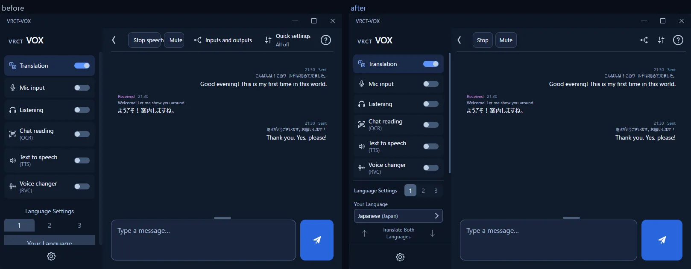

### L-01 狭い表示でサイドバーを開いたとき（英語 450×220）

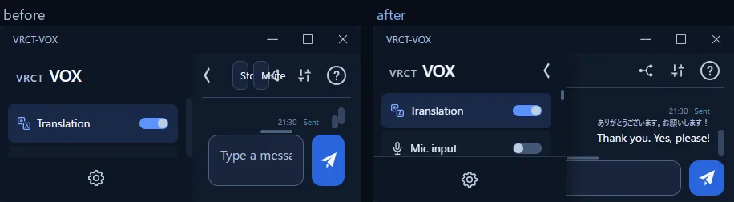

### L-02 最小サイズ（400×200）

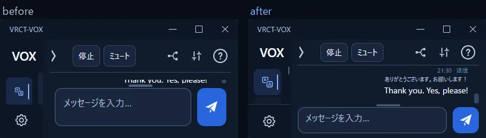

### L-03 サイドバー（1280×720、相手の言語 3 つ）

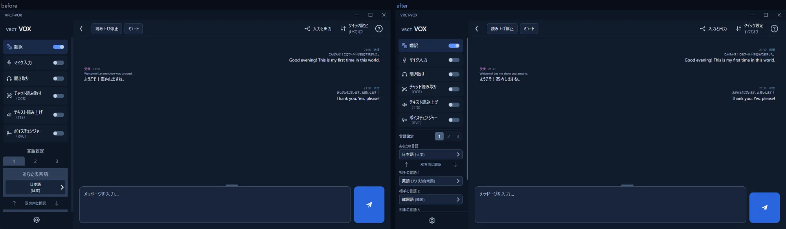

### L-03 サイドバー（英語 1280×720、相手の言語 1 つ）

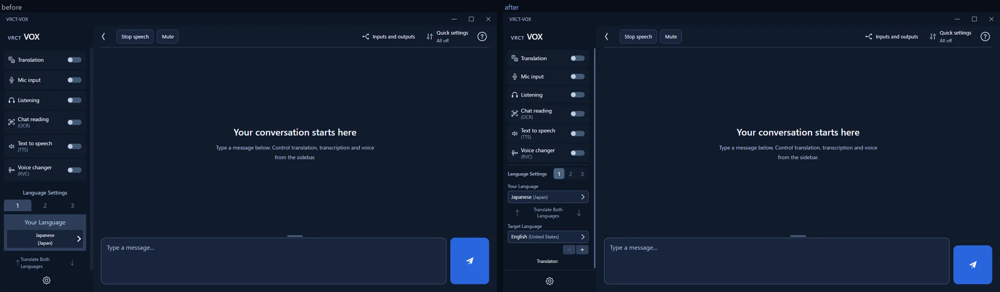

### L-03 UI サイズ 150%（1280×720）

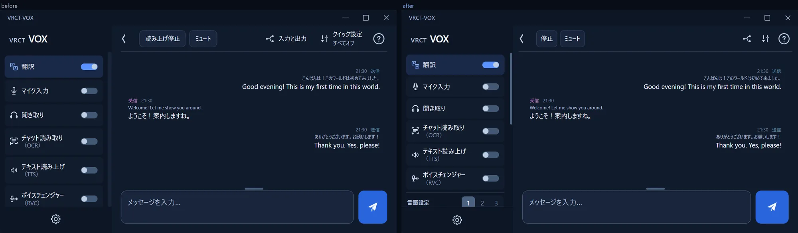

### L-05 クイック設定（400×200）

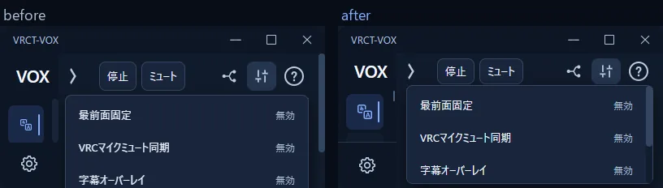

### L-06 入力と出力のパネル（400×200）

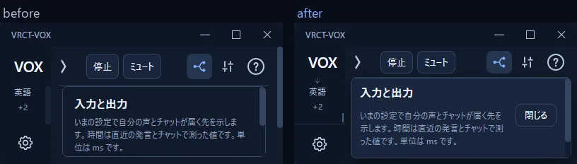

### L-07 翻訳エンジンの選択（1280×720）

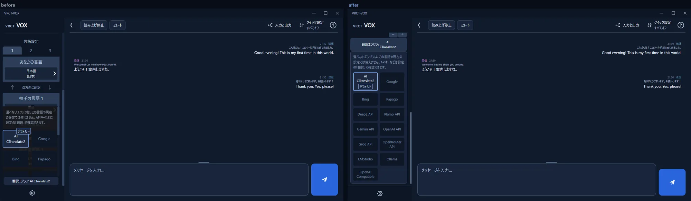

### L-08 言語の選択画面（1280×720）

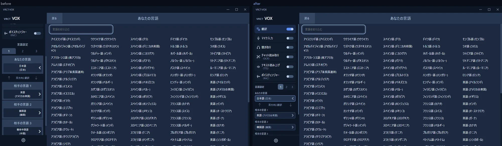

### L-09 アイコンの列（英語 640×480）

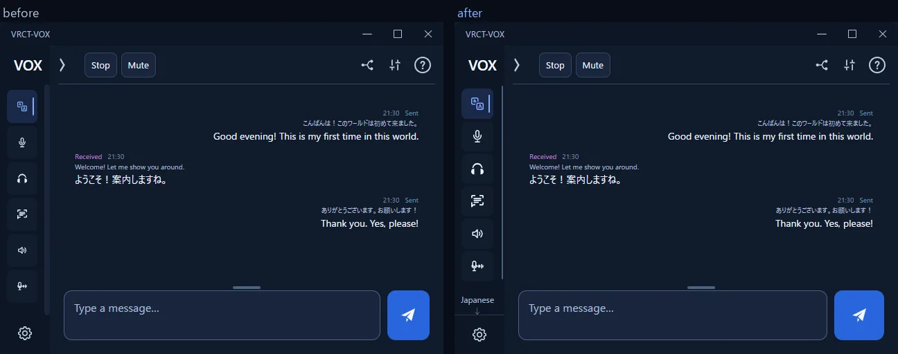

### L-10、L-11 大きいウィンドウ（英語 1920×1080）

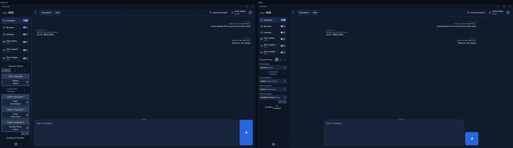

## 変更後も検出に残るもの

機械検出には、次の 2 種類が残っています。どちらも画像で確かめ、崩れではないと判断しました。

- **サイドバーの要素 × 設定を開く**: スクロール領域の下端で切れている要素の矩形が、その下の設定ボタンの帯に届いているものです。要素はスクロール領域で切り取られていて、帯の上には描かれていません。`detect.js` は、スクロールで届く領域を「見える範囲」として扱うためです。
- **サイドバーの要素 × メッセージ（sidebar-toggled、幅 800 以下）**: 狭いウィンドウで開いたサイドバーが、入力欄の上に重なっているものです。重ねて表示する設計どおりです。

## 確認していないこと

- **実際の Tauri ウィンドウ**: Windows の WebView2 と Linux の WebKitGTK では確かめていません。どちらもコンテナクエリには対応していますが、スクロールバーの描き方は違うおそれがあります。
- **フォント**: Windows の既定のフォントで撮りました。監査の画像（Linux、Noto）とは文字の幅が違います。そのため、変更前の画像も同じ PC で撮り直しました。
- **`App.jsx` にだけある部品**: 同意のダイアログ、通知、起動中の画面は、監査と同じく対象外です。
- **長い会話や長いメッセージ**: 監査と同じく、サンプルの会話 3 件だけで確かめました。

## 計測した環境

- Windows 11
- Chromium 1243（Playwright のヘッドレス）。スクロールバーを描くため、`--hide-scrollbars` を外しました（`audit/show_scrollbars.py`）
- デバイスピクセル比 1、動きを減らす設定、時計は 2026-01-10 21:30 に固定（監査と同じ）

## 再現の手順

監査の手順に、スクロールバーを描くためのプラグインを足します。PowerShell では次のとおりです。

```powershell
$env:PYTHONUTF8 = "1"   # Windows で findings の JSON を書くため
$env:AUDIT_OUT = "build/layout-audit"
$env:VRCT_TEST_STUDIO_UI = "1"
$env:VRCT_TEST_CHROMIUM = "<chrome.exe のパス>"
$env:PYTHONPATH = "tests/voice;docs/design/main-layout-audit/audit"
build/dev/browser-venv/Scripts/python.exe -m pytest -c tests/voice/pytest.ini --rootdir . `
    docs/design/main-layout-audit/audit/layout_audit.py -q -p no:cacheprovider -p show_scrollbars
```

- Vite を起動した直後の最初のページが 30 秒の制限を超えることがあります。そのときは、もう一度実行します。
- 変更前と変更後を並べた画像は、`audit/pairs.py` で作りました。
