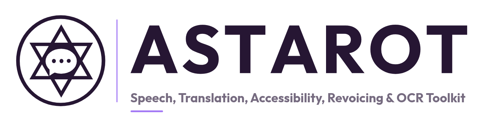

<h1 align="center">
  <picture>
    <source media="(prefers-color-scheme: dark)" srcset="../brand/astarot/logo-horizontal-dark.png">
    
  </picture>
</h1>

<!-- バッジは値をGitHub（Actions、Releases、リポジトリ）かリンク先のファイルから読む。LicenseとPlatformだけは固定で、
     LICENSEと配布物に合わせる。README.mdと同じにする。 -->

  
  
  
  

  
  
  
  

  
  
  
  
  

[English](/README.md)

ASTAROT（旧名VRCT-VOX）は音声認識（ASR）、読み上げ（TTS）、ボイスチェンジ（RVC）、チャット読み取り（OCR）、翻訳をまとめたVRChat向けのデスクトップアプリです。[VRCT](https://github.com/misyaguziya/VRCT)をもとに[kein5](https://github.com/kein5)が開発しています。**VRCTの公式版ではなく、VRCTの開発者やVRChatが承認したものでもありません。**

## できること

- **翻訳した発声**: チャット入力や確定した翻訳を[speech.cpp](https://github.com/nyosegawa/speech.cpp)のTTS（日本語はIrodori、ほかの言語はQwen3-TTS）で読み上げ、VRChatが使う仮想マイクに流します。音声とOSCのチャット文字は別々に設定できるので、自分の声はそのままに、翻訳の音声と文字を足すといった使い方ができます。
- **モニター出力**: 同じ読み上げ音声を自分のスピーカーやヘッドホンでも聞けます（任意）。
- **ボイスチェンジ**: RVCでマイクの声を変換します。WindowsとLinuxではライセンスとサイズを確認したうえで、実行環境をアプリから取得できます。CUDAでの変換にはGeForce GTX 16・RTX 20シリーズ以降のGPUとドライバー580以降が必要です。Windowsでは0.6.0から、DirectX 12対応のGPUもDirectMLで使えます。CPUでも処理が間に合えば変換できますが、声は遅れて届きます。Seed-VCは0.5.0で廃止しました。保存してあったSeed-VCの設定はRVCに切り替わります。
- **リアルタイム字幕**: 同梱のspeech.cppの音声認識サーバーで自分のマイクとほかのプレイヤーの声を文字にします。
- **同梱サーバー**: speech.cppのサーバーを設定画面から保存・起動・停止できます。
- **モデルの取得**: Irodori、Qwen3-TTS、RVCの既定モデル、翻訳のモデル（M2M100、NLLB-200）と、speech.cppが扱う音声認識モデル（Qwen3-ASR、ReazonSpeech、Haas-jaなど）を、ライセンスと容量を確認して同意したうえでHugging Faceから取得できます。サイズとSHA-256を検証し、設定への適用は別の操作です。GPUとVRAMに応じて標準・軽量モデルの目安を出しますが、動作を保証するものではありません。
- **Linux対応**: Waylandでのグローバルショートカット（XDG portal）、PipeWireの仮想マイクとマイク選択、AppImageでの日本語入力（fcitx/Mozc、ibus）に対応しています。VR UI、Waylandネイティブのウィンドウを共有するチャット読み取り、音声タイピングモードの貼り付け（X11/XWaylandのウィンドウ）も使えます。

RVCには音声モデルのほかに実行環境、HuBERT、RMVPEが必要です。[モデル取得の仕様](/docs/voice-stack/model-downloads.md)と、Windowsでは[Windowsで音声機能を使う](/docs/voice-stack/local-setup-windows.md)、Linuxでは[Linuxの手順](/docs/voice-stack/local-setup-linux.md)を参照してください。

## 配布状況

最新の版は **[GitHub Releases](https://github.com/kein5/astarot/releases/latest)** にあります（上のreleaseのバッジに番号が出ます）。バージョン番号は本家VRCT（3.x）とは別に0.1.0から数えます。ベータ版は`develop`から、正式版は`main`から公開します。

- **Linux**: AppImage、tar.gz、deb、rpm（x64、Vulkan）。0.5より前の版は、CachyOS（KDE Plasma Wayland）で実際のモデルを使って試験しました。
- **Windows**: インストーラーとzip。どのPCも同じ配布物です（0.5系のリリースには、同じ中身のCUDA版のzipもあります）。0.5より前の版は、Windows 11の実機で実際のモデルを使って試験しました（[検証記録](/docs/voice-stack/windows-voice-report.md)）。電子署名がないため、初回起動時にSmartScreenの警告が出ます。

いまの版で配布形式と機能ごとにどこまで確かめたか、CIで確かめたことと実機で確かめたことの違いは、**[対応環境と検証の範囲](https://kein5.github.io/astarot/ja/guide/support)** にあります。

各ファイルの`.sha256`と`SHA256SUMS-*`でダウンロードしたファイルを確認できます（電子署名ではありません）。インストーラー版とAppImage版は、署名を確かめてからアプリ内で更新します。ZIP版とtar.gz版は新しい版を知らせるだけで、deb・rpmはパッケージマネージャーで更新します。AURでの配布は予定していますが、まだ登録していません。

次の制限があります。

- チャット読み取り（OCR）にはモデルが必要ですが、同梱していません。利用条件に同意したうえで、設定の「チャット読み取り」で取得してください。LinuxではVRChatのウィンドウをXWayland経由で読み取ります。Waylandネイティブのウィンドウ（gamescopeの中のVRChatなど）は、ウィンドウを共有すると読み取れます。設定の「チャット読み取り」で「ウィンドウを共有…」を押すと、デスクトップのウィンドウ選択画面が開きます。
- LinuxのVR UIと、VRヘッドセットの画面のチャット読み取りは、SteamVRの代わりになる試験用の仕組みでだけ確認しました。実際のヘッドセットでは確認していません。Linux版の動作確認はKDE Plasma（Wayland）だけです。
- Google・Bing・PapagoのWeb翻訳は使えません（ライセンスの項を参照）。

不具合の報告や質問は **[Issues](https://github.com/kein5/astarot/issues)** へ、OS・バージョン・再現手順と、個人情報を除いたログを添えてお寄せください。脆弱性は[SECURITY.md](/SECURITY.md)の手順で非公開に報告してください。ASTAROTについての問い合わせを本家VRCTの開発者へ送らないでください。

## 使い始めるには

- [TTS設定ガイド](/docs/voice-stack/tts-quickstart-ja.md)
- [トラブルシューティング](/docs/voice-stack/troubleshooting.md)
- [アクセシビリティ：聞く・話す・読むことの支援と既知の制限](/ACCESSIBILITY.md#アクセシビリティ日本語)
- [モデル取得とGPU・VRAMの目安](/docs/voice-stack/model-downloads.md)
- [本家VRCTのドキュメント](https://misyaguziya.github.io/VRCT-Docs/)（本家アプリの説明で、ASTAROTの音声機能は含みません）

## 名称と保存先

画面にはASTAROTと表示しますが、実行ファイルと配布物は`vrct-vox` / `VRCT-VOX`、アプリIDは`io.github.kein5.vrct-vox`のままです。Linuxでは、0.6.0から設定とデータを`astarot`ディレクトリ（`~/.config/astarot`と`~/.local/share/astarot`）に保存します。0.6.0の最初の起動で、0.5.xの`vrct-vox`ディレクトリをそこへ移し、古い名前のリンクを残します。詳しくは[名称と識別子](/docs/voice-stack/project-rename.md)を参照してください。

## プライバシーとモデル

ASTAROTはオフにしない限り、2種類の利用状況の通知をASTAROTの受信サーバーへ送ります（「設定」→「高度な設定」の「利用状況を送信する」）。起動したこと（1日に1回）と、エラーの種類を表す固定のコード（同じコードにつき1日に1回）です。どちらにもアプリのバージョン、OSの種類とバージョン、表示言語、PCの構成（CPU、メモリ、GPUとそのドライバのバージョン）が付きます。送られる内容はアプリの「送信される内容を見る」でそのまま確かめられます。会話の文字や音声、マイクやスピーカーの名前、ユーザー名は送りません。最初に出るお知らせに答えるまでは何も送りません。本家VRCTのAptabaseのテレメトリーは使いません（本家の古いキーファイルが残っていても送信しません）。ユーザーが選んだ翻訳サービスや音声サービスには、送った文字や音声が届きます。利用状況の送信を止めても、すべての機能がオフラインになるわけではありません。

モデルは同梱していません。TTS・音声認識・RVCのモデルは、ユーザーが求めたときだけ取得するか、ユーザー自身が用意します。配布物にはOCRの重みを一切入れていません。本家のチャット欄検出モデルはforkの配布物に含めることが許されていないため、0.2.0でリポジトリからも消しました。0.1.0までのコミットには、その[利用条件](https://github.com/kein5/astarot/blob/250cec9681752c2f897d9a15a38e647c38561842/src-python/models/ocr/onnx/LICENSE.txt)のもとでモデルが残っているので、古いソース一式をそのまま配布しないでください。検証用の音声Mia2026は配布しません。同梱のspeech.cpp本体にはそれぞれの表記があり、モデルのライセンスはモデルごとに異なります。

## ライセンスと謝辞

ASTAROTは[MIT License](/LICENSE)で、本家VRCTの著作権表示を残しています。外部エンジンとモデルの重みにはそれぞれのライセンスが適用されます。Seed-VC連携など0.4.xまで同梱していたLGPL・GPLの部品、ソースの入手先、差し替え方法は[NOTICE](/NOTICE.md)にあります。GPLのx264/x265を含むPyAVと、公式VRCT専用ライセンスの`translator_engines`は配布しません。`translator_engines`を配布しないため、Google・Bing・PapagoのWeb翻訳は使えません。

本家VRCTの、みしゃ（misyaguziya）さん（メイン開発）、しいな（Shiina_12siy）さん（UI/UXとローカライズ）、レラ（soumt-r）さん（技術的な助言）、どね（done_vrc）さん（ロゴ）、そして[すべての貢献者](https://github.com/misyaguziya/VRCT/graphs/contributors)に感謝します。ASTAROTは皆さんの成果の上に成り立っています。現在は本家に追従しておらず、リポジトリの所有者が決めない限り本家へ何かを送ることはありません（[方針](/docs/voice-stack/publication-and-upstream.md)）。

VRChatおよび関連する名称はVRChat Inc.の商標または登録商標です。ASTAROTはVRChat Inc.と関係ありません。

## 開発

開発に使うNode、Rust、Python、uv、Cocogittoの版は`mise.toml`で固定していて、[mise](https://mise.jdx.dev/)で入れます（`mise install`）。よく使う手順もmiseのタスクにしてあり、`mise tasks`で一覧を見られます。`mise run doctor`で開発環境を確認し、検査用の依存を`mise run setup:headless`、UIの依存を`mise run setup:ui`で入れます。`mise run check`で開発ツールとNodeのテスト、lintを実行します。音声・バックエンド・Rustの検査、ブラウザでのテスト、Cocogittoは[開発ガイド](/docs/development.md)を、ブランチ、コミットメッセージ、PRの決まりは[CONTRIBUTING.md](/CONTRIBUTING.md)を参照してください。

正式版ごとの変更は[CHANGELOG.md](/CHANGELOG.md)にあります（0.2.0から）。ベータ版と、それより前のリリースは[GitHub Releases](https://github.com/kein5/astarot/releases)にあります。

- [ビルドとCIのガイド](/docs/readme_build.md)
- [Linuxのビルドパイプライン](/docs/voice-stack/linux-build-pipeline.md)と[AppImage](/docs/voice-stack/appimage.md)
- [配布候補と下書きの手順](/docs/voice-stack/release-candidates.md)
- [音声機能のライセンスと配布の範囲](/docs/voice-stack/licensing.md)
