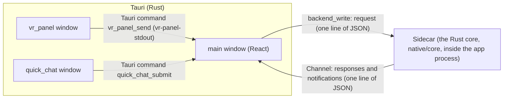
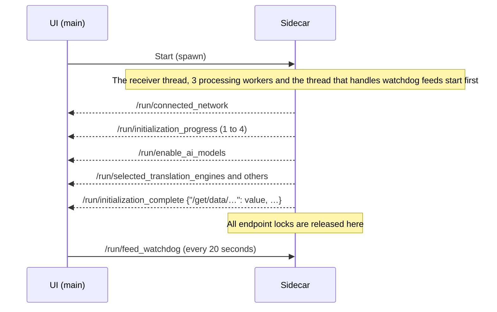
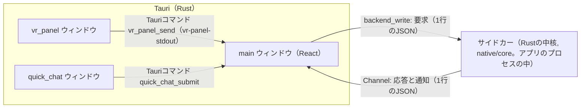
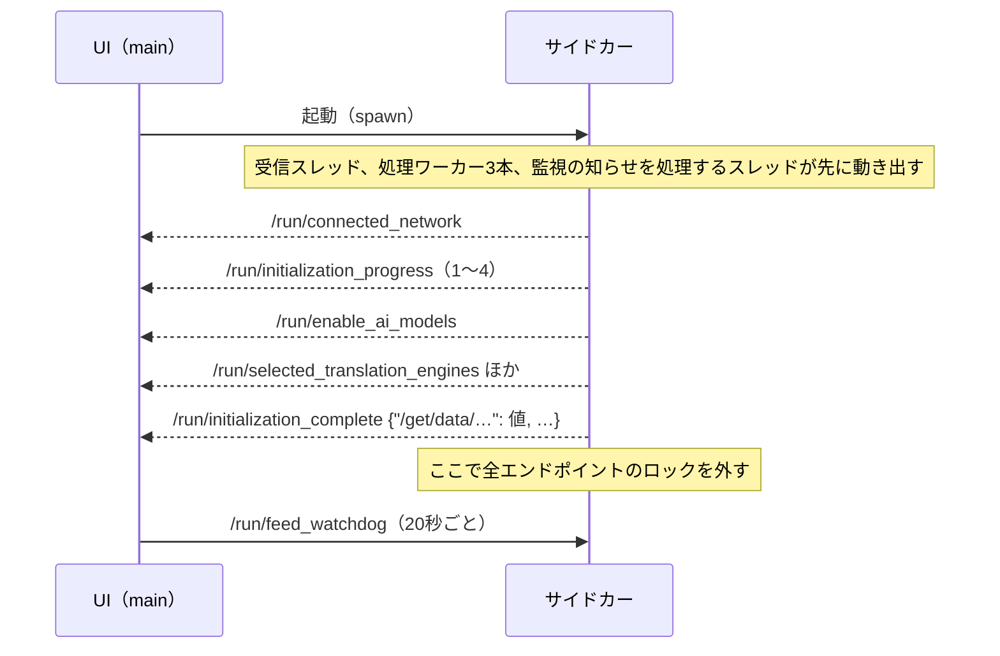

# IPC protocol (UI and sidecar)

[日本語版](#ipcプロトコルuiとサイドカー日本語版)

The rules for messages between the UI (Tauri and React) and the backend. From 0.5.0 the backend is the Rust core (`native/core`) running inside the app process, and it speaks with the same line format and rules as the Python sidecar of 0.4 and earlier. This document keeps the old name and calls the backend the "sidecar". Individual endpoints are in [the IPC endpoint list](reference/ipc-endpoints.md), and error codes are in [the error code list](reference/error-codes.md).

The LSP specification describes the "Base Protocol" apart from each message. Following it, this document covers only the rules common to all endpoints.

## Message paths



- Only the `main` window talks to the sidecar. The VR UI and Quick Chat go through `main` ([External interfaces](external-interfaces.md#ウィンドウ間の連携)).
- The backend is started with `backend_start` (`src-tauri/src/backend_host.rs`), and the UI handles it through `backendCommand.ts` in the same shape as the `Command.sidecar` of 0.4 and earlier (`src-ui/views/app/_app_controllers/StartPythonController.tsx`). Requests go through `backend_write` and shutdown through `backend_kill`, and responses and notifications arrive on a channel that keeps their order. The line format and rules are the same as up to 0.4 ([Core integration](../voice-stack/core-integration.md)). Below, "stdin" and "stdout" mean these two directions, requests and responses.

## Message format

### Request (UI → sidecar, stdin)

```json
{"endpoint": "/set/data/osc_port", "data": "OTAwMQ=="}
```

| Field | Type | Content |
|---|---|---|
| `endpoint` | String | The endpoint requested |
| `data` | String (optional) | The value passed through `JSON.stringify`, then encoded as Base64. Omitted in requests that have no value |

- Each line holds one JSON object and ends with a newline (`src-ui/logics/common/useStdoutToPython.ts`).
- The sidecar decodes `data` from Base64 and reads it as JSON (`native/core/src/protocol.rs`, the same as Python's `encodeBase64`). If it cannot be read, it becomes an empty dictionary.
- Requests carry no sequence number. Responses are matched by `endpoint`. Language changes are managed through the owner described below. For saving the voice, RVC, speech server and real-time speech recognition settings and hotkeys, responses are matched in send order within the same endpoint. A response to a state read does not confirm a save. When a transport error during a write leaves it unknown whether the request arrived, further sends to the same save target stop until that response arrives or the session ends.

### Responses and notifications (sidecar → UI, stdout)

```json
{"status": 200, "endpoint": "/set/data/osc_port", "result": 9001}
```

| Field | Type | Content |
|---|---|---|
| `status` | Number | Status code (see the next table) |
| `endpoint` | String | For a response, the same endpoint as the request; for a notification, `/run/…` |
| `result` | Any | The result. For an error, the error body |

Responses and notifications have the same shape. A notification is not a response to a request: the sidecar sends it on its own, like a "Notification" in LSP or JSON-RPC (the UI does not reply).

### stdout delivery and stalls

- One dedicated thread serializes the writes. When the queue is empty, it waits on a condition variable with no deadline and does not poll. Responses and notifications are taken out before diagnostic logs. Up to 200 diagnostic logs are kept, and beyond that the oldest are dropped first.
- Responses to requests (including periodic state reads), final messages, errors and completion notifications are not coalesced and are kept in the order they were queued. Of the success notifications that come from `mainloop.run`, only the following replace an undelivered entry with the same key by the newest value. The JSON shape and the status code do not change.

| Notification | Coalescing key and condition | Why the newest value is enough |
|---|---|---|
| `/run/vr_panel_pointer` | The endpoint. Coordinates or `null` | The current position for the hover display in VR. Contains no click actions |
| `/run/check_mic_volume`, `/run/check_speaker_volume` | Per endpoint. Numbers only | Replaces the current value of the volume meter |
| `/run/realtime_caption` | A non-empty `partial` with the same `source`, `generation`, `namespace` and `item_id` | Replaces the full text of the same caption line. A different utterance is a different line, so it is not coalesced. An empty string retires the line, so it is kept |

- A coalesced value goes to the new queue position. The remaining lines keep their order, and a state later than a start response is never sent before that response. A caption's `final`, `translated`, `discarded` and `outcome` remove the waiting partial with the same key. The delivery result `outcome` has no text and is kept as a final notification that is not coalesced ([Data formats](data-and-persistence.md#リアルタイム字幕と配送結果)). Late partials are also ignored for keys whose final line is waiting and for the 256 keys most recently taken out. A partial that is being written is handled by the single writer before the final line.
- There are at most 64 coalescing keys. An unknown shape, an unknown notification or a new key with no free slot is kept as an ordinary line, and other caption lines and the like are not dropped. So there is no limit on the total number or total bytes of lines that must be kept.
- A separate watch thread records once in `error.log` when no write has completed for 20 seconds while undelivered lines (including one being written) exist. The record gives the counts of kept lines, coalesced lines, diagnostic logs, lines being written and lines dropped in total. The next completed write records the recovery once. The writer and the watcher wait on separate condition variables. The watcher is woken by a signal only for the first queued line when no deadline is set, for the first success after a stall was reported, and for stopping. Ordinary queuing and completion do not wake it; it reads the latest progress time when the set deadline is reached. If the queue is empty at that point, it goes back to waiting with no deadline, and after reporting a stall it also waits with no deadline until recovery. A stall alone does not cause shutdown, a restart or requests to run again.
- On a temporary `OSError` (such as Errno 22 on Windows), the same output line is tried up to 3 times. So that a partly written line is not joined to the next JSON, after a failure a newline must be written and flushed successfully before the next attempt. A failed newline also counts as an attempt. A broken pipe, a closed stdout and similar errors end the attempts for that line. A line given up on is recorded in `error.log` with the total count of dropped lines, and later successes do not clear that record or the total. After 50 lines fail in a row, the existing frontend-lost callback is called (the process exits if none is registered). A success resets only the count of failures in a row.
- `sidecarSession.ts`, which the UI's `StartPythonController.tsx` uses, ignores empty lines, records lines with invalid JSON and goes on reading the following lines. When a flush fails, the whole line may already have arrived. The current format has no acknowledgment, so duplicates from retries cannot be told apart, and exactly-once delivery is not guaranteed. If transport diagnostics fail, they are not written back to stdout.

### Status codes

| `status` | Meaning | UI handling (`useReceiveRoutes.ts`) |
|---|---|---|
| 200 | Success | Passes `result` to the receiver registered for the endpoint. If there is no receiver, logs `Invalid endpoint` to the console |
| 400 | Expected error | Dispatched by `result.error_code` ([Cross-cutting behavior](cross-cutting.md#エラーの扱い)) |
| 404 | Endpoint does not exist | Releases the wait, goes back to the last confirmed value and reports that the operation could not be done |
| 409 | Cannot run because the state does not fit (voice features) | The voice, RVC and speech server screens show `result.error_code` |
| 423 | Locked (before initialization, or the same feature is busy) | Releases the wait and goes back to the last confirmed value. Tells the user to try again after the processing finishes. Arrives only when the lock did not open after waiting (see below) |
| 500 | Unexpected exception | Releases the wait and goes back to the last confirmed value. Reads the value again if there is a matching read endpoint, and shows the existing error notification |
| 348 | Log | Not shown. Has the form `{"status": 348, "log": …, "data": …}` and no `endpoint` |

For the voice, RVC, real-time speech recognition and model download endpoints, any status other than 200 goes to each feature's error display instead of `errorHandling_Backend` (the first branch in `receiveRoutes`).

A request that sets only the URL for OpenAI-compatible or Custom Whisper (`/set/data/openai_compatible_url`, `/set/data/custom_whisper_url`) returns 400 without contacting anything outside when the validated URL differs from the saved value and a key is saved. `result.error_code` is `CREDENTIAL_REENTRY_REQUIRED` and `result.data` is the saved URL, and the settings and the running state do not change. The UI releases only the wait for that URL. For the same URL it returns 200 without network access or changes, and when no key is set it saves only the URL. To change the URL and the key together, use `_auth_key_and_url` ([Changing API keys](cross-cutting.md#apiキーの変更)).

### Releasing the wait on a failed request

- Ordinary settings and the main features keep the last confirmed value in the atom's `data` while a request is pending. On 404, 423 and 500 they keep that value and set `state` back to `ok`. The success handler is not called, and no save-success notice is shown. When only the VR side is waiting, `main` sends the same value again.
- On 500 the write may have been partly applied. `/set/data/…`, `/delete/data/…`, `/set/enable/…` and `/set/disable/…` are mapped to an existing `/get/data/…`, which is read again. The connection checks `/run/lmstudio_connection` and `/run/ollama_connection` use `/get/data/connected_lmstudio` and `/get/data/connected_ollama`.
- The main switches for translation, sending and receiving transcription and OCR, and the volume tests, have no matching read endpoint. On failure they only go back to the last confirmed display and do not guess an unconfirmed result. The core added a read endpoint for `ollama_url` (`/get/data/ollama_url`).
- A failed re-read is not repeated. If a new write is sent while a re-read is pending, the old read response does not overwrite that write's wait or value. Writes are never resent automatically. Elapsed time alone does not release a wait either.
- When sending returns `false` or throws an exception, ordinary controls also go back to the last confirmed value. A send-failure notice is shown, but not on top of a notice that the sidecar stopped. A failed re-read alone does not add a send-failure notice on top of the original 500 notice either.
- Language changes use the dedicated matching described below. The TTS/RVC generation numbers, the model download observation numbers and the separate error handling for 400 and 409 also stay. For TTS/RVC, 404, 423 and 500 release the wait and read the state again only when the on/off direction of the response matches the current request. A send failure releases only the waits that this send still holds.
- In the old CTranslate2 download, different weights can be requested at the same time through the same endpoint. On 404, 423 and 500, `result.data.weight_type` returns only the failed weight, and the wait and progress of that item are released. On 500 the re-read target is `/get/data/selectable_<name>_type_dict`. `is_downloaded` is not rewritten on the guess that the download succeeded. Values from other requests and secrets are not copied into the error.
- Sends from the input box (`/run/send_message_box`) can also have several requests waiting for the same lock. On 404, 423 and 500, `result` becomes `{"message": original result, "data": {"id": row ID}}`, and only the failed row is shown as failed. The message text is not put in the error. An error without an ID (a request with no string ID) makes every input row in progress an unconfirmed failure.

### Error body

```json
{"status": 400, "endpoint": "/set/data/osc_port", "result": {
  "error_code": "VALIDATION_OSC_PORT_INVALID",
  "message": "OSC port is not valid",
  "data": 9000,
  "details": {},
  "category": "validation",
  "severity": "error"
}}
```

- The core builds it in `native/core/src/errors/mod.rs` (the same shape as Python's `VRCTError.create_error_response`). `message` is a default English sentence, and in many cases the UI replaces it with a string from `locales/`.
- `data` is "the value to restore". For a settings validation error it holds the value before saving, and the UI rolls the screen back to that value.
- A 409 from the voice features may return only `{"error_code": "..."}`.
- An error built from an exception has `details.exception_type`.

## Endpoint names

| Form | Meaning | Example |
|---|---|---|
| `/get/data/<name>` | Read a value | `/get/data/osc_port` |
| `/set/data/<name>` | Write a value. The response's `result` is the value after saving | `/set/data/osc_port` |
| `/delete/data/<name>` | Delete a value (such as an API key) | `/delete/data/deepl_auth_key` |
| `/set/enable/<name>`, `/set/disable/<name>` | Turn a feature on and off | `/set/enable/translation` |
| `/run/<name>` | An action, or a notification | `/run/send_message_box`, `/run/initialization_complete` |

- `/run/…` is used for both requests and notifications. [The endpoint list](reference/ipc-endpoints.md) tells them apart.
- Notification names are in the core's `RUN_MAPPING` (`native/core/src/controller/mod.rs`, the same names as Python's `run_mapping`), and a name not in the table is stopped when it is sent. The list of names is in the notifications section of [the IPC endpoint list](reference/ipc-endpoints.md).

## Startup and initialization

Normal release builds register `tauri-plugin-single-instance` as the first Tauri plugin.
On a second launch, the existing `main` window is shown, restored from minimized and focused.
The process started later exits before it starts the core, uses the microphone or reads or writes `config.json`.
If the existing `main` has not been created yet, no window operation is done. The show request and failed operations are recorded in the existing process's `startup.log`.

Debug builds, and launches that set the storage location in the environment variable `ASTAROT_CONFIG_DIR` (or `VRCT_CONFIG_DIR`), turn this control off.
This lets a development worktree, or a native GUI test with separate state, run at the same time as the installed app.
When the Linux release build is tested with isolated `XDG_*`, also set `ASTAROT_CONFIG_DIR` to the same settings location (`$XDG_CONFIG_HOME/astarot`).
The Linux release build decides the storage location before this check ([Moving the Linux storage location](data-and-persistence.md#linuxの保存先の移動)). When it moves the 0.5.x folder, it first checks the single-instance names of other ASTAROT and VRCT-VOX instances, and does not move the folder if one is in use.
On Linux the check depends on the D-Bus session bus, and where the bus cannot be reached, a second launch cannot be prevented.
The single-instance name is made from the app ID. From 0.7.0 the app ID is `io.github.kein5.astarot`, so this check does not stop a launch even while a version up to 0.6.x (`io.github.kein5.vrct-vox`) is running.
The settings location and the behavior of `config.json.lock` do not change. The check and the environment variables for test launches are verified by `tests/devtools/test_single_instance.py`.



1. The sidecar starts the receiver thread, the processing workers and the thread that handles watchdog feeds, then runs `controller.init()`. Requests that arrive during initialization and have `"status": False` in `mapping` (turning translation or speech recognition on or off, sending messages and so on) are treated as locked.
2. At the end of initialization, the sidecar sends `/run/initialization_complete`, which combines the results of almost every `/get/data/…` into one. It leaves out 9 of them: `available_releases` and `realtime_asr_models`, which use the network; `ocr_readiness`, which inspects the screen; `ocr_capture_status`, which shows a running state; `vrchat_osc_presence`; `telemetry_preview`; `tts_engine_voices`; `overlay_font_missing_languages`, which looks up the system fonts; and `gpu_memory`, which reads GPU memory (`INIT_EXCLUDED` in the core's `controller/lifecycle.rs`). The UI requests `realtime_asr_models` after it receives `/run/initialization_complete`. An item whose value could not be read is `null`.
3. The UI hands each item of `/run/initialization_complete` to its receiver, sets `IsBackendReady` to true and enables the main screen (until then it shows placeholders that cannot be operated; [Handling during initialization](cross-cutting.md#初期化中オフライン能力の不足)). It first checks that each value has the shape its receiver needs: array, object, string, number or boolean. It accepts `null` where it means "not set", as for an API key or a model not yet chosen. If a required value is missing, has the wrong shape or throws an exception while being applied, the UI keeps the safe initial value for that item and moves on to the next item. The initial language values provide display slots for every tab, and language names not yet received use the existing loading display. The UI logs each failed item name and reason once to the console, without the value itself. If anything failed, the existing persistent warning notice says, in the UI language included in the same result, that some settings could not be loaded. At this point the UI fetches the voice, speech server, real-time speech recognition and model download states again itself.
4. All endpoint locks are released only after `init()` returns.

The owner of the startup is held in `store.backend_session_owner` (`src-ui/logics/common/sidecarSession.ts`). Several controllers, StrictMode effect re-runs and remounts from an error boundary connect to the same session and do not start a second sidecar. For stdout, stderr, close, error and the completion of asynchronous work, it is checked that the session is the current one. Notifications from an old child process and completions of old writes do not change the state of the new session.

A refused spawn, an `error` from the command before the child process exists, and an unexpected exit before the 200 initialization-complete notification set `BackendStartupState` to `failed`. A successful spawn and the completion of initialization are recorded separately. An `error` while running (such as a failure to read stdout or stderr) is only recorded, and the child process is not stopped. The reason for the failure (it could not spawn, or it exited before it was ready; for an exit, the code or signal) is recorded in `BackendStartupFailure`, and the UI shows a persistent startup-failure dialog over the inoperable main screen, with the reason, what to do next and buttons for "Try starting again" and quitting. Readiness is derived from `BackendStartupState` and `IsBackendReady` (`src-ui/logics/common/startupPhase.ts`), with no separate state. Only when the user presses the button does the UI retry, after waiting for the failed spawn to complete and for the child process's shutdown. While waiting, it closes the dialog, goes back to the starting display and ignores repeated presses. If the shutdown fails, it does not start a new child process and goes back to the failure guidance. There is no automatic retry and no resending of uncertain writes.

The Rust core also reports with an exit code when it stops while getting ready (`native/core/src/backend.rs`). When the preparation panics, or its thread cannot be started, the core exits with `101` (`STARTUP_FAILED_EXIT`). When the preparation has not finished after 180 seconds (`STARTUP_LIMIT`), it exits with `124` (`STARTUP_TIMEOUT_EXIT`). In both cases it does not open the endpoints. If the preparation finishes after the deadline, it still does not open them. It writes only one fixed line to `error.log`, not the panic message (which can contain what the user said). The startup-failure dialog tells these two codes apart as "stopped on an internal error" and "did not finish getting ready in time", and for any other code shows "stopped while it was getting ready" with the code.

Both `failed` and `stopped` set `IsBackendReady` to false and disable global hotkeys and sending from Quick Chat. If the sidecar exits after initialization, the main screen stays and does not go back to the inoperable starting display. The main feature switches keep their last confirmed values but are not shown as running: their text and accessible names say that the connection was lost, and they are disabled. While there is no sidecar, these switches send no requests.

The core is started, given input and stopped with the Tauri commands `backend_start`, `backend_write` and `backend_kill` (`src-tauri/src/backend_host.rs`). All three accept calls only from the `main` window and return `backend_forbidden` to other windows. Input and stop work only when the session ID handed out at start matches the current run. A new start stops the previous run first. The app does not include the shell plugin (up to 0.4 it started the Python sidecar). Links open only through the opener plugin's list. The UI does not read or write files or make HTTP requests itself, so the app does not include the fs and http plugins (security audit SEC-05). `src-ui/logics/common/appPermissions.test.ts` checks the permission list against how the UI makes its calls.

These are verified in `src-ui/logics/useReceiveRoutes.test.ts`, `src-ui/logics/common/sidecarSession.test.ts` and `useStdoutToPython.test.ts`, which simulate spawn and child-process events.

## Concurrency and locks

- Requests go into a queue, and 3 workers (`DEFAULT_WORKER_COUNT`) process them. Requests that use the same lock run in the order received (FIFO), and each sends its response before the next one starts. Requests with different locks can run in parallel and do not necessarily finish in the order they arrived. This queue does not guarantee order relative to messages that arrive on other paths, such as the microphone or OCR.
- Each endpoint has a lock. `/set/enable/x` and `/set/disable/x` use the same lock. When a lock is in use, the first request for that lock is held in the queue until a completion signal. While it waits, it does not occupy a worker, and later requests for the same lock cannot overtake it. If the first request still cannot take the lock about 20 seconds after it started waiting, it returns 423 without being processed. This timeout response does not wait for the running request to finish. Workers also wake at intervals of at most 0.5 seconds to check for a stop.
- For translation and transcription engines with API keys, changing or deleting a key of the same service, choosing a model, changing the OpenAI-compatible or Custom Whisper URL and saving a URL and key pair are processed under the same lock in the order received. Requests for different services can run in parallel. Applying the settings and the prepared client also uses a shared lock. The shared lock is not held while the service is being queried ([Changing API keys](cross-cutting.md#apiキーの変更)).
- Turning OBS and WebSocket on or off, and writes to the WebSocket host and port and the OBS port, use the same lock so that a server they depend on is not stopped partway. The next operation does not start until the listen check, committing the settings and recovery on failure are finished. The wait limit is the same as for ordinary endpoint locks.
- Starting (`/run/typing_message_box`) and stopping (`/run/stop_typing_message_box`) the typing indicator are processed in the order received under the shared `/lock/typing_message_box`. A later stop never overtakes an earlier start, even before the worker that took the start begins processing it. The request and response formats and the usual lock wait limit do not change.
- A request that hits the lock before initialization (`"status": False`) is held at the head of the same lock and retried every 0.1 seconds. After 300 tries (about 30 seconds) it returns 423. The wait between retries does not occupy a worker either.
- The following requests skip the queue and are processed as soon as they are received, so that stop operations do not wait behind other heavy work: `/run/stop_voice`, `/run/disable_tts`, `/run/mute_voice`, `/run/resume_voice`, `/run/stop_direct_voice`, `/run/stop_realtime_asr`, `/run/stop_speech_server`, `/run/stop_voice_audition` (core only).
- `/run/feed_watchdog` also skips the queue, and a dedicated thread processes it in the order received. Even when all 3 workers are busy with heavy work, the watchdog feed is not delayed, and the watchdog does not stop a sidecar that is running.
- The receiver thread attaches a generation number to some requests (such as `_voice_generation` on `/run/send_message_box`), so that a request's audio does not play later if a stop happened while the request waited in the queue ([Cross-cutting behavior](cross-cutting.md#停止とミュート)).
- `/run/start_realtime_asr` and the main switches that use real-time speech recognition (`/set/enable/transcription_send`, `/set/enable/transcription_receive`) get the `_realtime_generation` at the time of receipt. The generation is kept while the server gets ready, and a request made stale by a stop that arrives later does not start recording. For the main switches, the existing 400 `TRANSCRIPTION_SEND_NOT_READY` / `TRANSCRIPTION_RECEIVE_NOT_READY` (`data: false`, `details.reason: realtime_stale_start`) is returned. A built-in server started by a cancelled request is released unless another start or a running speech recognition uses it.

### Matching language changes

Only for writes to `selected_your_languages`, `selected_target_languages`, `selected_translation_engines` and `selected_tab_no` does the UI remember an ID and the state before sending for each request (`src-ui/logics/main/languageMutationCoordinator.ts`). When 400, 404, 423 or 500 comes back, it reads all language values again. When there is no response within 30 seconds, it shows "Not confirmed" but keeps ownership of the request and waits for the final response. This keeps a late response from being mistaken for another request's. So if a response is lost, the languages cannot be changed until the sidecar is started again. The ID is not sent to the sidecar.

## Watchdog and shutdown

- After startup, the UI sends `/run/feed_watchdog` every 20 seconds. There is one timer per session: it is cleared when the last controller detaches and restarts on reconnection. If the spawn completes after unmount and there is no controller, no timer is created. The sidecar stops itself if nothing arrives for 60 seconds (`WATCHDOG_TIMEOUT`, `WATCHDOG_INTERVAL`). If stopping does not finish in 30 seconds, the process is killed.
- When the main window closes, whether by the close button, Alt+F4 or the taskbar, the UI sends `/run/shutdown` once, waits 2 seconds and then destroys the window (`WindowCloseController` in `src-ui/logics/common/useWindow.ts`). Shutdown work that has not finished in 2 seconds does not run to the end, because the core's run is stopped when the app exits (`BackendHost::shutdown`).
- When stdin closes (EOF), the sidecar assumes that the UI has ended and, without waiting for the watchdog deadline, enters the same shutdown as a watchdog timeout (`escalateShutdown`). An EOF after a stop was requested does nothing. Stopping the sidecar when the UI hangs and does not read the output is still the watchdog's job.
- When the sidecar process ends, the UI releases the waits of ordinary atoms, language changes, TTS/RVC, the speech server, real-time ASR and model downloads. Downloads and servers that were running are shown as unavailable, and operations that were waiting are not resent. No polling is sent after the stop.
- Unless it is a planned exit through `/run/shutdown`, `/run/update_software` or `/run/update_cuda_software`, the existing persistent notice says that the engine has stopped and a restart is needed (`StartPythonController.tsx`). A planned exit also releases the waits. A planned exit is kept per session and per endpoint, and is cleared by a send failure or a response other than 200. A failed update download or verification also clears it and returns the updating screen to its earlier state. A crash after that is reported as usual. A planned exit is not carried over to the next session.

## stderr and logs

- Lines on stderr that are judged to be warnings (`src-ui/logics/common/sidecarDiagnostics.ts`) are ignored. Other lines are shown as persistent error notices.
- Lines with status 348 are logs, and the UI does not show them. The same content is also written to `process.log`.
- For the states that the UI polls every 0.5 to 1 second (`POLLED_ENDPOINTS`: the voice state, the route, the voice conversion state, the speech server, real-time speech recognition, model downloads and TTS voice previews), successful responses (200) are written neither to `process.log` nor as status 348 lines. The responses themselves are sent to the UI. Failed responses are written. Successful volume values that the volume check in Settings sends (`/run/check_mic_volume`, `/run/check_speaker_volume`) are not written to `process.log` either.
- The UI's two volume meters reuse the atom object when both the value and `state` are the same. The receiving side does not subscribe to the meter values; it only writes them. This does not change what a repeated notification means for other atoms (`src-ui/logics/common/meterValue.test.ts`).
- When a response cannot be turned into JSON, 500 is sent to the UI, and only the response's shape without values (the sequence of types) is written to `process.log`.
- Logs mask values such as API keys (`SENSITIVE_ENDPOINT_MARKERS`). Conversation text is not written to `process.log`. The IPC on stdout itself is not masked.

---

# IPCプロトコル（UIとサイドカー）（日本語版）

UI（Tauri＋React）とバックエンドの間のメッセージの規則。0.5.0からバックエンドはアプリのプロセスの中で動くRustの中核（`native/core`）で、0.4までのPythonのサイドカーと同じ行の形と規則で話す。この文書では、バックエンドを以前の呼び名のまま「サイドカー」と書く。個々のエンドポイントは[IPCエンドポイント一覧](reference/ipc-endpoints.md)、エラーコードは[エラーコード一覧](reference/error-codes.md)にある。

LSPの仕様書が「Base Protocol」と各メッセージの説明を分けているのにならい、この文書は全エンドポイントに共通する規則だけを書く。

## 経路



- サイドカーと話すのは`main`ウィンドウだけである。VRパネルとQuick Chatは`main`を経由する（[外部インターフェース](external-interfaces.md#ウィンドウ間の連携)）。
- 起動は`backend_start`（`src-tauri/src/backend_host.rs`）で、UIは`backendCommand.ts`を通して0.4までの`Command.sidecar`と同じ形で扱う（`src-ui/views/app/_app_controllers/StartPythonController.tsx`）。要求は`backend_write`、終了は`backend_kill`で、応答と通知は順序を保つチャネルで届く。行の形式と規則は0.4までと変わらない（[中核の統合](../voice-stack/core-integration.md)）。下で「stdin」「stdout」と書くのは、この要求と応答の向きのことである。

## メッセージの形

### 要求（UI → サイドカー、stdin）

```json
{"endpoint": "/set/data/osc_port", "data": "OTAwMQ=="}
```

| 項目 | 型 | 内容 |
|---|---|---|
| `endpoint` | 文字列 | 要求するエンドポイント |
| `data` | 文字列（省略可） | 値を`JSON.stringify`したものをBase64にした文字列。値がない要求では省略する |

- 1行に1つのJSONを書き、改行で終える（`src-ui/logics/common/useStdoutToPython.ts`）。
- サイドカーは`data`をBase64から戻してJSONとして読む（`native/core/src/protocol.rs`。Pythonの`encodeBase64`と同じ）。読めないときは空の辞書になる。
- 要求に通し番号はない。応答は`endpoint`で対応づける。言語の変更は後述の所有者で管理する。音声・RVC・音声サーバー・リアルタイム音声認識の設定とホットキーの保存は、同じエンドポイント内で送信順に応答を対応づける。状態の取得応答では保存を確定しない。書き込み中の輸送エラーで到達したか分からなくなった場合は、その応答が届くかセッションが終わるまで、同じ保存先への追加送信を止める。

### 応答と通知（サイドカー → UI、stdout）

```json
{"status": 200, "endpoint": "/set/data/osc_port", "result": 9001}
```

| 項目 | 型 | 内容 |
|---|---|---|
| `status` | 数値 | 状態コード（次の表） |
| `endpoint` | 文字列 | 応答なら要求と同じエンドポイント、通知なら`/run/…` |
| `result` | 任意 | 結果。エラーのときはエラーの本体 |

応答と通知は同じ形である。通知は要求に対する応答ではなく、サイドカーが自分から送るもので、LSPやJSON-RPCの「Notification」にあたる（UIは返事をしない）。

### stdoutの配送と詰まり

- 専用スレッド1本が書き込みを直列化する。キューが空なら条件変数で期限なしに待ち、ポーリングしない。応答・通知は診断ログより先に取り出す。診断ログは200件まで保持し、超えた分は古いものから捨てる。
- 要求への応答（定期的な状態取得を含む）、確定メッセージ、エラー、完了通知は集約せず、投入順に保持する。`mainloop.run`から来た成功通知のうち、次のものだけは、未配送の同じキーを最新値に置き換える。JSONの形や状態コードは変えない。

| 通知 | 集約のキー・条件 | 最新値で足りる理由 |
|---|---|---|
| `/run/vr_panel_pointer` | エンドポイント。座標または`null` | VRのhover表示用の現在位置。クリック操作は含まない |
| `/run/check_mic_volume`、`/run/check_speaker_volume` | エンドポイントごと。数値のみ | 音量メーターの現在値を置き換える |
| `/run/realtime_caption` | `source`・`generation`・`namespace`・`item_id`が同じ、空でない`partial` | 同じ字幕行の全文を置き換える。別の発話は別の行なので集約しない。空文字は行を退役させる操作なので保持する |

- 集約した値は新しい投入位置に置く。残った行同士の順序を保ち、開始応答より後の状態をその応答より先に送らない。字幕の`final`・`translated`・`discarded`・`outcome`は同じキーの待機中のpartialを取り除く。配送結果の`outcome`は本文を持たず、集約しない確定通知として保持する（[データ形式](data-and-persistence.md#リアルタイム字幕と配送結果)）。確定行が待機中のキーと、取り出した直近256キーへの遅いpartialも無視する。書き込み中のpartialは1本のwriterで確定行より先に処理する。
- 集約用のキーは最大64件。不明な形、未知の通知、枠がない新規キーは通常の行として保持し、別の字幕行などを捨てない。このため、保持が必要な行の総数・総バイト数に上限はない。
- 別の監視スレッドが、未配送の行（書き込み中を含む）がある状態で20秒書き込みを完了できなかったことを、`error.log`に1回記録する。保持行、集約行、診断ログ、書き込み中、累積欠落の件数を添える。次に書き込みを完了すると復旧を1回記録する。writerと監視は別の条件変数で待つ。監視を通知で起こすのは、期限未設定時の最初の投入、詰まりを報告したあとの最初の成功、停止だけである。通常の投入・完了では起こさず、設定済みの期限に達してから最新の進捗時刻を読む。その時点でキューが空なら期限なしの待機に戻り、詰まりの報告後も復旧まで期限なしで待つ。詰まりだけでは終了・再起動・要求の再実行をしない。
- 一時的な`OSError`（WindowsのErrno 22など）は同じ出力行を最大3回試す。途中まで出た行と次のJSONが連結しないよう、失敗後は改行の書き込みとflushを成功させてから次の試行へ進む。改行の失敗も試行回数に含める。壊れたパイプ・閉じたstdoutなどはその行の試行を打ち切る。配送を断念した行は累積欠落件数とともに`error.log`に記録し、後続の成功でその記録や累計を消さない。50行の連続失敗で既存のフロントエンド消失コールバックを呼ぶ（未登録時は終了）。成功で連続失敗数だけを戻す。
- UIの`StartPythonController.tsx`が使う`sidecarSession.ts`は空行を無視し、不正なJSONの行を記録して後続の行を読む。flushの失敗時には、行全体がすでに届いている可能性もある。再試行による重複は受信確認のない現行形式では判別できず、厳密な一度限りの配送は保証しない。輸送の診断が失敗してもstdoutへ書き戻さない。

### 状態コード

| `status` | 意味 | UIの扱い（`useReceiveRoutes.ts`） |
|---|---|---|
| 200 | 成功 | エンドポイントに登録された受信先へ`result`を渡す。受信先がなければ`Invalid endpoint`としてコンソールに出す |
| 400 | 想定されたエラー | `result.error_code`で振り分ける（[横断的な振る舞い](cross-cutting.md#エラーの扱い)） |
| 404 | 存在しないエンドポイント | 待機を解除して最後に確認した値へ戻し、操作できなかったことを通知する |
| 409 | 状態が合わず実行できない（音声系） | 音声・RVC・音声サーバーの各画面が`result.error_code`を表示する |
| 423 | ロック中（初期化前、または同じ機能が処理中） | 待機を解除して最後に確認した値へ戻す。処理が終わってから操作し直すよう通知する。待ってもロックが解けなかったときだけ届く（後述） |
| 500 | 想定外の例外 | 待機を解除して最後に確認した値へ戻す。対応する読み取り先があれば再取得し、既存のエラー通知を出す |
| 348 | ログ | 表示しない。`{"status": 348, "log": …, "data": …}`の形で`endpoint`を持たない |

音声・RVC・リアルタイム音声認識・モデル取得のエンドポイントは、200以外を受け取ると`errorHandling_Backend`ではなく各機能のエラー表示に回る（`receiveRoutes`の先頭の分岐）。

OpenAI互換とCustom WhisperのURL単独の設定要求（`/set/data/openai_compatible_url`、`/set/data/custom_whisper_url`）は、検証後のURLが保存済みの値と異なり、キーが保存されている場合、外部へ通信せず400を返す。`result.error_code`は`CREDENTIAL_REENTRY_REQUIRED`、`result.data`は保存済みURLで、設定や動作中の状態は変更しない。UIは該当するURLの待機だけを解除する。同じURLなら通信も変更もせず200を返し、キーが未設定ならURLだけを保存する。URLとキーの同時変更には`_auth_key_and_url`を使う（[APIキーの変更](cross-cutting.md#apiキーの変更)）。

### 失敗した要求の待機を解除する

- 通常の設定とメイン機能は、要求中もatomの`data`に最後に確認した値を保つ。404・423・500ではその値を保ったまま`state`を`ok`へ戻す。成功時のハンドラーは呼ばず、保存成功の通知も出さない。VRだけが待機中の場合も、mainから同じ値を再通知する。
- 500では書き込みが途中まで適用されている可能性がある。`/set/data/…`、`/delete/data/…`、`/set/enable/…`、`/set/disable/…`には、実在する`/get/data/…`を対応づけて再取得する。接続確認の`/run/lmstudio_connection`と`/run/ollama_connection`には`/get/data/connected_lmstudio`と`/get/data/connected_ollama`を使う。
- 翻訳・送受信の文字起こし・OCRのメインスイッチと音量テストには、対応する読み取り先がない。失敗時は最後に確認した表示へ戻すだけで、未確認の結果を推測しない。`ollama_url`の読み取り先は中核で足した（`/get/data/ollama_url`）。
- 再取得の失敗で読み取りを繰り返さない。再取得を待つ間に新しい書き込みを送った場合、古い読み取り応答でその書き込みの待機や値を上書きしない。書き込みを自動で再送することはない。時間の経過だけでも待機を解除しない。
- 送信が`false`を返す、または例外になった場合も、通常の制御は最後に確認した値へ戻す。送信失敗の通知を出すが、サイドカー停止の通知が出ている場合は重ねない。読み取りだけの再取得失敗でも、元の500通知に送信失敗通知を重ねない。
- 言語変更は後述の専用の対応づけを使う。TTS/RVCの世代番号、モデル取得の観測番号、400/409の個別エラー処理も維持する。TTS/RVCの404・423・500は応答のオン・オフ方向が現在の要求と一致するときだけ待機を解除し、状態を再取得する。送信失敗はその送信がまだ持っている待機だけを解除する。
- 旧CTranslate2ダウンロードでは、同じエンドポイントで別の重みを同時に要求できる。404・423・500の`result.data.weight_type`に失敗した重みだけを返し、その項目の待機・進捗を解除する。500の再取得先は`/get/data/selectable_<名前>_type_dict`である。`is_downloaded`を成功と推測して書き換えない。他の要求の値や秘密情報はエラーへ転記しない。
- 入力欄からの送信（`/run/send_message_box`）も、複数が同じロックを待つことがある。404・423・500では`result`を`{"message": 元の結果, "data": {"id": 行のID}}`にして、失敗した行だけを失敗と表示する。本文はエラーに入れない。IDのないエラー（文字列のIDを持たない要求）は、処理中の入力の行をすべて未確認の失敗として扱う。

### エラーの本体

```json
{"status": 400, "endpoint": "/set/data/osc_port", "result": {
  "error_code": "VALIDATION_OSC_PORT_INVALID",
  "message": "OSC port is not valid",
  "data": 9000,
  "details": {},
  "category": "validation",
  "severity": "error"
}}
```

- 中核の`native/core/src/errors/mod.rs`が作る（Pythonの`VRCTError.create_error_response`と同じ形）。`message`は英語の既定文で、UIは多くの場合`locales/`の文言に置き換える。
- `data`は「元に戻すべき値」である。設定の検証エラーでは保存前の値が入り、UIはその値で画面を巻き戻す。
- 音声系の409は`{"error_code": "..."}`だけを返すことがある。
- 例外から作ったエラーは`details.exception_type`を持つ。

## エンドポイントの名前

| 形 | 意味 | 例 |
|---|---|---|
| `/get/data/<名前>` | 値を読む | `/get/data/osc_port` |
| `/set/data/<名前>` | 値を書く。応答の`result`は保存後の値 | `/set/data/osc_port` |
| `/delete/data/<名前>` | 値を消す（APIキーなど） | `/delete/data/deepl_auth_key` |
| `/set/enable/<名前>`、`/set/disable/<名前>` | 機能のオンとオフ | `/set/enable/translation` |
| `/run/<名前>` | 操作、または通知 | `/run/send_message_box`、`/run/initialization_complete` |

- `/run/…`は要求にも通知にも使う。どちらであるかは[一覧](reference/ipc-endpoints.md)で区別している。
- 通知の名前は中核の`RUN_MAPPING`（`native/core/src/controller/mod.rs`。Pythonの`run_mapping`と同じ名前）にあり、表にない名前は送る時点で止まる。名前の一覧は[IPCエンドポイント一覧](reference/ipc-endpoints.md)の「通知」にある。

## 起動と初期化

通常の配布版では、Tauriの最初のプラグインとして`tauri-plugin-single-instance`を登録する。
二重に起動すると、既存の`main`ウィンドウを表示し、最小化を解除してフォーカスを移す。
後から起動したプロセスは、中核の起動、マイクの使用、`config.json`の読み書きより前に終了する。
既存の`main`がまだ作られていなければ、ウィンドウ操作は行わない。表示要求と操作の失敗は既存プロセスの`startup.log`に記録する。

デバッグビルドと、環境変数`ASTAROT_CONFIG_DIR`（または`VRCT_CONFIG_DIR`）に保存先を指定した起動では、この制御を無効にする。
開発用のworktreeや、状態を分けたネイティブGUI試験を、インストール済みのアプリと同時に動かすためである。
Linuxの配布版を隔離した`XDG_*`で試す場合は、`ASTAROT_CONFIG_DIR`にも同じ設定先（`$XDG_CONFIG_HOME/astarot`）を明示する。
Linuxの配布版は、この判定の前に保存先を決める（[Linuxの保存先の移動](data-and-persistence.md#linuxの保存先の移動)）。0.5.xのフォルダーを移すときは、ほかのASTAROTとVRCT-VOXの単一起動の名前を先に確かめ、使われていれば移さない。
Linuxの判定はD-Busのセッションバスに依存し、バスに接続できない環境では二重起動を防げない。
単一起動の名前はアプリIDから作る。0.7.0からアプリIDが`io.github.kein5.astarot`なので、0.6.xまでの版（`io.github.kein5.vrct-vox`）が動いていても、この判定では止まらない。
設定の保存先と`config.json.lock`の動作は変えない。判定と試験起動時の環境変数は`tests/devtools/test_single_instance.py`で検証する。



1. サイドカーは受信スレッド、処理ワーカー、監視の知らせを処理するスレッドを動かしてから`controller.init()`を実行する。初期化の間に届いた要求のうち、`mapping`で`"status": False`のもの（翻訳・音声認識のオンオフ、メッセージ送信など）はロック中として扱う。
2. 初期化の最後に、ほぼすべての`/get/data/…`の結果を1つにまとめた`/run/initialization_complete`を送る。ネットワークを使う`available_releases`と`realtime_asr_models`、画面の調査をする`ocr_readiness`、実行中の状態を示す`ocr_capture_status`、`vrchat_osc_presence`、`telemetry_preview`、`tts_engine_voices`、システムの書体を調べる`overlay_font_missing_languages`、GPUのメモリーを読む`gpu_memory`の9つは含めない（中核の`controller/lifecycle.rs`の`INIT_EXCLUDED`）。`realtime_asr_models`は、UIが`/run/initialization_complete`を受けた後に要求する。値を取れなかった項目は`null`になる。
3. UIは`/run/initialization_complete`の各項目を対応する受信先に配り、`IsBackendReady`を真にしてメイン画面の操作を有効にする（それまでは操作できない仮の表示。[初期化中の扱い](cross-cutting.md#初期化中オフライン能力の不足)）。各取得先が必要とする配列・オブジェクト・文字列・数値・真偽値の形を先に確かめる。APIキーや未選択のモデルなど、未設定を表す`null`は受け付ける。必須の値が欠けている、形が違う、または反映時に例外が出た場合は、その項目の安全な初期値を残して後続の項目へ進む。言語の初期値には全タブの表示枠を用意し、取得できていない言語名は既存の読み込み中の表示にする。失敗した項目名と理由を1回ずつコンソールに記録し、値自体は記録しない。失敗があれば、同じ結果に含まれるUIの言語で、一部の設定を読み込めなかったことを既存の消えない警告通知で知らせる。音声・音声サーバー・リアルタイム音声認識・モデル取得の状態は、このときUIから改めて取りに行く。
4. 全エンドポイントのロックが外れるのは`init()`が戻ったあとである。

起動の所有者は`store.backend_session_owner`に保持する（`src-ui/logics/common/sidecarSession.ts`）。複数のコントローラーやStrictModeのeffect再実行、エラー境界からの再マウントは同じセッションに接続し、サイドカーを重複起動しない。stdout、stderr、close、errorと非同期処理の完了は、そのセッションが現在のものか確かめる。古い子プロセスの通知や書き込みの完了で、新しいセッションの状態を変えない。

spawnの拒否、子プロセスができる前のコマンドのerror、初期化完了の200通知を受け取る前の予期しない終了は`BackendStartupState`を`failed`にする。spawnの成功と初期化完了は別に記録する。動作中のerror（stdout・stderrの読み取りの失敗など）は、子プロセスを止めずに記録だけする。失敗の理由（spawnできなかったか、準備前に終了したか。終了ならコードまたはシグナル）を`BackendStartupFailure`に記録し、UIは操作できないメイン画面の上に消えない起動失敗のダイアログを出して、理由と次の行動、「もう一度起動する」と終了のボタンを示す。準備完了の判定は`BackendStartupState`と`IsBackendReady`から導き（`src-ui/logics/common/startupPhase.ts`）、別の状態は持たない。利用者が押した場合だけ、失敗したspawnの完了と子プロセスの終了処理を待って再試行する。待機中はダイアログを閉じて起動中の表示に戻し、連打を無視する。終了処理に失敗した場合は新しい子プロセスを起動せず、失敗の案内に戻す。自動再試行や、不確かな書き込みの再送はしない。

Rustの中核は、準備の途中で止まったときも終了コードで知らせる（`native/core/src/backend.rs`）。準備の処理がpanicしたとき、または準備のスレッドを起動できなかったときは`101`（`STARTUP_FAILED_EXIT`）、準備が180秒（`STARTUP_LIMIT`）たっても終わらないときは`124`（`STARTUP_TIMEOUT_EXIT`）で終わり、エンドポイントは開かない。期限を過ぎてから準備が終わっても、開かない。`error.log`には決まった1行だけを書き、panicの文言は書かない（利用者の発言を含むことがあるため）。起動失敗のダイアログは、この2つのコードを「内部のエラーで止まった」「時間内に終わらなかった」と言い分け、それ以外はコードを添えて「準備の途中で終了した」と示す。

`failed`と`stopped`のどちらでも`IsBackendReady`を偽にし、グローバルホットキーとQuick Chatの送信を無効にする。初期化後に終了した場合はメイン画面を残し、起動中の操作できない表示には戻さない。メインの機能スイッチは最後に確認した値を保持するが、動作中とは表示せず、接続が切れたことを文言とアクセシブル名で示して操作を無効にする。サイドカーがない間は、これらのスイッチから要求を送らない。

中核の起動・入力・終了は、Tauriのコマンド`backend_start`、`backend_write`、`backend_kill`で行う（`src-tauri/src/backend_host.rs`）。3つとも`main`ウィンドウからの呼び出しだけを受け付け、ほかのウィンドウには`backend_forbidden`を返す。入力と終了は、起動のときに渡したセッションIDが今の実行と一致するときだけ働く。新しく起動すると、前の実行を止めてから始める。アプリはshellプラグインを入れない（0.4まではPythonのサイドカーの起動に使っていた）。リンクはopenerプラグインの一覧だけで開く。UIはファイルの読み書きとHTTPの要求を自分でしないので、fsとhttpのプラグインはアプリに入れない（セキュリティ監査SEC-05）。`src-ui/logics/common/appPermissions.test.ts`が、権限の一覧とUIの呼び出し方を照合する。

これらは`src-ui/logics/useReceiveRoutes.test.ts`、`src-ui/logics/common/sidecarSession.test.ts`、`useStdoutToPython.test.ts`で、spawnと子プロセスのイベントを模擬して検証する。

## 並行性とロック

- 要求はキューに入り、3本のワーカー（`DEFAULT_WORKER_COUNT`）が処理する。同じロックを使う要求は受信順（FIFO）に実行し、応答を出してから次へ進む。異なるロックの要求は並行に実行でき、届いた順に終わるとは限らない。マイク・OCRなど別経路から届くメッセージとの順序は、このキューでは保証しない。
- エンドポイントごとにロックがある。`/set/enable/x`と`/set/disable/x`は同じロックを使う。同じロックが使用中なら、そのロックの先頭要求をキューに保持して完了通知を待つ。待機中はワーカーを専有せず、後続の同一ロック要求も追い越させない。先頭要求がロック待ちを始めて約20秒たっても取れなければ、処理せず423を返す。この期限切れの応答は、実行中の要求の完了を待たない。ワーカーは停止確認のため最大0.5秒ごとにも起きる。
- APIキーを持つ翻訳・文字起こしエンジンでは、同じサービスのキーの変更・削除、モデル選択、OpenAI互換・Custom WhisperのURL変更とURL・キーの組の保存を同じロックで受信順に処理する。別のサービスの要求は並行に実行できる。設定と準備済みクライアントの反映には、さらに共有のロックを使う。サービスへの問い合わせ中は共有ロックを取らない（[APIキーの変更](cross-cutting.md#apiキーの変更)）。
- OBSとWebSocketのオン・オフ、WebSocketのホスト・ポート、OBSのポートへの書き込みは、依存するサーバーを途中で止めないように同じロックを使う。待ち受けの確認、設定の確定、失敗時の復旧が終わるまで次の操作を入れない。待機の上限は通常のエンドポイントロックと同じである。
- 入力中表示の開始（`/run/typing_message_box`）と停止（`/run/stop_typing_message_box`）は、共通の`/lock/typing_message_box`で受信順に処理する。先の開始を取り出したワーカーが処理を始める前でも、後の停止が追い越すことはない。要求と応答の形式、通常のロック待機上限は変えない。
- 初期化前のロック（`"status": False`）に当たった要求は同じロックの先頭に保持し、0.1秒ごとに再試行する。300回（約30秒）で423を返す。再試行までの待機もワーカーを専有しない。
- 次の要求はキューを通らず、受信した時点で処理する。止める操作が、ほかの重い処理の後ろで待たないためである: `/run/stop_voice`、`/run/disable_tts`、`/run/mute_voice`、`/run/resume_voice`、`/run/stop_direct_voice`、`/run/stop_realtime_asr`、`/run/stop_speech_server`、`/run/stop_voice_audition`（中核のみ）。
- `/run/feed_watchdog`もキューを通らず、専用のスレッドが受信順に処理する。3本のワーカーが重い処理で埋まっても監視への知らせが遅れず、動いているサイドカーを監視が止めないためである。
- 受信スレッドは一部の要求に世代番号を付ける（`/run/send_message_box`の`_voice_generation`など）。キューで待つ間に停止操作があった要求の音声を、あとから鳴らさないためである（[横断的な振る舞い](cross-cutting.md#停止とミュート)）。
- `/run/start_realtime_asr`と、リアルタイム音声認識を使うメインスイッチ（`/set/enable/transcription_send`、`/set/enable/transcription_receive`）には、受信時の`_realtime_generation`を付ける。サーバーの準備中もその世代を保ち、後から届いた停止で古くなった要求は録音を開始しない。メインスイッチでは既存の400 `TRANSCRIPTION_SEND_NOT_READY` / `TRANSCRIPTION_RECEIVE_NOT_READY`（`data: false`、`details.reason: realtime_stale_start`）を返す。取り消された要求が起動した内蔵サーバーは、別の開始処理や動作中の音声認識が使っていなければ解放する。

### 言語の変更の対応づけ

`selected_your_languages`、`selected_target_languages`、`selected_translation_engines`、`selected_tab_no`への書き込みだけは、UIが要求ごとにIDと送る前の状態を覚えておく（`src-ui/logics/main/languageMutationCoordinator.ts`）。400・404・423・500が返ったときは、言語に関する値をすべて読み直す。30秒以内に応答がないときは「未確認」として示すが、要求の持ち主は手放さず、最後の応答を待つ。遅れて届いた応答を別の要求のものと取り違えないためである。そのため応答が失われると、サイドカーを起動し直すまで言語を変えられない。IDはサイドカーには送らない。

## 監視と終了

- UIは起動後20秒ごとに`/run/feed_watchdog`を送る。セッションごとのタイマーは1つで、最後のコントローラーが外れると解除し、再接続時に再開する。アンマウント後にspawnが完了しても、コントローラーがなければタイマーを作らない。サイドカーは60秒届かなければ自分を止める（`WATCHDOG_TIMEOUT`、`WATCHDOG_INTERVAL`）。止める処理が30秒で終わらなければプロセスを強制終了する。
- メインウィンドウを閉じるときは、閉じるボタンでも、Alt+F4やタスクバーからでも、`/run/shutdown`を1回だけ送り、2秒待ってからウィンドウを破棄する（`src-ui/logics/common/useWindow.ts`の`WindowCloseController`）。2秒で終わらなかった終了処理は、アプリの終了時に中核の実行を止める（`BackendHost::shutdown`）ため、最後まで実行されない。
- stdinが閉じたら（EOF）、サイドカーはUIが終わったとみなし、監視の期限を待たずに監視の期限切れと同じ終了処理（`escalateShutdown`）に入る。停止を頼まれた後のEOFでは何もしない。UIが止まったまま出力を読まない場合に止めるのは、引き続き監視の役目である。
- サイドカーのプロセスが終わると、UIは通常のatom、言語変更、TTS/RVC、音声サーバー、リアルタイムASR、モデル取得の待機を解除する。動作中だったダウンロードやサーバーには利用不可の状態を表示し、待機中だった操作を再送しない。停止後のポーリングは送信しない。
- `/run/shutdown`、`/run/update_software`、`/run/update_cuda_software`による予定された終了でない限り、処理部分が停止したので再起動が要ることを既存の消えない通知で知らせる（`StartPythonController.tsx`）。予定された終了でも待機は解除する。終了予定はセッションごと、エンドポイントごとに保持し、送信失敗や200以外の応答で解除する。更新のダウンロード・検証失敗も解除の対象で、更新中の画面も戻す。その後のクラッシュは通常どおり通知する。終了予定は次のセッションへ持ち越さない。

## stderrとログ

- stderrの行のうち、警告と判定したもの（`src-ui/logics/common/sidecarDiagnostics.ts`）は無視する。それ以外の行は、消えないエラー通知として表示する。
- status 348の行はログで、UIは表示しない。同じ内容が`process.log`にも書かれる。
- UIが0.5〜1秒ごとに問い合わせる状態（`POLLED_ENDPOINTS`。音声の状態、経路、声質変換の状態、音声サーバー、リアルタイム音声認識、モデル取得、読み上げの試聴）は、成功した応答（200）を`process.log`にもstatus 348の行にも書かない。応答そのものはUIへ送る。失敗した応答は書く。設定の音量チェックが送る音量の値（`/run/check_mic_volume`、`/run/check_speaker_volume`）も、成功したものは`process.log`に書かない。
- UIの2つの音量メーターは、値と`state`がともに同じならatomのオブジェクトを再利用する。受信側はメーターの値を購読せず、書き込みだけを行う。他のatomの再通知の意味は変えない（`src-ui/logics/common/meterValue.test.ts`）。
- 応答をJSONにできなかったときは、500をUIへ送り、`process.log`には値を除いた形（型の並び）だけを書く。
- ログではAPIキーなどの値を伏せる（`SENSITIVE_ENDPOINT_MARKERS`）。会話の本文は`process.log`に書かない。stdoutのIPCそのものは伏せない。

## おしゃべりAI

`/get/data/talk_ai_catalog` は、接続先ごとに `id`、`name`、`vision`、`cloud`、`destination` を返す。初期選択は `openai`。OpenAI Realtime の送信先は固定し、`vllm_omni` の接続先は `/set/data/talk_ai_local_url` で変更できる。

OpenAI のキーは `/set/data/talk_ai_auth_key` に文字列を渡して登録し、`null` で削除する。取得と登録の応答はキーの有無を `configured`、資格情報ストアに保存済みかを `stored` で返す。キーは設定ファイルに書かない。

実験的機能 `talk_ai` の初期値はオフ。対話を始めるには、接続先と音声の送信について利用者の同意を取り、`/set/enable/talk_ai` に `provider`、`destination`、`consent: { audio: true }` を渡す。利用者が接続のたびに同意する。接続先の変更、実験的機能の無効化、アプリの終了で対話を停止する。`/set/disable/talk_ai` でも停止できる。

`/get/data/talk_ai_status` は `phase`（`idle`、`connecting`、`ready`、`failed`）、`error`（固定コードまたは `null`）、`sending_audio`、`sending_screen` を返す。接続と同意を扱う段階では音声と画面を取り込まず、送信状態はどちらも `false`。

`/run/talk_ai_status` はセッションの接続完了と切断を通知する。応答と同じ `session_id` が入る。

段階4では、`phase: "ready"` の応答を受けてから、画面に音声の送信表示を出す。その後、現在の `session_id` と `indicator_visible: true` を `/set/enable/talk_ai_audio` へ渡す。応答音声は既定でシステムの再生先へ出す。別の再生先は `output` に指定し、仮想マイクに送るときは `share_output: true` も渡す。対話中はマイクの文字起こしを止める。対話の終了後に、利用者が文字起こしを再開できる。

`/set/data/talk_ai_interrupt` は応答の再生を止める。vLLM-Omni で利用者の発話を区切るには `/set/data/talk_ai_end_turn` を呼ぶ。両方に現在の `session_id` を渡す。

### 設定ファイルと会話ログの保存先

`/get/data/path_config` は設定ファイルの絶対パスを文字列で返す。`/get/data/path_logs` は有効な会話ログの保存先を `{ "path": "...", "error_code": null }` の形で返す。両方を初期化の応答に含める。

`/set/data/path_logs` は既存の書き込み可能なフォルダーの絶対パスを文字列で受け取る。`null` で既定の保存先に戻す。成功時は取得と同じ形を返す。入力を受け付けられない場合は既定の保存先に戻し、HTTP相当の状態400と `{ "path": "...", "error_code": "..." }` を返す。

| エラーコード | 入力欄に示す理由と対処 |
|---|---|
| `log_directory_invalid` | フォルダーのパスを指定するか、既定の保存先に戻す。 |
| `log_directory_not_absolute` | フォルダーの絶対パスを指定する。 |
| `log_directory_missing` | 存在するフォルダーを指定する。 |
| `log_directory_not_directory` | ファイルのパスをフォルダーのパスに直す。 |
| `log_directory_unwritable` | 書き込み可能なフォルダーを指定する。 |

保存済みのフォルダーが使用できなくなった場合も、既定の保存先へ戻す。取得時は有効なパスと直近のエラーコードを返す。会話ログの書き出しとフォルダーを開く操作は同じ保存先を使う。保存先を変えたあと、新しいメッセージを新しい保存先に書く。
