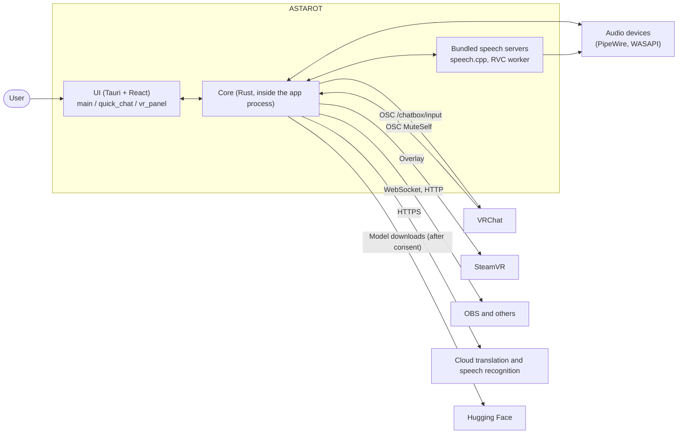
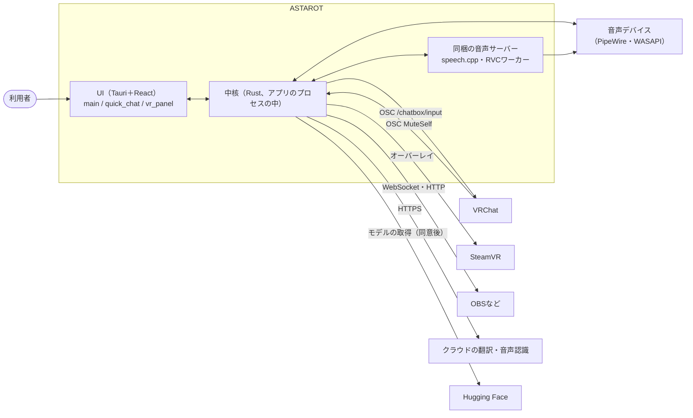

# Overview

[日本語版](#全体像日本語版)

ASTAROT's components, its relations with outside systems, and how its screens are organized. The product's purpose and users are in `PRODUCT.md`, and the rules for its look and operation are in `DESIGN.md`.

## System context

## Components

| Component | Location | Role |
|---|---|---|
| UI | `src-ui/` | Screens, settings, hotkeys, and the front end for the VR panel and Quick Chat. It receives its state from the core |
| Tauri | `src-tauri/` | Windows, starting the core and passing requests and notifications to and from it (`src/backend_host.rs`), Quick Chat, registering hotkeys, window sharing (Linux), app updates, permissions |
| Core | `native/core/` | Saving settings, translation, speech recognition, OCR, OSC, WebSocket, OBS, the overlay, and control of TTS and RVC. From 0.5.0 it is the only backend, and it runs in the same process as the app |
| Intake and dispatch | `native/core/src/dispatch.rs`, `controller/routes.rs` | The table that maps endpoints to their handlers, the notification names (`controller::RUN_MAPPING`), queues and locks |
| Feature code | `native/core/src/controller/` and the other crates in `native/` | Each feature (translation in `translation`, speech recognition in `transcription`, TTS in `tts`, voice conversion in `voice-conversion`, the audio route in `audio-routing`, OCR in `ocr-runtime`, the overlay in `vr-overlay`, OSC and others in `adapters`, the bundled servers in `speech-server`, model downloads and telemetry in `ops`) |
| Settings | `native/core/src/config/` | Declaring, validating (`config/schema.rs`) and saving settings |
| Errors | `native/core/src/errors/` | Error codes and their default messages |
| Native helpers | `native/`, `build/` | `astarot-rvc-worker`; on Linux, `astarot-voice-gate`, `astarot-source-bridge` and `astarot-screen-capture` (window sharing); the speech.cpp binaries |
| Python backend (up to 0.4) | `src-python/` (removed in 0.6.0) | Not in the 0.5.0 distribution, and not started. Removed from the repository as well in 0.6.0 (#285). The lists in `reference/` are built from the core (`tools/spec_core_catalog.json`). The mapping to the core is in `native/core/README.md` |

## Screens

### Main screen

| Area | Contents |
|---|---|
| Sidebar | The feature switches (Translation, Mic input, Listening, Chat reading, TTS, RVC), the language settings (tabs 1 to 3, your language, target languages, swapping, adding and removing target languages, the translator), and the button that opens the settings. When collapsed, it shows only icons |
| Top | Stop speech, Mute, the inputs and outputs panel, Quick settings (Always on top, VRC mic mute sync, the subtitle overlay on and off; for the subtitle overlay's position and look, it points to "Captions and VR" in the settings), Help |
| Inputs and outputs panel | Opens and closes with a button at the top. For your voice and for chat, it shows where they go with the current settings and why the other destinations are not used, the time of each stage of the latest message (ms), and the use of GPU memory (VRAM). It only shows these and does not change settings ([UC-16](use-cases.md#uc-16-入力が届く先と時間を見る)) |
| Conversation log | Sent messages, recognition results, text read by OCR, system messages. A sent message can be sent again. The screen keeps up to the newest 1,000 entries. While the bottom is shown, the log follows new lines. While you have scrolled up to read, the view stays where it is when lines are added or old lines go away. Sending from the input field brings the view back to the bottom |
| Input field | Typing and sending messages. Whether Enter sends depends on the Appearance settings. Over 144 characters, a note above the field tells you about the VRChat chatbox limit (sending is not blocked) |

### Settings screen

You choose a page in the rail on the left. Stop speech, Mute, the back button and, on every page but About, the note that the page's changes apply at once are always at the top. Every setting saves by itself (#1111).

An item that concerns several pages is placed on every page it concerns (VRC mic mute sync, the audio route, the TTS output destination). Changing it on any page changes the same setting, and settings search shows one result for each page.

| Page | Main contents | How it is saved |
|---|---|---|
| Device | Audio route, choice of microphone and speakers, input sensitivity, VRC mic mute sync | At once |
| Appearance | UI language, UI size, theme, log text size, transparency, font, send button, clearing the input field after sending, hiragana and romaji | At once |
| Translation | The built-in translation model and its device, downloading the model at startup, keys and models of external APIs, local LLMs | Choices at once, keys and URLs on Enter or when focus leaves them |
| Speech recognition | Silence time, queued messages, mic word filter, engine (local (speech.cpp), four cloud engines), cloud keys and models, realtime speech recognition, the bundled ASR server | Choices at once, keys, URLs and the server's paths on Enter or when focus leaves them |
| VRChat | Sending to the chatbox (sending, translation only, notification sound, received messages, VRC mic mute sync), message formats, OSC, audio route, TTS output destination, chat reading (source language, recognition models, area to read, capture target) | Choices at once, text fields on Enter or when focus leaves them, model downloads through the consent step |
| VR | The subtitle overlay's position and look, the subtitle typeface, showing subtitles and inputs and outputs on the desktop, VR UI | At once |
| Hotkeys | Keys for five actions (unassigned by default) | When entered |
| TTS | The source to read aloud, output device, monitor, server and voice per language, the bundled server, model downloads | Choices at once, addresses and voices on Enter or when focus leaves the form |
| RVC | Pitch, blend, the input to forward, runtime and model | Choices at once, numbers and paths on Enter or when focus leaves them |
| Advanced | Saving the conversation log, the settings file, WebSocket, OBS browser source | Text fields on Enter or when focus leaves them, switches at once |
| Experimental | Switches and descriptions for features that passed checks on real hardware in the experimental branch (all off by default). When there are no items, the page says so | At once |
| Updater | Version and release policy | Display only |
| About ASTAROT | Name, version, links, thanks to the original VRCT | Display only |

The theme (#965) is chosen from the presets or from "Custom", which the user defines. The presets are Dark Plum (the default), Midnight, Lagoon, Forest, Rose and Graphite, and Dark Plum is the brand palette itself (`variables.css`). A theme is set by two colors, Base and Accent. Base sets the hue of the grays of backgrounds, surfaces, borders and text; Accent sets the hue of primary buttons, selected items, the on state and keyboard focus. Every step keeps the same lightness as in Dark Plum, and only the hue and the saturation relative to the original color change. Any color that then falls short of the contrast in the "Colors" section of DESIGN.md is brought up to it by moving only its lightness, without changing its hue. The warning and error colors stay the same in every theme. The colors of sent and received log entries keep their hue and move only their lightness until they reach 4.5:1 against the background. The theme applies to every window drawn in the app's palette: the main window, the settings window (#1236), the VR panel, the tray's control panel and Quick Chat. Each has the theme from its first paint (#1259): the shell gives a window's page the theme before the page loads (the one the main window reported last, or before that the saved one), and the page puts it in place before its first render. The default theme sets nothing over the stylesheet. A choice takes effect at once and is saved in `THEME`. The two Custom colors are kept while a preset is chosen. A preset that this version does not know is drawn as the default. A Custom color is set by typing it into the hex field or with the color picker, and takes effect once all six digits are in. While a color is being dragged, it is sent only once every 150 ms, and the last color is always sent. When Accent is close to the hue of the warning or error color, a note below it says that they may be hard to tell apart.

### Other windows

- Quick Chat: opens with a hotkey or with a button on the Hotkeys page. It is an input-only window, and sending goes through the main screen. Over 144 characters, it shows the same warning below the input field.
- VR panel: when the VR UI is on, it shows a wrist launcher and windows (Log, Language, Inputs and outputs, Settings) inside VR.

The VR settings window arranges its tabs in the order Device, Appearance, Translation, Speech recognition, VRChat, VR, using the same names as the desktop. VRChat holds sending to the chatbox, sending the translation only, the notification sound, sending received messages, VRC mic mute sync and chat reading. VRC mic mute sync is also on Device, and the hiragana and romaji display is on Appearance. The chat reading controls are the source language, the reading interval, the minimum recognition score and the minimum text length. Settings such as destinations, keys and audio routes, and model downloads, are not added, so that [the range the VR panel relays](external-interfaces.md#tauriのコマンド) stays as it is.

A VR settings list with 50 or more entries, such as the font list, draws only the rows near the visible area. Row height and spacing stay the same, and the chosen entry is in view when the list opens. Entries outside the view can still be reached by scrolling or with Tab.

---

# 全体像（日本語版）

ASTAROTの構成要素と、外のシステムとの関係、画面の構成。製品の目的と利用者は`PRODUCT.md`、見た目と操作の決まりは`DESIGN.md`にある。

## システムの文脈

## 構成要素

| 要素 | 場所 | 役割 |
|---|---|---|
| UI | `src-ui/` | 画面、設定、ホットキー、VRパネルとQuick Chatの窓口。状態は中核から受け取る |
| Tauri | `src-tauri/` | ウィンドウ、中核の起動と要求・通知の受け渡し（`src/backend_host.rs`）、Quick Chat、ホットキーの登録、ウィンドウの共有（Linux）、アプリの更新、権限 |
| 中核 | `native/core/` | 設定の保存、翻訳、音声認識、OCR、OSC、WebSocket、OBS、オーバーレイ、読み上げとRVCの制御。0.5.0からアプリと同じプロセスで動く、ただ一つのバックエンド |
| 受付と振り分け | `native/core/src/dispatch.rs`、`controller/routes.rs` | エンドポイントと処理の対応表、通知の名前（`controller::RUN_MAPPING`）、キューとロック |
| 処理の本体 | `native/core/src/controller/`と、`native/`のほかのクレート | 各機能（翻訳は`translation`、音声認識は`transcription`、読み上げは`tts`、声質変換は`voice-conversion`、音声経路は`audio-routing`、OCRは`ocr-runtime`、オーバーレイは`vr-overlay`、OSCなどは`adapters`、同梱サーバーは`speech-server`、モデル取得とテレメトリは`ops`） |
| 設定 | `native/core/src/config/` | 設定の宣言、検証（`config/schema.rs`）、保存 |
| エラー | `native/core/src/errors/` | エラーコードと既定の文言 |
| ネイティブの補助 | `native/`、`build/` | `astarot-rvc-worker`、Linuxの`astarot-voice-gate`・`astarot-source-bridge`・`astarot-screen-capture`（ウィンドウ共有）、speech.cppのバイナリ |
| Pythonバックエンド（0.4まで） | `src-python/`（0.6.0で消した） | 0.5.0の配布物には入らず、起動もしない。0.6.0でリポジトリからも消した（#285）。`reference/`の一覧は中核から作る（`tools/spec_core_catalog.json`）。中核との対応は`native/core/README.md`にある |

## 画面

### メイン画面

| 場所 | 内容 |
|---|---|
| サイドバー | 機能のスイッチ（翻訳、マイク入力、聞き取り、チャット読み取り、TTS、RVC）、言語設定（タブ1〜3、あなたの言語、相手の言語、入れ替え、相手の言語の追加と削除、翻訳エンジン）、設定を開くボタン。たたむとアイコンだけになる |
| 上部 | 読み上げ停止、ミュート、入力と出力のパネル、クイック設定（最前面固定、VRCマイクミュート同期、字幕オーバーレイのオンとオフ。字幕オーバーレイの位置と見た目は設定の「字幕とVR」へ案内する）、ヘルプ |
| 入力と出力のパネル | 上部のボタンで開閉する。自分の声とチャットについて、いまの設定で届く先と使わない先の理由、直近のメッセージの段階ごとの時間（ms）、GPUのメモリ（VRAM）の使用量を表示する。表示だけで、設定は変えない（[UC-16](use-cases.md#uc-16-入力が届く先と時間を見る)） |
| 会話ログ | 送ったメッセージ、認識結果、OCRで読んだ文、システムメッセージ。送ったメッセージは再送できる。画面に残すのは新しい1,000件まで。いちばん下を表示している間は新しい行を追う。上へ戻して読んでいる間は、行が増えても古い行が消えても表示の位置を変えない。入力欄から送ると、いちばん下へ戻る |
| 入力欄 | メッセージの入力と送信。Enterで送るかどうかはデザインの設定による。144文字を超えると、VRChatのチャットボックスの上限を入力欄の上に知らせる（送信は止めない） |

### 設定画面

左のレールでページを選ぶ。上部に読み上げ停止、ミュート、戻るボタンと、About以外のページでは「このページの変更はすぐに反映されます」の注記が常にある。どの設定も自分で保存する（#1111）。

複数のページに関係する項目は、関係するページすべてに置く（VRCマイクミュート同期、音声経路、読み上げの出力先）。どのページで変えても同じ設定を変え、設定検索ではページごとに結果が出る。

| ページ | 主な内容 | 保存のしかた |
|---|---|---|
| デバイス | 音声経路、マイクとスピーカーの選択、入力の感度、VRCマイクミュート同期 | 即時 |
| デザイン | UIの言語、UIの大きさ、テーマ、ログの文字の大きさ、透明度、フォント、送信ボタン、送信後に入力欄を空にする、ひらがな・ローマ字 | 即時 |
| 翻訳 | 内蔵翻訳のモデルと実行デバイス、起動時のモデル取得、外部APIのキーとモデル、ローカルLLM | 選択は即時、キーとURLはEnterか欄を離れたとき |
| 音声認識 | 無音時間、待機数、ワードフィルター、エンジン（ローカル（speech.cpp）、クラウド4種）、クラウドのキーとモデル、リアルタイム音声認識、同梱ASRサーバー | 選択は即時、キーとURLとサーバーのパスはEnterか欄を離れたとき |
| VRChat | チャットボックスへの送信（送信、訳だけ、通知音、受信したメッセージ、VRCマイクミュート同期）、メッセージフォーマット、OSC、音声経路、読み上げの出力先、チャット読み取り（読み取り言語、認識モデル、読み取る範囲、キャプチャの対象） | 選択は即時、文字の欄はEnterか欄を離れたとき、モデルの取得は同意の操作 |
| VR | 字幕オーバーレイの位置と見た目、字幕の書体、デスクトップの字幕と入力と出力の表示、VR UI | 即時 |
| ホットキー | 5つの動作のキー（既定は未割り当て） | 入力した時点 |
| TTS | 読み上げの元、出力デバイス、モニター、言語ごとのサーバーと声、同梱サーバー、モデルの取得 | 選択は即時、アドレスと声はEnterかフォームを離れたとき |
| RVC | ピッチ、混合率、転送する入力、実行環境とモデル | 選択は即時、数とパスはEnterか欄を離れたとき |
| 高度な設定 | 会話ログの保存、設定ファイル、WebSocket、OBSブラウザソース | 文字の欄はEnterか欄を離れたとき、スイッチは即時 |
| 実験的機能 | experimentalブランチで実機の確認を通った機能のスイッチと説明（既定はすべてオフ）。項目がないときはその旨を出す | 即時 |
| アップデート | 版と配布の方針 | 表示のみ |
| ASTAROTについて | 名前、版、リンク、本家VRCTへの謝辞 | 表示のみ |

テーマ（#965）は、プリセットか、利用者が決める「Custom」から選ぶ。プリセットはDark Plum（既定）、Midnight、Lagoon、Forest、Rose、Graphiteで、Dark Plumはブランドの配色そのもの（`variables.css`）である。テーマはBaseとAccentの2色で決まる。Baseは背景、面、枠線、文字の灰色の色合いに、Accentは主なボタン、選択中の項目、オンの状態、キーボードのフォーカスの色合いになる。どの段もDark Plumのときと同じ明るさを保ち、色合いと、元の色に対する彩度の割合だけを変える。そのうえでDESIGN.mdの「Colors」のコントラストに届かない色は、色合いを変えずに明るさだけを動かして届かせる。警告とエラーの色はどのテーマでも変えない。送信と受信のログの色は色合いを変えず、地に対して4.5:1に届くまで明るさだけを動かす。テーマは、アプリの配色で描くすべてのウィンドウに効く。メインのウィンドウ、設定のウィンドウ（#1236）、VR UI、トレイのコントロールパネル、Quick Chatである。どのウィンドウも最初の描画からテーマが効いている（#1259）。シェルがウィンドウのページに、ページが読み込まれる前にテーマを渡し（メインのウィンドウが最後に知らせたもの、その前は保存されているもの）、ページは最初の描画の前にそれを当てる。既定のテーマはスタイルシートの上に何も置かない。選ぶとすぐに反映し、`THEME`に保存する。プリセットを選んでいる間もCustomの2色は残る。この版が知らないプリセットは既定として描く。Customの色は16進の欄に打つか色の選択で決め、6桁がそろった時点で反映する。色をドラッグしている間は150msに1回だけ送り、最後の色は必ず送る。Accentが警告かエラーの色合いに近いと、その下に見分けにくくなることを出す。

### そのほかのウィンドウ

- チャット入力の小窓（Quick Chat）: ホットキーかホットキーのページのボタンで開く。入力だけの窓で、送信はメイン画面を通る。144文字を超えると、入力欄の下に同じ警告を出す。
- VRパネル: VR UIがオンのとき、VRの中に手首のランチャーとウィンドウ（ログ、言語、入力と出力、設定）を出す。

VRの設定ウィンドウは、デバイス、デザイン、翻訳、音声認識、VRChat、VRの順にタブを並べ、デスクトップと同じ名前を使う。VRChatにはチャットボックスへの送信、訳だけの送信、通知音、受信したメッセージの送信、VRCマイクミュート同期とチャット読み取りを置く。VRCマイクミュート同期はデバイスにも置き、ひらがな・ローマ字の表示はデザインに置く。チャット読み取りで操作できるのは読み取り言語、読み取り間隔、認識スコアの下限、最小文字数である。接続先、キー、音声経路などの設定やモデル取得は追加せず、[VRパネルの中継範囲](external-interfaces.md#tauriのコマンド)を保つ。

フォントなどのVR設定の選択一覧は、50件以上なら画面周辺の行だけを描画する。行の高さと間隔は保ち、開いたときに選択済みの候補を表示する。画面外の候補にもスクロールやTabで移動できる。
