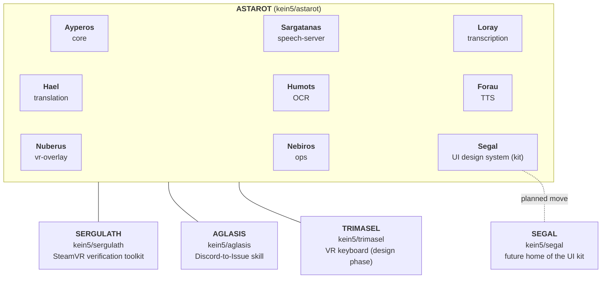

<!-- Generated by tools/component_map.py from tools/component_map.toml. Do not edit by hand; run `mise run component-map`. -->

# ASTAROT component map

[日本語版](#astarotの構成図日本語版)

This page shows the components inside ASTAROT and the repositories kept outside it, by code name. The code names come from the naming record, [#689](https://github.com/kein5/astarot/issues/689). A code name is a secondary name: the UI, documents and public APIs use names that describe the function ([Internal code names](../../voice-stack/project-rename.md#internal-code-names)).

## Diagram

The tables below give the same content as text.

## Inside ASTAROT

| Code name | Role | Folder |
|---|---|---|
| Ayperos | core | `native/core` |
| Sargatanas | speech-server | `native/speech-server` |
| Loray | transcription | `native/transcription` |
| Hael | translation | `native/translation` |
| Humots | OCR | `native/ocr-runtime` |
| Forau | TTS | `native/tts` |
| Nuberus | vr-overlay | `native/vr-overlay` |
| Nebiros | ops | `native/ops` |
| Segal | UI design system (kit) | `src-ui/views/kit` |

## External repositories

| Code name | Repository | Role | Status |
|---|---|---|---|
| SERGULATH | [kein5/sergulath](https://github.com/kein5/sergulath) | SteamVR verification toolkit |  |
| AGLASIS | [kein5/aglasis](https://github.com/kein5/aglasis) | Discord-to-Issue skill |  |
| SEGAL | [kein5/segal](https://github.com/kein5/segal) | future home of the UI kit |  |
| TRIMASEL | [kein5/trimasel](https://github.com/kein5/trimasel) | VR keyboard | design phase |

## Relations

| From | To | Line | Label |
|---|---|---|---|
| ASTAROT | SERGULATH | solid |  |
| ASTAROT | AGLASIS | solid |  |
| ASTAROT | TRIMASEL | solid |  |
| Segal | SEGAL | dashed | planned move |

## Updating this page

The names and roles on this page are edited only in `tools/component_map.toml`. After editing it, regenerate this page with `mise run component-map` (`python tools/component_map.py --write`). `check` fails while the page is out of date (`tests/devtools/test_component_map.py`). The tool also prints a warning for each Cargo package in the repository that no entry names, so that a new crate does not go missing from the map.

---

# ASTAROTの構成図（日本語版）

ASTAROTの中のコンポーネントと、ASTAROTの外に置くリポジトリを、コードネームで示します。コードネームは命名の記録（[#689](https://github.com/kein5/astarot/issues/689)）によります。コードネームは補助の名前で、画面、文書、公開するAPIでは、機能を説明する名前を使います（[内部のコードネーム](../../voice-stack/project-rename.md#内部のコードネーム)）。

## 図

下の表に、図と同じ内容を文字で示します。

## ASTAROTの中

| コードネーム | 役割 | フォルダー |
|---|---|---|
| Ayperos | 中核 | `native/core` |
| Sargatanas | 推論のサーバー | `native/speech-server` |
| Loray | 音声認識 | `native/transcription` |
| Hael | 翻訳 | `native/translation` |
| Humots | 文字認識（OCR） | `native/ocr-runtime` |
| Forau | 読み上げ（TTS） | `native/tts` |
| Nuberus | VRのオーバーレイ | `native/vr-overlay` |
| Nebiros | 運用（ops） | `native/ops` |
| Segal | UIのデザインシステム（kit） | `src-ui/views/kit` |

## 外部のリポジトリ

| コードネーム | リポジトリ | 役割 | 状態 |
|---|---|---|---|
| SERGULATH | [kein5/sergulath](https://github.com/kein5/sergulath) | SteamVRの検証の道具一式 |  |
| AGLASIS | [kein5/aglasis](https://github.com/kein5/aglasis) | DiscordからIssueを作るスキル |  |
| SEGAL | [kein5/segal](https://github.com/kein5/segal) | UIのkitの移り先 |  |
| TRIMASEL | [kein5/trimasel](https://github.com/kein5/trimasel) | VRのキーボード | 設計の段階 |

## つながり

| 元 | 先 | 線 | 説明 |
|---|---|---|---|
| ASTAROT | SERGULATH | 実線 |  |
| ASTAROT | AGLASIS | 実線 |  |
| ASTAROT | TRIMASEL | 実線 |  |
| Segal | SEGAL | 破線 | 移す予定 |

## このページの更新

このページの名前と役割は、`tools/component_map.toml`だけで直します。直したら、`mise run component-map`（`python tools/component_map.py --write`）でこのページを作り直します。ページが古いままだと`check`が失敗します（`tests/devtools/test_component_map.py`）。リポジトリの中のCargoのパッケージのうち、どの項目にもないものは、新しいクレートが構成図から漏れないように警告として表示します。
