# Sequences

[日本語版](#シーケンス日本語版)

The exchanges in typical scenes. This is not every scene: the ones chosen show startup, frequent operations, exchanges with outside systems and the error paths. Message formats are in [IPC protocol](ipc-protocol.md), and the endpoints are in [the endpoint list](reference/ipc-endpoints.md).

## Startup

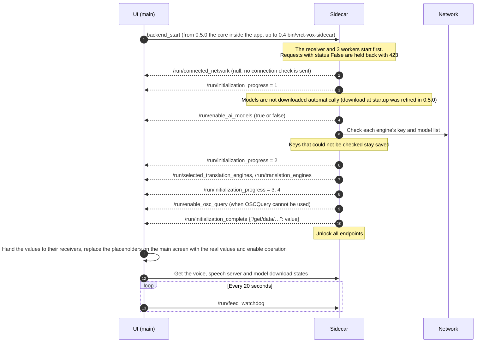

- When the sidecar writes a line other than a warning to stderr, the UI shows a persistent notification.
- `/run/enable_ai_models` is false only when the translation engine of the selected tab is CTranslate2 and its built-in model is missing. The UI shows no notification in that case. While the conversation is empty, the conversation area shows what is missing, together with a way to set it up ([Initialization, offline use and missing capabilities](cross-cutting.md#初期化中オフライン能力の不足)).
- For the branches on a failed spawn and on failed initialization items, and for how remounts and manual retries are handled, see [Startup and initialization](ipc-protocol.md#起動と初期化).

## Changing a setting

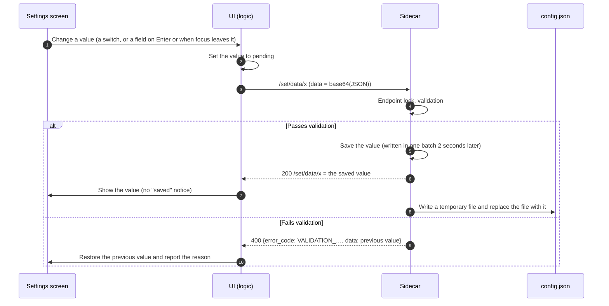

When the languages or the translation engine change, these notifications arrive before the response.

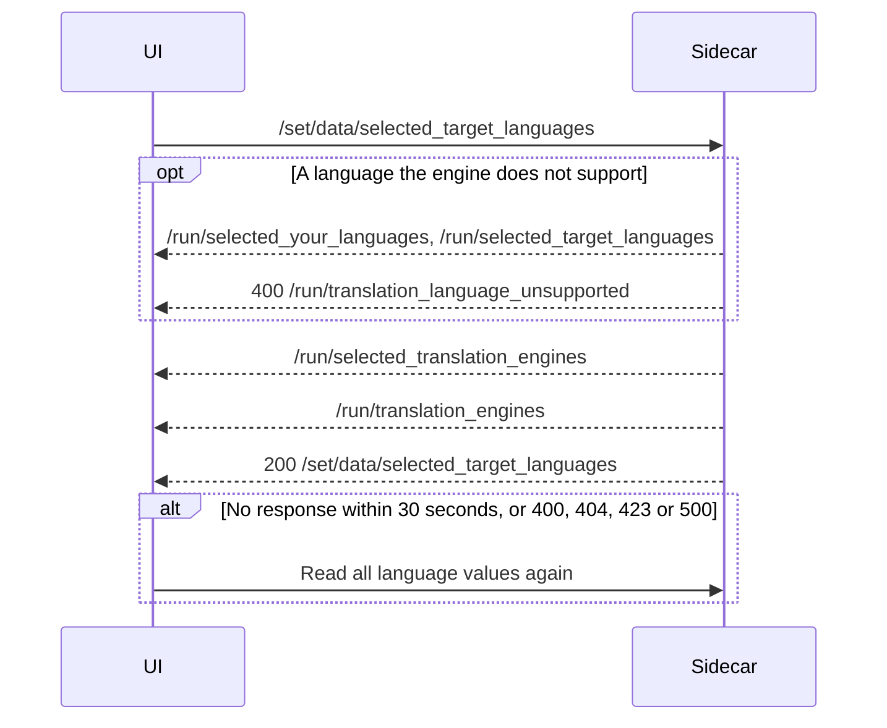

## Sending a chat message

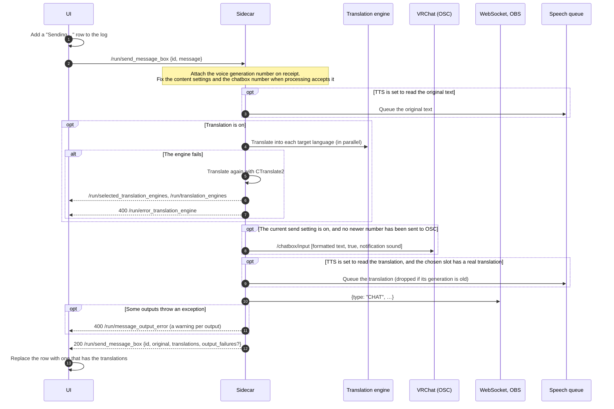

Fixing the settings, skipping stale OSC sends and handling output exceptions follow [Accepting and outputting messages](cross-cutting.md#メッセージの受付と出力). An exception in an output is reported when it happens, and the remaining processing continues.

For the row's state when sending fails, see [the data format of conversation messages](data-and-persistence.md).

## Microphone transcription

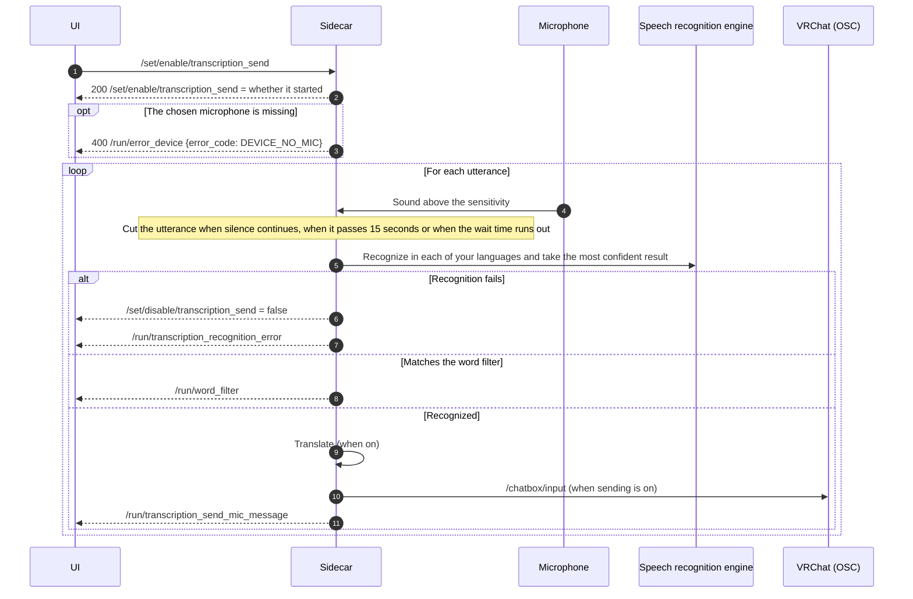

- The speaker side (Listening) follows the same flow: it recognizes in the target languages and translates into your language. It sends to VRChat only when "Send received message to VRChat" is on, and the notification is `/run/transcription_receive_speaker_message`.
- On Linux, and on Windows with the bundled server chosen for real-time captions, the Mic input switch starts real-time speech recognition, and the results arrive as `/run/realtime_caption`. With the bundled server, each switch starts the server it uses on its own (#1242): Mic input's (`asr`), and Listening's own (`asr_listening`) while Listening has a model of its own; otherwise Listening uses `asr` too. A server a switch started stops once no source uses it. No setting turns this off (#1396, decided on 2026-11-28): a `start_server` that an earlier version saved is read and left out, and the settings page has no start or stop for these servers. It shows the state of each, Mic input's and Listening's own. A server that hangs is started again by turning its switch off and on. When Listening's own server does not fit in the GPU memory beside Mic input's, the Listening switch is refused with `realtime_asr_models_do_not_fit`, and nothing else changes. `/get/data/realtime_asr_models` lists the models of a source's server (`{"source": "speaker"}`, Mic input's without one).

## Text to speech and stopping

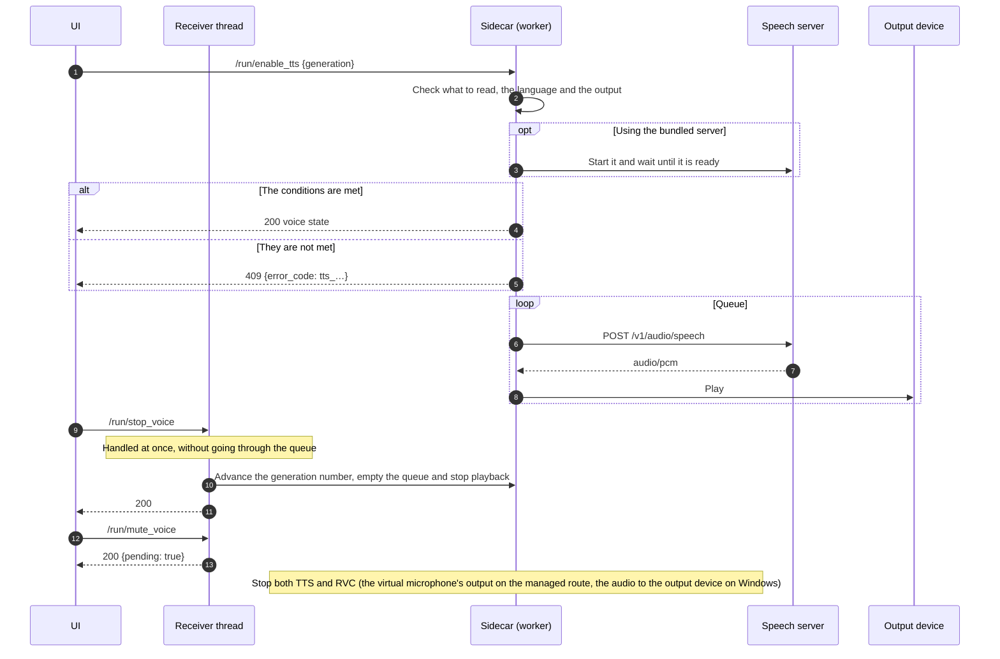

## Registering an API key

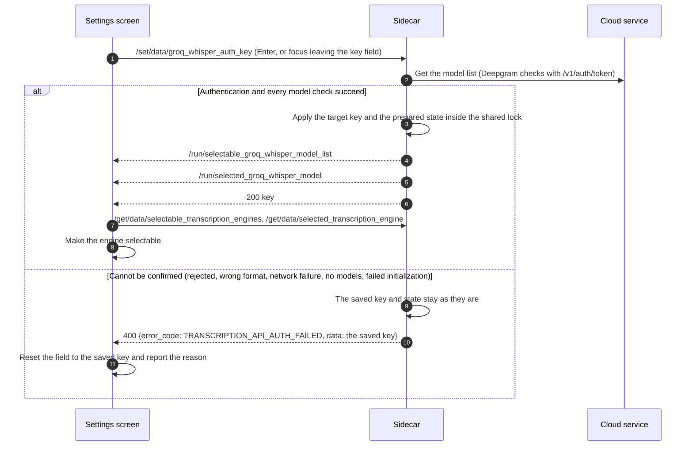

Translation keys (such as `/set/data/groq_auth_key`) follow the same flow, with the error code `AUTH_…`. Preparing and applying, concurrent changes and failures of the OpenAI-compatible URL follow [Changing API keys](cross-cutting.md#apiキーの変更).

Starting and stopping classic transcription and the volume meter, Auto selection and switching devices follow [Choosing and identifying audio devices](data-and-persistence.md#音声デバイスの選択と識別). On a device switch, the capture device that was opened is reported first, then the names before and after the change. Recording errors are detected without waiting for transcription processing, and the end is reported even when only the meter is running.

---

# シーケンス（日本語版）

代表的な場面のやり取り。すべての場面ではなく、起動、よく使う操作、外部とのやり取り、エラーの経路が分かるものを選んでいる。メッセージの形は[IPCプロトコル](ipc-protocol.md)、エンドポイントは[一覧](reference/ipc-endpoints.md)にある。

## 起動

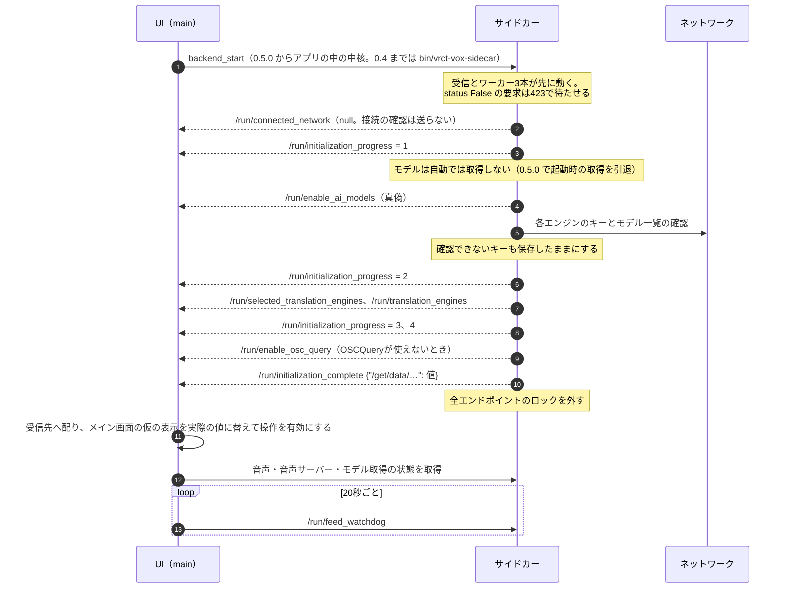

- サイドカーのstderrに警告以外の行が出たら、UIは消えない通知を出す。
- `/run/enable_ai_models`が偽になるのは、選択中のタブの翻訳エンジンがCTranslate2で、その内蔵モデルがないときだけである。UIはこのとき通知を出さない。足りないものは、会話が空のあいだ、用意する入口と一緒に会話欄へ表示する（[初期化中、オフライン、能力の不足](cross-cutting.md#初期化中オフライン能力の不足)）。
- spawn失敗と初期化項目の失敗の分岐、再マウントと手動再試行の扱いは[起動と初期化](ipc-protocol.md#起動と初期化)を参照する。

## 設定の変更

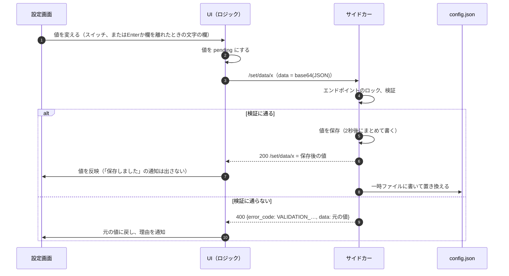

言語と翻訳エンジンの変更では、応答の前に次の通知が届く。

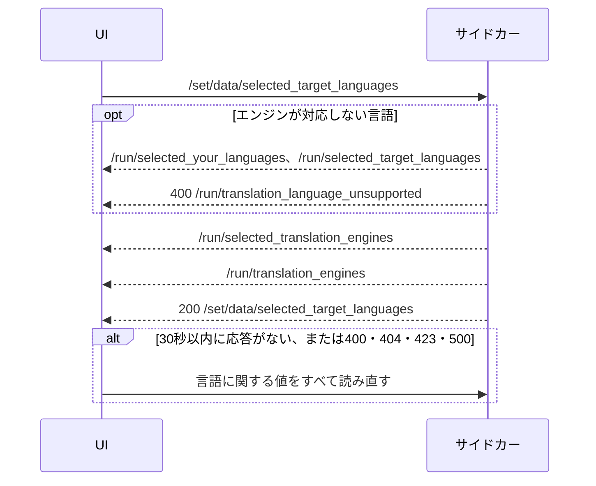

## チャットの送信

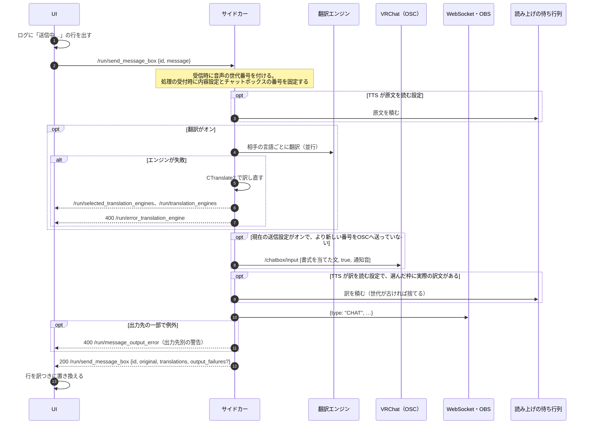

設定の固定、古いOSC送信の省略、出力先の例外の扱いは[メッセージの受付と出力](cross-cutting.md#メッセージの受付と出力)に従う。各出力の例外はその時点で通知し、後続の処理を続ける。

送信に失敗した場合の行の状態は、[会話メッセージのデータ形式](data-and-persistence.md)を参照。

## マイクの文字起こし

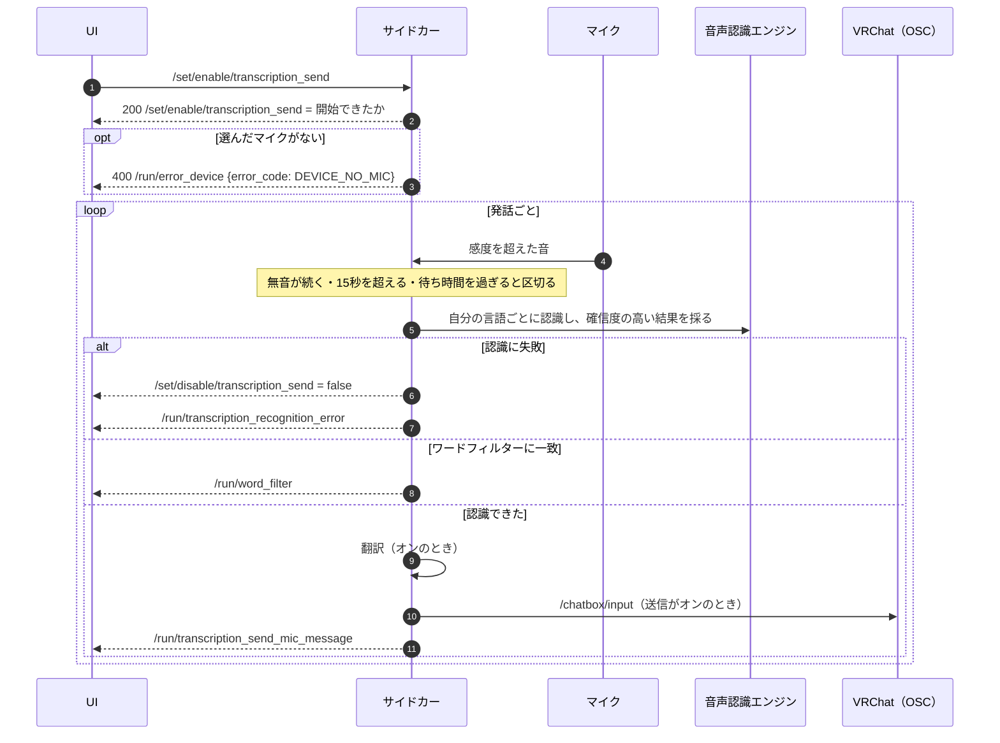

- スピーカー側（聞き取り）は同じ流れで、相手の言語で認識し、自分の言語へ訳す。VRChatへ送るのは「受信したメッセージをVRChatに送信する」がオンのときだけで、通知は`/run/transcription_receive_speaker_message`になる。
- Linuxと、リアルタイム字幕で同梱サーバーを選んだWindowsでは、マイク入力のスイッチがリアルタイム音声認識を始め、結果は`/run/realtime_caption`で届く。同梱サーバーでは、それぞれのスイッチが自分の使うサーバーを単独で起動する（#1242）。マイク入力は`asr`、聞き取りは自分のモデルを持つ間は`asr_listening`で、そうでないときは聞き取りも`asr`を使う。スイッチが起動したサーバーは、使う入力がなくなると止める。これをオフにする設定はない（#1396、2026-11-28の決定）。以前の版が保存した`start_server`は読んで捨て、設定画面にもこれらのサーバーの起動と停止はない。設定画面はマイク入力のサーバーと聞き取りのサーバーのそれぞれの状態を示す。固まったサーバーは、そのスイッチを切って入れ直すと起動し直す。聞き取りのサーバーがマイク入力のサーバーと一緒にはGPUのメモリに収まらないときは、聞き取りのスイッチを`realtime_asr_models_do_not_fit`で断り、ほかには何も変えない。`/get/data/realtime_asr_models`は、入力が使うサーバーのモデルを返す（`{"source": "speaker"}`。省略するとマイク入力）。

## 読み上げと停止

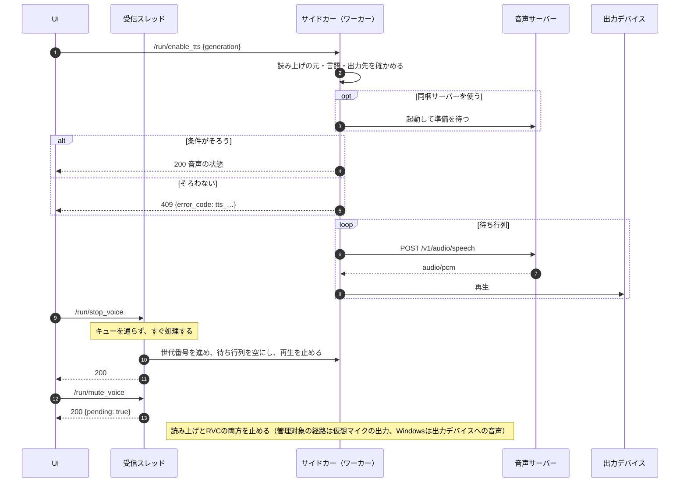

## APIキーの登録

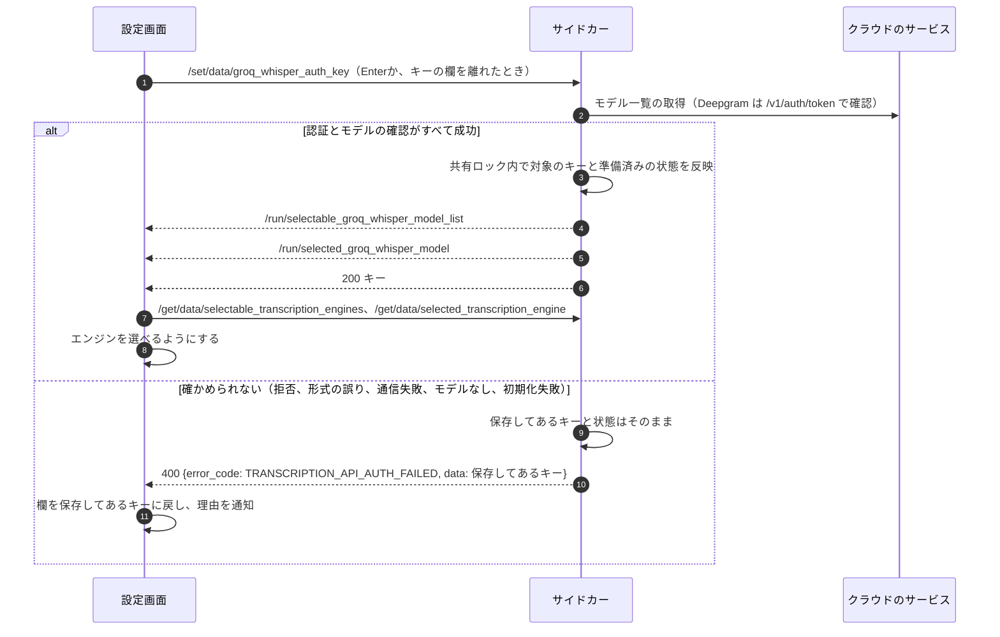

翻訳のキー（`/set/data/groq_auth_key`など）も同じ流れで、エラーコードは`AUTH_…`になる。準備と反映、同時変更、OpenAI互換URLの失敗時の扱いは[APIキーの変更](cross-cutting.md#apiキーの変更)に従う。

従来の文字起こしと音量メーターの開始・停止、Auto選択、機器の切り替えは、[音声デバイスの選択と識別](data-and-persistence.md#音声デバイスの選択と識別)に従う。機器の切り替えでは、開けた収録先を通知してから変更前後の名前を知らせる。録音エラーは文字起こしの処理を待たずに検出し、メーターだけが動いている場合も終了を通知する。
