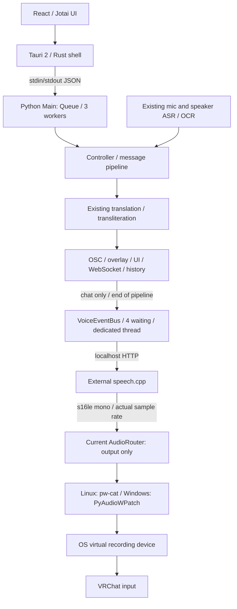
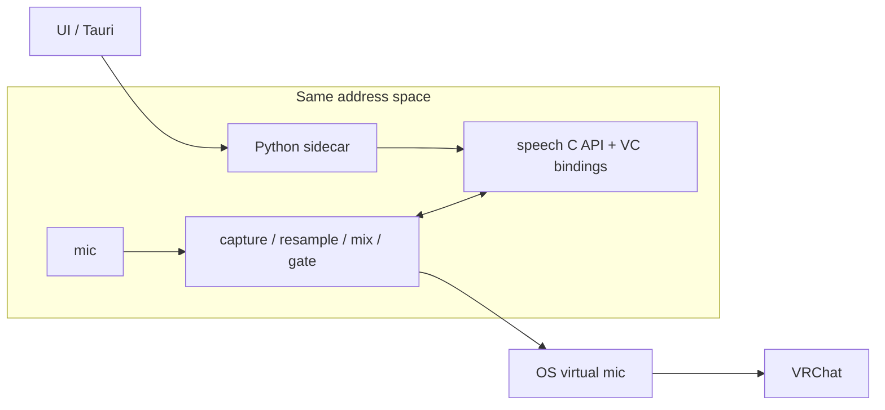
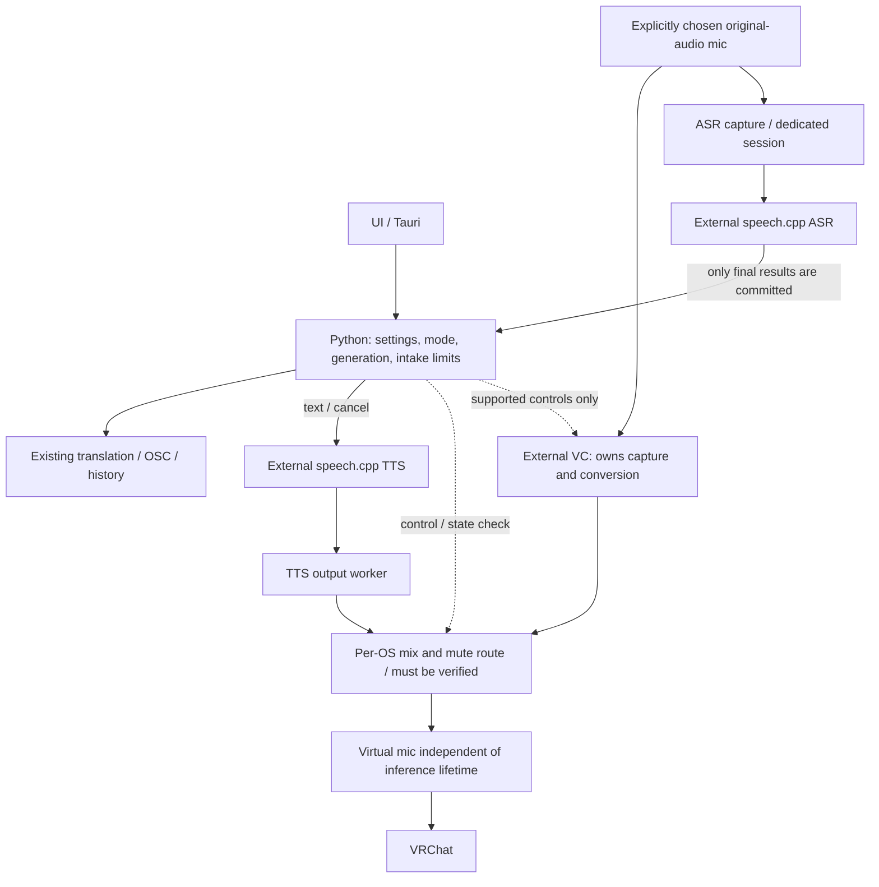
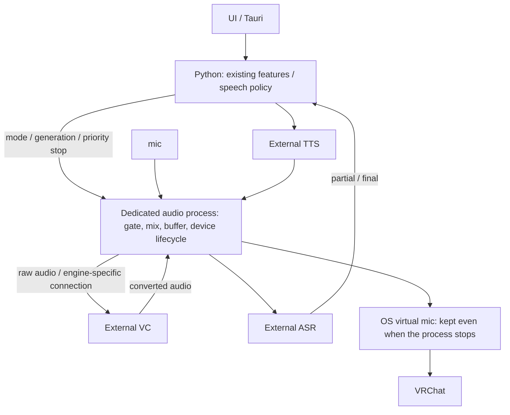
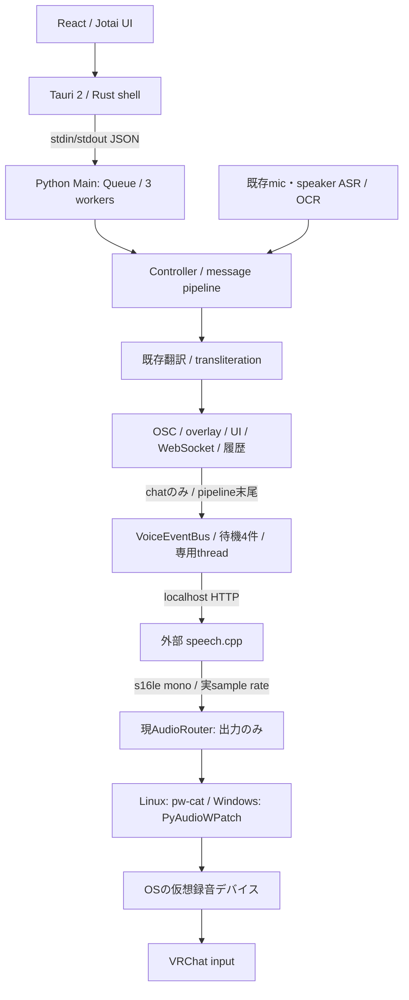
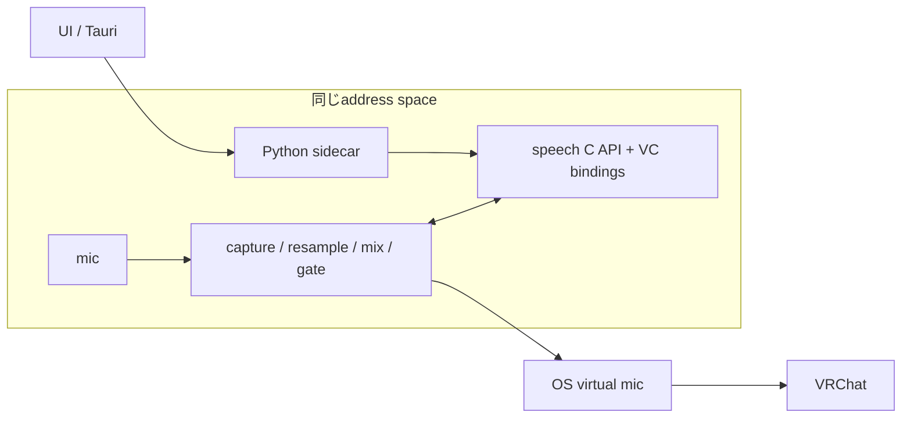
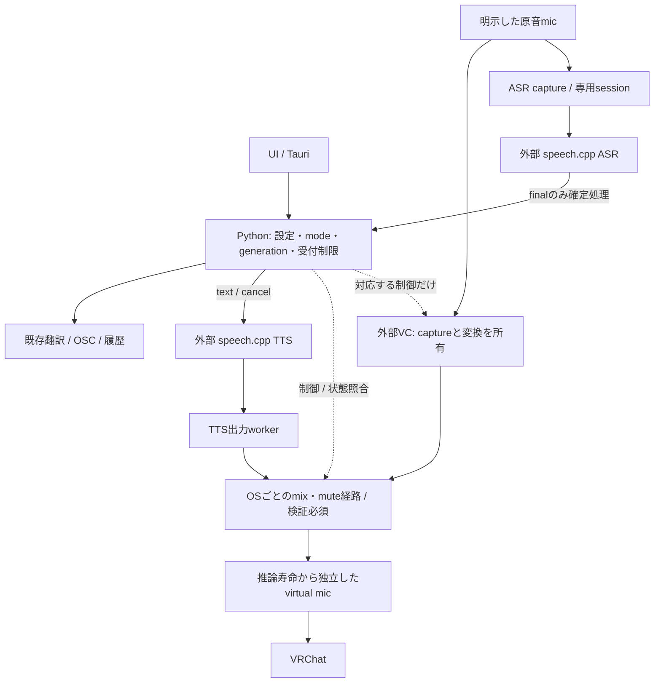
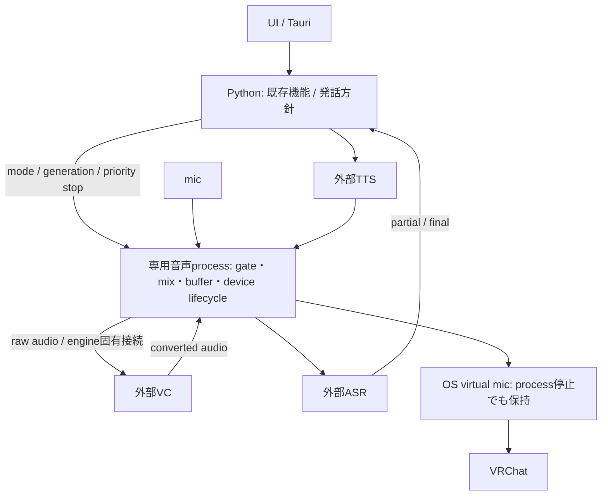

# Architecture evaluation of VRCT-VOX voice integration

[日本語版](#vrct-vox-音声統合のアーキテクチャ評価日本語版)

Evaluation date: 2026-10-27. Code evaluated: `1f7900ef`. Status: **design proposal. This is not approval or completion of an implementation, and not a performance guarantee.**

The requirements come from the provided `codex-implementation-spec.md`, `codex-start.md` and `imozuru-evidence-map.md`. This evaluation also reconsiders the implementation order and boundaries in those files. It does not change product code, dependencies or running audio routes, and no new experiments were run on real hardware.

Related outputs: the PoCs and their pass criteria, [the ADR 004 proposal](../adr/adr-004-audio-integration-boundaries.md), and the sources and research notes. The existing implementation records and [measurement records](benchmarks.md) are kept as history.

## 1. Conclusion and scope of the decision

**This evaluation recommends option B, "keep the existing VRCT at the center of control, run inference in external processes, and leave audio connection and mixing to the OS", as the first thing to verify.** This is not an unconditional endorsement of the current P1. The design of the following needs to change: original-text TTS waiting for translation, the queue that stop requests wait in, how the output target is identified, and the lifetime and reconnection of the virtual microphone.

Direct VC does not pass through ASR, translation or TTS. Captions and translation are processed in parallel from the original audio. Keep a boundary so that changing an inference engine does not drag in the existing OSC, translation and history. Unifying the implementation language and reducing network traffic are not goals in themselves.

B is not, however, treated as adopted for every mode on both OSes. **If the contracts for stopping, silencing and mixing cannot be demonstrated on the OS side, move to option C, a small dedicated audio process.** C also needs the OS virtual devices and the inference engines, and an extra process alone does not solve fallback when a device disappears, or GPU contention. There is not enough evidence to build a general media service, a plugin framework or a shared-memory protocol from the start.

The decision this time is a choice of order: "verify B first". The VC engine and the final distribution layout are chosen after the PoC. A B that does not meet the safety conditions must not be enabled in the product on the grounds of a staged rollout.

## 2. Classes of facts

| Label | Meaning |
|---|---|
| Confirmed: code | Confirmed from the implementation at the target HEAD. Does not mean it works on real hardware |
| Confirmed: records | Saved measurements and past test records. Not rerun this time |
| Stated in the source | Statements in official specifications, the authors' measurements and model cards. Separate from a demonstration in VRCT |
| Inference or proposal | Risks, options and proposed changes derived from the evidence |
| Unverified | Cannot be concluded from the current material; needs testing |

The user's reports "I heard it" and "the meter did not move after stopping" are records of manual observation and are not converted into measured acoustic latency.

## 3. Current structure

At this point VRCT-VOX is not a single C++ application. Its main parts are a React/Jotai UI, a Tauri Rust shell and a Python sidecar, and P1 calls an external speech.cpp.

The main evidence: [UI sidecar startup](https://github.com/kein5/astarot/blob/637a2576099d39ecd722f3882242caeb199bae22/src-ui/views/app/_app_controllers/StartPythonController.jsx), [UI IPC](../../src-ui/logics/common/useStdoutToPython.ts), [Main](https://github.com/kein5/astarot/blob/v0.5.2/src-python/mainloop.py#L688), [Controller](https://github.com/kein5/astarot/blob/v0.5.2/src-python/controller.py#L976), [scheduler](https://github.com/kein5/astarot/blob/v0.5.2/src-python/models/tts/tts_scheduler.py), [AudioRouter](https://github.com/kein5/astarot/blob/v0.5.2/src-python/models/audio_routing/audio_router.py).

| Responsibility or boundary | Implementation confirmed | Assessment |
|---|---|---|
| UI and Python | The sidecar is driven by JSON messages that name an endpoint. The main window owns the sidecar | Keeping the UI separate from inference is worth it. Processing delays inside Python need to be managed separately |
| Controller / Model / Config | `MessageDirectionSpec` gathers the differences between routes, but much of Controller reads the global model/config directly | Cutting out a small boundary for the new features makes compatibility easier to verify than a large rework of the whole |
| General commands | Main's queue has no limit, and the default worker count is 3. `/run/stop_voice` goes through the same dispatch path | Bounding only the TTS queue cannot limit the stop delay from the UI. Not yet measured with the workers saturated |
| Chat speech | Snapshots settings, generation and time before translation, and publishes after translation, each delivery and history | Original-text mode also waits for translation. After a translation (or similar) that takes more than 5 seconds, the speech can be dropped by the waiting-age limit. Asynchronous workers alone cannot remove this time dependency |
| TTS intake | 4 waiting, old waiting entries discarded, age 5 seconds, request 30 seconds, cancellation by generation | There is a base for handling count, staleness and cancellation. PCM residence time, general dispatch and the server's queue are separate boundaries |
| Deduplication | Utterance IDs are remembered for a limited retention time and count | Suppresses duplicates within a session. Not a persistent exactly-once guarantee across process restarts |
| Current AudioRouter | Opens the output per utterance, splits the PCM into pieces of 10 ms or less, writes them, and closes at the end | Not a shared audio foundation that implements capture, fan-out, mix, duck and correction for independent clocks |
| Linux output | Explicit target, with fallback and reconnect suppressed. Drives `pw-cat` as a child process | Prevents unintended reconnection on the writing side. VRChat's capture link is outside what this protects |
| Windows output | Checks the match by host API name plus device name, and uses a blocking `stream.write` | There is a guard against wrong connections from reused indexes, but it is not the endpoint GUID. If the driver blocks in write, there is no guarantee that a token alone can interrupt it |
| Existing ASR and Linux | The existing final-phrase ASR is kept. Windows-specific dependencies remain | Success of the Linux CLI cannot be taken as complete support for the whole Linux GUI. The new Realtime adapter is not implemented |

The Linux pipe capacity of 4096 bytes corresponds to about 42.7 ms of mono s16le at 48 kHz and about 85.3 ms at 24 kHz. This is an **arithmetic value** from the capacity, not the actual occupancy or E2E latency. HTTP, the engine, the OS and VRChat also have their own buffers. [Linux implementation](https://github.com/kein5/astarot/blob/v0.5.2/src-python/models/audio_routing/devices_pipewire.py)

Split by kind of dependency, static dependencies concentrate in Controller and model/config, time dependencies in TTS after translation, runtime dependencies in the GPU and OS audio, and distribution dependencies in the Windows modules, models and drivers on the Python side. The organizational division of responsibility and the maintenance effort are unconfirmed because there is no material on them. Separate folders alone are not taken as loose coupling.

## 4. Assumptions revisited against the sources

1. **Running speech.cpp as a separate process does not make concurrent requests to the same model run in parallel.** The server holds at most one model per task, and each model processes requests one at a time in FIFO order. Even with separate WebSockets for mic and speaker ASR, they share the wait for inference. [server specification](https://github.com/nyosegawa/speech.cpp/blob/main/docs/server.md)
2. **Embedding is a real option.** speech.cpp has a C API that specifies serialization of shared models and cooperative cancel. Removing HTTP does not remove the wait for the model or GPU contention. [C API](https://github.com/nyosegawa/speech.cpp/blob/main/docs/c-api.md)
3. **A PCM stream is not the same as incremental generation by the model.** Irodori generates sentence by sentence. Qwen's first chunk can include leading silence. Do not reuse the authors' fast chunk figures as the time "until speech starts". [Irodori](https://github.com/nyosegawa/speech.cpp/blob/main/docs/models/irodori-tts.md), [Qwen](https://github.com/nyosegawa/speech.cpp/blob/main/docs/models/qwen3-tts.md)
4. **Device connection for VC and a PCM API are different capabilities.** The old VCClient server has `POST /test`, but whether it applies to the current v2 binary is unconfirmed. Seed's engine is a Python class that opens devices itself and cannot be treated as a published, stable PCM service. [Old VCClient API](https://github.com/w-okada/voice-changer/blob/master/server/restapi/MMVC_Rest_VoiceChanger.py), [Seed engine](https://github.com/jiaheguo521/seed-vc-realtime/blob/main/realtime_vc_engine.py)
5. **Check OS support down to the edition and the model.** VCClient's standard Linux edition includes Beatrice, and the Windows CUDA/ONNX editions include RVC. That the same RVC setup runs on Linux cannot be derived from this table. [Support table](https://github.com/w-okada/voice-changer/blob/master/README.md)
6. **Handing audio to the OS does not bring latency to zero.** A PipeWire latency setting is a requested value, and an async link adds one quantum as a rule. Clock differences between separate devices remain even with the same 48 kHz setting. [properties](https://docs.pipewire.org/page_man_pipewire-props_7.html), [latency](https://docs.pipewire.org/page_latency.html)
7. **Fallback protection is needed along the whole route.** WirePlumber's suppression flags apply to a stream, and a low priority does not forbid selection as the default. VRChat's own reselection after the virtual source disappears is unconfirmed. [linking](https://pipewire.pages.freedesktop.org/wireplumber/policies/linking.html), [priorities](https://pipewire.pages.freedesktop.org/wireplumber/daemon/configuration/priorities.html)

## 5. The three candidates

### A: Embedding inference and audio processing in the existing Python sidecar

It can cut HTTP and some copies, and it makes owning capture in one place easier. On the other hand, native exceptions, driver stalls and heavy dependencies affect the existing features. It also ties the C API's ABI, CUDA/Vulkan, Python distribution and licenses more tightly together. A full rewrite in C++ is not required for these benefits and would be a separate, large migration cost.

### B: External inference, OS audio routes and a small control layer inside the existing VRCT

The candidates are shared audio output plus the existing virtual cable on Windows, and PipeWire on Linux. **Do not assume that the Windows virtual cable itself provides mixing, ducking or muting of all streams.** The PoC checks the actual session and endpoint control. On Linux, too, connecting several streams to the same sink is a different matter from proving that every route is silent after a stop.

With shared capture, VC and ASR may open the same original-audio device separately. This differs from a design that captures once and fans the same frames out. Evaluate compatibility and clock drift, and withdraw B's premise if an engine requires exclusive capture or a single frame supply.

### C: A small dedicated audio process and external inference

It gathers ownership of audio in one place and makes it easier to isolate failures in Python's translation processing and in driver calls. Control traffic and PCM traffic are kept apart, so a stop is not held up behind queued PCM. On the other hand, it adds problems of process supervision, contract versions, buffers, clocks, generations across restarts and double ownership.

If the VC has only a device API, C also needs an intermediate virtual device or engine-specific changes. The arrows in the diagram do not mean that a common PCM API exists today. First measure whether a local connection such as a named pipe or Unix socket is enough, and use shared memory only if copying is confirmed to dominate. The implementation language is chosen after the PoC. Adding native audio features to the existing Tauri shell is also a separation of responsibilities close to C, but failure propagation into the UI shell needs a separate evaluation.

### Comparison on the same criteria

The table below gives design predictions. It does not score comparison benchmarks, which have not been run.

| Aspect | A: embedded | B: external inference + OS routes | C: dedicated audio process |
|---|---|---|---|
| Low latency | Room to cut hops. Waits for the model and the GPU remain | OS buffers and buffers inside the engine tend to be opaque. Partial P1 measurements exist | Own buffers are easier to track, but IPC and intermediate routes may increase |
| Resources | Easier to share the runtime and capture. Actual VRAM savings not measured | A runtime per engine and resident models can multiply | An audio process and buffers on top of B. GPU contention is the same |
| Maintainability | More simultaneous updates of the ABI, inference dependencies and distribution | Close to today's boundaries, so changes are easier to contain. Supporting OS settings is a burden | More maintenance of contracts and supervision. It is clear where audio responsibility lies |
| Loose coupling | APIs can be separated, but the same process's failures and dependencies are shared | Engine changes are easier to isolate. Coupling to device names and OS settings remains | Control and data can be separated. Watch for the audio process bloating by taking on everything |
| Fault tolerance | A native crash spreads to the whole sidecar | Engine crashes are isolated. A stopped Python process, Windows blocking writes and consumer fallback are unsolved | The audio worker is easier to restart. OS failures and fallback in external consumers remain |
| Windows/Linux | Every native binding and all dependencies must support both OSes | Per-OS adapters and manually set up virtual devices. Edition differences are not hidden | A new audio backend to maintain on both OSes. A virtual driver is still needed |
| License | Linking and bundling widen the scope of obligations to evaluate | Easier to keep user-managed engines independent. Not an exemption, and not an automatic separation from the GPL | IPC, SDK and audio libraries on top of B. A separate process alone does not settle the terms |
| Evidence so far | speech.cpp C API specification. No comparison inside VRCT | Partial Linux TTS route, manual VRChat test | Design hypothesis only |
| Selection | Not adopted for now | **Conditionally recommended as the first PoC target** | First alternative if B's failure conditions are met |

A separate TTS companion that subscribes to the existing WebSocket would also be a small alternative for P1 alone. But it cannot consistently own utterance commitment, stopping and mode, and it does not take on direct VC or original-audio ASR either, so it is not chosen as the base for all features. Compatibility of the old WebSocket is kept.

## 6. Contracts to define for the recommended setup

### Ownership of control and audio

| Subject | Sole policy owner / executor | Contract |
|---|---|---|
| User settings, mode | A small voice coordinator in Python | The UI issues requests. Opening devices and inference do not run in UI callbacks |
| Original-text chat TTS | coordinator | Branch off after input validation and ID assignment, without waiting for translation. The change that reads the original text even when translation fails is stated in the regression tests as the intent of original-text mode |
| Translated-text TTS | The coordinator that receives final results | Only the final text for the selected target language. If the translation is missing, do not fall back to the original text |
| Direct VC | External VC engine | Independent of ASR and translation. Fallback to the raw voice is not allowed |
| ASR | Separate mic and speaker sessions and resampler state | 24 kHz mono is the input contract for speech.cpp ASR. Do not drop the whole VC/TTS route to 24 kHz |
| Actual gate/mix | The OS adapter in B, the audio process in C | Distinguish the separate TTS and VC gates from the overall gate. Every enabled output goes through the managed path. A connection in which VC bypasses the overall gate is rejected as unsupported |
| endpoint | The OS or an external virtual driver in B | Not removed when an inference request ends or an engine crashes. Stays silent. OS service failures are tested separately |
| Existing text features | Existing Controller/pipeline | An audio failure does not undo the success of OSC or history. New speech from received audio is OFF by default |

A minimal generated event with `session_id / utterance_id / source / generation / finality` is enough. It does not replace the existing SENT/CHAT/RECEIVED payloads. Partial recognition only updates the display, and completed replaces the whole text. Bounded dedupe and no automatic resend suppress double speech, and past audio is not played after a restart.

Stopping is split by the scope of the operation. The existing `/run/stop_voice` **keeps its meaning of TTS cancellation** and stops the current and waiting TTS. Direct VC and original-audio ASR continue. The next new TTS request the user sends is accepted. A TTS settings change or a failure of TTS alone also stops only the TTS route and does not drag VC in.

Muting all output is a separate, explicit operation that closes the **overall gate** that TTS, VC and explicit Passthrough go through. No new speech is held back while muted, and output resumes only after an explicit unmute and a device check. Restoring a connection or a new TTS request alone does not lift the overall mute. What is controlled is the virtual microphone route that VRCT manages; the design does not operate VRChat's mic toggle through OSC.

The stop order is **request to close the target route's gate → update the target generation → discard the target's waiting entries → cancel HTTP/engine → drop old PCM → confirm the target is silent**. A full mute applies this to every route. Keep the mode generation apart from the TTS-cancel generation, so that a TTS cancel does not expire VC's active generation. None of these steps waits on congestion in the general queue. Control-accepted ACK, generation-stopped ACK and confirmed output silence are separate states. On an OS setup where TTS alone cannot be stopped once TTS and VC are mixed, treat running them together as unsupported and compare with C. Do not assume that killing the engine instantly removes PCM already handed to the OS.

On a mode change, restart or device reconnection, first silence the affected routes. When the output target or mode changes, close the overall gate, and resume with the new mode generation once an explicit selection has completed the check. During a full mute, completing the selection alone does not lift it. After an unexpected disconnection or restart, require an explicit operation to resume. Even where automatic reconnection is allowed, it covers only restoring the connection; it does not resend old utterances or switch to the raw voice. Passthrough is a separate explicit choice.

### Queues and resources

TTS handles expiry and overload per utterance and shows overload results in the UI. VC monitors the frame count, audio duration and oldest capture time. Dropping arbitrary frames breaks the continuity of stateful conversion, so choose a catch-up/reset that the engine supports, together with silencing. ASR treats final and partial results separately and does not pile up finals without limit.

The GPU is a resource shared by every process. Before adding more separate processes, measure simultaneously resident models, VC hop, ASR frequency and language switching. In direct conversation mode, give priority to VC continuity and compare options that lower the speaker caption frequency or TTS intake. In mic translated-speech mode, give priority to that route. Do not make either of these the default: a settings change that silently lowers quality, or keeping models for every language resident.

Keep the default that suppresses direct VC during translated speech. Layering or ducking text TTS over VC is a separate capability, enabled only on OS setups where it has been confirmed to work. A PoC with features turned off does not count as achieving all P4 modes.

## 7. Latency audit

| Group and evidence | Boundary | Subject and result | p50 / p95 / p99 | What cannot be concluded |
|---|---|---|---|---|
| Linux speech.cpp 0.9.0 / Irodori MF F16, saved CSV | backend event created → first non-zero PCM write completed | warm 30/30. The 2 preceding requests in a separate group. 4080 SUPER/Vulkan, same sentence | 60.419 / 62.493 / 63.526 ms | UI dispatch, start of audible sound, arrival on the normal desktop or in VRChat |
| Same test | backend event created → read from the dedicated PipeWire source | warm 30/30, dedicated graph with no physical device | 85.094 / 125.998 / 127.239 ms | HMD, Windows, sending to the other party. GPU load not controlled |
| Synthetic PCM stop test | cancel call → last non-zero read | 30/30, dedicated graph, capture buffer included | 39.943 / 41.885 / 42.184 ms | UI stop press → silence in VRChat, the upper bound for real device failures |
| VRChat desktop, manual | CLI → host virtual mic → built-in record and playback | Of 3 speech attempts, 1 confirmed by listening. The first was not heard, and the next was a transport error. Separately, 1 stop observation | No E2E percentile | Network peers, VR, quality over repeated runs |

Sources: TTS JSON, CSV, stop JSON, manual JSON. The 2 failures are not mixed into the distribution of successful values, and missing measurements are not treated as 0 ms. They are also not mixed with the single 0.8.11 value or the single value after the timeout fix.

The existing instrumentation above detects non-zero bytes, not a perceptible voice or the first meaningful speech. With n=30, the nearest-rank p99 is the maximum, not a stable estimate of the tail. Warmup also includes 20.60 seconds of model load and warmup, so the warm short-sentence values cannot assess the startup experience.

The authors' measurements are kept in separate groups too. The description of the modified version at the top of Seed's README gives about 690 ms mic → speaker at a block of 0.3 seconds. The table with different conditions further down gives latency 430 ms / inference 150 ms on an RTX 3060 Laptop at a block of 0.18 seconds and 10 steps. **Do not write 430 ms and 690 ms as a distribution or a range under the same conditions.** According to the author, the Windows display is a fallback to an estimate, not a measurement in this environment. [Seed README](https://github.com/jiaheguo521/seed-vc-realtime/blob/main/README.md)

The boundaries to measure are split as follows.

| Symbol | Boundary and use |
|---|---|
| T0 | UI submit → backend accepts. Calibrate the mapping and error between the browser and backend clocks |
| T1 | backend accepts → HTTP start → first byte → first non-silent PCM write. Queue waits and translation waits go in separate spans |
| T2 | submit or capture trigger → first valid sample at the virtual source. Record the frame position and clock |
| T3 | VRChat input → built-in test / output at another peer. A separate test that includes game processing, network and playback buffers |
| V | Audio features of the physical input → converted output. VC changes the waveform, so also check where simple waveform correlation fails, and use feature matching or approved test utterances |
| A / X | End of an utterance in real audio → ASR final, → translation shown, → start of translated speech. Do not measure only from the server's speech-end notification |
| S | UI stop → accepted → target gate closed → target's last valid sample → silence continues. For a TTS cancel, also confirm that the VC signal continues. Only a full mute requires silence on the whole endpoint. Worker idle is a separate metric |

Break VC latency down into the capture buffer, the model's input block and lookahead, inference wait, conversion, alignment and resampling, the output buffer and the virtual device. Streaming has overlapping execution, so evaluate from the timeline of one utterance. **Do not build an E2E percentile by adding per-component medians or p95 values.** An RTF below 1 does not rule out short GPU stalls or underruns.

The specification's TTS target is p50 < 350 ms / p95 < 800 ms from UI submit to the first non-silent write toward the virtual microphone. For VC the aim is p50 < 250 ms / p95 < 400 ms from input to virtual output. Caption final p95 < 1.2 seconds, translation shown < 2 seconds and translated speech start < 3 seconds are measured from the end of the utterance. None of these are values newly achieved this time. Report both the write and the arrival at the endpoint, and do not move the end point of a target earlier for convenience.

## 8. Scenario evaluation based on ATAM

Following CMU's original ATAM report, this evaluation distinguishes risks, sensitivity points that drive a quality response, and tradeoff points where several qualities conflict. The six parts of a scenario follow the original QAW report. This time it is a lightweight evaluation using documents and code; it does not claim that a formal workshop with stakeholders or a performance proof was carried out. [ATAM §1.1/7](https://www.sei.cmu.edu/documents/629/2000_005_001_13706.pdf), [QAW §3.8](https://www.sei.cmu.edu/documents/716/2003_005_001_14249.pdf)

Priorities rest on the user's priority on compatibility, latency and licensing: **must-preserve = preventing wrong output, existing compatibility and distribution terms; primary quality = conversation latency and stability; supporting quality = ease of change**. A numerically weighted total score does not offset the safety conditions.

| ID / priority | Source of stimulus | Stimulus | Environment | Artifact | Response | Response measure |
|---|---|---|---|---|---|---|
| Q1 primary | User | Sends a Japanese chat | warm, translation ON/OFF, by VRChat load | UI → TTS → output | Starts exactly once, and text features continue | The specification's 350/800 ms, with counts, missing measurements and failures alongside |
| Q2 must-preserve | User | TTS cancel, full mute, mode change | General workers saturated, HTTP stall, late PCM | control / target gate / output | Stops the target's old generation. On TTS cancel VC continues, and a full mute waits for an explicit unmute | Proposed: target signal gone UI → endpoint p95 ≤ 100 ms, worst ≤ 250 ms, then 0 re-speech from the target for 2 seconds. Full mute: every signal silent. Unapproved PoC pass values |
| Q3 must-preserve | OS/device/engine | Endpoint disappears, engine crash, reconnection | mic / earphones / HMD / VRChat restart | Whole graph and VRChat input | Does not send raw voice or game audio by mistake; recovery is explicit | 0 forbidden signals during the test, 0 wrong targets. A timing check alone cannot substitute |
| Q4 primary | User and GPU load | VC + mic/speaker ASR + TTS | VRChat + WiVRn + HMD, 30 minutes | All runtimes / GPU | Bounded queuing, stays operable, shows overload | VC target 250/400 ms, 0 crashes, 0 ever-growing queues; report drops, FPS and VRAM |
| Q5 primary | Speaker | End of speech, resuming, short backchannels | mic and speaker at once, by selected language | VAD/ASR/translation | Partial is display only; final once | final p95 < 1.2 seconds, translation shown < 2 seconds, translated voice < 3 seconds, with the false cut rate and misrecognitions alongside |
| Q6 must-preserve | OS/driver | Device change and clock difference | Both OSes, 24/44.1/48 kHz, 30 minutes | capture/resample/output | Correct speed, clock correction, safe recovery | Drift and occupancy trends, xruns, coexistence with existing apps. Unsupported OS builds stated explicitly |
| Q7 supporting | Maintainer | Engine API or edition update | Existing providers alongside | Adapter / capability check / distribution | Local change; unsupported cases detected | 0 changes to the old message contracts, 0 regression failures. Effort measured on real changes |
| Q8 must-preserve | Release manager | Builds the distribution | Windows/Linux, CPU/GPU builds | The full set of code, weights and drivers | Artifacts with unknown terms are not bundled | 0 forbidden OCR files included; origin, hash, terms and notice present for every bundled item |

Q2's 100/250 ms are new **proposed values** for the stop experience. They are not the earlier Linux figure of around 42 ms extrapolated to both OSes. They are kept or revised after the PoC confirms feasibility and the perceptual margin needed. The safety requirement "0 forbidden signals" does not change.

| Point | Sensitivity and tradeoff | Effect on A | Effect on B | Effect on C |
|---|---|---|---|---|
| S1/T1 | Smaller blocks, queues and quantum may reduce latency, but they also reduce the underrun margin | Callback and inference must be separated | The actual OS and engine buffers must be checked | Own buffers are easier to control, but the right values need measuring |
| S2/T2 | Number of resident models and concurrent ASR requests: shorter warmup vs. VRAM/VC contention | GPU contention even in the same process | Adding a server per language has a cost | No guaranteed improvement from separating processes |
| S3/T3 | Waiting for the VAD end: caption speed vs. wrongly cut sentences | Common to all options | The server's default of about 0.6 seconds uses up budget | When adding a custom VAD, beware of double endpointing |
| S4/T4 | Failure boundary: ability to force-kill vs. complexity of IPC and supervision | Most tightly coupled | Engines are isolated; stopping the audio thread is an open problem | Benefit of worker isolation; more restart and generation management |
| S5/T5 | Reconnection: automatic recovery vs. unintended audio output | Remains in every option | OS policy has a large effect | A stable endpoint helps, but a guarantee on the consumer side remains open |
| S6/T6 | Single capture: branching the same frames vs. engine changes or intermediate buffers | Easy to do, but couples to native code | May not work with engines that own the device | Depends on the engine contract. Do not implement ahead on the assumption of a general API |

As limited non-risks, these have support in code and tests: the existing OFF default, P1's explicit device selection, no automatic HTTP resend, and rejection of old events by generation. But this is an evaluation within P1's chat route and does not extend to new VC or to VRChat's own reconnection.

## 9. Priority risks and verification

| ID / priority | Risk and current evidence | Action and judgment needed |
|---|---|---|
| R1 top | When the virtual endpoint disappears, the consumer may pick another mic. VRChat's contract is unconfirmed | Separate the endpoint lifetime from inference. In PoC-1, watch the consumer's actual target and forbidden signals. Retest under C too |
| R2 top | Stop may wait in the general dispatch, and a Windows write may not be interruptible. Structure confirmed in the code | Priority control and gates. If PoC-1/2 miss the limits, go to C. Do not judge silence by a kill alone |
| R3 high | speech.cpp serializes per model, and VC, ASR, TTS and VRChat contend on the same GPU | PoC-3/4; compare intake limits, resident counts and speaker caption frequency. Record it if a model change is needed |
| R4 high | Unverified whether B's mixing/ducking and shared capture work on both OSes | PoC-1/3/5. Compare with the extra cost of C. Do not hide unsupported cases behind a silent fallback |
| R5 high | Even original-text TTS waits for translation and uses up queue age | Revisit where the original text branches off, and PoC-2. Keep the order of the old text features |
| R6 high | VCClient's per-version APIs and model differences; Seed's fallback to the default device | Pin versions/hashes and measure capabilities. Setups that cannot refuse default fallback are not adopted |
| R7 high | Judging the GPL, models, vocoders, Beatrice and drivers by the main program's license alone | The PoC-6 artifact ledger. Do not decide distribution obligations on the basis of a separate process alone |
| R8 medium | Mistaking the first byte or a non-zero write for audible sound; claiming performance from small samples or successes only | Make measurement boundaries, total attempts, failures and missing data, and clock error mandatory |
| R9 medium | Own TTS or monitor output comes back into speaker capture and causes a translation loop | Separate the game output, source provenance, re-speech OFF by default. PoC-4/5 |
| R10 medium | Putting off the Linux UI and existing ASR dependencies concentrates porting cost at the end | Investigate import and startup boundaries early. Report Linux CLI and GUI achievements separately |

## 10. License and distribution decisions

| Subject | Terms confirmed in the source | Handling at this stage |
|---|---|---|
| VRCT / speech.cpp code | MIT. VRCT has a separate NOTICE | Keep attribution. speech.cpp is a candidate as a user-managed external engine |
| Existing OCR weights | Terms that do not allow bundling into the fork's own outputs | Keep the existing exclusion check. The restriction remains even if the audio setup changes |
| Irodori Small MF | Labeled MIT, and the model card also has statements on consent and use | Do not confuse with Large's Gemma terms. Check voice and model rights individually |
| Qwen CustomVoice | The card for the 0.6B model in question is Apache-2.0 | Keep the port's feature scope apart from the weights' terms |
| Seed-VC-Realtime / default weight card | Code GPLv3; the Plachta/Seed-VC card is also gpl-3.0 | Examine the integration method, distribution and extra models separately. Internal copy or link is not chosen for now |
| VCClient / Beatrice / vocoder | The main program's MIT does not cover everything. Terms differ by edition and model | Do not apply the beta terms to rc0 automatically. Hold distribution while the terms of the artifacts actually adopted are unsettled |
| Windows virtual driver | WASAPI grants no permission to distribute a virtual mic driver | The initial candidate is separate installation by the user; if it is bundled, check the actual driver's terms |

Sources: [existing ledger](licensing.md), [NOTICE](../../NOTICE.md), [speech license](https://github.com/nyosegawa/speech.cpp/blob/main/LICENSE), [Irodori card](https://huggingface.co/Aratako/Irodori-TTS-v4.1-Small-MF), [Qwen card](https://huggingface.co/Qwen/Qwen3-TTS-12Hz-0.6B-CustomVoice), [Seed license](https://github.com/jiaheguo521/seed-vc-realtime/blob/main/LICENSE), [Seed card](https://huggingface.co/Plachta/Seed-VC), [VCClient notice](https://github.com/w-okada/voice-changer/blob/master/LICENSE-NOTICE).

The GNU FAQ also explains that deciding whether something is a separate program or a combined work looks at what is communicated as well as how. Moving to an external process is technical isolation and is not used to assert a legal exemption. [GNU FAQ: Mere aggregation](https://www.gnu.org/licenses/gpl-faq.html#MereAggregation)

## 11. Proposed changes to the plan

1. Keep the P0/P1 evidence, and verify first the stop route, the original-text TTS branch and ownership of the whole graph. The existing record of 83 PASS is useful but does not stand in for Windows, VRChat or GPU load.
2. Before starting the next implementation, confirm the routes on both OSes, the VC candidates and the mixing contract with PoC-1 and PoC-3. Do not hide that product acceptance on Windows is incomplete, but do not make it a stage gate that also stops read-only investigation and isolated PoCs on Linux.
3. Add features in the order P2 direct VC, P3 ASR with final/partial separation, P4 translated speech. However, verify GPU contention between ASR and VC and the separation of received audio on a small scale from the P2 stage.
4. The full port of the Linux GUI can come later, but bring forward the portability investigation of startup imports, settings and device enumeration. Do not make a plan in which dependencies are first discovered at the final stage.
5. If B meets every contract, do not build C. Move to C only if B cannot meet safety, stopping and mixing and C can show an improvement. If inference itself is slow, reconsider the model, settings and requests before adding or removing IPC layers.

This proposal does not change the history of the existing ADRs 001 to 003. The adoption decision and the conditions that would overturn it are recorded in [the ADR 004 proposal](../adr/adr-004-audio-integration-boundaries.md). Whoever implements next does not replace unmeasured cells with "achieved"; they update the decision by adding the raw PoC records and the versions tested.

---

# VRCT-VOX 音声統合のアーキテクチャ評価（日本語版）

評価日: 2026-10-27。対象コード: `1f7900ef`。状態: **設計提案。実装の承認・完了・性能保証ではない。**

要求の基準は提供された `codex-implementation-spec.md`、`codex-start.md`、`imozuru-evidence-map.md`。この評価では、それらの実装順序・境界も再検討する。製品コード、依存関係、稼働中の音声経路は変更せず、新しい実機実験も行っていない。

関連成果物: PoCと判定条件、[ADR 004案](../adr/adr-004-audio-integration-boundaries.md)、出典・調査記録。既存の実装記録と[計測記録](benchmarks.md)は履歴として保持する。

## 1. 結論と判断の範囲

**案B「既存VRCTを制御の中心に置き、推論を外部プロセス、音声の接続・混合をOS側へ委ねる構成」を、最初の検証対象として推奨する。** 現行P1の無条件な追認ではない。原文TTSの翻訳待ち、停止要求の待ち行列、出力先の識別、仮想マイクの寿命と再接続は設計を改める必要がある。

直接VCはASR・翻訳・TTSを通さない。字幕と翻訳は原音から並列に処理する。推論エンジンの変更で既存のOSC・翻訳・履歴が巻き込まれない境界を残す。実装言語の統一やネットワーク通信の削減自体は目標にしない。

ただし、Bを全モード・両OSで採用済みとはしない。**停止・無音化・混合の契約をOS側で実証できなければ、案Cの小さな専用音声プロセスへ移る。** CにもOSの仮想デバイスと推論エンジンは必要であり、追加プロセスだけでは消失時のfallbackやGPU競合を解決できない。最初から汎用メディアサービス、プラグイン基盤、共有メモリプロトコルを作る根拠は不足している。

今回の判断は「Bから検証する順序」の選定である。VCエンジンと最終配布構成の選定はPoC後に行う。安全条件を満たさないBを、段階導入という理由で製品として有効にしてはならない。

## 2. 事実の分類

| 表記 | 意味 |
|---|---|
| 確認済み・コード | 対象HEADの実装から確認。実機での成立を意味しない |
| 確認済み・記録 | 保存済み測定値・過去の試験記録。今回再実行していない |
| 原典記載 | 公式仕様・作者測定・モデルカードの記述。VRCTでの実証とは別 |
| 推論・提案 | 証拠から導いたリスク、選択肢、変更案 |
| 未検証 | 現在の資料では結論できず、試験が必要 |

ユーザーによる「聞こえた」「停止後メーターが動かなかった」は手動観察の記録であり、音響遅延の計測値には変換しない。

## 3. 現在の構造

VRCT-VOXは現時点でC++一体型アプリではない。React/JotaiのUI、TauriのRustシェル、Python sidecarが主構成で、P1が外部speech.cppを呼ぶ。

主な証拠は [UI sidecar起動](https://github.com/kein5/astarot/blob/637a2576099d39ecd722f3882242caeb199bae22/src-ui/views/app/_app_controllers/StartPythonController.jsx)、[UI IPC](../../src-ui/logics/common/useStdoutToPython.ts)、[Main](https://github.com/kein5/astarot/blob/v0.5.2/src-python/mainloop.py#L688)、[Controller](https://github.com/kein5/astarot/blob/v0.5.2/src-python/controller.py#L976)、[scheduler](https://github.com/kein5/astarot/blob/v0.5.2/src-python/models/tts/tts_scheduler.py)、[AudioRouter](https://github.com/kein5/astarot/blob/v0.5.2/src-python/models/audio_routing/audio_router.py)。

| 責務・境界 | 確認できた実装 | 評価 |
|---|---|---|
| UIとPython | endpoint付きJSONによるsidecar操作。メインウィンドウがsidecarを所有 | UIと推論の分離を維持する価値がある。Python内の処理遅延は別途管理が必要 |
| Controller / Model / Config | `MessageDirectionSpec`で経路差を集約する一方、Controllerの多くがグローバルmodel/configを直接参照 | 全体の大改造より、新機能の境界を小さく切り出す方が互換性を検証しやすい |
| 一般コマンド | Mainのキューは上限なし、既定worker数3。`/run/stop_voice`も同じdispatch経路 | TTSキューだけを有界にしてもUIからの停止遅延は制限できない。worker飽和時の実測は未実施 |
| chat発声 | 翻訳前に設定・generation・時刻をsnapshotし、翻訳・各配信・履歴の後にpublish | 原文モードも翻訳を待つ。5秒を超える翻訳等の後は、待機age制限で発声が落ち得る。非同期workerだけではこの時間依存を除けない |
| TTS受付 | 待機4件、古い待機を破棄、age 5秒、要求30秒、generationによる取消 | 件数・陳腐化・取消を扱う基礎はある。PCM滞留時間、一般dispatch、サーバ待ち行列は別境界 |
| 重複排除 | 発話IDを有限の保持期間・件数で記憶 | セッション内の重複抑止。プロセス再起動をまたぐ永続的なexactly-once保証ではない |
| 現AudioRouter | 発話ごとに出力を開き、10ms以下のPCMへ分割してwrite、最後にclose | capture、fan-out、mix、duck、独立clockの補正を実装した共通音声基盤ではない |
| Linux出力 | 明示targetとfallback/reconnect抑止。`pw-cat`を子プロセスとして操作 | 書き込み側の意図しない再接続を抑える。VRChat側のcaptureリンクは保護範囲外 |
| Windows出力 | host API名＋device名で一致を確認し、blocking `stream.write` | index再利用の誤接続対策はあるがendpoint GUIDではない。driverがwriteで止まる場合、tokenだけで割り込める保証はない |
| 既存ASRとLinux | 既存の確定フレーズ型ASRを保持。Windows固有依存は残存 | Linux CLI成功をLinux GUI全体の対応完了とみなせない。新Realtime adapterは未実装 |

Linuxのpipe容量4096 bytesは、mono s16leなら48kHzで約42.7ms、24kHzで約85.3ms分に相当する。これは容量からの**算術値**であって実際の占有量やE2E遅延ではない。HTTP、エンジン、OS、VRChatのbufferも別に存在する。[Linux実装](https://github.com/kein5/astarot/blob/v0.5.2/src-python/models/audio_routing/devices_pipewire.py)

依存の見方を分けると、静的依存はControllerとmodel/config、時間依存は翻訳後のTTS、実行時依存はGPUとOS音声、配布依存はPython側のWindowsモジュール・モデル・driverに集中している。組織上の担当分担や保守工数は資料がなく未確認。フォルダが分かれていることだけで疎結合と評価しない。

## 4. 原典から見直した前提

1. **speech.cppを別プロセスにしても、同じモデルの同時要求は並列にならない。** サーバはtaskごとに最大1モデルを保持し、各モデルはFIFOで逐次処理する。micとspeakerのASRを別WebSocketにしても推論待ちを共有する。[server仕様](https://github.com/nyosegawa/speech.cpp/blob/main/docs/server.md)
2. **組込み案は実在する選択肢である。** speech.cppにはC APIがあり、共有モデルの直列化と協調cancelが規定されている。HTTP除去はモデル待ちやGPU競合の除去にはならない。[C API](https://github.com/nyosegawa/speech.cpp/blob/main/docs/c-api.md)
3. **PCMストリームとモデルの逐次生成は同じではない。** Irodoriは文単位生成の性質を持つ。Qwenのfirst chunkは先頭無音を含み得る。作者の高速なchunk値を「話し始めるまで」の値に流用しない。[Irodori](https://github.com/nyosegawa/speech.cpp/blob/main/docs/models/irodori-tts.md)、[Qwen](https://github.com/nyosegawa/speech.cpp/blob/main/docs/models/qwen3-tts.md)
4. **VCのデバイス接続とPCM APIは別の能力。** VCClient旧serverには`POST /test`があるが、現行v2バイナリへの適用は未確認。Seedのengineはデバイスを自ら開くPythonクラスであり、公開された安定PCMサービスと同一視できない。[VCClient旧API](https://github.com/w-okada/voice-changer/blob/master/server/restapi/MMVC_Rest_VoiceChanger.py)、[Seed engine](https://github.com/jiaheguo521/seed-vc-realtime/blob/main/realtime_vc_engine.py)
5. **OS対応はedition・モデルまで含めて確認する。** VCClientのLinux標準版はBeatrice、Windows CUDA/ONNX版はRVCを含む。Linuxで同じRVC構成が動くことはこの表から導けない。[対応表](https://github.com/w-okada/voice-changer/blob/master/README.md)
6. **OSへ委譲しても遅延はゼロにならない。** PipeWireのlatency指定は要求値で、async linkは原則1 quantumを追加する。別deviceのclock差は同じ48kHz設定でも残る。[properties](https://docs.pipewire.org/page_man_pipewire-props_7.html)、[latency](https://docs.pipewire.org/page_latency.html)
7. **fallback対策は経路全体に必要。** WirePlumberの抑止フラグはstreamに適用され、低priorityはdefault選択の禁止ではない。仮想sourceが消えた後のVRChat独自の再選択は未確認。[linking](https://pipewire.pages.freedesktop.org/wireplumber/policies/linking.html)、[priorities](https://pipewire.pages.freedesktop.org/wireplumber/daemon/configuration/priorities.html)

## 5. 三つの候補

### A: 既存Python sidecarへの推論・音声処理の組込み

HTTPや一部コピーを減らせ、captureを一箇所で所有しやすい。反面、native例外・driver停止・重い依存の影響が既存機能へ及ぶ。C APIのABI、CUDA/Vulkan、Python配布とライセンスの結合も増える。C++へ全面書換えする案はこの利点に必須ではなく、別の大きな移行費用になる。

### B: 外部推論＋OSの音声経路＋既存VRCT内の小さな制御層

Windowsはshared音声出力＋既存の仮想ケーブル、LinuxはPipeWireを候補とする。**Windowsのvirtual cable自体がmix・duck・全streamのmuteを提供するとは仮定しない。** 実際のsession/endpoint制御をPoCで確かめる。Linuxでも複数streamを同じsinkへ接続することと、停止後の全経路無音を証明することは別である。

shared captureではVCとASRが同じ原音デバイスを別々に開く場合がある。これは一度だけcaptureして同じフレームをfan-outする設計とは異なる。互換性とclockのずれを評価し、排他captureや単一frame供給が必須のengineならBの前提を撤回する。

### C: 専用の小さな音声プロセス＋外部推論

音声の所有者を一箇所に集め、Pythonの翻訳処理やdriver呼出の障害を分離しやすい。制御とPCMの通信は分離し、停止をPCM滞留に巻き込まない。一方、プロセス監督、契約の版、buffer、clock、再起動時の世代、二重所有の問題が増える。

VCがdevice APIしか持たない場合、Cでも中間virtual deviceやengine固有の変更が必要。図の矢印は現存する共通PCM APIを意味しない。最初はnamed pipe/Unix socketなどの局所的な接続で十分か測り、shared memoryはコピーが支配的と確認した場合に限る。実装言語はPoC後に選ぶ。既存Tauriシェルへのnative音声機能追加もCに近い責務分離だが、UIシェルへの障害伝播は別評価になる。

### 同じ基準での比較

以下は設計上の予測であり、未実施の比較ベンチを点数化していない。

| 観点 | A 組込み | B 外部推論＋OS経路 | C 専用音声process |
|---|---|---|---|
| 低遅延 | hop削減の余地。モデル待ち・GPU待ちは残る | OS buffer・engine内bufferが不透明になりやすい。P1部分実測あり | 自前bufferを把握しやすいがIPCと中間経路が増える可能性 |
| リソース | runtime・captureを共有しやすい。実際のVRAM節約は未測定 | engineごとのruntimeとモデル常駐が増え得る | Bにaudio processとbufferが追加。GPU競合は共通 |
| 保守性 | ABI・推論依存・配布の同時更新が増える | 今の境界に近く変更を限定しやすい。OS設定のサポート負担あり | 契約と監督の保守が増える。音声責務の所在は明確 |
| 疎結合性 | APIは分けられるが同じprocessの障害・依存を共有 | engine変更は隔離しやすい。device名・OS設定への結合は残る | control/dataを分離可能。audio processが何でも引き受ける肥大化に注意 |
| 障害耐性 | native crashがsidecar全体に波及 | engine crashを分離。Python停止・Windows blocking write・consumer fallbackは未解決 | audio workerを再起動しやすい。OS障害・外部consumerのfallbackは残る |
| Windows/Linux | 各native bindingと全依存を両OSに対応させる | OS別adapterと手動virtual device。edition差を隠さない | audio backendを両OSで新たに保守。virtual driverは引き続き必要 |
| ライセンス | linking・同梱で義務を評価する範囲が広い | ユーザー管理engineを独立させやすい。免責や自動的なGPL分離ではない | BにIPC/SDK/音声libを追加。別processだけでは条件を解決しない |
| 今ある証拠 | speech.cpp C API仕様。VRCT内比較なし | Linux TTS部分経路・手動VRChat試験 | 設計仮説のみ |
| 選定 | 今は不採用 | **最初のPoC対象として条件付き推奨** | Bの失敗条件に対する第一代替 |

既存WebSocketを購読する独立TTS companionも、P1だけなら小さい代替になる。ただし発話確定・停止・modeを一貫して所有できず、直接VC・原音ASRの責務も解決しないため、全機能の基盤には選ばない。旧WebSocketの互換性は維持する。

## 6. 推奨構成で明確にする契約

### 制御と音声の所有

| 対象 | 唯一の方針決定者／実行者 | 契約 |
|---|---|---|
| ユーザー設定・mode | Pythonの小さなvoice coordinator | UIは要求を出す。device開放・推論をUI callbackで実行しない |
| 原文chat TTS | coordinator | 入力検証・ID確定後に分岐し、翻訳を待たせない。翻訳失敗時にも原文を読む変更は、原文モードの意図として回帰試験に明記 |
| 訳文TTS | finalを受けるcoordinator | 選択した翻訳先の確定文だけ。訳文欠落時に原文へ戻さない |
| 直接VC | 外部VC engine | ASR/翻訳と独立。生声へのfallbackを許可しない |
| ASR | mic/speaker別sessionとresampler状態 | 24kHz monoはspeech.cpp ASRへの入力契約。VC/TTS経路全体を24kHzへ落とさない |
| 実際のgate/mix | BではOS adapter、Cならaudio process | TTS/VC別のgateと全体gateを区別する。有効な全出力が管理対象を通る。VCが全体gateを迂回する接続は非対応として拒否 |
| endpoint | BではOS/外部virtual driver | 推論の要求終了・engine crashで削除しない。無音を維持。OSサービス障害は別途試験 |
| 既存テキスト機能 | 既存Controller/pipeline | 音声失敗はOSC・履歴の成功を取り消さない。受信音声の新規発声は既定OFF |

生成イベントは`session_id / utterance_id / source / generation / finality`を持つ最小形でよい。既存SENT/CHAT/RECEIVEDのpayloadを置換しない。部分認識は表示の更新に留め、completedで全文を置換する。有限のdedupeと自動再送なしで二重発声を抑え、再起動後に過去音声を再生しない。

停止は操作の範囲を分ける。既存の`/run/stop_voice`は**TTS取消の意味を維持**し、現在・待機中のTTSを停止する。直接VC・原音ASRは継続する。次にユーザーが送った新しいTTS要求は受け付ける。TTS設定変更・TTS単独故障もTTS経路だけを止め、VCを巻き込まない。

全出力muteは別の明示操作とし、TTS・VC・明示Passthroughを通す**全体gate**を閉じる。mute中に新たな発声をためず、明示的な解除とdevice照合後にだけ再開する。接続復旧や新TTS要求だけで全体muteを解除しない。制御対象はVRCTが管理する仮想マイク経路であり、VRChatのmicトグルをOSCで操作する設計ではない。

停止の順序は、**対象経路のgateを閉じる要求→対象generationを更新→対象待機を破棄→HTTP/engine取消→旧PCMを排除→対象の無音を確認**とする。全体muteでは全経路に適用する。mode世代とTTS取消の世代を区別し、TTS取消でVCの有効世代を失効させない。これらを一般キューの混雑で待たせない。制御受付ACK、生成停止ACK、出力の無音確認は別状態。TTSとVCを混ぜた後にTTSだけを止められないOS構成では、その同時動作を未対応としてCを比較する。engineをkillしてもOSへ渡したPCMが即座に消えるとは仮定しない。

mode変更・再起動・device再接続では、影響する経路をまず無音にする。出力先・modeを変更した場合は全体gateを閉じ、明示的な選択操作による照合完了後、新mode世代で再開する。全体mute中なら選択完了だけでは解除しない。予期しない切断・再起動後は再開の明示操作を要求する。自動再接続を許しても接続の復旧までであり、古い発話の再送や生声への切替ではない。Passthroughは独立した明示選択とする。

### キューとリソース

TTSは発話単位で期限切れ・過負荷を扱い、過負荷結果をUIに表示する。VCはframe数・音声時間・最古capture時刻を監視する。任意のframeを捨てると状態付き変換の連続性が壊れるため、engineが対応するcatch-up/resetと無音化を選ぶ。ASRはfinalとpartialを別扱いにし、finalを無制限に積まない。

GPUは全processの共有資源。別process数を増やす前に、同時常駐モデル・VC hop・ASR頻度・言語切替の実測を行う。直接会話モードではVCの連続性を優先し、speaker字幕の頻度やTTS受付を下げる案を比較する。mic翻訳発声モードではその経路を優先する。黙って品質を落とす設定変更や、全言語モデルの常駐を既定にしない。

翻訳発声では直接VCを抑制する既定を維持する。VC中のテキストTTSの重畳・duckは独立capabilityとし、成立を確認したOS構成だけで有効にする。機能を無効にしたPoCを、P4全モード達成とは数えない。

## 7. 遅延の監査

| 群・証拠 | 境界 | 対象・結果 | p50 / p95 / p99 | 結論できないこと |
|---|---|---|---|---|
| Linux speech.cpp 0.9.0 / Irodori MF F16、保存済みCSV | backend event生成→最初の非ゼロPCM write完了 | warm 30/30。先行2要求を別群。4080 SUPER/Vulkan、同一文 | 60.419 / 62.493 / 63.526 ms | UI dispatch、可聴開始、通常desktop/VRChat到達 |
| 同一試験 | backend event生成→専用PipeWire source read | warm 30/30、物理deviceなしの専用graph | 85.094 / 125.998 / 127.239 ms | HMD・Windows・相手への送信。GPU負荷は未制御 |
| 合成PCM停止試験 | cancel呼出→最後の非ゼロread | 30/30、専用graph、capture buffer込み | 39.943 / 41.885 / 42.184 ms | UI停止押下→VRChat無音、実device故障の上限 |
| VRChat desktop手動 | CLI→host virtual mic→内蔵録音・再生 | 発声試行3件中、聴取確認1件。初回非聴取、次はtransport error。別に停止観察1件 | E2E percentileなし | ネットワークpeer・VR・反復品質 |

出典: TTS JSON、CSV、停止JSON、手動JSON。失敗2件を成功値の分布へ混ぜたり、欠測を0msとして扱ったりしない。0.8.11の単発値やtimeout修正後の単発値とも混合しない。

上記の既存計装は非ゼロbyteの検出であり、知覚できる声や最初の意味ある発話の検出ではない。n=30のnearest-rank p99は最大値となり、安定したtail推定ではない。warmupには20.60秒のモデルload/warmupもあり、warm短文の値で起動体験は評価できない。

作者測定も群を分ける。SeedのREADME上部の改修後説明はblock 0.3秒でmic→speaker約690ms、下部の別条件表はRTX 3060 Laptop・block 0.18秒・10 stepsでlatency 430ms / inference 150ms。**430–690msを同一条件の分布や範囲として書かない。** Windows表示は作者によれば推定へのfallbackであり、本環境の実測ではない。[Seed README](https://github.com/jiaheguo521/seed-vc-realtime/blob/main/README.md)

測定する境界を次のように分ける。

| 記号 | 境界と用途 |
|---|---|
| T0 | UI submit→backend受付。browserとbackend clockの対応・誤差を校正 |
| T1 | backend受付→HTTP開始→first byte→first non-silent PCM write。queue待ち・翻訳待ちを別spanへ |
| T2 | submitまたはcapture trigger→virtual sourceの最初の有効sample。frame位置とclockを記録 |
| T3 | VRChat入力→内蔵テスト／別peer出力。ゲーム処理・ネットワーク・再生bufferを含む別試験 |
| V | 物理入力の音声特徴→変換出力。VCで波形が変わるため単純な波形相関の失敗も検証し、特徴対応や許可した試験発話を使う |
| A / X | 実音声の発話終端→ASR final、→翻訳表示、→訳文音声開始。serverのspeech-end通知からだけ測らない |
| S | UI停止→受付→対象gate閉→対象の最後の有効sample→無音継続。TTS取消ではVC信号の継続も確認。全体muteだけがendpoint全体の無音を要求。worker idleは別指標 |

VCの遅延要因はcapture buffer、モデルの入力block/lookahead、推論待ち、変換、整列・resample、出力buffer、virtual deviceに分解する。streamingでは重複実行があるので、同一発話の時系列から評価する。**成分ごとの中央値やp95を足してE2E percentileを作らない。** RTFが1未満でも短時間のGPU stallやunderrunを否定できない。

仕様のTTS目標はUI submit→仮想マイク向けの最初の非無音writeでp50 <350ms / p95 <800ms。VCは入力→仮想出力p50 <250ms / p95 <400msを目指す。字幕final p95 <1.2秒、翻訳表示<2秒、訳文音声開始<3秒は発話終端起点。いずれも今回新たに達成した値ではない。writeとendpoint到達の両方を報告し、目標の終端を都合よく短縮しない。

## 8. ATAMに基づくシナリオ評価

CMUのATAM原典に従い、risk、品質応答を左右するsensitivity point、複数品質が衝突するtradeoff pointを区別する。6要素はQAW原典に基づく。今回は資料・コードを使った軽量評価であり、正式な関係者参加ワークショップや性能証明を実施したとはしない。[ATAM §1.1/7](https://www.sei.cmu.edu/documents/629/2000_005_001_13706.pdf)、[QAW §3.8](https://www.sei.cmu.edu/documents/716/2003_005_001_14249.pdf)

優先度はユーザーの互換性・遅延・ライセンス優先を根拠に、**必須保全＝誤出力防止・既存互換・配布条件、主要品質＝会話遅延・安定性、支援品質＝変更容易性**とする。数値加重した総合点で安全条件を相殺しない。

| ID / 優先 | 刺激源 | 刺激 | 環境 | 対象 | 応答 | 応答尺度 |
|---|---|---|---|---|---|---|
| Q1 主要 | ユーザー | 日本語chat送信 | warm、翻訳ON/OFF、VRChat負荷別 | UI→TTS→出力 | 一度だけ開始、テキスト機能継続 | 仕様の350/800ms、件数と欠測・失敗を併記 |
| Q2 必須 | ユーザー | TTS取消・全体mute・mode変更 | 一般worker飽和・HTTP stall・遅着PCM | control/対象gate/出力 | 対象の旧世代を停止。TTS取消ではVC継続、全体muteは明示解除待ち | 提案: UI→endpointで対象信号消失 p95≤100ms、最悪≤250ms、以後2秒対象再発声0。全体muteは全信号無音。未承認のPoC判定値 |
| Q3 必須 | OS/device/engine | endpoint消失・engine crash・再接続 | mic/イヤホン/HMD/VRChat再起動 | 全graphとVRChat input | 生声・ゲーム音を誤送信せず、明示復旧 | 試験中の禁止信号0、誤target0。時間判定だけで代用不可 |
| Q4 主要 | 利用者とGPU負荷 | VC＋mic/speaker ASR＋TTS | VRChat＋WiVRn＋HMD、30分 | 全runtime/GPU | 有界滞留、操作可能、過負荷を表示 | VC 250/400ms目標、crash0、増え続けるqueue0、drop・FPS・VRAMを報告 |
| Q5 主要 | 発話者 | 終端・再開・短い相づち | mic/speaker同時、選択言語別 | VAD/ASR/翻訳 | partialは表示だけ、final一度 | final p95<1.2秒、訳表示<2秒、訳声<3秒、誤切断率・誤認識を併記 |
| Q6 必須 | OS/driver | device変更とclock差 | 両OS、24/44.1/48kHz、30分 | capture/resample/output | 適正速度・clock補正・安全な復旧 | drift/占有の傾向、xrun、既存アプリ共存。未対応OS buildは明示 |
| Q7 支援 | 保守担当 | engineのAPI/edition更新 | 既存provider併存 | adapter/能力確認/配布 | 局所変更、非対応を検出 | 旧message契約の変更0、回帰失敗0。工数は実変更で計測 |
| Q8 必須 | リリース担当 | 配布物作成 | Windows/Linux、CPU/GPU版 | code/weight/driver一式 | 条件不明artifactを同梱しない | 禁止OCR混入0、同梱全件の由来・hash・条件・通知あり |

Q2の100/250msは停止体験のための新しい**提案値**で、過去のLinux 42ms前後を両OSへ外挿した値ではない。実現性と必要な知覚上の余裕をPoCで確認してから維持・改訂する。安全性の「禁止信号0」は変更しない。

| 点 | 感度とトレードオフ | Aへの影響 | Bへの影響 | Cへの影響 |
|---|---|---|---|---|
| S1/T1 | block・queue・quantumを小さくすると遅延は減る可能性、underrun余裕も減る | callback/推論の分離が必要 | OS・engineの実bufferを確認する必要 | 自前bufferは制御しやすいが適正値は測定が必要 |
| S2/T2 | モデル常駐数・ASR同時要求: warmup短縮対VRAM/VC競合 | 同processでもGPU競合 | 言語別server増設に費用 | process分離による改善保証なし |
| S3/T3 | VAD終端待ち: 字幕速度対文の誤切断 | 全案共通 | server既定約0.6秒が予算を消費 | 独自VAD追加では二重endpointingに注意 |
| S4/T4 | 障害境界: 強制終了可能性対IPC/監督の複雑さ | 最も結合が強い | engine隔離あり、音声threadの停止課題 | worker隔離の利点、再起動・世代管理が増える |
| S5/T5 | 再接続: 自動復旧対意図しない音声出力 | 全案に残る | OS policyが大きく影響 | stable endpointは助けるがconsumer保証は残る |
| S6/T6 | 単一capture: 同じframeの分岐対engine改修/中間buffer | 実現しやすいがnative結合 | device所有engineと両立しない場合あり | engine契約次第。汎用APIを想定して先行実装しない |

限定的なnon-riskとして、既存OFF既定、P1の明示device選択、HTTP自動再送なし、generationによる旧イベント拒否にはコード・試験の根拠がある。ただしP1のchat経路内での評価であり、新VCやVRChat自身の再接続まで拡張しない。

## 9. 優先リスクと検証

| ID / 優先 | リスクと現在の根拠 | 必要な対応・判定 |
|---|---|---|
| R1 最優先 | virtual endpoint消失でconsumerが別micを選ぶ可能性。VRChatの契約は未確認 | endpoint寿命を推論から分離。PoC-1でconsumer実targetと禁止信号を監視。Cでも再試験 |
| R2 最優先 | 一般dispatchで停止が待つ、Windows writeが割り込めない可能性。コードで確認した構造 | 優先controlとgate。PoC-1/2で上限未達ならCへ。killだけで無音と判定しない |
| R3 高 | speech.cppモデル直列化、同じGPUでVC/ASR/TTS/VRChatが競合 | PoC-3/4、受付制限・常駐数・speaker字幕頻度を比較。モデル変更が必要なら記録 |
| R4 高 | Bの混合/duck、shared captureが両OSで成立するか未検証 | PoC-1/3/5。Cの追加費用と比較。unsupportedを無言のfallbackで隠さない |
| R5 高 | 原文TTSまで翻訳を待つ、queue ageを消費 | 原文分岐位置の見直しとPoC-2。旧テキスト機能の順序は保持 |
| R6 高 | VCClient版別API・モデル差、Seedの既定device fallback | 版/hash固定と能力の実測。default fallbackを拒否できない構成は不採用 |
| R7 高 | GPL・モデル・vocoder・Beatrice・driverを本体のlicenseだけで判定 | PoC-6のartifact台帳。別processだけで配布義務を判断しない |
| R8 中 | first byte/非ゼロwriteを聞こえと誤認、小標本や成功例だけで性能を主張 | 計測境界、試行総数、失敗・欠測、clock誤差を必須化 |
| R9 中 | speaker captureへ自身のTTS/monitorが戻り、翻訳ループ | ゲーム出力の分離、source provenance、既定再発声OFF。PoC-4/5 |
| R10 中 | Linux UI/既存ASR依存を後回しにして移植費用が終盤に集中 | 初期にimport/起動境界を調査。Linux CLIとGUIの達成を別報告 |

## 10. ライセンスと配布の判断

| 対象 | 原典で確認した条件 | この段階の扱い |
|---|---|---|
| VRCT / speech.cpp code | MIT。VRCTには別途NOTICE | 帰属を維持。speech.cppはユーザー管理の外部engine候補 |
| 既存OCR重み | fork独自成果物へ同梱できない条件 | 既存の除外検査を維持。音声構成を変えても制約は残る |
| Irodori Small MF | MIT表記に加えモデルカードに同意・用途の記述 | LargeのGemma termsと混同しない。声・モデルの権利を個別に確認 |
| Qwen CustomVoice | 対象0.6BカードはApache-2.0 | portの機能範囲と重みの条件を分ける |
| Seed-VC-Realtime / default weightカード | code GPLv3、Plachta/Seed-VCカードもgpl-3.0 | 統合方式・配布物・追加モデルを別々に精査。内部copy/linkは今は選ばない |
| VCClient / Beatrice / vocoder | 本体MITだけでは完結しない。editionとモデル別条件 | beta規約をrc0へ自動適用しない。実際に採用するartifactの条件が未確定なら配布保留 |
| Windows virtual driver | WASAPIは仮想mic driverの配布許諾を与えない | ユーザーによる個別導入を初期候補とし、同梱するなら実driverの条件を確認 |

出典: [既存台帳](licensing.md)、[NOTICE](../../NOTICE.md)、[speech license](https://github.com/nyosegawa/speech.cpp/blob/main/LICENSE)、[Irodori card](https://huggingface.co/Aratako/Irodori-TTS-v4.1-Small-MF)、[Qwen card](https://huggingface.co/Qwen/Qwen3-TTS-12Hz-0.6B-CustomVoice)、[Seed license](https://github.com/jiaheguo521/seed-vc-realtime/blob/main/LICENSE)、[Seed card](https://huggingface.co/Plachta/Seed-VC)、[VCClient notice](https://github.com/w-okada/voice-changer/blob/master/LICENSE-NOTICE)。

GNUのFAQも、別プログラムか結合物かの判断では通信方法だけでなく通信内容を考慮すると説明する。外部process化は技術上の隔離であり、法的な免除の断定には使わない。[GNU FAQ: Mere aggregation](https://www.gnu.org/licenses/gpl-faq.html#MereAggregation)

## 11. 計画への修正提案

1. P0/P1の証拠を保持し、最初に停止経路・原文TTS分岐・全graphの所有を検証する。83 PASSの既存記録は有用だがWindows/VRChat/GPU負荷の代用ではない。
2. 次の実装を始める前に、PoC-1とPoC-3で両OSの経路・VC候補・混合契約を確認する。Windowsの製品受入未完了を隠さず、Linuxの読み取り調査や隔離PoCまで一律に止める段階ゲートにはしない。
3. P2直接VC、P3 final/partial分離を伴うASR、P4翻訳発声の順に機能を増やす。ただし、ASR＋VCのGPU競合と受信音声の分離はP2段階から小さく検証する。
4. Linux GUIの全面移植は後でもよいが、起動import・設定・device列挙の移植性調査は早める。最終段階で初めて依存関係を発見する計画にはしない。
5. Bで全契約を満たせればCを作らない。Bの安全性・停止・混合が満たせずCで改善を示せる場合に限り移行する。推論自体が遅い場合、IPC構成を増減する前にモデル・設定・要求を再検討する。

この提案は既存ADR 001〜003の履歴を変更しない。採否と判断を覆す条件は[ADR 004案](../adr/adr-004-audio-integration-boundaries.md)に記録した。次の実装担当者は、未測定欄を「達成」に置き換えず、PoCの生記録と対象versionを追加して判断を更新する。
