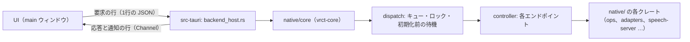

# 中核の統合と Python 同梱の終了（#285）

Python のサイドカーの中核（`mainloop.py`、`controller.py`、`config.py`）を Rust の `native/core`（vrct-core）へ移し、アプリのプロセスの中で動かす作業の記録です。2026-11-16 時点の状態を書きます。0.5.0 から中核がただ一つのバックエンドで、配布物に Python は入りません。

## 構成



- UI は今までどおり `sidecarSession.js` でバックエンドと話します。`backendCommand.js` が中核を、Python のサイドカーが使っていた shell プラグインの `Command` と同じ形で渡します。shell プラグインはアプリから外しました。
- 要求と応答の形式、状態コード、エラーの本体、ロックの規則は [IPC プロトコル](../spec/ipc-protocol.md) のままです。UI 側の変更は、この切り替えの部分だけです。
- 設定、ログ、モデルの保存先は Python のサイドカーと同じです。同じ `config.json` を読み書きします。
- 配布物に同梱するファイル（speech.cpp、補助プログラム、ライセンス文）は `_internal` にあり、中核は `native/core/src/resources.rs` で探します（「判断が要ること」の 5）。

## 切り替え

0.5.0 で Rust の中核を既定にし、Python のサイドカーを配布物から外しました（2026-11-16 決定）。0.4.0 の間は、中核は `VRCT_BACKEND=core` を指定したときだけの試用でした。

- `src-tauri/src/backend_host.rs` の `CORE_IS_DEFAULT` は `true` です。UI はいつも中核を起動します（`backend_kind` と `VRCT_BACKEND` はなくなりました）。
- `tauri.conf.json` に `externalBin` はなく、capability に shell の権限もありません。`vrct-vox-sidecar` の実行ファイルは配布物に入りません。
- 開発のときに Python のサイドカーへ戻す抜け道（`VRCT_BACKEND=python`）は作りませんでした（「判断が要ること」の 21）。
- 起動の後で、Python が取得した CTranslate2 の重みを消します（「判断が要ること」の「決まったこと」。ローカル翻訳への影響は 1）。
- `src-python/` とその試験は、移植の仕様として残しています。消すときに一緒に片付けるものは「Python の削除に伴うもの」にまとめました。

## 統合テスト

`cargo test --locked --manifest-path native/core/Cargo.toml` で動きます。CI では `voice-tests.yml` の `core-integration`（ubuntu-latest と windows-latest）が実行します。モデル、音声デバイス、外部のネットワークは使いません。

| 試験 | 確かめること |
|---|---|
| `tests/lifecycle.rs` | 起動時の通知の順序と `/run/initialization_complete`、終了と設定の保存、watchdog、入力が閉じたときの終了、古い版の設定の移行と通知、保存の失敗と回復 |
| `tests/config_reference.rs` | Python が書いた設定ファイル 50 通りを Windows と Linux の規則で読み、Python と同じ内容を書き戻すこと（基準は Python を実際に動かして作る） |
| `tests/error_codes.rs` | エラーコードと本体の形が [エラーコード一覧](../spec/reference/error-codes.md) と一致すること。中核のソースが応答・通知・コードの表で使う大文字のコードが、すべて一覧にあること（Python も表の外で返していた `VOICE_SETTINGS_INVALID` を除く） |
| `tests/dispatch.rs` | 404、500、ロックの順序、20 秒と 30 秒で返す 423、停止の要求の即時処理、VR パネルの中継の制限 |
| `tests/endpoint_coverage.rs` | 実装したエンドポイントが仕様の一覧に載っていて、初期化前に待つかどうかと即時処理の区分が一致すること。仕様のエンドポイントがすべて実装されていること（引退させたものを除く） |
| `tests/speech_servers.rs` | speech.cpp サーバの設定、起動と停止、世代、自分で終わったサーバの報告、終了時の後片付け |
| `tests/downloads.rs` | モデル取得の同意とカタログの版、状態、取り消し、検証して公開すること、設定への適用とその拒否（`settings_changed`、`model_target_busy`）、ハードウェアの確認、終了時の停止 |
| `tests/telemetry.rs` | 通知に答えるまで何も送らないこと、答えの検査（`telemetry_notice_invalid`）、`VRCT_TELEMETRY=off`、送る内容の表示、エラーコードの送信、終了後に送らないこと |
| `tests/adapters_servers.rs` | WebSocket サーバとトークン（101 と 403）、ホスト・ポート・証明書の変更と巻き戻し、OBS のページとトークン、起動時の再開と失敗の通知、`WEBSOCKET_*` と `OBS_BROWSER_SOURCE_*` のエラーコード |
| `tests/settings_endpoints.rs` | 動いていない機能の設定を読み書きするエンドポイント（翻訳・音声認識のキーの取得と削除、URL の変更とキーの入れ直し、OCR とオーバーレイの設定、古い Whisper の重み）。拒否したときのエラーコードと戻す値、`config.json` への保存、キーがログに出ないこと |
| `tests/updates.rs` | Python と同じく止めてある更新の答え（リリースの一覧は空、起動時の確認は「更新なし」、更新の要求は `UPDATE_SOFTWARE_DOWNLOAD`）、ホストが更新の仕組みを渡したときの版と種類の受け渡し、`UPDATE_SOFTWARE_VERIFY` |
| `tests/adapters_osc.rs` | OSC の送り先の検査、入力中の表示の送信、VRChat のミュートとの同期、OSCQuery を失ったときの順序、VRChat の有無、終了後に何も変えないこと |
| `tests/engine_checks.rs` | 起動時の確認に失敗したエンジンの扱い（サーバからモデルを探すエンジンの選択を消し、API キーは残す） |
| `tests/translation.rs` | 翻訳のプロバイダのキーの確認と保存、モデルの一覧と選択、LM Studio と Ollama の接続と切断、OpenAI 互換の URL とキー、起動時の確認、非商用の重みの同意、翻訳のオンとローカルのモデルの読み込み（足りない、読めない、VRAM 不足）。キーがログに出ないこと |
| `tests/messages.rs` | `/run/send_message_box` からチャットボックス（OSC）、WebSocket、会話のログまで。翻訳のオンとオフ、翻訳後のみの送信、VRChat へ送らない設定、プロバイダの失敗と切り替え、読み、認識の結果の受け渡し（ワードフィルタ、繰り返し、OCR、話し相手）、オーバーレイと音声の口、会話の履歴。文章がログに出ないこと。VR のログに描くことは `vr_overlay.rs`、OCR の行が流れを通って UI に届くことは `ocr.rs`、リアルタイムのマイクの確定文が訳されて読み上げられることは `voice.rs` が確かめる |
| `tests/audio_devices.rs` | 音声デバイスの一覧と選択肢、名前・ID・ホストでの選択と拒否したときに戻す値、Auto Select が OS の既定に従うこと、抜き差しで一覧が変わり選択が既定へ移ること、通知の順序、保存、Python が MME などで保存した選択、起動時の一覧、動いている録音を移すときの受け渡し、仮想マイクの案内と確認（見つけ方、テスト音、ミュート中の拒否、止めること）。デバイスはメモリの中の偽物 |
| `tests/vr_overlay.rs` | 字幕のログと VR パネルのオンとオフ（SteamVR の有無、VR パネルを作れない環境、保存した設定での起動）、設定が動いているオーバーレイに届くこと、VR パネルのエンドポイントと中継、失敗の通知（`OVERLAY_RUNTIME_FAILED`）、送ったメッセージが動いている大きいログに描かれること、終了。SteamVR と VR 画面は代わりのものを使う |
| `tests/ocr.rs` | チャットの読み取り。偽の画像と偽の認識器を使う。ディスクのファイルから見たモデルの準備、オンにできない理由（`OCR_DISABLED_*`）の通知、状態、動いている読み取りに設定が届くこと、言語の切り替えと巻き戻し、読んだ行をメッセージの流れへ渡し `/run/transcription_ocr_message` で UI に届くこと、オフと終了、モデルの読み込み中の終了、読んだ文字がログに出ないこと |
| `tests/transcription.rs` | 音声認識の録音（Google とクラウドのエンジン）。マイクとスピーカーのスイッチ、エンジンやデバイスがないときの拒否と通知、認識した文が UI・チャットボックス・会話のログに届き `process.log` には出ないこと、44.1 kHz のスピーカーと Whisper の API（言語とセグメントの選別）、音量メーター、エンジンの失敗（`ASR_ERROR`）、開けないデバイス（`AUDIO_OPEN_ERROR`）と別のデバイスへの切り替え、読み取りの失敗（`AUDIO_READ_ERROR`）、抜いたデバイスから別のデバイスへ移ることと最後のデバイスを抜いたときの停止、ミュートの同期、認識のキーと URL の確認と戻す値、起動時のエンジンの確認、終了。デバイスは 44.1 kHz と 48 kHz の PCM をデバイスと同じ間隔で渡す偽物、エンジンは 127.0.0.1 の偽のサーバ |
| `tests/realtime_asr.rs` | リアルタイムの音声認識。設定の検査と保存、エンドポイントとモデルの一覧、メインのスイッチ（Linux と Windows の speech.cpp）で字幕（途中・確定・訳・結果）と確定した文がチャットボックスまで届くこと、設定画面からの開始と停止と録音からの引き継ぎ、スイッチが足りないものを `details.reason` で答えること、サーバが断ったときの失敗の通知、終了。speech.cpp はモデルの一覧と Realtime の WebSocket を返す 127.0.0.1 の偽のサーバ |
| `tests/voice.rs` | TTS のスイッチ（止まっている理由ごとのコード、世代、内蔵サーバを自分で起動して止めること、設定画面から起動したサーバは止めないこと、サーバの停止で TTS が切れること）、音声の設定の検査と拒否したときの答え、入力したチャットを元の文と翻訳で読み上げること、マイクの確定文の読み上げと言語・翻訳の変更での取り消し、停止とミュートと再開、キューで待つ間の停止で古い世代を拒むこと、ミュートの保存と壊れた記録、Linux の管理された経路のゲート、出力先の一覧、モデルの選択肢とインストール済みエンジンの声、直接の音声（素通しと声質変換、世代、失敗、元の声に戻さないこと、変換を通した読み上げ）、声質変換の実行環境の準備（同意、版、手順ごとの失敗、worker の確認）、フローパネル、リアルタイムのマイクの確定文が訳されて読み上げられること、声を流しているケーブルを認識に使わせないこと（`realtime_endpoint_feedback`）、終了。出力とマイクはメモリの中の偽物、speech.cpp とエンジンはループバックの偽物、RVC の worker は `fake-rvc-worker` |

Python の `src-python/test/test_native_core_reference.py` は、Python 側の設定の規則が変わったのに基準データを作り直していないとき失敗します。

## Python の試験の棚卸し

`tests/` の Python の試験（関数 1,353 件）を、「新しい接続面で再カバーするもの」とそれ以外に分けました。

| 区分 | 内容 | 扱い |
|---|---|---|
| A | サイドカーを動くアプリとして試すもの（エンドポイント、設定の移行、起動と終了、モデル取得、エラーコード） | `native/core/tests/` で再カバーする |
| A-u | 移植先のクレートがまだ無かったサイドカーの処理 | 移植と一緒に再カバーした（下の表） |
| B | 移植済みのクレートの単体の振る舞い | 各クレートの試験と同等性の試験がすでに持つ |
| C | ビルド、配布、開発用の道具、ブラウザや GUI の試験 | バックエンドの言語に関係なく残す |
| D | Python と一緒に消えるもの（PyInstaller、Seed-VC、CTranslate2、Python の実行環境の準備） | コードと一緒に引退させる |
| E | 実機やモデルが要るもの | headless の CI では動かさない |

区分 A のうち、再カバーが済んだもの:

| Python の試験 | 再カバーした試験 |
|---|---|
| `tests/voice/test_runtime_paths.py`（設定の保存先）、`tests/platform/test_runtime_settings.py` | `lifecycle.rs`、`config_reference.rs` |
| `tests/voice/test_quick_chat_config.py`、`test_vc_settings.py`、`test_realtime_settings.py`（設定の移行） | `config_reference.rs` |
| `tests/platform/test_native_backend.py`（初期化の完了、終了、設定が次の起動に残ること） | `lifecycle.rs` |
| `tests/voice/test_priority_cancel.py`（停止の要求がキューを飛ばすこと） | `dispatch.rs` |
| `tests/voice/test_speech_server_controls.py`、`test_speech_server_end_owner.py`（サーバの部分） | `speech_servers.rs` |
| `tests/voice/test_model_download_controller.py`、`test_model_download_policy.py` | `downloads.rs` |
| `tests/voice/test_telemetry_client.py`（エンドポイントの部分） | `telemetry.rs` |
| `tests/voice/test_security_regressions.py`（WebSocket と OBS の部分）と `src-python/test/` の WebSocket・OBS・OSC の試験 | `adapters_servers.rs`、`adapters_osc.rs` |
| `src-python/test/test_old_whisper_weights.py` | `settings_endpoints.rs`、`src/controller/files.rs` の単体の試験 |
| `src-python/test/test_controller_vr_panel_opacity.py`、`test_credential_commits.py` と `test_controller_transcription_api_endpoints.py`（キーの削除と URL の変更の部分） | `settings_endpoints.rs` |
| `tests/voice/test_virtual_mic_controller.py`、`src-python/test/test_controller_audio.py`（Auto Select と終了時の停止の部分）、`test_config_saved_device_selection.py` | `audio_devices.rs` |
| `src-python/test/test_controller_ocr_enable.py`、`test_controller_ocr_readiness.py`、`test_controller_ocr_settings.py`、`test_model_stop_ocr_capture.py`、`test_ocr_language_and_shutdown.py`（中核の部分） | `ocr.rs`、`settings_endpoints.rs`。パイプラインそのものの振る舞いは `native/ocr-runtime` の試験が持つ |
| `src-python/test/test_controller_update_software_failure.py`、`test_controller_init_config_settings.py`（`available_releases` を起動時の一覧に入れない部分） | `updates.rs`、`lifecycle.rs` |
| `src-python/test/test_controller_transcription_api_endpoints.py`（キーの保存と拒否、URL とキーの組）、`test_controller_transcription_engine_status.py` | `transcription.rs`、`engine_checks.rs` |
| `src-python/test/test_model_transcript_wiring.py`、`test_model_api_transcription_wiring.py`、`test_model_energy_consumer.py`、`test_model_transcript_stop.py`、`test_device_capture_lifecycle.py`、`test_controller_vrc_mic_mute_sync_init.py`（認識の部分） | `transcription.rs` |
| `tests/voice/test_realtime_controls.py`、`test_realtime_toggles.py`、`test_realtime_settings.py`（移行以外）、`test_realtime_delivery.py`、`src-python/test/test_realtime_toggle_generation.py`、`test_realtime_legacy_handoff.py`、`test_realtime_delivery_outcomes.py` | `realtime_asr.rs` |
| 区分 A-u だった `tests/voice/test_realtime_session.py`、`test_realtime_events.py`、`test_realtime_audio.py`、`test_speechcpp_realtime.py`、`test_speechcpp_asr.py`、`test_asr_vocabulary.py`、`test_capture_packets.py` と、`src-python/test/test_transcription_recorder.py`、`test_transcription_transcriber.py`、`test_transcription_providers.py`、`test_transcription_openai_compatible.py`、`test_transcription_deepgram.py` | `realtime_asr.rs`、`transcription.rs` と `native/transcription` の単体の試験 |
| `src-python/test/test_controller_message_pipeline.py`、`test_message_snapshot_and_sinks.py`（送信、翻訳、読み、出力の失敗の部分） | `messages.rs`、`src/controller/messages.rs` の単体の試験 |
| `src-python/test/test_controller_translation_enable.py`、`test_translation_providers.py` と `test_endpoints.py` の翻訳のキーとモデルの部分 | `translation.rs`、`native/translation` の試験 |

| `src-python/test/test_controller_overlay_running.py`、`test_controller_vr_panel_toolbar.py`（固定先、ロック、ランチャーの手と初期化、自動で隠す設定）、`test_overlay_lifecycle_publication.py`（オンの失敗と切ったときの消去） | `vr_overlay.rs` |
| `src-python/test/test_overlay_steamvr_quit.py`、`test_overlay_shutdown_timeout.py`（SteamVR を待つこと、終了、つなぎ直し） | `vr_overlay.rs` と `native/vr-overlay` の `engine` の試験 |
| `tests/voice/test_tts_toggle.py`、`test_tts_toggle_server.py`、`test_speech_server_end_owner.py`（TTS の部分）、`test_tts_model_options.py`（コントローラの部分） | `voice.rs` |
| `tests/voice/test_spoken_controls.py`、`test_io_flow_controller.py`、`src-python/test/test_voice_settings_patches.py` | `voice.rs` |
| `tests/voice/test_direct_voice_controller.py`、`test_managed_controller.py`、`src-python/test/test_voice_route_monitor_mute.py` | `voice.rs`。経路のゲートと保存は `native/audio-routing` の試験も持つ |
| `tests/voice/test_external_speech_engines.py` | `voice.rs`（エンドポイントと TTS のスイッチ）、`native/tts/tests/engines.rs`（クライアント） |
| `tests/voice/test_vc_runtime_setup.py`（RVC の部分） | `voice.rs`、`native/voice-conversion` の単体の試験（版、アーカイブ、以前の実行環境の削除）。uv、Python、Seed-VC の部分は区分 D |


区分 A は上の表のとおり再カバーしました。音声認識の字幕を VR の大きいログに出す部分（`test_realtime_overlay*.py`）は、字幕を出す関数（`Core::show_overlay_caption`）につないでありますが、中核の試験ではまだ確かめていません。発話の診断のログ（`test_utterance_diagnostics.py`）は移していません（「判断が要ること」の 15）。

## 切り替え前の基準値

0.5.0 で Python の同梱をやめたときに比べるための値です。2026-11-16 に計りました。

### 計り方

`tools/measure_backend_startup.py` が、展開した Windows の配布物を相手にサイズと起動時間を計ります。中核の起動は `native/core/examples/startup_time.rs` で計ります。アプリと同じ `Environment` で `Backend::start` を呼び、`/run/initialization_complete` までの時間を返します。

```sh
cargo build --release --locked --manifest-path native/core/Cargo.toml --example startup_time
python tools/measure_backend_startup.py --package <展開した配布物> \
    --core-example native/core/target/release/examples/startup_time.exe \
    --work <空のフォルダ> --runs 5 --zip <VRCT-VOX.zip>
```

- 対象は release/0.4.0（e4b9bcfb）の CI が作った CPU 版の `VRCT-VOX.zip` です。
- 起動時間は、バックエンドを起動してから `/run/initialization_complete` が届くまでです。サイドカーは `vrct-vox-sidecar.exe` を子プロセスとして起動した時点から計ります。中核はアプリと同じくプロセスの中で起動します。アプリの窓や WebView の起動は含みません。
- 設定は空のフォルダから始め、起動時に外へ出る処理を止めます（モデルの自動取得、更新の確認、利用状況の送信、VRChat への OSC）。何も取得していません。
- それぞれ 5 回続けて起動しました。サイドカーを先に計り、1 回目はほかより遅いので分けて書きます。展開した直後なので、ディスクのキャッシュが完全に冷えた起動ではありません。
- 計った環境は Windows 11、Intel Core i7-1255U、ノート PC です。ほかの PC での速さを示す値ではありません。

0.5.0 の配布物も同じコマンドで計ります。`vrct-vox-sidecar.exe` がない配布物では、サイドカーを起動せず中核だけを計ります。この場合は中核の 1 回目が冷えた起動になります。サイズは `vrct-vox.exe`、そばに置いた ONNX Runtime、speech.cpp、RVC の worker、ライセンス、フォント、`_internal` の残りに分けて出します。Python の実行環境のファイルが残っていたら警告を出します。アプリの本体は窓と WebView を開くので、この計測では起動しません。

### 配布物のサイズ

展開した `VRCT-VOX.zip` は 1,115.3 MB です（zip のままでは 408.7 MB）。1 MB は 10^6 バイトです。

| 部分 | サイズ | 切り替えたあと |
|---|---:|---|
| `vrct-vox.exe`（アプリと中核） | 22.0 MB | 残る |
| speech.cpp（`_internal/build`） | 49.3 MB | 残る（置き場所は「判断が要ること」の 5） |
| `vrct-vox-sidecar.exe` | 28.0 MB | なくなる |
| Python の実行環境とライブラリ | 408.3 MB | なくなる |
| Sudachi の辞書（`*.dic`、かな・ローマ字の変換用） | 576.9 MB | Python と一緒になくなる。Rust で同じ変換をするときの辞書は未決 |
| 同梱のモデル（`_internal` の `*.onnx`） | 1.2 MB | Python と一緒になくなる |
| フォント（`*.ttf`） | 29.6 MB | Python と一緒になくなる。オーバーレイを Rust で描くときに要るかは未決 |

Python の実行環境とライブラリの中で大きいのは `cv2`（100.6 MB）、`ctranslate2`（63.7 MB）、`transformers`（42.7 MB）、`onnxruntime`（39.3 MB）、`numpy.libs`（38.2 MB）、`PIL`（13.5 MB）です。初回に取得するモデル（翻訳の重みなど）は配布物に入っていないので、この表に含めていません。

### 起動から初期化の完了まで

| バックエンド | 1 回目 | 2〜5 回目の中央値 | 最小〜最大 |
|---|---:|---:|---:|
| Python のサイドカー | 11.83 秒 | 7.95 秒 | 7.89〜11.83 秒 |
| 中核（`VRCT_BACKEND=core`） | 1.02 秒 | 0.74 秒 | 0.62〜1.02 秒 |

中核の値は、計った時点の接続の状態での値です。その時点の中核は、まだ音声デバイスの列挙と選択をしていませんでした。いまは起動時に行います（計り直していません）。サイドカーではこれが 3.48 秒かかっていました（`startup_timing.log` の `select_audio_devices`）。そのほかの段階はモジュールの読み込み（約 2.5 秒）と設定の一覧の収集（1.15 秒）です。収集のうち 0.99 秒は speech.cpp の機器の確認で、これは中核も同じく行い、同じ一覧を返しました。初期化の一覧の項目は、サイドカーが 183、中核が 160 です。機能をつなぐと中核の値は増えるので、0.5.0 では同じ方法で計り直して比べます。

## 切り替えた後の値（0.5.0 の候補）

2026-11-16 に、上と同じ道具と設定で計り直しました。

- 対象はこのブランチから手元で作った Windows の配布物です。`bat/build.bat`、`vite build`、`tauri build --no-bundle` の順に作り、`vrct-vox.exe` と `src-tauri/bin/_internal` を zip にしました。zip は PowerShell の `Compress-Archive` で作りました（`utils/zip.py` と同じ Deflate）。speech.cpp は固定した 0.11.0（`windows-x64-vulkan`）です。
- 計った環境は上と同じ Windows 11、Intel Core i7-1255U のノート PC です。5 回続けて起動しました。

| | 0.4.0（Python のサイドカー） | 0.5.0 の候補（中核） |
|---|---:|---:|
| 展開した配布物 | 1,115.3 MB | 77.1 MB |
| zip | 408.7 MB | 27.3 MB |
| 起動から初期化の完了まで（1 回目） | 11.83 秒 | 1.21 秒 |
| 同（2〜5 回目の中央値） | 7.95 秒 | 1.11 秒 |
| 同（最小〜最大） | 7.89〜11.83 秒 | 1.02〜1.43 秒 |

配布物の内訳は `vrct-vox.exe`（アプリと中核）24.8 MB、speech.cpp 47.3 MB、RVC の worker 2.0 MB、ライセンス文 3.1 MB です。ONNX Runtime、書体、OpenVR のライブラリ、読みの辞書は入っていません（「判断が要ること」の 2、3、6、7）。これらを入れると大きくなります。

中核の起動は、音声デバイスの列挙と選択（約 20 ms）と speech.cpp の機器の確認（約 1 秒）を含みます。初期化の一覧の項目はサイドカーが 183、中核が 184 です。speech.cpp の機器の確認は 0.4 と同じ 2 台の GPU を返しました。

`bat/build.bat` は `build/speechcpp/speech.exe` があると取り直しません。古い版が残っていると中核はハッシュが合わないとしてそれを使わず、機器の一覧が空になり、内蔵のサーバも起動しません。CI は毎回取得するので起きませんが、手元で配布物を作るときは版を確かめてください。
## 往復の試験

Issue のコメントは、音声認識・翻訳・TTS・声質変換・OCR の往復を統合テストで確かめるよう求めています。どれも headless の CI で動き、モデル、音声デバイス、外部のネットワークを使いません。

- 翻訳: ローカル翻訳は偽のエンジン、オンラインのプロバイダは 127.0.0.1 の偽のサーバを相手に、`/run/send_message_box` から OSC・WebSocket・会話のログ・履歴までを確かめます（`tests/translation.rs`、`tests/messages.rs`）。
- 音声認識: デバイスと同じ間隔で PCM を渡す偽の録音と、127.0.0.1 の偽の認識サーバ（クラウドのエンジンと speech.cpp の Realtime）を相手に、認識した文が UI・チャットボックス・会話のログに届くまでを確かめます（`tests/transcription.rs`、`tests/realtime_asr.rs`）。
- TTS: speech.cpp の偽のサーバ（`tests/common/fake_tts.rs` と、合成を返す `tests/fixture/fake_speech.rs`）を相手に、合成の要求から出力への書き込みまでを確かめます。リアルタイムのマイクの確定文が訳されて読み上げられるところまで通します（`tests/voice.rs`）。
- 声質変換: `vrct-rvc-worker` の代わりの小さな実行ファイル（`tests/fixture/fake_rvc_worker.rs`）を相手に、起動と停止、変換した音だけが出力に届くこと、失敗の扱いを確かめます（`tests/voice.rs`）。
- OCR: 撮影を差し替えて画像を与え、偽の認識エンジンを相手に、読んだ行がメッセージの流れを通って `/run/transcription_ocr_message` に届くまでを確かめます（`tests/ocr.rs`）。
- VR のオーバーレイ: 代わりの SteamVR を相手に、送ったメッセージが大きいログに描かれるまでを確かめます（`tests/vr_overlay.rs`）。

## 残っているエンドポイント

仕様のエンドポイントで、まだ Rust の中核にないものの一覧です。要求すると 404 を返します。`tests/endpoint_coverage.rs` がこの一覧と実装を照らし合わせます。

<!-- remaining-endpoints:begin -->
なし（0 件）。すべてのエンドポイントを中核につなぎました。
<!-- remaining-endpoints:end -->

次のエンドポイントは Python のバックエンドと一緒に引退させます。Rust の中核にはつなぎません。

<!-- retired-endpoints:begin -->
- 旧 CTranslate2 の重みの取得（1 件）: `/run/download_ctranslate2_weight`。起動時の自動取得と、カタログの `legacy_models` も移しません。
<!-- retired-endpoints:end -->

## Python の削除に伴うもの

`src-python/` はほかの領域の移植が終わるまで仕様として残します。消すときは、次のものも一緒に片付けるか、先に移します。2026-11-16 に `git grep src-python` などで調べた一覧です。

先に移さないとビルドが壊れるもの:

- `native/ops/src/downloads/speechcpp.rs` が `include_str!` で読む `src-python/models/model_downloads/speechcpp_models.py` と `speechcpp_asr.py`。`native/ops` の中へ移す。`tools/build_linux.py` の `CRATE_INPUTS` と `build-linux.yml` の対象のパス（`src-python/models/model_downloads/**`）も一緒に直す。
- `native/adapters/tests/obs.rs` が動かす `src-python/test/obs_reconnect.mjs`。
- 版のそろえ方。`utils/update_version.py` は `src-python/config.py` に版を書き、`.github/actions/windows-package/action.yml` と `release.yml` の候補の検査はそれを読む。
- `tools/spec_catalog.py`。仕様の一覧（`docs/spec/reference/`）を `src-python/`（`mainloop.py`、`errors.py`、`config.py`）から作っている。中核の `routes.rs`、`errors/table.rs`、`config/schema.rs` から作るように変える。`native/core/tests/endpoint_coverage.rs` はこの一覧を読む。
- 製品のモデルのカタログの正本。`AGENTS.md`、`NOTICE.md`、`release-candidates.md` は `src-python/models/model_downloads/catalog.py` を指す。Rust のカタログ（`native/ops`）に書き換える。

一緒に引退させる試験と CI:

- `src-python/test/` の全部と、`src-python` を読み込む `tests/` の試験（`tests/voice` の大半、`tests/platform` の一部、`src-python/test/test_native_core_reference.py`）。区分 A は上の表のとおり中核の試験に移した分だけ再カバー済み。
- `voice-tests.yml` の `backend-windows` と `backend-linux`。`headless` の `check --scope voice` は残る試験だけにする。
- `tools/dev.py` の `backend` のスコープ、`LINT_PATHS` と `PLATFORM_BACKEND_TESTS` の `src-python` の部分、`pyproject.toml` のアプリの依存と `cuda` の extra（`uv.lock` も）、`linux-build` のグループ、`bat/install.bat` と `mise run setup:app`、`.venv`・`.venv_cuda`・`.venv_linux`。
- 中核の基準データを Python で作る道具（`native/core/reference/dump_reference.py`、`native/ocr-runtime/reference/`、`native/ops` の `python_reference.json` を作る手順）。データは残し、作り直す道具だけを引退させる。
- `src-python` を読み込む開発用の道具（`tools/voice_cli.py`、`voice_route.py`、`voice_acceptance.py`、`native_acceptance.py`、`vrchat_voice_host.py`、`live_tts_acceptance.py`、`windows_field/`、`fake_vr_site/`、`chatbox_lab/`、`translation_onnx/compare.py` など）。中核で同じことをする道具に置き換えるか引退させる。
- `integrations/seed_vc/`（Python の Seed-VC。「判断が要ること」の 6）。
- `.github/CODEOWNERS` の例の `src-python/`。

文書:

- `src-python/docs/`、`docs/spec/` の各ページの `src-python` への参照（`contracts.md` の試験の場所など）、`native/*/README.md` の「Python のどこを置き換えたか」の記述（履歴として残すなら 0.4 のタグへのリンクにする）。
- `NOTICE.md` の Silero VAD（`src-python/models/transcription/silero_vad/`）と `licenses/silero-vad/`。Rust の音声認識が使わないなら引退させる。

## 翻訳の棚卸し

翻訳には上流の VRCT から引き継いだものが多く残っています。2026-11-16 に、Python（`src-python/models/translation/`、`controller.py`、`model.py`、`config.py`、`models/builtin_model_pins.py`）、中核（`controller/translation.rs`、`translation_onnx.rs`、`languages.rs`、`legacy_weights.rs`、`config/schema.rs`）、`native/translation`、`native/translate-onnx`、`tools/translation_onnx/`、UI と `locales/` を調べました。中核へ移すときは、古いものをそのまま移さない方針です。扱いの「消す」は利用者から見えないものか、どのビルドでも動かなかったものだけを実際に消し、ほかは「判断が要ること」の番号に回しました。

| もの | どこに | いまの状態 | 扱い |
|---|---|---|---|
| Google・Bing・Papago の Web 翻訳 | 上流の `translator_engines`（配布しない）、`translation_translator.py` の分岐とタイムアウト、言語の表の列、UI の `translator_status`、仕様のタイムアウトの記述 | どのビルドでも動かない。中核は「使えない」と示していた | **消した**。エンジンの一覧と UI の選択肢と仕様から外した。言語の表の列は残す（17、利用者から見える） |
| CTranslate2 での推論 | `translation_translator.py` の `changeCTranslate2Model`、`translateCTranslate2` | Python と一緒に配布物から消えた | **置き換える**（1 で決める） |
| transformers のトークナイザと遅い読み込み | `translation_utils.py` の `loadTransformers`、`UNLOADED`、`CTranslate2TokenizerLoadError` | Python だけ | **消える**。中核に移さない |
| `native/translate-onnx`、中核の機能 `onnx-translation`、`controller/translation_onnx.rs`、`tools/translation_onnx/` | Rust と道具 | 既定でオフ。モデルは未公開 | **1 の決定まで残す**。(b) なら消す |
| ローカル翻訳の継ぎ目 `LocalTranslation`（`Services::local_translation`） | 中核 | 偽のエンジンで試験済み | **残す** |
| CTranslate2 の重みの取得（`/run/download_ctranslate2_weight`、起動時の自動取得、カタログの `legacy_models`、`LEGACY_MODEL_DOWNLOAD_CONSENTS`） | Python | 引退させた | **1 の決定で置き換える**。(b) なら中核に戻す |
| 取得の通知（`download_progress_ctranslate2_weight`、`downloaded_ctranslate2_weight`、`error_ctranslate2_weight`）、`WEIGHT_CTRANSLATE2_DOWNLOAD`、`dispatch.rs` の `request_error_result` | 中核の `RUN_MAPPING` とエラーの表 | 中核は送らない | **1 の決定まで残す**。(b) なら使う。(a) か (d) なら消す |
| UI の重みの取得（設定の翻訳のダウンロードのボタン、`LegacyModelDownloadDialog`、`TranslationSetupController`、`legacyModelConsent.js`、起動時の取得の表示） | UI と `locales/` | 中核では確認が進まない行き止まり | **置き換える**（29、利用者から見える） |
| 重みの固定（版、サイズ、SHA-256）と確認の記録（`.weight_verified.json`） | `builtin_model_pins.py`、`legacy_model_downloads.py` | 中核にない | (b) なら Rust に移す。(a) ならカタログが置き換える |
| 旧フォルダ名（`m2m100_418M`、`m2m100_12b`）の付け替え | `translation_utils.py` の `backwardCompatibleRenameWeightsDir` | 中核に移していない | **消える**。移さない |
| 旧 CTranslate2 の重みを消す処理 | `legacy_weights.rs`、`Services::retire_legacy_translation_weights`、`tests/legacy_weights.rs` | 0.5.0 で有効 | 決まったこと。(b) か (c) なら出す前に止める（1） |
| 重みの選択と非商用の同意（`CTRANSLATE2_WEIGHT_TYPE`、`SELECTABLE_CTRANSLATE2_WEIGHT_TYPE_LIST`・`_DICT`、`CTRANSLATE2_LICENSE_NOTICE_SHOWN`、`WEIGHT_CTRANSLATE2_LICENSE_CONSENT_REQUIRED`、`WEIGHT_CTRANSLATE2_NON_COMMERCIAL_NOTICE`）とエンジンの ID `CTranslate2` | 中核と UI | 移した | **残す**。設定と IPC の契約なので名前は変えない。(a) でも同じ値でモデルを選ぶ |
| NLLB を既定にしていた古い設定の知らせ | `config.py`、中核の `notify_after_start` | 移した | **残す** |
| 計算デバイスと計算型（`SELECTED_TRANSLATION_COMPUTE_DEVICE`・`_TYPE`、`SELECTABLE_COMPUTE_DEVICE_LIST`、UI の ComputeDevice） | 中核と UI | 中核の一覧は CPU だけ | **残す**。(b) なら値をそのまま使う。(a) なら読み替える（1） |
| `getBestComputeType`（`auto` の解き方）と CUDA の機器の一覧 | `utils.py` | 中核は CPU の固定の一覧 | **消える**。(b) なら CTranslate2 の `auto` に任せる |
| GPU のメモリー不足（`detectVRAMError`、`LocalError::OutOfMemory`、`TRANSLATION_VRAM_*`、4 つの通知、UI の処理と文言） | Python、中核、UI | CPU だけなので起きない | **1 の決定まで残す**（30） |
| CUDA 版の配布物（CTranslate2 のための `_internal/nvidia`） | 配布 | 中身は標準版と同じ | 20 で決める |
| ローカル翻訳の言語の表（重みごとの表） | `translation_languages.json` | 移した | **残す** |
| オンラインのプロバイダ（DeepL、Plamo、Gemini、OpenAI、Groq、OpenRouter、LM Studio、Ollama、OpenAI 互換）、プロンプト、履歴、モデル一覧の短い保持、タイムアウト | `native/translation`、`controller/translation.rs` | 移した | **残す**。プロキシは 18 |
| 失敗したときローカル翻訳へ切り替える動き（`changeToCTranslate2Process`） | 中核の `fall_back_to_local` | 移した | **残す**。ローカル翻訳がない間は元の文で送る |

## 判断が要ること

PR の残課題と同じものです。決まったら、この節を更新します。番号は 2026-11-16 に振り直しました（それまでの番号は各領域の作業で重なっていました）。

### 決まったこと

- **既定の切り替え（2026-11-16）**。0.4.0 の間は既定を切り替えず、中核は `VRCT_BACKEND=core` を指定したときだけの試用でした。0.5.0 で中核を既定にし（`CORE_IS_DEFAULT`）、PyInstaller の工程と配布物のサイドカーをなくしました。
- **移植の範囲（2026-11-16）**。#277（翻訳・翻字のプロバイダ）、#278（音声認識）、#279（TTS）、#281（OCR）、#282（オーバーレイ）の残りを #285 の中で移しました。エンドポイントは全件が中核にあります。移していない振る舞いは下の 8、11、15 にあります。
- **使えないエンジンの選択（2026-11-16）**。起動時の確認に失敗したエンジンは Python と同じに扱います。LM Studio、OpenAI 互換、Ollama、Groq・OpenAI・カスタムの Whisper、Deepgram は、モデルの一覧と選択を消します（Deepgram は言語の表も）。ほかのエンジンの選択は残します。翻訳と音声認識のプロバイダは Rust に移り、起動時に Python と同じ確認をします。キーの扱いは 25 です。
- **旧 CTranslate2 の重み（2026-11-16: 消す）**。`/run/download_ctranslate2_weight`、起動時の自動取得、カタログの `legacy_models` は中核に移さず、引退させました。重みのフォルダ（`<データ>/weights/ctranslate2/` の、Python が作った 7 つの名前）は起動の後で消します（`CORE_IS_DEFAULT`、0.5.0 で有効）。リンクやジャンクションはたどらず、ほかのファイルには触れません。ローカル翻訳との関係は 1、知らせ方は 26 です。

### 決めてほしいこと

1. **ローカル翻訳のエンジン（0.5.0）**。Python の CTranslate2 は配布物から消えました。いまの中核にはローカル翻訳がありません。翻訳を有効にすると `TRANSLATION_MODEL_MISSING` になり、オンラインのプロバイダの翻訳と、失敗したときに元の文で送る動きだけが残ります。2026-11-16 に、アプリに組み込める OSS と `native/translate-onnx` を比べました（下の表）。一つに決めきれなかったので、どれもつないでいません。

    **先に決めてほしいこと**。旧 CTranslate2 の重みは 0.5.0 で起動の後に消します（「決まったこと」）。下の (b) か (c) を選ぶなら、その重みを読むので、0.5.0 を出す前に消す処理を止める必要があります（`backend_host.rs` の `retire_legacy_translation_weights` を `false` にする 1 行）。消した重みは戻せません。消さずにおけば、あとで消すことはできます。今回は決まったことに従い、消す処理はそのままにしました。

    | 候補 | ライセンス（エンジン） | 配布の形 | ビルドへの影響 | 配布物の増え方 | モデル | 速さ（30 文、この PC） | Python との一致（30 文） |
    |---|---|---|---|---|---|---|---|
    | Python の CTranslate2 4.8.4（基準） | MIT。Intel MKL と oneDNN を含むホイール | 0.4 の配布物の Python の中 | ― | `ctranslate2` 63.7 MB | 既存の重み | ja→en 8.5〜12.2 秒、en→ja 10.2〜10.3 秒 | ― |
    | a. `native/translate-onnx`（`ort` と `tokenizers`） | 自前（MIT）。`ort` は MIT か Apache-2.0、ONNX Runtime は MIT、`tokenizers` は Apache-2.0 | 中核の機能 `onnx-translation`（既定はオフ）。ONNX Runtime の配り方は 2 で決める（OCR と共通） | C++ のビルドなし。`ort` の機能はアプリ全体で 1 つにまとまるので、2 を決めてから有効にする | ONNX Runtime（Python の配布物では 39.3 MB。DirectML を使うなら `DirectML.dll` 17.7 MB）は OCR と共有。クレート分は未計測 | 未公開。`export.py` で作って公開し、カタログに載せる必要がある（418M は 506 MB）。既存の CTranslate2 の重みは読めない | この PC では計れない（モデルを作るには元のモデルの取得が要る）。Linux（Ryzen 9 9900X）の比較では CTranslate2 の 1.05〜1.5 倍の時間 | 未計測。WMT20 の 800 文では CTranslate2 と同等（BLEU +0.14、訳文の完全一致 326 文） |
    | b. `ct2rs` 0.11.2 と oneDNN（機能 `dnnl`） | `ct2rs` と CTranslate2 は MIT、oneDNN は Apache-2.0、SentencePiece は Apache-2.0 | 実行ファイルに静的リンク | CTranslate2 と oneDNN を CMake でビルド（この PC で約 9 分）。Windows はアプリ全体を静的な CRT（`+crt-static`）でビルドする必要がある。MSBuild の生成器ではパスが 260 文字を超えて失敗することがある | 試験用のプログラムで 36.6 MB | 既存の CTranslate2 の重みをそのまま読む。取得は固定済みの公開リポジトリ（`builtin_model_pins.py`）から戻せる | ja→en 22.3〜23.4 秒、en→ja 27.8〜32.8 秒（Python の 1.8〜3.2 倍） | ja→en 26、en→ja 26。30 文とも終了トークンで終わる |
    | b'. `ct2rs` と ruy（既定の機能） | 同上。ruy は Apache-2.0 | 同上 | CMake で約 5 分。CRT とパスの問題は同じ | 5.6 MB | 同上 | ja→en 155.1 秒、en→ja 254.2 秒（Python の 13〜25 倍）。使えない | ja→en 24、en→ja 28 |
    | b''. `ct2rs` と Intel MKL（機能 `mkl`） | MKL は Intel の EULA（再配布できるが OSS ではない） | 静的リンク | Windows は `nuget.exe`、Linux は Intel のインストーラーをビルドのときに取得。x86 だけ | 未計測 | 同上 | 未計測（Python と同じ計算ライブラリ） | 未計測 |
    | c. candle（`candle-transformers` 0.11.1） | MIT か Apache-2.0。C++ なし | 実行ファイル | なし | 未計測 | M2M100 と NLLB の実装がない。Marian（Opus-MT、言語の組ごとのモデル、CC-BY-4.0）か MADLAD-400（Apache-2.0、3B 以上）になる。どれも新しい取得が要る | 未計測 | ― |
    | d. `fxtranslate` 0.5.0（Firefox の翻訳エンジンの Rust 版） | MPL-2.0 | 実行ファイル | C++ なし（`cc` で SIMD の部分だけ） | 未計測 | Firefox のモデル（英語との組ごと）。作者は自分で配り直すよう求めている。日本語と韓国語のように英語を含まない組は 2 回訳す | 未計測 | ― |
    | e. Bergamot（translateLocally、`marek_translate_locally`） | AGPL-3.0 | ― | ― | ― | ― | ― | 除外。AGPL はアプリ全体の配布条件に及ぶため |

    計測は Windows 11、Intel Core i7-1255U のノート PC で、ほかのビルドを止めて 1〜2 回ずつ行いました。モデルは手元の `m2m100_418M-ct2-int8`、スレッドは 4、計算型は int8 です。Python 側はアプリと同じ手順（`translateCTranslate2` と同じトークナイザ、ビーム 5、256 トークン、終了トークンの確認）です。Rust 側は同じ手順を `ct2rs-sys` と SentencePiece で書きました。文は VRChat の会話を想定した日本語 30 文と英語 30 文です。時間はモデルの読み込みを含みません（読み込みは Python が 1.6〜5.5 秒、`ct2rs` が 0.7〜2.5 秒）。違った訳はどれも言い換えの範囲でした（「少しゆっくり」と「もう少しゆっくり」、「かわいい」と「かわいいです」など）。Python も oneDNN 版も、計算ライブラリが違うと int8 の丸めが変わって訳が少し変わります。

    技術の面では a が先です。CPU で Python との差が小さく、C++ のビルドがなく、ONNX Runtime を OCR と共有し、Windows では DirectML で GPU も使えます。b は今の重みとダウンロードの仕組みをそのまま使える点が先です。ただし Python の 1.8〜3.2 倍の時間がかかり、アプリ全体の CRT を変え、両方の OS の CI に C++ のビルドを足します。選べる形は次のとおりです。
    - (a) `translate-onnx` にする。モデルを公開してカタログに載せ（公開は外部への操作なので保守担当者の確認が要る。NLLB は CC-BY-NC-4.0 なので既定にしない）、2 を決めて `onnx-translation` を有効にする。利用者は 418M なら約 500 MB を取り直す。計算型は使わず CPU か DirectML で動かすので、設定の計算デバイスと計算型を読み替える（`controller/translation_onnx.rs` は今どの値でも CPU）。モデルの置き場所（いまは仮に `<データ>/weights/translate-onnx/<モデル>-onnx-int8/`）も決める。
    - (b) `ct2rs` にする。消す処理を止め、`ct2rs-sys` と SentencePiece と `tokenizers` を包むクレートを作る。CTranslate2 の重みの取得（`/run/download_ctranslate2_weight` とカタログの `legacy_models`）を中核に戻すと、UI はそのまま動く。計算型の設定（`auto`、`float32`、`int8`、`int8_float32`）はそのまま CTranslate2 に渡せる。引退させたエンドポイントを戻すので、ここで決める必要がある。
    - (c) 0.5.0 は (b) で今の重みを使い続け、あとで (a) に移る。作業は二重になる。
    - (d) 0.5.0 はローカル翻訳なしで出す（いまの状態）。

    どれでも `native/translate-onnx` か `ct2rs` のどちらか一方は消せます。棚卸しは「翻訳の棚卸し」にあります。
2. **ONNX Runtime の配り方**。OCR（`ocr-runtime`）、ローカル翻訳（`translate-onnx`）、Silero VAD（13）は `ort`（2.0.0-rc.15）で ONNX Runtime を使います。`ort` の features はアプリ全体で 1 つにまとまるので、配り方は 1 つに決める必要があります。選べる形は次の 3 つです。
    - **静的リンク（`download-binaries`）**。`ocr-runtime` 単体の既定です。ビルドのときに `ort` の作者（pyke）が配る ONNX Runtime 1.31.0 を取得してアプリの実行ファイルに入れます。ビルドにネットワークが要ります。Windows 版は DirectML の実行プロバイダを含み、`DirectML.dll`（17.7 MB）にリンクするので、これを実行ファイルの隣に置かないとアプリそのものが起動しない恐れがあります。取得した静的ライブラリは 343 MB で、実行ファイルがどれだけ大きくなるかは計っていません。MSVC 14.43 ではリンクできませんでした（`__std_find_first_of_trivial_pos_1` が無い）。README のとおり、公式の 1.31.1 より推論が遅く、スコアが 1e-5 ずれることがあります。
    - **実行時の読み込み（`load-dynamic`）**。中核はいまこれを使います（`native/core/Cargo.toml` の `ocr-runtime` の features。静的リンクに戻すのはこの 1 行です）。ビルドでは何も取得もリンクもしません。チャットの読み取りを始めるときに、`ORT_DYLIB_PATH`、実行ファイルの隣の `onnxruntime.dll`（Linux は `libonnxruntime.so`）、名前だけでの検索の順でライブラリを読みます。見つからなければ読み取りの準備で `engine: false`、オンにすると `OCR_DISABLED_ENGINE_UNAVAILABLE` になり、アプリのほかの機能には響きません。配るときは公式の ONNX Runtime（1.31.x、MIT）を実行ファイルの隣に置くか、声質変換の worker と同じく同意を得て公式のリリースから取得します。`utils/zip.py` は `onnxruntime.dll`、`onnxruntime_providers_shared.dll`、`DirectML.dll` があれば `vrct-vox.exe` の隣に収めます。いまはまだ何も置いていないので、中核のチャットの読み取りは、ライブラリを手で置くか `ORT_DYLIB_PATH` を指定したときだけ動きます。Python の配布物の `onnxruntime` は 39.3 MB でした。
    - **システムのライブラリ（`pkg-config` や `ORT_LIB_LOCATION`）**。Linux のパッケージで配布先の ONNX Runtime を使う形です。版をそろえられないことがあります。

    CPU 版と DirectML 版のどちらを置くか、Linux での置き場所、NOTICE とライセンス台帳への記載も、ここで一緒に決めます。

    ローカル翻訳との関係（1）: (a) の `translate-onnx` を選ぶと、その `Cargo.toml` は `download-binaries`、`copy-dylibs`、Windows では `directml` を求めます。中核の `load-dynamic` と同じビルドに入れると機能がまとまるので、有効にする前にどちらかへそろえます。(b) の `ct2rs` は ONNX Runtime を使いません。その場合 ONNX Runtime を使うのは OCR と VAD（13）だけです。
3. **読み（ひらがな・ローマ字）の辞書**。Python は SudachiPy と SudachiDict full（分割モード C）で読みを出していました。Rust でどの形態素解析器と辞書を使うかは決まっていません。解析器は `vrct_translation::transliteration::Tokenizer` として差し替えられるようにしてあり、決まるまでは辞書なし（`NoDictionary`）です。辞書がない間は、読みのスイッチを入れても読みは空（`transliteration: []`）で、メッセージはそのまま送ります。`process.log` に一度だけ「Transliteration: no dictionary」と書きます。Python では辞書を読めないと送信の処理ごと失敗していたので、そこは変えています。解析のあとの処理（読みの分け方、何の読み分け、カタカナからひらがなとヘボン式）は移植と試験が済んでいて、辞書が決まれば解析器を 1 つ書くだけでつながります。

    | 候補 | 配布物の大きさ | ライセンス | ビルドへの影響 | 起動とメモリ | 読みの質（Python の出力との比較） |
    |---|---|---|---|---|---|
    | a. sudachi.rs と SudachiDict full | 辞書 359.7 MB（0.4 の配布物は core と full の両方で 576.9 MB） | sudachi.rs と SudachiDict は Apache-2.0 | crates.io に `sudachi` の名前では出ていない（2026-11-16 に確認）。git の依存か、同梱のコピーが要る | 辞書の読み込み 0.51 秒、常駐の増加 147.7 MB（SudachiPy での計測） | Python と同じ辞書なので同じになる見込み（Rust 版は未計測） |
    | b. sudachi.rs と SudachiDict core | 辞書 217.2 MB | 同上 | 同上 | 0.19 秒、57.1 MB（SudachiPy での計測） | 40 文のうち、ひらがなは 40 文とも full と同じ。区切りが違ったのは 1 文（生麦生米生卵）で、読みは同じ |
    | b'. sudachi.rs と SudachiDict small | 未計測（手元になく、取得していない） | 同上 | 同上 | 未計測 | 未計測。small は core より語彙が少ない |
    | c. lindera と IPADIC か UniDic を埋め込み | 未計測（埋め込みは実行ファイルが大きくなる） | lindera は MIT。IPADIC は独自の許諾、UniDic は BSD・GPL・LGPL の三つから選ぶ形 | crates.io の `lindera`（6.2.0）、機能 `embed-ipadic`、`embed-unidic` | 未計測 | 未計測。読みの体系が Sudachi と違う（長音、固有名詞）ので、出力が変わる |
    | d. 辞書を同意を得てから取得 | 配布物には入らない。取得の大きさは選んだ辞書による | 辞書による | モデル取得のカタログに辞書を足す。取得前は読みなし | 取得の後は選んだ辞書と同じ | 選んだ辞書による |
    | e. lindera の `embed-sudachidict` | 未計測 | MIT と Apache-2.0 | crates.io の `lindera` の機能 | 未計測 | 未計測。Sudachi の辞書を lindera の形で使う |

    計測は SudachiPy 0.6.10、SudachiDict 20250825、分割モード C で、Python の `Transliterator.analyze` と同じ処理に 40 文を通して比べました。日常の会話、VRChat でよく出る語、読み分けが要る語（何、上がる、行う、日本橋）を含みます。時間とメモリは Windows 11 のノート PC で、別のビルドが動いている間に 1 回だけ計ったので、目安です。大きさは pip で入れたパッケージのフォルダの合計（1 MB は 10^6 バイト）です。
4. **音声デバイスの未決事項**（`native/audio-routing/README.md`）。決まっていない点は、Python の見え方に近い形で実装してあります。どれも変えやすい形です。
    - **Windows のマイクのホスト**。中核は `Windows WASAPI` のホストだけを並べます。PortAudio は同じマイクを MME、DirectSound、WASAPI、WDM-KS の各ホストに並べ、既定のマイクを MME から取っていました。案は (1) WASAPI だけのまま（ホストの選択欄は1つになる）、(2) ほかのホストの名前も並べて WASAPI のデバイスを開く、です。影響は選択欄の見た目と、ホストを選び分けていた利用者です。
    - **ほかのホストで保存したマイクの選択**。いまは起動時に WASAPI の同じデバイスへ移して保存し直します（`selection::migrate_mic`）。保存した ID にエンドポイント ID があればそれで探し、なければ名前で探します。MME は名前を 31 文字で切るので前方一致も認めます。1台に決まらなければ移しません。その場合は監視の最初の更新で、Python と同じく既定のマイクへ移ります。案は (1) このまま移す、(2) 移さず既定のマイクにする、です。(2) では MME などで選んでいた利用者の選択が、最初の起動で既定に戻ります。
    - **保存したスピーカーの ID**。中核は PyAudioWPatch の WASAPI の番号 2 を付けて `speaker:2:<エンドポイント ID>` とします。実機の設定と一致するかは確かめていません。別の番号で保存されていたときは、エンドポイント ID が同じ行へ移します（`selection::migrate_speaker`）。案は (1) このまま、(2) 実機の設定で番号を確かめてから移す処理を外す、です。
    - **ほかのホストで保存した出力**（TTS の出力先）。`AudioDevices::outputs` は、同じ名前の WASAPI の出力が1つあるあいだ一覧に残し、その出力を開きます。中核の読み上げもこの一覧と開き方を使います。実機では確かめていません。
    - **Linux の PipeWire への依存**。`vrct-audio-routing` に `pipewire` 機能を作り、中核では既定で無効、`src-tauri` では有効にしました。中核の試験（`core-integration`）は PipeWire の開発ファイルなしで動きます。機能が無効のとき Linux ではデバイスが何も並びません。アプリの Linux のビルドには `libpipewire-0.3` の開発ファイルと libclang が要ります（`build-linux.yml` と `linux-build-pipeline.md` に足しました）。この変更のあと Linux でのビルドはまだ通していません。実行時は `libpipewire-0.3.so.0` に動的にリンクします。配布物の libpipewire が本体から見つかるかは確かめていません。案は (1) このまま（アプリは常にリンクする）、(2) 実行時に読み込む形にして PipeWire のない環境でも起動できるようにする、です。
    - **仮想マイクの確認の録音側**。Python は PortAudio でケーブルの録音側をその形式のまま開き、全チャンネルのピークを見ていました。中核は WASAPI に 48 kHz モノラルへ変換させて読みます。聞こえたとする境（-30 dBFS）は同じです。実機では確かめていません。
5. **配布物のレイアウト**。いまの形は、PyInstaller の資源フォルダと同じ名前の `_internal` を残し、Python を抜いたものです。`tools/app_resources.py` が作り、中核は `native/core/src/resources.rs` の `locate(app_dir, "build/speechcpp")` で探します。探す順は、開発用のビルドならチェックアウトの `build/`、実行ファイルの隣の `_internal`（Windows、Linux の tar.gz、deb と rpm の `/opt/vrct-vox`）、AppImage の `usr/lib/vrct-vox/_internal`、最後に実行ファイルの隣そのものです。名前を残した理由は、Windows のインストーラーの更新が `_internal` をフォルダごと置き換えるからです。0.4 から更新すると、古い Python の実行環境（約 1 GB）もそのとき消えます。選択肢は (a) このまま `_internal` を使う、(b) `resources` などの名前に変える（インストーラー、Linux の道具、`app_update.rs`、`portal_screencast.rs`、`ocr-runtime` の `_internal/ocr_onnx` を一緒に直し、古い `_internal` を消す処理を足す）、です。関係するもの:
    - Linux の録音の補助プログラム `vrct-asr-capture`（`native/asr-capture/main.c`）。中核は Python と同じくこれを `build/vrct-asr-capture` から起動して PipeWire のノードを読みます。リアルタイムの音声認識が選べるエンドポイントの一覧は PipeWire のグラフから作るので、中核の `pipewire` 機能（アプリでは有効）が要ります。機能がないと一覧は空で `realtime_graph_unavailable` を返します。録音の経路（Google とクラウドのエンジン）は Python と同じく Windows だけです。
    - `vrct-vc-worker` の helper。中核は RVC の worker を直接起動し、Linux では起動したスレッドが終わると kernel が worker を終わらせます（`PR_SET_PDEATHSIG`）。helper を使うのは Python（router、Seed-VC、speech.cpp）だけになったので、配布物（`tools/app_resources.py` の `LINUX_HELPERS`）から外せます。`vrct-voice-gate` と `vrct-source-bridge` は中核も使うので残ります。
6. **字幕の書体**。Python は Noto Sans の JP・KR・SC・TC（合わせて 29.6 MB）を同梱していました。中核（`native/vr-overlay`）はいま書体を同梱しません。アプリの `fonts`、`_internal/fonts` を先に探し、次にシステムの書体（Windows は游ゴシック、メイリオ、Malgun Gothic、Microsoft YaHei、Microsoft JhengHei など。Linux は Noto Sans CJK などが入っていれば）を使います。Windows の日本語・韓国語・中国語の環境なら字は出ますが、書体と字形は Python と変わります。Linux は CJK の書体が入っていないと漢字やかなが出ません。選べるのは (a) 今のままシステムの書体を使う（増えるサイズ 0）、(b) Noto Sans CJK の 4 書体を今までどおり同梱する（29.6 MB）、(c) 必要な文字だけに絞った書体を同梱する、です。(b) と (c) は `fonts` に置けば、コードを変えずに使います。
7. **OpenVR のライブラリ（`openvr_api`）の配布**。VR のオーバーレイとチャットの読み取り（VR の映像）は `openvr_api` を実行時に読み込みます（ビルドに SDK は要りません）。環境変数 `VRCT_OPENVR_API`、実行ファイルの隣、`_internal/openvr`、名前だけでの検索の順で探します。Python では pyopenvr がこれを同梱していました。いまは誰も置いていないので見つかりません。オーバーレイは SteamVR が動いているのにつなげなかったものとして `OVERLAY_RUNTIME_FAILED`（`reason: runtime`）を知らせて字幕と VR パネルをオフにし、チャットの読み取りはデスクトップのウィンドウを読みます（`available_sources` に `vr` が出ない）。`openvr_api.dll`（約 0.8 MB）と `libopenvr_api.so`（約 1.7 MB）を配布物に入れるかを決める必要があります。ライセンスは Valve の BSD-3-Clause で、入れるなら `NOTICE.md` とライセンス台帳に載せます。
8. **VR パネルのコントローラ操作（#282 の残り）**。中核の VR パネルは、画面の表示、並びの切り替え、ランチャーの表示（手首を見たときと起動演出）、固定先の変更、呼び戻し、ランチャーを戻すこと、キーボード操作の吹き出しまでです。レーザーで指すこと、掴んで動かすこと、拡大縮小、角を掴んで大きさを変えること、操作バー、ホバーの吹き出し、VR 画面へのマウスの入力（`/run/vr_panel_pointer` の通知を含む）は移していません。これがないと VR の中で VR パネルのボタンを押せません。0.5.0 の前に移すか、それまで VR パネルを試用扱いにするかを決めてください。また Linux では VR 画面の表示に GPU のテクスチャを使わず `SetOverlayRaw` で渡しています。Python のコメントには「`setOverlayRaw` は約 190 回で失敗が続く」とあり、Linux の実機で確かめる必要があります（Windows は Direct3D 11 のテクスチャを使います）。
9. **OpenVR の接続の共有**。Python はオーバーレイとクリップボードで OpenVR の接続を参照数で共有していました（`openvr_session.py`）。中核ではオーバーレイだけが接続し、止めるときに `VR_ShutdownInternal` を呼びます。チャットの読み取りの VR の映像は自分で接続します。ほかの機能が OpenVR を使うようになったら、同じように共有する必要があります。
10. **声質変換の実行環境の準備**。`/get/data/vc_runtime_*` と `/run/*_vc_runtime_setup` は 2 種類を用意していました。RVC は、同梱の Rust の worker（`vrct-rvc-worker`）が読み込む ONNX Runtime（NVIDIA の GPU があれば CUDA と cuDNN も）と 2 つのネットワークを、同意を得てから固定した配布元から取得します。Seed-VC は、uv で Python の環境を作ります。中核は RVC の準備を `native/voice-conversion`（`runtime.rs`）に移しました。取得するもの、大きさ、ハッシュ、手順、途中からの再開、`receipt.json` の版の文字列は Python と同じなので、Python で準備した実行環境はそのまま使えます。Seed-VC は Python と一緒になくなるので一覧に出しません。選べる形は (a) いまの形（RVC だけを同意を得て準備する）、(b) 準備の画面を引退させ、実行環境を配布物に同梱する（CUDA 版は 1.8 GB 前後になり、NVIDIA の許諾の確認が要る）、(c) エンドポイントは残し「準備は要らない」と答える（worker が読み込むものが無いので RVC が動かない）、です。(a) にしたので利用者から見える違いは Seed-VC が一覧から消えることだけです。保存した直接の音声の設定の `engine` が `seed-vc`（既定値）のまま変換を始めると、Python で Seed-VC の実行環境が無かったときと同じく `vc_start_failed` になります。
11. **Linux の声質変換（管理された経路）**。Python は Linux で、マイクを PipeWire から 20 ms ずつ録り、変換した声を管理された VC の入力（`vrct.managed.vc`）へ書いていました。`vrct-audio-routing` には PipeWire の録音がまだ無いので、中核の声質変換は出力デバイスへ書く経路（Windows）だけで動きます。Linux で変換を始めると `vc_start_failed` になります。素通し（`vrct-source-bridge`）、管理された経路のミュート（`vrct-voice-gate`）、TTS は Linux でも動きます。案は (a) PipeWire の録音を `audio-routing` に足してつなぐ（音声認識の `vrct-asr-capture` と同じ録音を使える）、(b) それまで Linux の声質変換を中核では出さない、です。いまは (b) と同じ状態です。`vrct_voice_conversion::process::VcRoute` を Linux 用に 1 つ書けばつながります。
12. **声質変換の router プロセス**。Python は変換の持ち主（録音、worker との受け渡し、出力、モニター）を、ガベージコレクタと GIL から離すために別の Python プロセス（router）で動かしていました。中核ではアプリのプロセスのスレッドで動かします。worker（`vrct-rvc-worker`）は今までどおり別のプロセスです。ミュート、直接の声の抑制、変換を通した読み上げは、パイプの制御フレームではなく関数の呼び出しで届きます。プロセスを分け直すなら、持ち主を小さな実行ファイルにする必要があります。
13. **音声認識の VAD（Silero VAD）**。Python は `MIC_ENABLE_VAD` と `SPEAKER_ENABLE_VAD` がオンのとき、同梱の Silero VAD（MIT、2 ファイルで 1.2 MB）を onnxruntime で動かしてフレーズを切っていました。このモデルは Python と一緒に配布物から消えます。中核は今、VAD のスイッチがオンでも音量による切り出しを使います（スイッチの値は保存したまま）。案は (a) モデルを実行ファイルの隣に置き、OCR と同じく ONNX Runtime を実行時に読み込んで移植する（2 と一緒に決める）、(b) 同意を得てから取得する、(c) VAD のスイッチを引退させる、です。影響は VAD をオンにしていた利用者で、長い連続発話の切れ方と静かな出だしの拾い方が既定の方式と同じになります。
14. **Google の音声認識の鍵**。Python は `speech_recognition` が持つ公開の既定キー（Chromium のもの）で Google の Web 音声認識に送っていました。中核の `vrct-transcription` は同じキーと同じ要求（FLAC、HTTPS）を自分のコードに持ちます。Google がいつ止めてもおかしくない非公式の窓口です。このまま残すか、選択肢から外すかを決めてください。
15. **音声認識の Python との違いと、移していないもの**。(1) 認識をオフにしたとき、Python は途中のエンジンへの要求が終わるのを最大 15 秒待ちました。中核は録音だけを止めてすぐに答え、途中の結果は捨てます。(2) マイクを開けるデバイスがないとき、Python はスピーカーと音量メーターでは `/run/error_device` を送り、マイクの文字起こしでは送っていませんでした。中核はどれでも送ります。(3) WASAPI のループバックが何も渡さない間は、録音の経路でも無音で埋めます（Python は Realtime の経路だけ）。(4) クラウドの認識の通信は 18 と同じくプロキシを使いません。移していないのは、発話の時間の診断（`utterance_diagnostics.py` の集計ログ）と、チャットボックスへ送った後に期限が切れた確定した文を「届けた」とする扱い（`output_progress`。メッセージの経路に口がない）です。
16. **起動時の一覧に入れるもの**。Python と同じく `/get/data/speech_server_devices` を `/run/initialization_complete` に入れています。同梱の speech.cpp では子プロセスを起動するため、起動が最大で十数秒遅れることがあります。除外の一覧に足すか。
17. **Web 翻訳（Google、Bing、Papago）**。上流の翻訳モジュールは公式の VRCT でしか配布できないため、VRCT-VOX は同梱していません。Python の起動時の確認はこれらを「使える」と示し、選ぶと毎回失敗してローカル翻訳へ切り替わっていました。どのビルドでも動かなかったので、2026-11-16 に翻訳エンジンの一覧から外しました。
    - 消したもの: 中核のエンジンの一覧（`SELECTABLE_TRANSLATION_ENGINE_LIST`。`languages::RETIRED_WEB_TRANSLATORS` で除く）、UI の翻訳エンジンの選択肢（`ui_configs.js` の `translator_status`）、仕様の Web 翻訳のタイムアウトの記述。言語の表（`translation_languages.json`）の列は Python の表のまま残します。
    - 利用者から見える違い: 翻訳エンジンの選択で、選べない灰色の枠として出ていた Google、Bing、Papago が消えます。選べる言語は変わりません（この 3 つだけが訳せた言語はありませんでした）。設定に Google などが保存されていたタブは、読み込むときにそのタブの前の値（既定は CTranslate2）になります。Python でも起動のあとはローカル翻訳に戻っていたので、翻訳の結果は変わりません。
    - 戻すなら、この 2 か所を戻すだけです。
18. **プロキシ**。Python はクラウドの翻訳と音声認識のプロバイダへの通信で `HTTP(S)_PROXY` を使っていました。中核（`native/translation` と `native/transcription`）はプロキシを使いません（`native/ops` と同じ）。プロキシの中から使っている人は、オンラインの翻訳と認識が使えなくなります。対応するかを決める必要があります。
19. **チャットの読み取りのスレッドの優先度（Windows）**。`ocr-runtime` は Python の `background_priority.py` と同じく、モデルを読み込む間と最初の 2 回の読み取りの間にできたプロセスのスレッドを、すべて「通常より低い」優先度にします。ONNX Runtime のスレッドを VRChat や VR パネルより後に回すためです。Python ではサイドカーのプロセスの中だけの話でしたが、中核はアプリのプロセスで動くので、その間にアプリのほかの部分が作ったスレッドも下がります。ONNX Runtime のスレッドだけを下げる方法（スレッドを作るときのフック）に変えるかを決める必要があります。
20. **古い更新のエンドポイントと CUDA 版**。Python は自前の更新の仕組みを止めて出荷していました（`BUILTIN_UPDATER_ENABLED = False`）。アプリの更新は `src-tauri/src/app_update.rs` が行い、UI はそれを直接呼びます。中核も Python と同じ答えを返します。`/get/data/available_releases` は空の一覧、起動時の `/run/software_update_info` は「更新なし」、`/run/update_software` と `/run/update_cuda_software` は 200 を返してから `UPDATE_SOFTWARE_DOWNLOAD` を通知します。ホストが別の仕組みを渡せるように `Services::software_updates` を用意しましたが、`backend_host.rs` は何も渡していません。UI でこれらを使うのは、エラー画面の「今すぐ更新」（`AppErrorBoundary.jsx`、更新ありと通知されたときだけ出る）だけです。選択肢は (a) このまま残す、(b) 3 つのエンドポイントと通知、UI の古い経路を引退させる、(c) エラー画面のボタンを `app_update` につなぎ直す、です。

    0.4 までの CUDA 版は、Python の CTranslate2 のために NVIDIA のライブラリ（`_internal/nvidia`）を同梱していました。0.5.0 の中身は標準版と同じです。インストーラーの GPU の選択（`/EDITION=gpu`）と、CUDA 版を入れた利用者の更新（`app_update.rs` が `/EDITION=gpu` を渡す）が `VRCT-VOX_cuda.zip` を取りに行くので、同じ中身を同じ名前で作り続けています（`npm run release-cuda`、`release.yml` の `build-cuda`）。`_internal/nvidia` がなくなるので、一度 0.5.0 に更新した CUDA 版は次から標準版として更新します。選択肢は (a) このまま作り続ける、(b) CUDA 版をやめ、インストーラーの GPU の選択を消して `gpu` を標準版に読み替える、です。(b) はリリースの時間と容量を半分にできます。
21. **開発用に Python のサイドカーへ戻す抜け道**。作りませんでした。`externalBin` を残すと、開発用のビルドでも `src-tauri/bin` にサイドカーの実行ファイルが要り（tauri-build が確かめます）、shell の権限も残ります。Python の振る舞いと比べたいときは、0.4.x の配布物か、そのタグの checkout を使います。`src-python/` を消すまでは、Python の試験（`check --scope backend`）でも比べられます。
22. **AppImage で中核が起動するプログラムの環境**。AppImage の `AppRun` は GUI のために `LD_LIBRARY_PATH`（`usr/lib` を先頭に）や GTK・GIO の変数を変えます。0.4 までは、サイドカーを起動するスクリプトが元の環境（`VRCT_APPIMAGE_HOST_*`）に戻してから Python と補助プログラムを動かしていました。0.5.0 では中核がアプリのプロセスの中にあるので、speech.cpp、RVC の worker、補助プログラム、`xdg-open` が GUI の環境を受け継ぎます。AppImage が同梱したライブラリを先に読み、起動に失敗するおそれがあります。直し方は、子プロセスを起動するところ（`native/speech-server`、`native/audio-routing` の `ProcessEnv`、フォルダを開く処理、RVC の worker、`vrct-asr-capture`、`portal_screencast.rs`）で、`VRCT_APPIMAGE_HOST_*` から元の値を戻す共通の関数を使うことです。今は `portal_screencast.rs` が `LD_LIBRARY_PATH` だけを戻しています。実機の AppImage で確かめていません。
23. **フォルダを開く操作の Linux での動き**。Python は Windows の `explorer` だけを起動していたので、Linux では失敗していました。中核は Linux で `xdg-open` を使います。
24. **フローパネルのマイクの時刻**。Python はリアルタイム認識の確定を受け取った時刻（`received_ns`）から測り、待ち時間を `wait` として出していました。中核のメッセージの流れは認識の時間（`asr_ms`）か受け取った時刻から測ります。マイクの読み上げには確定の時刻を渡していますが（`TranscriptUpdate::received_ns`）、フローパネルの記録にはまだ渡していません。マイクがオンかどうかは `ENABLE_TRANSCRIPTION_SEND` と、リアルタイム認識を求めているか（`Core::set_realtime_mic_probe`）で決めます。
25. **起動時の確認に失敗したエンジンの API キー**。キーは Python と同じく残します。Python は「確認の失敗は、キーが拒まれたのか通信できないだけなのかを区別できない」ため、起動時にキーを消しませんでした。オーナーの決定の文面は「キーも消す」と読めるので、確認を求めています。
26. **旧 CTranslate2 の重みを知らせずに消すか**。古い Whisper の重みは、利用者が設定画面で頼んだときだけ消していました。CTranslate2 の重みは知らせずに消します。知らせるか、頼まれたときだけ消すかを決めてください（1 の「消すのを遅らせるか」と一緒に）。
27. **`src-python/` を消す時期**。配布物からは外しましたが、ソースと試験は移植の仕様として残しています。消すときに一緒に片付けるものは「Python の削除に伴うもの」にあります。0.5.0 の中で消すか、0.5.0 のあとにするかを決めてください。
28. **Python と違う内部の形（報告）**。ステータス 348 のログ行を UI へ送りません（UI は捨てていました）。`process.log` の行は JSON で書きます。中核は Python の辞書と同じ順序を保つため `serde_json` の `preserve_order` を使い、tts クレートは `arbitrary_precision` を使います。どちらもアプリ全体の `serde_json` に及びます。src-tauri の試験は通っています。
29. **翻訳のモデルを取得する画面の行き止まり**。設定の「翻訳」には CTranslate2 の重みごとにダウンロードのボタンがあり、押すと取得の確認（`LegacyModelDownloadDialog`）が開きます。中核はカタログの `legacy_models` を空で返し、`/run/download_ctranslate2_weight` も引退させたので、確認は「読み込み中」のまま進まず、開始のボタンは押せません。起動時の「翻訳のモデルがない」の案内（`TranslationSetupController`、`setupNeeds.js`）も同じ確認を開きます。直し方は 1 の決定で変わります。(a) なら ONNX のモデルをモデル取得のカタログに載せ、この画面をモデル取得の画面へつなぎ直します。(b) なら取得を中核に戻せば画面はそのまま動きます。(d) なら翻訳の重みの選択とボタンを隠すか「使えない」と示します。どれも利用者から見える変更なので、1 と一緒に決めてください。
30. **GPU のメモリー不足の経路（翻訳）**。Python は CUDA の CTranslate2 が GPU のメモリーを使い切ったときに、翻訳をオフにして知らせていました（`TRANSLATION_VRAM_CHAT`・`_MIC`・`_SPEAKER`・`_ENABLE`、`TRANSLATION_DISABLED_VRAM`、`/run/error_translation_*_vram_overflow` の 4 つの通知、UI の処理と文言）。中核の計算デバイスは CPU だけなので（`backend_host.rs` が `Environment::cpu_device()` だけを渡す）、この経路は起きません。1 で GPU を使わない形（(b) の CPU 版、または (a) の CPU 版）に決まったら、エラーコード、通知、UI の処理と文言を一緒に消せます。(a) で DirectML を使うなら残します。利用者から見える違いはありません（今も出ない）。
