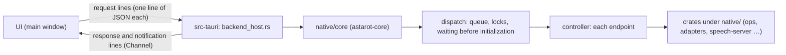
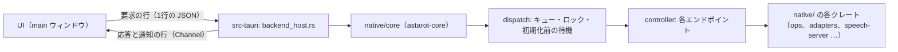

# Core integration and the end of the bundled Python (#285)

[日本語版](#中核の統合と-python-同梱の終了285日本語版)

This is the record of moving the core of the Python sidecar (`mainloop.py`, `controller.py`, `config.py`) into the Rust `native/core` (astarot-core) and running it inside the app's process. It describes the state as of 2026-11-16. From 0.5.0 the core is the only backend, and the release package contains no Python.

## Architecture



- The UI talks to the backend through `sidecarSession.ts`, as before. `backendCommand.ts` hands over the core in the same shape as the shell plugin's `Command` that the Python sidecar used. The shell plugin was removed from the app.
- The request and response formats, status codes, error bodies and locking rules stay as in [the IPC protocol](../spec/ipc-protocol.md). On the UI side, this switching part is the only change.
- Settings, logs and models are stored in the same places as with the Python sidecar. The core reads and writes the same `config.json` (on Linux, 0.6.0 moved them to `~/.config/astarot` and `~/.local/share/astarot`; see [names and storage locations](project-rename.md)).
- The files bundled in the package (speech.cpp, helper programs, license texts) are in `_internal`, and the core finds them with `native/core/src/resources.rs` (item 5 of "Decisions needed").

## Switching over

0.5.0 made the Rust core the default and removed the Python sidecar from the package (decided on 2026-11-16). During 0.4.0, the core was a trial that ran only when `VRCT_BACKEND=core` was set.

- `CORE_IS_DEFAULT` in `src-tauri/src/backend_host.rs` is `true`. The UI always starts the core (`backend_kind` and `VRCT_BACKEND` are gone).
- `tauri.conf.json` has no `externalBin`, and the capabilities grant no shell permission. The `vrct-vox-sidecar` executable is not in the package.
- No escape hatch back to the Python sidecar for development (`VRCT_BACKEND=python`) was built (item 21 of "Decisions needed").
- After startup, the CTranslate2 weights that Python downloaded are deleted ("Decided" under "Decisions needed"; the effect on local translation is item 1).
- `src-python/` and its tests were kept as the specification for the port. They were deleted on 2026-11-20 (item 27). What was cleaned up with them is in "Changes that came with removing Python".

## Integration tests

The tests run with `cargo test --locked --manifest-path native/core/Cargo.toml`. In CI, the `core-integration` job of `voice-tests.yml` (ubuntu-latest and windows-latest) runs them. They use no models, no audio devices and no external network.

| Test | What it checks |
|---|---|
| `tests/lifecycle.rs` | The order of notifications at startup and `/run/initialization_complete`; shutdown and saving the settings; the watchdog; shutdown when the input closes; migrating settings from older versions and the notices about it (the notice about the move from Whisper to speech.cpp shows until it is closed); save failures and recovery |
| `tests/config_reference.rs` | Reading 50 variants of settings files written by Python under the Windows and Linux rules, and writing back the same content as Python (the reference is made by actually running Python) |
| `tests/error_codes.rs` | Error codes and the shape of their bodies match [the error code list](../spec/reference/error-codes.md). Every upper-case code that the core's source uses in responses, notifications and code tables is in the list (except `VOICE_SETTINGS_INVALID`, which Python also returned outside the table) |
| `tests/dispatch.rs` | 404, 500, the lock order, 423 returned after 20 and 30 seconds, immediate handling of stop requests, the limits on relaying for the VR panel |
| `tests/endpoint_coverage.rs` | Every implemented endpoint is in the spec's list, and its classification (whether it waits until initialization, whether it is handled immediately) matches. Every endpoint in the spec is implemented (except retired ones) |
| `tests/speech_servers.rs` | speech.cpp server settings, start and stop, generations, reporting a server that exited on its own, cleanup at shutdown |
| `tests/downloads.rs` | Consent for model downloads and the catalog version, status, cancellation, verifying the files before publishing them, applying a model to the settings and the rejections of that (`settings_changed`, `model_target_busy`), the hardware check, stopping at shutdown |
| `tests/telemetry.rs` | Nothing is sent until the notice is answered, checking the answer (`telemetry_notice_invalid`), `VRCT_TELEMETRY=off`, showing what is sent, sending error codes, nothing is sent after shutdown |
| `tests/adapters_servers.rs` | The WebSocket server and tokens (101 and 403), changing the host, port and certificate and rolling them back, the OBS page and token, resuming at startup and notifying failures, the `WEBSOCKET_*` and `OBS_BROWSER_SOURCE_*` error codes |
| `tests/settings_endpoints.rs` | Endpoints that read and write settings of features that are not running (getting and deleting translation and speech recognition keys, changing a URL and re-entering the key, OCR and overlay settings, old Whisper weights). The error code and the value restored on rejection, saving to `config.json`, keys never appearing in logs |
| `tests/updates.rs` | With a fake update mechanism (`SoftwareUpdates`): the release list, the startup check ("no update" without asking when `CHECK_SOFTWARE_UPDATES` is off), a successful update (no notification), a failed signature check (`UPDATE_SOFTWARE_VERIFY`), a failed download (`UPDATE_SOFTWARE_DOWNLOAD`), passing on the kind and version. The same answers as Python when there is no mechanism (an empty list, "no update", `UPDATE_SOFTWARE_DOWNLOAD`). Filtering by channel and choosing the version are unit tests in `src-tauri/src/app_update.rs` |
| `tests/adapters_osc.rs` | Checking the OSC destination, sending the typing indicator, syncing with VRChat's mute, the order of events when OSCQuery is lost, whether VRChat is present, changing nothing after shutdown |
| `tests/engine_checks.rs` | How an engine that fails the startup check is handled (the selection of an engine that looks up its models on a server is cleared, and the API key is kept) |
| `tests/translation.rs` | Checking and saving translation provider keys, listing and selecting models, connecting and disconnecting LM Studio and Ollama, the Ollama URL (the LAN rule, the startup check, a saved value that breaks the rule), the Google Cloud Translation key, the Papago Client ID and Secret, the OpenAI-compatible URL and key, the startup check, consent for non-commercial weights, turning translation on and loading the local model (missing, unreadable, not enough VRAM). Keys never appear in logs |
| `tests/messages.rs` | From `/run/send_message_box` to the chatbox (OSC), WebSocket and the conversation log. Translation on and off, translation with the official APIs (Google Cloud Translation, Papago), sending only the translation, the setting that sends nothing to VRChat, provider failure and fallback, readings, passing on recognition results (word filter, repetition, OCR, the conversation partner), the overlay and voice sinks, the conversation history. Text never appears in logs. Drawing on the VR log is checked by `vr_overlay.rs`, OCR lines reaching the UI through the pipeline by `ocr.rs`, and final sentences from the realtime mic being translated and spoken by `voice.rs` |
| `tests/audio_devices.rs` | The audio device list and options, selecting by name, ID and host and the value restored on rejection, Auto Select following the OS default, the list changing when a device is plugged in or out and the selection moving to the default, the order of notifications, saving, selections that Python saved with MME and other hosts, the list at startup, the handover when a running recording moves, the virtual mic guide and check (how the device is found, the test sound, rejection while muted, stopping). The devices are in-memory fakes |
| `tests/vr_overlay.rs` | Turning the caption logs and the VR panel on and off (with and without SteamVR, environments where the VR panel cannot be created, starting with saved settings), settings reaching a running overlay, the VR panel endpoints and relaying, failure notifications (`OVERLAY_RUNTIME_FAILED`), sent messages being drawn on a running large log, controller hover arriving through `/run/vr_panel_pointer`, the trigger becoming a click on the VR screen and the position after grabbing and moving being saved, the caption font setting (`OVERLAY_FONT_NOT_FOUND`, the value restored, missing languages), shutdown. SteamVR and the VR screen are stand-ins. The details of controller input (scrolling, releasing outside the screen, scaling limits, resizing at a corner and its frame, the control bar, hover tooltips, locking, losing track of the controller) are checked by `native/vr-overlay/tests/interaction.rs` |
| `tests/clipboard.rs` | Pasting for voice typing (#393). Bringing the window of the game in SteamVR's scene to the front and sending Ctrl+V (the order on Windows and X11), looking up the game again for every paste, only copying when SteamVR is missing, cannot be connected to, has no game, the game is not a Steam game or its window cannot be brought to the front, sharing the OpenVR connection with the overlay, not writing the text or the game's name to logs. SteamVR and the desktop are stand-ins |
| `tests/ocr.rs` | Chat reading, with fake images and a fake recognizer. Model readiness judged from the files on disk, notifying why it cannot be turned on (`OCR_DISABLED_*`), status, settings reaching a running reader, switching the language and rolling it back, passing the lines read to the message pipeline and delivering them to the UI through `/run/transcription_ocr_message`, turning it off and shutdown, shutdown while a model is loading, the text read never appearing in logs |
| `tests/transcription.rs` | Recording for speech recognition (cloud engines). The mic and speaker switches, rejection and notification when there is no engine or device, recognized text reaching the UI, the chatbox and the conversation log but not `process.log`, a 44.1 kHz speaker and the Whisper API (filtering by language and segment), the volume meter, engine failure (`ASR_ERROR`), a device that cannot be opened (`AUDIO_OPEN_ERROR`) and switching to another device, read failure (`AUDIO_READ_ERROR`), moving from an unplugged device to another one and stopping when the last device is unplugged, mute sync, checking the recognition key and URL and the value restored, the engine check at startup, a saved Google selection loading as no selection, recognition continuing after a value that is not an engine is rejected, shutdown. The devices are fakes that deliver 44.1 kHz and 48 kHz PCM at the same interval as a device, and the engines are fake servers on 127.0.0.1 |
| `tests/recognition_revocation.rs` | What happens when recognition stops before a recognized sentence is delivered. When the switch is turned off, the device is lost, a read fails, the realtime session ends on its own, or VRChat is muted (with sync on) while the translation is pending, the sentence reaches none of the UI, the chatbox and the conversation log. Sentences are still delivered across a pause for settings, a device move and a handover to realtime recognition, and speaker text and typed chat are still delivered while muted. Translation is held back with `FakeProviders`, the recording is fake, recognition is a fake server on 127.0.0.1, and OSC is a fake connection |
| `tests/transcription_engine.rs` | Speech recognition engines and languages. When the engine changes, languages it cannot recognize are reset on every tab (avoiding enabled target languages, leaving disabled target languages alone, not resetting when every candidate is taken); the language list notice; the same handling when the Deepgram model changes (only while Deepgram is selected) and a list narrowed to the model's languages; keeping the selection of an engine that cannot be used or whose key was deleted; rejecting a value not in the list with `VALIDATION_CONFIG_VALUE_INVALID`. The engines are fake servers on 127.0.0.1 (the Deepgram models and languages change per test) |
| `tests/realtime_asr.rs` | Realtime speech recognition. Checking and saving settings, the endpoint and model lists, captions (partial, final, translation, result) and final text reaching the chatbox through the main switch (speech.cpp on Linux and Windows), starting and stopping from the settings screen and the handover from recording, the switch answering what is missing in `details.reason`, the failure notification when the server rejects, captions being drawn on the VR large log and the notification when they cannot be drawn, the flow panel record for final mic sentences being measured from finalization (item 24), shutdown. speech.cpp is a fake server on 127.0.0.1 that returns a model list and the Realtime WebSocket, and SteamVR is a stand-in |
| `tests/voice.rs` | The TTS switch (a code for each reason it is stopped, generations, starting and stopping the bundled server itself, not stopping a server started from the settings screen, TTS turning off when the server stops), checking voice settings and the answer on rejection, speaking typed chat as the original and as the translation, speaking final mic sentences and cancelling them when the language or translation changes, stop, mute and resume, rejecting old generations when a stop comes while speech waits in the queue, saving the mute state and a corrupted record, the gate of the Linux managed route, the output list, model options and the voices of installed engines, direct voice (pass-through and voice conversion, generations, failure, not falling back to the original voice, TTS through conversion), preparing the voice conversion runtime (consent, version, failure at each step, the worker check), the flow panel, final sentences from the realtime mic being translated and spoken, not letting recognition use the cable that carries the voice (`realtime_endpoint_feedback`), shutdown. Outputs and mics are in-memory fakes, speech.cpp and the engines are loopback fakes, and the RVC worker is `fake-rvc-worker` |

Up to 0.5.x, the Python test `src-python/test/test_native_core_reference.py` failed when the settings rules on the Python side changed but the reference data had not been regenerated (it was deleted together with the Python backend in 0.6.0).

Translation providers and readings (transliteration) have contract tests against Python in `native/translation`, outside the core (#277). `tests/contract/providers.json` holds, for each provider scenario, the requests the Python client sent (method, URL, headers, body, timeout), the results it returned and the range of the wait before a retry. `tests/contract/transliteration.json` holds the morphemes and readings of each sentence and the Hepburn romanization of each kana. Both were recorded from Python, and the Rust tests (`tests/contract.rs`, `tests/transliteration_contract.rs`) run the same scenarios and compare. Once Python is removed, these files remain as the specification. In CI, `core-integration` also runs the tests of `native/translation` and `native/translate-onnx`.

## Inventory of the Python tests

The Python tests in `tests/` (1,353 functions) were split into "what the new interface covers again" and the rest.

| Category | Content | Handling |
|---|---|---|
| A | Tests that exercise the sidecar as a running app (endpoints, settings migration, startup and shutdown, model downloads, error codes) | Covered again in `native/core/tests/` |
| A-u | Sidecar processing whose target crate did not exist yet | Covered again together with the port (the table below) |
| B | Unit behavior of crates already ported | Already held by each crate's tests and the parity tests |
| C | Build, distribution, development tools, browser and GUI tests | Kept regardless of the backend language |
| D | Things that go away with Python (PyInstaller, Seed-VC, CTranslate2, preparing the Python runtime) | Retired together with the code |
| E | Tests that need real hardware or models | Not run in headless CI |

Category A tests that have been covered again:

| Python test | Covered again by |
|---|---|
| `tests/voice/test_runtime_paths.py` (where settings are stored), `tests/platform/test_runtime_settings.py` | `lifecycle.rs`, `config_reference.rs` |
| `tests/voice/test_quick_chat_config.py`, `test_vc_settings.py`, `test_realtime_settings.py` (settings migration) | `config_reference.rs` |
| `tests/platform/test_native_backend.py` (initialization complete, shutdown, settings surviving to the next start) | `lifecycle.rs` |
| `tests/voice/test_priority_cancel.py` (stop requests skipping the queue) | `dispatch.rs` |
| `tests/voice/test_speech_server_controls.py`, `test_speech_server_end_owner.py` (the server part) | `speech_servers.rs` |
| `tests/voice/test_model_download_controller.py`, `test_model_download_policy.py` | `downloads.rs` |
| `tests/voice/test_telemetry_client.py` (the endpoint part) | `telemetry.rs` |
| `tests/voice/test_security_regressions.py` (the WebSocket and OBS part) and the WebSocket, OBS and OSC tests in `src-python/test/` | `adapters_servers.rs`, `adapters_osc.rs` |
| `src-python/test/test_old_whisper_weights.py` | The screen and the endpoint were removed in 0.6.0 (#288). `settings_endpoints.rs` does not touch the weights and checks that the endpoint returns 404 |
| `src-python/test/test_controller_vr_panel_opacity.py`, `test_credential_commits.py` and `test_controller_transcription_api_endpoints.py` (the parts on deleting keys and changing URLs) | `settings_endpoints.rs` |
| `tests/voice/test_virtual_mic_controller.py`, `src-python/test/test_controller_audio.py` (the parts on Auto Select and stopping at shutdown), `test_config_saved_device_selection.py` | `audio_devices.rs` |
| `src-python/test/test_controller_ocr_enable.py`, `test_controller_ocr_readiness.py`, `test_controller_ocr_settings.py`, `test_model_stop_ocr_capture.py`, `test_ocr_language_and_shutdown.py` (the core's part) | `ocr.rs`, `settings_endpoints.rs`. The behavior of the pipeline itself is covered by the tests of `native/ocr-runtime` |
| `src-python/test/test_controller_update_software_failure.py`, `test_controller_init_config_settings.py` (the part that keeps `available_releases` out of the startup list) | `updates.rs`, `lifecycle.rs` |
| `src-python/test/test_controller_transcription_api_endpoints.py` (saving and rejecting keys, URL and key pairs), `test_controller_transcription_engine_status.py` | `transcription.rs`, `engine_checks.rs` |
| `src-python/test/test_model_transcript_wiring.py`, `test_model_api_transcription_wiring.py`, `test_model_energy_consumer.py`, `test_model_transcript_stop.py`, `test_device_capture_lifecycle.py`, `test_controller_vrc_mic_mute_sync_init.py` (the recognition part) | `transcription.rs` |
| `tests/voice/test_realtime_controls.py`, `test_realtime_toggles.py`, `test_realtime_settings.py` (other than migration), `test_realtime_delivery.py`, `src-python/test/test_realtime_toggle_generation.py`, `test_realtime_legacy_handoff.py`, `test_realtime_delivery_outcomes.py` | `realtime_asr.rs` |
| `tests/voice/test_realtime_session.py`, `test_realtime_events.py`, `test_realtime_audio.py`, `test_speechcpp_realtime.py`, `test_speechcpp_asr.py`, `test_asr_vocabulary.py`, `test_capture_packets.py`, and `src-python/test/test_transcription_recorder.py`, `test_transcription_transcriber.py`, `test_transcription_providers.py`, `test_transcription_openai_compatible.py`, `test_transcription_deepgram.py`, which were category A-u | `realtime_asr.rs`, `transcription.rs` and the unit tests of `native/transcription`. The details of `test_speechcpp_asr.py` and `test_speechcpp_realtime.py` are in the next row |
| `tests/voice/test_speechcpp_asr.py`, `test_speechcpp_realtime.py`, `test_realtime_language.py` (the part re-checked function by function in step 3-3) | Unit tests of `speechcpp.rs` in `native/transcription`: choosing the language detection model from the language option (5 cases), taking only the recognition models from the list and dropping the rows of detection models, counting the speaker diarization model only on GPU (`CPU`, empty, absent, a number), rejecting a malformed list and an answer that is not JSON. Unit tests of `realtime/events.rs`: only final sentences carry the detected language, and malformed codes are dropped. That "auto" needs a detection model is checked by `a_switch_says_what_is_missing` in `realtime_asr.rs`. Rejection when the settings response differs, the deadlines of 120 seconds for the first item and 15 seconds after that, and cutting the connection wait short on stop are checked by the tests of `realtime_asr.rs` and `realtime/session.rs` (item 81; added on 2026-11-19). The tests of the REST `transcribe()` (the app does not use it), manual commit and clear (the core uses only `server_vad`) and the experimental `tools/speechcpp_asr_poc.py` are retired together with Python |
| `tests/voice/test_realtime_overlay.py`, `src-python/test/test_realtime_overlay_publication.py`, `test_overlay_lifecycle_publication.py` and `test_message_snapshot_and_sinks.py` (the caption part) | Unit tests of `subtitle.rs` in `native/vr-overlay`: partial captions wait outside the history and are replaced; a translation rewrites the same line, and a late update after that changes nothing; pending captions are discarded per namespace and do not come back; a final sentence pushed out of the log does not come back as a translation; an update that could not be shown is rolled back from the history and does not appear in later drawing either; at most 16 captions wait, and the oldest are dropped first. `captions_are_drawn_on_the_large_vr_log_and_one_it_cannot_show_is_told` in `realtime_asr.rs`: the large log is redrawn for each caption state, `MESSAGE_OUTPUT_FAILED` for `overlay_large` is notified when SteamVR rejects the image, and the final sentence is still delivered (item 79). Comparing versions of the drawn image (`isCurrentLargeLog`) is not needed, because the core draws and displays inside one lock, and it is retired. Drawing captions with the settings in effect when their language was received is item 80 |
| `tests/voice/test_capture_pipewire.py`, `test_capture_diagnostics.py` and `test_realtime_language.py` (the default node) | Unit tests of `endpoint_choice.rs` in `native/transcription`: replacing the default output with the configured default when it is the VRCT mix; `realtime_default_endpoint_feedback` when there are only VRCT nodes, and `realtime_default_endpoint_missing` when there are none; reading the default input from the metadata's JSON string; rejecting VRCT nodes, names that contain NUL and names longer than 512 bytes. These tests only take a graph, so they also run on Windows. The part that runs the helper (`HelperCapture`) (noisy standard error, the 5-second startup deadline, the 2-second stop) would be a Linux test that needs PipeWire, and it is not verified (item 82). The tests of the two-stage API (create, then start) are retired together with Python |
| `src-python/test/test_controller_message_pipeline.py`, `test_message_snapshot_and_sinks.py` (the parts on sending, translation, readings and output failures) | `messages.rs`, unit tests of `src/controller/messages.rs` |
| `src-python/test/test_controller_translation_enable.py`, `test_translation_providers.py` and the translation key and model parts of `test_endpoints.py` | `translation.rs`, the tests of `native/translation` |
| `src-python/test/test_translation_llm_completion.py`, `test_translation_runtime_timeouts.py`, and the model list timeout in `test_translation_ollama_timeout.py` (provider requests, timeouts, retries and the wait before them, responses cut off by length, extracting the text of a response) | The contract tests of `native/translation` (`tests/contract.rs`): the Rust providers match the requests and results recorded from the Python client. Falling back to local translation after a failure, and the notification about it, are in `translation.rs` and `messages.rs` |
| The parts of `src-python/test/test_translation_ctranslate2_license.py` that match the UI's weight list against the licenses and check the M2M100 language codes | Unit tests of `src/controller/translation.rs` (they compare the core's table with `src-ui/logics/ui_configs.ts`) |
| `src-python/test/test_controller_overlay_running.py`, `test_controller_vr_panel_toolbar.py` (anchor target, lock, the launcher's hand and initialization, the auto-hide setting), `test_overlay_lifecycle_publication.py` (failure to turn on, and clearing when turned off) | `vr_overlay.rs` |
| `src-python/test/test_overlay_steamvr_quit.py`, `test_overlay_shutdown_timeout.py` (waiting for SteamVR, shutdown, reconnecting) | `vr_overlay.rs` and the `engine` tests of `native/vr-overlay` |
| `src-python/test/test_overlay_fake_vr.py` (laser and pointer, moving with the grip and saving), `test_overlay_press_cancel.py` (releasing outside the screen, not pressing again until released, losing tracking), the input part of `test_overlay_grab_move.py` (saving on grab and release, scaling, locking, the control bar, the trigger after a grab, clicks and scrolling) | `native/vr-overlay/tests/interaction.rs`, `vr_overlay.rs`. The pose and layout calculations are in the reference tests of `native/vr-overlay` (`reference_tests.rs`) |
| `src-python/test/test_clipboard_focus_and_paste.py` (pasting as seen from the controller), `test_openvr_session.py` (the overlay and clipboard parts; the OCR part is item 9 of "Decisions needed") | `clipboard.rs`, the `shared` tests of `native/vr-overlay`, `tests/clipboard.rs` in `native/adapters` |
| `tests/voice/test_tts_toggle.py`, `test_tts_toggle_server.py`, `test_speech_server_end_owner.py` (the TTS part), `test_tts_model_options.py` (the controller part) | `voice.rs` |
| `tests/voice/test_spoken_controls.py`, `test_io_flow_controller.py`, `src-python/test/test_voice_settings_patches.py` | `voice.rs` |
| `tests/voice/test_direct_voice_controller.py`, `test_managed_controller.py` | `voice.rs`. The route gate and saving are also covered by the tests of `native/audio-routing` |
| `src-python/test/test_voice_route_monitor_mute.py` | `voice_route/tests.rs` in `native/audio-routing`: a saved mute reaches the monitor before it starts; resuming does not open the monitor until the mute state has been saved, and does not open it if saving fails; clearing a saved mute is passed on without the helper, and the monitor is muted when it closes |
| The Python tests of voice conversion and the monitor (the table in part 4 of "Remaining migration for 0.6.0") | Unit tests of `native/voice-conversion`, the tests of `native/audio-routing`, `voice.rs` |
| `tests/voice/test_external_speech_engines.py` | `voice.rs` (endpoints and the TTS switch), `native/tts/tests/engines.rs` (the client) |
| `tests/voice/test_vc_runtime_setup.py` (the RVC part) | `voice.rs`, unit tests of `native/voice-conversion` (version, archive, deleting the previous runtime). The uv, Python and Seed-VC parts are category D |
| `src-python/test/test_controller_typing.py`, `test_mainloop_typing_order.py` | `adapters_osc.rs` (clearing only the typing indicator that the app set), `dispatch.rs` (a stop request does not overtake a start request). The answer when clearing the indicator fails is item 57 of "Decisions needed" |
| `src-python/test/test_model_translate_fallback_no_wait.py`, `test_model_get_translate_unsupported_language.py`, `test_translation_unsupported_language.py`, `test_model_input_translate_parallel.py` | `translation.rs`. The local model translates one sentence at a time under a single lock, so concurrent translation is checked with an external provider. The difference in log lines is item 58. The language table (Filipino and Tagalog, for example) is category B |
| `src-python/test/test_translation_history_destination.py` | `messages.rs` (saving the same engine again keeps the history; moving to another engine or tab and back starts the history over). The Python form, which tests the same thing with 8 providers, is not moved (the history reaches every provider by the same path) |
| `src-python/test/test_conversation_logger.py` | `messages.rs` (writing only while it is on, a new file each time it is turned on), unit tests of `src/controller/messages.rs` |
| `src-python/test/test_message_delivery_revocation.py` (the parts on shutdown and chatbox order) | `messages.rs` (a message still being translated at shutdown reaches nowhere), unit tests of `src/controller/messages.rs` (a message that was not sent does not advance the order). Mute handling is items 55 and 56. Revocation when recognition stops or is disabled is part 1 of "Remaining migration for 0.6.0" |
| `tests/voice/test_tts.py`, `test_scheduler.py`, `test_spoken_scheduler.py`, `test_tts_playback_ownership.py` | `tests/client.rs`, `tests/scheduler.rs` and `tests/monitors.rs` in `native/tts`, and the unit tests of `settings.rs` and `scheduler.rs` (category B; compared argument by argument and checked value by value). The start delay through the core, consecutive utterances, and interruption by stop and by saving settings are in `voice.rs`. On 2026-11-19 the tests were re-checked per function and per parametrize value, and cases that stop a real `MonitorTee` while it is opening the device and after it has passed one block were added to `router/tests.rs` in `native/audio-routing`. The silent lead-in differs from Python (item 63). The end of the `StartExpiry` thread, and a stale `RequestTimer` call that arrives after cancellation, are not tested, because there is no injection point |
| `tests/voice/test_tts_listener_failure.py`, `src-python/test/test_tts_listener_monitor.py` | `tests/listener.rs` and the unit tests of `listener.rs` in `native/tts` (category B). Making the run of a server that the core started into the owner is in the unit tests of `src/controller/voice/mod.rs` and in `voice.rs`. That the probe runs 50 times a second is not itself checked (the 20 ms interval is a constant in the code). Re-checked on 2026-11-19, with additions to `tests/listener.rs`: the table (Windows) decides before the connection does, and that answer ends both requests to the same server; a header past the first-audio deadline ends the request, which then enters neither the watcher nor the probe; there is one probe per address (about 25 times in 0.5 seconds with two requests); a connection that times out is treated as undecidable. For a stop while the table is being read, only the case where the stop signal is set from the start is checked. The low-latency wait does not use the watcher (item 63) |
| `src-python/test/test_message_delivery_revocation.py` (the recognition part) | `recognition_revocation.rs`. When the switch is turned off, the device is lost or a read fails while the translation is pending, the sentence is not delivered (mic and speaker). Across a pause for settings, a device move and a handover to realtime recognition, it is delivered. Typed chat is not affected. An engine failure takes the same path as a read failure (`recorder_failed`), and it does not happen at that point, because the recognition thread does not handle the next utterance while a translation is pending (the same as Python). When the realtime session ends on its own (the server does not finish the utterance), a final sentence waiting for translation is not delivered either. VRChat's mute (with mute sync on) holds back mic sentences waiting for translation (recording and realtime) and lets speaker sentences and typed chat through. While muted, realtime mic captions are not shown either, and sentences heard after unmuting are delivered. With sync off, mute does not affect mic sentences. Whether sentences from before the mute are delivered after unmuting is item 55, and the voice generation of final sentences is item 56; neither is tested. Revocation when the recording cannot be stopped during a handover (`realtime_legacy_stop_failed`) is not tested, because a fake recording cannot produce a recording that does not stop. The OCR part is item 65 |
| `src-python/test/test_transcription_provider_regressions.py` | Unit tests of `providers.rs` in `native/transcription` (category B): different spellings of the detected language, unknown languages, a single language, Chinese and the selected country, Deepgram's language detection, broken answers and silence, the send deadline and 3 attempts. The Google part is items 14 and 46 |
| `src-python/test/test_model_transcription_wait.py` (the deadline part), `test_vrct_transcription_integration.py` | Unit tests of `phrases.rs` in `native/transcription`: an utterance ended by the deadline is not sent again, a new phrase extends the deadline, the boundary, no result is kept when nothing was recognized in a VAD segment. Waiting up to 15 seconds for a request's result on stop and then discarding it is item 15 (1) (`native/core/tests/transcription.rs`), and waking up many times while waiting is item 69 |
| `src-python/test/test_realtime_ingress_wait.py` | Unit tests of `realtime/session.rs` in `native/transcription`: rejecting audio beyond 200 ms or 20 chunks and audio older than 250 ms; a stopped session takes no audio and cannot be started again. The difference in how audio waits before it is sent is item 67 |
| `src-python/test/test_controller_transcription_language_fallback.py`, `test_controller_update_transcription_engine.py`, `test_model_transcription_language_support.py` | `transcription_engine.rs`: when the engine changes, languages it cannot recognize are reset on every tab to Japanese, then English (avoiding enabled target languages and leaving disabled target languages alone); nothing is reset when every candidate is taken; the language list is sent to the UI again. An engine that recognizes every language leaves the languages alone, and selecting the same engine again sends nothing. When the Deepgram model changes, the same happens, but only while Deepgram is selected. The language list is narrowed to the model's languages (`multi` means all). The selection of an engine that cannot be used or whose key was deleted is kept. That the cloud Whisper uses the `Whisper` column of the language table is in `transcription.rs`. Edge cases are item 74 |
| `src-python/test/test_asr_engine_consent.py` | Reading and writing the selection: `config_reference.rs` and `transcription.rs` (a saved Google). Rejecting a value that is not an engine: `transcription_engine.rs` and `transcription.rs` (item 73). The switch not starting a recording with no engine or with an engine that cannot be used: `transcription.rs`. Keeping the selection of an engine that cannot be used: `transcription_engine.rs`. The test that `AudioTranscriber` does not silently use Google is retired together with the Google path ("Google's web speech recognition" under "Decided") |
| `src-python/test/test_local_asr_migration.py` | The migration and its notice were removed in 0.6.0 (#288). `a_saved_whisper_choice_loads_as_none_without_a_notice` in `lifecycle.rs` checks that a saved Whisper selection loads as no selection, the server selection is kept, the removed settings and notice keys are not written while `MIC_AVG_LOGPROB` is kept, the removed endpoints (including those for the notice and the old weights) return 404, and `LOCAL_ASR_MIGRATION` is written as 2 for 0.5 and earlier. The difference from Python is the sixth intended difference in `config_reference.rs` |
| `src-python/test/test_audio_vad.py` (31 tests) | Under item 13 (c), the state machine that decides segments (thresholds, discarding segments that are too short, finalizing on silence, the leading margin, handling between the 2 thresholds) belongs to speech.cpp's detection (Realtime `server_vad`). The app side is the unit tests of `server_vad.rs` in `native/transcription`: cutting the recorded audio at the times the server gives; cutting an utterance longer than 7 seconds there and continuing; `reset` discarding the segment in progress and clearing the server's audio too; switching to volume-based segmentation and reporting the reason once when there is no server, no VAD model, or the session drops midway; keeping a segment cut by volume while the session was being opened, when the session could not be opened. Merging stereo and resampling are unit tests of `pcm.rs`. The tests of the ONNX model's probabilities (4), resetting the probability engine (2), the diagnostics callbacks (3; under the decision on item 15, utterance diagnostics moved to `diagnostics.rs`, and the start of speech and the end of a segment are checked by the tests of `server_vad.rs`) and the part that converts to 16 kHz and passes segments on (3 in `VadRecognizerAdapter`) are retired together with Python. `flush` on stop (5) is item 68 |
| `src-python/test/test_model_vad_recorder_selection.py` | `transcription_vad.rs`: with the switch off, segments are cut by volume, and with it on, by VAD; the mic switch does not affect the speaker (and the other way round); the longest VAD segment is 7 seconds |
| `tests/voice/test_speechcpp_realtime_vad_live.py` (category E) | A test against a real speech.cpp; it does not run in headless CI. In step 3-4, a VAD-only session was opened on a real server and the segments were compared ("What is done (3-4)" in part 3) |

Category A was covered again as the table above shows. The part that shows speech recognition captions on the VR large log (`test_realtime_overlay*.py`) moved to the tests of the core and `native/vr-overlay` in step 3-3. The utterance diagnostics log (`test_utterance_diagnostics.py`) moved to `diagnostics.rs` in `native/transcription` and to the core's tests under the decision on item 15 (2026-11-19). `src-python/test/test_pipewire_graph_readers.py` is a test of voice conversion and the voice route (part 4).

## Baseline values before the switch

These values are for comparison when 0.5.0 stops bundling Python. They were measured on 2026-11-16.

### Measurement method

`tools/measure_backend_startup.py` measures the size and startup time against an extracted Windows package. The core's startup is measured with `native/core/examples/startup_time.rs`, which calls `Backend::start` with the same `Environment` as the app and returns the time until `/run/initialization_complete`.

`tools/measure_backend_startup.py` was a tool for measuring these baseline values, so it was deleted (#810). The commands below record the procedure of 2026-11-16. The core's startup time can still be measured by running `startup_time.rs` on its own.

```sh
cargo build --release --locked --manifest-path native/core/Cargo.toml --example startup_time
python tools/measure_backend_startup.py --package <extracted package> \
    --core-example native/core/target/release/examples/startup_time.exe \
    --work <empty folder> --runs 5 --zip <VRCT-VOX.zip>
```

- The target is the CPU build of `VRCT-VOX.zip` that CI built for release/0.4.0 (e4b9bcfb).
- Startup time runs from starting the backend until `/run/initialization_complete` arrives. For the sidecar, it is measured from the moment `vrct-vox-sidecar.exe` is started as a child process. The core starts inside the process, as in the app. Starting the app's window and WebView is not included.
- Settings start from an empty folder, and the startup steps that reach outside are turned off (automatic model downloads, the update check, usage reporting, OSC to VRChat). Nothing was downloaded.
- Each backend was started 5 times in a row. The sidecar was measured first. The first run is slower than the others, so it is shown separately. The runs came right after extraction, so they are not starts with a fully cold disk cache.
- Measured on a Windows 11 laptop with an Intel Core i7-1255U. The values do not show the speed on other PCs.

The 0.5.0 package is measured with the same command. For a package without `vrct-vox-sidecar.exe`, the tool does not start the sidecar and measures only the core. In that case the core's first run is the cold start. The size is broken down into `vrct-vox.exe`, the ONNX Runtime placed next to it, speech.cpp, the RVC worker, licenses, fonts and the rest of `_internal`. The tool warns when files of the Python runtime remain. The app itself opens a window and a WebView, so this measurement does not start it.

### Package size

The extracted `VRCT-VOX.zip` is 1,115.3 MB (408.7 MB as a zip). 1 MB is 10^6 bytes.

| Part | Size | After the switch |
|---|---:|---|
| `vrct-vox.exe` (app and core) | 22.0 MB | Stays |
| speech.cpp (`_internal/build`) | 49.3 MB | Stays (its location is item 5 of "Decisions needed") |
| `vrct-vox-sidecar.exe` | 28.0 MB | Goes away |
| Python runtime and libraries | 408.3 MB | Goes away |
| Sudachi dictionary (`*.dic`, for kana and romaji conversion) | 576.9 MB | Goes away with Python. The core reads the same dictionary with sudachi.rs. Which edition to include (full is 359.7 MB) is item 3 of "Decisions needed" |
| Bundled models (`*.onnx` in `_internal`) | 1.2 MB | Goes away with Python |
| Fonts (`*.ttf`) | 29.6 MB | Goes away with Python. Captions use the fonts on the user's PC ("Decided" under "Decisions needed") |

The largest items in the Python runtime and libraries are `cv2` (100.6 MB), `ctranslate2` (63.7 MB), `transformers` (42.7 MB), `onnxruntime` (39.3 MB), `numpy.libs` (38.2 MB) and `PIL` (13.5 MB). Models downloaded on first use (translation weights and others) are not in the package, so this table does not include them.

### From startup to initialization complete

| Backend | 1st run | Median of runs 2 to 5 | Min to max |
|---|---:|---:|---:|
| Python sidecar | 11.83 s | 7.95 s | 7.89 to 11.83 s |
| Core (`VRCT_BACKEND=core`) | 1.02 s | 0.74 s | 0.62 to 1.02 s |

The core's values reflect how much was wired up at the time of measurement. At that time the core did not yet enumerate and select audio devices. It now does so at startup (not measured again). In the sidecar this took 3.48 seconds (`select_audio_devices` in `startup_timing.log`). The other stages are loading modules (about 2.5 seconds) and collecting the settings list (1.15 seconds). Of the collection, 0.99 seconds is the speech.cpp device check, which the core also does, and it returned the same list. The initialization list has 183 entries from the sidecar and 160 from the core. Wiring up more features increases the core's values, so for 0.5.0 they are measured again the same way and compared.

## Values after the switch (0.5.0 candidate)

Measured again on 2026-11-16 with the same tool and settings as above.

- The target is a Windows package built locally from this branch. It was built with `bat/build.bat`, `vite build` and `tauri build --no-bundle`, in that order, and `vrct-vox.exe` and `src-tauri/bin/_internal` were zipped. The zip was made with PowerShell's `Compress-Archive` (the same Deflate as `utils/zip.py`). speech.cpp is the pinned 0.11.0 (`windows-x64-vulkan`).
- Measured on the same Windows 11 laptop with an Intel Core i7-1255U as above. The core was started 5 times in a row.

| | 0.4.0 (Python sidecar) | 0.5.0 candidate (core) |
|---|---:|---:|
| Extracted package | 1,115.3 MB | 77.1 MB |
| zip | 408.7 MB | 27.3 MB |
| Startup to initialization complete (1st run) | 11.83 s | 1.21 s |
| Same (median of runs 2 to 5) | 7.95 s | 1.11 s |
| Same (min to max) | 7.89 to 11.83 s | 1.02 to 1.43 s |

The package breaks down into `vrct-vox.exe` (app and core) 24.8 MB, speech.cpp 47.3 MB, the RVC worker 2.0 MB and license texts 3.1 MB. ONNX Runtime, the OpenVR library and the reading dictionary are not included (items 2, 3 and 7 of "Decisions needed"). Adding them makes the package larger. Including ONNX Runtime (17.3 MB on Windows) and the OpenVR library (0.8 MB) was decided on 2026-11-17 (#509). Not including fonts was decided ("Caption font" under "Decided").

The core's startup includes enumerating and selecting audio devices (about 20 ms) and the speech.cpp device check (about 1 second). The initialization list has 183 entries from the sidecar and 184 from the core. The speech.cpp device check returned the same 2 GPUs as 0.4.

At the time of this measurement, `bat/build.bat` did not fetch `build/speechcpp/speech.exe` again when the file existed. When an old version was left behind, the core refused to use it because the hash did not match, the device list was empty, and the bundled server did not start either. Now `speechcpp_bundle.py --replace` keeps the file when it is the same version and replaces it when it is a different one (it does not touch anything else in `build/`).

This measurement covers only the Windows package. The 0.5.0 Linux package also includes the CPU build of speech.cpp ("Decided" under "Decisions needed"), so, comparing the contents of the pinned 0.11.0 ZIP, it grows by the CPU build's executable of 9,965,440 bytes (3,798,516 bytes compressed in the ZIP) and a copy of the notices (about 47 KB). The Vulkan build's executable is 52,174,848 bytes. The Linux package itself was not built here.

## Round-trip tests

A comment on the issue asks for integration tests that check the round trip of speech recognition, translation, TTS, voice conversion and OCR. All of them run in headless CI and use no models, no audio devices and no external network.

- Translation: against a fake engine for local translation and fake servers on 127.0.0.1 for the online providers, the path from `/run/send_message_box` to OSC, WebSocket, the conversation log and the history is checked (`tests/translation.rs`, `tests/messages.rs`).
- Speech recognition: against a fake recording that delivers PCM at the same interval as a device and fake recognition servers on 127.0.0.1 (cloud engines and speech.cpp Realtime), the path until recognized text reaches the UI, the chatbox and the conversation log is checked (`tests/transcription.rs`, `tests/realtime_asr.rs`).
- TTS: against fake speech.cpp servers (`tests/common/fake_tts.rs`, and `tests/fixture/fake_speech.rs`, which returns synthesized audio), the path from the synthesis request to writing to the output is checked. The test runs through to a final sentence from the realtime mic being translated and spoken (`tests/voice.rs`).
- Voice conversion: against a small executable that stands in for `astarot-rvc-worker` (`tests/fixture/fake_rvc_worker.rs`), start and stop, only converted audio reaching the output, and failure handling are checked (`tests/voice.rs`).
- OCR: with the capture replaced so that it supplies images, and against a fake recognition engine, the path until the lines read go through the message pipeline and reach `/run/transcription_ocr_message` is checked (`tests/ocr.rs`).
- VR overlay: against a stand-in SteamVR, the path until a sent message is drawn on the large log is checked (`tests/vr_overlay.rs`).

## Remaining endpoints

This is the list of endpoints in the spec that are not in the Rust core yet. Requesting them returns 404. `tests/endpoint_coverage.rs` compares this list with the implementation.

None (0 endpoints). Every endpoint is wired to the core.

The following endpoints are retired together with the Python backend. They are not wired to the Rust core.

- Downloading the old CTranslate2 weights (1 endpoint): `/run/download_ctranslate2_weight`. The automatic download at startup and the catalog's `legacy_models` are not moved either.
- The faster-whisper migration screen (4 endpoints; 0.6.0, decision 4 of #288): `/get/data/local_asr_notice` and `/set/disable/local_asr_notice` for the notice, and `/get/data/old_whisper_weights` and `/run/delete_old_whisper_weights` for the old Whisper weights. The core of the 0.5 series had them. Carrying over the settings (stages 1 and 2 of `LOCAL_ASR_MIGRATION`) was removed too.

## Changes that came with removing Python

**Deleted (2026-11-20)**. With the port PRs for the 4 areas all in (#731, #733, #740, #741, #742, #743, #744), `src-python/` was deleted. What was done with the items in the list below (what was moved, retired or kept) is as follows. The list below itself is the record of the survey on 2026-11-16.

- Moved first: the Python rows of the spec list were copied to `tools/spec_python_baseline.json`, and `tools/spec_catalog.py` builds from there (the generated tables are the same; they are not built from the core's source). On 2026-11-21 this was changed to building from the core (decision 4 of #746: `native/core/tests/spec_catalog.rs` writes `tools/spec_core_catalog.json`, and the 2 JSON files were deleted). The default of `VERSION` is built from `package.json`. `utils/update_version.py` and the candidate version check do not read `config.py`. The OBS reconnect script moved to `native/adapters/tests/fixtures/`. The chat reading model table is compared with the download catalog in the core's tests (`native/core/tests/downloads.rs`). The source of truth for the catalog is `native/ops/src/downloads/catalog.rs` (`AGENTS.md`, `NOTICE.md` and `CONTRIBUTING.md` were corrected).
- Retired tests: the tests in `tests/voice` that exercise the Python backend; the real-hardware GUI tests in `tests/platform` that use the Python backend's PipeWire parts, TTS calls, recording, or download and setup machinery (23 tests); the Seed-VC tests. The parts with substance were moved. The private PipeWire is in `tools/private_pipewire.py`, the reader for the screen capture helper is in `tests/voice/screen_frame.py`, and the LM Studio fake is in `tests/platform/native_translation.py`. The check of the OpenVR function tables moved to `tests/voice/test_openvr_fn_tables.py`.
- Retired tools: `voice_cli.py`, `voice_route.py`, `voice_acceptance.py`, `voice_b_poc.py`, `live_tts_acceptance.py`, `managed_vrchat_probe.py`, `native_frame_acceptance.py`, `source_bridge_acceptance.py`, `voice_route_acceptance.py`, `speechcpp_asr_poc.py`, `fetch_ocr_models.py`, `vrchat_voice_host.py`, `run_with_fake_vr.py`, `fake_vr_site/`, `windows_field/`, `collect.py` and `label.py` in `chatbox_lab/`, `whisper_eval/run_vrct_transcription_test.py`, `seedvc_artifacts.py`, `integrations/seed_vc/`, and the tools that generate the core's reference data (core, ops, ocr-runtime, vr-overlay). `native_acceptance.py` keeps only the 3 groups that do not depend on Python (appimage, ui, vrchat).
  - The TTS route (`test_native_voice.py` in the `voice` group) was rebuilt on 2026-11-21 as the core test `native/core/tests/spoken_route_live.rs` (decision 2 of #746). It runs on a private PipeWire with the real audio stack and the gate helper, in the `headless` job of Linux CI. `translation_onnx/compare.py` was kept, with the pinned CTranslate2 values moved to `tools/translation_onnx/ctranslate2_pins.py`. The tool that writes the OpenVR function tables (`native/openvr-client/reference/dump_reference.py`) uses only pyopenvr, so it was kept.
- CI and development tools: `backend-windows` and `backend-linux` were removed from `voice-tests.yml`, and `voice_cli.py` and `voice_route.py` were removed from `headless` (as decided for decision 2 of #732). `headless` covers the tools, the package, the UI and the Linux private PipeWire tests. The `backend` scope of `tools/dev.py`, the app dependencies and `cuda` in `pyproject.toml`, `linux-build`, `bat/install.bat`, and `setup:app`, `setup:backend` and `check:backend` in `mise` were removed. `python-osc` and pyopenvr were added to the `voice-test` group.
- Documents: the documents on procedures and rules were updated to the current state. In the spec and in each crate's README, the notes on "which Python file" a part was moved from are kept as history.
- Kept: the C helpers `vrct-asr-capture` (decision 1 of #744) and `vrct-vc-worker` (decision 5) are no longer used by the app, but they were kept because whether to remove them from the package had not been decided (later, decision 3 of #746 decided to remove them, and #809 removed both). Both lost part of their Python tests.

The following is the list of 2026-11-16.

The translation and readings part (#277) was checked on 2026-11-18. With only `src-python/models/translation/` and `src-python/models/transliteration/` deleted, all of the core's tests, the tests of `native/translation` and `native/translate-onnx`, and `tools/spec_catalog.py --check` passed (402 tests, 0 failures). Outside Python, the only thing that reads these 2 folders is the development tool `tools/translation_onnx/compare.py` (it skips the comparison when the folders are missing). Of the Python checks that deleting them would lose, matching the UI's weight list and checking the M2M100 language codes were moved to the core's tests.

What breaks the build unless it is moved first:

- ~~`src-python/models/model_downloads/speechcpp_models.py` and `speechcpp_asr.py`, which `native/ops/src/downloads/speechcpp.rs` reads with `include_str!`~~. Moved to JSON in `native/ops/data/` in #278. `CRATE_INPUTS` in `tools/build_linux.py` and the target paths of `build-linux.yml` were fixed too.
- ~~`transcription_languages.py`, which `tools/language_codes.py` reads to build the UI's language tags (`languageCodes.ts`)~~, and `mainloop.py` and `transcription_openai_compatible.py`, which the UI test `cloudTranscription.test.js` reads. #278 changed them to read the core's language table (`native/core/data/transcription_languages.json`), the spec's endpoint list and the core's `COMPATIBLE_ENGINES`.
- `src-python/test/obs_reconnect.mjs`, which `native/adapters/tests/obs.rs` runs.
- How versions are kept in step. `utils/update_version.py` writes the version into `src-python/config.py`, and the candidate checks in `.github/actions/windows-package/action.yml` and `release.yml` read it.
- `tools/spec_catalog.py`. It builds the spec lists (`docs/spec/reference/`) from `src-python/` (`mainloop.py`, `errors.py`, `config.py`). Change it to build them from the core's `routes.rs`, `errors/table.rs` and `config/schema.rs`. `native/core/tests/endpoint_coverage.rs` reads this list.
- The source of truth for the product's model catalog. `AGENTS.md`, `NOTICE.md` and `release-candidates.md` point to `src-python/models/model_downloads/catalog.py`. Rewrite them to point to the Rust catalog (`native/ops`).

Tests and CI to retire together with Python:

- All of `src-python/test/`, and the tests in `tests/` that import `src-python` (most of `tests/voice`, part of `tests/platform`, `src-python/test/test_native_core_reference.py`). Category A is covered again only as far as it was moved into the core's tests, as in the table above.
- The tests that record the translation and readings contracts from Python (`src-python/test/test_translation_contract.py`, `test_transliteration_contract.py`). The recorded `native/translation/tests/contract/` is kept, and the Rust tests keep using it. From then on, new scenarios are added by writing the records by hand.
- `backend-windows` and `backend-linux` in `voice-tests.yml`. `check --scope voice` in `headless` is limited to the tests that remain.
- The `backend` scope of `tools/dev.py`, the `src-python` parts of `LINT_PATHS` and `PLATFORM_BACKEND_TESTS`, the app dependencies and the `cuda` extra in `pyproject.toml` (and `uv.lock`), the `linux-build` group, `bat/install.bat` and `mise run setup:app`, `.venv`, `.venv_cuda` and `.venv_linux`.
- The tools that generate the core's reference data with Python (`native/core/reference/dump_reference.py`, `native/ocr-runtime/reference/`, the procedure that generates `python_reference.json` in `native/ops`). The data is kept, and only the tools that regenerate it are retired.
- Development tools that import `src-python` (`tools/voice_cli.py`, `voice_route.py`, `voice_acceptance.py`, `native_acceptance.py`, `vrchat_voice_host.py`, `live_tts_acceptance.py`, `windows_field/`, `fake_vr_site/`, `chatbox_lab/`, `translation_onnx/compare.py` and others). Replace them with tools that do the same through the core, or retire them. The part of `live_tts_acceptance.py` that measures start delay, consecutive utterances and stop with a real speech.cpp and output moved to `native/core/examples/live_speech.rs` (verified on Windows). The Linux part that records the virtual mic through the PipeWire gate moved too (`--route managed --private-pipewire`, verified on Linux). The part that uses VRChat's screen has not moved (part 2 of "Remaining migration for 0.6.0").
- The 4 tests in `tests/voice/test_asr_capture_native.py` that import `src-python` through `tools/voice_acceptance.py` (on PipeWire, they check the helper's output, wrong identifiers and output that is not read, the parent's exit, and a default change and re-creation under the same name). The core keeps using the C helper (`vrct-asr-capture`), so these tests are moved instead of retired. The other C helper tests do not read `src-python`, so they stay as they are.
- `integrations/seed_vc/` (Seed-VC in Python; item 6 of "Decisions needed").
- The 4 Noto Sans fonts in `src-python/models/overlay/fonts/` (29.6 MB). The core does not bundle fonts, so it does not use them ("Caption font" under "Decided").
- `src-python/` in the example in `.github/CODEOWNERS`.

Documents:

- `src-python/docs/`, the references to `src-python` on each page of `docs/spec/` (such as the test locations in `contracts.md`), and the notes in `native/*/README.md` on "which part of Python this replaced" (if they are kept as history, make them links to the 0.4 tag).
- Silero VAD in `NOTICE.md` (`src-python/models/transcription/silero_vad/`) and `licenses/silero-vad/`. Rust speech recognition does not use the bundled ONNX model; it uses the GGUF that speech.cpp reads (`silero-vad` in the model download catalog) (item 13 (c)). So these are retired together with Python.

## Remaining migration for 0.6.0

As of 0.5.0, every endpoint in the spec is in the core, and the package contains no Python. For the remaining 4 areas (sending messages, TTS, realtime speech recognition, voice conversion), "migration" means finishing the following 3 things in each area (the order and split decided on 2026-11-18).

- Take inventory of the Python tests and check the remaining behavior with the core's tests (add to the table in "Inventory of the Python tests" above).
- When behavior that differs from Python is found, fix it or list it under "Decisions needed". Changes that alter behavior wait for a decision.
- Move what has to be moved before that area's `src-python` can be deleted ("Changes that came with removing Python").

`src-python` is deleted all at once after the 4 areas are finished (item 27).

### Order

| Order | Area | Issue | What remains | Why it comes first |
|---|---|---|---|---|
| 1 | Sending messages | #285 | 1 below | The other 3 areas pass recognized text and the TTS sink into this pipeline. Settling it first lets the tests of the later areas assume this pipeline |
| 2 | Text to speech (TTS) | #279 | 2 below | Server management is done; what remains is only the behavior of synthesis requests and their order. It depends on the voice sink of sending messages |
| 3 | Speech recognition (realtime and recording) | #278 | 3 below | It passes final sentences to sending messages and TTS, so it comes after those 2 |
| 4 | Voice conversion | Continuation of #275 (completed) | 4 below | The largest remainder, including work on the Linux voice route. RVC is a managed exception under ADR-012 (ONNX Runtime), so moving it to speech.cpp is not included |
| Last | Deleting `src-python` | #285 | "Changes that came with removing Python" | After the 4 areas are finished |

### 1. Sending messages

The 8 Python tests for sending messages that were not in the inventory table (typing indicator, translation fallback and how it waits, concurrent translation, translation history, conversation log, revocation) were compared with the core (2026-11-18).

- **What is done**: as the rows added to the table above show, behavior that the core had but no test covered was checked with tests. A message that was not sent advanced the chatbox order, and a message accepted earlier was dropped; this was fixed to behave as Python does.
- **Decided (2026-11-19)**: revocation after unmuting follows Python (item 55). The voice generation of realtime final sentences (item 56) and the answer when the typing indicator could not be cleared (item 57) stay as they are. Log lines carry the provider's name (item 58). The chatbox order fix (#581) becomes the official behavior.
- **Implementing the decisions (2026-11-19)**:
  - **55**: with mute sync on, when VRChat changes to a state that stops the mic (muted, or the state is unknown), the core advances the mic delivery generation (`wrap_services` in `controller/transcription.rs`; Python's `_applyMuteStatusLocked`). Sentences accepted before the mute are not delivered after unmuting, for recording or realtime. The 2 mute tests in `recognition_revocation.rs` gained the case of muting and unmuting right away (Python's `resume=True` and `queued_finals_before_and_during_vrc_mute_stay_revoked_after_unmute`) and the check that sentences heard after unmuting are delivered. Both tests were confirmed to fail without the fix.
  - **58**: 2 lines of the translation log carry the engine's name as `provider`: when a provider fails (`Translation: the provider failed`; one line, including the one internal retry), and when the selected engine lacks the language pair and the local model also fails (`Translation: the engine lacks the language pair and the local model failed`; a new line). The line for a provider failure where the local model also lacks the pair carries it too. Text and keys are not written. 2 tests in `messages.rs` check this (a DeepL failure, and Japanese to German, which Papago cannot translate directly). The lines carry only the provider's name, without the languages that Python added (decided on 2026-11-20).
  - **Chatbox order**: the #581 fix stays (unit tests of `src/controller/messages.rs`).
- **What is done (2026-11-19)**: the tests left over from #581 (revoking sentences before delivery when the user disables recognition midway, when a device or engine fails, and on a handover to realtime) were checked with `tests/recognition_revocation.rs` from step 3-1 and the tests added after it. They cover speaker pause, loss and read failure, the realtime session ending on its own, sentences being translated during VRChat's mute (recording and realtime), realtime captions during mute, and mute sync off. Handling after unmuting waits for items 55 and 56.
- **Not verified**: revocation when the recording cannot be stopped during a handover (`realtime_legacy_stop_failed`), and re-checking the mute right before each output (Python's `test_every_legacy_publication_rechecks_epoch`), cannot be triggered with a fake recording and fake outputs, so they have no test through the core. The implementation is `fail_start` in `realtime_asr.rs`, and `current`, which `process_message_stamped` in `messages.rs` calls for each output.

### 2. Text to speech

The 6 Python TTS tests that were not in the inventory table were compared with the tests of `native/tts`, argument by argument and checked value by checked value (2026-11-18). Most had already been ported under the same names.

- **What is done**:
  - Tests missing from `native/tts` were added: the rows of the Windows TCP table that count as listening (a row in state 0 with no peer, a connection row), a panic during synthesis (Python's arbitrary exception), stopping the last subscription, a request that arrives during a probe joining the same monitor, and the timer of a finished utterance not cancelling the next utterance even after its deadline passes.
  - Tests through the core were added to `voice.rs`: speech starts before the server finishes sending audio; sentences sent in a row are read one at a time, to the end, in order; stop and saving settings stop the sentence being read and discard the waiting ones, while the switch stays on and the next sentence is read.
  - **The wiring that makes the run of a started server the owner was moved** (`src/controller/voice/mod.rs`). The core had not connected `SpeechServers::on_listener` to anything, so it treated even the speech.cpp it had started itself as an external server and, during speech, connected to its port every 20 ms to check it. As in Python (`listener_monitors.own` in `runtime.py`), requests to that server now end with `server_unavailable` when its run ends, and the port is not probed.
  - The tests of `native/tts` were not running in any CI, so they were added to `core-integration` in `voice-tests.yml` (Linux and Windows) and to `check --scope rust`. On Windows, a refused connection to a closed port does not come back within a 100 ms probe, so the connection test for when the table cannot be read was adjusted to that behavior.
  - **The 6 files were re-checked** (2026-11-19). `test_tts.py`, `test_scheduler.py` and `test_spoken_scheduler.py` were covered down to the parametrize values. `test_tts_playback_ownership.py`, `test_tts_listener_failure.py` and `test_tts_listener_monitor.py` were only partly covered, so tests were added (2 rows of the table above). Of the missing cases, the Windows table, how probes are counted and the first-audio deadline were added to `native/tts/tests/listener.rs`, and stopping a real `MonitorTee` was added to `router/tests.rs` in `native/audio-routing`. The differences found are in item 63.
- **Checks on real hardware** (the acceptance criteria of #279): with `native/core/examples/live_speech.rs`, the core was started as in the app, speech was produced with the bundled speech.cpp 0.11.0 (Vulkan) and Irodori-TTS 866M Q8_0, and the output was the silent `Steam Streaming Speakers`. On 2026-11-18, on a Windows 11 PC (i7-1255U, an RTX 3060 Ti connected over Thunderbolt with `Vulkan1` specified), while other programs used 80 to 100% of the CPU. These values are for this PC and are not a general guarantee.
  - Start delay (from receiving the sentence to the first audible write): 17 sentences in 4 measurement runs, 113 to 1,268 ms. These values are from the code before #556 (skipping the leading silence instead of writing it).
  - Consecutive utterances: with 3 sentences of about 1.5 seconds, all 3 were read in order in all 3 runs. With 3 sentences of about 5 seconds, the 2nd and 3rd waited in the queue for more than 5 seconds and were discarded without being read (item 61).
  - Stop: the request was answered in 0.2 to 0.6 ms, and speech stopped within 5 to 33 ms. Waiting sentences were discarded too, the switch stayed on, and the next sentence was read.
  - Cutting off midway: 2 of the 17 sentences stopped midway with `output_underflow` because synthesis could not keep up with real time. There was 1 more in another run that was aborted partway (item 62).
  - Server exit: when the speech.exe started by the core was killed during speech, on this PC the process did not disappear even after 15 seconds (thought to be GPU cleanup), and the port stayed open meanwhile. Speech stopped at the HTTP read deadline (in 2 runs: `output_underflow` at 2.1 seconds and `transport_error` at 8.7 seconds). Python also waits for the process to end, so under the same conditions it behaves the same. On the CPU, synthesis was too slow for speech to work, so this case could not be checked.
- **Checks of the Linux managed route on real hardware** (2026-11-19): a Linux part was added to `live_speech.rs` (`--route managed --private-pipewire`). It starts a private PipeWire daemon in a temporary folder and loads the managed route from `config/pipewire/90-vrct-managed.conf` and the WirePlumber policy. It does not touch the user's graph. The core writes speech to `vrct.managed.tts`, records the virtual mic (`vrct.managed.source`) with `pw-cat`, and measures when sound arrives and when it goes silent. As in the Python tool, silence is measured at the start of a silence that lasts 2 seconds. The bundled speech.cpp 0.11.0 (Vulkan build; NVIDIA GeForce RTX 4080 SUPER by automatic selection), Irodori-TTS 866M F16, and the helper programs from `_internal` of the 0.5.2 Linux package were used. The values are from 5 measurement runs on Linux (kernel 6.18, PipeWire 1.6.11). They are for the PC measured and are not a general guarantee.
  - **Bugs found** (to be fixed in #698): this check found that resuming the managed route (unmuting the virtual mic) failed every time. The gate helper did unmute, but the core's PipeWire observer (`pipewire/observer.rs` in `native/audio-routing`) could not read the change correctly, and the route muted again with `managed_graph_unavailable` or `managed_endpoint_missing_or_invalid`. With the virtual mic still muted, speech does not get through. There are 3 causes. (1) The server's answer about an object that disappeared during bind (the helper's own short-lived client) (`-ENOENT` "no global" and "unknown resource") was treated as a connection failure, and the observation was thrown away. (2) A node info with unchanged props (a mute change) emptied the props, and the node's name was lost. (3) The Props that arrive through the subscription after a change come with a different index (31, against 0 at first), so the old mute and the new mute stayed side by side. None of these happen with `pw-dump` (Python's way of reading). It failed the same way on the desktop graph and on the private graph. 0.5.2 has the same code, but resuming was not tried with the 0.5.2 package itself. The fix changes behavior, so it went into a PR (#698) separate from the test coverage work. The values below were measured with a core that has the #698 fix applied. On develop without the fix, `--route managed` stops at the first resume.
  - Start delay: 32 to 373 ms from receiving the sentence to the first audible write (median 227 ms, 15 sentences). 67 to 411 ms until sound reached the virtual mic (median 280 ms). Requests were answered in 0.3 ms or less.
  - Consecutive utterances: measured with the same 2 sentences as on Windows. With 3 short sentences, all 3 were read in all 5 runs. With 3 longer sentences, 2 sentences in 4 of the 5 runs and 1 sentence in 1 run waited in the queue for more than 5 seconds and were discarded (item 61; the same tendency as on Windows).
  - Stop: the request was answered in 0.1 ms, speech stopped within 8 to 11 ms, and the virtual mic went silent within 30 to 71 ms. Waiting sentences were discarded too; with the switch still on and the gate still open (stop is not mute), the next sentence reached the virtual mic.
  - Mute (gate): the request was answered in 0.1 ms, and the virtual mic went silent within 41 to 63 ms. The sentence being read was cancelled, sentences sent during mute were not read, and nothing reached the virtual mic. Sentences after resuming got through.
  - Server exit: when the speech.cpp started by the core was killed during speech, the process disappeared in 1.3 ms. It took 62 to 71 ms for the core to learn that the run had ended, 69 to 81 ms for speech to stop, and 96 to 144 ms (median 130 ms) for the virtual mic to go silent. Of the Python tool's targets (p95 100 ms, maximum 250 ms), the maximum was met, and the median exceeded 100 ms. Stating a p95 needs 30 measurement runs; 5 are not enough. The speech was counted as 1 error, and the switch turned off (TTS turning off when the server stops). The error code from the stop was not kept in the status.
- **Decided (2026-11-19)**: typed chat gets a longer waiting limit, or the time of the previous utterance is not counted as waiting (item 61 (b)). Gaps are filled with silence and playback continues (item 62 (c)). Item 63 is a report with nothing to decide.
- **Implementing the decisions (2026-11-19)**:
  - **61**: of the options in (b), "the time of the previous utterance is not counted" was chosen. For typed chat, the time the worker thread spent on other utterances (synthesis and playback) is excluded from the wait, and the sentence is discarded only when the rest exceeds 5 seconds (`Busy` in `native/tts/src/scheduler.rs`). Longer sentences sent in a row are read however long the previous sentence is. A sentence that waited 5 seconds or more while nothing was being spoken is still discarded, as before. Mic sentences keep the 5 seconds, as in Python. `typed_chat_waiting_behind_a_long_utterance_does_not_expire_but_microphone_speech_does` in `native/tts/tests/scheduler.rs` checks this (it was confirmed to fail without the fix).
  - **62**: the Windows TTS output (`open_output` in `router.rs`) no longer stops with `output_underflow` when the buffer runs empty. WASAPI plays silence there, and output continues when the next audio is written. The Linux PipeWire output already filled gaps with silence. The test sound of the virtual mic check (`platform.rs`) is not speech, so a gap still counts as a failure there, as before. A real-hardware test for Windows was added (`speech_that_runs_dry_goes_on_after_silence` in `tests/wasapi_live.rs`, which does not run by default), but it has not been run on real Windows hardware.
- **What remains**:
  - Recording and playback on VRChat's screen in `live_tts_acceptance.py` (up to the point where speech reaches the other person in VRChat). It needs Windows and VRChat's screen, so it has not been moved.
  - Of the checks on Windows, the ones that correspond to the Linux part of this section (the time until the output goes silent on stop and mute) have not been measured on real Windows hardware. The Windows route has no gate, and mute writes silence to the output.
  - Timing-sensitive tests in `native/tts` (those that use a 50 ms deadline) sometimes failed on Windows on a PC with a saturated CPU. Watch whether they are stable on Windows in CI.
  - "Remaining tests" in part 1 (revocation in the middle of recognition) were checked by step 3-1 and the additions on 2026-11-19 (see part 1).
  - Not tested because there is no injection point: the `StartExpiry` thread ending on cancellation (the current test only looks at the token), a stale `RequestTimer` call that arrives after cancellation, the stop signal being set while the table is being read, and the order of registering the owner before the low-latency wait (item 63 (2)).

### 3. Speech recognition

The target is `src-python/models/transcription/`. It covers both realtime recognition (speech.cpp) and recording with cloud engines. The Python tests that were not in the inventory table came to about 40 files and about 400 functions. They were compared with the tests of the core and of each crate (2026-11-18). Because there is so much, the migration is split into the following 4 steps.

| Step | Content |
|---|---|
| 3-1 (this section) | Removing builds and tests that depend on `src-python`, revocation in the middle of recognition (carried over from part 1), unit tests of engine answers, phrases and the realtime intake, comparing latency on real hardware, and the differences found that are aligned with Python |
| 3-2 | Switching languages when the engine changes and Deepgram's language list, the notice about the move to local speech recognition, rejecting values of engines that cannot be used. Tests through the core |
| 3-3 | Showing captions on the VR large log (`test_realtime_overlay*.py`, unit tests of `native/vr-overlay` and tests through the core), details of speech.cpp's model list and language detection, how the Linux default input and output are chosen (the helper part of `vrct-asr-capture`) |
| 3-4 | The VAD engine (item 13 (c)) and the Silero VAD tests, the segment on stop (item 68) |

`src-python/models/transcription/` itself is deleted together with `src-python` after the 4 areas, as item 27 says (the decision on item 64). Until then it is the reference that the Rust implementation and its verification are compared against.

- **What is done (3-1)**:
  - The speech.cpp model data that `native/ops` read with `include_str!` moved to JSON in `native/ops/data/` (`speechcpp_models.json` is a copy written by a tool; `speechcpp_asr.json` holds the names to show and the license review). Python's `speechcpp_models.py` and `speechcpp_asr.py` read the same JSON. `tools/language_codes.py`, which builds the UI's language tags, and the UI test `cloudTranscription.test.js` also read the core's data and the spec's list instead of `src-python`. With this, Rust, the UI and the build tools keep working when `src-python/models/transcription/` is deleted (item 64).
  - "Remaining tests" in part 1 were checked with `tests/recognition_revocation.rs`. A sentence waiting for translation reaches none of the UI, the chatbox and the conversation log when the switch is turned off, the device is lost or a read fails. Across a pause for settings, a device move and a handover to realtime recognition, it is delivered. A final sentence is not delivered when the realtime switch is turned off either. The OCR part is in item 65.
  - Unit tests were added to `native/transcription` (the table above).
  - **Realtime recognition now stops when the mic stops delivering audio** (`realtime/session.rs`). Python's Windows recording (`capture_windows.py`) stopped, as a failure, a mic that delivered nothing for 5 seconds after opening or for 2 seconds after the last audio. The core's Windows recording did not have this; captions did not appear, and nothing was reported (item 66).
  - **The longest VAD segment is now 7 seconds** (`vad::MAX_SPEECH_SECONDS`). The hook passed the recording's segment length in seconds (3 seconds by default), but Python's VAD path was fixed at 7 seconds. At the time of step 3-1 there was no VAD engine (item 13), so users saw no difference (item 68).
  - The parameters of the recording path (threshold, automatic threshold, recording and phrase segment lengths in seconds, the number of results to wait for, the average log probability, the no-speech probability, the buffer size, phrase end and minimum length, leading and trailing silence, the automatic threshold's decay and ratio, the 15-second cap, the queue size, 16 kHz to the engine) mean the same as in Python. What differs is the VAD (items 13 and 68) and details of how audio is received (items 67 and 72).
- **Checks on real hardware (latency)**: to check the #278 requirement "do not make the latency characteristics of streaming recognition worse than the current ones", Python's `RealtimeSession` (`src-python` on this branch) and the core were compared under the same conditions with `native/core/examples/live_asr.rs`. 5 Japanese sentences (48 kHz WAVE) made with Windows speech synthesis (Haruka) were streamed at the same interval as a device to an externally started speech.cpp (Qwen3-ASR 0.6B Q8_0 and Silero VAD v6.2, Vulkan). Each sentence is followed by 2.5 seconds of silence. The core was measured in 2 forms: the realtime session alone, and started as in the app with recognition through the main switch. The tool that runs Python for the comparison was a temporary one for the measurement and is not in the repository. On 2026-11-18, on a Windows 11 laptop with an Intel Core i7-1255U and an RTX 3060 Ti connected over Thunderbolt (`Vulkan1`), with SteamVR running on the same GPU. The values do not show the speed on other PCs. The values are per-sentence medians (90th percentile in parentheses), with other builds stopped and the 3 forms measured in turn.
  | | Python session | Core session | Core (as in the app) |
  |---|---:|---:|---:|
  | speech.cpp 0.10.0, 3 runs each: end of utterance to final | 810 ms (968) | 791 ms (944) | 785 ms (941) |
  | Same: start of utterance to first partial caption | 516 ms | 492 ms | 489 ms |
  | speech.cpp 0.11.0 (the bundled version), 2 runs each: end of utterance to final | 822 ms (1,036) | 802 ms (979) | 837 ms (1,073) |
  | Same: start of utterance to first partial caption | 519 ms | 507 ms | 537 ms |
  | Character error rate (mean) | 0.025 | 0.025 | 0.025 |
  - Even for the same form, the median varied by 50 to 140 ms from run to run (fluctuation on the server and GPU side). The differences among the 3 fell within this range, and there was no sign that the core got slower. The per-sentence medians were also within 20 ms of each other on 0.10.0.
  - For the core (as in the app), the time to the chatbox was measured with translation off. Text reached it at almost the same time as the final caption (median 785 ms on 0.10.0).
  - The table shows the core's values before #556 (shortening the margin after the silence that ends an utterance, to finalize sooner) was merged. After merging develop, 0.11.0 was measured again, 2 runs each, under the same conditions. The medians from the end of the utterance to the final were 817 ms (976) for the Python session, 746 ms (901) for the core session and 733 ms (894) for the core (as in the app). In per-sentence medians too, the core was 64 to 99 ms faster than Python.
  - In 5 of the 9 runs measured with other builds stopped, the Python session stopped about 62 seconds after starting with `input_overflow` (more than 200 ms of audio piling up at the intake). The 60-second summary of the utterance diagnostics had been written just before it stopped, but the cause was not verified. The Python values in the table are for the sentences that arrived before it stopped. The core ran to the end in all 9 runs in both forms.
- **What is done (3-2)**:
  - `test_controller_transcription_language_fallback.py`, `test_controller_update_transcription_engine.py`, `test_model_transcription_language_support.py`, `test_asr_engine_consent.py` and `test_local_asr_migration.py`, which were not in the inventory table, were checked with tests through the core (`tests/transcription_engine.rs` and the tests added to `transcription.rs` and `lifecycle.rs`; the table above). The Deepgram of the fake recognition server can now change its models and their languages per test.
  - **Values that are not engines are now rejected** (`/set/data/selected_transcription_engine`). The removed Whisper and Google, unknown names and values that are not names are rejected with 400 `VALIDATION_CONFIG_VALUE_INVALID`, as the spec (`docs/spec/data-and-persistence.md`) says, and the current selection is returned in `data`. Until then the core returned the current selection with 200, and Python returned 500 from a settings validation exception. Neither the selection nor running recognition changes. On receiving this code, the UI reloads the selection and shows a notice (item 73).
  - Switching languages when the engine changes, Deepgram's language list and the migration notice behaved the same as in Python. Edge cases are in item 74.
- **What is done (3-3)**:
  - `test_realtime_language.py`, `test_capture_pipewire.py`, `test_capture_diagnostics.py` and the caption tests, which were not in the inventory table, and `test_speechcpp_asr.py` and `test_speechcpp_realtime.py`, which had been grouped in the A-u row, were re-checked function by function (4 rows of the table above).
  - **A caption that could not be shown on the VR large log is now reported**. When SteamVR rejected a caption image, Python reported it through `/run/message_output_error` (`output` is `overlay_large`), the same as an output failure for a final sentence. The core only rolled back the history silently (item 79).
  - **An answer that is not JSON in speech.cpp's model list is now rejected** (`expected_json`), the same as Python.
  - **How the node to record from on Linux is chosen was split into a function that takes the graph** (`endpoint_choice.rs` in `native/transcription`). It can be tested in CI on any OS. As in Python, names that contain NUL and names longer than 512 bytes are now rejected, like VRCT nodes.
  - Otherwise, the order of drawing captions, the model list and language detection, and how the default node is chosen were the same as in Python. Of the differences, the one not fixed is item 82 (items 80 and 81 were fixed after the decision).
- **What is done (3-4)**:
  - **The VAD for recording now runs on speech.cpp's Silero VAD** (item 13 (c); `server_vad.rs` in `native/transcription`). speech.cpp 0.11.0 has no way to return segments from streaming audio with the detection model alone. The worker procedure rejects the detection model, and `speech vad` reads only WAVE files. So a Realtime session that does not transcribe (`transcription` is `null`, `turn_detection` is `server_vad`) is opened on the same server as realtime captions, and the recorded audio is cut at the times of `speech_started` and `speech_stopped`. The threshold of 0.25, the leading margin of 160 ms and the silence of 768 ms are the values of Python's VAD path. Utterances longer than 7 seconds are cut on the app side, and recording continues. There is no new runtime and no model added to the package (ADR-012).
  - When the server cannot be used, segments are cut by volume, and the reason is reported once through `/run/vad_unavailable` (400 `VAD_UNAVAILABLE`, `details.reason`). The switch can be turned on only when the server settings are complete (for the bundled server, the paths of the recognition model and the VAD model; for an external one, a loopback URL); otherwise it is rejected with the reason. When settings or applying a model make them complete or incomplete, `/get/data/vad_available` is sent to the UI again. The UI adds guidance about realtime captions to the notice, and the settings description was rewritten for this form. The spec is in `docs/spec/data-and-persistence.md`.
  - `test_audio_vad.py` and `test_model_vad_recorder_selection.py`, which were not in the inventory table, were compared (the table above).
  - **Compared on a real server** (2026-11-19, Windows 11, speech.cpp 0.11.0, the Qwen3-ASR 0.6B Q8_0 and Silero VAD v6.2 GGUFs, CPU). 7.46 seconds of English audio made with Windows speech synthesis (16 kHz, 3 utterances) was streamed at the same speed as a device. It was also compared with `speech vad` with the same values (reading a file) and with Python's `VadSegmenter` (the bundled ONNX model).
    | | 1 | 2 | 3 |
    |---|---:|---:|---:|
    | Core (server VAD): segment length | 0.992 s | 2.208 s | 2.752 s |
    | Same: time the segment was passed on (from the start of the audio) | 1.640 s | 4.360 s | 7.600 s |
    | `speech vad`: segment | 0.000 to 0.992 s | 1.504 to 3.712 s | 4.192 to 7.460 s |
    | Python: segment length | 1.568 s | 2.720 s | 3.232 s |
    | Same: time the segment was passed on | 1.600 s | 4.320 s | 7.560 s |
  - Segments 1 and 2 matched `speech vad`. Segment 3 differs because `speech vad` closed the open segment at the end of the file (7.460 s), while the core found the end of speech in the silence after the audio. From the end of speech to passing the segment on, the core was 40 ms slower than Python (the round trip to the server and sending in 200 ms pieces). Python's segments are about 0.5 seconds longer because they include all 768 ms of the silence after the end of speech (the core includes only the server's 160 ms margin). The end-of-speech positions matched Python's within 1 frame (32 ms) for all 3. The starts of 2 and 3 were about 0.1 seconds later in Python, because in Python the previous segment ends including the silence, so the leading margin is cut by that much. Recognition results were not compared (item 85). The values are for this environment and this audio and do not show values on other PCs or for other voices.
  - The segment on stop (item 68) was not added, because under item 15 (1) the core discards recognition after a stop. The new decisions are items 83 to 88.
- **What is done (2026-11-19)**:
  - **The flow panel's mic timing now matches Python** (item 24). Final sentences from the realtime mic are measured from the time the final was received, and the wait until the message pipeline takes them is shown in the "Waiting" stage (the starting point is "from the final recognition result"). The same applies when the TTS settings do not read final mic sentences. The UI already had this starting point and stage. `the_main_switch_streams_the_microphone_and_its_final_goes_out` in `realtime_asr.rs` checks this.
  - The differences from Python found in steps 1 to 3-4 were gathered into one table in "Differences from Python" below.
  - Of #278, showing captions on the VR large log (`test_realtime_overlay*.py`) was done in step 3-3, and moving `speechcpp_asr.py` and `speechcpp_models.py`, which `native/ops` read, was done in step 3-1. Both were re-checked on develop on 2026-11-19 (`include_str!` in `native/ops` reads only the JSON in `native/ops/data/`).
- **Decided (2026-11-19)**: align with Python (items 15, 66, 70), change (items 74, 81, 84, 85, 88), add tests (item 82), keep as is (items 68, 83, 87). Item 66 is already implemented.
- **Implementing the decisions (2026-11-19)**:
  - **15**: aligned with Python.
    - (1) When recognition is turned off, the core stops the recording and then waits up to 15 seconds for the requests already sent to the engine to finish (`Recorder::stop` and `STOP_WAIT` in `recorder.rs`; Python's `TRANSCRIPT_STOP_JOIN_TIMEOUT`). The results are discarded as before, and no new requests are sent once stopping has begun. A request that does not finish within 15 seconds is remembered until it ends; meanwhile realtime recognition cannot take over that source and fails with `realtime_legacy_stop_failed` (Python's `stop_for_handoff`). Python also ran the delivery of recognition results (translation, chatbox and so on) on the same thread, so it waited for that as well. The core waits only for the requests to the engine, because turning recognition off revokes results that are being delivered, so they would not arrive even after waiting. Tests can change the wait with `Services::recorder_stop_wait`. `turning_recognition_off_waits_for_the_engine_and_drops_what_it_answers` and `a_request_that_outlasts_the_wait_keeps_realtime_off_that_source_until_it_ends` in `transcription.rs` check this.
    - (2) When only mic transcription is turned on and there is no device that can open the mic, `/run/error_device` is not sent. Speaker transcription and the volume meter still send it, as before. `a_switch_needs_an_engine_and_a_device` in `transcription.rs` checks this.
    - (3) On Windows, the recording path (recording that opens a device) does not fill with silence the time when the loopback delivers nothing. The realtime path still fills it, as before (`fill_silence` in `DeviceCapture::start` in `wasapi/capture.rs`). Not verified on real Windows hardware.
    - (4) Traffic for cloud recognition (Groq, OpenAI, Deepgram, custom servers on the internet) goes through the proxy in `HTTPS_PROXY` (the lower-case name first; `ALL_PROXY` if it is not set). When none of the `*_proxy` environment variables is set, the Windows internet settings (`ProxyEnable`, `ProxyServer`, `ProxyOverride`) are read (Python's `urllib.request.getproxies`). Destinations in `NO_PROXY` and in the settings' exceptions, and local and LAN destinations, do not go through the proxy. Only HTTP proxies are supported: traffic goes through with `CONNECT`, and the user name and password in the proxy URL are sent with Basic authentication. `https://` and SOCKS proxies make the request fail (Python could also use `https://` proxies). The settings are read again for every request. Translation also uses the same proxy from 0.7.0 (item 18). The code is `proxy.rs` and `http::system_proxy` in `native/translation`, and `Services::transcription_transport` in the core. The part that reads the internet settings has only been type-checked for Windows and has not been verified on real hardware.
    - Utterance timing diagnostics (`utterance_diagnostics.py`): moved to `diagnostics.rs` in `native/transcription`. It counts the recording queue and the number dropped, the VAD start of speech and end of segment, how the VAD path merges, engine calls, messages and the wait for realtime finals. For each source, it writes one `[utterance-summary]` line to `process.log` at the first event 60 seconds or more after the window opened, when recognition stops, when a request longer than 15 seconds finishes, and at shutdown. It does not write text, audio or item IDs. It writes detailed lines right away only when a stage is slow (Python's `SLOW_MS`), when the engine recognized nothing, and when the queue starts and stops dropping. The `[latency]` line of a message from a recognized utterance is handled the same way, as in Python, and is written only when slow (typed chat and chat reading are written every time). There are 2 differences from Python. The engine line does not show the list of calls per language (`calls=1/1 [English=nomatch(0ms)]`), because `Recognizer` does not return results per language. The VAD wait (`vad_wait_ms`) is the length of the audio heard after the end of speech when the speech.cpp server reports the end of speech (Python counted from the start of Silero VAD's silence to closing the segment). This is checked by 7 tests in `diagnostics.rs` (`DiagnosticsTests` in Python's `test_utterance_diagnostics.py`), the records in `phrases.rs` and `server_vad.rs`, and the summary tests in `transcription.rs` and `realtime_asr.rs`.
    - `output_progress`: once a realtime final reaches the chatbox, its outcome is "delivered" even if the 2-second deadline then expires or it is revoked. While it is being sent to the chatbox, the outcome is not decided from outside (`Output` in `realtime/delivery.rs`). Python wrapped every output this way, but only the chatbox made the outcome "delivered". The core wraps only the chatbox send, and the other outputs are checked before sending, as before. `a_final_that_reached_the_chatbox_is_delivered_though_it_expires_after` in `realtime_asr.rs` checks this.
  - **70**: the recording handover (`capture::OnAudio`) now carries the time elapsed since the first sample of the audio passed on was recorded. Recording through the Linux helper (`vrct-asr-capture`) passes the difference between the packet's timestamp (`CLOCK_MONOTONIC`) and the current time, and the realtime session works back from it to the time the audio was heard and counts the 250 ms age from there (`heard_at` in `realtime/session.rs`). Delays in PipeWire and the pipe are counted too, so audio delayed before it is received is rejected, as in Python. Other recordings (Windows, fakes) keep the time of receipt. Not verified with PipeWire on real Linux hardware (with the fake helper, a packet stamped 100 ms earlier was confirmed to arrive as audio from 100 ms or more earlier).
  - **82**: the part that starts and reads the helper was split into `HelperCapture::spawn` (`open` calls it after checking the graph), and tests were added with a fake helper (`fake-asr-capture`, not included in the app) (`native/transcription/tests/helper_capture.rs`, run in Linux CI). As in Python's `test_capture_diagnostics.py`, they check the defined codes in standard error that is noisy and arrives in pieces, the startup deadline for a helper that outputs nothing (5 seconds), the deadline when audio stops (2 seconds), and that continuous silence does not stop it. They also check the helper ending after audio and its defined codes, and the elapsed time from item 70. When the helper fails before the first audio, the core returns only the start failure and does not call `on_error` (Python did both; the session's answer is the same). When the helper writes a code and exits right away, it is not determined whether the code or the end of output arrives first (item 72).
  - **74**: (b) When the languages of the Deepgram model are unknown (no key, could not be checked at startup, key deleted), every language is assumed to be recognizable, and all languages in the table are listed (`transcription_supports` in `controller/languages.rs`). When the key is deleted while Deepgram stays selected, the list is sent again. (c) A "your language" entry that was kept because every language the model can recognize was already taken as an enabled target language is added to the list (`language_and_country_list`). When another language is selected again, it drops out of the list. 2 tests in `transcription_engine.rs` were rewritten to match the decision.
  - **81**: option (b) of the decision had already gone in with #693 (the sub-item under item 81 of "Decisions needed"). The list request and the waits for the session's connection, handshake and settings response end on a stop request. Tests can change the deadlines with `Services::realtime_limits` and `realtime::Options::limits`, and the tests are in `realtime_asr.rs`. The statement in the 2026-11-19 record that "the implementation remains" was wrong.
  - **84**: when the recording VAD uses the bundled server, and the server is not running and `start_server` in the realtime settings is on, the server is started when the VAD session is opened, and the session waits until it is ready (`vad_server_url` in `realtime_asr.rs`, and `ensure_asr_server`, now shared with the realtime switch). The thread that opens the VAD session is the one that waits; the recorded audio from that time is held as before and sent to the server once the session opens. The owner of a server started this way is recorded, the same as for one started by the realtime switch. The server is stopped when neither a recording that uses the VAD (counted with `VadUser`) nor realtime uses it any more. When `start_server` is off, `speech_server_not_ready` is reported and segments are cut by volume, as before. `a_recording_with_the_vad_starts_the_bundled_server_when_the_settings_let_it` in `transcription_vad.rs` checks this with a fake bundled server (`fake-speech-core`). **Note** (2026-11-28, #1396): `start_server` is gone, and the bundled server is always started this way. A saved value is read and left out. The test is now `a_recording_with_the_vad_starts_the_bundled_server_and_stops_it_after`.
  - **85**: a server started with the VAD model loaded (ASR + VAD) is passed `--min-speech-duration-ms 64` (`arguments` and `MIN_SPEECH_MS` in `server.rs` in `native/speech-server`). This affects both realtime captions and the recording VAD. Before it went in, its effect on realtime captions was checked (2026-11-19, Linux, the Vulkan build of speech.cpp 0.11.0, NVIDIA GeForce RTX 4080 SUPER, Qwen3-ASR 0.6B Q8_0 and Silero VAD v6.2; in the session form of `live_asr.rs`, with Japanese audio made with speech.cpp's TTS, 3 runs each). The delay to the final for 5 normal sentences (medians 499 ms and 506 ms), the character error rate and the number of finals split in two were almost the same as with the default of 250 ms. Of 3 short interjections, only 6 of 9 were recognized with 250 ms (one spoken for 138 ms was never recognized), and all 9 were recognized with 64 ms. 0.1 seconds of noise and a loud 0.06-second click were not finalized with either value. The values are for the environment measured and are not a general guarantee. Other models, real mic noise and a server with a speaker diarization model loaded were not checked.
  - **88**: when the VAD switch is turned on and the realtime settings point to an external server, a TCP connection to the URL's host and port is tried with a 1-second deadline. If it fails, the switch is rejected with `VAD_UNAVAILABLE` (reason `realtime_models_unavailable`, with the saved value attached) (`vad_server_unreachable` in `realtime_asr.rs`, `vad_switch` in `settings.rs`). The UI already had the wording for this reason ("The ASR server did not answer" for the realtime switch). The bundled server is either started or reported when recording starts (item 84), so it is not checked. `an_external_server_that_does_not_answer_cannot_turn_a_switch_on` in `transcription_vad.rs` checks this.
  - **Linux recording was moved (2026-11-20, decision 2 of #733)**: Linux recording for realtime recognition no longer starts the helper (`vrct-asr-capture`). It reads through the PipeWire recording of `astarot-audio-routing` (`PipeWireCapture` in `pipewire/capture.rs`), the same as voice conversion (`linux.rs` in `native/transcription`). The mic is recorded from the source node and the speaker from the sink's monitor (`stream.capture.sink`), at 48 kHz mono. What is the same as the helper: before opening, the endpoint is checked in the graph, and if it is not the node chosen at selection time, it is rejected with `asr_capture_endpoint_changed`. It waits 5 seconds for the first audio; a failure before that is returned as a start failure, and `on_error` is not called (the behavior decided in #727). After the first audio, a 2-second gap (`asr_capture_stalled`), the end of the stream, and the receiver rejecting audio (`asr_capture_consumer_closed`) are reported only once (`start_until_audio` in `capture.rs`). There are 2 differences. Audio times are counted from the time of receipt instead of the helper's timestamp (the same as Windows; this counts about 10 ms newer, by the PipeWire quantum). The detailed clock and buffer checks that the helper had (`asr_capture_clock_*`, `stale_buffer`, `unexpected_link` and others) are not there. The Rust code that runs the helper (`helper.rs`), the fake helper (`fake-asr-capture`) and its tests were removed. The tests are the unit tests of `capture.rs` (with a fake recording: waiting for the first audio, start failure, deadlines, the receiver rejecting) and `native/transcription/tests/pipewire_capture_private.rs` (on a private PipeWire: the endpoint list, recording the mic and the speaker monitor, rejecting a different node, reporting once when the node is lost; run in the `headless` job of Linux CI). The C helper itself is kept, because Python tests use it.
- **Waiting for a decision**: item 67. Report-only items are 69, 72, 73, 79 and 86. Item 71 is a spec confirmation (items 75 to 78 are translation items).
- **What remains**: checks on real Linux hardware (from a real mic to captions). `native/core/examples/live_asr.rs` streams WAVE through a fake recording, so it does not go through the recording part. The recording itself has been checked since 2026-11-20 by the private PipeWire test (`pipewire_capture_private.rs`).

#### Differences from Python (speech recognition, 2026-11-19)

The numbers are the item numbers in "Decisions needed". "Fixed" means aligned with Python; "waiting for a decision" means options were listed and a decision is awaited; "report" means that no difference is expected to be visible to users, or that the behavior follows the spec and there is nothing to decide.

| Item | Difference | Handling |
|---|---|---|
| 13 | The VAD engine. Python uses the bundled Silero VAD (ONNX); the core uses the VAD of the speech.cpp server (Realtime `server_vad`) | Decided ((c)), implemented in step 3-4 |
| 15 | Not waiting for in-flight results when recognition is turned off, the notice when there is no mic, loopback silence, the proxy, the diagnostics log that had not been moved | Decided (2026-11-19: align with Python, and move the diagnostics and `output_progress` too). Fixed (2026-11-19; (3) on Windows and the proxy from the internet settings are not verified on real hardware) |
| 24 | The flow panel's mic timing | Fixed (2026-11-19) |
| 64 | When to delete `src-python/models/transcription/` | Decided (after the 4 areas, together with `src-python`) |
| 65 | The OCR revocation watcher reading the generation again | Decided, fixed |
| 66 | Stopping when the realtime mic stops delivering audio | Fixed. Decided (2026-11-19: adopted) |
| 67 | How realtime audio is sent (the 10 ms wait) | Waiting for a decision (latency in the same range as Python) |
| 68 | The longest VAD segment, and the segment on stop | The longest segment was fixed. The segment on stop was decided (2026-11-19: keep as is) |
| 69 | The recording path waking up while it waits | Report |
| 70 | The time used to judge stale audio in Linux realtime recognition | Decided (2026-11-19: align with Python), fixed |
| 71 | Selecting an engine whose service rejects the saved key | As specified (#457); listed for confirmation |
| 72 | Internal forms (timestamps, conversion, deadlines, answer fields, language codes, the order of helper failures) | Report |
| 73 | The answer when a value that is not an engine is selected | Report (aligned with the spec) |
| 74 | Edge cases of Deepgram's languages | Decided (2026-11-19: (b) and (c)), fixed |
| 79 | The notice when a caption could not be shown on the VR large log | Report (aligned with Python) |
| 80 | When the settings used for captions and final sentences are read | Decided, fixed |
| 81 | Stopping while waiting for the connection to speech.cpp and for the list | Decided ((b)), fixed in #693 |
| 82 | Tests and details of the part that runs the Linux helper | Decided (2026-11-19: fake helper tests in Linux CI), tests added |
| 83 to 88 | The recognition model and server for VAD, differences in segments, where the tests live, falling back to volume, the default URL | Decided (2026-11-19: 83 and 87 stay as they are, 84 is (b), 85 is (c), 88 is (b)). 84, 85 and 88 were fixed. 86 is a report |

### 4. Voice conversion

The target is the 18 Python test files for voice conversion, the monitor and the managed route (`tests/voice/test_vc_*.py`, `test_monitor_vc.py`, `test_monitor_output.py`, `test_audio_router.py`, `test_managed_route.py`, `test_rvc_integration.py`, `test_spoken_route_native.py`, `test_native_vc_collection.py`, `test_voice_route_watch.py`, `test_voice_route_cli.py`, `src-python/test/test_voice_route_monitor_mute.py`). Function by function, the arguments and checked values were compared with the tests of `native/voice-conversion`, `native/audio-routing`, `native/tts` and the core (2026-11-19). RVC is a managed exception under ADR-012 (ONNX Runtime), so moving it to speech.cpp is not included.

- **What is done**:
  - Tests through the core were added to `voice.rs`: the converted voice reaches the monitor in the same blocks, and nothing is opened when the monitor is off; mute stops the monitor while conversion continues; resume returns to the monitor; a worker that does not answer stops with `vc_block_expired` or `vc_worker_stalled` and does not output mic audio; a worker that answers only silence does not count as a verified conversion; the status shows when conversion runs on the CPU; nothing is opened when the TTS monitor is off.
  - Unit tests were added to `native/voice-conversion`. For the protocol: trusting only the 7 codes for why a worker cannot start; the fixed shape of `ready` (session, engine, version, sample rate, channels, profile, latency range, block, extra fields); rejecting output that does not answer a block; silence being 0; blocks from the future and blocks that are too old; truncated frames and malformed shapes. For the conversion process (`process.rs`): speech replaces the mic piece by piece, and gaps inside an utterance are silence and do not become mic audio; an utterance can wait for at most 2 seconds; the mic is cut into the session's blocks; a session runs only once, and a failure ends with its code; 22 invalid values of `rvc_options`; the worker, model, index and runtime are checked before startup. For the child process (`child.rs`): the worker ends when the thread that started it ends (Linux); stopping sends SIGTERM first and, if that is ignored, ends the worker with SIGKILL.
  - The 3 tests of `test_voice_route_monitor_mute.py` moved to the route tests of `native/audio-routing` (the inventory table above).
- **Results of the comparison**:

  | Python test | Core and crate tests | Handling |
  |---|---|---|
  | `test_vc_protocol.py` | Unit tests of `protocol.rs` | Covered again. The handling of the worker's standard input belongs to the Python worker |
  | `test_vc_isolated.py`, `test_vc_worker_native.py` | Unit tests of `process.rs` and `child.rs` | Covered again. The 9 cases of rejecting the control peer and the router's entry point belong to the Python router (item 12) |
  | `test_vc_speech_through.py` | Unit tests of `process.rs`, `voice.rs` (TTS through conversion) | Covered again. Invalid chunks are handled differently (item 90). The managed route also goes through the same `process.rs` (connected in item 11; there is no test that runs TTS through the managed route) |
  | `test_vc_monitor_mute.py`, `test_monitor_vc.py` | `voice.rs`, `process.rs` | Converted blocks, off, and mute and resume were covered again. The 7 managed route tests (3 for the controller and 4 for Linux) moved to the Linux tests in `voice.rs` after item 11 connected the route: the monitor receives the same blocks as the VC input; mute and gate failure stop only the monitor while conversion continues; on the external route neither conversion nor the gate runs; conversion does not stop even when the monitor cannot be opened. Under the 2026-11-20 decision the rest moved too: keeping the monitor closed until the gate confirms the resume, while keeping the TTS and conversion switches (`a_resume_waits_for_the_gate_and_keeps_tts_and_the_conversion_on`); monitor disconnection and stalls (`unplugged`, `stalled`; `a_monitor_that_fails_or_stalls_never_stops_a_linux_conversion`); nothing is opened on Linux when the monitor is off. Control pipe failure is item 12 |
  | `test_monitor_output.py`, `test_audio_router.py` | `router/tests.rs` in `native/audio-routing`, `native/tts/tests/monitors.rs`, `voice.rs` | Already covered again (the off case was added this round). Real Windows and PipeWire outputs are category E (`wasapi_live.rs`, `pipewire_live.rs`) |
  | `test_managed_route.py`, `test_voice_route_monitor_mute.py` | `voice_route/tests.rs` | Already covered again (monitor mute was added this round) |
  | `test_rvc_integration.py` | Unit tests of `process.rs` and `worker.rs`, `voice.rs` | Invalid values, the pre-start check, a stalling worker, silence and CPU were covered again. How a Seed-VC selection saved by an earlier version moves to RVC waits for a decision in item 10 |
  | `test_vc_settings.py` | `config_reference.rs`, `voice_settings.rs`, `voice.rs` | Already covered again |
  | `test_vc_router_protocol.py`, `test_vc_router_worker.py` | None | The core has no router process (item 12) |
  | `test_spoken_route_native.py` | Unit tests of `pipewire/gate.rs` (fake helper), `native/audio-routing/tests/voice_gate_private.rs` (private PipeWire and the real helper, item 89) | The 2 tests where the helper rejects on its own were covered again (2026-11-19). The 3rd test, which plays sound (TTS stays audible while the direct voice is suppressed, and a resume is needed), moved to `native/audio-routing/tests/direct_suppression_private.rs` under the 2026-11-20 decision |
  | `test_native_vc_collection.py`, `test_voice_route_watch.py`, `test_voice_route_cli.py` | None | How the Python tests are collected, and the `tools/voice_route.py` tool. Retired together with the tool |
  | `test_seedvc_*.py` | None | Category D. The general parts of `test_seedvc_live.py` (stopping, cleanup failure, silence, capture failure codes) are held by the tests above |
- **Retiring Seed-VC**: `integrations/seed_vc/` is read by the Python runtime setup (`src-python/models/voice_conversion/runtime_setup.py`), the Python tests and `tests/devtools/test_toolchain_pins.py`. Deleting it now would break `check --scope voice`, so it is deleted together with `src-python` ("Changes that came with removing Python"). The core does not offer Seed-VC and moves the saved value to RVC (item 10).
- **Decided (2026-11-19)**: moving the saved Seed-VC value keeps the current form (item 10 (1)); the router process is not split out again (item 12); conversion on the Linux managed route is connected (item 11 (a)); the C helper tests move to Rust tests on a private PipeWire (item 89 (b)). Item 90 is a report. Removing `vrct-vc-worker` from the package is in item 5.
- **Implementing the decisions (2026-11-19)**:
  - **11**: voice conversion now works on the Linux managed route.
    - PipeWire recording was added to `native/audio-routing` (`PipeWireCapture` in `pipewire/capture.rs`). It is a PipeWire stream inside the app's process, built the same way as the output (`pipewire/output.rs`). It records only the serial of the input whose identifiers (cookie and serial) were checked in the graph, does not move to another input and does not reconnect. It delivers 48 kHz, mono, s16le. Failures are reported only once, with the same codes as the helper (`vrct-asr-capture`): `asr_capture_start_timeout` when the first audio does not come within 5 seconds, `asr_capture_stalled` when audio stops for 2 seconds after that, `asr_capture_stream_disconnected` when the stream ends, and `asr_capture_endpoint_changed` when the input is not the node chosen at selection time.
    - The conversion I/O of the managed route (`ManagedVcDevices` in `managed_vc.rs`; the Linux implementation is `PipeWireVcDevices`) matches Python's `_PipeWireRoute`. If the input is still the node chosen at selection time, it binds to the managed VC input (`vrct.managed.vc`) and writes the converted voice to an output bound to that identifier. During conversion it keeps watching the graph and checks the binding for each block.
    - `ManagedRoute` in `native/voice-conversion` is the `VcRoute` that uses it. It leaves mute to the OS gate and does not write silence; it can wait on the worker for 1 block, waits 60 seconds for the worker to be ready, and limits a block's age to 160 ms (the same values as Python). The core uses it when it starts conversion on Linux. A build without the PipeWire feature fails with `vc_start_failed`, as before.
    - How recording timestamps are assigned was fixed. PipeWire sometimes delivers 2 or more 20 ms pieces at once (when the quantum is 1024 frames). Until then, the start of a piece was taken as 20 ms before the arrival time. As a result, the end of a block delivered in a batch had a time in the future, and conversion stopped with `vc_block_expired`. Now the last sample of the delivered audio gets the arrival time, and times are assigned backward piece by piece. This also affects the Windows route, where the start of a piece becomes up to 20 ms earlier than before (the deadline is 1 second, so the cases that stop do not change). It was decided to keep this effect on Windows (2026-11-20).
    - In the conversion layer too, recording failures are shown with the recording's defined codes as they are (`asr_capture_*`, `CAPTURE_CODES` in `windows_route.rs`), as in Python (`_capture_failed`). Only `asr_capture_failed` and codes the recording does not know become `vc_capture_failed` (`capture_failure` in `process.rs`). The settings screen already has descriptions for `asr_capture_start_timeout` and the others. Until then the core folded every code that does not start with `vc_` into `vc_capture_failed` (fixed under the 2026-11-20 decision; the same applies to the Windows device route).
    - Tests: `native/audio-routing/tests/managed_vc_private.rs` (private PipeWire, run in the `headless` job of Linux CI) checks binding, rejecting another node and the managed route's own mic, the recording hearing sound at 48 kHz mono, the output connecting to the VC input, and a single report when the mic disappears. 3 Linux tests in the core's `voice.rs` check, with fake I/O, that conversion reaches the VC input, that mute does not write silence, and the monitor and gate handling (the table above). `native/core/tests/voice_managed_live.rs` runs from the virtual mic of a private PipeWire through a fake worker to the VC input on real PipeWire (it needs `--features pipewire`, so it does not run in CI). A test for the timestamps of pieces delivered in a batch was added to `process.rs` in `voice-conversion`.
    - Recording for speech recognition also moved to this recording under the 2026-11-20 decision (decision 2 of #733) ("Linux recording was moved" in part 3 of "Remaining migration for 0.6.0").
  - **89**: a test was added to `native/audio-routing/tests/voice_gate_private.rs` that sets up a private PipeWire (`pipewire` with the managed route configuration, and the WirePlumber `policy` profile) in a temporary folder and uses the real `vrct-voice-gate`. The helper is built inside the test with `cc` and libpipewire (the same arguments as `tools/build_voice_gate.py`). It corresponds to 2 tests in Python's `test_spoken_route_native.py`: the VC input changes its mute only when given its own cookie, serial and the `vc` designation, and the helper rejects a different cookie, a different serial or a pointer to the TTS input; the resume (`guard-direct`) opens the main line only when the VC input is the expected node in the expected state. How the private PipeWire is set up is gathered in `tests/private_graph/mod.rs`, in the same form as `native/core/examples/live_speech.rs --private-pipewire`. Environment variables point to the private PipeWire before connecting to PipeWire, so the tests are combined into one. It does not run by default (`#[ignore]`); the `headless` job of Linux CI runs it with `cargo test --test voice_gate_private -- --ignored`. That job already provides PipeWire and WirePlumber at pinned versions for the Python tests. The 3rd test, which plays sound, moved to `tests/direct_suppression_private.rs` under the 2026-11-20 decision. On a private PipeWire, it plays 440 Hz into the VC input and 880 Hz into the TTS input, records the managed mic, and checks for sound every 20 ms (the same window and threshold as Python's `ToneObservation`). It checks that only TTS is audible while the direct voice is suppressed and both are audible when it is not, that changing the policy leaves silence until a resume, and that changing the VC input's mute from outside returns the route to mute and silence. The CI job stays as it is and is rebuilt in the PR that deletes `src-python` (decided on 2026-11-20). The rebuild is in "Changes that came with removing Python".
- **What remains**: apart from the 2 private PipeWire tests from items 89 and 11 (in the Linux `headless` job), the tests of `native/audio-routing` do not run in any CI (only in `check --scope rust`). As the README says, they have never been run on Windows yet.

## Translation inventory

Translation still has many parts inherited from upstream VRCT. On 2026-11-16, Python (`src-python/models/translation/`, `controller.py`, `model.py`, `config.py`, `models/builtin_model_pins.py`), the core (`controller/translation.rs`, `translation_onnx.rs`, `languages.rs`, `legacy_weights.rs`, `config/schema.rs`), `native/translation`, `native/translate-onnx`, `tools/translation_onnx/`, the UI and `locales/` were examined. The policy is not to carry old things into the core as they are. Of the items whose handling is "delete", only those invisible to users or those that worked in no build were actually deleted; the rest were passed on to numbered items in "Decisions needed".

| Item | Where | Current state | Handling |
|---|---|---|---|
| The Google, Bing and Papago web translators | Upstream `translator_engines` (not distributed), the branches and timeouts in `translation_translator.py`, columns in the language table, the UI's `translator_status`, the timeout description in the spec | Does not work in any build. The core showed it as "unavailable" | **Deleted** (legacy). Removed from the engine list, the UI's options and the spec. The columns in the language table stay (item 17; visible to users). Each company's official API (Google Cloud Translation, Papago) is a different thing and was added as `Google_Cloud_API` and `Papago_API` (item 32) |
| Inference with CTranslate2 | `changeCTranslate2Model` and `translateCTranslate2` in `translation_translator.py` | Left the package together with Python | **Replaced** by `native/translate-onnx` ("Decided") |
| The transformers tokenizer and lazy loading | `loadTransformers`, `UNLOADED` and `CTranslate2TokenizerLoadError` in `translation_utils.py` | Python only | **Goes away**. Not moved to the core |
| `native/translate-onnx`, the core's `onnx-translation` feature, `controller/translation_onnx.rs`, `tools/translation_onnx/` | Rust and tools | On by default. Enabled in the app too. The models were published on 2026-11-19 (item 1) | **Used** ("Decided") |
| The local translation seam `LocalTranslation` (`Services::local_translation`) | Core | Tested with a fake engine | **Kept** |
| Downloading CTranslate2 weights (`/run/download_ctranslate2_weight`, the automatic download at startup, the catalog's `legacy_models`, `LEGACY_MODEL_DOWNLOAD_CONSENTS`) | Python | Retired | **Replaced** by the `translation` target of the model download catalog (its entries wait for the models to be published, item 1) |
| Download notifications (`download_progress_ctranslate2_weight`, `downloaded_ctranslate2_weight`, `error_ctranslate2_weight`), `WEIGHT_CTRANSLATE2_DOWNLOAD`, `request_error_result` in `dispatch.rs` | The core's `RUN_MAPPING` and error table | Only `downloaded_ctranslate2_weight` is sent, when a model is downloaded from the catalog | The rest **can be deleted** (item 41) |
| Weight downloads in the UI (the download button in the translation settings, `LegacyModelDownloadDialog`, `TranslationSetupController`, `legacyModelConsent.js`, the download display at startup) | UI and `locales/` | The dead end was fixed. It shows the shared download screen, or says that the model is not yet published and where to put a model of your own | **Replaced** (item 29) |
| Weight pins (version, size, SHA-256) and the verification record (`.weight_verified.json`) | `builtin_model_pins.py`, `legacy_model_downloads.py` | Not in the core | **Goes away**. The catalog replaces it |
| Renaming old folder names (`m2m100_418M`, `m2m100_12b`) | `backwardCompatibleRenameWeightsDir` in `translation_utils.py` | Not moved to the core | **Goes away**. Not moved |
| Deleting the old CTranslate2 weights | `legacy_weights.rs`, `Services::retire_legacy_translation_weights`, `tests/legacy_weights.rs` | Active in 0.5.0 | "Decided" |
| Weight selection and non-commercial consent (`CTRANSLATE2_WEIGHT_TYPE`, `SELECTABLE_CTRANSLATE2_WEIGHT_TYPE_LIST` and `_DICT`, `CTRANSLATE2_LICENSE_NOTICE_SHOWN`, `WEIGHT_CTRANSLATE2_LICENSE_CONSENT_REQUIRED`, `WEIGHT_CTRANSLATE2_NON_COMMERCIAL_NOTICE`) and the engine ID `CTranslate2` | Core and UI | Moved | **Kept**. They are part of the settings and IPC contracts, so the names do not change. The same values select the ONNX models, and models added through the translation catalog are added to the list as `user:<ID>` (item 39; `custom:<folder name>` was removed in #597) |
| The notice for old settings that had NLLB as the default | `config.py`, the core's `notify_after_start` | Moved | **Kept** |
| Compute device and compute type (`SELECTED_TRANSLATION_COMPUTE_DEVICE` and `_TYPE`, `SELECTABLE_COMPUTE_DEVICE_LIST`, the UI's ComputeDevice) | Core and UI | The core's list is the CPU plus the GPU execution providers of the loaded ONNX Runtime | **Kept and reinterpreted** ("Decided") |
| `getBestComputeType` (how `auto` is resolved) and the list of CUDA devices | `utils.py` | The core builds the list from the execution providers | **Goes away** |
| GPU out of memory (`detectVRAMError`, `LocalError::OutOfMemory`, `TRANSLATION_VRAM_*`, 4 notifications, the UI's handling and wording) | Python, core, UI | Can happen with GPU execution providers | **Kept** ("Decided", item 30) |
| The CUDA package (`_internal/nvidia` for CTranslate2) | Distribution | Its contents were the same as the standard package | Dropped (item 20, #288) |
| Online providers (DeepL, Plamo, Gemini, OpenAI, Groq, OpenRouter, LM Studio, Ollama, OpenAI-compatible), prompts, history, short-term caching of model lists, timeouts | `native/translation` (a type per provider and a shared trait), `controller/translation.rs` | Moved to the core's clients. The core calls them with the user's keys. The Ollama URL was added. Contract tests against the Python clients confirmed that the requests sent and the results are the same (2026-11-18) | **Kept** (decided in item 31). The proxy is item 18 |
| The language table for local translation (a table per set of weights) | `translation_languages.json` | Moved | **Kept**. For a model that users supply themselves, the table comes from its own table or from the table of the same architecture (item 39) |
| Falling back to local translation on failure (`changeToCTranslate2Process`) | The core's `fall_back_to_local` | Moved | **Kept**. While there is no local translation, the original text is sent |

## Decisions needed

These are the same as the PR's open issues. When something is decided, this section is updated. The items were renumbered on 2026-11-16 (until then, the numbers from the work in each area overlapped).

### Decided

- **Switching the default (2026-11-16)**. During 0.4.0 the default was not switched, and the core was a trial that ran only when `VRCT_BACKEND=core` was set. 0.5.0 made the core the default (`CORE_IS_DEFAULT`) and removed the PyInstaller step and the sidecar from the package.
- **Scope of the port (2026-11-16)**. The remainder of #277 (translation and transliteration providers), #278 (speech recognition), #279 (TTS), #281 (OCR) and #282 (overlay) was moved within #285. Every endpoint is in the core. Behavior that has not been moved is in items 11 and 15 below. Controller input on the VR panel was moved (checks on real hardware are item 8).
- **A selected engine that cannot be used (2026-11-16)**. An engine that fails the startup check is handled as in Python. For LM Studio, OpenAI-compatible, Ollama, the Groq, OpenAI and custom Whisper, and Deepgram, the model list and the selection are cleared (for Deepgram, the language table too). The selection of other engines is kept. The translation and speech recognition providers moved to Rust and run the same checks as Python at startup. Key handling is item 25.
- **Old CTranslate2 weights (2026-11-16: delete)**. `/run/download_ctranslate2_weight`, the automatic download at startup and the catalog's `legacy_models` were not moved to the core and were retired. The weight folders (the 7 names that Python created under `<data>/weights/ctranslate2/`) are deleted after startup (`CORE_IS_DEFAULT`, active in 0.5.0). Links and junctions are not followed, and no other files are touched. The relation to local translation is item 1, and how users are told is item 26.
- **Translation providers (2026-11-16: keep all, #277)**. DeepL, PLaMo, Gemini, OpenAI, Groq, OpenRouter, LM Studio, Ollama and OpenAI-compatible all stay in the core. Their behavior is the same as Python's (checking keys and models, the startup check, prompts and history, timeouts, one retry, treating an answer cut off by length as a failed translation). The design is a zero-cost abstraction (corrected on 2026-11-16; the earlier instruction of "zero abstraction", that is, writing each provider separately without a shared layer, was wrong and was withdrawn). Shared behavior is written once, in the traits' default methods and associated constants, and each provider is a unit struct in its own file under `native/translation/src/providers/` that holds only what is specific to that provider. The traits are `Api` (checks, model list, translation, timeouts and retries) and `ChatCompletions`, which shares `/models` and `/chat/completions` of OpenAI-style chat. The traits are used only as generic bounds and are called through static dispatch (monomorphization). The translation path has no `dyn` and no tables of function pointers. The conversion from the engine name in the settings to a type is a single `match` in `Provider::call`, and the core's `controller/translation.rs` (`Translators::check`, `models`, `translate`) only calls it. Apart from the proxy (item 18), there is 1 difference from Python. When the OpenAI-compatible endpoint is on this PC or on the LAN, it uses the same timeout as LM Studio (120 seconds for reads) and does not retry (Python used the same 30 seconds and one retry as for cloud services). Checks against the real services are done by hand before release (item 38).
    - **Contract tests (2026-11-18)**. The requests that the Python clients actually sent and the results they returned were recorded per scenario with the network replaced (`native/translation/tests/contract/`), and the tests check that the Rust providers do the same. The differences found at that point were aligned with Python: sending generation settings to Gemini (`temperature` 0.7, 1 candidate, empty `safetySettings`), Gemini's timeouts (30 seconds for connecting too), the page parameter of Gemini's model list, the status codes that are retried and the wait before a retry (rules per SDK; `docs/spec/cross-cutting.md`), DeepL's `show_billed_characters`, and Ollama's empty `options` and `tools`. As in Python, an answer cut off by length (`incomplete_details`) is detected only in Responses API answers from OpenAI and OpenAI-compatible endpoints. It is not checked in Chat Completions answers.
    - **Responses API (2026-11-18)**. Python's LangChain called models whose names start with `gpt-5-pro`, `gpt-5.2-pro`, `gpt-5.4-pro`, `gpt-5.5-pro` or `gpt-5.6-sol`, or contain `codex`, through the Responses API (`POST /responses`). The core used only Chat Completions, so these models were rejected and fell back to local translation. The OpenAI-style chat providers use the Responses API by the same rule (item 59).
- **Local and LAN LLMs (2026-11-16)**. LM Studio (`LMSTUDIO_URL`), Ollama (`OLLAMA_URL`) and OpenAI-compatible (`OPENAI_COMPATIBLE_URL` and its key) can be given an address on this PC or on the LAN. The Ollama URL was added in the core. Python always used `http://localhost:11434`, so that is the default. It is saved the same way as for LM Studio: only when a server answers at that address and has models (`/set/data/ollama_url`, `CONNECTION_OLLAMA_URL_INVALID`). Plain HTTP can be used only for this PC and the LAN (`astarot_translation::http::is_local_host`; the settings check `net_policy` uses the same function).
    - This PC: `localhost`, 127.0.0.0/8, ::1.
    - LAN: 10.0.0.0/8, 172.16.0.0/12, 192.168.0.0/16, link-local (169.254.0.0/16, fe80::/10), IPv6 unique local (fc00::/7), `.local` names (mDNS; labels of letters, digits and hyphens).
    - For names (`localhost` and `.local`), the address resolved at connection time is checked again against these ranges. Nothing is sent in plain text to a name that points outside them.
    - Everything else (public addresses, CGNAT and Tailscale in 100.64.0.0/10, other names) needs HTTPS (item 36).
    - A URL cannot contain user information, a fragment, a backslash, port 0 or query names that look like secrets (the same as Python). A URL in a hand-edited settings file that breaks these rules is emptied on load, and the UI is told (Ollama too).
- **Web translators and official translation APIs (2026-11-16)**. The upstream web translators (Google, Bing, Papago) were removed from the translation engine list, because the upstream module can be distributed only with the official VRCT and they worked in no build (the core's `languages::RETIRED_WEB_TRANSLATORS`, the UI's `translator_status`, the timeout description in the spec). The columns of the language table (`translation_languages.json`) stay as in Python's table. A tab where Google or another of them was saved gets that tab's previous value (CTranslate2 by default) on load. Instead, the core calls each company's official API with the user's key.
    - **Google Cloud Translation (Basic, v2)**. Engine `Google_Cloud_API`. The API key is sent in the `x-goog-api-key` header, not in the URL. The key is checked with `GET /language/translate/v2/languages` (which translates nothing), and translations are sent to `POST /language/translate/v2` with `format: "text"`. The language codes are the same as the Google column (all of them are in the Cloud Translation list). The columns for the 2 APIs are added after DeepL by `languages.rs`, without changing Python's table (`translation_languages.json`). v3 (Advanced) needs a service account or OAuth, so it is not used. References: [translate](https://docs.cloud.google.com/translate/docs/reference/rest/v2/translate), [languages](https://docs.cloud.google.com/translate/docs/reference/rest/v2/languages), [how to pass API keys](https://docs.cloud.google.com/docs/authentication/api-keys-use), [language list](https://docs.cloud.google.com/translate/docs/languages).
    - **Papago Translation on NAVER Cloud Platform**. Engine `Papago_API`. The 2 values, the Client ID (`PAPAGO_CLIENT_ID`) and the Client Secret (`Papago_API` in `AUTH_KEYS`), are sent in the `X-NCP-APIGW-API-KEY-ID` and `X-NCP-APIGW-API-KEY` headers. The Client ID is saved first, and the Secret is checked together with that ID. While a Secret is saved, the ID cannot be changed (`CREDENTIAL_REENTRY_REQUIRED`, the same form as the OpenAI-compatible URL). The key check sends a request with empty text. If authentication fails, the gateway returns 401 or 429; if it passes, Papago rejects the empty text with 400 and an `N2MT…` code, so the key can be checked without translating anything (not verified against the real service; item 37). The languages are Korean, English, Japanese, Chinese (Simplified and Traditional), Vietnamese, Thai, Indonesian, French, Spanish, Russian, German and Italian (Hindi and Portuguese, which were in the web translator's column, are not included). Only some pairs can be translated directly (Korean with all of them; English with Japanese, Chinese, Vietnamese, Thai, Indonesian, French, Spanish, Russian and German; Japanese with Chinese, Vietnamese, Thai, Indonesian and French; Simplified with Traditional). Other pairs are not sent; they are treated as "cannot translate" and, as with the other engines, fall back to the alternative translation. A request takes up to 5,000 characters. References: [Translation](https://api.ncloud-docs.com/docs/en/ai-naver-papagonmt-translation), [overview and error codes](https://api.ncloud-docs.com/docs/en/ai-naver-papagonmt), [gateway errors](https://api.ncloud-docs.com/docs/en/common-naverapi-naverapi).
    - Common to both: the timeouts are the same as DeepL's (5 seconds to connect, 10 seconds to read). Retries follow the OpenAI SDK's rule: 1 retry on a network failure and on 408, 409, 429 and 5xx (`docs/spec/cross-cutting.md`). Keys and text are not written to logs (the Client ID is masked too; `client_id` in `log.rs`). The new error codes are `AUTH_GOOGLE_CLOUD_INVALID`, `AUTH_GOOGLE_CLOUD_FAILED`, `AUTH_PAPAGO_INVALID`, `AUTH_PAPAGO_FAILED` and `CONNECTION_OLLAMA_URL_INVALID`. Pricing and free tiers depend on each company's contract, which users make with their own keys. The clients are code written in this repository, so nothing goes into the license register.
    - Endpoints, error codes and settings keys that Python did not have were appended to the end of the tables from `tools/spec_core_additions.json` by `tools/spec_catalog.py`, which builds the spec lists (`docs/spec/reference/`) (with the note "core only"; from 2026-11-21, the lists are built entirely from the core).
- **Reading analyzer (2026-11-16: sudachi.rs)**. Morphological analysis for readings (hiragana and romaji) uses sudachi.rs (Apache-2.0), which corresponds to the internals of Python's SudachiPy, with the same split mode C and SudachiDict as Python. In a comparison over 152 sentences, SudachiDict full gave the same readings as Python for all of them. lindera and vibrato (IPADIC, NAIST-JDIC, UniDic) gave different readings for 17 to 88 sentences, so they were dropped. The comparison table and the reasons for dropping them are in item 3. sudachi.rs is not on crates.io, so it is pinned as a git dependency to the commit of tag v0.6.11 (the `sudachi` feature of `native/translation`). Which dictionary edition goes into the package is decided in item 3.
- **Local translation engine (2026-11-16: ONNX Runtime)**. `native/translate-onnx`, option (a) of item 1, was chosen. The old CTranslate2 weights stay retired. The owner's decisions are as follows, and all of them are wired into the core and the app. The comparison table is in item 1, and the tables of execution providers and quantization are in `native/translate-onnx/README.md`.
    - **CPU, and AMD, NVIDIA and Intel GPUs**. The supported execution providers are CPU, DirectML (Windows; GPUs from all 3 vendors), CUDA (NVIDIA), OpenVINO (Intel), MIGraphX (AMD on Linux) and WebGPU. ROCm was removed from ONNX Runtime, so it is not supported, and TensorRT builds an engine for each input shape, so it is not listed. Which ones are available depends on the loaded ONNX Runtime library, and they appear in the settings' compute device list (`SELECTABLE_COMPUTE_DEVICE_LIST`) with `device` set to `directml`, `cuda` and so on (the CPU stays `cpu`). The settings names and the IPC contract are unchanged. When the selected execution provider cannot start, translation runs on the CPU, and the log and a notification say so (item 40).
    - **Selectable quantization**. `export.py` can produce 4 forms, float32, float16, int8 and int4 (the ones actually produced and measured are int8 and float32), and the compute type setting (`SELECTED_TRANSLATION_COMPUTE_TYPE`) is reinterpreted as the form (`auto` prefers int8 on the CPU and float16 on a GPU; `int8_float32` means int8; `int4` was added to the CPU and CUDA lists).
    - **Models users supply themselves**. With "Add a model of your own" in the translation catalog, an M2M100 or NLLB folder is specified and added (#413). It is checked and added to the weight list and the language table. The earlier form of placing it in `<data>/translation-models/<folder name>/` was removed in #597 (item 39).
    - **Consent flow (the policy of item 33)**. Translation models are also downloaded from the shared model download catalog (`native/ops`, target `translation`) after the provider, license, size and SHA-256 are shown and consent is given. On 2026-11-19 the int8 versions of M2M100 418M and NLLB-200 distilled 600M were published and added to the catalog (item 1). On 2026-11-21 the int8 version of NLLB-200 distilled 1.3B was added too. The dead end in the settings screen was fixed (item 29).
    - **Build**. The core's `onnx-translation` feature is on by default and enabled in the app as well. ONNX Runtime is loaded at run time, as for OCR (`load-dynamic`), so the build fetches and links nothing. The tests run without models (passed on Windows; not yet run on Linux). The app executable grows by `tokenizers` and the like; for the standalone command (`astarot-translate`, release), 4.4 MB is the rough upper bound. Which ONNX Runtime library to distribute is item 2.
- **Google's web speech recognition (2026-11-16: remove)**. Python sent FLAC audio to Google's unofficial web speech recognition endpoint with the generic key bundled in `speech_recognition` (Chromium's key). The core's `astarot-transcription` also had the same key and request in its own code. Secret scanning detected this key as a generic key. The owner has confirmed that it is not a real secret. Even so, the endpoint is not an official one, and the key was not issued for use by other apps (the same kind of problem as the web translators in item 43). The local speech.cpp and the official cloud APIs (Groq, OpenAI, custom Whisper, Deepgram) remain, so this path is not needed. The key constant, the code that builds the request, `Engine::Google`, `Endpoints::google` and the FLAC writer that only Google used were deleted. Google was also removed from the engine list (the core's `languages::RETIRED_GOOGLE_ENGINE`), and the UI option and the Google button and description on the consent screen (`google_notice`) were deleted. The `Google` column of the language table (`transcription_languages.json`) stays as in Python's table, because its region-qualified language codes are used for matching detected languages, Deepgram's languages, the realtime recognition languages and the UI's language tags. The effect visible to users and the handling of a saved Google selection are item 46.
- **Caption font (2026-11-16: not bundled)**. Noto Sans JP, KR, SC and TC (29.6 MB), which Python bundled, were retired together with Python, and captions use the fonts on the user's PC (item 6 (a)). The app's `fonts` and `_internal/fonts` are not searched either.
    - The setting `OVERLAY_FONT_FAMILY` (empty means automatic) selects one of the PC's fonts. It is "Subtitle font" in the VR settings, and the list is the same as for the design font (font-kit). It is read and written with `/get/data/overlay_font_family` and `/set/data/overlay_font_family`; a font that is not installed is rejected with `OVERLAY_FONT_NOT_FOUND`, and the previous value is returned. A malformed name (only whitespace, longer than 256 characters, control characters) gets `VALIDATION_CONFIG_VALUE_INVALID`. If a saved font is later removed, the setting stays and captions are drawn with the automatic font.
    - Characters that the selected font lacks fall back to a standard font per language. On Windows: Yu Gothic UI and Meiryo for Japanese, Malgun Gothic for Korean, Microsoft YaHei for Simplified Chinese, Microsoft JhengHei for Traditional Chinese, and Segoe UI for Latin script. On Linux: Noto Sans CJK JP, KR, SC and TC, Noto Sans and DejaVu Sans (`native/vr-overlay/src/fonts.rs`). If none of these has the character, a font that has it is searched for. The core builds the name list by reading only the `name` table of the font files (167 font names in 83 ms on this PC). There are no new dependencies.
    - When there is no font that can draw Japanese, Korean or Chinese (Simplified or Traditional) (for example, Linux without CJK fonts), the description in the VR settings lists the missing languages (`/get/data/overlay_font_missing_languages`; not included in the startup list).
    - Font licenses no longer concern the package. The rest is in item 6.
- **Controller input on the VR panel (2026-11-16: move to Rust)**. `updateGrab` in Python's `overlay.py` and the code around it moved to `engine/input.rs` in `native/vr-overlay`, with the same behavior as Python.
    - The laser comes out of each controller's tip (the render model's `tip`) angled 12 degrees up, and hits are tested with SteamVR's `ComputeOverlayIntersection`. Transparent parts of the captions and areas outside the VR screen do not count as hits.
    - On the VR screen, the trigger is a left click, and the stick's up and down scroll. Input is sent to the VR screen from inside the app's process: on Windows, as in Python, `PostMessageW` to WebView2's `Chrome_RenderWidgetHostHWND` (the OS cursor does not move); on Linux, one line at a time to `input.sock` (`PanelSurface::pointer`). The pointed position is sent to the UI through `/run/vr_panel_pointer`, and the main window relays it to the VR screen to show the hover. If the pointer leaves while pressed, the release happens outside the screen.
    - Grabbing with the grip moves an item, and the position on release is saved (the same for the caption logs and the launcher). Also moved: scaling with the trigger while grabbing, moving away and closer with the stick's up and down, resizing at a log's corner (with a frame shown until it is drawn at the new size), the control bar under the log, hover tooltips, a locked log not being grabbable, and releasing at the last position when the controller is lost.
    - Controller poses and buttons were added to the fake SteamVR (`runtime::fake::FakeVr`), and `native/vr-overlay/tests/interaction.rs` and `native/core/tests/vr_overlay.rs` test them. Checks on real hardware are in item 8.
- **The GPU out-of-memory path (2026-11-16: keep)**. GPU execution providers are used, so `TRANSLATION_VRAM_*`, `TRANSLATION_DISABLED_VRAM`, the 4 notifications, and the UI's handling and wording were kept (item 30).
- **Bundling and placing speech.cpp (2026-11-16, item 5)**. The owner's decisions are as follows. speech.cpp is bundled with the app and is not downloaded at run time. On Windows, the only official Windows build is the Vulkan build, so only the Vulkan build is included. On Linux, the CPU build and the Vulkan build are included in the same package. Users choose in the settings whether inference uses the CPU or the GPU. The location stays the current `_internal` (item 5 (a)).
    - **Layout**. Each build has its own folder, and each folder has its own `bundle.json` (checked against pinned hashes) and a full set of notices.

      | Folder | Windows | Linux |
      |---|---|---|
      | `_internal/build/speechcpp/` | Vulkan build (`windows-x64-vulkan`) | Vulkan build (`linux-x64-vulkan`) |
      | `_internal/build/speechcpp-cpu/` | None | CPU build (`linux-x64-cpu`) |

      In the AppImage they are under `usr/lib/vrct-vox/_internal/`, and in a development checkout under `build/`. The core finds the 2 folders with `resources::locate` (`controller::speech::BUNDLES`), checks them at every start, and decides which build each one is from the end of the variant in `bundle.json`. It does not decide by folder name, so it also works when only the CPU build is placed in `build/speechcpp` in a development checkout. `tools/app_resources.py` requires both on Linux and includes only the Vulkan build on Windows.
    - **How the build is chosen** (`native/speech-server/src/builds.rs`). The form of the saved setting (`auto`, `cpu`, `gpu`, `VulkanN`) is unchanged.

      | Setting | Linux (2 builds) | Windows (1 build) |
      |---|---|---|
      | `cpu` | CPU build with `--device cpu` | Vulkan build with `--device cpu` (the CPU option shown by `serve --help` in speech.cpp 0.11.0) |
      | `gpu` | Vulkan build. The GPU is chosen as before | Same |
      | `VulkanN` | Vulkan build with that name | Same |
      | `auto` | Vulkan build or CPU build, by the check below | As before |

    - **How "Automatic" is checked (Linux)**. Every time the server starts, the Vulkan build's `speech devices --json` is run (up to 15 seconds). If it exits with code 0, its JSON list can be read, and there is a GPU usable for compute (excluding software rasterizers and the Direct3D 12 translation layer), the Vulkan build runs on that GPU. If the list can be read but has no GPU, the CPU build runs. Without `libvulkan.so.1`, the dynamic loader stops with exit code 127, so the list cannot be read. In that case too the CPU build runs, and `notice: "speech_server_cpu_fallback"` is added to the server state (`/get/data/speech_server_state`) for that run only. The UI shows this notice under the server state. When a GPU is selected and the Vulkan build does not start, the server is not moved to the CPU build; it fails, and `speech_server_vulkan_missing` is returned based on the Linux dynamic loader's message (the same code as when `vulkan-1.dll` is missing on Windows).
    - **Device list**. `devices` in `/get/data/speech_server_devices` still has only GPU rows (the same as Python). The CPU is an option in the UI in every environment. `cpu_build` was added to say what the CPU option runs on (`separate`: the CPU build, Linux; `shared`: the Vulkan build, Windows; `missing`), and `gpu_build` to say whether the GPU options can start (`ready`; `unavailable`: bundled but does not start on this PC; `missing`). The device check for model downloads (`default_speech_binary`) uses the Vulkan build's list when there are 2 builds and that list can be read, and otherwise the CPU build. This check runs `speech devices --json` one extra time.
    - **Packages**. Linux now has one package per architecture, named `VRCT-VOX-<version>-linux-x64-release.*` (tar.gz, AppImage, deb, rpm). `build-manifest.json` records `"variant": "linux-x64"` and `speech_builds`. The deb and rpm packages recommend the Vulkan loader (item 48). The sizes are at the end of "Values after the switch".
- **VAD for recording (2026-11-19: Silero VAD in speech.cpp)**. This is item 13 (c). Following ADR-012's upstream-first policy, the Silero VAD GGUF that speech.cpp downloads is used on the same server as realtime captions. The app carries no new runtime and no model. How it was added is in "What is done (3-4)" in part 3, and the remaining decisions are items 83 to 88.
- **When to delete `src-python/models/transcription/` (2026-11-19)**. This is item 64 (a). It is deleted together with `src-python` once the 4 areas are done; until then it is the reference that the Rust implementation and its verification are compared against.
- **Decisions on the remaining migration (2026-11-19)**. The decision is written at the end of each item. The main points:
    - Align with Python: 15 (the speech recognition differences (1) to (4), utterance timing diagnostics, `output_progress`), 55 (revoke mic delivery on mute), 66 (stop a mic that delivers no audio; implemented), 70 (work back the time of receipt from the Linux helper's timestamp).
    - Change the behavior: 58 (the provider's name in the log), 61 (a longer waiting limit for typed chat, or not counting the time of the previous utterance), 62 (fill gaps with silence and continue), 74 (the language list), 81 (cancelling the list request, and deadlines that tests can change), 84 (start the bundled server for VAD), 85 (a 64 ms minimum utterance for the bundled server), 88 (the switch checks whether the external server can be reached), 11 (voice conversion on Linux).
    - Add tests: 82 (a fake helper in Linux CI), 89 (the C gate helper on a private PipeWire).
    - Keep as is: 10, 12, 56, 57, 68, 83, 87.
    - Chatbox order (#581): the fix that restored the 0.4 behavior (a message that was not sent does not advance the order) becomes the official behavior. It was implemented in #581.
    - The state of implementation and tests is written in each area's section of "Remaining migration for 0.6.0". `src-python` is deleted once the implementation of these decisions is complete (items 27 and 64).

### Open decisions

1. **Remaining work on local translation**. The engine was decided as ONNX Runtime (`native/translate-onnx`) ("Decided"). It is wired into the core and the app, and tests with a fake model are in. What remains is as follows.
    - **Publishing the models**. Until the folders made with `export.py` are published and added to the model download catalog (`catalog.rs` in `native/ops`, target `translation`), users cannot download the built-in models. Publishing is an external action, so the maintainer checks before doing it. To add an entry, write the published repository and a pinned commit, each file's size and SHA-256, a link to the original model's license, `translation` in `notice`, and `<model>-onnx-<form>` as the ID (lower case, with `_` and `.` turned into `-`; `m2m100-418m-onnx-int8`), and raise `CATALOG_VERSION`. NLLB (CC-BY-NC-4.0) is not made the default. Please decide which models and which forms to publish (at least the int8 of M2M100 418M, and whether to add float16 for GPUs). The 418M int8 is about 506 MB.
      On 2026-11-18 (#277) the tools were put in place. `tools/translation_onnx/publish.py` builds a folder for publishing with a model card (`stage`), uploads it with the maintainer's token (`upload`), and writes the catalog entry after checking the files of the published revision against `manifest.json` (`catalog --write`). Entries now live in `native/ops/data/translation_models.json` instead of the code in `catalog.rs`, so adding one is only a data change. The procedure is in [GPU for local translation and preparing to publish](local-translation-gpu-2026-11-18.md). The owner and name of the target repository, and the models and forms to publish, have not been decided (item 78).
      On 2026-11-19 (#687), the int8 of M2M100 418M (`kein5/m2m100_418M-onnx-int8`, 505,722,914 bytes; the default) and the int8 of NLLB-200 distilled 600M (`kein5/nllb-200-distilled-600M-onnx-int8`, 642,621,286 bytes; CC-BY-NC-4.0, downloaded after consent) were published and added to the catalog (item 78). The published revisions and the check results are in the section of [licensing.md](licensing.md) on the models published on 2026-11-19 (#687).
      On 2026-11-21 (#411), the int8 of NLLB-200 distilled 1.3B (`kein5/nllb-200-distilled-1.3B-onnx-int8`, 1,401,617,741 bytes; CC-BY-NC-4.0, downloaded after consent) was also published and added to the catalog (item 78). The license check and the published revision are in the section of [licensing.md](licensing.md) on publishing NLLB-200 distilled 1.3B (2026-11-21).
    - **Measuring on the CPU and GPU**. Of the combinations of form and execution provider, only int8 and float32 on the CPU were measured with the real models (item 34).
    - **Users coming from 0.4**. The old CTranslate2 weights are deleted ("Decided"), so users who used local translation cannot use it until they download a new model. Turning translation on shows "no model", and the model is downloaded from the catalog through the download screen after consent (item 29). Until 2026-11-19 no model had been published, so it showed "not yet published".

    **Comparison when choosing the engine (2026-11-16)**. Open-source engines that can be built into the app were compared with `native/translate-onnx`.

    | Candidate | License (engine) | Distribution form | Effect on the build | Package growth | Models | Speed (30 sentences, this PC) | Match with Python (30 sentences) |
    |---|---|---|---|---|---|---|---|
    | Python's CTranslate2 4.8.4 (baseline) | MIT. A wheel that includes Intel MKL and oneDNN | Inside the Python of the 0.4 package | n/a | `ctranslate2` 63.7 MB | The existing weights | ja→en 8.5 to 12.2 s, en→ja 10.2 to 10.3 s | n/a |
    | a. `native/translate-onnx` (`ort` and `tokenizers`) | Written in this repository (MIT). `ort` is MIT or Apache-2.0, ONNX Runtime is MIT, `tokenizers` is Apache-2.0 | The core's `onnx-translation` feature (off by default). How to distribute ONNX Runtime is decided in item 2 (shared with OCR) | No C++ build. `ort` features are unified across the whole app, so enable it after item 2 is decided | ONNX Runtime (39.3 MB in the Python package; `DirectML.dll` 17.7 MB if DirectML is used) is shared with OCR. The crates' share is not measured | Not yet published. They have to be made with `export.py`, published and added to the catalog (418M is 506 MB). Cannot read the existing CTranslate2 weights | Cannot be measured on this PC (making the model needs the original model to be downloaded). In a comparison on Linux (Ryzen 9 9900X), 1.05 to 1.5 times CTranslate2's time | Not measured. On 800 WMT20 sentences, equivalent to CTranslate2 (BLEU +0.14, 326 translations identical) |
    | b. `ct2rs` 0.11.2 with oneDNN (feature `dnnl`) | `ct2rs` and CTranslate2 are MIT, oneDNN is Apache-2.0, SentencePiece is Apache-2.0 | Statically linked into the executable | Builds CTranslate2 and oneDNN with CMake (about 9 minutes on this PC). On Windows the whole app has to be built with the static CRT (`+crt-static`). With the MSBuild generator, paths can exceed 260 characters and fail | 36.6 MB in a test program | Reads the existing CTranslate2 weights as they are. Downloads can be restored from the pinned public repositories (`builtin_model_pins.py`) | ja→en 22.3 to 23.4 s, en→ja 27.8 to 32.8 s (1.8 to 3.2 times Python) | ja→en 26, en→ja 26. All 30 sentences end with the end token |
    | b'. `ct2rs` with ruy (default feature) | Same as above. ruy is Apache-2.0 | Same as above | About 5 minutes with CMake. The same CRT and path problems | 5.6 MB | Same as above | ja→en 155.1 s, en→ja 254.2 s (13 to 25 times Python). Not usable | ja→en 24, en→ja 28 |
    | b''. `ct2rs` with Intel MKL (feature `mkl`) | MKL is under Intel's EULA (redistributable but not open source) | Static linking | Fetches `nuget.exe` on Windows and Intel's installer on Linux at build time. x86 only | Not measured | Same as above | Not measured (the same math library as Python) | Not measured |
    | c. candle (`candle-transformers` 0.11.1) | MIT or Apache-2.0. No C++ | Executable | None | Not measured | No implementation of M2M100 or NLLB. It would be Marian (Opus-MT, a model per language pair, CC-BY-4.0) or MADLAD-400 (Apache-2.0, 3B and up). All need new downloads | Not measured | n/a |
    | d. `fxtranslate` 0.5.0 (a Rust version of Firefox's translation engine) | MPL-2.0 | Executable | No C++ (only the SIMD parts through `cc`) | Not measured | Firefox's models (one per pair with English). The author asks users to host them again themselves. Pairs without English, such as Japanese and Korean, are translated twice | Not measured | n/a |
    | e. Bergamot (translateLocally, `marek_translate_locally`) | AGPL-3.0 | n/a | n/a | n/a | n/a | n/a | Excluded, because the AGPL extends to the distribution terms of the whole app |

    Measured on a Windows 11 laptop with an Intel Core i7-1255U, with other builds stopped, 1 to 2 runs each. The model was a local `m2m100_418M-ct2-int8`, with 4 threads and the int8 compute type. The Python side used the same procedure as the app (the same tokenizer as `translateCTranslate2`, beam 5, 256 tokens, the end token check). The Rust side wrote the same procedure with `ct2rs-sys` and SentencePiece. The sentences were 30 Japanese and 30 English sentences modeled on VRChat conversation. Times exclude model loading (loading took 1.6 to 5.5 seconds in Python and 0.7 to 2.5 seconds in `ct2rs`). The translations that differed were all paraphrases (`少しゆっくり` and `もう少しゆっくり`, `かわいい` and `かわいいです`, and so on). For both Python and the oneDNN version, a different math library changes the int8 rounding and slightly changes the translations.

    (a) was chosen because its gap to Python on the CPU is small, it has no C++ build, it can share ONNX Runtime with OCR, and its execution providers can use AMD, NVIDIA and Intel GPUs.
2. **How to distribute ONNX Runtime**. **Decided on 2026-11-17 (#509)**: option (a) below; the official CPU build 1.31.0 is bundled. It goes in `_internal/onnxruntime`, not next to `vrct-vox.exe`, so that the core can find it the same way in the Linux deb, rpm and AppImage too (`native/core/src/shipped_libraries.rs`, `tools/runtime_libraries.py`). Without `ORT_DYLIB_PATH`, the core makes this file the default, and translation uses the same environment as OCR (`ort` can create only one environment per process, and when each created its own, the later one ended up without ONNX Runtime). Finding the library, the environment, and turning off ONNX Runtime's usage reporting are gathered in one place, `native/onnx-runtime` (`astarot-onnx-runtime`) (#277; "sharing with the `ort` foundation of #275" in section B of #288). The OCR, translation and voice conversion workers receive the environment from there and do not create their own. GPU execution providers remain under consideration as (c). The following is the record from before the decision. OCR (`ocr-runtime`) and local translation (`translate-onnx`) both load ONNX Runtime at run time with `load-dynamic` of `ort` (2.0.0-rc.15) ("Decided"). The build fetches and links nothing. They search `ORT_DYLIB_PATH`, then `onnxruntime.dll` next to the executable (`libonnxruntime.so` on Linux), then a search by name only, and both use the one loaded first in the process. Nothing is distributed now, so it works only when the library is placed by hand or `ORT_DYLIB_PATH` is set. The compute device list for translation is built at startup from the execution providers in the library, which is loaded if it is next to the executable (`compute_devices()`; otherwise only the CPU is listed, and nothing is loaded). What needs deciding is which library to distribute and from where.

    | Option | What is placed (Windows x64) | Added size | Usable GPUs | Things to watch |
    |---|---|---|---|---|
    | (a) Bundle the CPU build | The official `onnxruntime.dll` 1.31.0 | 17.3 MB (Linux `libonnxruntime.so` is 11.4 MB as tgz) | None | The smallest. The same version OCR was tested with |
    | (b) Bundle the DirectML build (Windows) | `onnxruntime.dll` 1.24.4 from NuGet and `DirectML.dll` 1.15.4 | 35.8 MB | NVIDIA, AMD, Intel (DirectX 12) | DirectML is in maintenance only, and the DirectML build of ONNX Runtime stopped at 1.24.4. OCR would also use the same 1.24.4, so the OCR results have to be checked again. Write the redistribution terms of `DirectML.dll` in NOTICE |
    | (c) Download after consent | With the same mechanism as the voice conversion runtime (`runtime.rs` in `native/voice-conversion`), download the CUDA build (309.5 MB plus about 1 GB of NVIDIA libraries), the OpenVINO build (41.0 MB plus the OpenVINO runtime), the DirectML build (12.5 MB as a NuGet package, plus the DirectML package of 202.3 MB with all architectures) and others from the official sources | The package does not grow | Whichever is chosen | To load a downloaded library, add the download folder to the search locations (currently only `ORT_DYLIB_PATH` and next to the executable). Loading happens once per process, so restart after downloading |
    | (d) Use the system's on Linux | The distribution's ONNX Runtime | No growth | Depends on the build (MIGraphX needs an environment with ROCm) | The version cannot be kept consistent |

    The recommendation is to bundle (a) with the CPU as the default, and to let only those who choose it download a GPU build through (c). In every form, ONNX Runtime (MIT) goes into NOTICE and the license register (when bundled). The comparison table per execution provider is in `native/translate-onnx/README.md`.

    Concrete options for (c) (download the DirectML build after consent; on NVIDIA, use the CUDA build 1.31.0 in the GPU runtime for voice conversion; stay CPU only) and what was learned on 2026-11-18 (the translation graph now runs on DirectML) are in [GPU for local translation and preparing to publish](local-translation-gpu-2026-11-18.md) (#277).

    **The GPU handling was decided on 2026-11-19 ((c); the record of the decision in PR #630)**: the default distribution stays the CPU build, and no ONNX Runtime for GPUs is bundled. The CUDA build (when an NVIDIA driver is present) and the DirectML build (Windows only) can be downloaded after the user consents. Download and verification use the same mechanism as the voice conversion runtime (`onnx_cuda_runtime` and `onnx_directml_runtime` in `runtime.rs`; `vc_runtimes/onnxruntime-cuda` and `vc_runtimes/onnxruntime-directml` in the settings folder). The CUDA build's files are the same as RVC's GPU runtime, so if that is already prepared, it is used. At startup the core reads `SELECTED_TRANSLATION_COMPUTE_DEVICE.device` in `config.json` and, if that build is prepared, loads it instead of the bundled CPU build (`use_libraries` in `shipped_libraries.rs`; the CUDA build loads the NVIDIA libraries first, and the DirectML build loads `DirectML.dll` first). Loading happens once per process, so the devices of a prepared build are listed with `restart_required`, and a selected one is used from the next start. Until then translation runs on the CPU. The bundled CPU build and a GPU build selected at startup are not loaded just to build the list. The packaging steps (`tools/runtime_libraries.py`, `distribution_policy.py`) are unchanged.
3. **Edition and distribution of the reading dictionary (hiragana and romaji)**. The analyzer was decided as sudachi.rs and wired into the core ("Decided"). The core opens `_internal/build/sudachi/system.dic` (`build/sudachi/system.dic` in a development checkout) at the first message that asks for readings. Not decided yet: which SudachiDict edition goes into the package, and the step that puts it there. `tools/sudachi_dictionary.py fetch --edition <edition>` downloads the official distribution (20250825), checks its size and SHA-256, and places it in `build/sudachi`. `tools/app_resources.py` puts it into `_internal` when it is there. The CI and release steps (`windows-package.yml`, `build-linux.yml`, `release.yml`) do not include this download yet. As things stand, the package has no dictionary and no readings appear. Even with the readings switch on, messages are sent without readings, and the reason is written once to `process.log` (Python failed the whole send when it could not read the dictionary). Once the edition is decided, add the download to each step and add `build/sudachi/system.dic` to `required` in `app_resources.py`. **Decision** (2026-11-21, #924): (a) full. Keeping the same readings as 0.4 takes priority. `bat\build.bat` (used by Windows' `windows-package.yml` and `release.yml`) and `tools/build_linux.py` (`build-linux.yml`) download full, and `app_resources.py` now requires the dictionary and its license text. The package grows by about 127 MB as a zip.

    | Edition | Dictionary (extracted) | zip (Deflate) | xz | Sentences that differ from Python's output (of 152) | Increase in private memory after opening |
    |---|---:|---:|---:|---|---:|
    | full | 359.7 MB | 126.6 MB | 84.3 MB | 0 | 74.5 MB |
    | core | 217.2 MB | 72.1 MB | 45.1 MB | 5. All are words in Latin letters that are not read in katakana (Quest, Discord, Unity, SDK, VOX) | 29.5 MB |
    | small | 122.9 MB | 41.8 MB | 23.8 MB | 13. Besides the Latin-letter words: `日本語` → `にっぽんご`, `誕生日` → `たんじょうひ`, `月曜日` → `げつようひ`, `大人数` → `だいにんずう` | 14.8 MB |

    The 0.5.0 candidate package is 77.1 MB extracted and 27.3 MB as a zip ("Values after the switch"). With full, it becomes about 437 MB extracted and about 154 MB as a zip. That is still smaller than the dictionaries in the 0.4 package (576.9 MB for core and full). The options are:

    - (a) full. Readings match Python's.
    - (b) core. Words written in Latin letters (names of games and services) are not read in katakana and appear in Latin letters as they are.
    - (c) small. On top of (b), the readings of common words change too.
    - (d) Not in the package; downloaded after consent (the same screen and catalog as model downloads). No readings appear until it is downloaded.

    **Comparison when choosing the analyzer (2026-11-16)**. Reading quality was compared over 152 sentences of the kind typed in VRChat (conversation, game and VRChat terms, personal names, numbers, mixed kana, kanji and Latin letters, and words whose reading depends on context, such as `何`, `上がる`, `行う`, `日本橋`, `今日` and `一日`). Python's `Transliterator.analyze` (SudachiPy 0.6.10, SudachiDict 20250825 full, split mode C) was compared with each candidate's analysis passed through the same post-processing as the core (`astarot_translation::transliteration::analyze`). The counts are the numbers of sentences whose joined hiragana string or joined romaji string differed from Python's. Python's output itself also has errors (`何時` → `いつ`, `16 日` → `いちむいか`, `原神` → `はらかみ`). This comparison looks only at whether the result matches Python.

    | Candidate | Differing sentences (hiragana / romaji) | Size | License | Effect on the build | Loading and memory |
    |---|---|---|---|---|---|
    | sudachi.rs 0.6.11 with SudachiDict full (adopted) | 0 / 0 | Executable +2.5 MB. The 359.7 MB dictionary sits next to it | Apache-2.0. Part of the dictionary is UniDic's BSD-3-Clause | Not on crates.io. A git dependency (pinned commit). No C dependencies. The only download during the build is the source from GitHub | 0.07 s, private memory +74.5 MB (mapped dictionary pages not included) |
    | Same, core | 5 / 5 | Dictionary 217.2 MB | Same as above | Same as above | 0.03 s, +29.5 MB |
    | Same, small | 13 / 13 | Dictionary 122.9 MB | Same as above | Same as above | 0.01 s, +14.8 MB |
    | `embed-sudachidict` of lindera 6.2.0 (small, core and notcore of SudachiDict 20260723) | 17 / 15 | Executable +593.1 MB (embedding does not compress) | lindera is MIT. The dictionary is the same as above | Downloads and builds the dictionary from lindera.dev during the build (2 minutes 23 seconds on this PC) | 0.003 s, +0.3 MB (the dictionary is a mapping of the executable) |
    | lindera's `embed-ipadic` | 36 / 35 | Executable +48.0 MB | IPADIC has its own license (redistributable, with attribution required) | Same as above (downloaded from lindera.dev) | 0.02 s, +0.3 MB |
    | lindera's `embed-unidic` (unidic-mecab 2.1.2) | 88 / 77 | Executable +199.8 MB | BSD chosen from BSD, GPL and LGPL | Same as above | 0.003 s, +0.3 MB |
    | vibrato 0.5.3 with IPADIC 2.7.0 | 36 / 35 | Dictionary 8.0 MB (zstd) | vibrato is MIT or Apache-2.0. IPADIC as above | The dictionary is the converted file that vibrato publishes. No C dependencies (decompressed with ruzstd) | 0.52 s, +62.9 MB (decompressed into memory) |
    | vibrato with NAIST-JDIC 0.6.3b | 36 / 35 | 10.7 MB | BSD-3-Clause | Same as above | 0.68 s, +103.0 MB |
    | vibrato with UniDic-cwj 3.1.1 (compact) | 25 / 25 | 23.5 MB | BSD chosen from BSD, GPL and LGPL | Same as above | 1.46 s, +286.7 MB |
    | vibrato with unidic-mecab 2.1.2 | 88 / 77 | 34.6 MB | Same as above | Same as above | 2.14 s, +227.2 MB |

    Candidates dropped, and why:

    - **IPADIC and NAIST-JDIC** (lindera and vibrato). The licenses are fine. 36 of the 152 sentences had readings that differ from Python: numbers are not read (`3時` → `3じ`, `1000円` → `1000えん`), words in Latin letters are not read, `一人` → `いちにん`, `二人` → `ににん`, `何時` → `なにじ`, `明日` → `あした`, `離席` → `はなれせき`, and so on.
    - **unidic-mecab 2.1.2** (lindera's `embed-unidic` and vibrato). It has no kana reading in context (the field that corresponds to Sudachi's reading); only the lexeme reading or the pronunciation with long vowels (`トーキョー`) is available. 88 sentences differed.
    - **UniDic-cwj 3.1.1**. With BSD chosen, the license is fine. It handles words in Latin letters much like Sudachi, but 25 sentences differed, for example by reading numbers digit by digit (`10分` → `てんぶん`, `100人` → `いちぜろにん`), and it uses 287 MB of memory.
    - **lindera's SudachiDict**. The dictionary is from the same family, but lindera lacks Sudachi's input normalization (full-width letters and digits, upper case) and the processing that joins numbers and katakana, so 17 sentences differed in Latin-letter and full-width words. Embedding it adds 593 MB to the executable, and every build downloads the dictionary from lindera.dev, which is not the original distributor.
    - **sudachi.rs 0.7.0**. It reads only the new dictionary format (V1) and cannot read SudachiDict 20250825 (V0).
    - **jpreprocess (the OpenJTalk dictionary) and vaporetto**. jpreprocess outputs pronunciation for speech synthesis (long vowels become `ー`), a different system from Sudachi's readings. vaporetto only segments and has no readings. Neither was measured.

    Measured on this Windows 11 laptop (Intel Core i7-1255U) by running a small executable built in release mode for each candidate, once each. The dictionary files were in the disk cache, so the loading times come out shorter than for a cold start. Memory is the increase in private memory (Pagefile usage) after opening the dictionary and analyzing 1 sentence. The executable increase is the difference from the same executable with nothing added (0.6 MB). When added to the app, the increase is smaller by the shared dependencies (regex and others). 1 MB is 10^6 bytes.
4. **Open points on audio devices** (`native/audio-routing/README.md`). The open points are implemented in a form close to how Python presented them. All of them are easy to change.
    - **Windows mic hosts**. The core lists only the `Windows WASAPI` host. PortAudio listed the same mic under each of the MME, DirectSound, WASAPI and WDM-KS hosts and took the default mic from MME. The options are (1) keep WASAPI only (the host selector has one entry), and (2) also list the other hosts' names and open the WASAPI device. This affects how the selector looks and users who picked between hosts.
    - **Mic selections saved with other hosts**. Currently they are moved at startup to the same WASAPI device and saved again (`selection::migrate_mic`). If the saved ID contains an endpoint ID, the search uses it; otherwise it searches by name. MME cuts names at 31 characters, so a prefix match is also accepted. If no single device is found, nothing is moved. In that case the first update of the watcher moves the selection to the default mic, as in Python. The options are (1) keep moving them like this, and (2) do not move them and use the default mic. With (2), users who selected through MME or another host get the default back at the first start.
    - **Saved speaker IDs**. The core adds PyAudioWPatch's WASAPI number 2 and writes `speaker:2:<endpoint ID>`. Whether this matches the settings on real hardware has not been verified. A value saved with another number is moved to the row with the same endpoint ID (`selection::migrate_speaker`). The options are (1) keep it as is, and (2) check the number against the settings on real hardware, then remove the migration.
    - **Outputs saved with other hosts** (the TTS output). `AudioDevices::outputs` keeps such an output in the list while there is exactly one WASAPI output with the same name, and opens that output. The core's TTS uses this list and this way of opening too. Not verified on real hardware.
    - **Dependence on PipeWire on Linux**. A `pipewire` feature was created in `astarot-audio-routing`; it is off by default in the core and on in `src-tauri`. The core's tests (`core-integration`) run without the PipeWire development files. With the feature off, no devices are listed on Linux. The app's Linux build needs the `libpipewire-0.3` development files and libclang (added to `build-linux.yml` and `linux-build-pipeline.md`). The Linux build has not been run since this change. At run time the app links dynamically to `libpipewire-0.3.so.0`. Whether the app finds the libpipewire in the package has not been verified. The options are (1) keep it as is (the app always links it), and (2) load it at run time so the app can start in environments without PipeWire.
    - **The recording side of the virtual mic check**. Python opened the recording side of the cable with PortAudio in its own format and looked at the peak across all channels. The core has WASAPI convert it to 48 kHz mono and reads that. The threshold for counting sound as heard (-30 dBFS) is the same. Not verified on real hardware.
5. **Package layout**. Decided (2026-11-16: (a) keep `_internal`). Where speech.cpp goes and how one of the 2 Linux builds is chosen are in "Bundling and placing speech.cpp" under "Decided". The layout keeps `_internal`, the same name as PyInstaller's resource folder, with Python taken out. `tools/app_resources.py` builds it, and the core finds things with `locate(app_dir, "build/speechcpp")` in `native/core/src/resources.rs` (`"build/speechcpp-cpu"` for the Linux CPU build). The search order is `build/` in the checkout for a development build, `_internal` next to the executable (Windows, the Linux tar.gz, `/opt/vrct-vox` for deb and rpm), `usr/lib/vrct-vox/_internal` in the AppImage, and finally the executable's own folder. The name was kept because the Windows installer's update replaces `_internal` as a whole folder. When updating from 0.4, the old Python runtime (about 1 GB) is removed at that point too. The option not chosen, (b), was to rename it to `resources` or similar (fixing the installer, the Linux tools, `app_update.rs`, `portal_screencast.rs` and `_internal/ocr_onnx` in `ocr-runtime` together, and adding a step that deletes the old `_internal`). Related items:
    - The Linux recording helper `vrct-asr-capture` (`native/asr-capture/main.c`). From 2026-11-20 the core does not start it and reads PipeWire nodes through the recording of `astarot-audio-routing` (decision 2 of #733). Only the Python tests use the helper now, so it can be removed from the package (`LINUX_HELPERS` in `tools/app_resources.py`). The list of endpoints that realtime speech recognition can choose from is built from the PipeWire graph, so it needs the core's `pipewire` feature (on in the app). Without the feature, the list is empty and `realtime_graph_unavailable` is returned. The recording path (cloud engines) is Windows only, as in Python.
    - The `vrct-vc-worker` helper. The core starts the RVC worker directly, and on Linux the kernel ends the worker when the thread that started it ends (`PR_SET_PDEATHSIG`). Only Python (router, Seed-VC, speech.cpp) uses the helper now, so it can be removed from the package (`LINUX_HELPERS` in `tools/app_resources.py`). `vrct-voice-gate` and `vrct-source-bridge` stay, because the core uses them too.
6. **Caption font (remaining)**. It was decided not to bundle fonts and to use the fonts on the user's PC ("Caption font" under "Decided"). What remains:
    - The font list uses the app's list (font-kit), and the core searches by the names in the fonts' `name` table. A font that font-kit shows but the core cannot find (fonts outside the Windows default and user font folders, or outside fontconfig's default folders on Linux) is rejected with `OVERLAY_FONT_NOT_FOUND` when selected. fontconfig itself is not called (to avoid adding a dependency). If fonts on real hardware disagree with the list, please decide whether to add search locations to the core or to have the app pass the font file locations.
    - On Linux without CJK fonts, those characters do not appear in captions (not even as tofu boxes). The settings description lists the missing languages, but the captions themselves show no mark. Please decide whether to show a notice inside the captions too.
    - Fonts and glyphs differ from Python (Noto Sans). Readability has not been checked in VR on real hardware.
7. **Distributing the OpenVR library (`openvr_api`)**. **Decided on 2026-11-17 (#509)**: `libopenvr_api_64` from OpenVR SDK 2.12.14 is bundled in `_internal/openvr`, taken from the same pyopenvr 2.12.1401 wheel as 0.4.x. The licenses, Valve's for the same version and pyopenvr's, go in `_internal/licenses/openvr`. Without `VRCT_OPENVR_API`, the core tries this file before a search by name only (for both the overlay and OCR). The following is the record from before the decision. The VR overlay and chat reading (VR video) load `openvr_api` at run time (the build needs no SDK). They search the environment variable `VRCT_OPENVR_API`, next to the executable, `_internal/openvr`, then a search by name only, in that order. In Python, pyopenvr bundled it. Now nothing places it, so it is not found. The overlay reports `OVERLAY_RUNTIME_FAILED` (`reason: runtime`), as if SteamVR were running but could not be connected to, and turns off the captions and the VR panel; chat reading reads desktop windows (`vr` does not appear in `available_sources`). Whether to put `openvr_api.dll` (about 0.8 MB) and `libopenvr_api.so` (about 1.7 MB) in the package needs deciding. The license is Valve's BSD-3-Clause, and if they are included, they go into `NOTICE.md` and the license register.
8. **Checking the VR panel on real hardware (remaining)**. Controller input moved to Rust ("Controller input on the VR panel" under "Decided"). It is tested with a fake SteamVR but has not been checked with SteamVR on real hardware. 2 things remain.
    - The newly used OpenVR functions are called by their position in the function table (`GetControllerState` 34 and `GetStringTrackedDeviceProperty` 27 in `IVRSystem_023`, `ComputeOverlayIntersection` 53 in `IVROverlay_028`, `GetComponentState` 14 in `IVRRenderModels_006`). The size of `VRControllerState_t` (64 bytes on Windows, 60 bytes on Linux) matches `openvr_capi.h`. Up to 0.5.1, `GetControllerState` was miscounted as 33 and called `GetHiddenAreaMesh`, which is number 33. Using the overlay while controllers were active crashed the app inside the SteamVR client (#610). Now each position is declared together with the function's name, and a test compares them with pyopenvr's function table (`native/openvr-client/reference/dump_reference.py`). On real hardware, it needs to be checked that the laser hits, that the trigger, grip and stick can be read, and that the tip direction (37 degrees down on Quest controllers) can be obtained. When the tip cannot be obtained, the controller body's direction is used for pointing.
    - On Linux, the VR screen is not displayed through a GPU texture; it is passed with `SetOverlayRaw` (the resize frame too). A comment in Python says "`setOverlayRaw` keeps failing after about 190 calls". Python used an OpenGL texture for the VR panel and used `SetOverlayRaw` only for captions and the pointer mark. This cannot be checked without hardware, so please check on real Linux hardware that transfers do not keep failing after the VR screen runs for a few minutes. If they keep failing, a GPU texture (Vulkan or OpenGL) has to be added for Linux too. Windows uses a Direct3D 11 texture.
9. **Sharing the OpenVR connection**. Python shared the OpenVR connection by reference count among the overlay, the clipboard and the VR video for chat reading (`openvr_session.py`), because there is one OpenVR connection per process and `VR_ShutdownInternal` closes everyone's connection no matter who calls it. In the core, `astarot_vr_overlay::shared::SharedVr` plays the same role. The default of `Services::vr` is OpenVR wrapped in it, used by the overlay (including controller input on the VR panel) and the voice typing clipboard (#393). The clipboard borrows the connection for each paste, reads the scene application and returns the connection right away. If the overlay is using the connection, the clipboard uses the same one; otherwise it opens and closes one (the same as Python). What remains is the VR video for chat reading: `ocr-runtime` still connects and closes on its own. Closing while the overlay or the clipboard is connected cuts their connection too. The options are (a) put `ocr-runtime`'s VR capture on the `SharedVr` connection (add a capture function to `Session`), and (b) leave it as it is. With (b), using OCR that reads VR video together with the overlay can cut the overlay off and make it reconnect. **Done** (2026-11-17, #440; checked on 2026-11-21): it now has the form of (a). The VR capture for chat reading also borrows the single per-process OpenVR connection from `astarot-openvr-client`, as the overlay does (`acquire` in `native/ocr-runtime/src/capture/openvr.rs`). Only the last one to let go closes OpenVR, so stopping one does not cut off the other.
10. **Preparing the voice conversion runtime**. `/get/data/vc_runtime_*` and `/run/*_vc_runtime_setup` provided 2 kinds. For RVC, the ONNX Runtime that the bundled Rust worker (`vrct-rvc-worker`) loads (plus CUDA and cuDNN when there is an NVIDIA GPU) and 2 networks are downloaded from pinned sources after consent. For Seed-VC, uv builds a Python environment. The core moved RVC preparation into `native/voice-conversion` (`runtime.rs`). What is downloaded, the sizes, hashes, steps, resuming partway and the version string in `receipt.json` are the same as in Python, so a runtime prepared by Python can be used as it is. Seed-VC goes away with Python, so it is not listed. The available forms are (a) the current form (prepare only RVC, after consent), (b) retire the preparation screen and bundle the runtime in the package (the CUDA version would be around 1.8 GB and would need NVIDIA's license terms checked), and (c) keep the endpoints and answer "no preparation needed" (RVC would not work, because the worker would have nothing to load). With (a) chosen, Seed-VC disappears from the preparation list. The way to choose Seed-VC was closed too (#391). The settings screen does not show Seed-VC, the core rejects saving `engine: "seed-vc"` with 400 `vc_engine_unavailable` (with the saved value attached), and the default engine for direct voice is now `rvc`. A `seed-vc` saved by an earlier version is moved to `rvc` on load. The other fields are kept, so 0.4 can still read them. Users whose `mode` was `converted` are told on the RVC page during that run that "Seed-VC is no longer available, so it was switched to RVC". Conversion does not start automatically. If no RVC model is set, the RVC switch asks for one. What needs deciding is this migration. The options are (1) the current form (move to RVC, keep the conversion choice, tell the user on the RVC page), (2) set `mode` back to `passthrough`, stop converting and tell the user, and (3) let the user choose in a startup notice (a dialog). With (1), for users who have an RVC model set, the RVC switch converts with RVC instead of Seed-VC. The notice is visible only when the RVC page is opened. **Decision** (2026-11-19): (1). The current form stays (move an earlier version's `seed-vc` to `rvc` on load, keep the conversion choice, tell the user on the RVC page). Nothing changes.
11. **Voice conversion on Linux (managed route)**. On Linux, Python recorded the mic from PipeWire in 20 ms pieces and wrote the converted voice to the managed VC input (`vrct.managed.vc`). `astarot-audio-routing` has no PipeWire recording yet, so the core's voice conversion works only on the route that writes to an output device (Windows). Starting conversion on Linux fails with `vc_start_failed`. Pass-through (`vrct-source-bridge`), mute on the managed route (`vrct-voice-gate`) and TTS work on Linux too. The options are (a) add PipeWire recording to `audio-routing` and connect it (it can share the same recording as `vrct-asr-capture` for speech recognition), and (b) do not offer voice conversion on Linux in the core until then. The current state is the same as (b). Writing one `astarot_voice_conversion::process::VcRoute` for Linux connects it. **Decision** (2026-11-19): (a). PipeWire recording is added to `astarot-audio-routing`, and voice conversion on the Linux managed route (the Linux version of `VcRoute`) is connected. The implementation and tests are written in part 4 of "Remaining migration for 0.6.0". **Note** (2026-11-19): implemented ("Implementing the decisions" in part 4 of "Remaining migration for 0.6.0").
12. **The voice conversion router process**. Python ran the owner of conversion (recording, exchange with the worker, output, monitor) in a separate Python process (the router), to keep it away from the garbage collector and the GIL. The core runs it on a thread in the app's process. The worker (`vrct-rvc-worker`) is still a separate process. Mute, suppression of the direct voice, and TTS through conversion arrive as function calls instead of control frames on a pipe. Splitting the process out again would require making the owner a small executable. **Decision** (2026-11-19): the process is not split out again and stays as it is (the conversion owner is a thread of the app, and the worker is a separate process). Nothing changes.
13. **VAD for speech recognition (Silero VAD)**. When `MIC_ENABLE_VAD` and `SPEAKER_ENABLE_VAD` were on, Python ran the bundled Silero VAD (MIT, 2 files, 1.2 MB) with onnxruntime to cut phrases. This model leaves the package together with Python. The recording side was given a hook for a VAD (#391). When a `VadEngine` from `astarot_transcription::vad` is passed to `Services::vad`, a recording with the switch on uses its segmentation and merges segments the same way as Python's VAD path (finalize at natural breaks, join segments cut at the limit, add silence before and after). The engine in this version is `vad::bundled()`, which returns nothing. So users see the following. "VAD (auto)" in the settings cannot be selected, and the reason is shown. `/set/enable/*_vad_filter` returns 400 `VAD_UNAVAILABLE`. An on value saved by an earlier version is kept, and recording is cut by volume. The screen shows "Auto" or "Manual" even when the saved value is on. What remains is the choice of engine. The options are (a) put the model next to the executable and load ONNX Runtime at run time (decided together with item 2 and with how to choose the inference runtime in item 53), (b) download it after consent, (c) use the Silero VAD GGUF that speech.cpp's ASR profile downloads, and (d) retire the VAD switch. (a) to (c) only require replacing `bundled()`. This affects users who had VAD on: until it is decided, how long continuous speech is cut and how quiet starts are picked up are the same as with the volume method. What was found about (c) (2026-11-18, `speech serve --help` of speech.cpp 0.11.0): the server uses the detection (VAD) model only inside transcription (`chunking_strategy` of `/v1/audio/transcriptions`) and Realtime's `server_vad`. There is no endpoint that returns only segments. To segment recordings for cloud engines, the VAD would have to be mixed into a transcription request, or speech.cpp's C API would have to be used inside the process. The server's VAD thresholds and durations (`--threshold`, `--min-speech-duration-ms`, `--min-silence-duration-ms`, `--speech-pad-ms`, `--max-speech-duration-s`) can be passed as request options. **Decision** (2026-11-19): (c). Following ADR-012's upstream-first policy, the Silero VAD GGUF that speech.cpp downloads is used. It went in under step 3-4 of #278, by opening a Realtime session that does not transcribe on the realtime caption server ("What is done (3-4)" in part 3). What users see, as described above from "The engine in this version is `vad::bundled()`" onward, is from before step 3-4. What they see now is in `docs/spec/data-and-persistence.md`, and the remaining decisions are items 83 to 88.
14. **The Google speech recognition key**. Decided (2026-11-16: remove). It is in "Google's web speech recognition" under "Decided". The effect visible to users is item 46.
15. **Differences from Python in speech recognition, and what has not been moved**. (1) When recognition was turned off, Python waited up to 15 seconds for in-flight engine requests to finish. The core stops only the recording, answers right away and discards in-flight results. (2) When no device could open the mic, Python sent `/run/error_device` for the speaker and the volume meter but not for mic transcription. The core sends it in every case. (3) While the WASAPI loopback delivers nothing, the recording path also fills with silence (Python did this only on the Realtime path). (4) Cloud recognition traffic does not use a proxy, the same as item 18. Not moved: the utterance timing diagnostics (the summary log of `utterance_diagnostics.py`), and treating a final sentence whose deadline expired after it was sent to the chatbox as "delivered" (`output_progress`; the message path has no hook for it). **Decision** (2026-11-19): align with Python. (1) to (4) are brought in line with Python's behavior, and the utterance timing diagnostics (`utterance_diagnostics.py`) and the `output_progress` handling that had not been moved are moved too. Anything that cannot be moved is recorded with the reason. The implementation and tests are written in part 3 of "Remaining migration for 0.6.0".
16. **What goes into the startup list**. As in Python, `/get/data/speech_server_devices` is included in `/run/initialization_complete`. With the bundled speech.cpp this starts a child process, so startup can be delayed by up to ten-odd seconds. Open question: whether to add it to the exclusion list.
17. **Web translators (Google, Bing, Papago)**. Decided (2026-11-16). It is in "Web translators and official translation APIs" under "Decided".
18. **Proxy**. Python used `HTTP(S)_PROXY` for traffic to cloud translation and speech recognition providers. The core (`native/translation` and `native/transcription`) does not use a proxy (the same as `native/ops`). People who use the app from behind a proxy lose online translation and recognition. Servers on this PC and the LAN (LM Studio, Ollama, OpenAI-compatible on the LAN) did not go through the proxy in Python either. The provider decisions of 2026-11-16 (items 31 and 32) do not mention the proxy, so whether to support it has not been decided yet. If it is added, it goes in one place, HTTP send and receive (`native/translation/src/http.rs`), and affects every provider. **Note** (2026-11-19): with the decision on item 15 (4), cloud speech recognition traffic now uses the proxy (`proxy.rs` and `http::system_proxy` in `native/translation`). Whether translation uses it has not been decided yet. If it does, the core's `Services::translation_transport` is set to `system_proxy`. **Note** (2026-11-23): translation uses it too (item 18 of #924, 0.7.0), and `Services::translation_transport` was set to `system_proxy`. As with speech recognition, destinations on this PC and the LAN do not go through the proxy.
19. **Thread priority for chat reading (Windows)**. Like Python's `background_priority.py`, `ocr-runtime` sets every thread created in the process while the model loads and during the first 2 reads to "below normal" priority, so that ONNX Runtime's threads yield to VRChat and the VR panel. In Python this affected only the sidecar process, but the core runs in the app's process, so threads that other parts of the app create in that window are lowered too. Whether to switch to lowering only ONNX Runtime's threads (a hook at thread creation) needs deciding. **Note** (2026-11-23): item 19 of #924 changed this to lower only ONNX Runtime's threads. The ONNX Runtime sessions for chat reading (reading and chat bubble detection) create their threads through a thread creation hook (`SessionBuilder::with_thread_manager`, `priority::BelowNormalThreads` in `ocr-runtime`), and only those threads get "below normal" priority. The reading loop's thread is lowered as before. The step that lowered every thread created while the model loads (`lower_new_threads`) was dropped.
20. **The update endpoints and the CUDA version**. The update endpoints were decided (the owner's decision of 2026-11-16, "move getting the release list and software updates to Rust too"). The CUDA version was decided as (b) on 2026-11-19 and dropped (#288; the section on dropping the CUDA version in [Unifying the Windows package](single-package.md)). The installer reads `/EDITION=gpu` as the standard version, and app updates do not pass `/EDITION=`. `/run/update_cuda_software` stays as part of the IPC contract and behaves the same as `/run/update_software`. The UI calls only `/run/update_software`. Below is the record from before the decision.

    Python shipped with its own update mechanism turned off (`BUILTIN_UPDATER_ENABLED = False`). The core cannot depend on Tauri, so it receives the update mechanism through `Services::software_updates` (`SoftwareUpdates`), as before. The app's `backend_host.rs` passes `CoreUpdates` from `src-tauri/src/app_update.rs`, which uses the same code as the update screen (`app_update_*`): detecting the install type, the channel, the GitHub release list and how to choose from it (`installable`, `list_releases`), the check, signature verification and installation. Only the app reads the release list, so this is not split into a crate under `native/`. When the host passes nothing (the core's tests), it is the existing `Disabled`, which gives the same answers as Python.
    - `/get/data/available_releases`: of the GitHub releases (the newest 30), returns those that the current version's channel takes, newest first. A stable version takes only stable releases; a beta version (`-beta` in the version) takes both. Drafts, tags that are not versions, releases without `latest.json` and downloads not from this repository are excluded. The current version and older versions are included (the same as Python's version selection). The shape is the same as Python's, `{tag, version, is_prerelease, published_at}`. For deb, rpm and development builds, the list is empty without any network access. If the list cannot be fetched, it is empty.
    - `/run/software_update_info` at startup: checks with the updater only when `CHECK_SOFTWARE_UPDATES` is on, and sends `{is_update_available, new_version}`. When it is off, it sends "no update" without network access. Python sent it regardless of the setting, but its mechanism was turned off, so it did not access the network. The update screen also checks at startup, so the result of a check in progress, and a successful result from within 30 seconds after one finished, are shared, and the request is made once (`CHECK_REUSE`; checking again after a failure queries again). ZIP and tar.gz installs are also told about new versions (the same as the update screen).
    - `/run/update_software`: downloads the latest version of the current channel, or a specified version (one in the list above; older versions are allowed), checks the signature and installs it. On Windows it hands over to the installer and exits; on Linux the AppImage is replaced and restarted. A failed signature check is `UPDATE_SOFTWARE_VERIFY`, and other failures are `UPDATE_SOFTWARE_DOWNLOAD`. Other failures include a failed download, no newer version, a specified version that is not in the list, a copy that cannot be replaced from inside the app (ZIP, tar.gz, an AppImage that cannot be written, deb and rpm, development builds), and the update screen being in the middle of a check or update. In both cases the app keeps running the current version. The IPC has no progress notification, so none is sent (item 44).
    - `/run/update_cuda_software`: behaves the same as `/run/update_software`. Python switched to the GPU version with this endpoint, but in 0.5.0 the contents are the same, so the most conservative form was chosen. During 0.5 the edition stays as the copy was installed (`/EDITION=gpu` only for a CUDA installation that has `_internal/nvidia`), and from #288 no edition is passed.
    - UI: "Update now" on the error screen (`AppErrorBoundary.jsx`) appears only when the startup check found a newer version and the copy can be replaced from inside the app (`mode` in `app_update_info` is `install`). Pressing it calls one of the 2 endpoints above, as before. The update screen in the settings uses `app_update_*`, as before.

    Up to 0.4, the CUDA version bundled NVIDIA libraries (`_internal/nvidia`) for Python's CTranslate2. In 0.5.0 its contents are the same as the standard version. The installer's GPU option (`/EDITION=gpu`) and updates for users who installed the CUDA version (`app_update.rs` passes `/EDITION=gpu`; so do the core's `/run/update_software` and `/run/update_cuda_software`) fetch `VRCT-VOX_cuda.zip`, so the same contents keep being built under the same name (`npm run release-cuda`, `build-cuda` in `release.yml`). `_internal/nvidia` goes away, so a CUDA version once updated to 0.5.0 updates as the standard version from then on. The options are (a) keep building it, and (b) drop the CUDA version, remove the installer's GPU option and read `gpu` as the standard version. (b) halves the release time and size. Either way, the code of the core and the app does not change. With (b), the part of the error screen that picks the endpoint by compute device, and `/run/update_cuda_software`, can be retired. Conversely, switching to the GPU version through `/run/update_cuda_software` as Python did is a change in one place: passing `edition` to `/EDITION=` in `CoreUpdates::install` (in that case (a) is a prerequisite).
21. **An escape hatch back to the Python sidecar for development**. Not built. Keeping `externalBin` would require the sidecar executable in `src-tauri/bin` even for development builds (tauri-build checks it), and the shell permission would stay as well. To compare with Python's behavior, use a 0.4.x package or a checkout of that tag. Until `src-python/` is deleted, the Python tests (`check --scope backend`) can also be used to compare.
22. **The environment of programs the core starts in an AppImage**. The AppImage's `AppRun` changes `LD_LIBRARY_PATH` (putting `usr/lib` first) and GTK and GIO variables for the GUI. Up to 0.4, the script that started the sidecar restored the original environment (`VRCT_APPIMAGE_HOST_*`) before running Python and the helper programs. In 0.5.0 the core is inside the app's process, so speech.cpp, the RVC worker, the helper programs and `xdg-open` inherit the GUI's environment. They may load the libraries bundled in the AppImage first and fail to start. The fix is to use a shared function that restores the original values from `VRCT_APPIMAGE_HOST_*` wherever a child process is started (`native/speech-server`, `ProcessEnv` in `native/audio-routing`, opening folders, the RVC worker, `vrct-asr-capture`, `portal_screencast.rs`). At present only `portal_screencast.rs` restores `LD_LIBRARY_PATH`. Not verified with a real AppImage. **Note** (2026-11-23): item 22 of #924 added the shared function `astarot_app_identity::appimage::restore_host_environment`, and the programs that the core and the app start (speech.cpp and the translation LLM, the GPU list for model downloads, the RVC worker, the audio helpers, the clipboard tools, `xdg-open`, `nvidia-smi`, the screen capture helper) now get back the 16 variables that `AppRun` saved. Variables that the starting side sets itself are left as they are. Programs that Tauri plugins start (opening URLs, updates) are out of scope. Not yet verified with a real AppImage. **Note** (2026-11-24): checked with a real AppImage, 0.7.0-beta.1 (#1016). The browsers that `xdg-open` started loaded the AppImage's libraries, and the restart after an update recorded the AppImage's values over the record of the host's values. Both were fixed in #1137. The AppImage's `usr/bin` has a small `xdg-open` that restores the host's values from the record and then starts the host's `xdg-open`. `AppRun` keeps a record that is already there instead of recording again. With an AppImage rebuilt this way, the browsers it started loaded none of its libraries, and the restarted app recorded the same host values as the first start.
23. **How opening a folder works on Linux**. Python started only Windows' `explorer`, so it failed on Linux. The core uses `xdg-open` on Linux.
24. **The flow panel's mic timing**. **Fixed** (2026-11-19; the text below describes the state before that, and the current behavior is in "What is done (2026-11-19)" in part 3). Python measured from the time the realtime recognition final was received (`received_ns`) and showed the waiting time as `wait`. The core's message pipeline measures from the recognition time (`asr_ms`) or the time of receipt. The time of the final is passed to mic TTS (`TranscriptUpdate::received_ns`) but not yet to the flow panel's record. Whether the mic is on is decided by `ENABLE_TRANSCRIPTION_SEND` and by whether realtime recognition is requested (`Core::set_realtime_mic_probe`).
25. **The API key of an engine that failed the startup check**. The key is kept, as in Python. Python did not delete the key at startup because "a failed check cannot tell whether the key was rejected or the network simply could not be reached". The wording of the owner's decision can be read as "delete the key too", so confirmation is requested.
26. **Whether to delete the old CTranslate2 weights without telling the user**. The old Whisper weights were deleted only when the user asked for it on the settings screen. The CTranslate2 weights are deleted without telling the user. Please decide whether to tell the user, or to delete them only when asked (together with "whether to delay the deletion" in item 1).
27. **When to delete `src-python/`**. It was removed from the package, but the source and tests are kept as the specification for the port. What to clean up together with it is in "Changes that came with removing Python". **Decision**: delete it in 0.6.0, when the move to the core is finished. During 0.5.0 it stays as the comparison target. **Carried out** (2026-11-20): the ports of the 4 areas were all in, so it was deleted ("Changes that came with removing Python").
28. **Internal forms that differ from Python (report)**. Log lines with status 348 are not sent to the UI (the UI discarded them). `process.log` lines are written as JSON. The core uses `serde_json`'s `preserve_order` to keep the same order as Python's dictionaries, and the tts crate uses `arbitrary_precision`. Both affect `serde_json` across the whole app. The src-tauri tests pass.
29. **The screen for downloading translation models (remaining)**. The dead end was fixed ("Decided"). The download button in the "Translation" settings and the startup guidance "no translation model" (`TranslationSetupController`) open the same confirmation (`LegacyModelDownloadDialog`). If the core's catalog has entries with target `translation`, the confirmation shows the shared model download screen (`ModelDownloads`: it shows the provider, license, size, version and SHA-256, downloads after consent and applies the model). When there are no entries, it says that the models are "not yet published" and that a model of your own can be added with "Add a model of your own" in the translation catalog, and it shows only a close button. Until #597 it showed the folder for placing your own models (`translation_models_folder`, a field that the core added to the catalog's answer). That field was removed. On 2026-11-19 entries for the int8 versions of M2M100 418M and NLLB-200 distilled 600M were added (item 1), so the shipped catalog shows the download screen.
    - **The model list on the translation page (#565)**. The list stays, and it shows only rows that can be used or downloaded (`src-ui/logics/translation/localModelList.ts`). It shows downloaded built-in weights, user models (`user:`; until #597 also `custom:`), and built-in weights that have a catalog entry. Whether a set of weights has an entry is decided by that weight's ID (`<model>-onnx-<form>`, the same as the core's `translation_onnx::catalog_id`) (`translationDownloadable`), not by the entries of other weights. The selected weights stay with "Not available yet" even if they cannot be downloaded, so the row that the heading row points to does not disappear. Other built-in weights that are neither downloaded nor downloadable are not listed. Until the catalog arrives, rows whose downloadability is unknown are not listed and get no mark. When no built-in weights can be downloaded and the selected weights cannot be used either, `models_unavailable` points to the external translation APIs and local LLMs under "More settings" below. "CTranslate2" was removed from the heading and the description ("Translation model"). The setting names and values (`CTRANSLATE2_WEIGHT_TYPE` and others) and the locale keys are unchanged. The same applies to the confirmation when choosing NLLB.
    - **Filtering on the confirmation screen**. A confirmation opened from a weight's row shows only that weight's entries (one per quantization form). When the catalog has no entry for that weight (for example, when it is opened before the catalog arrives), it shows every entry with target `translation`. The guidance on the main screen uses the same check: if the selected weight has no entry, it does not suggest a download and opens the translation engine list instead.
    - **Decided (2026-11-21, #565)**. The current form, keeping the list on the translation page, becomes official, and "Included with the app" in the translation catalog is listed by the same rule (`src-ui/logics/translation/useListedLocalWeights.ts`). The names of rows and cards are now the names of the download catalog entries ("NLLB-200 distilled 600M · int8"). The names are in `name` in `ui_configs.ts`, and a core test compares them with the catalog. The translation engine's name is "AI translation (local)", the same as the settings section (`src-ui/logics/main/translatorLabel.ts`). NLLB-200 3.3B, which is not published, was removed from the built-in list (`TRANSLATION_WEIGHTS`). Settings that had selected it load with the default, and after startup the user is told once through `WEIGHT_CTRANSLATE2_RETIRED` (`/run/translation_model_retired`). The setting names and values (`CTRANSLATE2_WEIGHT_TYPE`, weight IDs) are unchanged. The size field is still a static value (`ui_configs.ts`).
30. **GPU out of memory (remaining)**. It was decided to keep the path ("Decided"). `translate-onnx` derives `translation_out_of_memory` from ONNX Runtime's error text (`out of memory`, `E_OUTOFMEMORY`, `0x8007000E`, `failed to allocate` and others), and the core raises `TRANSLATION_VRAM_*` and the 4 notifications as `LocalError::OutOfMemory`, the same as Python. What remains is checking whether this text identifies memory exhaustion on real GPUs (DirectML, CUDA). If it does not, the case is treated as an ordinary load failure (`TRANSLATION_MODEL_LOAD_FAILED`) or a translation failure.
31. **Whether to keep all external providers and local LLMs (#277)**. Decided (2026-11-16: keep all). It is in "Translation providers" under "Decided".
32. **Whether to add official translation APIs**. Decided (2026-11-16: add Google Cloud Translation and Papago). It is in "Web translators and official translation APIs" under "Decided". Azure AI Translator and Amazon Translate were not added (item 36).
33. **Catalog entries for translation models (remaining)**. It was decided to keep the consent flow, and the core's catalog now handles it ("Decided"). What is needed to add entries is in "Publishing the models" under item 1. What to check after adding them is the download confirmation text (`model_downloads.notice_translation`) and the weight list changing to "Downloaded" when a model is applied (`/run/downloaded_ctranslate2_weight`). The latter was tested with a fake catalog (`tests/translation_models.rs`). On 2026-11-19, 2 entries were added (item 1). The NLLB entries use their own confirmation text (`model_downloads.notice_translation_nllb_600m`, and `notice_translation_nllb_1_3b` for 1.3B; CC-BY-NC-4.0, the free space needed for the download, memory during translation). How the screen looks with the real entries has not been checked yet.
34. **Local translation speed and devices (remaining)**. Execution providers and quantization forms can now be selected ("Decided"; the tables are in `native/translate-onnx/README.md`). What remains is measurement.
    - Only int8 and float32 on the CPU were measured with the real models (on Linux with a Ryzen 9 9900X and on this Windows laptop). For DirectML, CUDA, OpenVINO, MIGraphX and WebGPU, and for float16 and int4, speed and translation quality (`compare.py`) are measured on several PCs before the default choice (the `auto` order) is decided. Values from one PC are not treated as a general guarantee.
    - 2026-11-18 (#277): the 2 causes that kept the translation graph from running on DirectML were fixed, and all 4 forms of a small random model (`tools/translation_onnx/tiny.py`) were confirmed to produce the same translation IDs as the CPU on Intel and NVIDIA GPUs ([GPU for local translation and preparing to publish](local-translation-gpu-2026-11-18.md)). The same can be checked on any PC with `tiny.py` and `a_device_decodes_as_the_cpu_does` in `tests/real.rs`. Speed and translation quality with the real models, CUDA, OpenVINO, AMD GPUs and Linux are still to be done.
    - The number of CPU threads is still 4. Translation competes for the CPU with speech recognition and TTS (speech.cpp), so how to choose it is decided together with the measurements.
    - On a GPU, it competes for the same GPU with speech.cpp and the RVC worker.
35. **Where API keys are kept, and other secret values**. The policy (2026-11-16) is "keep API keys in the same place and mechanism as the app's other secret values, not in plain-text `config.json`". An investigation found that the app had no mechanism for secret values yet. The API keys (`AUTH_KEYS`, `TRANSCRIPTION_AUTH_KEYS`), the WebSocket token (`WEBSOCKET_AUTH_TOKEN`; it also goes into the OBS page) and the Linux screen sharing restore token (`OCR_PORTAL_RESTORE_TOKEN`) were all in plain text in `config.json`. The Tauri side, `native/ops` and the UI hold no secret values (the UI only keeps API keys in screen state and does not write them to browser storage). The send key for usage reporting is a public value, and there is no number that identifies the PC. WebSocket TLS holds only the path of the key file. Also, Python wrote `config.json` with mode 0600, but the core wrote it without setting permissions (resulting in 0644 on Linux). This was fixed.
    There was no mechanism to match, so the form easiest to back out of was chosen. Only the API keys are moved out of `config.json` into `secrets.json` in the same folder (encrypted with DPAPI on Windows, mode 0600 on Linux). There are no new dependencies (only one `windows-sys` feature was added). The storage is a replaceable `Services::secret_store`, so switching to another method only requires implementing one `SecretStore`, and the migration can be written along the same path (from `secrets.json` to the new storage). The spec is in the section of `docs/spec/data-and-persistence.md` on where API keys are stored. 3 things need deciding.
    - **Storage method**. (a) Keep the current `secrets.json` (DPAPI on Windows, 0600 on Linux). It adds no dependencies or OS features and works the same in the AppImage. On Linux, other programs running as the same user can read it. (b) The OS credential store. On Windows, Credential Manager (`CredWriteW` in `windows-sys` is enough, with no new dependency; up to 2,560 bytes per entry). On Linux, Secret Service (GNOME Keyring, KWallet), which adds D-Bus dependencies (`keyring` or `secret-service`, and `zbus`; all MIT or Apache-2.0) to the core. In environments without Secret Service (a desktop with only a window manager, a keyring that stays locked, over SSH), it would fall back to the current `secrets.json`. The AppImage does not need to carry D-Bus libraries (`zbus` is written purely in Rust). The suggestion is to keep (a) for 0.5.0 and consider (b) after seeing feedback from Linux users. **Moved to an ADR** (2026-11-18): this decision moved to [ADR-013](../adr/adr-013-secret-store.md), which decided to move to (b), the OS credential store. The work is Issue #575. The handling of environments without Secret Service, of `secrets.json` after the move, of store failures and of an unreadable `secrets.json` was decided in the work on Issue #575 and written in the section of ADR-013 on what was decided during the work.
    - **Whether to move other secret values too**. The WebSocket token and the screen sharing restore token stay in `config.json`. Moving them only requires adding their names to `SECRET_SETTINGS`. However, users who read the token from `config.json` to configure an external tool would have to change that procedure. The suggestion is to move the WebSocket token too, so that showing and copying it on the settings screen is enough.
    - **When going back to an earlier version**. Going back to 0.4 or earlier finds no keys in `config.json`, so they have to be entered again. The question is whether to mention this in the 0.5.0 release notes. The suggestion is to mention it.
36. **LAN ranges, and official APIs not added**. `.local` names (mDNS) were added to the range allowed for plain HTTP. The earlier spec (`data-and-persistence.md`) said "do not allow HTTP by resolving LAN host names through DNS". A check was added that nothing is sent when the resolved address is outside the range, so even if a name points to a public address, nothing is sent in plain text. Reverting only requires deleting the `is_mdns_name` branch in `http.rs`. Please confirm whether to keep it. 100.64.0.0/10 (CGNAT; the default range of VPNs such as Tailscale) is not in the range allowed for plain HTTP, because it is also the shared address space of internet providers. Servers behind Tailscale are given as a `.local` name, a LAN address, or over HTTPS. Please decide whether to add it. Also, of the candidates in item 32, Azure AI Translator (key and region) and Amazon Translate (SigV4 signing) were not added. Whether to add them is decided separately.
37. **Where the Papago Client ID is stored**. The Client ID is an authentication value used as a pair with the Secret, so, like the API keys, it is kept in the key storage (item 35) and is not written to `config.json` (the setting name stays `PAPAGO_CLIENT_ID`; it was added to `SECRET_SETTINGS`). The Client ID could also go back to `config.json` as a non-secret identifier (one line removed from `SECRET_SETTINGS`). The Client ID is masked in logs too.
38. **Checking the official APIs and LLMs against the real services**. Google Cloud Translation and Papago were written to the official documentation (checked on 2026-11-16) and tested with fake servers on 127.0.0.1. They have not been checked against the real services with real keys. In particular, the Papago key check (400 and an `N2MT` code for empty text), and whether the language list used for the Google key check is billed, have to be checked by hand before release. The same goes for the other providers (item 31).
39. **Translation models users supply themselves**. When a folder in the same form as `export.py` output is placed in `<data>/translation-models/<folder name>/`, it is checked at startup and listed as `custom:<folder name>` (the table of requirements and rejection reasons is in `native/translate-onnx/README.md`). The most conservative form was chosen, and it is easy to change. What needs deciding:
    - A placed model does not appear in the list until the app restarts. Open question: whether to add a reload button to the settings screen.
    - The license is for users to check; the app neither shows nor checks it (the weight's row only says "a model you added yourself; check its license yourself"). Open question: whether to show `license` from `manifest.json`, and whether to show the same confirmation as for NLLB for a non-commercial license.
    - The compute type is not used; the model runs in the folder's form. When a GPU is selected and that form does not suit the GPU, it runs on the CPU and the user is told.
    - At startup only file sizes are checked; SHA-256 is checked when the model is loaded (so that large models do not slow startup).
    - 2026-11-18 (#277): an M2M100 or NLLB retrained locally (a folder in transformers form) can now be turned into this folder form with `export.py NAME --source <folder> --family m2m100|nllb --license <license>`. The license passed is written to `manifest.json` as it is.
    - **Done** (2026-11-18, #597; checked on 2026-11-21): this folder mechanism was retired. Folders in `<data>/translation-models/` are no longer listed or loaded. A saved `custom:` selection returns to the default model, and a fixed message about it is written to the log at startup (`RETIRED_MODELS_DIR` in `native/core/src/controller/translation.rs`, `lifecycle.rs`). The folder and the files in it are not touched. Your own models are used by adding them to the translation catalog from #597. The open questions above no longer need deciding.
40. **The notice when falling back from a compute device to the CPU**. When the selected execution provider cannot start and translation runs on the CPU, the reason is written to `process.log` when translation is turned on, and the UI is told through the notification `/run/translation_compute_device_fallback` (`{requested, used, variant, reason}`; status 200). The UI shows a warning notice (`common_warning.translation_device_fallback`). It was not made an error code, because the error code table (`docs/spec/reference/error-codes.md`) and the IPC list are still generated from Python, and this notification is not in the spec lists (the catalog field `translation_models_folder` was removed in #597). When translation stays on and the model is reloaded because the weights or the language changed, the log gets a line but the UI is not told. It will be added to the spec lists when they are generated from the core. **Done** (checked on 2026-11-21): the spec lists are now generated from the core (#874, decision 4 of #746), so this notification is in the IPC list (`translation_compute_device_fallback` in `docs/spec/reference/ipc-endpoints.md`).
41. **What remains of the unused CTranslate2 download**. Since (a) was decided, `/run/download_progress_ctranslate2_weight`, `/run/error_ctranslate2_weight`, `WEIGHT_CTRANSLATE2_DOWNLOAD`, `request_error_result` in `dispatch.rs` and the download part of the UI's `legacyModelConsent.js` are not used (`/run/downloaded_ctranslate2_weight` is used when a model is downloaded from the catalog). They affect the spec and the Python tests, so this work did not delete them. Please decide whether to clean them up together when `src-python/` is deleted (item 27). **Note** (2026-11-23): `src-python/` was gone, so item 41 of #924 cleaned these up (#988): the 2 notifications, `WEIGHT_CTRANSLATE2_DOWNLOAD`, the branch of `request_error_result` for that download, the UI's handling of its failure and their rows in the spec. `/run/downloaded_ctranslate2_weight` stays. The review screen's half for the retired download, with `legacyModelConsent.ts`, went with #1015 (#1049). What is left of that download in the UI is in #1052.
42. **Sharing ONNX Runtime between OCR and translation**. One process can load only one library, so when a GPU library is in place (item 2 (b) or (c)), OCR uses it too. OCR specifies the CPU execution provider explicitly, so its behavior does not change, but if the version changes (the DirectML build is 1.24.4), the OCR results need to be checked again. The library is loaded once, at first use after startup, so switching to a downloaded library needs a restart.
    - 2026-11-19 (item 2 (c)): when DirectML is selected as the translation device and the app restarts, OCR also runs on the DirectML build 1.24.4. In the measurements of the [inference runtime comparison](inference-runtime-comparison.md), the largest output difference from 1.31.0 was 3.4e-6. Single-thread detection slowed from 349 ms to 626 ms (on the same laptop). The CUDA build is 1.31.0, so the version does not change.
43. **Whether to rebuild the Google and Papago web translators in Rust**. The findings are in [the web translator research](web-translators-research.md) (2026-11-16; nothing was implemented).
    - **Premise**. The current web translators cannot be used because of the license of the upstream module (`translator_engines`; before that, `translators` under GPL-3.0). Building without looking at either codebase (clean room) would avoid the copyright problem. The problem of the services' terms remains separately.
    - **Technical feasibility**. Both can be built with HTTP alone, and the package barely grows. Google has 4 unofficial endpoints; in 2026-09, `client=gtx` was blocked with 429 and a CAPTCHA page, and each client fixed it by escaping to another endpoint. Papago signs with HMAC-MD5 using a key embedded in the site's JavaScript; there is a case where a fix took about 11 months after it broke, and an app that dropped it in 2026-09 citing 404. Whether they work now has not been checked (no requests were sent).
    - **Risks from the terms**. Google's current terms of service (from 2026-07-30) prohibit automated access that violates machine-readable instructions such as robots.txt, circumventing protection mechanisms, and reverse engineering. The robots.txt of `translate.google.com` has `Disallow` for `/translate_a`. The original text of NAVER's terms could not be retrieved; secondary sources say they prohibit automated collection by macros or bots without prior permission. Blocking can happen per IP address and may affect other people on the same connection. Getting the user's consent does not change the relationship with the service. No legal judgment has been made.
    - **Sustainability of maintenance**. Fixes would be needed at least once a year. Each fix requires an app update, and the more fixes are piled up to avoid blocking, the worse things get with respect to the terms.
    - **Options**. (A) Do not build them (official APIs, DeepL and LLMs, and local translation only), (B) build them off by default, usable only after a warning and consent, (B') B with Google only (no language can be translated only by Papago), (C) official APIs only (the same as A; the official Papago is already in). Within what was researched, the suggestion is A or C. Whichever is chosen has to follow the same reasoning as item 14 (Google's public key for speech recognition, which was decided to be removed).
44. **The update path from the error screen, and progress**. "Update now" on the error screen calls the core's `/run/update_software` (until #288, `/run/update_cuda_software` depending on the compute device), and the update screen in the settings calls `app_update_install`. Inside, it is the same updater, but the core's path has no progress notification, so the error screen stays at "updating" until the app exits (on failure it comes back through the `UPDATE_SOFTWARE_*` notification). The options are (a) keep it as is, (b) add a progress notification to the IPC (a new endpoint, so it goes into the spec lists as "core only"), and (c) switch the error screen to the `useAppUpdate` check and `app_update_install` too, and stop using the core's 3 endpoints from the UI. With (c), the UI also stops reading `/run/software_update_info` at startup.
45. **Going back to an older version with a version-specified update**. When a version is passed to `/run/update_software`, it installs that version if it is in the list, even an older one (the same as Python's version selection; the updater's `version_comparator` takes only that version). The current UI does not pass a version. Going back from 0.5.0 to 0.4 or earlier returns to a version with the Python sidecar, and the API keys have to be entered again ("When going back to an earlier version" in item 35). Versions without `latest.json` (releases from before the updater) are not in the list and cannot be chosen. The options are (a) keep allowing older versions, and (b) allow only versions newer than the current one (exclude the current version and older ones in `list_releases` and `find_release`).
46. **The effect on users of removing Google speech recognition**. Removing the key and the path was decided ("Google's web speech recognition" under "Decided"). Please confirm here how it looks to users.
    - **What goes away**. The Google engine, which worked without an API key, and "Start transcribing with Google" on the selection screen shown when transcription is first turned on, with its description (that audio is sent to Google). The selection screen keeps local (speech.cpp) and a button that opens the engine settings to choose a cloud engine. Google also disappears from the engine options in the settings and on the VR panel.
    - **A saved Google selection**. `SELECTED_TRANSCRIPTION_ENGINE: "Google"` in a `config.json` from 0.4 or earlier loads as no selection (`null`). As on a first start, turning transcription on in Windows returns `TRANSCRIPTION_ENGINE_NOT_SELECTED` without opening the recording, and the UI shows the selection screen. Nothing switches to another engine on its own, and no audio is sent. The settings file becomes `null` the next time it is saved. The main switch on Linux (realtime recognition) does not use this selection, so nothing changes there.
    - **Alternatives**. Local (speech.cpp) and the official cloud APIs used with the user's key (Groq, OpenAI, a custom Whisper server, Deepgram). Using Google Cloud Speech-to-Text with the user's key is a future candidate (not implemented).
    - **Options**. (a) The current form (reset to no selection and have the user choose again when turning it on; unlike when Whisper was removed, no migration target is chosen), (b) move to speech.cpp (the same form as the migration when Whisper was removed; it needs a model download, so model guidance appears when it is turned on), (c) (a) plus a one-time notice at startup that "the Google engine is gone" (adding a notification and wording like `LOCAL_ASR_NOTICE_PENDING`). Whichever is chosen, the release notes need to say so.
47. **"CPU" on Windows and the Vulkan library**. Windows bundles only the official Vulkan build, so "CPU" also runs that Vulkan build with `--device cpu`. This executable loads `vulkan-1.dll` at startup, so on a PC without a GPU driver (such as a virtual machine with no GPU passed through), it cannot start even with CPU selected and fails with `speech_server_vulkan_missing`. The options are (a) keep it as is (the settings description says "vulkan-1.dll is required"), (b) build speech.cpp's CPU build in this project and bundle it (upstream has no Windows CPU build; this adds a build step, hash pinning and a license check), and (c) bundle Khronos's Vulkan loader (`vulkan-1.dll`, Apache-2.0) (it would run on the CPU even on a PC without a driver, but may load an older loader than the system's). The difference between platforms was set as follows. Both have the same options (Automatic, CPU, GPU, GPU names); only the descriptions differ. Windows: "CPU runs the same speech.cpp on the processor; vulkan-1.dll is required". Linux: "CPU runs the CPU build, which does not use Vulkan; Automatic also uses it when the GPU cannot be used".
48. **The Vulkan loader in the Linux packages**. In deb and rpm, the Vulkan loader (`libvulkan1`, `vulkan-loader`) moved from required to recommended (Mesa's Vulkan drivers were already recommended). As a recommendation, the package installs without extras on PCs used with the CPU only and on minimal setups. apt and dnf install recommendations by default, so in most environments the loader is installed as before. When installed with `--no-install-recommends` or `install_weak_deps=False`, there is no loader, and the GPU options cannot start (the settings screen says so, and "Automatic" runs the CPU build and shows that notice too). Making it required again is reliable for people who use the GPU, but makes CPU-only users install the loader too. tar.gz and AppImage declare no dependencies, so in either case they run the CPU build when there is no loader. `tools/ci/check_linux_package.sh` checks that installing without recommendations starts the CPU build, and that installing the loader starts the Vulkan build.
49. **Failure after "Automatic" chooses the Vulkan build, and GPU options that cannot be used**. "Automatic" starts the Vulkan build when a GPU appears in the list. If loading the model or the first computation then fails on the GPU (`speech_server_device_failed`, `speech_server_out_of_memory`), the failure is shown, as in Python, and the server is not restarted with the CPU build. Please decide whether to move to the CPU build automatically (if it does, people who meant to run on the GPU will find it harder to notice why it is slow). Also, the GPU options stay selectable even on a PC where the Vulkan build does not start (so that a saved value is not changed silently; starting fails and shows the reason). Please also decide whether to gray them out so that they cannot be selected.
50. **The name of the Linux package**. The CPU build and the Vulkan build went into one package, so the name became `VRCT-VOX-<version>-linux-x64-release.*` (up to 0.4, `linux-x64-vulkan-release` or `linux-x64-cpu-release`). `tools/release_candidate.py` accepts only the new name. In-app updates look for `*.AppImage`, so they do not depend on the name. The site's install guide (`site/en/guide/install.md`, `site/ja/guide/install.md`) still has examples with the old names. The policy is to ship site changes after testing, so this work did not fix it. Please decide the naming (keep `linux-x64`, or something like `linux-x64-all`) and when to fix the site. **Done** (2026-11-20, #886; checked on 2026-11-21): the site's install guide (`site/en/guide/install.mdx`, `site/ja/guide/install.mdx`) now uses the `linux-x64-release` name. The package name itself is handled in the package naming work for the rename to ASTAROT (#689).
51. **How the paste target for voice typing is chosen (#393)**. Python read the name of the first `steam.app.*` in the list of registered applications once, when it detected that SteamVR had started. At that point the game was often not running yet, and it sometimes picked up the name of another installed game or of SteamVR itself (`steam.app.250820`). The core reads the name of SteamVR's scene application (`GetApplicationKeyByProcessId` from `GetCurrentSceneProcessId`) for every paste. Using only keys of the form `steam.app.*`, and finding the window by that name (on Windows, a partial match on the title, then the process name; on Linux, the X11 title, class and process name), are the same as Python. 2 things need deciding. (1) Whether to find the window by the scene application's process ID instead of its name. With a partial name match, if a window such as a browser with "VRChat" in its title is found first, the text is pasted there (Python did the same). (2) Whether to allow non-Steam applications (keys that do not start with `steam.app.`) as paste targets too. Keystrokes are sent with `keybd_event`, as in Python, and were not changed to `SendInput`.
52. **What was decided in fixing #394**. Each was made close to Python or easy to undo.
    - **When the speech recognition engine changes**. Python turned off a running switch only when the path (traditional recording or realtime) changed. The core also turns off a running transcription switch when, on Windows, the engine changes while staying on traditional recording, so that audio does not keep going to the previous engine. Turning it on again starts with the new engine. The other option is to restart recording with the new engine without turning it off. A restart can fail and turn off, for example with an engine that has no key.
    - **When the OSC destination cannot be opened at startup**. Python could not start. The core resets the destination address to `127.0.0.1`, saves it, and starts sending and receiving there. The UI receives the existing `VALIDATION_CANNOT_SET_IP` as a 400 notification of `/set/data/osc_ip_address`. The other option is to keep the saved value and use `127.0.0.1` only for this run. That keeps a hand-edited value, but the value on screen and the actual destination disagree.
    - **The `AUTO_DOWNLOAD_MODELS` switch**. The automatic download at startup is retired ("Old CTranslate2 weights" under "Decided", and the section on remaining endpoints). So instead of having the core read the switch, the switch and its description (`en.yml` and `ja.yml`) were removed from the translation page of the settings. The setting key, the 3 endpoints such as `/get/data/auto_download_models`, and the UI's receiver (`AutoDownloadModels` in `ui_config_setter.ts`) are kept for IPC and settings compatibility. Nothing happens for users who had it "on" in 0.4. New models are downloaded only explicitly, from the consent screen.
    - **When translation threads for multiple targets terminate abnormally**. Python re-raised exceptions other than out of memory, and the message was not processed. The core treats that target as not translated and sends the original text. It is reported through the same path as an existing translation failure: it sends `TRANSLATION_ENGINE_LIMIT`, marks the selected engine unusable and falls back to local translation (`fall_back_to_local`). Translation stays on. The other option is to report the failure without switching engines. An abnormal termination is a bug in the core, not an engine network failure, so switching may be too much. That would need a new error code or a notification with different wording, though.
53. **How to choose the inference runtime (OCR, local translation, VAD)**. OCR and local translation currently run on `ort` (ONNX Runtime). With that as the premise, other inference runtimes were compared (2026-11-17; [inference runtime comparison](inference-runtime-comparison.md)). The ones compared were `tract`, `rten`, `candle` and `burn` (which turns ONNX into Rust code and uses wgpu for the GPU). The models used were the real OCR models, Silero VAD v5, and a small random M2M100 with the same structure as the real one. Speeds are values on this PC and do not show the speed on other PCs.
    - **Whether it runs**:
      - `ort`: every model and every quantization form ran, and it was the fastest on the CPU.
      - `tract`: OCR and VAD ran, but translation did not run in any form.
      - `rten`: everything ran, but the int8 output differed greatly from ONNX Runtime.
      - `candle`: only VAD ran.
      - `burn`: float32 translation ran on both GPUs (NVIDIA and Intel), but int8 and int4 could not be imported. It also turns the model into code at build time, so it cannot load models that users place at run time.
    - **Bugs found** (neither fixed):
      - **DirectML**: the current translation graph does not run on the DirectML build of ONNX Runtime. It fails at `Reshape` (`allowzero=1`) in `graphs.py`, and even when that is fixed, the values of the cached steps are corrupted. Running translation on DirectML needs fixes to the graph and verification (the DirectML rows in items 34 and 39 do not work now because of this bug). **Fixed on 2026-11-18 (#277)**. `Reshape` is exported with `allowzero=0`, and the cached steps no longer request outputs with no elements. The reasons and what was checked are in item 34. Folders exported before 2026-11-18 still have `allowzero=1`, so they do not run on DirectML.
      - **float16 export**: `export.py --variant float16` cannot export because the node order breaks after conversion. Adding a re-sort is expected to fix it. **Fixed on 2026-11-18 (#277)**. Nodes are re-sorted after conversion (`graphs.sort_nodes`).
    - **An in-house runtime**: realistic for VAD alone (a few hundred lines). Writing OCR and translation at ONNX Runtime's speed is not realistic.
    - **Options**:
      - (A) Keep everything on ort
      - (B) ort for OCR and translation; tract, burn or an in-house runtime for VAD (VAD can be decided separately from ONNX Runtime; item 13)
      - (C) tract or rten for OCR and VAD, ort for translation
      - (D) Everything on tract (not possible, because translation does not run)
      - (E) Everything on burn (quantization and run-time model loading would have to be rebuilt)
    - **The option with the least impact**: (A). Only (A) runs every model. Decide it together with item 2 (distributing ONNX Runtime) and item 13 (VAD).
    - **VAD (2026-11-19)**: item 13 was decided as (c), and VAD now runs inside speech.cpp. This item decides only the runtime for OCR and translation. The VAD parts of (B) and (C) no longer need choosing.
    - **Done** (checked on 2026-11-21): (A) has been decided. Decision 2 of ADR-012 (`docs/adr/adr-012-audio-ai-runtime-consolidation.md`) sets ONNX Runtime as the shared inference foundation for OCR and local translation.
54. **The 2 ways to add your own models**. #407, which went into develop (registering your own models; `user_models.json`), registers speech.cpp models (Japanese and multilingual TTS, speech recognition, VAD, speaker diarization) and RVC models by specifying file locations. Your own local translation models in #384 (item 39) were placed as whole folders in `<data>/translation-models/<folder name>/` and found at startup (#413 added the form of adding them to the translation catalog, and #597 removed the placement form). The targets do not overlap, so both keep working as they are (when develop was merged into #384, the shared step that applies downloaded models to the settings, `apply_model_paths`, was adjusted to pass the translation target and the catalog id). From the user's side, the way to add a model differs by model. The options are (a) keep the 2 forms, (b) move translation models to #407's registration form too (register a folder with a manifest), and (c) add a just-place-a-folder form to the #407 side too.
55. **Revocation after unmuting in VRChat**. Python advanced the mic delivery generation every time VRChat muted (`MuteSelf` in `model.py`). Sentences accepted before the mute are not delivered even after unmuting. The core has no such generation and looks at the mute state at that moment (`mic_held_back`). So if VRChat is muted and unmuted right away while a translation is pending, sentences spoken before the mute reach the chatbox, WebSocket, the conversation log and TTS. The same goes for realtime final sentences queued before the mute (those queued during the mute are revoked). 0.5.0 shipped with this behavior. The options are (a) align with Python and revoke mic delivery when muted (`Transcription::revoke(Mic)`), and (b) keep it as is. (a) honors mute in the sense of "do not let out anything said before it either" and prevents sends the user did not intend. Once decided, tests that mute and then unmute are added to `messages.rs` and `realtime_asr.rs`. **Decision** (2026-11-19): (a). As in Python, mic delivery is revoked when VRChat mutes (with mute sync on). Sentences accepted before the mute are not delivered even after unmuting. Tests that mute and then unmute are added. The implementation and tests are written in part 1 of "Remaining migration for 0.6.0".
56. **When the voice generation of a realtime final sentence is taken**. Python recorded the generation of the TTS settings when a final sentence entered the session's intake. The core records it when it takes the sentence off the delivery queue and accepts it (`mic_voice_snapshot` in `realtime_asr.rs`). If TTS is stopped or its settings change while the sentence waits at the intake, Python does not speak it, but the core may. The options are (a) align with Python by recording at the time of receipt, and (b) keep it as is and record the difference. **Decision** (2026-11-19): (b). It stays as is, and the difference is recorded. The core records the generation of the TTS settings when it takes a final sentence off the delivery queue and accepts it.
57. **The answer when the typing indicator could not be cleared**. When sending to VRChat was turned off and the OSC message that clears the typing indicator failed, Python raised an exception and returned 500 (the setting stayed off). The core writes to `process.log` and returns 200 (`false`). In both, the indicator stays recorded as set by the app and is cleared again at the next stop request. The core does not tell the UI that the indicator could not be cleared. Please decide whether to keep this or to return 500 as Python did. **Decision** (2026-11-19): keep it as is. The core writes to `process.log` and returns 200 (`false`).
58. **Translation log lines**. When a provider failed, Python wrote the provider's name to the log. The core writes only "Translation: the provider failed". Also, when the selected engine lacks the language pair and the local model also fails, Python wrote one log line, but the core writes none. Neither includes text or keys. Please decide whether to add the name (the provider's name is not user data). **Decision** (2026-11-19): the provider's name is written to the log, both in the line for a provider failure and in the line for when the selected engine lacks the language pair and the local model also fails. Text and keys are not written. The implementation and tests are written in part 1 of "Remaining migration for 0.6.0".
59. **How models are routed to the Responses API** (#277). As in Python, it is decided by the model name alone (`responses_only` in `native/translation/src/providers/chat.rs`). The list of names was copied from langchain-openai 1.8.0, so when OpenAI releases a new Responses-API-only model, it has to be added by hand. The rule looks only at names, so models on OpenRouter, LM Studio and OpenAI-compatible endpoints whose names contain `codex` are also sent to `/responses`, as in Python. The options are (a) keep it the same as Python, (b) apply it only to OpenAI and OpenAI-compatible, and (c) retry with the Responses API when Chat Completions rejects. (c) removes the need to add to the list by hand, but each rejection costs one more request.
60. **Gemini's generation settings** (#277). Python translated with LangChain's default `temperature` of 0.7, so the core now sends the same value. Until then the core sent nothing and translated with the model's default (1.0 for Gemini 2.5). Please decide whether to keep 0.7, make it selectable in the settings, or align with the other LLM providers (none of which send `temperature` by default).
61. **Discarding TTS that waited more than 5 seconds** (#279). As in Python, an utterance that waited in the queue for more than 5 seconds is discarded without being spoken (`expired`; capacity 4). This rule also applies to typed chat. On real hardware, sending 3 sentences of about 5 seconds in a row discarded the 2nd and 3rd, and with sentences of about 1.5 seconds all 3 were spoken (part 2 of "Remaining migration for 0.6.0"). This meets #279's "consecutive utterances equivalent to the current version", but when longer sentences are sent in a row, the later ones silently disappear. The options are (a) keep it as is (do not play audio that arrives late), (b) give chat a longer waiting limit, or do not count the time while the previous utterance is speaking, and (c) show in the UI that something was discarded. **Decision** (2026-11-19): (b). For typed chat, the waiting limit is made longer, or the time while the previous utterance is speaking is not counted as waiting. The implementation and tests are written in part 2 of "Remaining migration for 0.6.0".
62. **When output runs dry in the middle of speech** (#279). As in Python (PortAudio's `exception_on_underflow`), when the TTS output buffer runs empty, that utterance is stopped with `output_underflow`. On a PC with a saturated CPU, synthesis could not keep up with real time, and 2 of 17 sentences stopped midway. The options are (a) keep it as is, (b) buffer more at the start (a longer start delay), and (c) fill gaps with silence and continue (the other person hears broken-up audio). **Decision** (2026-11-19): (c). When the output buffer runs empty, it is filled with silence and speech continues. The implementation and tests are written in part 2 of "Remaining migration for 0.6.0".
63. **Internal forms that differ from Python (TTS, report)** (#279). No difference is expected to be visible to users. The rows of the Windows TCP table that count as listening (Python: state LISTEN, or psutil's NONE with no peer address; the core: state 2, or a state other than 1 to 12 with peer port 0). Applying the first-audio deadline to reading the headers too (Python could exceed the deadline with a server that sent headers bit by bit). Reading only ASCII digits in `X-Sample-Rate` (Python's `int()` also read `48_000` and the like). Closing the monitor outside the state lock. Re-checking the 6 files on 2026-11-19 found 3 more. (1) At the start of speech.cpp's output, near-silence with an amplitude of 64 or less is discarded for up to 1 second, keeping only the last 20 ms (#556, `native/tts/src/onset.rs`). Python wrote the silence as it was (`silent_pcm_does_not_disable_start_deadline` in `test_spoken_scheduler.py`). The output device is not opened until the first sound either. This is an intended difference to shorten the start delay. (2) The low-latency standby synthesizes through speech-server's own HTTP and cuts off a single request after 2 seconds (`native/speech-server/src/standby.rs`). Python synthesized through the same path as TTS, so the watcher cancelled it as soon as the owned server ended. In the core, the cleanup of the server's run stops it. There is no Rust test that checks the order of registering the owner before the standby (Python's `runtime_registers_owner_before_standby`). (3) The end of an owned server is reported at the end of its run (`on_listener(None)`) without waiting for the process to exit. When the user stops the server, requests are cancelled before the child process is ended; when the child process ends unexpectedly, the report is up to about 50 ms late (up to 500 ms when it waits for unread output).
64. **When to delete `src-python/models/transcription/`** (#278). #278's acceptance criterion is "the feature is complete even when the Python implementation of the target module is deleted". This module is imported by the whole Python backend (`model.py`, `controller.py`, `config.py`, `errors.py`, and parts of voice conversion, translation and the voice route), so deleting it alone would stop the Python backend from starting. The comparison target (item 27) and most tests of `check --scope backend` and `check --scope voice` would stop working too. So #278 did not delete it, and instead made everything outside the Python backend independent of this module ("What is done" in part 3). The remaining references are inside the Python backend and in the development tools that import Python ("Changes that came with removing Python"). The options are (a) delete it together with `src-python` after the 4 areas, as item 27 says, (b) delete it together with the whole Python backend without waiting for voice conversion, and (c) take only the speech recognition part out of the Python backend and delete it (this needs the Python recording and recognition paths rewritten, and Python as the comparison target loses speech recognition). The current form is (a). **Decision** (2026-11-19): (a). It is deleted together with `src-python` once the 4 areas are done. It is not deleted in step 3-4 either; until then it is the reference that the Rust implementation and its verification are compared against.
65. **The OCR revocation watcher** (#278). **Decided on 2026-11-19: fix it**. Python read the OCR generation only once, when it received an OCR line, and used that value to judge whether to deliver it (`ocrMessage` in `controller.py`). The core checked the generation on receipt and then read it again when creating the delivery watcher. If OCR was turned off and right back on in between, a line read before it was turned off could be delivered as the new generation.
    - **OCR**. Now `ocr_message` creates the watcher with the generation it read (`ocr_guard` in `controller/ocr.rs`) and passes that watcher to the delivery (`OcrDelivery`). The default delivery (`pipeline_delivery`) does not read the generation again and watches the message pipeline with the watcher it was given. This is the same as Python. 2 tests in `tests/ocr.rs` check it: the watcher of a line read before turning off stays false even after turning back on, and the delivery uses the watcher it was given (the latter was confirmed to fail with the earlier design that read the generation again).
    - **Mic and speaker**. There was a gap of the same shape between checking the recording's version and creating the watcher (`on_recorder_event` in `controller/transcription.rs`). The order is now to create the watcher first and then check the version. The paths that turn things off advance either the version or the watcher's generation, so even if an off and an on come in between, the version check fails or the watcher becomes false. The pause for the settings screen (`settings_pause`) still does not revoke sentences being delivered, as before. There is no way to trigger this reordering in a test; only that the recording tests still pass has been checked.
66. **When the realtime mic stops delivering audio** (#278). Python's Windows recording stopped, as a failure, a mic that delivered nothing for 5 seconds after opening or for 2 seconds after the last audio (`_START_TIMEOUT_S` and `_STALL_NS` in `capture_windows.py`; the Linux helper did the same). The core's Windows recording did not have this, and with a broken mic, captions did not appear and nothing was reported. In #278 the session now stops after the same number of seconds (`realtime/session.rs`, tests in `realtime_asr.rs`). The switch turns off with `TRANSCRIPTION_SEND_NOT_READY` (`details.reason` is `realtime_capture_failed`). The speaker loopback delivers nothing while nothing is playing, so this applies only to the mic. It is a fix that aligns with Python, but it changes the behavior of 0.5.0, so it is listed for a decision. **Decision** (2026-11-19): adopted. The fix that aligns with Python (stop the session of a mic that stopped delivering audio and report it with `TRANSCRIPTION_SEND_NOT_READY`) becomes the official behavior.
67. **The difference in how realtime audio is sent** (#278). Python sent audio as soon as it entered the intake and read server events in a separate task. The core uses one thread: after sending the audio in the intake, it waits up to 10 ms for server events. Audio that arrives in the meantime waits at the intake until the next round. For Windows recording too, Python received audio through driver callbacks, while the core reads every 10 ms. Each can add a delay of 0 to 10 ms per frame (20 ms). Compared on real hardware, the median from the end of an utterance to the final fell within the same range as Python, with no sign that the core got slower. After #556 was merged, the core was faster ("Checks on real hardware" in part 3). So #278 did not change how audio is sent. The options are (a) keep it as is, and (b) cut the event wait short when audio arrives (split the threads, or shorten the wait).
68. **The longest VAD segment, and the segment on stop** (#278). Python's VAD path cut continuous speech at 7 seconds, and when recording stopped, it also sent the segment in progress to recognition as the last segment (`flush`). The core's hook passed the recording's segment length in seconds (3 seconds by default) as the maximum and had no segment on stop. In #278 the maximum was fixed at 7 seconds (`vad::MAX_SPEECH_SECONDS`). The segment on stop was not added even after the VAD engine (item 13) went in at step 3-4. The core discards in-flight results when recognition is turned off (item 15 (1)), so a segment made on stop would have no receiver. The recording's version is checked, so segments after the stop are discarded. In a recording with VAD on, an utterance in progress just before the stop is not recognized (Python also sent the segment on stop to recognition). The options are (a) keep it as is (the same as turning off with volume segmentation), and (b) change item 15 (1) and recognize the segment on stop before stopping. **Decision** (2026-11-19): (a). It stays as is. In a recording with VAD on, an utterance in progress just before the stop is not recognized.
69. **The recording path waking up while it waits (report)** (#278). When idle, Python's recording slept until the next audio or the phrase deadline. The core's listening thread wakes every 100 ms and its transcription thread every 200 ms to check (`recorder.rs`). Waking up does not read the settings or call the engine. A stop request is answered without waiting (item 15 (1)). No difference is expected to be visible to users. **Note** (2026-11-19): with the implementation of item 15 (1), a stop request now waits up to 15 seconds for requests to the engine.
70. **The time used to judge stale audio in Linux realtime recognition** (#278). Python judged whether audio was older than 250 ms from the timestamp that the helper (`vrct-asr-capture`) stamped with PipeWire's clock. The core re-stamps the audio when it receives it from the helper (`helper.rs`, `realtime/session.rs`). So delays in PipeWire and in the helper's pipe are not counted, and audio that was delayed before receipt is still sent. Even with a delay at which Python stopped with a failure, the core may keep showing captions late. Working back the receipt time from the difference between the helper's timestamp (`CLOCK_MONOTONIC`) and the current time would match Python, but it has not been verified on real Linux hardware. Please decide whether to fix it. **Decision** (2026-11-19): align with Python. The receipt time is worked back from the difference between the helper's timestamp (`CLOCK_MONOTONIC`) and the current time. Whatever cannot be verified on real Linux hardware is written in that PR. The implementation and tests are written in part 3 of "Remaining migration for 0.6.0".
71. **Selecting an engine whose service rejects the saved key** (#278). Python selected the engine as chosen and reported the failure when the switch was turned on. The core checks the key before selecting; if it is rejected, the previous engine stays, and that engine is removed from the list (#457; the spec written in `docs/spec/cross-cutting.md`). It is decided as spec, but it was not in this list, so it is listed for confirmation.
72. **Internal forms that differ from Python (speech recognition, report)** (#278). No difference is expected to be visible to users. Not subtracting 20 ms from the timestamp of Windows realtime audio (Python subtracted it because of the clock tick). Converting to 24 kHz with a windowed sinc instead of soxr's HQ (about 0.7 ms of delay). A fixed 1-second deadline for sending audio instead of the remaining 250 ms. When a segment field is missing in a Whisper API answer, Python raises an exception, and the core drops that segment. When taking the part of a Deepgram language code without the region (`ja` from `ja-JP`), the core's language table side also splits on `_` (`controller/languages.rs`). The core answers failures reading and deleting the old Whisper weights not with 500 but with 200 and the number that could not be deleted (the UI handles both). When the Linux helper fails, it is not determined whether the defined code written to standard error or the code indicating that the output closed arrives first (both become `realtime_capture_failed` in the session).
73. **The answer when a value that is not an engine is selected (report)** (#278). `/set/data/selected_transcription_engine` now rejects values not in the list (the removed Whisper and Google, unknown names, values that are not names) with 400 `VALIDATION_CONFIG_VALUE_INVALID`. This is a fix to match the spec (`docs/spec/data-and-persistence.md`). Until then the core returned the current selection with 200, and Python returned 500 from a settings validation exception. The UI's options show only engines in the list, so this does not happen in normal use. On receiving this code, the UI reloads the selection and shows a notice that "the setting value is not valid". It is listed because the IPC answer changes.
74. **Edge cases of Deepgram's languages** (#278). Both are the same as Python and unchanged. (1) When every language the Deepgram model can recognize is taken as a target language, a language it cannot recognize is left as it is. That language is not in the language list, so it stays selected without appearing in the UI's list. (2) When the key is deleted while Deepgram stays selected, or when Deepgram is selected but could not be checked at startup (no key, the service cannot be reached), the model and its languages are unknown, so the language list is empty. The model's languages are not saved in the settings, so they stay unknown until they are checked again at a later start. When the key is deleted, the list notice is not sent either. The options are (a) keep it as is, (b) list all languages in the table when the model's languages are unknown, and (c) in case (1), add the kept language to the list. **Decision** (2026-11-19): both (b) and (c). When the model's languages are unknown, all languages in the table are listed, and the language kept in (1) is added to the list. The implementation and tests are written in part 3 of "Remaining migration for 0.6.0".
75. **DirectML int8 and int4** (#277). With the small random model, int8 and int4 also gave the same translation IDs on DirectML as on the CPU ([GPU for local translation and preparing to publish](local-translation-gpu-2026-11-18.md)). The table in `accelerate.rs` (`support`) does not list these 2 among DirectML's compute types. When DirectML lacks a quantized operator, ONNX Runtime silently runs that operation on the CPU, and which operations ran on the GPU, and the speed, were not checked. The table was not changed. The options are (a) keep them unlisted, and (b) list them after measuring speed with the real models. **Decided (2026-11-19)**: int8 and int4 were added to DirectML's compute type list (`support` is `Untested`). Counting with ONNX Runtime's profiler, for every form of the small model, only shape computations (`Concat` and `Squeeze`) ran on the CPU, and the quantized operations also ran on DirectML. `auto` prefers the float forms on DirectML too, and chooses int4, then int8, when there is no float form. Speed with the real models has not been measured (item 34).
76. **A folder that loads on the GPU but fails in translation** (#277). Falling back to the CPU happens only when the execution provider cannot load the model (`accelerate::open_with_fallback`). A folder made with `export.py` before 2026-11-18 (`Reshape` with `allowzero=1`) loads on DirectML and fails at the first translation. In that case it does not fall back to the CPU, and the translation fails. As with the 2nd bug this round, there were also cases where the values went wrong without a failure. The options are (a) keep it as is (folders to be published are made with the new export), and (b) after loading on the GPU, translate once with a short input, and if that fails or the values are not finite, reload on the CPU and tell the user (the same notification as item 40). (b) makes loading a little slower.
    - **Decided (2026-11-19): (b)**. After loading on something other than the CPU, `Translator::load` in `translate-onnx` runs a source text made of a language token and an end token once each through the encoder, the decoder's first step and the cached step. If that fails, or the output is not finite or its absolute value exceeds the float16 maximum (65504), it reloads on the CPU and puts `translation_provider_check_failed` in `reason` of the same notification as item 40 (out of memory stays `translation_out_of_memory`). The `allowzero=1` folder of the small random model fell back to the CPU with DirectML on Intel and NVIDIA GPUs, and the new folders ran on the GPU in all 4 forms without falling back (`tests/real.rs`). The values are not compared with the CPU, so wrong values that are finite and not too large cannot be detected.
77. **NLLB 3.3B translating into English** (#277, an open item of #288). In the comparison of 2026-11-15, the BLEU of the 4 directions into English was 1.12 to 1.90 lower than CTranslate2; this has not been checked. Checking it needs the original model downloaded (more than 17 GB) and exported (more than 50 GB of memory). To check it, compare with more sentences or with a different quantization method. The procedure is in [GPU for local translation and preparing to publish](local-translation-gpu-2026-11-18.md).
    - **Decided (2026-11-20): close it**. The 2 directions between English and Japanese were checked. The 3 directions German→English, Russian→English and Chinese→English were not.
    - On the full WMT20 sets (English→Japanese 1,000 sentences, Japanese→English 993 sentences), the BLEU difference of the ONNX version minus the CTranslate2 version was −0.06 for English→Japanese (95% interval −0.43 to +0.32) and −0.09 for Japanese→English (−0.45 to +0.27). Both intervals straddle 0, so the ONNX version cannot be said to be lower. The −1.90 for Japanese→English seen with 50 sentences on 2026-11-15 did not reproduce.
    - 3.3B is not published (item 78 stands). The results are in the section on the English and Japanese check (2026-11-20) in `tools/translation_onnx/README.md`.
78. **Which models to publish, and how to handle NLLB** (#277, an open item of #288). What needs deciding:
    - The models and forms to publish. At least the int8 of M2M100 418M (about 506 MB). Whether to add float16 for GPUs ("Publishing the models" in item 1).
    - The owner and name of the target repository (whether to use one repository per model and form).
    - Whether to publish NLLB. CC-BY-NC-4.0 allows distributing copies with attribution, the license and an indication of changes, but not for uses primarily intended for commercial advantage. If it is published, this goes in the model card from `publish.py stage`. The current policy (not the default; when it is chosen, the non-commercial license is shown and consent is obtained) is unchanged.
    - **Decided (2026-11-19)**. NLLB-200 is published in a form that shows CC-BY-NC-4.0 and the size and asks for consent, and the default stays M2M100. For NLLB, only the int8 of distilled 600M is published first; 1.3B is added in separate work, and 3.3B is not published for now. The int8 of M2M100 418M is published too. The repositories are `kein5/m2m100_418M-onnx-int8` and `kein5/nllb-200-distilled-600M-onnx-int8`, one per model and form. float16 for GPUs has not been published. The results of publishing are in "Publishing the models" in item 1 (#687).
    - **Decided (2026-11-21)**. The int8 of distilled 1.3B was also published and added to the catalog (#411). The basis for the decision is in the section on the English and Japanese check (2026-11-20) in `tools/translation_onnx/README.md`. 3.3B stays unpublished (item 77).
    - Whether to replace NLLB. The only model that can also be used commercially and runs in the current form is M2M100. MADLAD-400 (Apache-2.0) and SMaLL-100 (MIT) would need support for their forms added to `native/translate-onnx`. LLMs for translation can be used through the current providers (Ollama, LM Studio, OpenAI-compatible). The candidates and licenses are in the section of [licensing.md](licensing.md) on candidate models for local translation and how to handle NLLB.
79. **The notice when a caption could not be shown on the VR large log (report)** (#278). Python ran caption output in the same wrapper as the output of final sentences (`_runMessageSink("overlay_large")`), and when SteamVR rejected the image, it sent `MESSAGE_OUTPUT_FAILED` to `/run/message_output_error` (`id` is `namespace:item`, `source` is `mic` or `speaker`, `output` is `overlay_large`). The core only rolled back the history and sent nothing, so it was aligned with Python. It is the same notice as when a chat message could not be output. The caption lines (`/run/realtime_caption`) and the destinations of final sentences do not change, and recognition does not stop. It is listed because it adds a notice visible to users.
80. **When the settings used for captions and final sentences are read** (#278). **Decided on 2026-11-19**: the settings are snapshotted together per utterance, and captions, translation and the VR log all use the same snapshot. This is in the core.
    - A realtime final sentence snapshots the settings and the chatbox order when it is received (`messages::Admitted`; the same moment as `MessageSnapshot.capture` and `chatbox_order.admit()` in Python's `admit`). Even if the settings change while the translation is pending, that sentence's translation, chatbox, UI, WebSocket, conversation log and TTS, and the final and translated captions on the VR large log, use the snapshot. Partial captions are snapshotted at the moment each one arrives.
    - The VR log does not re-read "show translation only" (`OVERLAY_SHOW_ONLY_TRANSLATED_MESSAGES`) at draw time; it draws with the value the message snapshotted. The same applies to traditional recognition, typed chat and OCR.
    - The chatbox order is now the order of receipt. Chat typed while a final sentence waits for an earlier sentence's translation is sent first, and an older final sentence whose translation finishes later does not overwrite it (it is not sent, as `superseded`).
    - The tests are 2 in `native/core/tests/realtime_asr.rs` (changing the language while waiting, typing chat while waiting) and unit tests for building captions (`realtime_asr.rs`, `overlay.rs`). These 2 fail if the code goes back to re-reading at processing time instead of using the snapshot.
    - Until then the core read the settings at the start of translation for the message pipeline and at draw time for VR captions. If the language changed between receiving a sentence and finishing its translation, the VR log could drop the translation line or label it with another language's name (the translation was made in the language at the start of translation, while the caption's language name came from the settings at draw time). The options considered were (a) keep it as is, and (b) as in Python, pass the settings snapshotted at receipt to both the message pipeline and the captions.
    - The desktop captions (drawn by the UI) apply the current "show translation only" to the lines on display. They hold no per-line snapshot, so they were not changed. Aligning them would need the snapshotted value added to the messages that reach the UI.
81. **Stopping while waiting for the connection to speech.cpp and for the list, and untested deadlines** (#278). Python could cancel the model list request and the connection within 0.5 seconds. The core's list request (`speechcpp::survey`) cannot be cancelled and waits up to 5 seconds each for connecting and for reading. Stopping realtime recognition and starting it again right away can exceed the wait for the previous session's cleanup (3 seconds) and fail with `realtime_previous_owner_busy`. Session preparation (2 seconds to connect, 2 seconds for the settings response) also looks at the stop request only after preparation. Rejection when the server's settings response differs (`configuration_rejected`), the deadlines of 120 seconds for the first item and 15 seconds after that, and failure on disconnection and on oversized events are implemented the same as in Python but have no tests (because tests cannot change the deadline lengths). The options are (a) keep it as is, and (b) make the list request cancellable, make the deadlines changeable from tests, and add tests. An issue was filed upstream on 2026-11-19 ([nyosegawa/speech.cpp#224](https://github.com/nyosegawa/speech.cpp/issues/224)). It asked for any one of: making an in-flight list request cancellable, giving the list request a short configurable deadline, or releasing the previous session's owner as soon as the connection drops. **Decision** (2026-11-19): (b). The list request becomes cancellable, the deadlines become changeable from tests, and tests are added. The implementation and tests are written in part 3 of "Remaining migration for 0.6.0".
    - **Decided (2026-11-19): (b)**. The upstream issue was closed on 2026-11-19 with the explanation that the waiting was on the core's side and there was nothing to fix in speech.cpp. `GET /v1/models` in speech.cpp 0.11.0 answers without waiting for inference to finish (within 1.4 ms, measured on the Linux CPU build with Qwen3-ASR 0.6B loaded, during inference and right after a Realtime client disconnected), and the 5 seconds was the deadline that the core passes to the list request. Stopping and restarting right away ends in `realtime_previous_owner_busy` when speech.cpp does not answer (for example, while it is starting or shutting down) and the session thread is in a wait that does not look at the stop request. The core was fixed as follows.
    - The stop request (`Session::request_stop`) ends the waits for the session's WebSocket connection, handshake and settings response. Cancellation (`Cancel`) was added to HTTP sending (`astarot_translation::http`) and is also used for the list request. Reads are split into 20 ms slices, and cancellation is checked between them. This is built the same way as TTS's HTTP (`native/tts/src/http.rs`), because calling `shutdown` on the socket from another thread does not always make Winsock wake up a waiting receive. The standard library has no connect that can be aborted midway, so connecting happens on a separate thread. On cancellation, the call returns and leaves that thread behind, and the leftover thread ends at the connection deadline. If it did connect, it closes the connection at that point.
    - The list requests made by the switch and by starting from the settings screen carry a cancellation tied to the source's generation. When the generation advances, for example by stopping, changing settings or shutting down, the request ends, and the start answers with `realtime_stale_start`. The settings screen's model list (`/get/data/realtime_asr_models`) has no source generation, so it is not cancelled. Python did not cancel it either.
    - The session does not fetch the list again. From the list that start preparation (`prepare_realtime` in `realtime_asr.rs`) fetched, the model (`speechcpp::Model`) and whether GPU speaker diarization is available are passed in `realtime::Options`, and the session thread waits only for the WebSocket. Python's `_preflight` fetched the list on the session thread, so this differs from Python. If the server's model changes between fetching the list and connecting, speech.cpp rejects `/v1/realtime?model=`, or the settings response check (`configuration_rejected`) catches it.
    - Starting from the settings screen (`/run/start_realtime_asr`) also fetches the list before setting up the session. When the server does not answer, the saved model is not in the list, or that model does not support the language, this is returned in the start's answer (409 `realtime_models_unavailable`, `realtime_model_unavailable`, `realtime_language_*`). Until then the core and Python reported these after starting the session, as a session failure in the status's `error_code`.
    - The deadlines are gathered in `Services::realtime_limits` (5 seconds for each stage of the list, 3 seconds of waiting for the previous session's cleanup) and `realtime::Options::limits` (2 seconds of preparation, 120 seconds for the first item, 15 seconds after that), and tests can change them. The values, and counting the deadlines per stage, are unchanged. Whether to shorten the values, or to count the list deadline as a whole as Python did, has not been decided.
    - Tests were added to `native/core/tests/realtime_asr.rs`: turning the switch on, off and on again with a fake server that does not answer does not end in `realtime_previous_owner_busy`; a start waiting for the list ends on a stop request; a mismatched settings response; the deadlines for the first item and after; disconnection and events larger than 1 MiB. The unit tests of the session and HTTP (`session.rs`, `speechcpp.rs`, `http.rs`) check that calls return within 100 ms of cancellation. Not verified on real Windows hardware (20 ms reads, the connection thread, cancelling a connection to a closed loopback port).
82. **Tests and details of the part that runs the Linux helper (report)** (#278). The part that starts and reads the helper (`vrct-asr-capture`) (`HelperCapture` in `helper.rs`) runs only on Linux, where PipeWire is needed, and has no tests (Python's `test_capture_diagnostics.py` checked it with a fake helper). There are 2 differences in detail. When the helper fails before the first audio, the core returns only the start failure and does not call the failure notice (`on_error`) (Python did both; the session's answer is the same). When bytes that are not UTF-8 arrive on standard error, reading stops there (the defined codes are ASCII, so only codes after that point are missed). The last entry of item 72 (whether the code or the end of output comes first) concerns the same part. Please decide whether to add tests with a fake helper in Linux CI. **Decision** (2026-11-19): add tests. They are tests with a fake helper in Linux CI. The implementation and tests are written in part 3 of "Remaining migration for 0.6.0".
83. **Loading a recognition model for VAD** (#278). speech.cpp 0.11.0's Realtime cannot open a session on a server that has not loaded a recognition model (404). So even when recognition uses a cloud engine (Groq, OpenAI, Deepgram and others), using VAD requires running an ASR server with a recognition model loaded. With Qwen3-ASR 0.6B, its memory is spent only for VAD. speech.cpp has no way to return segments with the detection model alone (the worker procedure rejects the detection model, `speech vad` reads only files and takes about 1 second per run, and the C API that streams segments is not distributed as a library). The options are (a) keep it as is, and (b) propose to speech.cpp a Realtime session that can be opened with only the detection model, or a `speech vad` that reads standard input (ADR-012's upstream-first policy; upstream is contacted only when instructed, so it has not been contacted yet). **Decision** (2026-11-19): (a). It stays as is. Using VAD requires an ASR server with a recognition model loaded.
84. **Not starting the bundled server for VAD** (#278). Realtime captions start the bundled server when the switch is turned on, if the setting (`start_server`) is on. The recording VAD does not start it; if the server is stopped, it segments by volume and reports `speech_server_not_ready`. The description of "VAD (auto)" in the settings says to start the server first. Starting it loads a recognition model (item 83), which would use memory and time that the user did not ask for. The options are (a) keep it as is, and (b) start it according to `start_server`, as realtime captions do. **Decision** (2026-11-19): (b). As with realtime captions, the bundled server is started for the recording VAD when `start_server` is on. The implementation and tests are written in part 3 of "Remaining migration for 0.6.0".
85. **Differences between the server's VAD and Python's VAD** (#278). The threshold, the leading margin and the silence length are sent with the same values as Python. The differences are as follows. (1) The minimum utterance is set by the server's startup value (`--min-speech-duration-ms`; 250 ms by default). Python used 64 ms. It cannot be changed per Realtime session, and changing the bundled server's startup value also affects realtime captions. Short interjections may not reach recognition. (2) A segment ends at the server's margin (160 ms), while Python included all of the silence after the end of speech (768 ms). The audio sent to recognition is about 0.6 seconds shorter. (3) On a real server, segments were passed on about 40 ms later than Python. (4) The server also cuts utterances longer than 10 seconds on its own. The app cuts at 7 seconds first, so this normally has no effect. Segment positions were compared with Python on a real server ("What is done (3-4)" in part 3), but differences in recognition results were not. The options are (a) keep it as is, (b) align (2) with Python and extend the segment end to the point where the end of speech is decided, and (c) set the bundled server's minimum utterance to 64 ms (after checking the effect on captions). **Decision** (2026-11-19): (c). The bundled server's minimum utterance is set to 64 ms. It goes in after the effect on realtime captions is checked. The implementation and tests are written in part 3 of "Remaining migration for 0.6.0".
86. **Where the VAD engine's tests live (report)** (#278). The state machine that decides segments is in speech.cpp, so the app has no tests corresponding to the state machine tests in Python's `test_audio_vad.py` (threshold, short segments, margins, between the 2 thresholds). The core's tests use a fake server (`tests/common/fake_asr.rs`, which returns segments by volume) to check the app side's handling (cut times, the maximum, notices, falling back to volume). On a real server, it was checked by hand, as in the comparison above. The options are (a) keep it as is, and (b) add a test that compares segments on a real server as category E (running only when the model is present, like `tests/voice/test_speechcpp_realtime_vad_live.py`).
87. **How volume segments are merged when the server cannot be used** (#278). Until the settings are complete, VAD is not used, and segments are cut and merged by volume, the same as with the switch off. When the settings are complete and it turns out after recording starts that the server cannot be used (not running, session dropped), segments are cut by volume, but merging stays as on the VAD path: phrases are not joined by `PHRASE_TIMEOUT`, and each segment cut by volume is recognized as one utterance (the segment length is the shorter of the recording segment and the phrase segment). Python stopped recognition when the VAD model did not work (`VAD_INFERENCE_ERROR`), so it had no equivalent case. The options are (a) keep it as is, and (b) after falling back to volume, also merge the same way as with the switch off. **Decision** (2026-11-19): (a). It stays as is. When it turns out after recording starts that the server cannot be used, segments are cut by volume, and merging stays as on the VAD path.
88. **VAD can be selected with the external server's default URL** (#278). With new settings, realtime captions point to an external server (`http://127.0.0.1:8080`), so `/get/data/vad_available` is `true` and VAD can be selected even when nothing is running. When recording starts on Windows, it takes about 2 seconds for the connection to be refused; meanwhile the segments cut by volume are held, and they are sent to recognition after `speech_server_not_ready` is reported. Whether the server can be reached is not checked when the switch is turned on (so as not to make the UI wait). The options are (a) keep it as is, and (b) check whether the external server can be reached when the switch is turned on, and reject it if not. **Decision** (2026-11-19): (b). When the switch is turned on, it checks whether the external server can be reached and rejects it if not. The implementation and tests are written in part 3 of "Remaining migration for 0.6.0". Note (2026-11-27): since #1266, new settings use the bundled server, so this applies only to settings that use the external server.
89. **Tests of the C gate helper rejecting on its own** (continuation of #275). The core keeps using the C helper (`vrct-voice-gate`) for mute and resume on the Linux managed route. That the helper rejects wrong identifiers and unreadable nodes on its own was checked only by Python's `test_spoken_route_native.py` (private PipeWire and the real helper). The core's tests (`pipewire/gate.rs`) check the arguments and checks with a fake helper. The options are (a) retire it together with Python and check by hand with `native/core/examples/live_speech.rs --private-pipewire`, and (b) move it to a Rust test that sets up a private PipeWire (not run by default, or only in Linux CI). **Decision** (2026-11-19): (b). It moves to a Rust test that sets up a private PipeWire. The implementation and tests are written in part 4 of "Remaining migration for 0.6.0".
90. **Chunks of speech sent through conversion (report)** (continuation of #275). Python rejected chunks not aligned to 80 ms with `ValueError`. The core repacks them into 80 ms pieces and drops a final odd byte (`speak` in `process.rs`). The speech is synthesized audio, and no difference is expected to be visible to users.

---

# 中核の統合と Python 同梱の終了（#285）（日本語版）

Python のサイドカーの中核（`mainloop.py`、`controller.py`、`config.py`）を Rust の `native/core`（astarot-core）へ移し、アプリのプロセスの中で動かす作業の記録です。2026-11-16 時点の状態を書きます。0.5.0 から中核がただ一つのバックエンドで、配布物に Python は入りません。

## 構成



- UI は今までどおり `sidecarSession.ts` でバックエンドと話します。`backendCommand.ts` が中核を、Python のサイドカーが使っていた shell プラグインの `Command` と同じ形で渡します。shell プラグインはアプリから外しました。
- 要求と応答の形式、状態コード、エラーの本体、ロックの規則は [IPC プロトコル](../spec/ipc-protocol.md) のままです。UI 側の変更は、この切り替えの部分だけです。
- 設定、ログ、モデルの保存先は Python のサイドカーと同じです。同じ `config.json` を読み書きします（Linux では 0.6.0 で `~/.config/astarot` と `~/.local/share/astarot` へ移しました。[名前と保存先](project-rename.md)）。
- 配布物に同梱するファイル（speech.cpp、補助プログラム、ライセンス文）は `_internal` にあり、中核は `native/core/src/resources.rs` で探します（「判断が要ること」の 5）。

## 切り替え

0.5.0 で Rust の中核を既定にし、Python のサイドカーを配布物から外しました（2026-11-16 決定）。0.4.0 の間は、中核は `VRCT_BACKEND=core` を指定したときだけの試用でした。

- `src-tauri/src/backend_host.rs` の `CORE_IS_DEFAULT` は `true` です。UI はいつも中核を起動します（`backend_kind` と `VRCT_BACKEND` はなくなりました）。
- `tauri.conf.json` に `externalBin` はなく、capability に shell の権限もありません。`vrct-vox-sidecar` の実行ファイルは配布物に入りません。
- 開発のときに Python のサイドカーへ戻す抜け道（`VRCT_BACKEND=python`）は作りませんでした（「判断が要ること」の 21）。
- 起動の後で、Python が取得した CTranslate2 の重みを消します（「判断が要ること」の「決まったこと」。ローカル翻訳への影響は 1）。
- `src-python/` とその試験は、移植の仕様として残していました。2026-11-20 に消しました（27）。一緒に片付けたものは「Python の削除に伴うもの」にあります。

## 統合テスト

`cargo test --locked --manifest-path native/core/Cargo.toml` で動きます。CI では `voice-tests.yml` の `core-integration`（ubuntu-latest と windows-latest）が実行します。モデル、音声デバイス、外部のネットワークは使いません。

| 試験 | 確かめること |
|---|---|
| `tests/lifecycle.rs` | 起動時の通知の順序と `/run/initialization_complete`、終了と設定の保存、watchdog、入力が閉じたときの終了、古い版の設定の移行と通知（Whisper から speech.cpp への移行の知らせを閉じるまで出すこと）、保存の失敗と回復 |
| `tests/config_reference.rs` | Python が書いた設定ファイル 50 通りを Windows と Linux の規則で読み、Python と同じ内容を書き戻すこと（基準は Python を実際に動かして作る） |
| `tests/error_codes.rs` | エラーコードと本体の形が [エラーコード一覧](../spec/reference/error-codes.md) と一致すること。中核のソースが応答・通知・コードの表で使う大文字のコードが、すべて一覧にあること（Python も表の外で返していた `VOICE_SETTINGS_INVALID` を除く） |
| `tests/dispatch.rs` | 404、500、ロックの順序、20 秒と 30 秒で返す 423、停止の要求の即時処理、VR パネルの中継の制限 |
| `tests/endpoint_coverage.rs` | 実装したエンドポイントが仕様の一覧に載っていて、初期化前に待つかどうかと即時処理の区分が一致すること。仕様のエンドポイントがすべて実装されていること（引退させたものを除く） |
| `tests/speech_servers.rs` | speech.cpp サーバの設定、起動と停止、世代、自分で終わったサーバの報告、終了時の後片付け |
| `tests/downloads.rs` | モデル取得の同意とカタログの版、状態、取り消し、検証して公開すること、設定への適用とその拒否（`settings_changed`、`model_target_busy`）、ハードウェアの確認、終了時の停止 |
| `tests/telemetry.rs` | 通知に答えるまで何も送らないこと、答えの検査（`telemetry_notice_invalid`）、`VRCT_TELEMETRY=off`、送る内容の表示、エラーコードの送信、終了後に送らないこと |
| `tests/adapters_servers.rs` | WebSocket サーバとトークン（101 と 403）、ホスト・ポート・証明書の変更と巻き戻し、OBS のページとトークン、起動時の再開と失敗の通知、`WEBSOCKET_*` と `OBS_BROWSER_SOURCE_*` のエラーコード |
| `tests/settings_endpoints.rs` | 動いていない機能の設定を読み書きするエンドポイント（翻訳・音声認識のキーの取得と削除、URL の変更とキーの入れ直し、OCR とオーバーレイの設定、古い Whisper の重み）。拒否したときのエラーコードと戻す値、`config.json` への保存、キーがログに出ないこと |
| `tests/updates.rs` | 偽の更新の仕組み（`SoftwareUpdates`）で、リリースの一覧、起動時の確認（`CHECK_SOFTWARE_UPDATES` がオフなら尋ねずに「更新なし」）、更新の成功（何も通知しない）、署名の検証の失敗（`UPDATE_SOFTWARE_VERIFY`）、ダウンロードの失敗（`UPDATE_SOFTWARE_DOWNLOAD`）、種類と版の受け渡し。仕組みがないときの Python と同じ答え（一覧は空、「更新なし」、`UPDATE_SOFTWARE_DOWNLOAD`）。チャンネルでの絞り込みと版の選び方は `src-tauri/src/app_update.rs` の単体の試験 |
| `tests/adapters_osc.rs` | OSC の送り先の検査、入力中の表示の送信、VRChat のミュートとの同期、OSCQuery を失ったときの順序、VRChat の有無、終了後に何も変えないこと |
| `tests/engine_checks.rs` | 起動時の確認に失敗したエンジンの扱い（サーバからモデルを探すエンジンの選択を消し、API キーは残す） |
| `tests/translation.rs` | 翻訳のプロバイダのキーの確認と保存、モデルの一覧と選択、LM Studio と Ollama の接続と切断、Ollama の URL（LAN の規則、起動時の確認、規則に合わない保存値）、Google Cloud Translation のキー、Papago の Client ID と Secret、OpenAI 互換の URL とキー、起動時の確認、非商用の重みの同意、翻訳のオンとローカルのモデルの読み込み（足りない、読めない、VRAM 不足）。キーがログに出ないこと |
| `tests/messages.rs` | `/run/send_message_box` からチャットボックス（OSC）、WebSocket、会話のログまで。翻訳のオンとオフ、公式 API（Google Cloud Translation、Papago）での翻訳、翻訳後のみの送信、VRChat へ送らない設定、プロバイダの失敗と切り替え、読み、認識の結果の受け渡し（ワードフィルタ、繰り返し、OCR、話し相手）、オーバーレイと音声の口、会話の履歴。文章がログに出ないこと。VR のログに描くことは `vr_overlay.rs`、OCR の行が流れを通って UI に届くことは `ocr.rs`、リアルタイムのマイクの確定文が訳されて読み上げられることは `voice.rs` が確かめる |
| `tests/audio_devices.rs` | 音声デバイスの一覧と選択肢、名前・ID・ホストでの選択と拒否したときに戻す値、Auto Select が OS の既定に従うこと、抜き差しで一覧が変わり選択が既定へ移ること、通知の順序、保存、Python が MME などで保存した選択、起動時の一覧、動いている録音を移すときの受け渡し、仮想マイクの案内と確認（見つけ方、テスト音、ミュート中の拒否、止めること）。デバイスはメモリの中の偽物 |
| `tests/vr_overlay.rs` | 字幕のログと VR パネルのオンとオフ（SteamVR の有無、VR パネルを作れない環境、保存した設定での起動）、設定が動いているオーバーレイに届くこと、VR パネルのエンドポイントと中継、失敗の通知（`OVERLAY_RUNTIME_FAILED`）、送ったメッセージが動いている大きいログに描かれること、コントローラのホバーが `/run/vr_panel_pointer` で届き、トリガーが VR 画面のクリックになり、掴んで動かした位置が保存されること、字幕の書体の設定（`OVERLAY_FONT_NOT_FOUND`、戻す値、足りない言語）、終了。SteamVR と VR 画面は代わりのものを使う。コントローラの操作の細部（スクロール、画面の外で離すこと、拡大縮小の限度、角での大きさの変更と枠、操作バー、ホバーの吹き出し、ロック、コントローラを見失ったとき）は `native/vr-overlay/tests/interaction.rs` が確かめる |
| `tests/clipboard.rs` | 音声タイピングの貼り付け（#393）。SteamVR のシーンのゲームのウィンドウを前面に出して Ctrl+V を送ること（Windows と X11 の順序）、ゲームを貼り付けのたびに読み直すこと、SteamVR がない・つなげない・ゲームがない・Steam のゲームでない・前面に出せないときはコピーだけ行うこと、オーバーレイと OpenVR の接続を共有すること、文とゲームの名前をログに書かないこと。SteamVR とデスクトップは代わりのものを使う |
| `tests/ocr.rs` | チャットの読み取り。偽の画像と偽の認識器を使う。ディスクのファイルから見たモデルの準備、オンにできない理由（`OCR_DISABLED_*`）の通知、状態、動いている読み取りに設定が届くこと、言語の切り替えと巻き戻し、読んだ行をメッセージの流れへ渡し `/run/transcription_ocr_message` で UI に届くこと、オフと終了、モデルの読み込み中の終了、読んだ文字がログに出ないこと |
| `tests/transcription.rs` | 音声認識の録音（クラウドのエンジン）。マイクとスピーカーのスイッチ、エンジンやデバイスがないときの拒否と通知、認識した文が UI・チャットボックス・会話のログに届き `process.log` には出ないこと、44.1 kHz のスピーカーと Whisper の API（言語とセグメントの選別）、音量メーター、エンジンの失敗（`ASR_ERROR`）、開けないデバイス（`AUDIO_OPEN_ERROR`）と別のデバイスへの切り替え、読み取りの失敗（`AUDIO_READ_ERROR`）、抜いたデバイスから別のデバイスへ移ることと最後のデバイスを抜いたときの停止、ミュートの同期、認識のキーと URL の確認と戻す値、起動時のエンジンの確認、保存されていた Google の選択が未選択になること、エンジンでない値を断っても認識が続くこと、終了。デバイスは 44.1 kHz と 48 kHz の PCM をデバイスと同じ間隔で渡す偽物、エンジンは 127.0.0.1 の偽のサーバ |
| `tests/recognition_revocation.rs` | 認識した文を届ける前に止めたときの扱い。翻訳を待つ間にスイッチを切る、デバイスを失う、読み取りが失敗する、リアルタイムのセッションが自分で終わる、VRChat でミュートする（同期がオンのとき）と、UI、チャットボックス、会話のログのどこにも届かないこと。設定のための一時停止、デバイスの移動、リアルタイム認識への引き継ぎ、ミュートの間のスピーカーと打ったチャットは届くこと。翻訳は `FakeProviders` で止めておき、録音は偽物、認識は 127.0.0.1 の偽のサーバ、OSC は偽の接続 |
| `tests/transcription_engine.rs` | 音声認識のエンジンと言語。エンジンを変えたときにすべてのタブで聞き取れない言語を戻すこと（有効な訳す先を避ける、無効な訳す先に触れない、埋まっていれば戻さない）、言語の一覧の知らせ、Deepgram のモデルを変えたときの同じ扱い（Deepgram を選んでいる間だけ）とモデルの言語に絞った一覧、使えないエンジンとキーを消したエンジンの選択を残すこと、一覧にない値を `VALIDATION_CONFIG_VALUE_INVALID` で断ること。エンジンは 127.0.0.1 の偽のサーバ（Deepgram のモデルと言語は試験ごとに変える） |
| `tests/realtime_asr.rs` | リアルタイムの音声認識。設定の検査と保存、エンドポイントとモデルの一覧、メインのスイッチ（Linux と Windows の speech.cpp）で字幕（途中・確定・訳・結果）と確定した文がチャットボックスまで届くこと、設定画面からの開始と停止と録音からの引き継ぎ、スイッチが足りないものを `details.reason` で答えること、サーバが断ったときの失敗の通知、字幕が VR の大きいログに描かれることと描けなかったときの通知、マイクの確定文のフローパネルの記録が確定から測られること（24）、終了。speech.cpp はモデルの一覧と Realtime の WebSocket を返す 127.0.0.1 の偽のサーバ、SteamVR は代わりのもの |
| `tests/voice.rs` | TTS のスイッチ（止まっている理由ごとのコード、世代、内蔵サーバを自分で起動して止めること、設定画面から起動したサーバは止めないこと、サーバの停止で TTS が切れること）、音声の設定の検査と拒否したときの答え、入力したチャットを元の文と翻訳で読み上げること、マイクの確定文の読み上げと言語・翻訳の変更での取り消し、停止とミュートと再開、キューで待つ間の停止で古い世代を拒むこと、ミュートの保存と壊れた記録、Linux の管理された経路のゲート、出力先の一覧、モデルの選択肢とインストール済みエンジンの声、直接の音声（素通しと声質変換、世代、失敗、元の声に戻さないこと、変換を通した読み上げ）、声質変換の実行環境の準備（同意、版、手順ごとの失敗、worker の確認）、フローパネル、リアルタイムのマイクの確定文が訳されて読み上げられること、声を流しているケーブルを認識に使わせないこと（`realtime_endpoint_feedback`）、終了。出力とマイクはメモリの中の偽物、speech.cpp とエンジンはループバックの偽物、RVC の worker は `fake-rvc-worker` |

0.5.x までは、Python の `src-python/test/test_native_core_reference.py` が、Python 側の設定の規則が変わったのに基準データを作り直していないとき失敗していました（0.6.0 で Python のバックエンドと一緒に消しました）。

翻訳のプロバイダと読み（翻字）は中核の外の `native/translation` に Python との契約テストがあります（#277）。`tests/contract/providers.json` は、プロバイダごとの場面で Python のクライアントが送った要求（メソッド、URL、ヘッダー、本文、待ち時間）と返した結果、再試行の前の待ちの範囲です。`tests/contract/transliteration.json` は、文ごとの形態素と読み、かなごとのヘボン式です。どちらも Python から記録したもので、Rust の試験（`tests/contract.rs`、`tests/transliteration_contract.rs`）が同じ場面を動かして比べます。Python を消したあとは、このファイルが仕様として残ります。CI では `core-integration` が `native/translation` と `native/translate-onnx` の試験も流します。

## Python の試験の棚卸し

`tests/` の Python の試験（関数 1,353 件）を、「新しい接続面で再カバーするもの」とそれ以外に分けました。

| 区分 | 内容 | 扱い |
|---|---|---|
| A | サイドカーを動くアプリとして試すもの（エンドポイント、設定の移行、起動と終了、モデル取得、エラーコード） | `native/core/tests/` で再カバーする |
| A-u | 移植先のクレートがまだ無かったサイドカーの処理 | 移植と一緒に再カバーした（下の表） |
| B | 移植済みのクレートの単体の振る舞い | 各クレートの試験と同等性の試験がすでに持つ |
| C | ビルド、配布、開発用の道具、ブラウザや GUI の試験 | バックエンドの言語に関係なく残す |
| D | Python と一緒に消えるもの（PyInstaller、Seed-VC、CTranslate2、Python の実行環境の準備） | コードと一緒に引退させる |
| E | 実機やモデルが要るもの | headless の CI では動かさない |

区分 A のうち、再カバーが済んだもの:

| Python の試験 | 再カバーした試験 |
|---|---|
| `tests/voice/test_runtime_paths.py`（設定の保存先）、`tests/platform/test_runtime_settings.py` | `lifecycle.rs`、`config_reference.rs` |
| `tests/voice/test_quick_chat_config.py`、`test_vc_settings.py`、`test_realtime_settings.py`（設定の移行） | `config_reference.rs` |
| `tests/platform/test_native_backend.py`（初期化の完了、終了、設定が次の起動に残ること） | `lifecycle.rs` |
| `tests/voice/test_priority_cancel.py`（停止の要求がキューを飛ばすこと） | `dispatch.rs` |
| `tests/voice/test_speech_server_controls.py`、`test_speech_server_end_owner.py`（サーバの部分） | `speech_servers.rs` |
| `tests/voice/test_model_download_controller.py`、`test_model_download_policy.py` | `downloads.rs` |
| `tests/voice/test_telemetry_client.py`（エンドポイントの部分） | `telemetry.rs` |
| `tests/voice/test_security_regressions.py`（WebSocket と OBS の部分）と `src-python/test/` の WebSocket・OBS・OSC の試験 | `adapters_servers.rs`、`adapters_osc.rs` |
| `src-python/test/test_old_whisper_weights.py` | 0.6.0 で画面とエンドポイントを外した（#288）。`settings_endpoints.rs` は重みに触れず、エンドポイントが 404 になることを確かめる |
| `src-python/test/test_controller_vr_panel_opacity.py`、`test_credential_commits.py` と `test_controller_transcription_api_endpoints.py`（キーの削除と URL の変更の部分） | `settings_endpoints.rs` |
| `tests/voice/test_virtual_mic_controller.py`、`src-python/test/test_controller_audio.py`（Auto Select と終了時の停止の部分）、`test_config_saved_device_selection.py` | `audio_devices.rs` |
| `src-python/test/test_controller_ocr_enable.py`、`test_controller_ocr_readiness.py`、`test_controller_ocr_settings.py`、`test_model_stop_ocr_capture.py`、`test_ocr_language_and_shutdown.py`（中核の部分） | `ocr.rs`、`settings_endpoints.rs`。パイプラインそのものの振る舞いは `native/ocr-runtime` の試験が持つ |
| `src-python/test/test_controller_update_software_failure.py`、`test_controller_init_config_settings.py`（`available_releases` を起動時の一覧に入れない部分） | `updates.rs`、`lifecycle.rs` |
| `src-python/test/test_controller_transcription_api_endpoints.py`（キーの保存と拒否、URL とキーの組）、`test_controller_transcription_engine_status.py` | `transcription.rs`、`engine_checks.rs` |
| `src-python/test/test_model_transcript_wiring.py`、`test_model_api_transcription_wiring.py`、`test_model_energy_consumer.py`、`test_model_transcript_stop.py`、`test_device_capture_lifecycle.py`、`test_controller_vrc_mic_mute_sync_init.py`（認識の部分） | `transcription.rs` |
| `tests/voice/test_realtime_controls.py`、`test_realtime_toggles.py`、`test_realtime_settings.py`（移行以外）、`test_realtime_delivery.py`、`src-python/test/test_realtime_toggle_generation.py`、`test_realtime_legacy_handoff.py`、`test_realtime_delivery_outcomes.py` | `realtime_asr.rs` |
| 区分 A-u だった `tests/voice/test_realtime_session.py`、`test_realtime_events.py`、`test_realtime_audio.py`、`test_speechcpp_realtime.py`、`test_speechcpp_asr.py`、`test_asr_vocabulary.py`、`test_capture_packets.py` と、`src-python/test/test_transcription_recorder.py`、`test_transcription_transcriber.py`、`test_transcription_providers.py`、`test_transcription_openai_compatible.py`、`test_transcription_deepgram.py` | `realtime_asr.rs`、`transcription.rs` と `native/transcription` の単体の試験。`test_speechcpp_asr.py` と `test_speechcpp_realtime.py` の細部は次の行 |
| `tests/voice/test_speechcpp_asr.py`、`test_speechcpp_realtime.py`、`test_realtime_language.py`（3-3 で関数ごとに照らし直した分） | `native/transcription` の `speechcpp.rs` の単体の試験。言語の選択肢から検出するモデルを決めること（5 通り）、一覧から認識のモデルだけを取り検出のモデルの行を落とすこと、話者を分けるモデルを GPU のときだけ数えること（`CPU`、空、なし、数）、形の合わない一覧と JSON でない答えを断ること。`realtime/events.rs` の単体の試験。検出した言語を確定の文だけが持ち、形の合わないコードを捨てること。「auto」に検出するモデルが要ることは `realtime_asr.rs` の `a_switch_says_what_is_missing`。設定の応答が違うときの拒否、1 件目 120 秒と以後 15 秒の締め切り、止めたときに接続の待ちを切り上げることは、`realtime_asr.rs` と `realtime/session.rs` の試験で確かめる（81。2026-11-19 に足した）。REST の `transcribe()`（アプリは使っていない）、手動の commit と clear（中核は `server_vad` だけ）、実験用の `tools/speechcpp_asr_poc.py` の試験は Python と一緒に引退させる |
| `tests/voice/test_realtime_overlay.py`、`src-python/test/test_realtime_overlay_publication.py`、`test_overlay_lifecycle_publication.py` と `test_message_snapshot_and_sinks.py`（字幕の部分） | `native/vr-overlay` の `subtitle.rs` の単体の試験。途中の字幕は履歴の外で待って置き換わること、訳が同じ行を書き換え、そのあとの遅れた更新は何も変えないこと、名前空間ごとに待っている字幕を捨てて戻さないこと、ログから押し出された確定の文が訳として戻らないこと、見せられなかった更新を履歴から戻して後の描画にも出さないこと、待つ字幕は 16 件までで古いものから捨てること。`realtime_asr.rs` の `captions_are_drawn_on_the_large_vr_log_and_one_it_cannot_show_is_told`。字幕の状態ごとに大きいログを描き直し、SteamVR が画像を断ると `overlay_large` の `MESSAGE_OUTPUT_FAILED` を知らせ、確定の文はそのまま届くこと（79）。描いた画像の版の比較（`isCurrentLargeLog`）は、中核が描画と表示を 1 つのロックの中で行うので要らず、引退させる。字幕の言語を受け取ったときの設定で描くことは 80 |
| `tests/voice/test_capture_pipewire.py`、`test_capture_diagnostics.py` と `test_realtime_language.py`（既定のノード） | `native/transcription` の `endpoint_choice.rs` の単体の試験。既定の出力が VRCT のミックスなら設定した既定に替えること、VRCT のノードしかなければ `realtime_default_endpoint_feedback`、なければ `realtime_default_endpoint_missing`、既定の入力をメタデータの JSON の文字列から読むこと、VRCT のノードと NUL を含む名前や 512 バイトを超える名前を断ること。グラフを受け取るだけなので Windows でも動く。補助（`HelperCapture`）を動かす部分（雑音の多い標準エラー、5 秒の起動の締め切り、2 秒の止まり）は PipeWire の要る Linux の試験で、確かめていない（82）。作ってから始める 2 段の API の試験は Python と一緒に引退させる |
| `src-python/test/test_controller_message_pipeline.py`、`test_message_snapshot_and_sinks.py`（送信、翻訳、読み、出力の失敗の部分） | `messages.rs`、`src/controller/messages.rs` の単体の試験 |
| `src-python/test/test_controller_translation_enable.py`、`test_translation_providers.py` と `test_endpoints.py` の翻訳のキーとモデルの部分 | `translation.rs`、`native/translation` の試験 |
| `src-python/test/test_translation_llm_completion.py`、`test_translation_runtime_timeouts.py`、`test_translation_ollama_timeout.py` のモデルの一覧の待ち時間（プロバイダの要求、待ち時間、再試行とその前の待ち、長さで切れた応答、応答の文の取り出し） | `native/translation` の契約テスト（`tests/contract.rs`）。Python のクライアントから記録した要求と結果に Rust のプロバイダが一致すること。失敗の後のローカル翻訳への切り替えと通知は `translation.rs` と `messages.rs` |
| `src-python/test/test_translation_ctranslate2_license.py` の、UI の重みの一覧とライセンスの照合、M2M100 の言語コードの照合 | `src/controller/translation.rs` の単体の試験（中核の表と `src-ui/logics/ui_configs.ts` を照らす） |
| `src-python/test/test_controller_overlay_running.py`、`test_controller_vr_panel_toolbar.py`（固定先、ロック、ランチャーの手と初期化、自動で隠す設定）、`test_overlay_lifecycle_publication.py`（オンの失敗と切ったときの消去） | `vr_overlay.rs` |
| `src-python/test/test_overlay_steamvr_quit.py`、`test_overlay_shutdown_timeout.py`（SteamVR を待つこと、終了、つなぎ直し） | `vr_overlay.rs` と `native/vr-overlay` の `engine` の試験 |
| `src-python/test/test_overlay_fake_vr.py`（レーザーとポインタ、グリップで動かして保存）、`test_overlay_press_cancel.py`（画面の外で離すこと、離すまで押し直さないこと、追跡を失ったとき）、`test_overlay_grab_move.py` の操作の部分（掴んで離すと保存、拡大縮小、ロック、操作バー、掴んだ後のトリガー、クリックとスクロール） | `native/vr-overlay/tests/interaction.rs`、`vr_overlay.rs`。姿勢と並びの計算は `native/vr-overlay` の基準の試験（`reference_tests.rs`） |
| `src-python/test/test_clipboard_focus_and_paste.py`（コントローラから見た貼り付け）、`test_openvr_session.py`（オーバーレイとクリップボードの部分。OCR の部分は「判断が要ること」の 9） | `clipboard.rs`、`native/vr-overlay` の `shared` の試験、`native/adapters` の `tests/clipboard.rs` |
| `tests/voice/test_tts_toggle.py`、`test_tts_toggle_server.py`、`test_speech_server_end_owner.py`（TTS の部分）、`test_tts_model_options.py`（コントローラの部分） | `voice.rs` |
| `tests/voice/test_spoken_controls.py`、`test_io_flow_controller.py`、`src-python/test/test_voice_settings_patches.py` | `voice.rs` |
| `tests/voice/test_direct_voice_controller.py`、`test_managed_controller.py` | `voice.rs`。経路のゲートと保存は `native/audio-routing` の試験も持つ |
| `src-python/test/test_voice_route_monitor_mute.py` | `native/audio-routing` の `voice_route/tests.rs`。保存したミュートが始める前にモニターへ届くこと、再開はミュートの状態を保存し終えるまでモニターを開かないこと、保存できなければ開かないこと、保存したミュートの解除を補助なしで伝え、閉じるときにミュートすること |
| 声質変換とモニターの Python の試験（「0.6.0 の残りの移行」の 4 の表） | `native/voice-conversion` の単体の試験、`native/audio-routing` の試験、`voice.rs` |
| `tests/voice/test_external_speech_engines.py` | `voice.rs`（エンドポイントと TTS のスイッチ）、`native/tts/tests/engines.rs`（クライアント） |
| `tests/voice/test_vc_runtime_setup.py`（RVC の部分） | `voice.rs`、`native/voice-conversion` の単体の試験（版、アーカイブ、以前の実行環境の削除）。uv、Python、Seed-VC の部分は区分 D |
| `src-python/test/test_controller_typing.py`、`test_mainloop_typing_order.py` | `adapters_osc.rs`（アプリが付けた入力中の表示だけを消すこと）、`dispatch.rs`（止める要求が始める要求を追い越さないこと）。表示を消すのに失敗したときの答えは「判断が要ること」の 57 |
| `src-python/test/test_model_translate_fallback_no_wait.py`、`test_model_get_translate_unsupported_language.py`、`test_translation_unsupported_language.py`、`test_model_input_translate_parallel.py` | `translation.rs`。ローカルのモデルは 1 つの鍵で 1 文ずつ訳すので、同時に訳すことは外部のプロバイダで確かめる。ログの行の違いは 58。言語の表（Filipino と Tagalog など）は区分 B |
| `src-python/test/test_translation_history_destination.py` | `messages.rs`（同じエンジンを保存し直しても履歴が残ること、ほかのエンジンやタブへ移って戻ると履歴が始まり直すこと）。8 つのプロバイダで同じことを試す Python の形は移さない（履歴はどのプロバイダにも同じ道で渡る） |
| `src-python/test/test_conversation_logger.py` | `messages.rs`（オンの間だけ書くこと、オンにするたびに別のファイル）、`src/controller/messages.rs` の単体の試験 |
| `src-python/test/test_message_delivery_revocation.py`（終了とチャットボックスの順番の部分） | `messages.rs`（訳している間に終了したメッセージがどこにも届かないこと）、`src/controller/messages.rs` の単体の試験（送らなかったメッセージで順番が進まないこと）。ミュートの扱いは 55 と 56。認識の停止と無効化での取り消しは「0.6.0 の残りの移行」の 1 |
| `tests/voice/test_tts.py`、`test_scheduler.py`、`test_spoken_scheduler.py`、`test_tts_playback_ownership.py` | `native/tts` の `tests/client.rs`、`tests/scheduler.rs`、`tests/monitors.rs` と、`settings.rs`・`scheduler.rs` の単体の試験（区分 B。引数と確かめる値ごとに照らし合わせた）。中核を通した開始の遅れ、続けての発話、停止と設定の保存での割り込みは `voice.rs`。2026-11-19 に関数と parametrize の値ごとに照らし直し、本物の `MonitorTee` を機器を開く途中と 1 ブロックを流したあとで止める場合を `native/audio-routing` の `router/tests.rs` に足した。無音の出だしは Python と違う（63）。`StartExpiry` のスレッドが終わること、取り消しのあとに届いた古い `RequestTimer` の呼び出しは、差し込み口がないので試験していない |
| `tests/voice/test_tts_listener_failure.py`、`src-python/test/test_tts_listener_monitor.py` | `native/tts` の `tests/listener.rs` と `listener.rs` の単体の試験（区分 B）。中核が起動したサーバの走りを持ち主にすることは `src/controller/voice/mod.rs` の単体の試験と `voice.rs`。探りが毎秒 50 回であることそのものは確かめていない（20 ms の間隔はコードの定数）。2026-11-19 に照らし直し、`tests/listener.rs` に足した。表（Windows）が接続より先に決めることと、その答えで同じサーバへの 2 つの要求が終わること、最初の音声の締め切りを越えたヘッダで要求が終わり見張りにも探りにも入らないこと、探りがアドレスごとに 1 本であること（2 つの要求で 0.5 秒に約 25 回）、時間切れの接続は判断できないと扱うこと。表を読む途中で止めたときは、止める合図が最初から立っている場合だけを確かめている。低遅延の待機は見張りを使わない（63） |
| `src-python/test/test_message_delivery_revocation.py`（認識の部分） | `recognition_revocation.rs`。翻訳を待つ間にスイッチを切る、デバイスを失う、読み取りが失敗するときは届けない（マイクとスピーカー）。設定のための一時停止、デバイスの移動、リアルタイム認識への引き継ぎでは届ける。打ったチャットは影響を受けない。エンジンの失敗は読み取りの失敗と同じ経路（`recorder_failed`）で、翻訳を待つ間は認識のスレッドが次の発話を扱わないので（Python と同じ）、その時点では起きない。リアルタイムのセッションが自分で終わったとき（サーバが発話を終えない）も、翻訳を待つ確定文は届けない。VRChat のミュート（ミュートの同期がオン）は、翻訳を待つマイクの文（録音とリアルタイム）を届けず、スピーカーの文と打ったチャットは届ける。ミュートの間はリアルタイムのマイクの字幕も出さず、解いたあとに聞いた文は届ける。同期がオフならミュートはマイクの文に効かない。ミュートを解いたあとにミュートの前の文を届けるかは 55、確定文の音声の世代は 56 で、どちらも試験していない。引き継ぎで録音を止められなかったとき（`realtime_legacy_stop_failed`）の取り消しは、偽の録音では止まらない録音を作れないので試験していない。OCR の部分は 65 |
| `src-python/test/test_transcription_provider_regressions.py` | `native/transcription` の `providers.rs` の単体の試験（区分 B）。検出した言語の書き方の違い、知らない言語、1 つだけの言語、中国語と選んだ国、Deepgram の言語の検出、壊れた答えと無音、送信の締め切りと 3 回の試行。Google の部分は 14 と 46 |
| `src-python/test/test_model_transcription_wait.py`（締め切りの部分）、`test_vrct_transcription_integration.py` | `native/transcription` の `phrases.rs` の単体の試験。締め切りで終えた発話を送り直さないこと、新しいフレーズで締め切りが延びること、境目、VAD の区間で何も聞き取れなかったときに結果を残さないこと。止めたときに要求の結果を最大 15 秒待って捨てることは 15 の (1)（`native/core/tests/transcription.rs`）、待っている間に何度も目を覚ますことは 69 |
| `src-python/test/test_realtime_ingress_wait.py` | `native/transcription` の `realtime/session.rs` の単体の試験。200 ms か 20 枚を超えた音声と、250 ms より古い音声を断ること、止めたセッションが音声を受け取らず始め直せないこと。音声を送るまでの待ち方の違いは 67 |
| `src-python/test/test_controller_transcription_language_fallback.py`、`test_controller_update_transcription_engine.py`、`test_model_transcription_language_support.py` | `transcription_engine.rs`。エンジンを変えると、聞き取れない言語をすべてのタブで日本語、英語の順に戻すこと（有効な訳す先の言語は避け、無効な訳す先には触れない）、何もかも埋まっていれば戻さないこと、言語の一覧を UI に知らせ直すこと。全部の言語を聞けるエンジンでは言語に触れず、同じエンジンを選び直しても何も知らせないこと。Deepgram のモデルを変えたときは、Deepgram を選んでいる間だけ同じことをすること。言語の一覧がモデルの言語（`multi` はすべて）に絞られること。使えないエンジンとキーを消したエンジンの選択を残すこと。言語の表の `Whisper` の列をクラウドの Whisper が使うことは `transcription.rs`。端の扱いは 74 |
| `src-python/test/test_asr_engine_consent.py` | 選択を読み書きすることは `config_reference.rs` と `transcription.rs`（保存されていた Google）。エンジンでない値を断ることは `transcription_engine.rs` と `transcription.rs`（73）。エンジンがないときと使えないエンジンでスイッチが録音を始めないことは `transcription.rs`。使えないエンジンの選択を残すことは `transcription_engine.rs`。`AudioTranscriber` が黙って Google を使わないことの試験は Google の経路と一緒に引退させる（「決まったこと」の「Google の Web 音声認識」） |
| `src-python/test/test_local_asr_migration.py` | 0.6.0 で移行と知らせを外した（#288）。`lifecycle.rs` の `a_saved_whisper_choice_loads_as_none_without_a_notice` が、保存されていた Whisper の選択が未選択になること、サーバの選択を残すこと、外した設定と知らせのキーを書かず `MIC_AVG_LOGPROB` を残すこと、外したエンドポイント（知らせと古い重みのものを含む）が 404 になること、0.5 以前のために `LOCAL_ASR_MIGRATION` を 2 で書くことを確かめる。Python との違いは `config_reference.rs` の 6 つ目の意図した違い |
| `src-python/test/test_audio_vad.py`（31 件） | 区間を決める状態機械（しきい値、短すぎる区間を捨てること、無音での確定、前の余白、2 つのしきい値の間の扱い）は、13 の (c) で speech.cpp の検出（Realtime の `server_vad`）が持ちます。アプリの側は `native/transcription` の `server_vad.rs` の単体の試験です。サーバーが示した時刻で録音の音声を切ること、7 秒を超えた発話をそこで切って続けること、`reset` で途中の区間を捨ててサーバーの音声も消すこと、サーバーがないとき・VAD のモデルがないとき・セッションが途中で切れたときに音量の区切りへ移って理由を 1 回知らせること、セッションを開いている間に音量で切った区間を開けなかったときに残すこと。ステレオをまとめることとリサンプルは `pcm.rs` の単体の試験です。ONNX のモデルの確率（4 件）、確率のエンジンを戻すこと（2 件）、診断のコールバック（3 件。発話の診断は 15 の決定で `diagnostics.rs` に移し、話し始めと区間の終わりは `server_vad.rs` の試験で確かめる）、16 kHz に変えて区間に渡す部分（`VadRecognizerAdapter` の 3 件）の試験は Python と一緒に引退させます。止めたときの `flush`（5 件）は 68 です |
| `src-python/test/test_model_vad_recorder_selection.py` | `transcription_vad.rs`。スイッチがオフなら音量で切り、オンなら VAD で切ること、マイクのスイッチがスピーカーに効かないこと（逆も）、VAD の区間の最長が 7 秒であること |
| `tests/voice/test_speechcpp_realtime_vad_live.py`（区分 E） | 本物の speech.cpp で確かめる試験で、headless の CI では動かしません。3-4 では本物のサーバーに VAD だけのセッションを開いて区間を比べました（3 の「済んだこと（3-4）」） |


区分 A は上の表のとおり再カバーしました。音声認識の字幕を VR の大きいログに出す部分（`test_realtime_overlay*.py`）は、3-3 で中核と `native/vr-overlay` の試験に移しました。発話の診断のログ（`test_utterance_diagnostics.py`）は、15 の決定で `native/transcription` の `diagnostics.rs` と中核の試験に移しました（2026-11-19）。`src-python/test/test_pipewire_graph_readers.py` は声質変換と音声の経路（4）の試験です。

## 切り替え前の基準値

0.5.0 で Python の同梱をやめたときに比べるための値です。2026-11-16 に計りました。

### 計り方

`tools/measure_backend_startup.py` が、展開した Windows の配布物を相手にサイズと起動時間を計ります。中核の起動は `native/core/examples/startup_time.rs` で計ります。アプリと同じ `Environment` で `Backend::start` を呼び、`/run/initialization_complete` までの時間を返します。

`tools/measure_backend_startup.py` は、この基準値を計るための道具だったので消しました（#810）。下のコマンドは 2026-11-16 の手順の記録です。中核の起動時間は、今も `startup_time.rs` を単独で動かして計れます。

```sh
cargo build --release --locked --manifest-path native/core/Cargo.toml --example startup_time
python tools/measure_backend_startup.py --package <展開した配布物> \
    --core-example native/core/target/release/examples/startup_time.exe \
    --work <空のフォルダ> --runs 5 --zip <VRCT-VOX.zip>
```

- 対象は release/0.4.0（e4b9bcfb）の CI が作った CPU 版の `VRCT-VOX.zip` です。
- 起動時間は、バックエンドを起動してから `/run/initialization_complete` が届くまでです。サイドカーは `vrct-vox-sidecar.exe` を子プロセスとして起動した時点から計ります。中核はアプリと同じくプロセスの中で起動します。アプリの窓や WebView の起動は含みません。
- 設定は空のフォルダから始め、起動時に外へ出る処理を止めます（モデルの自動取得、更新の確認、利用状況の送信、VRChat への OSC）。何も取得していません。
- それぞれ 5 回続けて起動しました。サイドカーを先に計り、1 回目はほかより遅いので分けて書きます。展開した直後なので、ディスクのキャッシュが完全に冷えた起動ではありません。
- 計った環境は Windows 11、Intel Core i7-1255U、ノート PC です。ほかの PC での速さを示す値ではありません。

0.5.0 の配布物も同じコマンドで計ります。`vrct-vox-sidecar.exe` がない配布物では、サイドカーを起動せず中核だけを計ります。この場合は中核の 1 回目が冷えた起動になります。サイズは `vrct-vox.exe`、そばに置いた ONNX Runtime、speech.cpp、RVC の worker、ライセンス、フォント、`_internal` の残りに分けて出します。Python の実行環境のファイルが残っていたら警告を出します。アプリの本体は窓と WebView を開くので、この計測では起動しません。

### 配布物のサイズ

展開した `VRCT-VOX.zip` は 1,115.3 MB です（zip のままでは 408.7 MB）。1 MB は 10^6 バイトです。

| 部分 | サイズ | 切り替えたあと |
|---|---:|---|
| `vrct-vox.exe`（アプリと中核） | 22.0 MB | 残る |
| speech.cpp（`_internal/build`） | 49.3 MB | 残る（置き場所は「判断が要ること」の 5） |
| `vrct-vox-sidecar.exe` | 28.0 MB | なくなる |
| Python の実行環境とライブラリ | 408.3 MB | なくなる |
| Sudachi の辞書（`*.dic`、かな・ローマ字の変換用） | 576.9 MB | Python と一緒になくなる。中核は sudachi.rs で同じ辞書を読む。入れる版（full は 359.7 MB）は「判断が要ること」の 3 |
| 同梱のモデル（`_internal` の `*.onnx`） | 1.2 MB | Python と一緒になくなる |
| フォント（`*.ttf`） | 29.6 MB | Python と一緒になくなる。字幕は利用者の PC の書体を使う（「判断が要ること」の「決まったこと」） |

Python の実行環境とライブラリの中で大きいのは `cv2`（100.6 MB）、`ctranslate2`（63.7 MB）、`transformers`（42.7 MB）、`onnxruntime`（39.3 MB）、`numpy.libs`（38.2 MB）、`PIL`（13.5 MB）です。初回に取得するモデル（翻訳の重みなど）は配布物に入っていないので、この表に含めていません。

### 起動から初期化の完了まで

| バックエンド | 1 回目 | 2〜5 回目の中央値 | 最小〜最大 |
|---|---:|---:|---:|
| Python のサイドカー | 11.83 秒 | 7.95 秒 | 7.89〜11.83 秒 |
| 中核（`VRCT_BACKEND=core`） | 1.02 秒 | 0.74 秒 | 0.62〜1.02 秒 |

中核の値は、計った時点の接続の状態での値です。その時点の中核は、まだ音声デバイスの列挙と選択をしていませんでした。いまは起動時に行います（計り直していません）。サイドカーではこれが 3.48 秒かかっていました（`startup_timing.log` の `select_audio_devices`）。そのほかの段階はモジュールの読み込み（約 2.5 秒）と設定の一覧の収集（1.15 秒）です。収集のうち 0.99 秒は speech.cpp の機器の確認で、これは中核も同じく行い、同じ一覧を返しました。初期化の一覧の項目は、サイドカーが 183、中核が 160 です。機能をつなぐと中核の値は増えるので、0.5.0 では同じ方法で計り直して比べます。

## 切り替えた後の値（0.5.0 の候補）

2026-11-16 に、上と同じ道具と設定で計り直しました。

- 対象はこのブランチから手元で作った Windows の配布物です。`bat/build.bat`、`vite build`、`tauri build --no-bundle` の順に作り、`vrct-vox.exe` と `src-tauri/bin/_internal` を zip にしました。zip は PowerShell の `Compress-Archive` で作りました（`utils/zip.py` と同じ Deflate）。speech.cpp は固定した 0.11.0（`windows-x64-vulkan`）です。
- 計った環境は上と同じ Windows 11、Intel Core i7-1255U のノート PC です。5 回続けて起動しました。

| | 0.4.0（Python のサイドカー） | 0.5.0 の候補（中核） |
|---|---:|---:|
| 展開した配布物 | 1,115.3 MB | 77.1 MB |
| zip | 408.7 MB | 27.3 MB |
| 起動から初期化の完了まで（1 回目） | 11.83 秒 | 1.21 秒 |
| 同（2〜5 回目の中央値） | 7.95 秒 | 1.11 秒 |
| 同（最小〜最大） | 7.89〜11.83 秒 | 1.02〜1.43 秒 |

配布物の内訳は `vrct-vox.exe`（アプリと中核）24.8 MB、speech.cpp 47.3 MB、RVC の worker 2.0 MB、ライセンス文 3.1 MB です。ONNX Runtime、OpenVR のライブラリ、読みの辞書は入っていません（「判断が要ること」の 2、3、7）。これらを入れると大きくなります。ONNX Runtime（Windows で 17.3 MB）と OpenVR のライブラリ（0.8 MB）は、2026-11-17 に入れることが決まりました（#509）。書体は入れないことに決まりました（「決まったこと」の「字幕の書体」）。

中核の起動は、音声デバイスの列挙と選択（約 20 ms）と speech.cpp の機器の確認（約 1 秒）を含みます。初期化の一覧の項目はサイドカーが 183、中核が 184 です。speech.cpp の機器の確認は 0.4 と同じ 2 台の GPU を返しました。

この計測のときの `bat/build.bat` は、`build/speechcpp/speech.exe` があると取り直しませんでした。古い版が残っていると中核はハッシュが合わないとしてそれを使わず、機器の一覧が空になり、内蔵のサーバも起動しませんでした。いまは `speechcpp_bundle.py --replace` で、同じ版なら残し、別の版なら置き換えます（`build/` のほかのものには触れません）。

この計測は Windows の配布物だけです。0.5.0 の Linux の配布物は speech.cpp の CPU 版も入れるので（「判断が要ること」の「決まったこと」）、固定した 0.11.0 の ZIP の中身で比べると、CPU 版の実行ファイルの 9,965,440 バイト（ZIP の中の圧縮で 3,798,516 バイト）と通知の写し（約 47 KB）が増えます。Vulkan 版の実行ファイルは 52,174,848 バイトです。Linux の配布物そのものは、ここでは作っていません。
## 往復の試験

Issue のコメントは、音声認識・翻訳・TTS・声質変換・OCR の往復を統合テストで確かめるよう求めています。どれも headless の CI で動き、モデル、音声デバイス、外部のネットワークを使いません。

- 翻訳: ローカル翻訳は偽のエンジン、オンラインのプロバイダは 127.0.0.1 の偽のサーバを相手に、`/run/send_message_box` から OSC・WebSocket・会話のログ・履歴までを確かめます（`tests/translation.rs`、`tests/messages.rs`）。
- 音声認識: デバイスと同じ間隔で PCM を渡す偽の録音と、127.0.0.1 の偽の認識サーバ（クラウドのエンジンと speech.cpp の Realtime）を相手に、認識した文が UI・チャットボックス・会話のログに届くまでを確かめます（`tests/transcription.rs`、`tests/realtime_asr.rs`）。
- TTS: speech.cpp の偽のサーバ（`tests/common/fake_tts.rs` と、合成を返す `tests/fixture/fake_speech.rs`）を相手に、合成の要求から出力への書き込みまでを確かめます。リアルタイムのマイクの確定文が訳されて読み上げられるところまで通します（`tests/voice.rs`）。
- 声質変換: `astarot-rvc-worker` の代わりの小さな実行ファイル（`tests/fixture/fake_rvc_worker.rs`）を相手に、起動と停止、変換した音だけが出力に届くこと、失敗の扱いを確かめます（`tests/voice.rs`）。
- OCR: 撮影を差し替えて画像を与え、偽の認識エンジンを相手に、読んだ行がメッセージの流れを通って `/run/transcription_ocr_message` に届くまでを確かめます（`tests/ocr.rs`）。
- VR のオーバーレイ: 代わりの SteamVR を相手に、送ったメッセージが大きいログに描かれるまでを確かめます（`tests/vr_overlay.rs`）。

## 残っているエンドポイント

仕様のエンドポイントで、まだ Rust の中核にないものの一覧です。要求すると 404 を返します。`tests/endpoint_coverage.rs` がこの一覧と実装を照らし合わせます。

<!-- remaining-endpoints:begin -->
なし（0 件）。すべてのエンドポイントを中核につなぎました。
<!-- remaining-endpoints:end -->

次のエンドポイントは Python のバックエンドと一緒に引退させます。Rust の中核にはつなぎません。

<!-- retired-endpoints:begin -->
- 旧 CTranslate2 の重みの取得（1 件）: `/run/download_ctranslate2_weight`。起動時の自動取得と、カタログの `legacy_models` も移しません。
- faster-whisper の移行の画面（4 件。0.6.0、#288 の判断4）: 知らせの `/get/data/local_asr_notice` と `/set/disable/local_asr_notice`、古い Whisper の重みの `/get/data/old_whisper_weights` と `/run/delete_old_whisper_weights`。0.5 系の中核にはありました。設定の引き継ぎ（`LOCAL_ASR_MIGRATION` の段階 1 と 2）も外しました。
<!-- retired-endpoints:end -->

## Python の削除に伴うもの

**消しました（2026-11-20）**。4 領域の移植の PR（#731、#733、#740、#741、#742、#743、#744）がそろったので、`src-python/` を消しました。下の一覧のうち、何をどうしたか（移したもの、引退させたもの、残したもの）は次のとおりです。下の一覧そのものは、2026-11-16 に調べた時点の記録です。

- 先に移したもの: 仕様の一覧の Python の行は `tools/spec_python_baseline.json` に写し、`tools/spec_catalog.py` はそこから作ります（生成される表は同じ。中核のソースから作る形にはしていません）。2026-11-21 に、中核から作る形に替えました（#746 の判断 4。`native/core/tests/spec_catalog.rs` が `tools/spec_core_catalog.json` を書き、2 つの JSON は消しました）。`VERSION` の既定値は `package.json` から作ります。`utils/update_version.py` と候補の版の検査は `config.py` を読みません。OBS の再接続のスクリプトは `native/adapters/tests/fixtures/` に移しました。チャット読み取りのモデルの表は、中核の試験（`native/core/tests/downloads.rs`）でダウンロードのカタログと照らします。カタログの正本は `native/ops/src/downloads/catalog.rs` です（`AGENTS.md`、`NOTICE.md`、`CONTRIBUTING.md` を直しました）。
- 引退させた試験: `tests/voice` のうち Python のバックエンドを試すもの、`tests/platform` の実機の GUI の試験のうち Python のバックエンドの PipeWire の部品、読み上げの呼び出し、録音、取得と準備の仕組みを使うもの（23 本）、Seed-VC の試験です。中身のある部分は移しました。私用の PipeWire は `tools/private_pipewire.py`、画面の撮影の補助の読み手は `tests/voice/screen_frame.py`、LM Studio の偽物は `tests/platform/native_translation.py` にあります。OpenVR の関数表の照合は `tests/voice/test_openvr_fn_tables.py` に移しました。
- 引退させた道具: `voice_cli.py`、`voice_route.py`、`voice_acceptance.py`、`voice_b_poc.py`、`live_tts_acceptance.py`、`managed_vrchat_probe.py`、`native_frame_acceptance.py`、`source_bridge_acceptance.py`、`voice_route_acceptance.py`、`speechcpp_asr_poc.py`、`fetch_ocr_models.py`、`vrchat_voice_host.py`、`run_with_fake_vr.py`、`fake_vr_site/`、`windows_field/`、`chatbox_lab/` の `collect.py` と `label.py`、`whisper_eval/run_vrct_transcription_test.py`、`seedvc_artifacts.py`、`integrations/seed_vc/`、中核の基準データを作る道具（core、ops、ocr-runtime、vr-overlay）。`native_acceptance.py` は、Python に頼らない 3 つのグループ（appimage、ui、vrchat）だけを残しました。
  - 読み上げの経路（`voice` のグループの `test_native_voice.py`）は、2026-11-21 に中核の試験 `native/core/tests/spoken_route_live.rs` として作り直しました（#746 の判断 2）。私用の PipeWire の上で、本物の音声の土台とゲートの補助を使い、Linux の CI の `headless` のジョブで流します。`translation_onnx/compare.py` は CTranslate2 の固定値を `tools/translation_onnx/ctranslate2_pins.py` に移して残しました。OpenVR の関数表を書く道具（`native/openvr-client/reference/dump_reference.py`）は pyopenvr だけを使うので残しました。
- CI と開発の道具: `voice-tests.yml` の `backend-windows` と `backend-linux` を外し、`headless` から `voice_cli.py` と `voice_route.py` を外しました（#732 の判断 2 の決定）。`headless` は道具、配布物、UI と、Linux の私用の PipeWire の試験を受け持ちます。`tools/dev.py` の `backend` のスコープ、`pyproject.toml` のアプリの依存と `cuda`、`linux-build`、`bat/install.bat`、`mise` の `setup:app`、`setup:backend`、`check:backend` をなくしました。`voice-test` のグループには `python-osc` と pyopenvr を足しました。
- 文書: 手順と決まりの文書は今の形に直しました。仕様と各クレートの README のうち、移した元を示す「Python のどのファイルか」の記述は、履歴として残しています。
- 残したもの: C の補助 `vrct-asr-capture`（#744 の判断 1）と `vrct-vc-worker`（判断 5）は、アプリが使わなくなりましたが、配布物から外すかが決まっていないので残しました（その後 #746 の判断 3 で外すと決まり、#809 で 2 つとも外しました）。どちらも Python の試験の一部を失いました。

以下は 2026-11-16 の一覧です。

翻訳と読み（#277）の分は 2026-11-18 に確かめました。`src-python/models/translation/` と `src-python/models/transliteration/` だけを消した状態で、中核の全試験、`native/translation` と `native/translate-onnx` の試験、`tools/spec_catalog.py --check` が通りました（402 件、失敗 0）。この 2 つのフォルダーを読む Python 以外のものは、開発用の `tools/translation_onnx/compare.py`（フォルダーがなければ照合を飛ばす）だけです。消すと失われる Python の確認のうち、UI の重みの一覧の照合と M2M100 の言語コードの照合は、中核の試験に移しました。

先に移さないとビルドが壊れるもの:

- ~~`native/ops/src/downloads/speechcpp.rs` が `include_str!` で読む `src-python/models/model_downloads/speechcpp_models.py` と `speechcpp_asr.py`~~。#278 で `native/ops/data/` の JSON に移した。`tools/build_linux.py` の `CRATE_INPUTS` と `build-linux.yml` の対象のパスも直した。
- ~~`tools/language_codes.py` が UI の言語タグ（`languageCodes.ts`）を作るのに読む `transcription_languages.py`~~ と、UI の試験 `cloudTranscription.test.js` が読む `mainloop.py` と `transcription_openai_compatible.py`。#278 で中核の言語の表（`native/core/data/transcription_languages.json`）、仕様のエンドポイントの一覧、中核の `COMPATIBLE_ENGINES` を読むように変えた。
- `native/adapters/tests/obs.rs` が動かす `src-python/test/obs_reconnect.mjs`。
- 版のそろえ方。`utils/update_version.py` は `src-python/config.py` に版を書き、`.github/actions/windows-package/action.yml` と `release.yml` の候補の検査はそれを読む。
- `tools/spec_catalog.py`。仕様の一覧（`docs/spec/reference/`）を `src-python/`（`mainloop.py`、`errors.py`、`config.py`）から作っている。中核の `routes.rs`、`errors/table.rs`、`config/schema.rs` から作るように変える。`native/core/tests/endpoint_coverage.rs` はこの一覧を読む。
- 製品のモデルのカタログの正本。`AGENTS.md`、`NOTICE.md`、`release-candidates.md` は `src-python/models/model_downloads/catalog.py` を指す。Rust のカタログ（`native/ops`）に書き換える。

一緒に引退させる試験と CI:

- `src-python/test/` の全部と、`src-python` を読み込む `tests/` の試験（`tests/voice` の大半、`tests/platform` の一部、`src-python/test/test_native_core_reference.py`）。区分 A は上の表のとおり中核の試験に移した分だけ再カバー済み。
- 翻訳と読みの契約を Python から記録する試験（`src-python/test/test_translation_contract.py`、`test_transliteration_contract.py`）。記録した `native/translation/tests/contract/` は残し、Rust の試験が使い続けます。以後、場面を足すときは記録を手で書きます。
- `voice-tests.yml` の `backend-windows` と `backend-linux`。`headless` の `check --scope voice` は残る試験だけにする。
- `tools/dev.py` の `backend` のスコープ、`LINT_PATHS` と `PLATFORM_BACKEND_TESTS` の `src-python` の部分、`pyproject.toml` のアプリの依存と `cuda` の extra（`uv.lock` も）、`linux-build` のグループ、`bat/install.bat` と `mise run setup:app`、`.venv`・`.venv_cuda`・`.venv_linux`。
- 中核の基準データを Python で作る道具（`native/core/reference/dump_reference.py`、`native/ocr-runtime/reference/`、`native/ops` の `python_reference.json` を作る手順）。データは残し、作り直す道具だけを引退させる。
- `src-python` を読み込む開発用の道具（`tools/voice_cli.py`、`voice_route.py`、`voice_acceptance.py`、`native_acceptance.py`、`vrchat_voice_host.py`、`live_tts_acceptance.py`、`windows_field/`、`fake_vr_site/`、`chatbox_lab/`、`translation_onnx/compare.py` など）。中核で同じことをする道具に置き換えるか引退させる。`live_tts_acceptance.py` のうち、本物の speech.cpp と出力で開始の遅れ、続けての発話、停止を測る部分は `native/core/examples/live_speech.rs` に移した（Windows で確かめた）。PipeWire のゲートで仮想マイクを録る Linux の部分も移した（`--route managed --private-pipewire`、Linux で確かめた）。VRChat の画面を使う部分は移していない（「0.6.0 の残りの移行」の 2）。
- `tests/voice/test_asr_capture_native.py` のうち、`tools/voice_acceptance.py` を通して `src-python` を読み込む 4 本（PipeWire の上で、補助の出力、識別子の誤りと読まれない出力、親の終了、既定の変更と同じ名前の作り直しを確かめるもの）。C の補助（`vrct-asr-capture`）は中核が使い続けるので、引退させずに置き場所を移す。ほかの C の補助の試験は `src-python` を読まないので、そのまま残る。
- `integrations/seed_vc/`（Python の Seed-VC。「判断が要ること」の 6）。
- `src-python/models/overlay/fonts/` の Noto Sans の 4 書体（29.6 MB）。中核は書体を同梱しないので使いません（「決まったこと」の「字幕の書体」）。
- `.github/CODEOWNERS` の例の `src-python/`。

文書:

- `src-python/docs/`、`docs/spec/` の各ページの `src-python` への参照（`contracts.md` の試験の場所など）、`native/*/README.md` の「Python のどこを置き換えたか」の記述（履歴として残すなら 0.4 のタグへのリンクにする）。
- `NOTICE.md` の Silero VAD（`src-python/models/transcription/silero_vad/`）と `licenses/silero-vad/`。Rust の音声認識は同梱の ONNX のモデルを使わず、speech.cpp が読む GGUF（モデル取得のカタログの `silero-vad`）を使うので（13 の (c)）、Python と一緒に引退させる。

## 0.6.0 の残りの移行

0.5.0 の時点で、仕様のエンドポイントはすべて中核にあり、配布物に Python は入っていません。残りの 4 領域（メッセージ送信、読み上げ、リアルタイム音声認識、声質変換）の「移行」とは、領域ごとに次の 3 つを終えることです（2026-11-18 に決めた順序と切り分け）。

- Python の試験を棚卸しして、残る振る舞いを中核の試験で確かめる（上の「Python の試験の棚卸し」の表に足す）。
- Python と違う振る舞いを見つけたら、直すか、「判断が要ること」に挙げる。挙動を変える変更は判断を待つ。
- その領域の `src-python` を消すのに先に要るもの（「Python の削除に伴うもの」）を移す。

`src-python` は 4 領域が終わってから、まとめて消します（27）。

### 順序

| 順 | 領域 | Issue | 残っていること | 先にする理由 |
|---|---|---|---|---|
| 1 | メッセージ送信 | #285 | 下の 1 | ほかの 3 領域は、認識した文や読み上げの口をこの流れに渡す。ここを先に固めると、後の領域の試験がこの流れを前提にできる |
| 2 | 読み上げ（TTS） | #279 | 下の 2 | サーバの管理は済んでいて、残りは合成の要求と順番の振る舞いだけ。メッセージ送信の音声の口に依る |
| 3 | 音声認識（リアルタイムと録音） | #278 | 下の 3 | 確定した文をメッセージ送信と読み上げへ渡すので、その 2 つの後にする |
| 4 | 声質変換 | #275（完了）の続き | 下の 4 | 残りが一番大きく、Linux の音声の経路の作業を含む。RVC は ADR-012 で管理された例外（ONNX Runtime）なので、speech.cpp へ移す作業は含めない |
| 最後 | `src-python` の削除 | #285 | 「Python の削除に伴うもの」 | 4 領域が終わってから |

### 1. メッセージ送信

棚卸しの表に載っていなかったメッセージ送信の Python の試験 8 本（入力中の表示、翻訳の切り替えと待ち方、同時に訳すこと、翻訳の履歴、会話のログ、取り消し）を中核と照らし合わせました（2026-11-18）。

- **済んだこと**: 上の表に足した行のとおり、中核にあって試験のなかった振る舞いを試験で確かめました。送らなかったメッセージでチャットボックスの順番が進み、先に受け付けたメッセージが落ちていたのを、Python と同じ動きに直しました。
- **決まったこと（2026-11-19）**: ミュートを解いたあとの取り消しは Python に合わせる（55）。リアルタイムの確定文の音声の世代（56）と、入力中の表示を消せなかったときの答え（57）はこのまま。ログの行にプロバイダの名前を書く（58）。チャットボックスの順番の直し（#581）は正式な動きにする。
- **決定の実装（2026-11-19）**:
  - **55**: ミュートの同期がオンで、VRChat がマイクを止める状態に変わったとき（ミュートか、状態がわからないとき）に、マイクの配達の世代を進めます（`controller/transcription.rs` の `wrap_services`。Python の `_applyMuteStatusLocked`）。ミュートの前に受け付けた文は、録音でもリアルタイムでも、ミュートを解いたあとに届きません。`recognition_revocation.rs` の 2 つのミュートの試験に、ミュートしてすぐ解く場合（Python の `resume=True` と `queued_finals_before_and_during_vrc_mute_stay_revoked_after_unmute`）と、解いたあとに聞いた文は届くことを足しました。直しを外すと 2 つとも落ちることを確かめました。
  - **58**: 翻訳のログの 2 つの行に、エンジンの名前を `provider` として付けます。プロバイダが失敗したとき（`Translation: the provider failed`。中の 1 回のやり直しを含めて 1 行）と、選んだエンジンが言語の組を持たずローカルのモデルも失敗したとき（`Translation: the engine lacks the language pair and the local model failed`。新しい行）です。プロバイダが失敗してローカルも組を持たないときの行にも付けました。文とキーは書きません。`messages.rs` の 2 つの試験（DeepL の失敗、Papago が直接訳せない日本語からドイツ語）で確かめます。行に付けるのはプロバイダの名前だけで、Python が付けていた言語は足しません（2026-11-20 の決定）。
  - **チャットボックスの順番**: #581 の直しのままです（`src/controller/messages.rs` の単体の試験）。
- **済んだこと（2026-11-19）**: #581 で残した試験（認識の途中で利用者が無効にしたとき、デバイスやエンジンが失敗したとき、リアルタイムへの引き継ぎのときに、届く前の文を取り消すこと）は、3-1 の `tests/recognition_revocation.rs` と、そのあとに足した試験で確かめました。スピーカーの一時停止、喪失、読み取りの失敗、リアルタイムのセッションが自分で終わったとき、VRChat のミュートの間に訳している文（録音とリアルタイム）、ミュートの間のリアルタイムの字幕、ミュートの同期がオフのときです。ミュートを解いたあとの扱いは 55 と 56 を待ちます。
- **確かめていないこと**: 引き継ぎで録音を止められなかったときの取り消し（`realtime_legacy_stop_failed`）と、各出力の直前にミュートを確かめ直すこと（Python の `test_every_legacy_publication_rechecks_epoch`）は、偽の録音と偽の出力では起こせないので、中核を通した試験にしていません。実装は `realtime_asr.rs` の `fail_start` と、`messages.rs` の `process_message_stamped` が出力ごとに呼ぶ `current` です。

### 2. 読み上げ

棚卸しの表に載っていなかった読み上げの Python の試験 6 本を、引数と確かめる値ごとに `native/tts` の試験と照らし合わせました（2026-11-18）。ほとんどは同じ名前で移植済みでした。

- **済んだこと**:
  - `native/tts` に足りなかった試験を足しました。Windows の TCP 表で待ち受けとみなす行（状態 0 で相手のない行、接続の行）、合成の途中のパニック（Python の任意の例外）、最後の購読の停止、探りの途中で来た要求が同じ監視に入ること、終わった発話のタイマーが締め切りを過ぎても次の発話を取り消さないこと。
  - 中核を通した試験を `voice.rs` に足しました。サーバが音声を送り終える前に読み上げが始まること、続けて送った文が 1 件ずつ最後まで順に読まれること、停止と設定の保存で読んでいる文が止まり、待っている文も捨てられ、スイッチはオンのままで次の文は読まれること。
  - **起動したサーバの走りを持ち主にする配線を移しました**（`src/controller/voice/mod.rs`）。中核は `SpeechServers::on_listener` を誰にもつないでいなかったので、自分で起動した speech.cpp も外部のサーバとして扱い、読み上げの間はそのポートへ 20 ms ごとに接続して確かめていました。Python（`runtime.py` の `listener_monitors.own`）と同じく、走りが終わったらそのサーバへの要求を `server_unavailable` で終え、ポートは探らないようにしました。
  - `native/tts` の試験はどの CI でも動いていなかったので、`voice-tests.yml` の `core-integration`（Linux と Windows）と `check --scope rust` に足しました。Windows では閉じたポートへの接続の拒否が 100 ms の探りでは返らないので、表が読めないときの接続の試験をその性質に合わせました。
  - **6 ファイルを照らし直しました**（2026-11-19）。`test_tts.py`、`test_scheduler.py`、`test_spoken_scheduler.py` は、parametrize の値まで覆われていました。`test_tts_playback_ownership.py`、`test_tts_listener_failure.py`、`test_tts_listener_monitor.py` は一部だけ覆われていたので、試験を足しました（上の表の 2 行）。足りない場合のうち、Windows の表と探りの数え方と最初の音声の締め切りは `native/tts/tests/listener.rs` に、本物の `MonitorTee` を止める場合は `native/audio-routing` の `router/tests.rs` に足しました。見つけた違いは 63 に書きました。
- **実機での確認**（#279 の受け入れ条件）: `native/core/examples/live_speech.rs` で、中核をアプリと同じく起動し、同梱の speech.cpp 0.11.0（Vulkan）と Irodori-TTS 866M Q8_0 で読み上げ、出力は無音の `Steam Streaming Speakers` にしました。2026-11-18、Windows 11 の PC（i7-1255U、RTX 3060 Ti を Thunderbolt でつなぎ `Vulkan1` を指定）で、ほかのプログラムが CPU を 80〜100% 使っている状態です。この PC での値で、一般の保証ではありません。
  - 開始の遅れ（文を受けてから最初に聞こえる書き込みまで）: 4 回の計測で 17 件、113〜1,268 ms。#556（出だしの無音を書かずに飛ばす）が入る前のコードでの値です。
  - 続けての発話: 約 1.5 秒の文 3 件は 3 回とも 3 件が順に読まれました。約 5 秒の文 3 件は、2 件目と 3 件目がキューで 5 秒を超えて待ち、読まれずに捨てられました（61）。
  - 停止: 要求への答えは 0.2〜0.6 ms、読み上げが止まるまで 5〜33 ms。待っていた文も捨て、スイッチはオンのまま、次の文は読まれました。
  - 途中で途切れること: 17 件中 2 件が、合成が実時間に追いつかず `output_underflow` で途中で止まりました。途中で打ち切った別の回にも 1 件ありました（62）。
  - サーバの終了: 読み上げの途中で中核が起動した speech.exe を強制終了すると、この PC ではプロセスが 15 秒たっても消えず（GPU の後始末と見ています）、その間はポートも開いたままでした。読み上げは HTTP の読み取りの締め切りで止まりました（2 回で 2.1 秒 `output_underflow` と 8.7 秒 `transport_error`）。Python もプロセスの終わりを待つ仕組みなので、同じ条件では同じです。CPU で動かすと合成が遅すぎて読み上げが成り立たず、この場合の確認はできませんでした。
- **Linux の管理された経路の実機での確認**（2026-11-19）: `live_speech.rs` に Linux の部分を足しました（`--route managed --private-pipewire`）。私用の PipeWire のデーモンを一時フォルダーで起動し、`config/pipewire/90-vrct-managed.conf` の管理された経路と WirePlumber の方針を載せます。利用者のグラフには触れません。中核は読み上げを `vrct.managed.tts` へ書き、仮想マイク（`vrct.managed.source`）を `pw-cat` で録って、音が届いた時刻と無音になった時刻を測ります。無音は Python の道具と同じく、2 秒続く無音の始まりで測ります。同梱の speech.cpp 0.11.0（Vulkan 版、自動の選択で NVIDIA GeForce RTX 4080 SUPER）と Irodori-TTS 866M F16、0.5.2 の Linux の配布物の `_internal` の補助プログラムを使いました。Linux（カーネル 6.18、PipeWire 1.6.11）で、5 回の計測の値です。計測した PC での値で、一般の保証ではありません。
  - **見つけた不具合**（#698 で直す）: この確認で、管理された経路の再開（仮想マイクのミュートを解くこと）が毎回失敗することを見つけました。ゲートの補助プログラムはミュートを解いていましたが、中核の PipeWire の観測（`native/audio-routing` の `pipewire/observer.rs`）がその変化を正しく読めず、経路が `managed_graph_unavailable` か `managed_endpoint_missing_or_invalid` でミュートし直していました。仮想マイクがミュートのままなので、読み上げは届きません。原因は 3 つです。(1) bind している間に消えた物（補助プログラム自身の短命なクライアント）へのサーバの答え（`-ENOENT` の「no global」と「unknown resource」）を接続の故障とみなし、観測を捨てていた。(2) props が変わっていないノードの info（ミュートの変化）で props を空にし、ノードの名前を失っていた。(3) 変化のあとに購読で届く Props は別の index（初めの 0 に対して 31）で来るので、古いミュートと新しいミュートが並んで残っていた。どれも `pw-dump`（Python の読み方）では起きません。デスクトップのグラフでも私用のグラフでも同じく失敗しました。0.5.2 も同じコードですが、0.5.2 の配布物そのもので再開を試してはいません。振る舞いを変える直しなので、試験の再カバーとは別の PR（#698）にしました。下の値は、#698 の直しを当てた中核で測ったものです。直しがない develop では、`--route managed` は初めの再開で止まります。
  - 開始の遅れ: 文を受けてから最初に聞こえる書き込みまで 32〜373 ms（中央値 227 ms、15 件）。仮想マイクに音が届くまで 67〜411 ms（中央値 280 ms）。要求への答えは 0.3 ms 以下でした。
  - 続けての発話: Windows と同じ 2 つの文で測りました。短い文 3 件は 5 回とも 3 件が読まれました。長めの文 3 件は、5 回のうち 4 回で 2 件が、1 回で 1 件が、キューで 5 秒を超えて待ち捨てられました（61。Windows と同じ傾向）。
  - 停止: 要求への答えは 0.1 ms、読み上げが止まるまで 8〜11 ms、仮想マイクが無音になるまで 30〜71 ms。待っていた文も捨て、スイッチはオンのまま、ゲートは開いたまま（停止はミュートではない）で、次の文は仮想マイクに届きました。
  - ミュート（ゲート）: 要求への答えは 0.1 ms、仮想マイクが無音になるまで 41〜63 ms。読んでいた文は取り消され、ミュートの間に送った文は読まれず、仮想マイクにも何も届きませんでした。再開のあとの文は届きました。
  - サーバの終了: 読み上げの途中で中核が起動した speech.cpp を強制終了すると、プロセスは 1.3 ms で消え、中核が走りの終わりを知るまで 62〜71 ms、読み上げが止まるまで 69〜81 ms、仮想マイクが無音になるまで 96〜144 ms（中央値 130 ms）でした。Python の道具の目安（p95 100 ms、最大 250 ms）のうち、最大は満たし、中央値は 100 ms を超えました。p95 を言うには 30 回の計測が要り、5 回では足りません。読み上げは誤り 1 件として数えられ、スイッチはオフになりました（サーバの停止で TTS が切れること）。止まったときの誤りのコードは状態に残っていませんでした。
- **決まったこと（2026-11-19）**: 打ち込んだチャットは待ちの上限を長くするか、前の発話の間は待ちに数えない（61 の (b)）。途切れは無音で埋めて続ける（62 の (c)）。63 は報告で、決めることはありません。
- **決定の実装（2026-11-19）**:
  - **61**: (b) のうち「前の発話の間は数えない」にしました。打ち込んだチャットは、作業スレッドがほかの発話を扱っていた時間（合成と再生）を待ちから除き、残りが 5 秒を超えたときだけ捨てます（`native/tts/src/scheduler.rs` の `Busy`）。続けて送った長めの文は、前の文がどれだけ長くても読まれます。何も話していないのに 5 秒以上待った文は、今までどおり捨てます。マイクの文は Python のとおり 5 秒のままです。`native/tts/tests/scheduler.rs` の `typed_chat_waiting_behind_a_long_utterance_does_not_expire_but_microphone_speech_does` で確かめます（直しを外すと落ちることを確かめた）。
  - **62**: Windows の読み上げの出力（`router.rs` の `open_output`）が、バッファが空になっても `output_underflow` で止めず、そこは WASAPI が無音を出し、次の音声を書いて続けるようにしました。Linux の PipeWire の出力は、もともと足りないところを無音で埋めていました。仮想マイクの確認のテスト音（`platform.rs`）は読み上げではないので、今までどおり途切れを失敗にします。Windows の実機の試験（`tests/wasapi_live.rs` の `speech_that_runs_dry_goes_on_after_silence`、既定では動かない）を足しましたが、Windows の実機では流していません。
- **残っていること**:
  - `live_tts_acceptance.py` の VRChat の画面での録音と再生（VRChat の中で相手に届くまで）。Windows と VRChat の画面が要るので、移していません。
  - Windows での確認のうち、この節の Linux の部分にあたるもの（停止とミュートで出力が無音になるまで）は Windows の実機で測っていません。Windows の経路にはゲートがなく、ミュートは出力に無音を書きます。
  - `native/tts` の時間に敏感な試験（50 ms の締め切りを使うもの）は、CPU が飽和した PC では Windows で落ちることがありました。CI の Windows で安定するかを見ます。
  - 1 の「残っている試験」（認識の途中の取り消し）は、3-1 と 2026-11-19 の追加で確かめました（1 を参照）。
  - 差し込み口がないので試験にしていないもの: `StartExpiry` のスレッドが取り消しで終わること（今の試験は token を見るだけ）、取り消しのあとに届いた古い `RequestTimer` の呼び出し、表を読む途中で止める合図が立つ場合、所有者を低遅延の待機の前に登録する順序（63 の (2)）。

### 3. 音声認識

対象は `src-python/models/transcription/` です。リアルタイム認識（speech.cpp）と、クラウドのエンジンを使う録音の両方を含みます。棚卸しの表に載っていなかった Python の試験は、ファイルで約 40、関数で約 400 ありました。これを中核と各クレートの試験と照らし合わせました（2026-11-18）。量が多いので、移行を次の 4 つに分けます。

| 区切り | 内容 |
|---|---|
| 3-1（この節） | `src-python` に頼る組み立てと試験をなくすこと、認識の途中の取り消し（1 から引き継いだもの）、エンジンの答えとフレーズとリアルタイムの受け口の単体の試験、実機での遅れの比較、見つけた違いのうち Python に合わせるもの |
| 3-2 | エンジンを変えたときの言語の切り替えと Deepgram の言語の一覧、ローカルの音声認識への移行の知らせ、使えないエンジンの値を断ること。中核を通した試験 |
| 3-3 | 字幕を VR の大きいログに出すこと（`test_realtime_overlay*.py`、`native/vr-overlay` の単体の試験と中核を通した試験）、speech.cpp のモデルの一覧と言語の検出の細部、Linux の既定の入力と出力の選び方（`vrct-asr-capture` の補助の部分） |
| 3-4 | VAD のエンジン（13 の (c)）と Silero VAD の試験、止めたときの区間（68） |

`src-python/models/transcription/` そのものは 27 のとおり 4 領域の後で `src-python` と一緒に消します（64 の決定）。それまでは Rust の実装と検証の比べる相手に使います。

- **済んだこと（3-1）**:
  - `native/ops` が `include_str!` で読んでいた speech.cpp のモデルのデータを `native/ops/data/` の JSON に移しました（`speechcpp_models.json` はツールが書く写し、`speechcpp_asr.json` は出す名前とライセンスの審査）。Python の `speechcpp_models.py` と `speechcpp_asr.py` も同じ JSON を読みます。UI の言語タグを作る `tools/language_codes.py` と UI の試験 `cloudTranscription.test.js` も、`src-python` ではなく中核のデータと仕様の一覧を読みます。これで `src-python/models/transcription/` を消しても、Rust、UI、ビルドの道具は動きます（64）。
  - 1 の「残っている試験」を `tests/recognition_revocation.rs` で確かめました。翻訳を待つ文は、スイッチを切る、デバイスを失う、読み取りが失敗するときは UI、チャットボックス、会話のログのどこにも届きません。設定のための一時停止、デバイスの移動、リアルタイム認識への引き継ぎでは届きます。リアルタイムのスイッチを切ったときの確定文も届きません。OCR の部分は 65 にあります。
  - `native/transcription` の単体の試験を足しました（上の表）。
  - **リアルタイムのマイクが音を渡さなくなったら止めるようにしました**（`realtime/session.rs`）。Python の Windows の録音（`capture_windows.py`）は開いてから 5 秒、最後の音声から 2 秒、何も届かないマイクを失敗として止めていました。中核の Windows の録音にはこれがなく、字幕が出ないまま何も知らせませんでした（66）。
  - **VAD の区間の最長を 7 秒にしました**（`vad::MAX_SPEECH_SECONDS`）。差し込み口は録音の区切りの秒数（既定は 3 秒）を渡していましたが、Python の VAD の経路は 7 秒で固定でした。3-1 の時点では VAD のエンジンがなかったので（13）、利用者から見える違いはありませんでした（68）。
  - 録音の経路のパラメータ（しきい値、自動しきい値、録音とフレーズの区切りの秒数、待つ結果の数、平均の対数確率、無音の確率、バッファの大きさ、フレーズの終わりと最短の長さ、前後の無音、自動しきい値の減衰と比、15 秒の上限、キューの大きさ、エンジンへの 16 kHz）の意味は Python と同じでした。違うのは VAD（13、68）と、音声の受け取り方の細部（67、72）です。
- **実機での確認（遅れ）**: #278 の「ストリーミング認識の遅延特性を現行より悪化させない」を確かめるため、`native/core/examples/live_asr.rs` で Python の `RealtimeSession`（このブランチの `src-python`）と中核を同じ条件で比べました。外で起動した speech.cpp（Qwen3-ASR 0.6B Q8_0 と Silero VAD v6.2、Vulkan）に、Windows の音声合成（Haruka）で作った日本語の 5 文（48 kHz の WAVE）を、デバイスと同じ間隔で流しました。各文のあとに 2.5 秒の無音を置きます。中核はリアルタイムのセッションだけの形と、アプリと同じく起動してメインのスイッチで認識する形の 2 つで計りました。Python を動かす比べ方の道具は計測のための一時的なもので、リポジトリには入れていません。2026-11-18、Windows 11、Intel Core i7-1255U のノート PC に RTX 3060 Ti を Thunderbolt でつないだもの（`Vulkan1`）で、同じ GPU で SteamVR が動いている状態です。ほかの PC での速さを示す値ではありません。値は 1 文ごとの中央値（括弧の中は 90 パーセンタイル）で、ほかのビルドを止めて 3 つを交互に計りました。
  | | Python のセッション | 中核のセッション | 中核（アプリと同じ） |
  |---|---:|---:|---:|
  | speech.cpp 0.10.0、3 回ずつ: 発話の終わりから確定まで | 810 ms（968） | 791 ms（944） | 785 ms（941） |
  | 同: 発話の始まりから最初の途中の字幕まで | 516 ms | 492 ms | 489 ms |
  | speech.cpp 0.11.0（同梱の版）、2 回ずつ: 発話の終わりから確定まで | 822 ms（1,036） | 802 ms（979） | 837 ms（1,073） |
  | 同: 発話の始まりから最初の途中の字幕まで | 519 ms | 507 ms | 537 ms |
  | 文字の誤り率（平均） | 0.025 | 0.025 | 0.025 |
  - 同じ形でも、回によって中央値が 50〜140 ms 違いました（サーバと GPU の側の揺れ）。3 つの違いはこの幅に収まり、中核が遅くなった様子はありませんでした。文ごとの中央値も 0.10.0 で 20 ms 以内でした。
  - 中核（アプリと同じ）では、翻訳をオフにしてチャットボックスまで計りました。確定の字幕とほぼ同時（0.10.0 で中央値 785 ms）に届きました。
  - 表は #556（発話を区切る無音のあとの余白を短くし、確定を早める）を取り込む前の中核の値です。develop を取り込んだあと、同じ条件で 0.11.0 を 2 回ずつ計り直しました。発話の終わりから確定までの中央値は、Python のセッションが 817 ms（976）、中核のセッションが 746 ms（901）、中核（アプリと同じ）が 733 ms（894）でした。文ごとの中央値でも、中核は Python より 64〜99 ms 早くなりました。
  - Python のセッションはほかのビルドを止めて計った 9 回のうち 5 回、始めてから約 62 秒で `input_overflow`（受け口に 200 ms を超える音声がたまる）で止まりました。止まる直前に 60 秒ごとの発話の診断の集計が出ていましたが、原因は確かめていません。表の Python の値は止まるまでに届いた文の値です。中核は 2 つの形とも 9 回すべて最後まで続きました。
- **済んだこと（3-2）**:
  - 棚卸しの表に載っていなかった `test_controller_transcription_language_fallback.py`、`test_controller_update_transcription_engine.py`、`test_model_transcription_language_support.py`、`test_asr_engine_consent.py`、`test_local_asr_migration.py` を、中核を通した試験で確かめました（`tests/transcription_engine.rs` と、`transcription.rs`、`lifecycle.rs` に足した試験。上の表）。偽の認識サーバの Deepgram は、試験ごとにモデルとその言語を変えられるようにしました。
  - **エンジンでない値を断るようにしました**（`/set/data/selected_transcription_engine`）。外した Whisper と Google、知らない名前、名前でない値は、仕様（`docs/spec/data-and-persistence.md`）のとおり 400 の `VALIDATION_CONFIG_VALUE_INVALID` で断り、`data` に今の選択を返します。中核はそれまで 200 で今の選択を返し、Python は設定の検査の例外で 500 を返していました。選択も、動いている認識も変わりません。UI はこのコードを受けると選択を読み直して知らせを出します（73）。
  - エンジンを変えたときの言語の切り替え、Deepgram の言語の一覧、移行の知らせの振る舞いは、Python と同じでした。端の扱いは 74 にあります。
- **済んだこと（3-3）**:
  - 棚卸しの表に載っていなかった `test_realtime_language.py`、`test_capture_pipewire.py`、`test_capture_diagnostics.py`、字幕の試験と、A-u の行にまとめていた `test_speechcpp_asr.py` と `test_speechcpp_realtime.py` を、関数ごとに照らし直しました（上の表の 4 行）。
  - **字幕を VR の大きいログに出せなかったことを知らせるようにしました**。Python は字幕の画像を SteamVR が断ると、確定の文の出力の失敗と同じく `/run/message_output_error`（`output` は `overlay_large`）で知らせました。中核は黙って履歴を戻すだけでした（79）。
  - **speech.cpp のモデルの一覧で JSON でない答えを断るようにしました**（`expected_json`）。Python と同じです。
  - **Linux で録るノードの選び方を、グラフを受け取る関数に分けました**（`native/transcription` の `endpoint_choice.rs`）。どの OS の CI でも試験できます。Python と同じく、NUL を含む名前と 512 バイトを超える名前も VRCT のノードと同じく断るようにしました。
  - 字幕を描く順序、モデルの一覧と言語の検出、既定のノードの選び方は、ほかは Python と同じでした。違いのうち直していないものは 82 です（80 と 81 は決定のあとで直しました）。
- **済んだこと（3-4）**:
  - **録音の VAD を speech.cpp の Silero VAD で動かすようにしました**（13 の (c)。`native/transcription` の `server_vad.rs`）。speech.cpp 0.11.0 には、検出のモデルだけで、流れてくる音声から区間を返す方法がありません。worker の手順は検出のモデルを断り、`speech vad` は WAVE のファイルしか読みません。そこで、リアルタイム字幕と同じサーバーに、文字起こしをしない Realtime のセッション（`transcription` は `null`、`turn_detection` は `server_vad`）を開き、`speech_started` と `speech_stopped` の時刻で録音の音声を切ります。しきい値 0.25、前の余白 160 ms、無音 768 ms は Python の VAD の経路の値です。7 秒を超えた発話はアプリの側で切って続けます。新しいランタイムも、配布物に入れるモデルもありません（ADR-012）。
  - サーバーを使えないときは、音量で区切り、理由を `/run/vad_unavailable`（400 の `VAD_UNAVAILABLE`、`details.reason`）で 1 回知らせます。スイッチは、サーバーの設定がそろっているとき（同梱なら認識モデルと VAD モデルのパス、外部ならループバックの URL）だけオンにでき、そろっていなければ理由を付けて断ります。設定やモデルの適用でそろったり外れたりすると、`/get/data/vad_available` を UI に送り直します。UI はリアルタイム字幕の案内を知らせに付け、設定の説明もこの形に書き直しました。仕様は `docs/spec/data-and-persistence.md` にあります。
  - 棚卸しの表に載っていなかった `test_audio_vad.py` と `test_model_vad_recorder_selection.py` を照らし合わせました（上の表）。
  - **本物のサーバーで比べました**（2026-11-19、Windows 11、speech.cpp 0.11.0、Qwen3-ASR 0.6B Q8_0 と Silero VAD v6.2 の GGUF、CPU）。Windows の音声合成で作った英語の 7.46 秒の音声（16 kHz、3 つの発話）を、デバイスと同じ速さで流しました。同じ値の `speech vad`（ファイルを読む）と Python の `VadSegmenter`（同梱の ONNX のモデル）とも比べました。
    | | 1 | 2 | 3 |
    |---|---:|---:|---:|
    | 中核（サーバーの VAD）: 区間の長さ | 0.992 s | 2.208 s | 2.752 s |
    | 同: 区間を渡した時点（音声の先頭から） | 1.640 s | 4.360 s | 7.600 s |
    | `speech vad`: 区間 | 0.000〜0.992 s | 1.504〜3.712 s | 4.192〜7.460 s |
    | Python: 区間の長さ | 1.568 s | 2.720 s | 3.232 s |
    | 同: 区間を渡した時点 | 1.600 s | 4.320 s | 7.560 s |
  - 1 と 2 は `speech vad` と同じ区間でした。3 は `speech vad` がファイルの終わり（7.460 s）で開いた区間を閉じたためで、中核は音声のあとの無音で話し終わりを見つけました。話し終わりから区間を渡すまでは、Python より 40 ms 遅くなりました（サーバーとの往復と 200 ms ずつ送る分）。Python の区間が約 0.5 秒長いのは、話し終わりのあとの無音を 768 ms すべて含めるためです（中核はサーバーの余白の 160 ms だけ）。話し終わりの位置は、3 つとも Python と 1 フレーム（32 ms）以内で同じでした。2 と 3 の始まりは、Python のほうが 0.1 秒ほど遅くなりました。Python では前の区間が無音を含めて終わるので、前の余白がその分だけ削られるためです。認識の結果までは比べていません（85）。値はこの環境とこの音声のもので、ほかの PC や声での値を示すものではありません。
  - 止めたときの区間（68）は、15 の (1) で中核が止めたあとの認識を捨てるので、入れていません。新しい判断は 83〜88 です。
- **済んだこと（2026-11-19）**:
  - **フローパネルのマイクの時刻を Python に合わせました**（24）。リアルタイムのマイクの確定文は、確定を受け取った時刻から測り、メッセージの流れが受け取るまでの待ちを「待ち」の段に出します（起点は「音声認識の確定から」）。読み上げの設定でマイクの確定文を読まないときも同じです。UI はこの起点と段をすでに持っていました。`realtime_asr.rs` の `the_main_switch_streams_the_microphone_and_its_final_goes_out` で確かめます。
  - 1〜3-4 で見つけた Python との違いを、下の「Python との違いの一覧」に 1 つの表にまとめました。
  - #278 のうち、字幕を VR の大きいログに出すこと（`test_realtime_overlay*.py`）は 3-3 で、`native/ops` が読んでいた `speechcpp_asr.py` と `speechcpp_models.py` の移動は 3-1 で済んでいます。どちらも 2026-11-19 の develop で確かめ直しました（`native/ops` の `include_str!` は `native/ops/data/` の JSON だけを読みます）。
- **決まったこと（2026-11-19）**: Python に合わせる（15、66、70）、変える（74、81、84、85、88）、試験を足す（82）、このまま（68、83、87）。66 は実装済みです。
- **決定の実装（2026-11-19）**:
  - **15**: Python に合わせました。
    - (1) 認識をオフにしたとき、録音を止めてから、エンジンへ送った要求が終わるのを最大 15 秒待ちます（`recorder.rs` の `Recorder::stop` と `STOP_WAIT`、Python の `TRANSCRIPT_STOP_JOIN_TIMEOUT`）。結果は今までどおり捨て、止め始めたあとは新しい要求を送りません。15 秒で終わらない要求は終わるまで覚えておき、その間はリアルタイムの認識がその音源を引き継げず、`realtime_legacy_stop_failed` になります（Python の `stop_for_handoff`）。Python は認識の結果を届ける処理（翻訳、チャットボックスなど）も同じスレッドで動かしていたので、それも待っていました。中核が待つのはエンジンへの要求だけです。オフにすると届ける途中の結果は取り消すので、待っても届かないためです。待つ秒数は `Services::recorder_stop_wait` で試験から変えられます。`transcription.rs` の `turning_recognition_off_waits_for_the_engine_and_drops_what_it_answers` と `a_request_that_outlasts_the_wait_keeps_realtime_off_that_source_until_it_ends` で確かめます。
    - (2) マイクの文字起こしだけをオンにしてマイクを開けるデバイスがないときは、`/run/error_device` を送りません。スピーカーの文字起こしと音量メーターは今までどおり送ります。`transcription.rs` の `a_switch_needs_an_engine_and_a_device` で確かめます。
    - (3) Windows で、録音の経路（デバイスを開く録音）は、ループバックが何も渡さない間を無音で埋めません。リアルタイムの経路は今までどおり埋めます（`wasapi/capture.rs` の `DeviceCapture::start` の `fill_silence`）。Windows の実機では確かめていません。
    - (4) クラウドの認識（Groq、OpenAI、Deepgram、インターネットの上のカスタムサーバー）の通信は、`HTTPS_PROXY`（小文字の名前が先。なければ `ALL_PROXY`）のプロキシを通します。`*_proxy` の環境変数がどれもないときは、Windows のインターネットの設定（`ProxyEnable`、`ProxyServer`、`ProxyOverride`）を読みます（Python の `urllib.request.getproxies`）。`NO_PROXY` と設定の例外にある宛先、ローカルと LAN の宛先は、プロキシを通しません。使えるのは HTTP のプロキシだけで、`CONNECT` で通し、プロキシの URL の利用者名とパスワードを Basic 認証で送ります。`https://` と SOCKS のプロキシは要求を失敗にします（Python は `https://` のプロキシも使えました）。設定は要求ごとに読み直します。翻訳も、0.7.0 から同じプロキシを使います（18）。`native/translation` の `proxy.rs` と `http::system_proxy`、中核の `Services::transcription_transport` です。インターネットの設定を読む部分は、Windows 向けの型の確認だけで、実機では確かめていません。
    - 発話の時間の診断（`utterance_diagnostics.py`）: `native/transcription` の `diagnostics.rs` に移しました。録音のキューと落とした数、VAD の話し始めと区間の終わり、VAD の経路のまとめ方、エンジンの呼び出し、メッセージ、リアルタイムの確定の待ちを数えます。音源ごとに、窓を開いてから 60 秒以上たった最初の出来事のとき、認識を止めたとき、15 秒を超えた要求が終わったとき、終了のときに、`[utterance-summary]` の 1 行を `process.log` に書きます。テキスト、音声、項目の ID は書きません。段が遅いとき（Python の `SLOW_MS`）、エンジンが何も聞き取れなかったとき、キューが落とし始めたときと落とし終えたときだけ、詳しい行をすぐに書きます。認識した発話のメッセージの `[latency]` の行も、Python と同じくこの扱いになり、遅いときだけ書きます（入力したチャットとチャットの読み取りは毎回）。Python と違うところは 2 つです。エンジンの行に、言語ごとの呼び出しの一覧（`calls=1/1 [English=nomatch(0ms)]`）を出していません。`Recognizer` が言語ごとの結果を返さないためです。VAD の待ち（`vad_wait_ms`）は、speech.cpp のサーバーが話し終わりを知らせたときに、話し終わりのあとに聞いていた音声の長さです（Python は Silero VAD の無音の起点から区間を閉じるまでを数えた）。`diagnostics.rs` の 7 件（Python の `test_utterance_diagnostics.py` の `DiagnosticsTests`）、`phrases.rs` と `server_vad.rs` の記録、`transcription.rs` と `realtime_asr.rs` の要約の試験で確かめます。
    - `output_progress`: リアルタイムの確定がチャットボックスへ届いたら、そのあとで 2 秒の期限が切れても、取り消されても、結果を「届けた」とします。チャットボックスへ送っている間は、外から結果を決めません（`realtime/delivery.rs` の `Output`）。Python はすべての出力をこの形で包んでいましたが、「届けた」にするのはチャットボックスだけでした。中核はチャットボックスの送信だけを包み、ほかの出力は今までどおり送る前に確かめます。`realtime_asr.rs` の `a_final_that_reached_the_chatbox_is_delivered_though_it_expires_after` で確かめます。
  - **70**: 録音の受け渡し（`capture::OnAudio`）に、渡す音声の最初の標本を録ってからの経過を足しました。Linux の補助（`vrct-asr-capture`）の録音は、パケットの印（`CLOCK_MONOTONIC`）と今の時刻の差を渡し、リアルタイムのセッションはそこから音声を聞いた時刻を戻して、250 ms の古さを数えます（`realtime/session.rs` の `heard_at`）。PipeWire とパイプでの遅れも数えるので、受け取るまでに遅れた音声は Python と同じく断ります。ほかの録音（Windows、偽物）は、受け取った時点のままです。Linux の実機の PipeWire では確かめていません（偽の補助では、100 ms 前の印のパケットが 100 ms 以上前の音声として届くことを確かめた）。
  - **82**: 補助を起動して読む部分を `HelperCapture::spawn` に分け（`open` はグラフを確かめてからこれを呼ぶ）、偽の補助（`fake-asr-capture`、アプリには入らない）で試験を足しました（`native/transcription/tests/helper_capture.rs`、Linux の CI で動く）。Python の `test_capture_diagnostics.py` と同じく、雑音の混じった、分かれて届く標準エラーの決まったコード、何も出さない補助の起動の締め切り（5 秒）、音声が途切れたときの締め切り（2 秒）と、続けて届く無音では止まらないことを確かめます。あわせて、音声のあとの補助の終わりと決まったコード、70 の経過を確かめます。最初の音声の前に補助が失敗したときは、中核は開始の失敗だけを返し、`on_error` は呼びません（Python は両方。セッションの答えは同じ）。補助がコードを書いてすぐ終わると、コードと出力の終わりのどちらが先に届くかは決まっていません（72）。
  - **74**: (b) Deepgram のモデルの言語がわからないとき（キーがない、起動時に確かめられなかった、キーを消した）は、どの言語も聞けるとして、表のすべての言語を一覧に出します（`controller/languages.rs` の `transcription_supports`）。Deepgram を選んだままキーを消したときは、一覧を知らせ直します。(c) モデルが聞ける言語がどれも有効な訳す先に使われていて残した自分の言語は、一覧に足します（`language_and_country_list`）。ほかの言語を選び直すと、一覧から外れます。`transcription_engine.rs` の 2 つの試験を決定に合わせて書き換えました。
  - **81**: 決定の (b) は #693 で入っていました（「判断が要ること」の 81 の下の項目）。一覧の要求と、セッションの接続、ハンドシェイク、設定の応答の待ちは、止める要求で終わります。締め切りは `Services::realtime_limits` と `realtime::Options::limits` で試験から変えられ、`realtime_asr.rs` に試験があります。2026-11-19 の記録で「実装は残っている」と書いたのは誤りでした。
  - **84**: 録音の VAD が同梱のサーバーを使うとき、サーバーが動いていなくてリアルタイムの設定の `start_server` がオンなら、VAD のセッションを開くときに起動して準備ができるまで待ちます（`realtime_asr.rs` の `vad_server_url` と、リアルタイムのスイッチと共通にした `ensure_asr_server`）。待つのは VAD のセッションを開くスレッドで、その間の録音の音声は今までどおり持っておき、開けたらサーバーへ送ります。起動したサーバーは、リアルタイムのスイッチが起動したものと同じく持ち主を記録します。VAD を使う録音（`VadUser` で数える）もリアルタイムも使わなくなったら止めます。`start_server` がオフのときは、今までどおり `speech_server_not_ready` を知らせて音量で区切ります。`transcription_vad.rs` の `a_recording_with_the_vad_starts_the_bundled_server_when_the_settings_let_it` で、同梱のサーバーの偽物（`fake-speech-core`）を使って確かめます。 **注記**（2026-11-28、#1396）: `start_server` はなくなり、同梱のサーバーは常にこのとおり起動します。保存された値は読んで捨てます。試験は `a_recording_with_the_vad_starts_the_bundled_server_and_stops_it_after` になりました。
  - **85**: VAD のモデルを載せて起動するサーバー（ASR + VAD）に `--min-speech-duration-ms 64` を渡します（`native/speech-server` の `server.rs` の `arguments`、`MIN_SPEECH_MS`）。リアルタイム字幕と録音の VAD の両方に効きます。入れる前にリアルタイム字幕への影響を確かめました（2026-11-19、Linux、speech.cpp 0.11.0 の Vulkan 版、NVIDIA GeForce RTX 4080 SUPER、Qwen3-ASR 0.6B Q8_0 と Silero VAD v6.2。`live_asr.rs` のセッションの形で、speech.cpp の読み上げで作った日本語の音声を 3 回ずつ）。通常の文 5 件の確定までの遅れ（中央値 499 ms と 506 ms）、文字の誤り率、確定が 2 つに分かれる数は、既定の 250 ms とほぼ同じでした。短い相づち 3 件は、250 ms では 9 回中 6 回しか認識されず（話した長さが 138 ms の 1 件は一度も認識されなかった）、64 ms では 9 回すべて認識されました。0.1 秒の雑音と 0.06 秒の大きなクリックは、どちらでも確定しませんでした。計測した環境での値で、一般の保証ではありません。ほかのモデル、本物のマイクの雑音、話者を分けるモデルを載せたサーバーでは確かめていません。
  - **88**: VAD のスイッチを入れるとき、リアルタイムの設定が外部のサーバーなら、その URL のホストとポートに 1 秒の締め切りで TCP 接続を試し、つながらなければ `VAD_UNAVAILABLE`（理由 `realtime_models_unavailable`、保存値を添える）で断ります（`realtime_asr.rs` の `vad_server_unreachable`、`settings.rs` の `vad_switch`）。理由の文言は UI にもともとありました（リアルタイムのスイッチの「ASR サーバーから応答がありません」）。同梱のサーバーは録音を始めるときに起動するか知らせるので（84）、確かめません。`transcription_vad.rs` の `an_external_server_that_does_not_answer_cannot_turn_a_switch_on` で確かめます。
  - **Linux の録音を移した（2026-11-20、#733 の判断 2）**: リアルタイムの認識の Linux の録音は、補助（`vrct-asr-capture`）を起動せず、声質変換と同じ `astarot-audio-routing` の PipeWire の録音（`pipewire/capture.rs` の `PipeWireCapture`）で読みます（`native/transcription` の `linux.rs`）。マイクはソースのノードから、スピーカーはシンクのモニター（`stream.capture.sink`）から、48 kHz モノラルで録ります。補助と同じところは次のとおりです。開く前にグラフで端点を確かめ、選んだときのノードでなければ `asr_capture_endpoint_changed` で断ります。最初の音声を 5 秒待ち、その前の失敗は開始の失敗として返し、`on_error` は呼びません（#727 で決まった動き）。最初の音声のあとは、2 秒の途切れ（`asr_capture_stalled`）、ストリームの終わり、受け手が音声を断ったこと（`asr_capture_consumer_closed`）を 1 回だけ知らせます（`capture.rs` の `start_until_audio`）。違うところは 2 つです。音声の時刻は、補助の印ではなく受け取った時点から数えます（Windows と同じ。PipeWire の量子のぶん、約 10 ms 新しく数える）。補助が持っていた時計とバッファの細かい確かめ（`asr_capture_clock_*`、`stale_buffer`、`unexpected_link` など）はありません。補助を動かす Rust のコード（`helper.rs`）、偽の補助（`fake-asr-capture`）とその試験は外しました。試験は、`capture.rs` の単体の試験（偽の録音で、最初の音声の待ち、開始の失敗、締め切り、受け手が断ったとき）と、`native/transcription/tests/pipewire_capture_private.rs`（私用の PipeWire で、端点の一覧、マイクとスピーカーのモニターの録音、ノードの違いを断ること、ノードを失ったら 1 回知らせること。Linux の CI の `headless` のジョブで動かす）です。C の補助そのものは、Python の試験が使うので残しています。
- **判断を待つこと**: 67。報告だけのものは 69、72、73、79、86。71 は仕様の確認です（75〜78 は翻訳の項目）。
- **残っていること**: Linux の実機での確認（本物のマイクから字幕まで）。`native/core/examples/live_asr.rs` は WAVE を偽の録音で流すので、録音の部分を通りません。録音そのものは、2026-11-20 から私用の PipeWire の試験（`pipewire_capture_private.rs`）で確かめています。

#### Python との違いの一覧（音声認識、2026-11-19）

番号は「判断が要ること」の番号です。「直した」は Python に合わせたもの、「判断待ち」は案を挙げて決定を待つもの、「報告」は利用者から見える違いがない想定か、仕様どおりで決めることのないものです。

| 番号 | 違い | 扱い |
|---|---|---|
| 13 | VAD のエンジン。Python は同梱の Silero VAD（ONNX）、中核は speech.cpp のサーバーの VAD（Realtime の `server_vad`） | 決定（(c)）、3-4 で実装 |
| 15 | 認識をオフにしたときに途中の結果を待たない、マイクがないときの知らせ、ループバックの無音、プロキシ、移していない診断のログ | 決定（2026-11-19: Python に合わせ、診断と `output_progress` も移す）。直した（2026-11-19。Windows の (3) とインターネットの設定のプロキシは実機で確かめていない） |
| 24 | フローパネルのマイクの時刻 | 直した（2026-11-19） |
| 64 | `src-python/models/transcription/` を消す時期 | 決定（4 領域の後で `src-python` ごと） |
| 65 | OCR の取り消しの見張りで世代を読み直していたこと | 決定、直した |
| 66 | リアルタイムのマイクが音を渡さなくなったら止めること | 直した。決定（2026-11-19: 採用） |
| 67 | リアルタイムの音声の送り方（10 ms の待ち） | 判断待ち（遅れは Python と同じ幅） |
| 68 | VAD の区間の最長と、止めたときの区間 | 最長は直した。止めたときの区間は決定（2026-11-19: このまま） |
| 69 | 録音の経路が待つ間に目を覚ますこと | 報告 |
| 70 | Linux のリアルタイム認識で古い音声を判断する時刻 | 決定（2026-11-19: Python に合わせる）、直した |
| 71 | 保存したキーをサービスが断るエンジンを選んだとき | 仕様どおり（#457）、確認のため |
| 72 | 内部の形（印、変換、締め切り、答えの欄、言語コード、補助の失敗の順） | 報告 |
| 73 | エンジンでない値を選ぼうとしたときの答え | 報告（仕様に合わせた） |
| 74 | Deepgram の言語の端の扱い | 決定（2026-11-19: (b) と (c)）、直した |
| 79 | 字幕を VR の大きいログに出せなかったときの知らせ | 報告（Python に合わせた） |
| 80 | 字幕と確定の文に使う設定を読む時点 | 決定、直した |
| 81 | speech.cpp への接続と一覧を待つ間の停止 | 決定（(b)）、#693 で直した |
| 82 | Linux の補助を動かす部分の試験と細部 | 決定（2026-11-19: Linux の CI で偽の補助の試験）、試験を足した |
| 83〜88 | VAD のための認識モデルとサーバー、区間の違い、試験の置き場所、音量への切り替え、既定の URL | 決定（2026-11-19: 83 と 87 はこのまま、84 は (b)、85 は (c)、88 は (b)）。84、85、88 は直した。86 は報告 |

### 4. 声質変換

対象は、声質変換、モニター、管理された経路の Python の試験 18 ファイルです（`tests/voice/test_vc_*.py`、`test_monitor_vc.py`、`test_monitor_output.py`、`test_audio_router.py`、`test_managed_route.py`、`test_rvc_integration.py`、`test_spoken_route_native.py`、`test_native_vc_collection.py`、`test_voice_route_watch.py`、`test_voice_route_cli.py`、`src-python/test/test_voice_route_monitor_mute.py`）。関数ごとに、引数と確かめる値を `native/voice-conversion`、`native/audio-routing`、`native/tts`、中核の試験と照らし合わせました（2026-11-19）。RVC は ADR-012 の管理された例外（ONNX Runtime）なので、speech.cpp へ移す作業は含めません。

- **済んだこと**:
  - 中核を通した試験を `voice.rs` に足しました。変換した声がモニターにも同じブロックで届き、モニターがオフなら何も開かないこと。ミュートでモニターが止まり、変換は続くこと。再開でモニターに戻ること。答えない worker は `vc_block_expired` か `vc_worker_stalled` で止まり、マイクの音を出さないこと。無音だけを答える worker は変換を確かめたことにならないこと。CPU で変換するときに状態がそれを示すこと。読み上げのモニターがオフなら何も開かないこと。
  - `native/voice-conversion` の単体の試験を足しました。プロトコルでは、worker が始められない理由の 7 つのコードだけを信じること、`ready` の固定の形（セッション、エンジン、版、標本化周波数、チャンネル、プロファイル、遅れの範囲、ブロック、余分な項目）、ブロックに答えない出力を断ること、無音は 0 であること、未来と古すぎるブロック、途中で切れた枠と形の誤りです。変換の過程（`process.rs`）では、発話がマイクを部分ごとに置き換え、発話の中の隙間は無音でマイクにならないこと、待てる発話は 2 秒までであること、マイクをセッションのブロックに切ること、セッションは 1 回だけで失敗はそのコードで終わること、`rvc_options` の不正な値 22 通り、起動の前に worker、モデル、インデックス、実行環境を確かめることです。子プロセス（`child.rs`）では、起動したスレッドが終わると worker が終わること（Linux）、止めるときは先に SIGTERM、聞かなければ SIGKILL で終わらせることです。
  - `native/audio-routing` の経路の試験に、`test_voice_route_monitor_mute.py` の 3 本を移しました（上の棚卸しの表）。
- **照らし合わせた結果**:

  | Python の試験 | 中核とクレートの試験 | 扱い |
  |---|---|---|
  | `test_vc_protocol.py` | `protocol.rs` の単体の試験 | 再カバーした。worker の標準入力の扱いは Python の worker のもの |
  | `test_vc_isolated.py`、`test_vc_worker_native.py` | `process.rs`、`child.rs` の単体の試験 | 再カバーした。制御の相手を断る 9 通りと router の入口は Python の router のもの（12） |
  | `test_vc_speech_through.py` | `process.rs` の単体の試験、`voice.rs`（変換を通した読み上げ） | 再カバーした。不正なチャンクの扱いは違う（90）。管理された経路でも同じ `process.rs` を通る（11 でつないだ。管理された経路で読み上げを通す試験はない） |
  | `test_vc_monitor_mute.py`、`test_monitor_vc.py` | `voice.rs`、`process.rs` | 変換したブロック、オフ、ミュートと再開は再カバーした。管理された経路の 7 本（コントローラの 3 本と Linux の 4 本）は、11 でつないだあと `voice.rs` の Linux の試験に移した。モニターが VC の入力と同じブロックを受けること、ミュートとゲートの失敗でモニターだけが止まり変換は続くこと、外部の経路では変換もゲートも動かないこと、モニターを開けなくても変換が止まらないことです。2026-11-20 の決定で残りも移した。再開をゲートが確かめるまでモニターを閉じたままにし、読み上げと変換のスイッチを保つこと（`a_resume_waits_for_the_gate_and_keeps_tts_and_the_conversion_on`）、モニターの切断と詰まり（`unplugged`、`stalled`。`a_monitor_that_fails_or_stalls_never_stops_a_linux_conversion`）、Linux でモニターがオフのとき何も開かないこと。制御パイプの失敗は 12 |
  | `test_monitor_output.py`、`test_audio_router.py` | `native/audio-routing` の `router/tests.rs`、`native/tts/tests/monitors.rs`、`voice.rs` | 再カバー済み（オフのときは今回足した）。Windows と PipeWire の本物の出力は区分 E（`wasapi_live.rs`、`pipewire_live.rs`） |
  | `test_managed_route.py`、`test_voice_route_monitor_mute.py` | `voice_route/tests.rs` | 再カバー済み（モニターのミュートは今回足した） |
  | `test_rvc_integration.py` | `process.rs`、`worker.rs` の単体の試験、`voice.rs` | 不正な値、起動前の確認、止まる worker、無音、CPU を再カバーした。以前の版が保存した Seed-VC を RVC へ移す形は 10 で判断を待っている |
  | `test_vc_settings.py` | `config_reference.rs`、`voice_settings.rs`、`voice.rs` | 再カバー済み |
  | `test_vc_router_protocol.py`、`test_vc_router_worker.py` | なし | router のプロセスは中核にない（12） |
  | `test_spoken_route_native.py` | `pipewire/gate.rs` の単体の試験（偽の補助）、`native/audio-routing/tests/voice_gate_private.rs`（私用の PipeWire と本物の補助、89） | 補助が自分で断る 2 本は再カバーした（2026-11-19）。音を流す 3 本目（直接の声を抑えている間も読み上げが聞こえ、再開が要ること）は、2026-11-20 の決定で `native/audio-routing/tests/direct_suppression_private.rs` に移した |
  | `test_native_vc_collection.py`、`test_voice_route_watch.py`、`test_voice_route_cli.py` | なし | Python の試験の集め方と `tools/voice_route.py` の道具。道具と一緒に引退させる |
  | `test_seedvc_*.py` | なし | 区分 D。`test_seedvc_live.py` の汎用の部分（止めること、片付けの失敗、無音、捕捉の失敗のコード）は上の試験が持つ |
- **Seed-VC の引退**: `integrations/seed_vc/` は Python の実行環境の準備（`src-python/models/voice_conversion/runtime_setup.py`）と Python の試験、`tests/devtools/test_toolchain_pins.py` が読んでいます。いま消すと `check --scope voice` が壊れるので、`src-python` と一緒に消します（「Python の削除に伴うもの」）。中核は Seed-VC を選ばせず、保存値を RVC に移します（10）。
- **決まったこと（2026-11-19）**: Seed-VC の保存値の移し方は今の形（10 の (1)）、router のプロセスは分け直さない（12）、Linux の管理された経路の変換をつなぐ（11 の (a)）、C の補助の試験を私用の PipeWire の Rust の試験に移す（89 の (b)）。90 は報告です。`vrct-vc-worker` を配布物から外すことは 5 にあります。
- **決定の実装（2026-11-19）**:
  - **11**: Linux の管理された経路で声質変換が動くようにしました。
    - `native/audio-routing` に PipeWire の録音を足しました（`pipewire/capture.rs` の `PipeWireCapture`）。アプリのプロセスの中の PipeWire のストリームで、出力（`pipewire/output.rs`）と同じ作りです。グラフで識別子（クッキーとシリアル）を確かめた入力のシリアルだけを録り、別の入力へ移らず、つなぎ直しません。48 kHz、モノラル、s16le で渡します。失敗は補助（`vrct-asr-capture`）と同じコードで 1 回だけ知らせます。最初の音声が 5 秒来ないときは `asr_capture_start_timeout`、そのあと 2 秒途切れたときは `asr_capture_stalled`、ストリームが終わったときは `asr_capture_stream_disconnected`、入力が選んだときのノードでないときは `asr_capture_endpoint_changed` です。
    - 管理された経路の変換の口（`managed_vc.rs` の `ManagedVcDevices`、Linux の実装は `PipeWireVcDevices`）は、Python の `_PipeWireRoute` と同じです。入力が選んだときのノードのままなら管理された VC の入力（`vrct.managed.vc`）に結び付け、変換した声をその識別子に結び付けた出力へ書きます。変換の間はグラフを見続け、ブロックごとに結び付きを確かめます。
    - `native/voice-conversion` の `ManagedRoute` が、これを使う `VcRoute` です。ミュートは OS のゲートに任せて無音を書かず、worker を待てるブロックは 1 つ、worker の準備を待つのは 60 秒、ブロックの古さの上限は 160 ms です（Python と同じ値）。中核は Linux で変換を始めるとこれを使います。PipeWire の機能なしでビルドしたときは、今までどおり `vc_start_failed` になります。
    - 録音の時刻の付け方を直しました。PipeWire は、20 ms の部分を 1 回に 2 つ以上まとめて渡すことがあります（量子が 1024 フレームのとき）。これまでは、届いた時刻の 20 ms 前を部分の始まりとしていました。そのため、まとめて届いたブロックの終わりが未来の時刻になり、`vc_block_expired` で止まりました。いまは、届いた音声の最後の標本を届いた時刻とし、部分ごとにさかのぼって時刻を付けます。Windows の経路にも効き、部分の始まりは今までより最大 20 ms 早くなります（期限は 1 秒なので、止まる場面は変わりません）。Windows にも効くままにすると決まりました（2026-11-20）。
    - 録音の失敗は、変換の層でも Python（`_capture_failed`）と同じく、録音の決まったコード（`asr_capture_*`、`windows_route.rs` の `CAPTURE_CODES`）のまま見せます。`asr_capture_failed` と、録音が知らないコードだけを `vc_capture_failed` にします（`process.rs` の `capture_failure`）。設定の画面には `asr_capture_start_timeout` などの説明がもともとあります。それまでの中核は、`vc_` で始まらないコードをすべて `vc_capture_failed` にまとめていました（2026-11-20 の決定で直した。Windows の機器の経路も同じ）。
    - 試験: `native/audio-routing/tests/managed_vc_private.rs`（私用の PipeWire、Linux の CI の `headless` のジョブで動かす）で、結び付け、別のノードや管理された経路のマイク自身を断ること、録音が 48 kHz モノラルで音を聞くこと、出力が VC の入力につながること、マイクがなくなると 1 回だけ知らせることを確かめます。中核の `voice.rs` の Linux の 3 本で、変換が VC の入力に届き、ミュートで無音を書かないこと、モニターとゲートの扱い（上の表）を偽の口で確かめます。`native/core/tests/voice_managed_live.rs` は、私用の PipeWire の仮想のマイクから偽の worker を通して VC の入力まで、本物の PipeWire で通します（`--features pipewire` が要るので CI では動かさない）。`voice-conversion` の `process.rs` に、まとめて届いた部分の時刻の試験を足しました。
    - 音声認識の録音も、2026-11-20 の決定（#733 の判断 2）でこの録音に移しました（「0.6.0 の残りの移行」の 3 の「Linux の録音を移した」）。
  - **89**: `native/audio-routing/tests/voice_gate_private.rs` に、私用の PipeWire（管理された経路の設定を入れた `pipewire` と、WirePlumber の `policy` のプロファイル）を一時フォルダに立てて、本物の `vrct-voice-gate` を使う試験を足しました。補助は試験の中で `cc` と libpipewire でビルドします（`tools/build_voice_gate.py` と同じ引数）。Python の `test_spoken_route_native.py` の 2 本にあたります。VC の入力は、自分のクッキーとシリアルと `vc` の指定のときだけミュートを変え、違うクッキー、違うシリアル、読み上げの入力を指したときは補助が断ること。再開（`guard-direct`）は、VC の入力が期待したノードで期待した状態のときだけ本線を開くことです。私用の PipeWire の立て方は `tests/private_graph/mod.rs` にまとめ、`native/core/examples/live_speech.rs --private-pipewire` と同じ形です。PipeWire に接続する前に環境変数で私用の PipeWire を指すので、試験は 1 本にまとめています。既定では動かさず（`#[ignore]`）、Linux の CI の `headless` のジョブが `cargo test --test voice_gate_private -- --ignored` で動かします。このジョブは、Python の試験のために固定した版の PipeWire と WirePlumber をすでに用意しています。音を流す 3 本目は、2026-11-20 の決定で `tests/direct_suppression_private.rs` に移しました。私用の PipeWire で、VC の入力に 440 Hz、読み上げの入力に 880 Hz を流し、管理されたマイクを録って 20 ms ごとに音の有無を見ます（Python の `ToneObservation` と同じ窓としきい値）。直接の声を抑えている間は読み上げだけが聞こえ、抑えないときは両方が聞こえること、方針を変えると再開まで無音になること、VC の入力のミュートを外から変えると経路がミュートに戻って無音になることを確かめます。CI のジョブはこのままにし、`src-python` を消す PR で組み直します（2026-11-20 の決定）。組み直しは「Python の削除に伴うもの」にあります。
- **残っていること**: `native/audio-routing` の試験は、89 と 11 の私用の PipeWire の 2 本（Linux の `headless` のジョブ）のほかは、どの CI でも動いていません（`check --scope rust` だけ）。README のとおり、Windows ではまだ動かしたことがありません。

## 翻訳の棚卸し

翻訳には上流の VRCT から引き継いだものが多く残っています。2026-11-16 に、Python（`src-python/models/translation/`、`controller.py`、`model.py`、`config.py`、`models/builtin_model_pins.py`）、中核（`controller/translation.rs`、`translation_onnx.rs`、`languages.rs`、`legacy_weights.rs`、`config/schema.rs`）、`native/translation`、`native/translate-onnx`、`tools/translation_onnx/`、UI と `locales/` を調べました。中核へ移すときは、古いものをそのまま移さない方針です。扱いの「消す」は利用者から見えないものか、どのビルドでも動かなかったものだけを実際に消し、ほかは「判断が要ること」の番号に回しました。

| もの | どこに | いまの状態 | 扱い |
|---|---|---|---|
| Google・Bing・Papago の Web 翻訳 | 上流の `translator_engines`（配布しない）、`translation_translator.py` の分岐とタイムアウト、言語の表の列、UI の `translator_status`、仕様のタイムアウトの記述 | どのビルドでも動かない。中核は「使えない」と示していた | **消した**（遺産）。エンジンの一覧と UI の選択肢と仕様から外した。言語の表の列は残す（17、利用者から見える）。各社の公式 API（Google Cloud Translation、Papago）は別のもので、`Google_Cloud_API` と `Papago_API` として足した（32） |
| CTranslate2 での推論 | `translation_translator.py` の `changeCTranslate2Model`、`translateCTranslate2` | Python と一緒に配布物から消えた | **置き換えた**。`native/translate-onnx`（「決まったこと」） |
| transformers のトークナイザと遅延読み込み | `translation_utils.py` の `loadTransformers`、`UNLOADED`、`CTranslate2TokenizerLoadError` | Python だけ | **消える**。中核に移さない |
| `native/translate-onnx`、中核の機能 `onnx-translation`、`controller/translation_onnx.rs`、`tools/translation_onnx/` | Rust と道具 | 既定でオン。アプリでも有効。モデルは 2026-11-19 に公開した（1） | **使う**（「決まったこと」） |
| ローカル翻訳の継ぎ目 `LocalTranslation`（`Services::local_translation`） | 中核 | 偽のエンジンで試験済み | **残す** |
| CTranslate2 の重みの取得（`/run/download_ctranslate2_weight`、起動時の自動取得、カタログの `legacy_models`、`LEGACY_MODEL_DOWNLOAD_CONSENTS`） | Python | 引退させた | **置き換えた**。モデル取得のカタログの対象 `translation`（項目はモデルの公開待ち、1） |
| 取得の通知（`download_progress_ctranslate2_weight`、`downloaded_ctranslate2_weight`、`error_ctranslate2_weight`）、`WEIGHT_CTRANSLATE2_DOWNLOAD`、`dispatch.rs` の `request_error_result` | 中核の `RUN_MAPPING` とエラーの表 | `downloaded_ctranslate2_weight` だけを、カタログから取得したときに送る | 残りは**消せる**（41） |
| UI の重みの取得（設定の翻訳のダウンロードのボタン、`LegacyModelDownloadDialog`、`TranslationSetupController`、`legacyModelConsent.js`、起動時の取得の表示） | UI と `locales/` | 行き止まりを直した。共通の取得の画面を出すか、未公開と自分のモデルの置き場所を示す | **置き換えた**（29） |
| 重みの固定（版、サイズ、SHA-256）と確認の記録（`.weight_verified.json`） | `builtin_model_pins.py`、`legacy_model_downloads.py` | 中核にない | **消える**。カタログが置き換える |
| 旧フォルダ名（`m2m100_418M`、`m2m100_12b`）の付け替え | `translation_utils.py` の `backwardCompatibleRenameWeightsDir` | 中核に移していない | **消える**。移さない |
| 旧 CTranslate2 の重みを消す処理 | `legacy_weights.rs`、`Services::retire_legacy_translation_weights`、`tests/legacy_weights.rs` | 0.5.0 で有効 | 決まったこと |
| 重みの選択と非商用の同意（`CTRANSLATE2_WEIGHT_TYPE`、`SELECTABLE_CTRANSLATE2_WEIGHT_TYPE_LIST`・`_DICT`、`CTRANSLATE2_LICENSE_NOTICE_SHOWN`、`WEIGHT_CTRANSLATE2_LICENSE_CONSENT_REQUIRED`、`WEIGHT_CTRANSLATE2_NON_COMMERCIAL_NOTICE`）とエンジンの ID `CTranslate2` | 中核と UI | 移した | **残す**。設定と IPC の契約なので名前は変えない。同じ値で ONNX のモデルを選び、翻訳のカタログで足したモデルは `user:<ID>` として一覧に足す（39。`custom:<フォルダ名>` は #597 で外した） |
| NLLB を既定にしていた古い設定の知らせ | `config.py`、中核の `notify_after_start` | 移した | **残す** |
| 計算デバイスと計算型（`SELECTED_TRANSLATION_COMPUTE_DEVICE`・`_TYPE`、`SELECTABLE_COMPUTE_DEVICE_LIST`、UI の ComputeDevice） | 中核と UI | 中核の一覧は CPU と、読み込んだ ONNX Runtime の GPU の実行プロバイダ | **残して読み替えた**（「決まったこと」） |
| `getBestComputeType`（`auto` の解き方）と CUDA の機器の一覧 | `utils.py` | 中核は実行プロバイダから一覧を作る | **消える** |
| GPU のメモリー不足（`detectVRAMError`、`LocalError::OutOfMemory`、`TRANSLATION_VRAM_*`、4 つの通知、UI の処理と文言） | Python、中核、UI | GPU の実行プロバイダで起こりうる | **残す**（「決まったこと」、30） |
| CUDA 版の配布物（CTranslate2 のための `_internal/nvidia`） | 配布 | 中身は標準版と同じだった | やめた（20、#288） |
| オンラインのプロバイダ（DeepL、Plamo、Gemini、OpenAI、Groq、OpenRouter、LM Studio、Ollama、OpenAI 互換）、プロンプト、履歴、モデル一覧の短い保持、タイムアウト | `native/translation`（プロバイダごとの型と共通のトレイト）、`controller/translation.rs` | 中核のクライアントに移した。利用者のキーで中核から呼ぶ。Ollama の URL を足した。Python のクライアントとの契約テストで、送る要求と結果が同じであることを確かめた（2026-11-18） | **残す**（31 で決定）。プロキシは 18 |
| ローカル翻訳の言語の表（重みごとの表） | `translation_languages.json` | 移した | **残す**。自分で用意したモデルは自分の表か、同じアーキテクチャの表から作る（39） |
| 失敗したときローカル翻訳へ切り替える動き（`changeToCTranslate2Process`） | 中核の `fall_back_to_local` | 移した | **残す**。ローカル翻訳がない間は元の文で送る |

## 判断が要ること

PR の残課題と同じものです。決まったら、この節を更新します。番号は 2026-11-16 に振り直しました（それまでの番号は各領域の作業で重なっていました）。

### 決まったこと

- **既定の切り替え（2026-11-16）**。0.4.0 の間は既定を切り替えず、中核は `VRCT_BACKEND=core` を指定したときだけの試用でした。0.5.0 で中核を既定にし（`CORE_IS_DEFAULT`）、PyInstaller の工程と配布物のサイドカーをなくしました。
- **移植の範囲（2026-11-16）**。#277（翻訳・翻字のプロバイダ）、#278（音声認識）、#279（TTS）、#281（OCR）、#282（オーバーレイ）の残りを #285 の中で移しました。エンドポイントは全件が中核にあります。移していない振る舞いは下の 11、15 にあります。VR パネルのコントローラ操作は移しました（実機での確認は 8）。
- **使えないエンジンの選択（2026-11-16）**。起動時の確認に失敗したエンジンは Python と同じに扱います。LM Studio、OpenAI 互換、Ollama、Groq・OpenAI・カスタムの Whisper、Deepgram は、モデルの一覧と選択を消します（Deepgram は言語の表も）。ほかのエンジンの選択は残します。翻訳と音声認識のプロバイダは Rust に移り、起動時に Python と同じ確認をします。キーの扱いは 25 です。
- **旧 CTranslate2 の重み（2026-11-16: 消す）**。`/run/download_ctranslate2_weight`、起動時の自動取得、カタログの `legacy_models` は中核に移さず、引退させました。重みのフォルダ（`<データ>/weights/ctranslate2/` の、Python が作った 7 つの名前）は起動の後で消します（`CORE_IS_DEFAULT`、0.5.0 で有効）。リンクやジャンクションはたどらず、ほかのファイルには触れません。ローカル翻訳との関係は 1、知らせ方は 26 です。
- **翻訳のプロバイダ（2026-11-16: 全部残す、#277）**。DeepL、PLaMo、Gemini、OpenAI、Groq、OpenRouter、LM Studio、Ollama、OpenAI 互換をすべて中核に残します。振る舞いは Python と同じです（キーとモデルの確認、起動時の確認、プロンプトと履歴、待ち時間、1 回の再試行、長さで切れた答えを訳せなかったとする扱い）。形はゼロコスト抽象化です（2026-11-16 に訂正。その前の「ゼロ抽象」、つまり共通の層を作らずに各プロバイダを別々に書くという指示は誤りで、取り下げました）。共通の振る舞いはトレイトの既定のメソッドと関連定数に 1 回だけ書き、各プロバイダは `native/translation/src/providers/` の 1 ファイルずつの単位構造体で、そのプロバイダだけの部分を持ちます。トレイトは `Api`（確認、モデルの一覧、翻訳、待ち時間と再試行）と、OpenAI 形式のチャットの `/models` と `/chat/completions` を共有する `ChatCompletions` です。トレイトはジェネリクスの境界としてだけ使い、静的ディスパッチ（単相化）で呼びます。翻訳の経路に `dyn` や関数ポインタの表はありません。設定のエンジンの名前から型への変換は `Provider::call` の 1 つの `match` だけで、中核の `controller/translation.rs`（`Translators::check`、`models`、`translate`）はそれを呼ぶだけです。Python と違うのは、プロキシ（18）のほかに 1 点です。OpenAI 互換のエンドポイントがこの PC か LAN にあるときは、LM Studio と同じ待ち時間（読み取り 120 秒）にして再試行しません（Python はクラウドと同じ 30 秒と 1 回の再試行）。本物のサービスでの確認は出す前に人の手で行います（38）。
    - **契約テスト（2026-11-18）**。Python のクライアントが実際に送った要求と返した結果を、通信を差し替えて場面ごとに記録し（`native/translation/tests/contract/`）、Rust のプロバイダが同じであることを確かめるようにしました。このとき見つかった差は Python に合わせました。Gemini に生成の設定（`temperature` 0.7、候補 1 つ、空の `safetySettings`）を送ること、Gemini の待ち時間（接続も 30 秒）、Gemini のモデルの一覧のページの指定、再試行する状態コードと再試行の前の待ち（SDK ごとの規則。`docs/spec/cross-cutting.md`）、DeepL の `show_billed_characters`、Ollama の空の `options` と `tools` です。長さで切れた答えの判定（`incomplete_details`）は Python と同じく OpenAI と OpenAI 互換の Responses API の答えだけで見ます。Chat Completions の答えでは見ません。
    - **Responses API（2026-11-18）**。Python の LangChain は、名前が `gpt-5-pro`、`gpt-5.2-pro`、`gpt-5.4-pro`、`gpt-5.5-pro`、`gpt-5.6-sol` で始まるか `codex` を含むモデルを Responses API（`POST /responses`）で呼んでいました。中核は Chat Completions だけを使っていたので、こうしたモデルは断られてローカル翻訳に回っていました。OpenAI 形式のチャットのプロバイダは同じ規則で Responses API を使います（59）。
- **ローカルと LAN の LLM（2026-11-16）**。LM Studio（`LMSTUDIO_URL`）、Ollama（`OLLAMA_URL`）、OpenAI 互換（`OPENAI_COMPATIBLE_URL` とキー）に、この PC か LAN のアドレスを指定できます。Ollama の URL は中核で足しました。Python は常に `http://localhost:11434` を使っていたので、既定値はそれにしています。保存のしかたは LM Studio と同じで、そのアドレスでサーバが答えてモデルがあるときだけ保存します（`/set/data/ollama_url`、`CONNECTION_OLLAMA_URL_INVALID`）。平文の HTTP は、この PC と LAN にだけ使えます（`astarot_translation::http::is_local_host`。設定の検査 `net_policy` も同じ関数を使います）。
    - この PC: `localhost`、127.0.0.0/8、::1。
    - LAN: 10.0.0.0/8、172.16.0.0/12、192.168.0.0/16、リンクローカル（169.254.0.0/16、fe80::/10）、IPv6 のユニークローカル（fc00::/7）、`.local` の名前（mDNS。英数字とハイフンのラベル）。
    - 名前（`localhost` と `.local`）は、接続するときに引いたアドレスがこの範囲にあるかをもう一度確かめます。範囲の外へ向く名前には平文で送りません。
    - これ以外（公開のアドレス、100.64.0.0/10 の CGNAT や Tailscale、ほかの名前）は HTTPS が要ります（36）。
    - URL にユーザー情報、フラグメント、バックスラッシュ、ポート 0、秘密に見えるクエリの名前は使えません（Python と同じ）。手で書き換えた設定ファイルの規則に合わない URL は、読み込むときに空にして UI に知らせます（Ollama も同じ）。
- **Web 翻訳と公式の翻訳 API（2026-11-16）**。上流の Web 翻訳（Google、Bing、Papago）は、上流のモジュールが公式の VRCT でしか配れずどのビルドでも動かなかったので、翻訳エンジンの一覧から外しました（中核の `languages::RETIRED_WEB_TRANSLATORS`、UI の `translator_status`、仕様のタイムアウトの記述）。言語の表（`translation_languages.json`）の列は Python の表のまま残します。Google などが保存されていたタブは、読み込むときにそのタブの前の値（既定は CTranslate2）になります。代わりに、各社の公式の API を利用者のキーで中核から呼びます。
    - **Google Cloud Translation（Basic、v2）**。エンジン `Google_Cloud_API`。API キーは `x-goog-api-key` のヘッダーで送り、URL には入れません。キーは `GET /language/translate/v2/languages` で確かめ（何も訳さない）、訳すときは `POST /language/translate/v2` に `format: "text"` で送ります。言語のコードは Google の列と同じです（Cloud Translation の一覧にすべてあります）。2 つの API の列は、Python の表（`translation_languages.json`）を変えずに `languages.rs` が DeepL の後に足します。v3（Advanced）はサービスアカウントか OAuth が要るので使いません。参照: [translate](https://docs.cloud.google.com/translate/docs/reference/rest/v2/translate)、[languages](https://docs.cloud.google.com/translate/docs/reference/rest/v2/languages)、[API キーの渡し方](https://docs.cloud.google.com/docs/authentication/api-keys-use)、[言語の一覧](https://docs.cloud.google.com/translate/docs/languages)。
    - **NAVER Cloud Platform の Papago Translation**。エンジン `Papago_API`。Client ID（`PAPAGO_CLIENT_ID`）と Client Secret（`AUTH_KEYS` の `Papago_API`）の 2 つの値を `X-NCP-APIGW-API-KEY-ID` と `X-NCP-APIGW-API-KEY` のヘッダーで送ります。先に Client ID を保存し、Secret はその ID と一緒に確かめます。Secret を保存している間は ID を変えられません（`CREDENTIAL_REENTRY_REQUIRED`、OpenAI 互換の URL と同じ形）。キーの確認は空の文で要求を送ります。認証が通らないとゲートウェイが 401 か 429 を返し、通れば Papago が空の文を 400 と `N2MT…` のコードで断るので、何も訳さずに確かめられます（本物のサービスでは確かめていません。37）。言語は韓国語、英語、日本語、中国語（簡体・繁体）、ベトナム語、タイ語、インドネシア語、フランス語、スペイン語、ロシア語、ドイツ語、イタリア語です（Web 翻訳の列にあったヒンディー語とポルトガル語はありません）。直接訳せる組は限られます（韓国語とすべて、英語と日本語・中国語・ベトナム語・タイ語・インドネシア語・フランス語・スペイン語・ロシア語・ドイツ語、日本語と中国語・ベトナム語・タイ語・インドネシア語・フランス語、簡体と繁体）。ほかの組は送らずに「訳せない」とし、ほかのエンジンと同じく代わりの翻訳に回します。1 回に 5,000 字までです。参照: [Translation](https://api.ncloud-docs.com/docs/en/ai-naver-papagonmt-translation)、[概要とエラーコード](https://api.ncloud-docs.com/docs/en/ai-naver-papagonmt)、[ゲートウェイのエラー](https://api.ncloud-docs.com/docs/en/common-naverapi-naverapi)。
    - 共通: 待ち時間は DeepL と同じ（接続 5 秒、読み取り 10 秒）です。再試行は OpenAI の SDK の規則で、通信の失敗と 408・409・429・5xx のときに 1 回です（`docs/spec/cross-cutting.md`）。キーと文はログに出しません（Client ID も伏せます。`log.rs` の `client_id`）。新しいエラーコードは `AUTH_GOOGLE_CLOUD_INVALID`、`AUTH_GOOGLE_CLOUD_FAILED`、`AUTH_PAPAGO_INVALID`、`AUTH_PAPAGO_FAILED`、`CONNECTION_OLLAMA_URL_INVALID` です。料金と無料枠は各社の契約によるもので、利用者が自分のキーで契約します。クライアントは自前のコードなので、ライセンスの台帳に載せるものはありません。
    - Python になかったエンドポイント、エラーコード、設定キーは、仕様の一覧（`docs/spec/reference/`）を作る `tools/spec_catalog.py` が `tools/spec_core_additions.json` から表の末尾に足していました（備考は「中核のみ」。2026-11-21 から、一覧は全部中核から作ります）。
- **読みの解析器（2026-11-16: sudachi.rs）**。読み（ひらがな・ローマ字）の形態素解析は、Python の SudachiPy の中身にあたる sudachi.rs（Apache-2.0）で、Python と同じ分割モード C と SudachiDict を使います。152 文で比べ、SudachiDict full では Python とすべて同じ読みになりました。lindera と vibrato（IPADIC、NAIST-JDIC、UniDic）は 17〜88 文で読みが違ったので外しました。比較の表と外した理由は 3 にあります。sudachi.rs は crates.io にないので、git の依存としてタグ v0.6.11 のコミットに固定しました（`native/translation` の機能 `sudachi`）。配布物に入れる辞書の版は 3 で決めます。
- **ローカル翻訳のエンジン（2026-11-16: ONNX Runtime）**。1 の (a) の `native/translate-onnx` にしました。旧 CTranslate2 の重みは引退のままです。オーナーの決定は次のとおりで、どれも中核とアプリにつなぎました。比較の表は 1、実行プロバイダと量子化の表は `native/translate-onnx/README.md` にあります。
    - **CPU と、AMD・NVIDIA・Intel の GPU**。実行プロバイダは CPU、DirectML（Windows。3社の GPU）、CUDA（NVIDIA）、OpenVINO（Intel）、MIGraphX（Linux の AMD）、WebGPU を扱います。ROCm は ONNX Runtime から消えたので扱わず、TensorRT は入力の形ごとにエンジンを作るので一覧に出しません。どれがあるかは読み込んだ ONNX Runtime のライブラリで決まり、設定の計算デバイスの一覧（`SELECTABLE_COMPUTE_DEVICE_LIST`）に `device` を `directml`、`cuda` などとして出します（CPU は今までどおり `cpu`）。設定の名前と IPC の契約は変えていません。選んだ実行プロバイダが始められないときは CPU で動かし、ログと通知で知らせます（40）。
    - **選べる量子化**。float32、float16、int8、int4 の4つの形を `export.py` で作れるようにし（実際に作って計ったのは int8 と float32）、設定の計算型（`SELECTED_TRANSLATION_COMPUTE_TYPE`）を形に読み替えます（`auto` は CPU なら int8、GPU なら float16 を先に選ぶ。`int8_float32` は int8。`int4` を CPU と CUDA の一覧に足した）。
    - **自分で用意したモデル**。翻訳のカタログの「自分のモデルを追加」で、M2M100 か NLLB のフォルダを指定して足します（#413）。検査して重みの一覧と言語の表に足します。以前の `<データ>/translation-models/<フォルダ名>/` に置く形は #597 で外しました（39）。
    - **同意のフロー（33 の方針）**。翻訳のモデルも共通のモデル取得のカタログ（`native/ops`、対象 `translation`）から、提供元、ライセンス、容量、SHA-256 を見せて同意を得てから取得します。2026-11-19 に M2M100 418M と NLLB-200 distilled 600M の int8 を公開し、カタログに載せました（1）。2026-11-21 に NLLB-200 distilled 1.3B の int8 も載せました。設定の画面の行き止まりは直しました（29）。
    - **ビルド**。中核の機能 `onnx-translation` を既定でオンにし、アプリでも有効にしました。ONNX Runtime は OCR と同じく実行時に読み込むので（`load-dynamic`）、ビルドで何も取得もリンクもしません。試験はモデルなしで動く形です（Windows で通しました。Linux ではまだ動かしていません）。アプリの実行ファイルが増えるのは `tokenizers` などの分で、単体のコマンド（`astarot-translate`、release）で 4.4 MB が上限の目安です。どの ONNX Runtime のライブラリを配るかは 2 です。
- **Google の Web 音声認識（2026-11-16: 外す）**。Python は `speech_recognition` が持つ汎用のキー（Chromium のもの）で、Google の非公式の Web 音声認識の窓口に FLAC の音声を送っていました。中核の `astarot-transcription` も同じキーと要求を自分のコードに持っていました。このキーはシークレットスキャンで汎用のキーとして検出されました。オーナーは本物の秘密ではないことを確かめています。それでも窓口は公式のものではなく、キーもほかのアプリのために発行されたものではありません（43 のウェブ翻訳と同じ種類の問題です）。ローカルの speech.cpp と公式のクラウド API（Groq、OpenAI、カスタムの Whisper、Deepgram）が残るので、この経路は要りません。キーの定数、要求を組み立てるコード、`Engine::Google`、`Endpoints::google`、Google だけが使っていた FLAC の書き出しを消しました。エンジンの一覧からも外し（中核の `languages::RETIRED_GOOGLE_ENGINE`）、UI の選択肢と、同意の画面の Google のボタンと説明（`google_notice`）も消しました。言語の表（`transcription_languages.json`）の `Google` の列は Python の表のまま残します。地域つきの言語コードとして、検出した言語の照合、Deepgram の言語、リアルタイム認識の言語、UI の言語タグに使っているためです。利用者から見える影響と、保存されていた Google の選択の扱いは 46 です。
- **字幕の書体（2026-11-16: 同梱しない）**。Python が同梱していた Noto Sans の JP・KR・SC・TC（29.6 MB）は Python と一緒に引退させ、字幕は利用者の PC の書体を使います（6 の (a)）。アプリの `fonts` と `_internal/fonts` も探しません。
    - 設定 `OVERLAY_FONT_FAMILY`（空は自動）で、PC の書体から 1 つ選べます。VR の設定の「字幕の書体」で、一覧はデザインのフォントと同じ（font-kit）です。`/get/data/overlay_font_family` と `/set/data/overlay_font_family` で読み書きし、入っていない書体は `OVERLAY_FONT_NOT_FOUND` で断って前の値を返します。形の悪い名前（空白だけ、256 文字を超える、制御文字）は `VALIDATION_CONFIG_VALUE_INVALID` です。保存した書体があとで消えても設定は残し、自動の書体で描きます。
    - 選んだ書体にない文字は、言語ごとの標準の書体に回します。Windows は日本語が Yu Gothic UI、Meiryo、韓国語が Malgun Gothic、簡体字が Microsoft YaHei、繁体字が Microsoft JhengHei、ラテン文字が Segoe UI です。Linux は Noto Sans CJK の JP・KR・SC・TC、Noto Sans、DejaVu Sans です（`native/vr-overlay/src/fonts.rs`）。そこにもなければ、その文字を持つ書体を探します。中核は書体のファイルの `name` 表だけを読んで名前の一覧を作ります（この PC で 167 の書体名を 83 ms）。新しい依存はありません。
    - 日本語・韓国語・中国語（簡体字・繁体字）を描ける書体がないとき（CJK の書体がない Linux など）、VR の設定の説明に足りない言語を出します（`/get/data/overlay_font_missing_languages`。起動時の一覧には入れません）。
    - 書体のライセンスは配布物に関係しなくなりました。残りは 6 にあります。
- **VR パネルのコントローラ操作（2026-11-16: Rust に移す）**。Python の `overlay.py` の `updateGrab` とその周りを `native/vr-overlay` の `engine/input.rs` に移し、Python と同じ振る舞いにしました。
    - レーザーは各コントローラの先端（render model の `tip`）から 12 度上に出し、SteamVR の `ComputeOverlayIntersection` で当たりを調べます。字幕の透明な所と VR 画面の領域の外は当たりにしません。
    - VR 画面ではトリガーが左クリック、スティックの上下がスクロールです。入力はアプリのプロセスの中から VR 画面に送ります。Windows は Python と同じく WebView2 の `Chrome_RenderWidgetHostHWND` へ `PostMessageW`（OS のカーソルは動かしません）、Linux は `input.sock` へ 1 行ずつです（`PanelSurface::pointer`）。指している位置は `/run/vr_panel_pointer` で UI に知らせ、メイン画面が VR 画面へ中継してホバーを出します。押したまま外れたら画面の外で離します。
    - グリップで掴んで動かし、離した位置を保存します（字幕のログもランチャーも同じ）。掴んだままトリガーで拡大縮小、スティックの上下で遠ざける・近づける、ログの角で大きさを変える（新しい大きさで描くまで枠を出す）、ログの下の操作バー、ホバーの吹き出し、ロックしたログは掴めないこと、コントローラを見失ったら最後の位置で離すこと、も移しました。
    - 偽の SteamVR（`runtime::fake::FakeVr`）にコントローラの姿勢とボタンを足し、`native/vr-overlay/tests/interaction.rs` と `native/core/tests/vr_overlay.rs` で試験します。実機での確認は 8 にあります。
- **GPU のメモリー不足の経路（2026-11-16: 残す）**。GPU の実行プロバイダを使うので、`TRANSLATION_VRAM_*`、`TRANSLATION_DISABLED_VRAM`、4つの通知、UI の処理と文言を残しました（30）。
- **speech.cpp の同梱と置き場所（2026-11-16、5）**。オーナーの決定は次のとおりです。speech.cpp はアプリに同梱し、実行時には取得しません。Windows は公式の Windows 版が Vulkan 版だけなので、Vulkan 版だけを入れます。Linux は CPU 版と Vulkan 版を同じ配布物に入れます。推論に CPU と GPU のどちらを使うかは、利用者が設定で選びます。置き場所は今の `_internal` のままにしました（5 の (a)）。
    - **レイアウト**。ビルドごとにフォルダを分け、それぞれが自分の `bundle.json`（固定のハッシュで確かめる）と通知一式を持ちます。

      | フォルダ | Windows | Linux |
      |---|---|---|
      | `_internal/build/speechcpp/` | Vulkan 版（`windows-x64-vulkan`） | Vulkan 版（`linux-x64-vulkan`） |
      | `_internal/build/speechcpp-cpu/` | なし | CPU 版（`linux-x64-cpu`） |

      AppImage では `usr/lib/vrct-vox/_internal/` の下、開発の checkout では `build/` の下です。中核は 2 つのフォルダを `resources::locate` で探し（`controller::speech::BUNDLES`）、起動のたびに確かめて、`bundle.json` の variant の末尾でどちらのビルドかを決めます。フォルダの名前では決めないので、開発の checkout で `build/speechcpp` に CPU 版だけを置いても動きます。`tools/app_resources.py` が Linux では両方を必須にし、Windows では Vulkan 版だけを入れます。
    - **選び方**（`native/speech-server/src/builds.rs`）。保存する設定の形（`auto`、`cpu`、`gpu`、`VulkanN`）は変えていません。

      | 設定 | Linux（2 つのビルド） | Windows（1 つのビルド） |
      |---|---|---|
      | `cpu` | CPU 版を `--device cpu` で | Vulkan 版を `--device cpu` で（speech.cpp 0.11.0 の `serve --help` が示す CPU の指定） |
      | `gpu` | Vulkan 版。GPU は今までどおり選ぶ | 同じ |
      | `VulkanN` | Vulkan 版をその名前で | 同じ |
      | `auto` | 下の確かめ方で Vulkan 版か CPU 版 | 今までどおり |

    - **「自動」の確かめ方（Linux）**。サーバーを起動するたびに、Vulkan 版の `speech devices --json` を実行します（15 秒まで）。終了コード 0 で一覧の JSON が読め、計算に使える GPU（ソフトウェアのラスタライザーと Direct3D 12 の対応層は除く）があれば、Vulkan 版でその GPU を使います。一覧が読めても GPU がなければ、CPU 版で動かします。`libvulkan.so.1` がないと動的ローダーが終了コード 127 で止めるので、一覧は読めません。このときも CPU 版で動かし、サーバーの状態（`/get/data/speech_server_state`）にその回だけ `notice: "speech_server_cpu_fallback"` を付けます。UI はサーバーの状態の下にこの知らせを出します。GPU を選んでいて Vulkan 版が起動しないときは CPU 版に移さず失敗にし、Linux の動的ローダーの文から `speech_server_vulkan_missing` を返します（Windows の `vulkan-1.dll` がないときと同じコード）。
    - **機器の一覧**。`/get/data/speech_server_devices` の `devices` は今までどおり GPU の行だけです（Python と同じ）。CPU はどの環境でも UI の選択肢にあり、何で動くかを `cpu_build`（`separate`: CPU 版、Linux。`shared`: Vulkan 版で、Windows。`missing`）で、GPU の選択肢が起動できるかを `gpu_build`（`ready`、`unavailable`: 同梱しているがこの PC で起動しない、`missing`）で足しました。モデル取得の機器の確認（`default_speech_binary`）は、2 つのビルドがあるとき Vulkan 版の一覧が読めればそれを、読めなければ CPU 版を使います。その確かめに `speech devices --json` を 1 回多く実行します。
    - **配布物**。Linux はアーキテクチャごとに 1 つになり、名前は `VRCT-VOX-<version>-linux-x64-release.*`（tar.gz、AppImage、deb、rpm）です。`build-manifest.json` は `"variant": "linux-x64"` と `speech_builds` を記録します。deb と rpm は Vulkan ローダーを推奨にしました（48）。大きさは「切り替えた後の値」の最後にあります。
- **録音の VAD（2026-11-19: speech.cpp の Silero VAD）**。13 の (c) です。ADR-012 の上流優先の方針に従い、speech.cpp が取得する Silero VAD の GGUF を、リアルタイム字幕と同じサーバーで使います。アプリは新しいランタイムもモデルも持ちません。入れ方は 3 の「済んだこと（3-4）」、残る判断は 83〜88 にあります。
- **`src-python/models/transcription/` を消す時期（2026-11-19）**。64 の (a) です。4 領域がそろってから `src-python` ごと消し、それまでは Rust の実装と検証の比べる相手に使います。
- **残りの移行の判断（2026-11-19）**。各項目の行末に決定を書きました。要点は次のとおりです。
    - Python に合わせる: 15（音声認識の違い (1)〜(4)、発話の時間の診断、`output_progress`）、55（ミュートでマイクの配達を取り消す）、66（音を渡さないマイクを止める。実装済み）、70（Linux の補助の印から受け取った時刻を戻す）。
    - 動きを変える: 58（ログにプロバイダの名前）、61（打ち込んだチャットの待ちの上限を長くするか、前の発話の間は数えない）、62（途切れを無音で埋めて続ける）、74（言語の一覧）、81（一覧の要求の取り消しと、試験から変えられる締め切り）、84（VAD のために同梱のサーバーを起動する）、85（同梱のサーバーの最短の発話を 64 ms）、88（外部のサーバーへつながるかをスイッチで確かめる）、11（Linux の声質変換）。
    - 試験を足す: 82（Linux の CI で偽の補助）、89（私用の PipeWire で C のゲートの補助）。
    - このままにする: 10、12、56、57、68、83、87。
    - チャットボックスの順番（#581）: 0.4 の動きに戻した直し（送らなかったメッセージで順番が進まない）を正式な動きとします。#581 で実装済みです。
    - 実装と試験の状態は、「0.6.0 の残りの移行」の各領域の節に書きます。`src-python` は、この決定の実装がそろってから消します（27、64）。

### 決めてほしいこと

1. **ローカル翻訳の残り**。エンジンは ONNX Runtime（`native/translate-onnx`）に決まりました（「決まったこと」）。中核とアプリでつなぎ、偽のモデルの試験も入れました。残っているのは次のとおりです。
    - **モデルの公開**。`export.py` で作ったフォルダを公開し、モデル取得のカタログ（`native/ops` の `catalog.rs`、対象 `translation`）に載せるまで、利用者は組み込みのモデルを取得できません。公開は外部への操作なので、保守担当者が確かめてから行います。載せるには、公開先のリポジトリと固定したコミット、各ファイルの大きさと SHA-256、元のモデルのライセンスのリンク、`notice` に `translation`、ID に `<モデル>-onnx-<形>`（小文字、`_` と `.` は `-`。`m2m100-418m-onnx-int8`）を書き、`CATALOG_VERSION` を上げます。NLLB（CC-BY-NC-4.0）は既定にしません。どのモデルとどの形を公開するか（少なくとも M2M100 418M の int8、GPU 用に float16 か）を決めてください。418M の int8 は約 506 MB です。
      2026-11-18（#277）に道具をそろえました。`tools/translation_onnx/publish.py` が、モデルカードを付けた公開用のフォルダを作り（`stage`）、保守担当者のトークンで上げ（`upload`）、公開した版のファイルを `manifest.json` と照らし合わせてカタログの項目を書きます（`catalog --write`）。項目は `catalog.rs` のコードではなく `native/ops/data/translation_models.json` に置くようにしたので、載せるのはデータの変更だけです。手順は [ローカル翻訳の GPU と公開の準備](local-translation-gpu-2026-11-18.md) にあります。公開先のリポジトリの持ち主と名前、公開するモデルと形は決まっていません（78）。
      2026-11-19（#687）に、M2M100 418M の int8（`kein5/m2m100_418M-onnx-int8`、505,722,914 バイト。既定）と NLLB-200 distilled 600M の int8（`kein5/nllb-200-distilled-600M-onnx-int8`、642,621,286 バイト。CC-BY-NC-4.0 で、同意を得てから取得する）を公開し、カタログに載せました（78）。公開した版と照合の結果は [licensing.md](licensing.md) の「公開したモデル（2026-11-19、#687）」にあります。
      2026-11-21（#411）に、NLLB-200 distilled 1.3B の int8（`kein5/nllb-200-distilled-1.3B-onnx-int8`、1,401,617,741 バイト。CC-BY-NC-4.0 で、同意を得てから取得する）も公開し、カタログに載せました（78）。ライセンスの確認と公開した版は [licensing.md](licensing.md) の「NLLB-200 distilled 1.3Bの公開（2026-11-21）」にあります。
    - **CPU と GPU での計測**。形と実行プロバイダの組み合わせのうち、実際のモデルで計ったのは CPU の int8 と float32 だけです（34）。
    - **0.4 からの利用者**。旧 CTranslate2 の重みは消すので（「決まったこと」）、ローカル翻訳を使っていた利用者は、新しいモデルを取得し直すまでローカル翻訳を使えません。翻訳を有効にすると「モデルがない」と出て、取得の画面からカタログのモデルを同意して取得します（29）。2026-11-19 までは、モデルを公開していなかったので「まだ公開していない」と出していました。

    **エンジンを選んだときの比較（2026-11-16）**。アプリに組み込める OSS と `native/translate-onnx` を比べました。

    | 候補 | ライセンス（エンジン） | 配布の形 | ビルドへの影響 | 配布物の増え方 | モデル | 速さ（30 文、この PC） | Python との一致（30 文） |
    |---|---|---|---|---|---|---|---|
    | Python の CTranslate2 4.8.4（基準） | MIT。Intel MKL と oneDNN を含むホイール | 0.4 の配布物の Python の中 | ― | `ctranslate2` 63.7 MB | 既存の重み | ja→en 8.5〜12.2 秒、en→ja 10.2〜10.3 秒 | ― |
    | a. `native/translate-onnx`（`ort` と `tokenizers`） | 自前（MIT）。`ort` は MIT か Apache-2.0、ONNX Runtime は MIT、`tokenizers` は Apache-2.0 | 中核の機能 `onnx-translation`（既定はオフ）。ONNX Runtime の配り方は 2 で決める（OCR と共通） | C++ のビルドなし。`ort` の機能はアプリ全体で 1 つにまとまるので、2 を決めてから有効にする | ONNX Runtime（Python の配布物では 39.3 MB。DirectML を使うなら `DirectML.dll` 17.7 MB）は OCR と共有。クレート分は未計測 | 未公開。`export.py` で作って公開し、カタログに載せる必要がある（418M は 506 MB）。既存の CTranslate2 の重みは読めない | この PC では計れない（モデルを作るには元のモデルの取得が要る）。Linux（Ryzen 9 9900X）の比較では CTranslate2 の 1.05〜1.5 倍の時間 | 未計測。WMT20 の 800 文では CTranslate2 と同等（BLEU +0.14、訳文の完全一致 326 文） |
    | b. `ct2rs` 0.11.2 と oneDNN（機能 `dnnl`） | `ct2rs` と CTranslate2 は MIT、oneDNN は Apache-2.0、SentencePiece は Apache-2.0 | 実行ファイルに静的リンク | CTranslate2 と oneDNN を CMake でビルド（この PC で約 9 分）。Windows はアプリ全体を静的な CRT（`+crt-static`）でビルドする必要がある。MSBuild の生成器ではパスが 260 文字を超えて失敗することがある | 試験用のプログラムで 36.6 MB | 既存の CTranslate2 の重みをそのまま読む。取得は固定済みの公開リポジトリ（`builtin_model_pins.py`）から戻せる | ja→en 22.3〜23.4 秒、en→ja 27.8〜32.8 秒（Python の 1.8〜3.2 倍） | ja→en 26、en→ja 26。30 文とも終了トークンで終わる |
    | b'. `ct2rs` と ruy（既定の機能） | 同上。ruy は Apache-2.0 | 同上 | CMake で約 5 分。CRT とパスの問題は同じ | 5.6 MB | 同上 | ja→en 155.1 秒、en→ja 254.2 秒（Python の 13〜25 倍）。使えない | ja→en 24、en→ja 28 |
    | b''. `ct2rs` と Intel MKL（機能 `mkl`） | MKL は Intel の EULA（再配布できるが OSS ではない） | 静的リンク | Windows は `nuget.exe`、Linux は Intel のインストーラーをビルドのときに取得。x86 だけ | 未計測 | 同上 | 未計測（Python と同じ計算ライブラリ） | 未計測 |
    | c. candle（`candle-transformers` 0.11.1） | MIT か Apache-2.0。C++ なし | 実行ファイル | なし | 未計測 | M2M100 と NLLB の実装がない。Marian（Opus-MT、言語の組ごとのモデル、CC-BY-4.0）か MADLAD-400（Apache-2.0、3B 以上）になる。どれも新しい取得が要る | 未計測 | ― |
    | d. `fxtranslate` 0.5.0（Firefox の翻訳エンジンの Rust 版） | MPL-2.0 | 実行ファイル | C++ なし（`cc` で SIMD の部分だけ） | 未計測 | Firefox のモデル（英語との組ごと）。作者は自分で配り直すよう求めている。日本語と韓国語のように英語を含まない組は 2 回訳す | 未計測 | ― |
    | e. Bergamot（translateLocally、`marek_translate_locally`） | AGPL-3.0 | ― | ― | ― | ― | ― | 除外。AGPL はアプリ全体の配布条件に及ぶため |

    計測は Windows 11、Intel Core i7-1255U のノート PC で、ほかのビルドを止めて 1〜2 回ずつ行いました。モデルは手元の `m2m100_418M-ct2-int8`、スレッドは 4、計算型は int8 です。Python 側はアプリと同じ手順（`translateCTranslate2` と同じトークナイザ、ビーム 5、256 トークン、終了トークンの確認）です。Rust 側は同じ手順を `ct2rs-sys` と SentencePiece で書きました。文は VRChat の会話を想定した日本語 30 文と英語 30 文です。時間はモデルの読み込みを含みません（読み込みは Python が 1.6〜5.5 秒、`ct2rs` が 0.7〜2.5 秒）。違った訳はどれも言い換えの範囲でした（「少しゆっくり」と「もう少しゆっくり」、「かわいい」と「かわいいです」など）。Python も oneDNN 版も、計算ライブラリが違うと int8 の丸めが変わって訳が少し変わります。

    (a) を選んだ理由は、CPU で Python との差が小さく、C++ のビルドがなく、ONNX Runtime を OCR と共有でき、実行プロバイダで AMD、NVIDIA、Intel の GPU を使えることです。
2. **ONNX Runtime の配り方**。**2026-11-17 に決まりました（#509）**: 下の (a)、公式の CPU 版 1.31.0 を同梱します。置き場所は `vrct-vox.exe` の隣ではなく `_internal/onnxruntime` です。Linux の deb、rpm、AppImage でも中核が同じ方法で見つけられるからです（`native/core/src/shipped_libraries.rs`、`tools/runtime_libraries.py`）。`ORT_DYLIB_PATH` がなければ中核がこのファイルを既定にし、翻訳は OCR と同じ環境を使います（`ort` は 1 プロセスに環境を 1 つしか作れず、別々に作ると後の方が ONNX Runtime なしになっていました）。ライブラリの探し方、環境、ONNX Runtime の利用状況の送信を止めることは、`native/onnx-runtime`（`astarot-onnx-runtime`）の 1 か所にまとめました（#277。#288 の B 節の「#275 の `ort` 基盤との共通化」）。OCR、翻訳、声質変換のワーカーはここから環境を受け取り、自分では作りません。GPU の実行プロバイダは (c) の検討として残ります。以下は決める前の記録です。OCR（`ocr-runtime`）とローカル翻訳（`translate-onnx`）は、どちらも `ort`（2.0.0-rc.15）の `load-dynamic` で ONNX Runtime を実行時に読み込みます（「決まったこと」）。ビルドでは何も取得もリンクもしません。`ORT_DYLIB_PATH`、実行ファイルの隣の `onnxruntime.dll`（Linux は `libonnxruntime.so`）、名前だけでの検索の順で探し、プロセスで最初に読み込んだ1つを両方が使います。いまは何も配っていないので、ライブラリを手で置くか `ORT_DYLIB_PATH` を指定したときだけ動きます。翻訳の計算デバイスの一覧は、起動の時に実行ファイルの隣にライブラリがあればそれを読み込み、入っている実行プロバイダから作ります（`compute_devices()`。なければ CPU だけで、何も読み込みません）。決めてほしいのは、どのライブラリをどこから配るかです。

    | 案 | 置くもの（Windows x64） | 増える大きさ | 使える GPU | 気をつけること |
    |---|---|---|---|---|
    | (a) CPU 版を同梱 | 公式の `onnxruntime.dll` 1.31.0 | 17.3 MB（Linux の `libonnxruntime.so` は tgz で 11.4 MB） | なし | いちばん小さい。OCR が試験した版と同じ |
    | (b) DirectML 版を同梱（Windows） | NuGet の `onnxruntime.dll` 1.24.4 と `DirectML.dll` 1.15.4 | 35.8 MB | NVIDIA、AMD、Intel（DirectX 12） | DirectML は維持のみで、DirectML 版の ONNX Runtime は 1.24.4 で止まっている。OCR も同じ 1.24.4 を使うことになるので、OCR の結果を確かめ直す。`DirectML.dll` の再配布の条件を NOTICE に書く |
    | (c) 同意を得てから取得 | 声質変換の実行環境（`native/voice-conversion` の `runtime.rs`）と同じ仕組みで、CUDA 版（309.5 MB と NVIDIA のライブラリ 1 GB 前後）、OpenVINO 版（41.0 MB と OpenVINO のランタイム）、DirectML 版（NuGet の包みで 12.5 MB と、全アーキテクチャの入った DirectML の包み 202.3 MB）などを公式の配布元から取る | 配布物は増えない | 選んだもの | 取得したライブラリを読み込むには、探す場所に取得先のフォルダを足す（いまは `ORT_DYLIB_PATH` と実行ファイルの隣だけ）。読み込みはプロセスで1回なので、取得の後は起動し直す |
    | (d) Linux はシステムのもの | ディストリビューションの ONNX Runtime | 増えない | ビルドによる（MIGraphX は ROCm の入った環境） | 版をそろえられない |

    おすすめは、(a) を同梱して既定は CPU にし、GPU は (c) で選んだ人だけが取る形です。どの形でも、ONNX Runtime（MIT）を NOTICE とライセンス台帳に載せます（同梱するとき）。実行プロバイダごとの比べた表は `native/translate-onnx/README.md` にあります。

    (c) の具体的な案（DirectML 版を同意を得て取得する、NVIDIA では声質変換の GPU の実行環境にある CUDA 版の 1.31.0 を使う、CPU だけのまま）と、2026-11-18 にわかったこと（DirectML で翻訳のグラフが動くようになった）は、[ローカル翻訳の GPU と公開の準備](local-translation-gpu-2026-11-18.md) にあります（#277）。

    **GPU の扱いは 2026-11-19 に決まりました（(c)。PR #630 の決定の記録）**: 既定の配布は CPU 版のままで、GPU 用の ONNX Runtime は同梱しません。CUDA 版（NVIDIA のドライバーがあるとき）と DirectML 版（Windows だけ）を、利用者が同意してから取得できるようにしました。取得と確認は声質変換の実行環境と同じ仕組みです（`runtime.rs` の `onnx_cuda_runtime` と `onnx_directml_runtime`。設定フォルダーの `vc_runtimes/onnxruntime-cuda` と `vc_runtimes/onnxruntime-directml`）。CUDA 版のファイルは RVC の GPU 用の実行環境と同じなので、そちらを準備済みならそれを使います。中核は起動時に `config.json` の `SELECTED_TRANSLATION_COMPUTE_DEVICE.device` を読み、その版が準備済みなら同梱の CPU 版の代わりに読み込みます（`shipped_libraries.rs` の `use_libraries`。CUDA 版は NVIDIA のライブラリを、DirectML 版は `DirectML.dll` を先に読み込む）。読み込みはプロセスで 1 回なので、準備した版の処理デバイスは `restart_required` を付けて一覧に出し、選ぶと次の起動から使います。それまでは CPU で訳します。同梱の CPU 版と起動時に選んだ GPU 版は、一覧を作るために読み込みません。配布物の工程（`tools/runtime_libraries.py`、`distribution_policy.py`）は変えていません。
3. **読み（ひらがな・ローマ字）の辞書の版と配り方**。解析器は sudachi.rs に決めて、中核につなぎました（「決まったこと」）。中核は `_internal/build/sudachi/system.dic`（開発の checkout では `build/sudachi/system.dic`）を、読みを求める最初のメッセージで開きます。決まっていないのは、配布物に入れる SudachiDict の版と、それを配布物に入れる工程です。`tools/sudachi_dictionary.py fetch --edition <版>` が公式の配布（20250825）を取得し、大きさと SHA-256 を確かめて `build/sudachi` に置きます。`tools/app_resources.py` はそれがあれば `_internal` に収めます。CI とリリースの工程（`windows-package.yml`、`build-linux.yml`、`release.yml`）にはまだこの取得を入れていません。このままでは配布物に辞書がなく、読みは出ません。読みのスイッチを入れてもメッセージは読みなしで送り、`process.log` に理由を一度だけ書きます（Python は辞書を読めないと送信ごと失敗していました）。版が決まったら、取得を各工程に足し、`app_resources.py` の `required` に `build/sudachi/system.dic` を足します。 **決定**（2026-11-21、#924）: (a) full。0.4 と同じ読みを保つことを優先します。`bat\build.bat`（Windows の `windows-package.yml` と `release.yml` が使う）と `tools/build_linux.py`（`build-linux.yml`）が full を取得し、`app_resources.py` は辞書とライセンス文を必須にしました。配布物は zip で約 127 MB 大きくなります。

    | 版 | 辞書（展開） | zip（Deflate） | xz | Python の出力と違う文（152 文中） | 開いたあとの専用メモリーの増加 |
    |---|---:|---:|---:|---|---:|
    | full | 359.7 MB | 126.6 MB | 84.3 MB | 0 | 74.5 MB |
    | core | 217.2 MB | 72.1 MB | 45.1 MB | 5。どれも英字の語をカタカナで読まない（Quest、Discord、Unity、SDK、VOX） | 29.5 MB |
    | small | 122.9 MB | 41.8 MB | 23.8 MB | 13。英字の語のほか、日本語→にっぽんご、誕生日→たんじょうひ、月曜日→げつようひ、大人数→だいにんずう | 14.8 MB |

    0.5.0 の候補の配布物は展開して 77.1 MB、zip で 27.3 MB です（「切り替えた後の値」）。full を入れると展開で約 437 MB、zip で約 154 MB になります。0.4 の配布物の辞書（core と full で 576.9 MB）よりは小さくなります。案は次のとおりです。

    - (a) full。Python と同じ読みになります。
    - (b) core。英字で書いた語（ゲームやサービスの名前）がカタカナで読まれず、英字のまま出ます。
    - (c) small。(b) に加えて、よく使う語の読みも変わります。
    - (d) 配布物に入れず、同意を得てから取得する（モデルの取得と同じ画面とカタログ）。取得するまで読みは出ません。

    **解析器を選んだときの比較（2026-11-16）**。読みの質は、VRChat で打つような 152 文（会話、ゲームと VRChat の語、人名、数、かな・漢字・英字の混在、何・上がる・行う・日本橋・今日・一日などの読み分け）を、Python の `Transliterator.analyze`（SudachiPy 0.6.10、SudachiDict 20250825 full、分割モード C）と、各候補の解析に中核と同じ後処理（`astarot_translation::transliteration::analyze`）を通したものとで比べました。数は、ひらがなをつないだ文字列とローマ字をつないだ文字列が Python と違った文の数です。Python の出力そのものにも誤りがあります（何時→いつ、16 日→いちむいか、原神→はらかみ）。この比較は Python と同じかどうかだけを見ます。

    | 候補 | 違う文（ひらがな / ローマ字） | 大きさ | ライセンス | ビルドへの影響 | 読み込みとメモリー |
    |---|---|---|---|---|---|
    | sudachi.rs 0.6.11 と SudachiDict full（採用） | 0 / 0 | 実行ファイル +2.5 MB。辞書 359.7 MB を隣に置く | Apache-2.0。辞書の一部は UniDic の BSD-3-Clause | crates.io にない。git の依存（コミットを固定）。C の依存なし。ビルド中の取得は GitHub からのソースだけ | 0.07 秒、専用メモリー +74.5 MB（写像した辞書のページは別） |
    | 同 core | 5 / 5 | 辞書 217.2 MB | 同上 | 同上 | 0.03 秒、+29.5 MB |
    | 同 small | 13 / 13 | 辞書 122.9 MB | 同上 | 同上 | 0.01 秒、+14.8 MB |
    | lindera 6.2.0 の `embed-sudachidict`（SudachiDict 20260723 の small・core・notcore） | 17 / 15 | 実行ファイル +593.1 MB（埋め込みは圧縮しない） | lindera は MIT。辞書は上と同じ | ビルド中に lindera.dev から辞書を取得して作る（この PC で 2 分 23 秒） | 0.003 秒、+0.3 MB（辞書は実行ファイルの写像） |
    | lindera の `embed-ipadic` | 36 / 35 | 実行ファイル +48.0 MB | IPADIC は独自の許諾（再配布できるが表示が要る） | 同上（lindera.dev から取得） | 0.02 秒、+0.3 MB |
    | lindera の `embed-unidic`（unidic-mecab 2.1.2） | 88 / 77 | 実行ファイル +199.8 MB | BSD・GPL・LGPL から BSD を選ぶ | 同上 | 0.003 秒、+0.3 MB |
    | vibrato 0.5.3 と IPADIC 2.7.0 | 36 / 35 | 辞書 8.0 MB（zstd） | vibrato は MIT か Apache-2.0。IPADIC は上と同じ | 辞書は vibrato の公開した変換済みのファイル。C の依存なし（ruzstd で展開） | 0.52 秒、+62.9 MB（展開してメモリーに置く） |
    | vibrato と NAIST-JDIC 0.6.3b | 36 / 35 | 10.7 MB | BSD-3-Clause | 同上 | 0.68 秒、+103.0 MB |
    | vibrato と UniDic-cwj 3.1.1（compact） | 25 / 25 | 23.5 MB | BSD・GPL・LGPL から BSD | 同上 | 1.46 秒、+286.7 MB |
    | vibrato と unidic-mecab 2.1.2 | 88 / 77 | 34.6 MB | 同上 | 同上 | 2.14 秒、+227.2 MB |

    外した候補と理由:

    - **IPADIC と NAIST-JDIC**（lindera と vibrato）。ライセンスは問題ありません。数字を読まない（3時→3じ、1000円→1000えん）、英字の語を読まない、一人→いちにん、二人→ににん、何時→なにじ、明日→あした、離席→はなれせき、など、Python と違う読みが 152 文中 36 文ありました。
    - **unidic-mecab 2.1.2**（lindera の `embed-unidic` と vibrato）。文脈の中の仮名の読み（Sudachi の読みにあたる欄）がなく、語彙素の読みか長音の発音（トーキョー）しか取れません。88 文が違いました。
    - **UniDic-cwj 3.1.1**。BSD を選べばライセンスは問題ありません。英字の語の扱いは Sudachi に近いものの、数を一字ずつ読む（10分→てんぶん、100人→いちぜろにん）など 25 文が違い、メモリーも 287 MB 使います。
    - **lindera の SudachiDict**。辞書は同じ系統ですが、Sudachi の入力の正規化（全角英数、大文字）と、数字やカタカナをつなぐ処理がないので、英字と全角の語で 17 文が違いました。埋め込むと実行ファイルが 593 MB 増え、ビルドのたびに配布元ではない lindera.dev から辞書を取ります。
    - **sudachi.rs 0.7.0**。辞書の新しい形式（V1）だけを読み、SudachiDict 20250825（V0）を読めません。
    - **jpreprocess（OpenJTalk の辞書）と vaporetto**。jpreprocess は読み上げ用の発音（長音を「ー」にする）を出すので、Sudachi の読みとは体系が違います。vaporetto は分割だけで読みを持ちません。どちらも計っていません。

    計測はこの Windows 11 のノート PC（Intel Core i7-1255U）で、各候補を release でビルドした小さな実行ファイルを 1 回ずつ動かしました。辞書のファイルはディスクのキャッシュに載った状態なので、読み込みの時間は冷えた起動より短く出ます。メモリーは辞書を開いて 1 文を解析したあとの専用メモリー（Pagefile usage）の増加です。実行ファイルの増加は、何も入れない同じ実行ファイル（0.6 MB）との差です。アプリに入れたときの増加は、共有する依存（regex など）の分だけ小さくなります。1 MB は 10^6 バイトです。
4. **音声デバイスの未決事項**（`native/audio-routing/README.md`）。決まっていない点は、Python の見え方に近い形で実装してあります。どれも変えやすい形です。
    - **Windows のマイクのホスト**。中核は `Windows WASAPI` のホストだけを並べます。PortAudio は同じマイクを MME、DirectSound、WASAPI、WDM-KS の各ホストに並べ、既定のマイクを MME から取っていました。案は (1) WASAPI だけのまま（ホストの選択欄は1つになる）、(2) ほかのホストの名前も並べて WASAPI のデバイスを開く、です。影響は選択欄の見た目と、ホストを選び分けていた利用者です。
    - **ほかのホストで保存したマイクの選択**。いまは起動時に WASAPI の同じデバイスへ移して保存し直します（`selection::migrate_mic`）。保存した ID にエンドポイント ID があればそれで探し、なければ名前で探します。MME は名前を 31 文字で切るので前方一致も認めます。1台に決まらなければ移しません。その場合は監視の最初の更新で、Python と同じく既定のマイクへ移ります。案は (1) このまま移す、(2) 移さず既定のマイクにする、です。(2) では MME などで選んでいた利用者の選択が、最初の起動で既定に戻ります。
    - **保存したスピーカーの ID**。中核は PyAudioWPatch の WASAPI の番号 2 を付けて `speaker:2:<エンドポイント ID>` とします。実機の設定と一致するかは確かめていません。別の番号で保存されていたときは、エンドポイント ID が同じ行へ移します（`selection::migrate_speaker`）。案は (1) このまま、(2) 実機の設定で番号を確かめてから移す処理を外す、です。
    - **ほかのホストで保存した出力**（TTS の出力先）。`AudioDevices::outputs` は、同じ名前の WASAPI の出力が1つあるあいだ一覧に残し、その出力を開きます。中核の読み上げもこの一覧と開き方を使います。実機では確かめていません。
    - **Linux の PipeWire への依存**。`astarot-audio-routing` に `pipewire` 機能を作り、中核では既定で無効、`src-tauri` では有効にしました。中核の試験（`core-integration`）は PipeWire の開発ファイルなしで動きます。機能が無効のとき Linux ではデバイスが何も並びません。アプリの Linux のビルドには `libpipewire-0.3` の開発ファイルと libclang が要ります（`build-linux.yml` と `linux-build-pipeline.md` に足しました）。この変更のあと Linux でのビルドはまだ通していません。実行時は `libpipewire-0.3.so.0` に動的にリンクします。配布物の libpipewire が本体から見つかるかは確かめていません。案は (1) このまま（アプリは常にリンクする）、(2) 実行時に読み込む形にして PipeWire のない環境でも起動できるようにする、です。
    - **仮想マイクの確認の録音側**。Python は PortAudio でケーブルの録音側をその形式のまま開き、全チャンネルのピークを見ていました。中核は WASAPI に 48 kHz モノラルへ変換させて読みます。聞こえたとする境（-30 dBFS）は同じです。実機では確かめていません。
5. **配布物のレイアウト**。決まりました（2026-11-16: (a) `_internal` のまま）。speech.cpp の置き場所と、Linux の 2 つのビルドの選び方は「決まったこと」の「speech.cpp の同梱と置き場所」にあります。形は、PyInstaller の資源フォルダと同じ名前の `_internal` を残し、Python を抜いたものです。`tools/app_resources.py` が作り、中核は `native/core/src/resources.rs` の `locate(app_dir, "build/speechcpp")`（Linux の CPU 版は `"build/speechcpp-cpu"`）で探します。探す順は、開発用のビルドならチェックアウトの `build/`、実行ファイルの隣の `_internal`（Windows、Linux の tar.gz、deb と rpm の `/opt/vrct-vox`）、AppImage の `usr/lib/vrct-vox/_internal`、最後に実行ファイルの隣そのものです。名前を残した理由は、Windows のインストーラーの更新が `_internal` をフォルダごと置き換えるからです。0.4 から更新すると、古い Python の実行環境（約 1 GB）もそのとき消えます。選ばなかった (b) は `resources` などの名前に変える案でした（インストーラー、Linux の道具、`app_update.rs`、`portal_screencast.rs`、`ocr-runtime` の `_internal/ocr_onnx` を一緒に直し、古い `_internal` を消す処理を足す）。関係するもの:
    - Linux の録音の補助プログラム `vrct-asr-capture`（`native/asr-capture/main.c`）。中核は 2026-11-20 から起動せず、`astarot-audio-routing` の録音で PipeWire のノードを読みます（#733 の判断 2）。補助を使うのは Python の試験だけになったので、配布物（`tools/app_resources.py` の `LINUX_HELPERS`）から外せます。リアルタイムの音声認識が選べるエンドポイントの一覧は PipeWire のグラフから作るので、中核の `pipewire` 機能（アプリでは有効）が要ります。機能がないと一覧は空で `realtime_graph_unavailable` を返します。録音の経路（クラウドのエンジン）は Python と同じく Windows だけです。
    - `vrct-vc-worker` の helper。中核は RVC の worker を直接起動し、Linux では起動したスレッドが終わると kernel が worker を終わらせます（`PR_SET_PDEATHSIG`）。helper を使うのは Python（router、Seed-VC、speech.cpp）だけになったので、配布物（`tools/app_resources.py` の `LINUX_HELPERS`）から外せます。`vrct-voice-gate` と `vrct-source-bridge` は中核も使うので残ります。
6. **字幕の書体（残り）**。書体は同梱せず、利用者の PC の書体を使うことに決まりました（「決まったこと」の「字幕の書体」）。残っているのは次のとおりです。
    - 書体の一覧はアプリの一覧（font-kit）を使い、中核は書体の `name` 表の名前で探します。font-kit が見せて中核が見つけられない書体（Windows の既定のフォルダとユーザーのフォルダ、Linux の fontconfig の既定のフォルダの外にある書体）は、選ぶと `OVERLAY_FONT_NOT_FOUND` で断ります。fontconfig そのものは呼びません（依存を増やさないため）。実機で一覧と食い違う書体があれば、中核の探す場所を足すか、アプリから書体のファイルの場所を渡すかを決めてください。
    - CJK の書体がない Linux では、その文字は字幕に出ません（豆腐の四角も描きません）。設定の説明に足りない言語を出しますが、字幕そのものには印を出しません。字幕の中にも知らせを出すかを決めてください。
    - 書体と字形は Python（Noto Sans）と変わります。実機の VR で読みやすさを確かめていません。
7. **OpenVR のライブラリ（`openvr_api`）の配布**。**2026-11-17 に決まりました（#509）**: 0.4.x と同じ pyopenvr 2.12.1401 の wheel から、OpenVR SDK 2.12.14 の `libopenvr_api_64` を `_internal/openvr` に同梱します。ライセンスは Valve の同じ版のものと pyopenvr のものを `_internal/licenses/openvr` に置きます。中核は `VRCT_OPENVR_API` がなければこのファイルを、名前だけでの検索より先に試します（オーバーレイも OCR も）。以下は決める前の記録です。VR のオーバーレイとチャットの読み取り（VR の映像）は `openvr_api` を実行時に読み込みます（ビルドに SDK は要りません）。環境変数 `VRCT_OPENVR_API`、実行ファイルの隣、`_internal/openvr`、名前だけでの検索の順で探します。Python では pyopenvr がこれを同梱していました。いまは誰も置いていないので見つかりません。オーバーレイは SteamVR が動いているのにつなげなかったものとして `OVERLAY_RUNTIME_FAILED`（`reason: runtime`）を知らせて字幕と VR パネルをオフにし、チャットの読み取りはデスクトップのウィンドウを読みます（`available_sources` に `vr` が出ない）。`openvr_api.dll`（約 0.8 MB）と `libopenvr_api.so`（約 1.7 MB）を配布物に入れるかを決める必要があります。ライセンスは Valve の BSD-3-Clause で、入れるなら `NOTICE.md` とライセンス台帳に載せます。
8. **VR パネルの実機での確認（残り）**。コントローラの操作は Rust に移しました（「決まったこと」の「VR パネルのコントローラ操作」）。偽の SteamVR で試験していますが、実機の SteamVR では確かめていません。残っているのは次の 2 つです。
    - 新しく使う OpenVR の関数を、関数表の位置で呼んでいます（`IVRSystem_023` の `GetControllerState` 34 と `GetStringTrackedDeviceProperty` 27、`IVROverlay_028` の `ComputeOverlayIntersection` 53、`IVRRenderModels_006` の `GetComponentState` 14）。`VRControllerState_t` の大きさ（Windows 64 バイト、Linux 60 バイト）は `openvr_capi.h` と同じです。`GetControllerState` は 0.5.1 まで 33 と数え違えていて、33 番の `GetHiddenAreaMesh` を呼んでいました。コントローラーが有効なときにオーバーレイを使うと、アプリが SteamVR のクライアントの中で落ちていました（#610）。いまは位置を関数の名前と一緒に宣言し、試験で pyopenvr の関数表と照らし合わせています（`native/openvr-client/reference/dump_reference.py`）。実機で、レーザーが当たること、トリガーとグリップとスティックが読めること、先端の向き（Quest のコントローラで 37 度下）が取れることを確かめる必要があります。先端が取れないときは本体の向きで指します。
    - Linux では VR 画面の表示に GPU のテクスチャを使わず、`SetOverlayRaw` で渡しています（伸ばす枠も同じ）。Python のコメントには「`setOverlayRaw` は約 190 回で失敗が続く」とあります。Python は VR パネルに OpenGL のテクスチャを使い、`SetOverlayRaw` は字幕とポインタの印にだけ使っていました。ハードウェアなしでは確かめられないので、Linux の実機で、VR 画面を数分動かしても転送が失敗し続けないかを確かめてください。失敗が続くなら、Linux にも GPU のテクスチャ（Vulkan か OpenGL）を足す必要があります。Windows は Direct3D 11 のテクスチャです。
9. **OpenVR の接続の共有**。Python はオーバーレイ、クリップボード、チャットの読み取りの VR の映像で、OpenVR の接続を参照数で共有していました（`openvr_session.py`）。OpenVR の接続はプロセスに 1 つで、`VR_ShutdownInternal` は誰が呼んでも全員の接続を閉じるからです。中核では `astarot_vr_overlay::shared::SharedVr` が同じ役をします。`Services::vr` の既定はこれで包んだ OpenVR で、オーバーレイ（VR パネルのコントローラの操作を含む）と音声タイピングのクリップボード（#393）が使います。クリップボードは貼り付けのたびに接続を借りてシーンのアプリを読み、すぐ返します。オーバーレイが使っていれば同じ接続を使い、使っていなければ開いて閉じます（Python と同じ）。残りはチャットの読み取りの VR の映像で、いまも `ocr-runtime` が自分で接続して閉じます。オーバーレイかクリップボードが接続している間に閉じると、その接続も切れます。選択肢は (a) `ocr-runtime` の VR の撮影を `SharedVr` の接続に載せる（`Session` に撮影の関数を足す）、(b) このままにする、です。(b) のままでは、VR の映像を読む OCR とオーバーレイを同時に使うと、オーバーレイが切れてつなぎ直すことがあります。 **済み**（2026-11-17、#440。2026-11-21 に確かめました）: (a) の形になりました。チャットの読み取りの VR の撮影も、オーバーレイと同じくプロセスに 1 つの OpenVR の接続を `astarot-openvr-client` から借ります（`native/ocr-runtime/src/capture/openvr.rs` の `acquire`）。最後に手放したものだけが OpenVR を閉じるので、どちらかを止めても、もう一方は切れません。
10. **声質変換の実行環境の準備**。`/get/data/vc_runtime_*` と `/run/*_vc_runtime_setup` は 2 種類を用意していました。RVC は、同梱の Rust の worker（`vrct-rvc-worker`）が読み込む ONNX Runtime（NVIDIA の GPU があれば CUDA と cuDNN も）と 2 つのネットワークを、同意を得てから固定した配布元から取得します。Seed-VC は、uv で Python の環境を作ります。中核は RVC の準備を `native/voice-conversion`（`runtime.rs`）に移しました。取得するもの、大きさ、ハッシュ、手順、途中からの再開、`receipt.json` の版の文字列は Python と同じなので、Python で準備した実行環境はそのまま使えます。Seed-VC は Python と一緒になくなるので一覧に出しません。選べる形は (a) いまの形（RVC だけを同意を得て準備する）、(b) 準備の画面を引退させ、実行環境を配布物に同梱する（CUDA 版は 1.8 GB 前後になり、NVIDIA の許諾の確認が要る）、(c) エンドポイントは残し「準備は要らない」と答える（worker が読み込むものが無いので RVC が動かない）、です。(a) にしたので、Seed-VC は準備の一覧から消えます。Seed-VC を選ぶ口も閉じました（#391）。設定画面は Seed-VC を出さず、中核は `engine: "seed-vc"` の保存を 400 の `vc_engine_unavailable`（保存値を添える）で断り、直接の音声の既定のエンジンを `rvc` にしました。以前の版が保存した `seed-vc` は、読み込むときに `rvc` へ移します。ほかの項目は残すので、0.4 でも読めます。`mode` が `converted` だった利用者には、その起動のあいだ RVC のページで「Seed-VC は使えなくなったため RVC に切り替えた」と知らせます。変換は自動では始めません。RVC のモデルが未設定なら、RVC のスイッチは設定を求めます。決めてほしいのはこの移し方です。案は (1) いまの形（RVC へ移し、変換の選択は残し、RVC のページで知らせる）、(2) `mode` を `passthrough` に戻して変換をやめ、知らせる、(3) 起動時のお知らせ（ダイアログ）で選んでもらう、です。(1) は RVC のモデルを設定済みの利用者で、RVC のスイッチが Seed-VC の代わりに RVC で変換するようになります。知らせは RVC のページを開いたときだけ見えます。 **決定**（2026-11-19）: (1)。今の形（以前の版の `seed-vc` を読み込むときに `rvc` へ移し、変換の選択は残し、RVC のページで知らせる）のままにします。変えることはありません。
11. **Linux の声質変換（管理された経路）**。Python は Linux で、マイクを PipeWire から 20 ms ずつ録り、変換した声を管理された VC の入力（`vrct.managed.vc`）へ書いていました。`astarot-audio-routing` には PipeWire の録音がまだ無いので、中核の声質変換は出力デバイスへ書く経路（Windows）だけで動きます。Linux で変換を始めると `vc_start_failed` になります。素通し（`vrct-source-bridge`）、管理された経路のミュート（`vrct-voice-gate`）、TTS は Linux でも動きます。案は (a) PipeWire の録音を `audio-routing` に足してつなぐ（音声認識の `vrct-asr-capture` と同じ録音を使える）、(b) それまで Linux の声質変換を中核では出さない、です。いまは (b) と同じ状態です。`astarot_voice_conversion::process::VcRoute` を Linux 用に 1 つ書けばつながります。 **決定**（2026-11-19）: (a)。PipeWire の録音を `astarot-audio-routing` に足し、Linux の管理された経路の声質変換（`VcRoute` の Linux 版）をつなぎます。実装と試験は「0.6.0 の残りの移行」の4に書きます。 **注記**（2026-11-19）: 実装しました（「0.6.0 の残りの移行」の 4 の「決定の実装」）。
12. **声質変換の router プロセス**。Python は変換の持ち主（録音、worker との受け渡し、出力、モニター）を、ガベージコレクタと GIL から離すために別の Python プロセス（router）で動かしていました。中核ではアプリのプロセスのスレッドで動かします。worker（`vrct-rvc-worker`）は今までどおり別のプロセスです。ミュート、直接の声の抑制、変換を通した読み上げは、パイプの制御フレームではなく関数の呼び出しで届きます。プロセスを分け直すなら、持ち主を小さな実行ファイルにする必要があります。 **決定**（2026-11-19）: プロセスを分け直さず、今のまま（変換の持ち主はアプリのスレッド、worker は別のプロセス）にします。変えることはありません。
13. **音声認識の VAD（Silero VAD）**。Python は `MIC_ENABLE_VAD` と `SPEAKER_ENABLE_VAD` がオンのとき、同梱の Silero VAD（MIT、2 ファイルで 1.2 MB）を onnxruntime で動かしてフレーズを切っていました。このモデルは Python と一緒に配布物から消えます。録音の側は VAD を差し込める形にしました（#391）。`astarot_transcription::vad` の `VadEngine` を `Services::vad` に渡すと、スイッチがオンの録音はその区切りを使い、Python の VAD の経路と同じまとめ方（自然な区切りで確定、上限で切れた区間はつなぐ、前後に無音を足す）をします。この版のエンジンは `vad::bundled()` で、何も返しません。そのため利用者には次のように見えます。設定の「VAD（自動）」は選べず、理由を表示します。`/set/enable/*_vad_filter` は 400 の `VAD_UNAVAILABLE` を返します。以前の版で保存したオンの値は残し、録音は音量で切ります。画面は保存値がオンでも「自動」か「手動」を表示します。残っているのはエンジンの選択です。案は (a) モデルを実行ファイルの隣に置き、ONNX Runtime を実行時に読み込む（2 と、53 の推論ランタイムの選び方と一緒に決める）、(b) 同意を得てから取得する、(c) speech.cpp の ASR のプロファイルが取得する Silero VAD の GGUF を使う、(d) VAD のスイッチを引退させる、です。(a) から (c) は `bundled()` を差し替えるだけで済みます。影響は VAD をオンにしていた利用者で、決まるまでは長い連続発話の切れ方と静かな出だしの拾い方が音量の方式と同じになります。(c) について調べたこと（2026-11-18、speech.cpp 0.11.0 の `speech serve --help`）: サーバは検出（VAD）のモデルを、文字起こし（`/v1/audio/transcriptions` の `chunking_strategy`）と Realtime の `server_vad` の中でだけ使います。区間だけを返すエンドポイントはありません。クラウドのエンジンの録音で区切るには、文字起こしの要求に混ぜるか、speech.cpp の C API をプロセスの中で使う必要があります。サーバの VAD のしきい値と時間（`--threshold`、`--min-speech-duration-ms`、`--min-silence-duration-ms`、`--speech-pad-ms`、`--max-speech-duration-s`）は要求のオプションとして渡せます。**決定**（2026-11-19）: (c)。ADR-012 の上流優先の方針に従い、speech.cpp が取得する Silero VAD の GGUF を使います。#278 の 3-4 で、リアルタイム字幕のサーバーに文字起こしをしない Realtime のセッションを開く形で入れました（3 の「済んだこと（3-4）」）。上の「この版のエンジンは `vad::bundled()`」からあとの見え方は 3-4 の前のものです。今の見え方は `docs/spec/data-and-persistence.md` にあり、残る判断は 83〜88 です。
14. **Google の音声認識の鍵**。決まりました（2026-11-16: 外す）。「決まったこと」の「Google の Web 音声認識」にあります。利用者から見える影響は 46 です。
15. **音声認識の Python との違いと、移していないもの**。(1) 認識をオフにしたとき、Python は途中のエンジンへの要求が終わるのを最大 15 秒待ちました。中核は録音だけを止めてすぐに答え、途中の結果は捨てます。(2) マイクを開けるデバイスがないとき、Python はスピーカーと音量メーターでは `/run/error_device` を送り、マイクの文字起こしでは送っていませんでした。中核はどれでも送ります。(3) WASAPI のループバックが何も渡さない間は、録音の経路でも無音で埋めます（Python は Realtime の経路だけ）。(4) クラウドの認識の通信は 18 と同じくプロキシを使いません。移していないのは、発話の時間の診断（`utterance_diagnostics.py` の集計ログ）と、チャットボックスへ送った後に期限が切れた確定した文を「届けた」とする扱い（`output_progress`。メッセージの経路に口がない）です。 **決定**（2026-11-19）: Python に合わせます。(1)〜(4) を Python の動きにそろえ、移していない発話の時間の診断（`utterance_diagnostics.py`）と `output_progress` の扱いも移します。移せないものがあれば、その理由を記録します。実装と試験は「0.6.0 の残りの移行」の3に書きます。
16. **起動時の一覧に入れるもの**。Python と同じく `/get/data/speech_server_devices` を `/run/initialization_complete` に入れています。同梱の speech.cpp では子プロセスを起動するため、起動が最大で十数秒遅れることがあります。除外の一覧に足すか。
17. **Web 翻訳（Google、Bing、Papago）**。決まりました（2026-11-16）。「決まったこと」の「Web 翻訳と公式の翻訳 API」にあります。
18. **プロキシ**。Python はクラウドの翻訳と音声認識のプロバイダへの通信で `HTTP(S)_PROXY` を使っていました。中核（`native/translation` と `native/transcription`）はプロキシを使いません（`native/ops` と同じ）。プロキシの中から使っている人は、オンラインの翻訳と認識が使えなくなります。この PC と LAN のサーバ（LM Studio、Ollama、LAN の OpenAI 互換）は、Python でもプロキシを通していませんでした。2026-11-16 のプロバイダの決定（31、32）はプロキシに触れていないので、対応するかはまだ決まっていません。足すなら HTTP の送受信（`native/translation/src/http.rs`）の 1 か所で、すべてのプロバイダに効きます。 **注記**（2026-11-19）: 15 の (4) の決定で、音声認識のクラウドの通信はプロキシを使うようになりました（`native/translation` の `proxy.rs` と `http::system_proxy`）。翻訳に使うかは、まだ決まっていません。使うなら、中核の `Services::translation_transport` を `system_proxy` にします。 **注記**（2026-11-23）: 翻訳も使うことにして（#924 の項目 18、0.7.0）、`Services::translation_transport` を `system_proxy` にしました。音声認識と同じく、この PC と LAN の宛先はプロキシを通しません。
19. **チャットの読み取りのスレッドの優先度（Windows）**。`ocr-runtime` は Python の `background_priority.py` と同じく、モデルを読み込む間と最初の 2 回の読み取りの間にできたプロセスのスレッドを、すべて「通常より低い」優先度にします。ONNX Runtime のスレッドを VRChat や VR パネルより後に回すためです。Python ではサイドカーのプロセスの中だけの話でしたが、中核はアプリのプロセスで動くので、その間にアプリのほかの部分が作ったスレッドも下がります。ONNX Runtime のスレッドだけを下げる方法（スレッドを作るときのフック）に変えるかを決める必要があります。 **注記**（2026-11-23）: #924 の項目 19 で、ONNX Runtime のスレッドだけを下げる形に変えました。チャット読み取りの ONNX Runtime のセッション（読み取りと吹き出しの検出）は、スレッドを作るときのフック（`SessionBuilder::with_thread_manager`、`ocr-runtime` の `priority::BelowNormalThreads`）でスレッドを作り、そのスレッドだけを「通常より低い」優先度にします。読み取りのループのスレッドは今までどおり下げます。モデルを読み込む間にできたスレッドをすべて下げる処理（`lower_new_threads`）はやめました。
20. **更新のエンドポイントと CUDA 版**。更新のエンドポイントは決まりました（2026-11-16 のオーナーの決定「リリースの一覧の取得とソフトウェアの更新も Rust に移す」）。CUDA 版は 2026-11-19 に (b) に決まり、やめました（#288。[Windows の配布物の一本化](single-package.md)の「CUDA 版をやめた」）。インストーラーは `/EDITION=gpu` を標準版に読み替え、アプリの更新は `/EDITION=` を渡しません。`/run/update_cuda_software` は IPC の契約として残し、`/run/update_software` と同じ動きです。UI は `/run/update_software` だけを呼びます。下は決める前の記録です。

    Python は自前の更新の仕組みを止めて出荷していました（`BUILTIN_UPDATER_ENABLED = False`）。中核は Tauri に依存できないので、更新の仕組みは今までどおり `Services::software_updates`（`SoftwareUpdates`）で受け取ります。アプリの `backend_host.rs` が `src-tauri/src/app_update.rs` の `CoreUpdates` を渡し、更新の画面（`app_update_*`）と同じコードを使います。入れ方の判定、チャンネル、GitHub のリリースの一覧と選び方（`installable`、`list_releases`）、確認、署名の検証、インストールです。リリースの一覧を読むのはアプリだけなので、`native/` のクレートには分けていません。ホストが渡さないとき（中核の試験）は今までの `Disabled` で、Python と同じ答えです。
    - `/get/data/available_releases`: GitHub のリリース（新しい 30 件）のうち、今の版のチャンネルが取るものを新しい順に返します。安定版は安定版だけ、ベータ版（版に `-beta`）は両方です。下書き、版でないタグ、`latest.json` がないもの、このリポジトリのダウンロードでないものは除きます。今の版と古い版も含めます（Python の版の選択と同じ）。形は Python と同じ `{tag, version, is_prerelease, published_at}` です。deb・rpm と開発用のビルドでは通信せずに空です。一覧を取れなければ空です。
    - 起動時の `/run/software_update_info`: `CHECK_SOFTWARE_UPDATES` がオンのときだけ updater で確かめ、`{is_update_available, new_version}` を送ります。オフなら通信せずに「更新なし」を送ります。Python は設定にかかわらず送っていましたが、仕組みが止めてあったので通信はしていませんでした。更新の画面も起動時に確かめるので、走っている確認の結果と、終わってから 30 秒以内の成功した結果は共有し、要求を 1 回にしています（`CHECK_REUSE`。失敗した後に確かめ直すと、また問い合わせます）。ZIP と tar.gz も新しい版を知らせます（更新の画面と同じ）。
    - `/run/update_software`: 今のチャンネルの最新版か、指定した版（上の一覧にある版。古い版も可）を取得し、署名を確かめて入れます。Windows はインストーラーに引き継いで終了し、Linux の AppImage は置き換えて再起動します。署名の検証の失敗は `UPDATE_SOFTWARE_VERIFY`、ほかの失敗は `UPDATE_SOFTWARE_DOWNLOAD` です。ほかの失敗には、取得できない、新しい版がない、指定した版が一覧にない、アプリの中で入れ替えられないコピー（ZIP、tar.gz、書き込めない AppImage、deb・rpm、開発用のビルド）、更新の画面が確認か更新の最中、を含みます。どちらも今の版のまま動き続けます。IPC に進み具合の通知はないので送りません（44）。
    - `/run/update_cuda_software`: `/run/update_software` と同じ動きです。Python はこのエンドポイントで GPU 版に切り替えていましたが、0.5.0 の中身は同じなので、最も控えめな形にしました。0.5 の間はエディションをそのコピーの入れ方のまま変えず（`_internal/nvidia` がある CUDA 版のインストールだけ `/EDITION=gpu`）、#288 からはエディションを渡しません。
    - UI: エラー画面の「今すぐ更新」（`AppErrorBoundary.jsx`）は、起動時の確認で新しい版があり、そのコピーをアプリの中で入れ替えられる（`app_update_info` の `mode` が `install`）ときだけ出します。押すと今までどおり上の 2 つのどちらかを呼びます。設定の更新の画面は今までどおり `app_update_*` を使います。

    0.4 までの CUDA 版は、Python の CTranslate2 のために NVIDIA のライブラリ（`_internal/nvidia`）を同梱していました。0.5.0 の中身は標準版と同じです。インストーラーの GPU の選択（`/EDITION=gpu`）と、CUDA 版を入れた利用者の更新（`app_update.rs` が `/EDITION=gpu` を渡す。中核の `/run/update_software` と `/run/update_cuda_software` も同じ）が `VRCT-VOX_cuda.zip` を取りに行くので、同じ中身を同じ名前で作り続けています（`npm run release-cuda`、`release.yml` の `build-cuda`）。`_internal/nvidia` がなくなるので、一度 0.5.0 に更新した CUDA 版は次から標準版として更新します。選択肢は (a) このまま作り続ける、(b) CUDA 版をやめ、インストーラーの GPU の選択を消して `gpu` を標準版に読み替える、です。(b) はリリースの時間と容量を半分にできます。どちらでも中核とアプリのコードは変わりません。(b) にするなら、エラー画面が計算デバイスでエンドポイントを選び分けている部分と `/run/update_cuda_software` を引退させられます。逆に Python のように `/run/update_cuda_software` で GPU 版へ切り替えるなら、`CoreUpdates::install` で `edition` を `/EDITION=` に渡す 1 か所の変更です（その場合 (a) が前提です）。
21. **開発用に Python のサイドカーへ戻す抜け道**。作りませんでした。`externalBin` を残すと、開発用のビルドでも `src-tauri/bin` にサイドカーの実行ファイルが要り（tauri-build が確かめます）、shell の権限も残ります。Python の振る舞いと比べたいときは、0.4.x の配布物か、そのタグの checkout を使います。`src-python/` を消すまでは、Python の試験（`check --scope backend`）でも比べられます。
22. **AppImage で中核が起動するプログラムの環境**。AppImage の `AppRun` は GUI のために `LD_LIBRARY_PATH`（`usr/lib` を先頭に）や GTK・GIO の変数を変えます。0.4 までは、サイドカーを起動するスクリプトが元の環境（`VRCT_APPIMAGE_HOST_*`）に戻してから Python と補助プログラムを動かしていました。0.5.0 では中核がアプリのプロセスの中にあるので、speech.cpp、RVC の worker、補助プログラム、`xdg-open` が GUI の環境を受け継ぎます。AppImage が同梱したライブラリを先に読み、起動に失敗するおそれがあります。直し方は、子プロセスを起動するところ（`native/speech-server`、`native/audio-routing` の `ProcessEnv`、フォルダを開く処理、RVC の worker、`vrct-asr-capture`、`portal_screencast.rs`）で、`VRCT_APPIMAGE_HOST_*` から元の値を戻す共通の関数を使うことです。今は `portal_screencast.rs` が `LD_LIBRARY_PATH` だけを戻しています。実機の AppImage で確かめていません。 **注記**（2026-11-23）: #924 の項目 22 で、共通の関数 `astarot_app_identity::appimage::restore_host_environment` を足し、中核とアプリが起動するプログラム（speech.cpp と翻訳の LLM、モデルの取得の GPU の一覧、RVC の worker、音声の補助、クリップボードの道具、`xdg-open`、`nvidia-smi`、画面の取り込みの補助）で `AppRun` が退避した 16 個の変数を戻すようにしました。起動する側が自分で決めた変数はそのままにします。Tauri のプラグインが起動するもの（URL を開く、更新）は対象外です。実機の AppImage では、まだ確かめていません。 **注記**（2026-11-24）: 実機の AppImage（0.7.0-beta.1）で確かめました（#1016）。`xdg-open` が起動したブラウザーは AppImage のライブラリを読み込み、更新のあとの再起動では、ホストの値の記録が AppImage の値で上書きされました。どちらも #1137 で直しました。AppImage の `usr/bin` に小さな `xdg-open` を置き、記録からホストの値を戻してから、ホストの `xdg-open` を起動します。`AppRun` は、記録がすでにあれば記録し直さずにそのまま使います。こうして組み直した AppImage から起動したブラウザーは、AppImage のライブラリを 1 つも読み込まず、再起動したアプリは 1 回目と同じホストの値を記録しました。
23. **フォルダを開く操作の Linux での動き**。Python は Windows の `explorer` だけを起動していたので、Linux では失敗していました。中核は Linux で `xdg-open` を使います。
24. **フローパネルのマイクの時刻**。**直しました**（2026-11-19。下の本文はその前の状態です。今の動きは 3 の「済んだこと（2026-11-19）」にあります）。Python はリアルタイム認識の確定を受け取った時刻（`received_ns`）から測り、待ち時間を `wait` として出していました。中核のメッセージの流れは認識の時間（`asr_ms`）か受け取った時刻から測ります。マイクの読み上げには確定の時刻を渡していますが（`TranscriptUpdate::received_ns`）、フローパネルの記録にはまだ渡していません。マイクがオンかどうかは `ENABLE_TRANSCRIPTION_SEND` と、リアルタイム認識を求めているか（`Core::set_realtime_mic_probe`）で決めます。
25. **起動時の確認に失敗したエンジンの API キー**。キーは Python と同じく残します。Python は「確認の失敗は、キーが拒まれたのか通信できないだけなのかを区別できない」ため、起動時にキーを消しませんでした。オーナーの決定の文面は「キーも消す」と読めるので、確認を求めています。
26. **旧 CTranslate2 の重みを知らせずに消すか**。古い Whisper の重みは、利用者が設定画面で頼んだときだけ消していました。CTranslate2 の重みは知らせずに消します。知らせるか、頼まれたときだけ消すかを決めてください（1 の「消すのを遅らせるか」と一緒に）。
27. **`src-python/` を消す時期**。配布物からは外しましたが、ソースと試験は移植の仕様として残しています。消すときに一緒に片付けるものは「Python の削除に伴うもの」にあります。**決定**: 0.6.0 で中核への移行が終わったときに消します。0.5.0 の間は比較の相手として残します。**実施**（2026-11-20）: 4 領域の移植がそろったので消しました（「Python の削除に伴うもの」）。
28. **Python と違う内部の形（報告）**。ステータス 348 のログ行を UI へ送りません（UI は捨てていました）。`process.log` の行は JSON で書きます。中核は Python の辞書と同じ順序を保つため `serde_json` の `preserve_order` を使い、tts クレートは `arbitrary_precision` を使います。どちらもアプリ全体の `serde_json` に及びます。src-tauri の試験は通っています。
29. **翻訳のモデルを取得する画面（残り）**。行き止まりは直しました（「決まったこと」）。設定の「翻訳」のダウンロードのボタンと、起動時の「翻訳のモデルがない」の案内（`TranslationSetupController`）は、同じ確認（`LegacyModelDownloadDialog`）を開きます。中核のカタログに対象 `translation` の項目があれば、その中で共通のモデル取得の画面（`ModelDownloads`。提供元、ライセンス、容量、版、SHA-256 を見せ、同意を得てから取得し、適用する）を出します。項目がないときは、「まだ公開していない」ことと、自分のモデルは翻訳のカタログの「自分のモデルを追加」で足せることを示し、閉じるボタンだけを出します。#597 までは自分のモデルを置くフォルダ（`translation_models_folder`。中核がカタログの答えに足した欄）を示していました。この欄は外しました。2026-11-19 に M2M100 418M と NLLB-200 distilled 600M の int8 の項目を載せたので（1）、出荷するカタログでは取得の画面を出します。
    - **翻訳のページのモデルの一覧（#565）**。一覧は残し、使えるか取得できる行だけを並べます（`src-ui/logics/translation/localModelList.ts`）。並ぶのは、取得済みの組み込みの重み、利用者のモデル（`user:`。#597 までは `custom:` も）、カタログに項目がある組み込みの重みです。重みに項目があるかは、その重みの ID（`<モデル>-onnx-<形>`。中核の `translation_onnx::catalog_id` と同じ）で決めます（`translationDownloadable`）。ほかの重みの項目では決めません。選んでいる重みは、取得できなくても「まだ取得できません」を付けて残し、見出しの行が指す行をなくしません。ほかの組み込みの重みで、取得済みでなく取得もできないものは並べません。カタログが届くまでは、取得できるかわからない行を並べず、印も付けません。組み込みの重みを1つも取得できず、選んでいる重みも使えないときは、`models_unavailable` で下の「詳細設定」の外部翻訳APIとローカルLLMを案内します。見出しと説明から「CTranslate2」を外しました（「翻訳モデル」）。設定の名前と値（`CTRANSLATE2_WEIGHT_TYPE` など）とロケールのキーは変えていません。NLLB を選ぶときの確認も同じです。
    - **確認の画面の絞り込み**。重みの行から開いた確認は、その重みの項目（量子化の形ごと）だけを出します。カタログにその重みの項目がないとき（カタログが届く前に開いたときなど）は、対象 `translation` の項目をすべて出します。メイン画面の案内も同じ判定で、選んでいる重みの項目がなければ取得を案内せず、翻訳エンジンの一覧を開きます。
    - **決まりました（2026-11-21、#565）**。一覧は翻訳のページに残す今の形を正式にし、翻訳のカタログの「アプリに含まれる項目」も同じ規則で並べます（`src-ui/logics/translation/useListedLocalWeights.ts`）。行とカードの名前は、取得のカタログの項目の名前（「NLLB-200 distilled 600M · int8」）にしました。名前は `ui_configs.ts` の `name` にあり、中核の試験がカタログと照らします。翻訳エンジンの名前は、設定の節と同じ「AI翻訳（ローカル）」です（`src-ui/logics/main/translatorLabel.ts`）。公開しない NLLB-200 3.3B は、組み込みの一覧（`TRANSLATION_WEIGHTS`）から外しました。それを選んでいた設定は既定で読み込まれ、起動の後に一度だけ `WEIGHT_CTRANSLATE2_RETIRED`（`/run/translation_model_retired`）で知らせます。設定の名前と値（`CTRANSLATE2_WEIGHT_TYPE`、重みの ID）は変えていません。容量の欄は今も静的な値（`ui_configs.ts`）です。
30. **GPU のメモリー不足（残り）**。経路は残すことに決まりました（「決まったこと」）。`translate-onnx` は ONNX Runtime のエラーの文面（`out of memory`、`E_OUTOFMEMORY`、`0x8007000E`、`failed to allocate` など）から `translation_out_of_memory` を作り、中核は Python と同じ `LocalError::OutOfMemory` として `TRANSLATION_VRAM_*` と4つの通知を出します。残っているのは、実際の GPU（DirectML、CUDA）でメモリーを使い切ったときに、この文面で見分けられるかを確かめることです。見分けられないと、ふつうの読み込みの失敗（`TRANSLATION_MODEL_LOAD_FAILED`）か翻訳の失敗として扱われます。
31. **外部のプロバイダとローカル LLM を全部残すか（#277）**。決まりました（2026-11-16: 全部残す）。「決まったこと」の「翻訳のプロバイダ」にあります。
32. **公式の翻訳 API を足すか**。決まりました（2026-11-16: Google Cloud Translation と Papago を足す）。「決まったこと」の「Web 翻訳と公式の翻訳 API」にあります。Azure AI Translator と Amazon Translate は足していません（36）。
33. **翻訳のモデルのカタログの項目（残り）**。同意の流れは保つことに決まり、中核のカタログで扱えるようにしました（「決まったこと」）。項目を載せるのに要るものは 1 の「モデルの公開」にあります。載せた後に確かめることは、ダウンロードの確認の文面（`model_downloads.notice_translation`）と、適用したときに重みの一覧が「取得済み」に変わること（`/run/downloaded_ctranslate2_weight`）です。後者は偽のカタログで試験しました（`tests/translation_models.rs`）。2026-11-19 に 2 つの項目を載せました（1）。NLLB の項目は自分の確認の文面（`model_downloads.notice_translation_nllb_600m`、1.3B は `notice_translation_nllb_1_3b`。CC-BY-NC-4.0、取得に要る空き容量、翻訳中のメモリー）を使います。実際の項目での画面の見え方は、まだ確かめていません。
34. **ローカル翻訳の速さと使う機器（残り）**。実行プロバイダと量子化の形を選べるようにしました（「決まったこと」。表は `native/translate-onnx/README.md`）。残っているのは計測です。
    - 実際のモデルで計ったのは CPU の int8 と float32 だけです（Linux の Ryzen 9 9900X と、この Windows のノート PC）。DirectML、CUDA、OpenVINO、MIGraphX、WebGPU と、float16 と int4 は、複数の PC で速さと訳の質（`compare.py`）を計ってから、既定の選び方（`auto` の順番）を決めます。ある PC での値を一般の保証にはしません。
    - 2026-11-18（#277）: DirectML で翻訳のグラフが動かなかった原因を 2 つ直し、乱数の小さなモデル（`tools/translation_onnx/tiny.py`）の 4 つの形すべてが、Intel と NVIDIA の GPU で CPU と同じ訳の ID を出すことを確かめました（[ローカル翻訳の GPU と公開の準備](local-translation-gpu-2026-11-18.md)）。どの PC でも、`tiny.py` と `tests/real.rs` の `a_device_decodes_as_the_cpu_does` で同じことを確かめられます。実際のモデルでの速さと訳の質、CUDA、OpenVINO、AMD の GPU、Linux はまだです。
    - CPU のスレッド数はいまも 4 です。音声認識や TTS（speech.cpp）と CPU を取り合うので、決め方は計測と一緒に決めます。
    - GPU では speech.cpp や RVC の worker と同じ GPU を取り合います。
35. **API キーの置き場所と、ほかの秘密の値**。方針（2026-11-16）は「API キーをアプリのほかの秘密の値と同じ場所と仕組みに置き、平文の `config.json` に置かない」です。調べると、アプリには秘密の値の仕組みがまだありませんでした。API キー（`AUTH_KEYS`、`TRANSCRIPTION_AUTH_KEYS`）、WebSocket のトークン（`WEBSOCKET_AUTH_TOKEN`。OBS のページにも入る）、Linux の画面共有の再開トークン（`OCR_PORTAL_RESTORE_TOKEN`）は、どれも `config.json` に平文でした。Tauri 側、`native/ops`、UI は秘密の値を持ちません（UI は API キーを画面の状態に持つだけで、ブラウザーの保存領域には書きません）。利用状況の通知の送信キーは公開の値で、PC を見分ける番号はありません。WebSocket の TLS は鍵のファイルのパスを持つだけです。また Python は `config.json` を 0600 で書いていましたが、中核は権限を付けずに書いていました（Linux で 0644 になる）。これは直しました。
    合わせる仕組みがないので、いちばん後戻りしやすい形にしました。API キーだけを `config.json` から出し、同じフォルダの `secrets.json` に置きます（Windows は DPAPI で暗号化、Linux は 0600）。新しい依存はありません（`windows-sys` の機能を 1 つ足しただけ）。保存先は `Services::secret_store` の差し替えなので、ほかの方式にするときは `SecretStore` を 1 つ実装するだけで済み、移行も同じ道（`secrets.json` から新しい保存先へ）で書けます。仕様は `docs/spec/data-and-persistence.md` の「APIキーの保存先」にあります。決めてほしいのは次の 3 つです。
    - **保存先の方式**。(a) いまの `secrets.json`（Windows は DPAPI、Linux は 0600）のまま。依存も OS の機能も増えず、AppImage でも同じに動きます。Linux では同じユーザーで動くほかのプログラムから読めます。(b) OS の資格情報の保管庫。Windows は資格情報マネージャー（`windows-sys` の `CredWriteW` で足り、依存は増えません。1 件 2,560 バイトまで）。Linux は Secret Service（GNOME Keyring、KWallet）で、D-Bus の依存（`keyring` か `secret-service`、`zbus`。どれも MIT か Apache-2.0）が中核に増えます。Secret Service のない環境（ウィンドウマネージャーだけのデスクトップ、鍵束がロックされたまま、SSH 越し）では、いまの `secrets.json` に戻す形になります。AppImage は D-Bus のライブラリを中に持たずに済みます（`zbus` は Rust だけで書かれています）。案は (a) を 0.5.0 に残し、(b) は Linux の利用者の声を見てから、です。**ADR へ移しました**（2026-11-18）: この判断は [ADR-013](../adr/adr-013-secret-store.md) に移し、(b) の OS の資格情報の保管庫へ移すと決めました。実施は Issue #575 です。Secret Service のない環境での扱い、移した後の `secrets.json` の扱い、保管庫の障害の扱い、読めない `secrets.json` の扱いは、Issue #575 の実施で決め、ADR-013 の「実施で決めたこと」に書きました。
    - **ほかの秘密の値も移すか**。WebSocket のトークンと画面共有の再開トークンは `config.json` に残しました。移すなら `SECRET_SETTINGS` に名前を足すだけです。ただし、利用者が `config.json` からトークンを読んで外部のツールに設定していた場合は、その手順が変わります。案は、WebSocket のトークンも移して、設定画面の表示とコピーだけで足りるようにする、です。
    - **前の版に戻したとき**。0.4 以前に戻すと `config.json` にキーがないので、入れ直しが要ります。0.5.0 のリリースノートに書くかどうかです。案は、書く、です。
36. **LAN の範囲と、足さなかった公式 API**。`.local` の名前（mDNS）を平文の HTTP の範囲に入れました。それまでの仕様（`data-and-persistence.md`）は「LAN のホスト名を DNS で解決して HTTP を許可しない」としていました。名前を引いた先が範囲の外なら送らない確認を足したので、名前が公開のアドレスへ向いても平文では送りません。戻すなら `http.rs` の `is_mdns_name` の分岐を消すだけです。残すかを確かめてください。平文の HTTP を許す範囲に 100.64.0.0/10（CGNAT。Tailscale などの VPN の既定の範囲）を入れていません。インターネットの事業者の共有アドレスでもあるためです。Tailscale の先のサーバは、`.local` の名前か LAN のアドレス、または HTTPS で指定します。入れるかを決めてください。また、32 の候補のうち Azure AI Translator（キーとリージョン）と Amazon Translate（SigV4 の署名）は足していません。足すかどうかは別に決めます。
37. **Papago の Client ID の保存先**。Client ID は Secret と組で使う認証の値なので、API キーと同じく鍵の保管場所（35）に置き、`config.json` には書きません（設定の名前は `PAPAGO_CLIENT_ID` のまま、`SECRET_SETTINGS` に足しました）。Client ID を秘密ではない識別子として `config.json` に戻すこともできます（`SECRET_SETTINGS` から外す 1 行）。ログでは Client ID も伏せています。
38. **公式 API と LLM の本物のサービスでの確認**。Google Cloud Translation と Papago は、公式の文書（2026-11-16 に確認）に合わせて書き、127.0.0.1 の偽のサーバで試験しました。本物のサービスと本物のキーでは確かめていません。とくに Papago のキーの確認（空の文に対する 400 と `N2MT` のコード）と、Google のキーの確認に使う言語の一覧が課金されないかは、出す前に人の手で確かめる必要があります。ほかのプロバイダ（31）も同じです。
39. **自分で用意した翻訳のモデル**。`<データ>/translation-models/<フォルダ名>/` に `export.py` と同じ形のフォルダを置くと、起動の時に検査して一覧に `custom:<フォルダ名>` として出します（要件と断る理由の表は `native/translate-onnx/README.md`）。決めたのは最も控えめな形で、変えやすくしてあります。決めてほしいことは次のとおりです。
    - 置いたモデルは起動し直すまで一覧に出ません。設定の画面から読み直すボタンを足すか。
    - ライセンスは利用者が確かめるものとし、アプリは表示も確認もしません（重みの行に「自分で追加したモデル。ライセンスは自分で確認」と出すだけ）。`manifest.json` の `license` を表示するか、非商用のライセンスなら NLLB と同じ確認を出すか。
    - 計算型は使わず、フォルダの形のまま動かします。GPU を選んでいて、その形が GPU に合わないときは CPU で動かして知らせます。
    - 起動の時はファイルの大きさだけを確かめ、SHA-256 は読み込むときに確かめます（大きなモデルで起動を遅らせないため）。
    - 2026-11-18（#277）: 手元で学習し直した M2M100 や NLLB（transformers の形のフォルダ）を、`export.py NAME --source <フォルダ> --family m2m100|nllb --license <ライセンス>` でこのフォルダの形にできるようにしました。ライセンスは渡したものをそのまま `manifest.json` に書きます。
    - **済み**（2026-11-18、#597。2026-11-21 に確かめました）: このフォルダの仕組みは引退させました。`<データ>/translation-models/` のフォルダはもう一覧に出さず、読み込みもしません。保存していた `custom:` の選択は既定のモデルに戻り、起動の時にそのことを決まった文でログに書きます（`native/core/src/controller/translation.rs` の `RETIRED_MODELS_DIR`、`lifecycle.rs`）。フォルダとその中のファイルには触れません。自分のモデルは、#597 の翻訳のカタログに足す形で使います。上の決めてほしいことは、もう決める必要がありません。
40. **計算デバイスから CPU への切り替えの知らせ**。選んだ実行プロバイダが始められず CPU で動かすとき、翻訳を有効にした時に `process.log` に理由を書き、通知 `/run/translation_compute_device_fallback`（`{requested, used, variant, reason}`。状態 200）で UI に知らせます。UI は警告の通知を出します（`common_warning.translation_device_fallback`）。エラーコードにはしませんでした。エラーコードの表（`docs/spec/reference/error-codes.md`）と IPC の一覧はまだ Python から作っているためで、この通知は仕様の一覧に載っていません（カタログの欄 `translation_models_folder` は #597 で外しました）。翻訳が有効なまま重みや言語を変えて読み込み直したときは、ログには書きますが UI には知らせません。仕様の一覧を中核から作るようにするとき、一緒に載せます。 **済み**（2026-11-21 に確かめました）: 仕様の一覧を中核から作るようにしたので（#874、#746 の判断 4）、この通知は IPC の一覧（`docs/spec/reference/ipc-endpoints.md` の `translation_compute_device_fallback`）に載っています。
41. **使わなくなった CTranslate2 の取得の残り**。(a) に決まったので、`/run/download_progress_ctranslate2_weight`、`/run/error_ctranslate2_weight`、`WEIGHT_CTRANSLATE2_DOWNLOAD`、`dispatch.rs` の `request_error_result`、UI の `legacyModelConsent.js` の取得の部分は使われません（`/run/downloaded_ctranslate2_weight` はカタログから取得したときに使います）。仕様と Python の試験に関わるので、この作業では消していません。`src-python/` を消すとき（27）に一緒に片付けるか決めてください。 **注記**（2026-11-23）: `src-python/` はもうないので、#924 の項目 41 で片付けました（#988）。消したのは、通知 2 つ、`WEIGHT_CTRANSLATE2_DOWNLOAD`、`request_error_result` のその取得の分岐、UI の取得の失敗の扱いと、仕様の行です。`/run/downloaded_ctranslate2_weight` は残しました。確認画面の古い取得の半分と `legacyModelConsent.ts` は、#1015 で消しました（#1049）。UI に残っているその取得の部品は #1052 で扱います。
42. **OCR と翻訳で ONNX Runtime を共有すること**。1つのプロセスで読み込めるライブラリは1つなので、GPU 用のライブラリ（2 の (b) や (c)）を置くと、OCR もそれを使います。OCR は CPU の実行プロバイダを明示しているので動き方は変わりませんが、版が変わると（DirectML 版は 1.24.4）、OCR の結果を確かめ直す必要があります。読み込みは起動の後で最初に使ったときに1回なので、取得したライブラリに替えるには起動し直します。
    - 2026-11-19（2 の (c)）: 翻訳の処理デバイスに DirectML を選んで起動し直すと、OCR も DirectML 版の 1.24.4 で動きます。[推論ランタイムの比較](inference-runtime-comparison.md) の計測では、1.31.0 との出力の差は最大 3.4e-6 でした。1 スレッドの検出は 349 ms から 626 ms に遅くなりました（同じノート PC での値）。CUDA 版は 1.31.0 なので版は変わりません。
43. **Google と Papago のウェブ翻訳を Rust で作り直すか**。調べた結果は [ウェブ翻訳の調査](web-translators-research.md) にあります（2026-11-16。実装はしていません）。
    - **前提**。今のウェブ翻訳が使えないのは、上流のモジュール（`translator_engines`。その前は GPL-3.0 の `translators`）のライセンスのためです。どちらのコードも見ずに作る（クリーンルーム）なら、著作権の問題は避けられます。サービスの規約の問題は別に残ります。
    - **技術的な可否**。どちらも HTTP だけで作れ、配布物はほとんど増えません。Google の非公式の窓口は 4 つあり、2026-09 にも `client=gtx` が 429 と CAPTCHA のページで止まり、各クライアントが別の窓口に逃げて直しました。Papago はサイトの JavaScript に埋め込まれた鍵で HMAC-MD5 の署名を作る形で、壊れてから直るまで約 11 か月かかった例と、2026-09 に 404 を理由に外したアプリがあります。今動くかは確かめていません（要求は送っていません）。
    - **規約面のリスク**。Google の今の利用規約（2026-07-30 から）は、robots.txt のような機械が読む指示に反した自動の取得、保護の仕組みの迂回、リバースエンジニアリングを禁じています。`translate.google.com` の robots.txt は `/translate_a` を `Disallow` にしています。NAVER の規約は原文を取得できず、二次資料ではマクロやボットによる自動の収集を事前の許可なく禁じています。遮断は IP 単位で起きることがあり、同じ回線のほかの人を巻き込むおそれがあります。利用者の同意を取っても、サービスとの関係は変わりません。法的な判断はしていません。
    - **保守の持続可能性**。年に 1 回以上の修理が要る前提です。直すにはアプリの更新が要り、遮断を避ける修理を重ねるほど規約の面で悪くなります。
    - **選択肢**。(A) 作らない（公式 API、DeepL と LLM、ローカル翻訳だけ）、(B) 既定はオフで、警告と同意のあとにだけ使う形で作る、(B') B を Google だけにする（Papago だけが訳せる言語はない）、(C) 公式 API だけ（A と同じ。公式の Papago はすでに入れた）。調べた範囲の案は A か C です。どれを選ぶかは 14（Google の音声認識の公開キー。外すことに決まりました）と同じ考え方でそろえる必要があります。
44. **エラー画面からの更新の経路と進み具合**。エラー画面の「今すぐ更新」は中核の `/run/update_software` を呼び（#288 までは計算デバイスによって `/run/update_cuda_software`）、設定の更新の画面は `app_update_install` を呼びます。中では同じ updater ですが、中核の経路には進み具合の通知がなく、エラー画面はアプリが終わるまで「更新中」のままです（失敗すれば `UPDATE_SOFTWARE_*` の通知で戻ります）。選択肢は (a) このまま、(b) 進み具合の通知を IPC に足す（新しいエンドポイントになるので仕様の一覧に「中核のみ」として載せる）、(c) エラー画面も `useAppUpdate` の確認と `app_update_install` に替え、中核の 3 つのエンドポイントは UI から使わなくする、です。(c) では起動時の `/run/software_update_info` も UI が読まなくなります。
45. **版を指定した更新で古い版へ戻すこと**。`/run/update_software` に版を渡すと、一覧にある版なら古い版でも入れます（Python の版の選択と同じ。updater の `version_comparator` で、その版だけを取る）。いまの UI は版を渡しません。0.5.0 から 0.4 以前に戻すと、Python のサイドカーの版に戻り、API キーは入れ直しになります（35 の「前の版に戻したとき」）。また `latest.json` のない版（updater より前のリリース）は一覧に出ないので選べません。選択肢は (a) このまま古い版も許す、(b) 今より新しい版だけにする（`list_releases` と `find_release` で今の版以下を除く）、です。
46. **Google の音声認識をなくしたことの利用者への影響**。キーと経路を外すことは決まりました（「決まったこと」の「Google の Web 音声認識」）。利用者から見える扱いはここで確かめてください。
    - **なくなるもの**。API キーなしで使えた Google のエンジンと、初めて文字起こしをオンにしたときの選択画面の「Google で文字起こしを始める」とその説明（音声が Google に送られること）です。選択画面には、ローカル（speech.cpp）と、クラウドのエンジンを選ぶためにエンジンの設定を開くボタンが残ります。設定と VR パネルのエンジンの選択肢からも Google が消えます。
    - **保存されていた Google の選択**。0.4 までの `config.json` の `SELECTED_TRANSCRIPTION_ENGINE: "Google"` は、読み込むときに未選択（`null`）になります。初めて起動したときと同じで、Windows で文字起こしをオンにすると録音を開かずに `TRANSCRIPTION_ENGINE_NOT_SELECTED` を返し、UI が選択画面を出します。ほかのエンジンへ勝手に切り替えたり、音声を送ったりはしません。設定ファイルは次に保存するときに `null` になります。Linux のメインのスイッチ（リアルタイム認識）はこの選択を使わないので、何も変わりません。
    - **代わり**。ローカル（speech.cpp）と、利用者のキーで使う公式のクラウド API（Groq、OpenAI、カスタムの Whisper サーバー、Deepgram）です。Google Cloud Speech-to-Text を利用者のキーで使う形は今後の候補です（実装していません）。
    - **選択肢**。(a) いまの形（未選択に戻し、オンにしたときに選び直してもらう。Whisper を外したときと違って移行先を決めない）、(b) speech.cpp に移す（Whisper を外したときの移行と同じ形。モデルの取得が要るので、オンにしたときにモデルの案内が出る）、(c) (a) に加えて、起動時に一度だけ「Google のエンジンはなくなった」と知らせる（`LOCAL_ASR_NOTICE_PENDING` のような通知と文言を足す）。どれでもリリースノートで知らせる必要があります。
47. **Windows の「CPU」と Vulkan のライブラリ**。Windows は公式の Vulkan 版だけを同梱するので、「CPU」もその Vulkan 版を `--device cpu` で動かします。この実行ファイルは起動するときに `vulkan-1.dll` を読み込むので、GPU ドライバーのない PC（GPU を渡していない仮想マシンなど）では CPU を選んでも起動できず、`speech_server_vulkan_missing` になります。選択肢は (a) このまま（設定の説明に「vulkan-1.dll が要る」と書いた）、(b) speech.cpp の CPU 版を自分でビルドして同梱する（上流に Windows の CPU 版はない。ビルドの工程、ハッシュの固定、ライセンスの確認が増える）、(c) Khronos の Vulkan ローダー（`vulkan-1.dll`、Apache-2.0）を同梱する（ドライバーのない PC でも CPU で動くが、システムのローダーより古いものを読む恐れがある）、です。プラットフォームによる見え方の違いは次のとおりにしました。どちらも選択肢は同じ（自動、CPU、GPU、GPU の名前）で、説明だけが違います。Windows は「CPU は同じ speech.cpp をプロセッサーで動かす。vulkan-1.dll が要る」、Linux は「CPU は Vulkan を使わない CPU 版で動く。自動も GPU を使えないときはこれで動く」です。
48. **Linux のパッケージの Vulkan ローダー**。deb と rpm で、Vulkan ローダー（`libvulkan1`、`vulkan-loader`）を必須から推奨に移しました（Mesa の Vulkan ドライバーは前から推奨）。推奨にすると、CPU だけで使う PC や最小構成にも余計なものを入れずに入ります。apt と dnf は既定で推奨も入れるので、多くの環境では今までどおりローダーも入ります。`--no-install-recommends` や `install_weak_deps=False` で入れたときはローダーがなく、GPU の選択肢は起動できません（設定の画面が知らせ、「自動」は CPU 版で動き、その知らせも出ます）。必須に戻すと GPU を使う人には確実ですが、CPU だけの人にもローダーを入れさせます。tar.gz と AppImage は依存を宣言しないので、どちらにしてもローダーがなければ CPU 版で動きます。`tools/ci/check_linux_package.sh` は推奨なしで入れて CPU 版が起動すること、ローダーを入れると Vulkan 版が起動することを確かめます。
49. **「自動」で Vulkan 版を選んだ後の失敗と、使えない GPU の選択肢**。「自動」は一覧で GPU が見えれば Vulkan 版で起動します。そのあとでモデルの読み込みや最初の計算が GPU で失敗したとき（`speech_server_device_failed`、`speech_server_out_of_memory`）は、Python と同じく失敗を見せ、CPU 版で起動し直しません。自動で CPU 版に移すか決めてください（移すと、GPU で動かしたつもりの人が遅さの理由に気づきにくくなります）。また、Vulkan 版が起動しない PC でも GPU の選択肢は選べるままにしました（保存した値を黙って変えないため。起動すると失敗し、理由を出します）。選べないように灰色にするかも決めてください。
50. **Linux の配布物の名前**。CPU 版と Vulkan 版を 1 つに入れたので、名前を `VRCT-VOX-<version>-linux-x64-release.*` にしました（0.4 までは `linux-x64-vulkan-release` か `linux-x64-cpu-release`）。`tools/release_candidate.py` は新しい名前だけを受け付けます。アプリ内の更新は `*.AppImage` を探すので名前には依存しません。サイトの導入ガイド（`site/en/guide/install.md`、`site/ja/guide/install.md`）は古い名前の例のままです。サイトの変更は試験の後に出す方針なので、この作業では直していません。名前の付け方（`linux-x64` のままか、`linux-x64-all` などにするか）とサイトを直す時期を決めてください。 **済み**（2026-11-20、#886。2026-11-21 に確かめました）: サイトの導入ガイド（`site/en/guide/install.mdx`、`site/ja/guide/install.mdx`）は `linux-x64-release` の名前に直りました。配布物の名前そのものは、ASTAROT への改名（#689）の配布物の名前の作業で扱います。
51. **音声タイピングの貼り付け先の選び方（#393）**。Python は SteamVR の起動を見つけたときに一度だけ、登録済みのアプリの一覧から最初の `steam.app.*` の名前を読みました。この時点ではゲームがまだ動いていないことが多く、入れてある別のゲームや SteamVR 自身（`steam.app.250820`）の名前を拾うこともありました。中核は貼り付けのたびに、SteamVR のシーンのアプリ（`GetCurrentSceneProcessId` から `GetApplicationKeyByProcessId`）の名前を読みます。キーが `steam.app.*` のものだけを使う点と、その名前でウィンドウを探す点（Windows はタイトルの部分一致、次にプロセス名。Linux は X11 のタイトル、クラス、プロセス名）は Python と同じです。決めてほしいことは 2 つあります。(1) 名前ではなくシーンのアプリのプロセス ID でウィンドウを探すか。名前の部分一致では、タイトルに「VRChat」を含むブラウザなどの窓が先に見つかると、そこへ貼り付けます（Python も同じ）。(2) Steam 以外のアプリ（キーが `steam.app.` で始まらないもの）も貼り付け先にするか。キーの送り方は Python と同じ `keybd_event` で、`SendInput` には変えていません。
52. **#394 の直し方で決めたこと**。どれも Python に近いか、取り消しやすい形にしました。
    - **音声認識のエンジンを替えたとき**。Python は経路（従来の録音とリアルタイム）が変わるときだけ、動いていたスイッチをオフにしていました。中核は、Windows で従来の録音のまま別のエンジンへ替えたときも、動いていた文字起こしのスイッチをオフにします。前のエンジンへ送り続けないためです。もう一度オンにすると新しいエンジンで始まります。もう一つの案は、オフにせずに新しいエンジンで録音を始め直すことです。始め直しは、キーのないエンジンなどで失敗してオフになることがあります。
    - **起動時に OSC の送り先を開けないとき**。Python は起動できませんでした。中核は送り先のアドレスを `127.0.0.1` に戻して保存し、送信と受信をそこで始めます。UI には既存の `VALIDATION_CANNOT_SET_IP` を `/set/data/osc_ip_address` の 400 通知で送ります。もう一つの案は、保存した値はそのままにして、この起動の間だけ `127.0.0.1` を使うことです。手で書き換えた値を残せますが、画面の値と実際の送り先が食い違います。
    - **`AUTO_DOWNLOAD_MODELS` のスイッチ**。起動時の自動取得は引退済みです（「決まったこと」の「旧 CTranslate2 の重み」と、残っているエンドポイントの節）。そのため中核に読ませるのではなく、設定の翻訳のページからスイッチと説明文（`en.yml` と `ja.yml`）を消しました。設定のキー、`/get/data/auto_download_models` などの 3 つのエンドポイント、UI の受け口（`ui_config_setter.ts` の `AutoDownloadModels`）は、IPC と設定の互換のために残しています。0.4 で「オン」にしていた利用者には何も起きません。新しいモデルの取得は、同意の画面からの明示の取得だけです。
    - **複数の翻訳先のスレッドが異常終了したとき**。Python はメモリー不足でない例外を投げ直し、そのメッセージは処理されませんでした。中核は、その翻訳先を訳せなかったものとして原文で送ります。報告は既存の翻訳の失敗と同じ経路で、`TRANSLATION_ENGINE_LIMIT` を送り、選んでいたエンジンを使えない状態にしてローカル翻訳へ切り替えます（`fall_back_to_local`）。翻訳はオンのままです。もう一つの案は、エンジンを切り替えずに失敗だけを知らせることです。異常終了はエンジンの通信の失敗ではなく中核の不具合なので、切り替えは行き過ぎかもしれません。ただしそのためには新しいエラーコードか、文言の違う通知が要ります。
53. **推論ランタイムの選び方（OCR、ローカル翻訳、VAD）**。OCR とローカル翻訳は、いま `ort`（ONNX Runtime）で動かしています。その前提で、ほかの推論ランタイムと比べました（2026-11-17。[推論ランタイムの比較](inference-runtime-comparison.md)）。比べたのは `tract`、`rten`、`candle`、`burn`（ONNX を Rust のコードにして、GPU は wgpu で使う）です。使ったのは本物の OCR のモデル、Silero VAD v5、本物と同じ構造の小さな乱数の M2M100 です。速さはこの PC での値で、ほかの PC での速さを示すものではありません。
    - **動くかどうか**:
      - `ort`: すべてのモデルとすべての量子化の形が動き、CPU で一番速い結果でした。
      - `tract`: OCR と VAD は動きましたが、翻訳はどの形も動きませんでした。
      - `rten`: すべて動きましたが、int8 の出力が ONNX Runtime と大きくずれました。
      - `candle`: VAD しか動きませんでした。
      - `burn`: float32 の翻訳を両方の GPU（NVIDIA と Intel）で動かせましたが、int8 と int4 は取り込めませんでした。また、モデルをビルドのときにコードにするので、利用者が置くモデルを実行時に読めません。
    - **見つかった不具合**（どちらも直していません）:
      - **DirectML**: ONNX Runtime の DirectML 版では、いまの翻訳のグラフが動きません。`graphs.py` の `Reshape`（`allowzero=1`）で失敗し、直してもキャッシュ付きのステップの値が壊れます。DirectML で翻訳を動かすには、グラフの直しと検証が要ります（34 と 39 の DirectML の行は、この不具合のため今は動きません）。**2026-11-18 に直しました（#277）**。`Reshape` は `allowzero=0` で書き出し、キャッシュ付きのステップは要素のない出力を求めないようにしました。理由と確かめたことは 34 にあります。2026-11-18 より前に書き出したフォルダは `allowzero=1` のままなので、DirectML では動きません。
      - **float16 の書き出し**: `export.py --variant float16` は、変換したあとのノードの順序が崩れて書き出せません。並べ直しを足せば直る見込みです。**2026-11-18 に直しました（#277）**。変換のあとでノードを並べ直します（`graphs.sort_nodes`）。
    - **自前のランタイム**: VAD だけなら現実的です（数百行）。OCR と翻訳を ONNX Runtime の速さで書くのは、現実的ではありません。
    - **選択肢**:
      - (A) すべて ort のまま
      - (B) OCR と翻訳は ort、VAD は tract か burn か自前（VAD を ONNX Runtime から切り離して決められる。13）
      - (C) OCR と VAD は tract か rten、翻訳は ort
      - (D) すべて tract（翻訳が動かないので選べない）
      - (E) すべて burn（量子化と、実行時のモデルの読み込みを作り直す）
    - **影響が一番小さい案**: (A) です。全モデルが動くのは (A) だけです。決めるときは、2（ONNX Runtime の配り方）と 13（VAD）と一緒に決めてください。
    - **VAD（2026-11-19）**: 13 が (c) に決まり、VAD は speech.cpp の中で動くようになりました。この項目で決めるのは OCR と翻訳のランタイムだけです。(B) と (C) の VAD の部分は選ぶ必要がなくなりました。
    - **済み**（2026-11-21 に確かめました）: (A) に決まっています。ADR-012（`docs/adr/adr-012-audio-ai-runtime-consolidation.md`）の決定の 2 が、OCR とローカル翻訳は ONNX Runtime を共通の推論の基盤にすると定めています。
54. **自分のモデルを足す 2 つの仕組み**。develop に入った #407（自分のモデルを登録する。`user_models.json`）は、speech.cpp のモデル（日本語・多言語の TTS、音声認識、VAD、話者の分離）と RVC のモデルを、ファイルの場所を指定して登録します。#384 のローカル翻訳の自分のモデル（39）は、`<データ>/translation-models/<フォルダ名>/` にフォルダごと置いて、起動時に見つける形でした（#413 で翻訳のカタログに足す形ができ、#597 で置く形を外しました）。対象が重ならないので、どちらも今のまま動きます（#384 に develop を取り込むときに、取得したモデルを設定へ当てる共通の処理 `apply_model_paths` に、翻訳の対象とカタログの id を渡すように合わせました）。利用者から見ると、モデルによって足し方が違います。案は (a) このまま 2 つの形を残す、(b) 翻訳のモデルも #407 の登録の形（マニフェストのあるフォルダを登録する）に寄せる、(c) #407 の側にもフォルダを置くだけの形を足す、です。
55. **VRChat のミュートを解いたあとの取り消し**。Python は VRChat でミュートになるたびにマイクの配達の世代を進めました（`model.py` の `MuteSelf`）。ミュートの前に受け付けた文は、ミュートを解いたあとも届きません。中核にはこの世代がなく、ミュートの状態をその時点で見ます（`mic_held_back`）。そのため、翻訳を待つ間にミュートしてすぐ解くと、ミュートの前に話した文がチャットボックス、WebSocket、会話のログ、読み上げへ届きます。リアルタイムの確定文で、ミュートの前にキューに入ったものも同じです（ミュートの間に入ったものは取り消します）。0.5.0 はこの動きで出ています。案は (a) Python に合わせ、ミュートになったときにマイクの配達を取り消す（`Transcription::revoke(Mic)`）、(b) このままにする、です。(a) はミュートを「それまでの発言も出さない」という意味で守る方向で、利用者が意図しない送信を防ぎます。決まったら `messages.rs` と `realtime_asr.rs` に、ミュートしてから解く試験を足します。 **決定**（2026-11-19）: (a)。Python に合わせ、VRChat でミュートになったとき（ミュートの同期がオン）にマイクの配達を取り消します。ミュートの前に受け付けた文は、解いたあとも届きません。ミュートしてから解く試験を足します。実装と試験は「0.6.0 の残りの移行」の1に書きます。
56. **リアルタイムの確定文の音声の世代を取る時点**。Python は確定文がセッションの受け口に入った時点で、読み上げの設定の世代を記録しました。中核は配達の列から取り出して受け付けた時点で記録します（`realtime_asr.rs` の `mic_voice_snapshot`）。受け口で待つ間に読み上げを止めたり設定を変えたりすると、Python では読み上げませんが、中核では読み上げることがあります。案は (a) 受け取った時点で記録するよう Python に合わせる、(b) このままにして差を記録する、です。 **決定**（2026-11-19）: (b)。このままにして差を記録します。中核は、確定文を配達の列から取り出して受け付けた時点で、読み上げの設定の世代を記録します。
57. **入力中の表示を消せなかったときの答え**。VRChat への送信をオフにしたとき、入力中の表示を消す OSC の送信が失敗すると、Python は例外を投げて 500 を返しました（設定はオフのまま）。中核は `process.log` に書いて 200（`false`）を返します。表示はアプリが付けたものとして残し、次に止める要求で消し直すのはどちらも同じです。中核は、表示を消せなかったことを UI に伝えません。このままにするか、Python と同じく 500 を返すかを決めてください。 **決定**（2026-11-19）: このままにします。中核は `process.log` に書いて 200（`false`）を返します。
58. **翻訳のログの行**。Python はプロバイダが失敗したとき、ログにプロバイダの名前を書きました。中核は「Translation: the provider failed」とだけ書きます。また、選んだエンジンが言語の組を持たず、ローカルのモデルも失敗したとき、Python は一度ログに書きましたが、中核は書きません。どちらも文やキーは含みません。名前を足すかを決めてください（プロバイダの名前は利用者のデータではありません）。 **決定**（2026-11-19）: プロバイダの名前をログに書きます。プロバイダが失敗したときの行と、選んだエンジンが言語の組を持たずローカルのモデルも失敗したときの行の両方です。文とキーは書きません。実装と試験は「0.6.0 の残りの移行」の1に書きます。
59. **Responses API に回すモデルの決め方**（#277）。Python と同じくモデルの名前だけで決めます（`native/translation/src/providers/chat.rs` の `responses_only`）。名前の一覧は langchain-openai 1.8.0 のものを写したので、OpenAI が Responses API だけのモデルを新しく出したら、手で足す必要があります。規則は名前だけを見るので、OpenRouter、LM Studio、OpenAI 互換で名前に `codex` を含むモデルも、Python と同じく `/responses` に送ります。案は (a) このまま Python と同じにする、(b) OpenAI と OpenAI 互換だけにする、(c) Chat Completions が断ったときに Responses API で試し直す、です。(c) は一覧を手で足さなくてよくなりますが、断られるたびに要求が 1 回増えます。
60. **Gemini の生成の設定**（#277）。Python は LangChain の既定の `temperature` 0.7 で訳していたので、中核も同じ値を送るようにしました。それまでの中核は何も送らず、モデルの既定（Gemini 2.5 は 1.0）で訳していました。0.7 のままにするか、設定で選べるようにするか、ほかの LLM のプロバイダ（既定ではどれも `temperature` を送らない）とそろえるかを決めてください。
61. **待ちが 5 秒を超えた読み上げの破棄**（#279）。Python と同じく、キューで 5 秒を超えて待った発話は読まずに捨てます（`expired`。容量は 4 件）。この決まりは打ち込んだチャットにもかかります。実機では、約 5 秒の文を 3 件続けて送ると 2 件目と 3 件目が捨てられ、約 1.5 秒の文なら 3 件とも読まれました（「0.6.0 の残りの移行」の 2）。#279 の「連続発話が現行と同等」は満たしますが、長めの文を続けて送ると後の文が黙って消えます。案は (a) このままにする（遅れて届く音声を出さない）、(b) チャットは待ちの上限を長くするか、前の発話が話している間は数えない、(c) 捨てたことを UI に出す、です。 **決定**（2026-11-19）: (b)。打ち込んだチャットは、待ちの上限を長くするか、前の発話が話している間は待ちに数えないようにします。実装と試験は「0.6.0 の残りの移行」の2に書きます。
62. **読み上げの途中で出力が途切れたとき**（#279）。Python（PortAudio の `exception_on_underflow`）と同じく、読み上げの出力でバッファが空になると、その発話を `output_underflow` で止めます。CPU が飽和した PC では合成が実時間に追いつかず、17 件中 2 件が途中で止まりました。案は (a) このままにする、(b) 出だしにためる量を増やす（開始の遅れが延びる）、(c) 途切れを無音で埋めて続ける（相手には途切れた音声が届く）、です。 **決定**（2026-11-19）: (c)。出力のバッファが空になったら、無音で埋めて読み上げを続けます。実装と試験は「0.6.0 の残りの移行」の2に書きます。
63. **Python と違う内部の形（読み上げ、報告）**（#279）。利用者から見える違いはない想定です。Windows の TCP 表で待ち受けとみなす行（Python は状態が LISTEN か、psutil の NONE で相手のアドレスがない行。中核は状態 2 か、1〜12 以外で相手のポートが 0 の行）。最初の音声までの締め切りを、ヘッダの読み取りにもかけること（Python はヘッダを少しずつ送るサーバで締め切りを越えることがありました）。`X-Sample-Rate` は ASCII の数字だけを読むこと（Python の `int()` は `48_000` なども読みました）。モニターを閉じるのを状態のロックの外で行うこと。2026-11-19 に 6 ファイルを照らし直して、次の 3 つも見つけました。(1) speech.cpp の出力の出だしで、振幅 64 以下のほぼ無音を最大 1 秒捨て、最後の 20 ms だけ残します（#556、`native/tts/src/onset.rs`）。Python は無音もそのまま書いていました（`test_spoken_scheduler.py` の `silent_pcm_does_not_disable_start_deadline`）。最初の音が出るまで出力の機器も開きません。開始の遅れを縮めるための意図した違いです。(2) 低遅延の待機（standby）は speech-server 自身の HTTP で合成し、1 回の要求を 2 秒で打ち切ります（`native/speech-server/src/standby.rs`）。Python は読み上げと同じ経路で合成したので、所有するサーバが終わると見張りがすぐ取り消しました。中核ではサーバの走りの後片付けが止めます。所有者を待機の前に登録する順序（Python の `runtime_registers_owner_before_standby`）を確かめる Rust の試験はありません。(3) 所有するサーバの終わりは、プロセスの終了を待たずに走りの終わり（`on_listener(None)`）で知らせます。利用者がサーバを止めたときは子プロセスを終わらせる前に要求が取り消され、子プロセスが不意に終わったときは最大 50 ms ほど遅れます（出力の読み残しを待つと最大 500 ms）。
64. **`src-python/models/transcription/` を消す時期**（#278）。#278 の受け入れ条件は「対象モジュールの Python 実装を削除しても機能が完結する」です。このモジュールは Python のバックエンド全体（`model.py`、`controller.py`、`config.py`、`errors.py`、声質変換と翻訳と音声の経路の一部）が読み込むので、これだけを消すと Python のバックエンドが起動しなくなります。比べる相手（27）と、`check --scope backend` と `check --scope voice` の試験の大半も動かなくなります。そこで #278 では消さず、Python のバックエンドの外がこのモジュールに頼らないようにしました（3 の「済んだこと」）。残っている参照は Python のバックエンドの中と、Python を読み込む開発用の道具（「Python の削除に伴うもの」）だけです。案は (a) 27 のとおり 4 領域の後で `src-python` と一緒に消す、(b) 声質変換を待たずに Python のバックエンドごと消す、(c) 音声認識の部分だけを Python のバックエンドから外して消す（Python の録音と認識の経路を書き換える作業が要り、比べる相手としての Python は音声認識を失う）、です。いまは (a) の形です。**決定**（2026-11-19）: (a)。4 領域がそろってから `src-python` ごと消します。3-4 でも消さず、それまでは Rust の実装と検証の比べる相手に使います。
65. **OCR の取り消しの見張り**（#278）。**2026-11-19 に決まりました: 直す**。Python は OCR の行を受け取った時点で OCR の世代を 1 回だけ読み、その値で届けてよいかを判断しました（`controller.py` の `ocrMessage`）。中核は受け取った時点で世代を確かめたあと、届ける見張りを作るときにもう一度世代を読んでいました。その間に OCR をオフにしてすぐオンにすると、オフの前に読んだ行が新しい世代として届くことがありました。
    - **OCR**。今は `ocr_message` が読んだ世代で見張りを作り（`controller/ocr.rs` の `ocr_guard`）、届け方（`OcrDelivery`）にその見張りを渡します。既定の届け方（`pipeline_delivery`）は世代を読み直さず、渡された見張りでメッセージの流れを見張ります。Python と同じです。`tests/ocr.rs` の 2 つの試験で確かめます。オフの前に読んだ行の見張りがオンに戻しても偽のままであることと、届け方が渡された見張りを使うことです（世代を読み直す前の作りでは、後者が落ちることを確かめました）。
    - **マイクとスピーカー**。録音の版を確かめてから見張りを作るまでに、同じ形の隙間がありました（`controller/transcription.rs` の `on_recorder_event`）。見張りを先に作ってから版を確かめる順にしました。オフにする経路は版か見張りの世代を進めるので、間にオフとオンが入っても、版の確認で落ちるか見張りが偽になります。設定画面のための一時停止（`settings_pause`）は、今までどおり届ける途中の文を取り消しません。この順の入れ替えを試験で起こす方法はなく、録音まわりの試験が今までどおり通ることだけを確かめています。
66. **リアルタイムのマイクが音を渡さなくなったとき**（#278）。Python の Windows の録音は開いてから 5 秒、最後の音声から 2 秒、何も届かないマイクを失敗として止めました（`capture_windows.py` の `_START_TIMEOUT_S` と `_STALL_NS`。Linux の補助も同じ）。中核の Windows の録音にはこれがなく、壊れたマイクでは字幕が出ないまま何も知らせませんでした。#278 でセッションが同じ秒数で止めるようにしました（`realtime/session.rs`、`realtime_asr.rs` の試験）。スイッチは `TRANSCRIPTION_SEND_NOT_READY`（`details.reason` は `realtime_capture_failed`）でオフになります。スピーカーのループバックは鳴っていない間は何も渡さないので、対象はマイクだけです。Python に合わせる直しですが、0.5.0 の動きを変えるので判断の対象として挙げます。 **決定**（2026-11-19）: 採用します。Python に合わせた直し（音を渡さなくなったマイクのセッションを止め、`TRANSCRIPTION_SEND_NOT_READY` で知らせる）を正式な動きとします。
67. **リアルタイムの音声の送り方の違い**（#278）。Python は受け口に音声が入るとすぐに送り、サーバのイベントは別のタスクで読みました。中核は 1 つのスレッドで、受け口の音声を送ったあと、サーバのイベントを最大 10 ms 待ちます。その間に届いた音声は次の回まで受け口で待ちます。Windows の録音も、Python はドライバの呼び出しで受け取り、中核は 10 ms ごとに読みます。どちらも 1 枚（20 ms）あたり 0〜10 ms の遅れになりえます。実機で比べると、発話の終わりから確定までの中央値は Python と同じ幅に収まり、中核が遅くなった様子はありませんでした。#556 を取り込んだあとは中核のほうが早くなりました（3 の「実機での確認」）。そのため #278 では送り方を変えていません。案は (a) このままにする、(b) 音声が届いたらイベントの待ちを切り上げるようにする（スレッドを分けるか、待ちを短くする）、です。
68. **VAD の区間の最長と、止めたときの区間**（#278）。Python の VAD の経路は話し続ける発話を 7 秒で切り、録音を止めたときは話している途中の区間も最後の区間として認識に回しました（`flush`）。中核の差し込み口は最長に録音の区切りの秒数（既定 3 秒）を渡し、止めたときの区間を持っていませんでした。#278 で最長を 7 秒に固定しました（`vad::MAX_SPEECH_SECONDS`）。止めたときの区間は、3-4 で VAD のエンジン（13）を入れたあとも入れていません。中核は認識をオフにしたとき途中の結果を捨てるので（15 の (1)）、止めたときに区間を作っても受け取る先がありません。録音の版を確かめるので、止めたあとの区間は捨てられます。VAD をオンにした録音では、止める直前の話し途中の発話が認識されません（Python は止めたときの区間も認識に回しました）。案は (a) このままにする（音量の区切りでオフにしたときと同じ）、(b) 15 の (1) を変えて、止めたときの区間を認識してから止める、です。 **決定**（2026-11-19）: (a)。このままにします。VAD をオンにした録音で、止める直前の話し途中の発話は認識しません。
69. **録音の経路が待つ間に目を覚ますこと（報告）**（#278）。Python の録音は、仕事がない間は次の音声かフレーズの締め切りまで眠りました。中核の聞き取りのスレッドは 100 ms ごと、文字起こしのスレッドは 200 ms ごとに目を覚まして確かめます（`recorder.rs`）。目を覚ましても設定を読まず、エンジンも呼びません。止める要求は待たずに答えます（15 の (1)）。利用者から見える違いはない想定です。 **注記**（2026-11-19）: 15 の (1) の実装で、止める要求はエンジンへの要求を最大 15 秒待つようになりました。
70. **Linux のリアルタイム認識で古い音声を判断する時刻**（#278）。Python は補助（`vrct-asr-capture`）が PipeWire の時刻で付けた印から、音声が 250 ms より古いかを判断しました。中核は補助から受け取った時点で印を付け直します（`helper.rs`、`realtime/session.rs`）。そのため PipeWire と補助のパイプでの遅れは数えず、受け取るまでに遅れた音声も送ります。Python では失敗として止まった遅れでも、中核では字幕が遅れて出続けることがあります。補助の印（`CLOCK_MONOTONIC`）と今の時刻の差から受け取った時刻を戻せば Python と同じになりますが、Linux の実機では確かめていません。直すかを決めてください。 **決定**（2026-11-19）: Python に合わせます。補助の印（`CLOCK_MONOTONIC`）と今の時刻の差から、受け取った時刻を戻します。Linux の実機で確かめられない範囲は、その PR に書きます。実装と試験は「0.6.0 の残りの移行」の3に書きます。
71. **保存したキーをサービスが断るエンジンを選んだとき**（#278）。Python は選んだエンジンをそのまま選び、スイッチを入れたときに失敗を知らせました。中核は選ぶ前にキーを確かめ、断られたら前のエンジンのままにして、そのエンジンを一覧から外します（#457。`docs/spec/cross-cutting.md` に書いてある仕様）。仕様としては決まっていますが、この一覧に載っていなかったので確認のために挙げます。
72. **Python と違う内部の形（音声認識、報告）**（#278）。利用者から見える違いはない想定です。Windows のリアルタイムの音声の印から 20 ms を引かないこと（Python は時計の刻みのために引きました）。24 kHz への変換が soxr の HQ ではなく窓付きの sinc であること（遅れは約 0.7 ms）。音声を送る締め切りが残りの 250 ms ではなく 1 秒で固定であること。Whisper の API の答えで区間の欄が欠けていたら、Python は例外にし、中核はその区間を捨てること。Deepgram の言語コードから地域を除いた部分（`ja-JP` の `ja`）を取るとき、中核の言語の表の側は `_` でも区切ること（`controller/languages.rs`）。古い Whisper の重みの読み取りと削除の失敗を、中核は 500 で答えず、消せなかった数として 200 で答えること（UI はどちらにも対応しています）。Linux の補助が失敗したとき、標準エラーに書いた決まったコードと、出力が閉じたことを示すコードのどちらが先に届くかが決まっていないこと（どちらもセッションでは `realtime_capture_failed` になります）。
73. **エンジンでない値を選ぼうとしたときの答え（報告）**（#278）。`/set/data/selected_transcription_engine` は、一覧にない値（外した Whisper と Google、知らない名前、名前でない値）を 400 の `VALIDATION_CONFIG_VALUE_INVALID` で断るようにしました。仕様（`docs/spec/data-and-persistence.md`）に合わせた直しです。それまでの中核は 200 で今の選択を返し、Python は設定の検査の例外で 500 を返していました。UI の選択肢には一覧のエンジンしか出ないので、ふだんの操作では起きません。UI はこのコードを受けると選択を読み直し、「設定の値が正しくない」という知らせを出します。IPC の答えが変わるので挙げます。
74. **Deepgram の言語の端の扱い**（#278）。どちらも Python と同じで、変えていません。(1) Deepgram のモデルが聞ける言語がどれも訳す先で使われていると、聞けない言語をそのまま残します。その言語は言語の一覧にないので、UI の一覧には出ないまま選ばれています。(2) Deepgram を選んだままキーを消したときや、Deepgram が選ばれているのに起動時に確かめられなかったとき（キーがない、サービスに届かない）は、モデルとその言語がわからないので言語の一覧が空になります。モデルの言語は設定に保存しないので、起動のたびに確かめ直すまでわかりません。キーを消したときは一覧の知らせも送りません。案は (a) このままにする、(b) モデルの言語がわからないときは表のすべての言語を出す、(c) (1) では残した言語を一覧に足す、です。 **決定**（2026-11-19）: (b) と (c) の両方。モデルの言語がわからないときは表のすべての言語を出し、(1) で残した言語は一覧に足します。実装と試験は「0.6.0 の残りの移行」の3に書きます。
75. **DirectML の int8 と int4**（#277）。乱数の小さなモデルでは、int8 と int4 も DirectML で CPU と同じ訳の ID になりました（[ローカル翻訳の GPU と公開の準備](local-translation-gpu-2026-11-18.md)）。`accelerate.rs` の表（`support`）は、この 2 つを DirectML の計算型の一覧に出しません。量子化の演算子を DirectML が持たないと、ONNX Runtime はその演算を黙って CPU で動かすためで、どの演算が GPU で動いたかと速さは確かめていません。表は変えていません。案は (a) このまま出さない、(b) 実際のモデルで速さを計ってから出す、です。**決まりました（2026-11-19）**: DirectML の計算型の一覧に int8 と int4 を足しました（`support` は `Untested`）。ONNX Runtime のプロファイルで数えると、小さなモデルのどの形でも、CPU で動いたのは形の計算（`Concat` と `Squeeze`）だけで、量子化の演算も DirectML で動いていました。`auto` は DirectML でも float の形を先に選び、float の形がないときに int4、int8 を選びます。実際のモデルでの速さは計っていません（34）。
76. **GPU で読み込めても翻訳で失敗するフォルダ**（#277）。CPU への切り替えは、実行プロバイダでモデルを読み込めなかったときだけです（`accelerate::open_with_fallback`）。2026-11-18 より前に `export.py` で作ったフォルダ（`Reshape` が `allowzero=1`）は、DirectML で読み込みは通り、最初の翻訳で失敗します。この場合は CPU に切り替わらず、翻訳の失敗になります。今回の 2 つ目の不具合のように、失敗せずに値がおかしくなる場合もありました。案は (a) このまま（公開するフォルダは新しい書き出しで作る）、(b) GPU で読み込んだあとに短い入力で一度訳し、失敗するか値が有限でなければ CPU で読み込み直して知らせる（40 と同じ通知）、です。(b) は読み込みが少し遅くなります。
    - **決まりました（2026-11-19）: (b)**。`translate-onnx` の `Translator::load` が、CPU 以外で読み込んだあとに、言語のトークンと終了のトークンの原文でエンコーダ、デコーダの最初のステップ、キャッシュ付きのステップを 1 回ずつ通します。失敗したとき、または出力が有限でないか絶対値が float16 の最大（65504）を超えたときは、CPU で読み込み直し、40 と同じ通知の `reason` に `translation_provider_check_failed` を入れます（メモリー不足は `translation_out_of_memory` のまま）。乱数の小さなモデルの `allowzero=1` のフォルダは、Intel と NVIDIA の GPU の DirectML で CPU に切り替わり、新しいフォルダは 4 つの形とも切り替わらずに GPU で動きました（`tests/real.rs`）。値を CPU と比べないので、有限で大きすぎない誤った値は見つけられません。
77. **NLLB 3.3B の英語へ訳す方向**（#277、#288 の未決事項）。2026-11-15 の比較で英語へ訳す 4 方向の BLEU が CTranslate2 より 1.12〜1.90 低かった件は、確かめていません。元のモデルの取得（17 GB を超える）と書き出し（50 GB を超えるメモリー）が要るためです。確かめるなら、文の数を増やすか、量子化の方式を変えて比べます。手順は [ローカル翻訳の GPU と公開の準備](local-translation-gpu-2026-11-18.md) にあります。
    - **決まりました（2026-11-20）: 閉じます**。英語と日本語の間の 2 方向は確かめました。独→英、露→英、中→英の 3 方向は確かめていません。
    - WMT20 の全文（英→日 1,000 文、日→英 993 文）で、ONNX 版から CTranslate2 版を引いた BLEU の差は、英→日が −0.06（95% 区間 −0.43〜+0.32）、日→英が −0.09（−0.45〜+0.27）でした。どちらの区間も 0 をまたぐので、ONNX 版のほうが低いとは言えません。2026-11-15 に 50 文で見えた日→英の −1.90 は、再現しませんでした。
    - 3.3B は公開しません（78 のまま）。結果は `tools/translation_onnx/README.md` の「英語と日本語の確認（2026-11-20）」にあります。
78. **公開するモデルと NLLB の扱い**（#277、#288 の未決事項）。決めてほしいことは次のとおりです。
    - 公開するモデルと形。少なくとも M2M100 418M の int8（約 506 MB）。GPU 用に float16 を足すか（1 の「モデルの公開」）。
    - 公開先のリポジトリの持ち主と名前（モデルと形ごとに 1 つのリポジトリにするか）。
    - NLLB を公開するか。CC-BY-NC-4.0 は、作者、ライセンス、変更したことを示せば写しを配れますが、営利を主な目的とする使い方には使えません。公開するなら `publish.py stage` のモデルカードにそれを書きます。今の方針（既定にせず、選ぶときに非商用のライセンスを示して同意を得る）は変えていません。
    - **決まりました（2026-11-19）**。NLLB-200 は CC-BY-NC-4.0 とサイズを見せて同意を得る形で公開し、既定は M2M100 のままにします。NLLB は distilled 600M の int8 だけを先に公開し、1.3B は別の作業で足し、3.3B は今は公開しません。M2M100 418M の int8 も公開します。リポジトリは `kein5/m2m100_418M-onnx-int8` と `kein5/nllb-200-distilled-600M-onnx-int8` で、どちらもモデルと形ごとに 1 つです。GPU 用の float16 は公開していません。公開の結果は 1 の「モデルの公開」にあります（#687）。
    - **決まりました（2026-11-21）**。distilled 1.3B の int8 も公開し、カタログに載せました（#411）。判断の材料は `tools/translation_onnx/README.md` の「英語と日本語の確認（2026-11-20）」にあります。3.3B は公開しないままです（77）。
    - NLLB を差し替えるか。商用でも使えて今の形で動くのは M2M100 だけです。MADLAD-400（Apache-2.0）と SMaLL-100（MIT）は、`native/translate-onnx` に形の対応を足す必要があります。翻訳向けの LLM は、今のプロバイダ（Ollama、LM Studio、OpenAI 互換）で使えます。候補とライセンスは [licensing.md](licensing.md) の「ローカル翻訳のモデルの候補とNLLBの扱い」にあります。
79. **字幕を VR の大きいログに出せなかったときの知らせ（報告）**（#278）。Python は字幕を出す処理を確定の文の出力と同じ包み（`_runMessageSink("overlay_large")`）で動かし、SteamVR が画像を断ると `/run/message_output_error` に `MESSAGE_OUTPUT_FAILED`（`id` は `名前空間:項目`、`source` は `mic` か `speaker`、`output` は `overlay_large`）を送りました。中核は履歴を戻すだけで何も送っていなかったので、Python に合わせました。チャットのメッセージを出せなかったときと同じ知らせです。字幕の行（`/run/realtime_caption`）と確定の文の届け先は変わらず、認識も止まりません。利用者に見える知らせが増えるので挙げます。
80. **字幕と確定の文に使う設定を読む時点**（#278）。**2026-11-19 に決まりました**: 発話ごとに設定をひとまとめに控え、字幕と翻訳と VR のログのすべてで同じ控えを使います。中核に入れました。
    - リアルタイムの確定の文は、受け取った時点で設定とチャットボックスの順番を控えます（`messages::Admitted`。Python の `admit` の `MessageSnapshot.capture` と `chatbox_order.admit()` と同じ時点）。翻訳を待つ間に設定を変えても、その文の翻訳、チャットボックス、UI、WebSocket、会話のログ、読み上げ、VR の大きいログの確定と訳つきの字幕は、控えた値を使います。途中の字幕は届くたびにその時点で控えます。
    - VR のログは「訳だけ表示」（`OVERLAY_SHOW_ONLY_TRANSLATED_MESSAGES`）を描く時点で読み直さず、メッセージが控えた値で描きます。従来の認識、入力したチャット、OCR も同じです。
    - チャットボックスの順番は受け取った順になりました。確定の文が前の文の翻訳を待つ間に打ったチャットは先に送られ、あとから訳し終えた古い確定の文はそれを上書きしません（`superseded` として送らない）。
    - 試験は `native/core/tests/realtime_asr.rs` の 2 本（待つ間に言語を変える、待つ間にチャットを打つ）と、字幕の組み立ての単体の試験（`realtime_asr.rs`、`overlay.rs`）です。この 2 本は控えを使わずに処理の時点で読み直す形に戻すと落ちます。
    - それまでの中核は、メッセージの流れは翻訳を始める時点で、VR の字幕は描く時点で設定を読んでいました。文を受け取ってから訳し終えるまでに言語を変えると、VR のログで訳の行が落ちたり、別の言語の名前が付いたりすることがありました（訳は翻訳を始めた時点の言語で作り、字幕の言語の名前は描く時点の設定から付けたため）。検討した案は (a) このままにする、(b) Python と同じく受け取った時点で控えた設定を、メッセージの流れと字幕の両方に渡す、でした。
    - デスクトップの字幕（UI が描く）は表示している行に今の「訳だけ表示」を当てはめます。行ごとの控えを持たないので変えていません。そろえるなら、UI に届くメッセージに控えた値を載せる変更が要ります。
81. **speech.cpp への接続と一覧を待つ間の停止、試していない締め切り**（#278）。Python はモデルの一覧の要求と接続を 0.5 秒以内に取り消せました。中核の一覧の要求（`speechcpp::survey`）は取り消せず、接続と読み取りのそれぞれで最大 5 秒待ちます。リアルタイムの認識を止めてすぐに始め直すと、前のセッションの片付けの待ち（3 秒）を越えて `realtime_previous_owner_busy` になることがあります。セッションの準備（接続 2 秒、設定の応答 2 秒）も、止める要求を準備のあとで見ます。サーバが返す設定の応答が違うときの拒否（`configuration_rejected`）、1 件目 120 秒と以後 15 秒の締め切り、切断と大きすぎるイベントでの失敗は、実装は Python と同じですが、試験がありません（締め切りの秒数を試験から変えられないため）。案は (a) このままにする、(b) 一覧の要求を取り消せるようにし、締め切りを試験から変えられるようにして試験を足す、です。上流には 2026-11-19 に Issue を出しました（[nyosegawa/speech.cpp#224](https://github.com/nyosegawa/speech.cpp/issues/224)）。頼んだのは、途中の一覧の要求を取り消せるようにすること、一覧の要求に短く変えられる締め切りを設けること、接続が切れたらすぐに前のセッションの持ち主を放すこと、のどれかです。 **決定**（2026-11-19）: (b)。一覧の要求を取り消せるようにし、締め切りを試験から変えられるようにして、試験を足します。実装と試験は「0.6.0 の残りの移行」の3に書きます。
    - **決まりました（2026-11-19）: (b)**。上流の Issue は、待っているのは中核の側で speech.cpp に直すところはない、という説明を付けて 2026-11-19 に閉じました。speech.cpp 0.11.0 の `GET /v1/models` は推論の終わりを待たずに答え（Linux の CPU 版に Qwen3-ASR 0.6B を読み込み、推論中と Realtime のクライアントが切れた直後に計って 1.4 ms 以内）、5 秒は中核が一覧の要求に渡す締め切りでした。止めてすぐに始め直して `realtime_previous_owner_busy` になるのは、speech.cpp が答えないとき（起動や終了の途中など）に、セッションのスレッドが止める要求を見ない待ちの中にいる場合です。中核を次のように直しました。
    - 止める要求（`Session::request_stop`）は、セッションの WebSocket の接続、ハンドシェイク、設定の応答の待ちを終えます。HTTP の送信（`astarot_translation::http`）に取り消し（`Cancel`）を足し、一覧の要求にも使います。読み取りは 20 ms ずつ区切り、その間に取り消しを確かめます。読み上げの HTTP（`native/tts/src/http.rs`）と同じ作りで、別のスレッドからソケットを `shutdown` しても、待っている受信を Winsock が起こすとは限らないためです。標準ライブラリには途中でやめられる接続がないので、接続は別のスレッドで行います。取り消すとそのスレッドを残して戻り、残ったスレッドは接続の締め切りで終わります。つながっていれば、その時点で閉じます。
    - スイッチと設定画面の開始が取る一覧の要求は、ソースの世代に結んだ取り消しを持ちます。止める、設定を変える、終了するなどで世代が進むと要求が終わり、開始は `realtime_stale_start` で答えます。設定画面のモデルの一覧（`/get/data/realtime_asr_models`）はソースの世代を持たないので、取り消しません。Python もここは取り消しませんでした。
    - セッションは一覧を取り直しません。開始の準備（`realtime_asr.rs` の `prepare_realtime`）が取った一覧から、モデル（`speechcpp::Model`）と GPU の話者分離があるかを `realtime::Options` で渡し、セッションのスレッドは WebSocket だけを待ちます。Python の `_preflight` はセッションのスレッドで一覧を取ったので、この点は Python と違います。一覧を取ってから接続するまでにサーバーのモデルが替わったときは、speech.cpp が `/v1/realtime?model=` を断るか、設定の応答の検査（`configuration_rejected`）で分かります。
    - 設定画面の開始（`/run/start_realtime_asr`）も、セッションを置く前に一覧を取ります。サーバーが答えないとき、保存したモデルが一覧にないとき、そのモデルが言語に対応しないときは、開始の答え（409 の `realtime_models_unavailable`、`realtime_model_unavailable`、`realtime_language_*`）で返します。それまでの中核と Python は、セッションを始めたあとにセッションの失敗として状態の `error_code` に出しました。
    - 締め切りは `Services::realtime_limits`（一覧の各段 5 秒、前のセッションの片付けの待ち 3 秒）と `realtime::Options::limits`（準備 2 秒、1 件目 120 秒、以後 15 秒）にまとめ、試験から変えられるようにしました。値と、締め切りを段ごとに数える形は変えていません。値を短くするか、一覧の締め切りを Python と同じく全体で数えるかは決めていません。
    - 試験は `native/core/tests/realtime_asr.rs` に足しました。答えない偽のサーバーでスイッチを入れて切って入れ直しても `realtime_previous_owner_busy` にならないこと、一覧を待つ開始が止める要求で終わること、設定の応答の食い違い、1 件目と以後の締め切り、切断と 1 MiB を超えるイベントです。セッションと HTTP の単体の試験（`session.rs`、`speechcpp.rs`、`http.rs`）は、取り消しから 100 ms 以内に戻ることを確かめます。Windows の実機では確かめていません（20 ms ずつの読み取り、接続のスレッド、閉じたループバックのポートへの接続の取り消し）。
82. **Linux の補助を動かす部分の試験と細部（報告）**（#278）。補助（`vrct-asr-capture`）を起動して読む部分（`helper.rs` の `HelperCapture`）は、PipeWire の要る Linux でしか動かず、試験がありません（Python の `test_capture_diagnostics.py` は偽の補助で確かめていました）。細部の違いは 2 つです。最初の音声の前に補助が失敗すると、中核は開始の失敗だけを返し、失敗の知らせ（`on_error`）は呼びません（Python は両方。セッションの答えは同じ）。標準エラーに UTF-8 でないバイトが来ると、そこで読むのをやめます（決まったコードは ASCII なので、読み落とすのはそのあとのコードだけです）。72 の最後の項目（コードと出力の終わりのどちらが先か）も同じ部分です。Linux の CI で偽の補助を使う試験を足すかを決めてください。 **決定**（2026-11-19）: 試験を足します。Linux の CI で、偽の補助を使う試験にします。実装と試験は「0.6.0 の残りの移行」の3に書きます。
83. **VAD のために認識モデルを読み込むこと**（#278）。speech.cpp 0.11.0 の Realtime は、認識のモデルを読み込んでいないサーバーではセッションを開けません（404）。そのため、クラウドのエンジン（Groq、OpenAI、Deepgram など）で認識していても、VAD を使うには認識モデルを読み込んだ ASR サーバーを動かす必要があります。Qwen3-ASR 0.6B なら、そのメモリーを VAD のためだけに使います。検出のモデルだけで区間を返す方法は、speech.cpp にありません（worker の手順は検出のモデルを断り、`speech vad` はファイルしか読まず 1 回に約 1 秒かかり、区間を流して返す C API はライブラリとして配られていません）。案は (a) このままにする、(b) 検出のモデルだけで開ける Realtime のセッションか、標準入力から読む `speech vad` を speech.cpp に提案する（ADR-012 の上流優先。上流への連絡は指示があるときだけ行うので、まだ連絡していません）、です。 **決定**（2026-11-19）: (a)。このままにします。VAD を使うには、認識モデルを読み込んだ ASR サーバーが要ります。
84. **VAD のために同梱のサーバーを起動しないこと**（#278）。リアルタイム字幕は、設定（`start_server`）がオンなら、スイッチを入れたときに同梱のサーバーを起動します。録音の VAD は起動せず、サーバーが止まっていれば音量で区切って `speech_server_not_ready` を知らせます。設定の「VAD（自動）」の説明に、先に起動しておくことを書きました。起動すると認識モデルを読み込むので（83）、利用者が頼んでいないメモリーと時間を使うためです。案は (a) このままにする、(b) リアルタイム字幕と同じく `start_server` に従って起動する、です。 **決定**（2026-11-19）: (b)。リアルタイム字幕と同じく、`start_server` がオンなら録音の VAD のために同梱のサーバーを起動します。実装と試験は「0.6.0 の残りの移行」の3に書きます。
85. **サーバーの VAD と Python の VAD の違い**（#278）。しきい値、前の余白、無音の長さは Python と同じ値を送ります。違いは次のとおりです。(1) 最短の発話は、サーバーの起動時の値（`--min-speech-duration-ms`。既定 250 ms）で決まります。Python は 64 ms でした。Realtime のセッションでは変えられず、同梱のサーバーの起動の値を変えるとリアルタイム字幕にも効きます。短い相づちが認識に回らなくなることがあります。(2) 区間の終わりはサーバーの余白（160 ms）までで、Python は話し終わりのあとの無音（768 ms）をすべて含めました。認識に送る音声が約 0.6 秒短くなります。(3) 区間を渡すのが、本物のサーバーで Python より約 40 ms 遅くなりました。(4) サーバーは 10 秒を超えた発話を自分でも切ります。アプリが 7 秒で先に切るので、ふつうは影響しません。区間の位置は本物のサーバーで Python と比べましたが（3 の「済んだこと（3-4）」）、認識の結果の違いは比べていません。案は (a) このままにする、(b) (2) を Python に合わせ、区間の終わりを話し終わりの判定の時点まで延ばす、(c) 同梱のサーバーの最短の発話を 64 ms にする（字幕への影響を確かめてから）、です。 **決定**（2026-11-19）: (c)。同梱のサーバーの最短の発話を 64 ms にします。リアルタイム字幕への影響を確かめてから入れます。実装と試験は「0.6.0 の残りの移行」の3に書きます。
86. **VAD のエンジンの試験の置き場所（報告）**（#278）。区間を決める状態機械は speech.cpp にあるので、Python の `test_audio_vad.py` の状態機械の試験（しきい値、短い区間、余白、2 つのしきい値の間）に当たる試験はアプリにありません。中核の試験は偽のサーバー（`tests/common/fake_asr.rs`。音量で区間を返す）で、アプリの側の扱い（切る時刻、最長、知らせ、音量への切り替え）を確かめます。本物のサーバーでは、上の比較のように手で確かめました。案は (a) このままにする、(b) 本物のサーバーで区間を比べる試験を、区分 E（`tests/voice/test_speechcpp_realtime_vad_live.py` と同じく、モデルがあるときだけ動く）として足す、です。
87. **サーバーを使えないときの音量の区切りのまとめ方**（#278）。設定がそろわないうちは VAD を使わず、スイッチがオフのときと同じに音量で区切ってまとめます。設定がそろっていて録音を始めたあとにサーバーを使えないと分かったとき（動いていない、セッションが切れた）は、音量で区切りますが、まとめ方は VAD の経路のままです。`PHRASE_TIMEOUT` でフレーズをつながず、音量で切れた区間ごとに 1 つの発話として認識します（区切りの秒数は録音の区切りとフレーズの区切りの短いほう）。Python は VAD のモデルが動かないと認識を止めたので（`VAD_INFERENCE_ERROR`）、同じ場面がありません。案は (a) このままにする、(b) 音量に切り替えたら、まとめ方もスイッチがオフのときと同じにする、です。 **決定**（2026-11-19）: (a)。このままにします。録音を始めたあとにサーバーを使えないとわかったときは、音量で区切り、まとめ方は VAD の経路のままです。
88. **外部のサーバーの既定の URL で VAD を選べること**（#278）。新しい設定のリアルタイム字幕は外部のサーバー（`http://127.0.0.1:8080`）なので、何も動いていなくても `/get/data/vad_available` は `true` で、VAD を選べます。録音を始めると、Windows では接続が断られるまで約 2 秒かかり、その間は音量で区切った区間を持っておき、`speech_server_not_ready` を知らせてから認識に回します。スイッチを入れるときにサーバーへつながるかは確かめていません（UI を待たせないため）。案は (a) このままにする、(b) スイッチを入れるときに外部のサーバーへつながるかを確かめ、つながらなければ断る、です。 **決定**（2026-11-19）: (b)。スイッチを入れるときに外部のサーバーへつながるかを確かめ、つながらなければ断ります。実装と試験は「0.6.0 の残りの移行」の3に書きます。 注記（2026-11-27）: #1266 から新しい設定は同梱サーバーを使うので、これは外部のサーバーを使う設定にだけ当てはまります。
89. **C のゲートの補助が自分で断ることの試験**（#275 の続き）。中核は Linux の管理された経路のミュートと再開に、C の補助（`vrct-voice-gate`）を使い続けます。補助が識別子の誤りや読めないノードを自分で断ることは、Python の `test_spoken_route_native.py`（私用の PipeWire と本物の補助）だけが確かめていました。中核の試験（`pipewire/gate.rs`）は偽の補助で引数と確認を確かめます。案は (a) Python と一緒に引退させ、`native/core/examples/live_speech.rs --private-pipewire` で手で確かめる、(b) 私用の PipeWire を立てる Rust の試験（既定では動かさないか、Linux の CI だけ）に移す、です。 **決定**（2026-11-19）: (b)。私用の PipeWire を立てる Rust の試験に移します。実装と試験は「0.6.0 の残りの移行」の4に書きます。
90. **変換を通す発話のチャンク（報告）**（#275 の続き）。Python は 80 ms に揃わないチャンクを `ValueError` で断りました。中核は 80 ms ずつに詰め直し、最後の奇数の 1 バイトを捨てます（`process.rs` の `speak`）。発話は合成した音声で、利用者から見える違いはない想定です。
