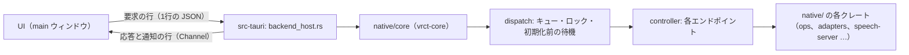

# 中核の統合と Python 同梱の終了（#285）

Python のサイドカーの中核（`mainloop.py`、`controller.py`、`config.py`）を Rust の `native/core`（vrct-core）へ移し、アプリのプロセスの中で動かす作業の記録です。2026-11-16 時点の状態を書きます。0.5.0 から中核がただ一つのバックエンドで、配布物に Python は入りません。

## 構成



- UI は今までどおり `sidecarSession.js` でバックエンドと話します。`backendCommand.js` が中核を、Python のサイドカーが使っていた shell プラグインの `Command` と同じ形で渡します。shell プラグインはアプリから外しました。
- 要求と応答の形式、状態コード、エラーの本体、ロックの規則は [IPC プロトコル](../spec/ipc-protocol.md) のままです。UI 側の変更は、この切り替えの部分だけです。
- 設定、ログ、モデルの保存先は Python のサイドカーと同じです。同じ `config.json` を読み書きします。
- 配布物に同梱するファイル（speech.cpp、補助プログラム、ライセンス文）は `_internal` にあり、中核は `native/core/src/resources.rs` で探します（「判断が要ること」の 5）。

## 切り替え

0.5.0 で Rust の中核を既定にし、Python のサイドカーを配布物から外しました（2026-11-16 決定）。0.4.0 の間は、中核は `VRCT_BACKEND=core` を指定したときだけの試用でした。

- `src-tauri/src/backend_host.rs` の `CORE_IS_DEFAULT` は `true` です。UI はいつも中核を起動します（`backend_kind` と `VRCT_BACKEND` はなくなりました）。
- `tauri.conf.json` に `externalBin` はなく、capability に shell の権限もありません。`vrct-vox-sidecar` の実行ファイルは配布物に入りません。
- 開発のときに Python のサイドカーへ戻す抜け道（`VRCT_BACKEND=python`）は作りませんでした（「判断が要ること」の 21）。
- 起動の後で、Python が取得した CTranslate2 の重みを消します（「判断が要ること」の「決まったこと」。ローカル翻訳への影響は 1）。
- `src-python/` とその試験は、移植の仕様として残しています。消すときに一緒に片付けるものは「Python の削除に伴うもの」にまとめました。

## 統合テスト

`cargo test --locked --manifest-path native/core/Cargo.toml` で動きます。CI では `voice-tests.yml` の `core-integration`（ubuntu-latest と windows-latest）が実行します。モデル、音声デバイス、外部のネットワークは使いません。

| 試験 | 確かめること |
|---|---|
| `tests/lifecycle.rs` | 起動時の通知の順序と `/run/initialization_complete`、終了と設定の保存、watchdog、入力が閉じたときの終了、古い版の設定の移行と通知、保存の失敗と回復 |
| `tests/config_reference.rs` | Python が書いた設定ファイル 50 通りを Windows と Linux の規則で読み、Python と同じ内容を書き戻すこと（基準は Python を実際に動かして作る） |
| `tests/error_codes.rs` | エラーコードと本体の形が [エラーコード一覧](../spec/reference/error-codes.md) と一致すること。中核のソースが応答・通知・コードの表で使う大文字のコードが、すべて一覧にあること（Python も表の外で返していた `VOICE_SETTINGS_INVALID` を除く） |
| `tests/dispatch.rs` | 404、500、ロックの順序、20 秒と 30 秒で返す 423、停止の要求の即時処理、VR パネルの中継の制限 |
| `tests/endpoint_coverage.rs` | 実装したエンドポイントが仕様の一覧に載っていて、初期化前に待つかどうかと即時処理の区分が一致すること。仕様のエンドポイントがすべて実装されていること（引退させたものを除く） |
| `tests/speech_servers.rs` | speech.cpp サーバの設定、起動と停止、世代、自分で終わったサーバの報告、終了時の後片付け |
| `tests/downloads.rs` | モデル取得の同意とカタログの版、状態、取り消し、検証して公開すること、設定への適用とその拒否（`settings_changed`、`model_target_busy`）、ハードウェアの確認、終了時の停止 |
| `tests/telemetry.rs` | 通知に答えるまで何も送らないこと、答えの検査（`telemetry_notice_invalid`）、`VRCT_TELEMETRY=off`、送る内容の表示、エラーコードの送信、終了後に送らないこと |
| `tests/adapters_servers.rs` | WebSocket サーバとトークン（101 と 403）、ホスト・ポート・証明書の変更と巻き戻し、OBS のページとトークン、起動時の再開と失敗の通知、`WEBSOCKET_*` と `OBS_BROWSER_SOURCE_*` のエラーコード |
| `tests/settings_endpoints.rs` | 動いていない機能の設定を読み書きするエンドポイント（翻訳・音声認識のキーの取得と削除、URL の変更とキーの入れ直し、OCR とオーバーレイの設定、古い Whisper の重み）。拒否したときのエラーコードと戻す値、`config.json` への保存、キーがログに出ないこと |
| `tests/updates.rs` | 偽の更新の仕組み（`SoftwareUpdates`）で、リリースの一覧、起動時の確認（`CHECK_SOFTWARE_UPDATES` がオフなら尋ねずに「更新なし」）、更新の成功（何も通知しない）、署名の検証の失敗（`UPDATE_SOFTWARE_VERIFY`）、ダウンロードの失敗（`UPDATE_SOFTWARE_DOWNLOAD`）、種類と版の受け渡し。仕組みがないときの Python と同じ答え（一覧は空、「更新なし」、`UPDATE_SOFTWARE_DOWNLOAD`）。チャンネルでの絞り込みと版の選び方は `src-tauri/src/app_update.rs` の単体の試験 |
| `tests/adapters_osc.rs` | OSC の送り先の検査、入力中の表示の送信、VRChat のミュートとの同期、OSCQuery を失ったときの順序、VRChat の有無、終了後に何も変えないこと |
| `tests/engine_checks.rs` | 起動時の確認に失敗したエンジンの扱い（サーバからモデルを探すエンジンの選択を消し、API キーは残す） |
| `tests/translation.rs` | 翻訳のプロバイダのキーの確認と保存、モデルの一覧と選択、LM Studio と Ollama の接続と切断、Ollama の URL（LAN の規則、起動時の確認、規則に合わない保存値）、Google Cloud Translation のキー、Papago の Client ID と Secret、OpenAI 互換の URL とキー、起動時の確認、非商用の重みの同意、翻訳のオンとローカルのモデルの読み込み（足りない、読めない、VRAM 不足）。キーがログに出ないこと |
| `tests/messages.rs` | `/run/send_message_box` からチャットボックス（OSC）、WebSocket、会話のログまで。翻訳のオンとオフ、公式 API（Google Cloud Translation、Papago）での翻訳、翻訳後のみの送信、VRChat へ送らない設定、プロバイダの失敗と切り替え、読み、認識の結果の受け渡し（ワードフィルタ、繰り返し、OCR、話し相手）、オーバーレイと音声の口、会話の履歴。文章がログに出ないこと。VR のログに描くことは `vr_overlay.rs`、OCR の行が流れを通って UI に届くことは `ocr.rs`、リアルタイムのマイクの確定文が訳されて読み上げられることは `voice.rs` が確かめる |
| `tests/audio_devices.rs` | 音声デバイスの一覧と選択肢、名前・ID・ホストでの選択と拒否したときに戻す値、Auto Select が OS の既定に従うこと、抜き差しで一覧が変わり選択が既定へ移ること、通知の順序、保存、Python が MME などで保存した選択、起動時の一覧、動いている録音を移すときの受け渡し、仮想マイクの案内と確認（見つけ方、テスト音、ミュート中の拒否、止めること）。デバイスはメモリの中の偽物 |
| `tests/vr_overlay.rs` | 字幕のログと VR パネルのオンとオフ（SteamVR の有無、VR パネルを作れない環境、保存した設定での起動）、設定が動いているオーバーレイに届くこと、VR パネルのエンドポイントと中継、失敗の通知（`OVERLAY_RUNTIME_FAILED`）、送ったメッセージが動いている大きいログに描かれること、コントローラのホバーが `/run/vr_panel_pointer` で届き、トリガーが VR 画面のクリックになり、掴んで動かした位置が保存されること、字幕の書体の設定（`OVERLAY_FONT_NOT_FOUND`、戻す値、足りない言語）、終了。SteamVR と VR 画面は代わりのものを使う。コントローラの操作の細部（スクロール、画面の外で離すこと、拡大縮小の限度、角での大きさの変更と枠、操作バー、ホバーの吹き出し、ロック、コントローラを見失ったとき）は `native/vr-overlay/tests/interaction.rs` が確かめる |
| `tests/clipboard.rs` | 音声タイピングの貼り付け（#393）。SteamVR のシーンのゲームのウィンドウを前面に出して Ctrl+V を送ること（Windows と X11 の順序）、ゲームを貼り付けのたびに読み直すこと、SteamVR がない・つなげない・ゲームがない・Steam のゲームでない・前面に出せないときはコピーだけ行うこと、オーバーレイと OpenVR の接続を共有すること、文とゲームの名前をログに書かないこと。SteamVR とデスクトップは代わりのものを使う |
| `tests/ocr.rs` | チャットの読み取り。偽の画像と偽の認識器を使う。ディスクのファイルから見たモデルの準備、オンにできない理由（`OCR_DISABLED_*`）の通知、状態、動いている読み取りに設定が届くこと、言語の切り替えと巻き戻し、読んだ行をメッセージの流れへ渡し `/run/transcription_ocr_message` で UI に届くこと、オフと終了、モデルの読み込み中の終了、読んだ文字がログに出ないこと |
| `tests/transcription.rs` | 音声認識の録音（クラウドのエンジン）。マイクとスピーカーのスイッチ、エンジンやデバイスがないときの拒否と通知、認識した文が UI・チャットボックス・会話のログに届き `process.log` には出ないこと、44.1 kHz のスピーカーと Whisper の API（言語とセグメントの選別）、音量メーター、エンジンの失敗（`ASR_ERROR`）、開けないデバイス（`AUDIO_OPEN_ERROR`）と別のデバイスへの切り替え、読み取りの失敗（`AUDIO_READ_ERROR`）、抜いたデバイスから別のデバイスへ移ることと最後のデバイスを抜いたときの停止、ミュートの同期、認識のキーと URL の確認と戻す値、起動時のエンジンの確認、保存されていた Google の選択が未選択になること、終了。デバイスは 44.1 kHz と 48 kHz の PCM をデバイスと同じ間隔で渡す偽物、エンジンは 127.0.0.1 の偽のサーバ |
| `tests/realtime_asr.rs` | リアルタイムの音声認識。設定の検査と保存、エンドポイントとモデルの一覧、メインのスイッチ（Linux と Windows の speech.cpp）で字幕（途中・確定・訳・結果）と確定した文がチャットボックスまで届くこと、設定画面からの開始と停止と録音からの引き継ぎ、スイッチが足りないものを `details.reason` で答えること、サーバが断ったときの失敗の通知、終了。speech.cpp はモデルの一覧と Realtime の WebSocket を返す 127.0.0.1 の偽のサーバ |
| `tests/voice.rs` | TTS のスイッチ（止まっている理由ごとのコード、世代、内蔵サーバを自分で起動して止めること、設定画面から起動したサーバは止めないこと、サーバの停止で TTS が切れること）、音声の設定の検査と拒否したときの答え、入力したチャットを元の文と翻訳で読み上げること、マイクの確定文の読み上げと言語・翻訳の変更での取り消し、停止とミュートと再開、キューで待つ間の停止で古い世代を拒むこと、ミュートの保存と壊れた記録、Linux の管理された経路のゲート、出力先の一覧、モデルの選択肢とインストール済みエンジンの声、直接の音声（素通しと声質変換、世代、失敗、元の声に戻さないこと、変換を通した読み上げ）、声質変換の実行環境の準備（同意、版、手順ごとの失敗、worker の確認）、フローパネル、リアルタイムのマイクの確定文が訳されて読み上げられること、声を流しているケーブルを認識に使わせないこと（`realtime_endpoint_feedback`）、終了。出力とマイクはメモリの中の偽物、speech.cpp とエンジンはループバックの偽物、RVC の worker は `fake-rvc-worker` |

Python の `src-python/test/test_native_core_reference.py` は、Python 側の設定の規則が変わったのに基準データを作り直していないとき失敗します。

## Python の試験の棚卸し

`tests/` の Python の試験（関数 1,353 件）を、「新しい接続面で再カバーするもの」とそれ以外に分けました。

| 区分 | 内容 | 扱い |
|---|---|---|
| A | サイドカーを動くアプリとして試すもの（エンドポイント、設定の移行、起動と終了、モデル取得、エラーコード） | `native/core/tests/` で再カバーする |
| A-u | 移植先のクレートがまだ無かったサイドカーの処理 | 移植と一緒に再カバーした（下の表） |
| B | 移植済みのクレートの単体の振る舞い | 各クレートの試験と同等性の試験がすでに持つ |
| C | ビルド、配布、開発用の道具、ブラウザや GUI の試験 | バックエンドの言語に関係なく残す |
| D | Python と一緒に消えるもの（PyInstaller、Seed-VC、CTranslate2、Python の実行環境の準備） | コードと一緒に引退させる |
| E | 実機やモデルが要るもの | headless の CI では動かさない |

区分 A のうち、再カバーが済んだもの:

| Python の試験 | 再カバーした試験 |
|---|---|
| `tests/voice/test_runtime_paths.py`（設定の保存先）、`tests/platform/test_runtime_settings.py` | `lifecycle.rs`、`config_reference.rs` |
| `tests/voice/test_quick_chat_config.py`、`test_vc_settings.py`、`test_realtime_settings.py`（設定の移行） | `config_reference.rs` |
| `tests/platform/test_native_backend.py`（初期化の完了、終了、設定が次の起動に残ること） | `lifecycle.rs` |
| `tests/voice/test_priority_cancel.py`（停止の要求がキューを飛ばすこと） | `dispatch.rs` |
| `tests/voice/test_speech_server_controls.py`、`test_speech_server_end_owner.py`（サーバの部分） | `speech_servers.rs` |
| `tests/voice/test_model_download_controller.py`、`test_model_download_policy.py` | `downloads.rs` |
| `tests/voice/test_telemetry_client.py`（エンドポイントの部分） | `telemetry.rs` |
| `tests/voice/test_security_regressions.py`（WebSocket と OBS の部分）と `src-python/test/` の WebSocket・OBS・OSC の試験 | `adapters_servers.rs`、`adapters_osc.rs` |
| `src-python/test/test_old_whisper_weights.py` | `settings_endpoints.rs`、`src/controller/files.rs` の単体の試験 |
| `src-python/test/test_controller_vr_panel_opacity.py`、`test_credential_commits.py` と `test_controller_transcription_api_endpoints.py`（キーの削除と URL の変更の部分） | `settings_endpoints.rs` |
| `tests/voice/test_virtual_mic_controller.py`、`src-python/test/test_controller_audio.py`（Auto Select と終了時の停止の部分）、`test_config_saved_device_selection.py` | `audio_devices.rs` |
| `src-python/test/test_controller_ocr_enable.py`、`test_controller_ocr_readiness.py`、`test_controller_ocr_settings.py`、`test_model_stop_ocr_capture.py`、`test_ocr_language_and_shutdown.py`（中核の部分） | `ocr.rs`、`settings_endpoints.rs`。パイプラインそのものの振る舞いは `native/ocr-runtime` の試験が持つ |
| `src-python/test/test_controller_update_software_failure.py`、`test_controller_init_config_settings.py`（`available_releases` を起動時の一覧に入れない部分） | `updates.rs`、`lifecycle.rs` |
| `src-python/test/test_controller_transcription_api_endpoints.py`（キーの保存と拒否、URL とキーの組）、`test_controller_transcription_engine_status.py` | `transcription.rs`、`engine_checks.rs` |
| `src-python/test/test_model_transcript_wiring.py`、`test_model_api_transcription_wiring.py`、`test_model_energy_consumer.py`、`test_model_transcript_stop.py`、`test_device_capture_lifecycle.py`、`test_controller_vrc_mic_mute_sync_init.py`（認識の部分） | `transcription.rs` |
| `tests/voice/test_realtime_controls.py`、`test_realtime_toggles.py`、`test_realtime_settings.py`（移行以外）、`test_realtime_delivery.py`、`src-python/test/test_realtime_toggle_generation.py`、`test_realtime_legacy_handoff.py`、`test_realtime_delivery_outcomes.py` | `realtime_asr.rs` |
| 区分 A-u だった `tests/voice/test_realtime_session.py`、`test_realtime_events.py`、`test_realtime_audio.py`、`test_speechcpp_realtime.py`、`test_speechcpp_asr.py`、`test_asr_vocabulary.py`、`test_capture_packets.py` と、`src-python/test/test_transcription_recorder.py`、`test_transcription_transcriber.py`、`test_transcription_providers.py`、`test_transcription_openai_compatible.py`、`test_transcription_deepgram.py` | `realtime_asr.rs`、`transcription.rs` と `native/transcription` の単体の試験 |
| `src-python/test/test_controller_message_pipeline.py`、`test_message_snapshot_and_sinks.py`（送信、翻訳、読み、出力の失敗の部分） | `messages.rs`、`src/controller/messages.rs` の単体の試験 |
| `src-python/test/test_controller_translation_enable.py`、`test_translation_providers.py` と `test_endpoints.py` の翻訳のキーとモデルの部分 | `translation.rs`、`native/translation` の試験 |

| `src-python/test/test_controller_overlay_running.py`、`test_controller_vr_panel_toolbar.py`（固定先、ロック、ランチャーの手と初期化、自動で隠す設定）、`test_overlay_lifecycle_publication.py`（オンの失敗と切ったときの消去） | `vr_overlay.rs` |
| `src-python/test/test_overlay_steamvr_quit.py`、`test_overlay_shutdown_timeout.py`（SteamVR を待つこと、終了、つなぎ直し） | `vr_overlay.rs` と `native/vr-overlay` の `engine` の試験 |
| `src-python/test/test_overlay_fake_vr.py`（レーザーとポインタ、グリップで動かして保存）、`test_overlay_press_cancel.py`（画面の外で離すこと、離すまで押し直さないこと、追跡を失ったとき）、`test_overlay_grab_move.py` の操作の部分（掴んで離すと保存、拡大縮小、ロック、操作バー、掴んだ後のトリガー、クリックとスクロール） | `native/vr-overlay/tests/interaction.rs`、`vr_overlay.rs`。姿勢と並びの計算は `native/vr-overlay` の基準の試験（`reference_tests.rs`） |
| `src-python/test/test_clipboard_focus_and_paste.py`（コントローラから見た貼り付け）、`test_openvr_session.py`（オーバーレイとクリップボードの部分。OCR の部分は「判断が要ること」の 9） | `clipboard.rs`、`native/vr-overlay` の `shared` の試験、`native/adapters` の `tests/clipboard.rs` |
| `tests/voice/test_tts_toggle.py`、`test_tts_toggle_server.py`、`test_speech_server_end_owner.py`（TTS の部分）、`test_tts_model_options.py`（コントローラの部分） | `voice.rs` |
| `tests/voice/test_spoken_controls.py`、`test_io_flow_controller.py`、`src-python/test/test_voice_settings_patches.py` | `voice.rs` |
| `tests/voice/test_direct_voice_controller.py`、`test_managed_controller.py`、`src-python/test/test_voice_route_monitor_mute.py` | `voice.rs`。経路のゲートと保存は `native/audio-routing` の試験も持つ |
| `tests/voice/test_external_speech_engines.py` | `voice.rs`（エンドポイントと TTS のスイッチ）、`native/tts/tests/engines.rs`（クライアント） |
| `tests/voice/test_vc_runtime_setup.py`（RVC の部分） | `voice.rs`、`native/voice-conversion` の単体の試験（版、アーカイブ、以前の実行環境の削除）。uv、Python、Seed-VC の部分は区分 D |
| `src-python/test/test_controller_typing.py`、`test_mainloop_typing_order.py` | `adapters_osc.rs`（アプリが付けた入力中の表示だけを消すこと）、`dispatch.rs`（止める要求が始める要求を追い越さないこと）。表示を消すのに失敗したときの答えは「判断が要ること」の 57 |
| `src-python/test/test_model_translate_fallback_no_wait.py`、`test_model_get_translate_unsupported_language.py`、`test_translation_unsupported_language.py`、`test_model_input_translate_parallel.py` | `translation.rs`。ローカルのモデルは 1 つの鍵で 1 文ずつ訳すので、同時に訳すことは外部のプロバイダで確かめる。ログの行の違いは 58。言語の表（Filipino と Tagalog など）は区分 B |
| `src-python/test/test_translation_history_destination.py` | `messages.rs`（同じエンジンを保存し直しても履歴が残ること、ほかのエンジンやタブへ移って戻ると履歴が始まり直すこと）。8 つのプロバイダで同じことを試す Python の形は移さない（履歴はどのプロバイダにも同じ道で渡る） |
| `src-python/test/test_conversation_logger.py` | `messages.rs`（オンの間だけ書くこと、オンにするたびに別のファイル）、`src/controller/messages.rs` の単体の試験 |
| `src-python/test/test_message_delivery_revocation.py`（終了とチャットボックスの順番の部分） | `messages.rs`（訳している間に終了したメッセージがどこにも届かないこと）、`src/controller/messages.rs` の単体の試験（送らなかったメッセージで順番が進まないこと）。ミュートの扱いは 55 と 56。認識の停止と無効化での取り消しは「0.6.0 の残りの移行」の 1 |


区分 A は上の表のとおり再カバーしました。音声認識の字幕を VR の大きいログに出す部分（`test_realtime_overlay*.py`）は、字幕を出す関数（`Core::show_overlay_caption`）につないでありますが、中核の試験ではまだ確かめていません。発話の診断のログ（`test_utterance_diagnostics.py`）は移していません（「判断が要ること」の 15）。

## 切り替え前の基準値

0.5.0 で Python の同梱をやめたときに比べるための値です。2026-11-16 に計りました。

### 計り方

`tools/measure_backend_startup.py` が、展開した Windows の配布物を相手にサイズと起動時間を計ります。中核の起動は `native/core/examples/startup_time.rs` で計ります。アプリと同じ `Environment` で `Backend::start` を呼び、`/run/initialization_complete` までの時間を返します。

```sh
cargo build --release --locked --manifest-path native/core/Cargo.toml --example startup_time
python tools/measure_backend_startup.py --package <展開した配布物> \
    --core-example native/core/target/release/examples/startup_time.exe \
    --work <空のフォルダ> --runs 5 --zip <VRCT-VOX.zip>
```

- 対象は release/0.4.0（e4b9bcfb）の CI が作った CPU 版の `VRCT-VOX.zip` です。
- 起動時間は、バックエンドを起動してから `/run/initialization_complete` が届くまでです。サイドカーは `vrct-vox-sidecar.exe` を子プロセスとして起動した時点から計ります。中核はアプリと同じくプロセスの中で起動します。アプリの窓や WebView の起動は含みません。
- 設定は空のフォルダから始め、起動時に外へ出る処理を止めます（モデルの自動取得、更新の確認、利用状況の送信、VRChat への OSC）。何も取得していません。
- それぞれ 5 回続けて起動しました。サイドカーを先に計り、1 回目はほかより遅いので分けて書きます。展開した直後なので、ディスクのキャッシュが完全に冷えた起動ではありません。
- 計った環境は Windows 11、Intel Core i7-1255U、ノート PC です。ほかの PC での速さを示す値ではありません。

0.5.0 の配布物も同じコマンドで計ります。`vrct-vox-sidecar.exe` がない配布物では、サイドカーを起動せず中核だけを計ります。この場合は中核の 1 回目が冷えた起動になります。サイズは `vrct-vox.exe`、そばに置いた ONNX Runtime、speech.cpp、RVC の worker、ライセンス、フォント、`_internal` の残りに分けて出します。Python の実行環境のファイルが残っていたら警告を出します。アプリの本体は窓と WebView を開くので、この計測では起動しません。

### 配布物のサイズ

展開した `VRCT-VOX.zip` は 1,115.3 MB です（zip のままでは 408.7 MB）。1 MB は 10^6 バイトです。

| 部分 | サイズ | 切り替えたあと |
|---|---:|---|
| `vrct-vox.exe`（アプリと中核） | 22.0 MB | 残る |
| speech.cpp（`_internal/build`） | 49.3 MB | 残る（置き場所は「判断が要ること」の 5） |
| `vrct-vox-sidecar.exe` | 28.0 MB | なくなる |
| Python の実行環境とライブラリ | 408.3 MB | なくなる |
| Sudachi の辞書（`*.dic`、かな・ローマ字の変換用） | 576.9 MB | Python と一緒になくなる。中核は sudachi.rs で同じ辞書を読む。入れる版（full は 359.7 MB）は「判断が要ること」の 3 |
| 同梱のモデル（`_internal` の `*.onnx`） | 1.2 MB | Python と一緒になくなる |
| フォント（`*.ttf`） | 29.6 MB | Python と一緒になくなる。字幕は利用者の PC の書体を使う（「判断が要ること」の「決まったこと」） |

Python の実行環境とライブラリの中で大きいのは `cv2`（100.6 MB）、`ctranslate2`（63.7 MB）、`transformers`（42.7 MB）、`onnxruntime`（39.3 MB）、`numpy.libs`（38.2 MB）、`PIL`（13.5 MB）です。初回に取得するモデル（翻訳の重みなど）は配布物に入っていないので、この表に含めていません。

### 起動から初期化の完了まで

| バックエンド | 1 回目 | 2〜5 回目の中央値 | 最小〜最大 |
|---|---:|---:|---:|
| Python のサイドカー | 11.83 秒 | 7.95 秒 | 7.89〜11.83 秒 |
| 中核（`VRCT_BACKEND=core`） | 1.02 秒 | 0.74 秒 | 0.62〜1.02 秒 |

中核の値は、計った時点の接続の状態での値です。その時点の中核は、まだ音声デバイスの列挙と選択をしていませんでした。いまは起動時に行います（計り直していません）。サイドカーではこれが 3.48 秒かかっていました（`startup_timing.log` の `select_audio_devices`）。そのほかの段階はモジュールの読み込み（約 2.5 秒）と設定の一覧の収集（1.15 秒）です。収集のうち 0.99 秒は speech.cpp の機器の確認で、これは中核も同じく行い、同じ一覧を返しました。初期化の一覧の項目は、サイドカーが 183、中核が 160 です。機能をつなぐと中核の値は増えるので、0.5.0 では同じ方法で計り直して比べます。

## 切り替えた後の値（0.5.0 の候補）

2026-11-16 に、上と同じ道具と設定で計り直しました。

- 対象はこのブランチから手元で作った Windows の配布物です。`bat/build.bat`、`vite build`、`tauri build --no-bundle` の順に作り、`vrct-vox.exe` と `src-tauri/bin/_internal` を zip にしました。zip は PowerShell の `Compress-Archive` で作りました（`utils/zip.py` と同じ Deflate）。speech.cpp は固定した 0.11.0（`windows-x64-vulkan`）です。
- 計った環境は上と同じ Windows 11、Intel Core i7-1255U のノート PC です。5 回続けて起動しました。

| | 0.4.0（Python のサイドカー） | 0.5.0 の候補（中核） |
|---|---:|---:|
| 展開した配布物 | 1,115.3 MB | 77.1 MB |
| zip | 408.7 MB | 27.3 MB |
| 起動から初期化の完了まで（1 回目） | 11.83 秒 | 1.21 秒 |
| 同（2〜5 回目の中央値） | 7.95 秒 | 1.11 秒 |
| 同（最小〜最大） | 7.89〜11.83 秒 | 1.02〜1.43 秒 |

配布物の内訳は `vrct-vox.exe`（アプリと中核）24.8 MB、speech.cpp 47.3 MB、RVC の worker 2.0 MB、ライセンス文 3.1 MB です。ONNX Runtime、OpenVR のライブラリ、読みの辞書は入っていません（「判断が要ること」の 2、3、7）。これらを入れると大きくなります。ONNX Runtime（Windows で 17.3 MB）と OpenVR のライブラリ（0.8 MB）は、2026-11-17 に入れることが決まりました（#509）。書体は入れないことに決まりました（「決まったこと」の「字幕の書体」）。

中核の起動は、音声デバイスの列挙と選択（約 20 ms）と speech.cpp の機器の確認（約 1 秒）を含みます。初期化の一覧の項目はサイドカーが 183、中核が 184 です。speech.cpp の機器の確認は 0.4 と同じ 2 台の GPU を返しました。

この計測のときの `bat/build.bat` は、`build/speechcpp/speech.exe` があると取り直しませんでした。古い版が残っていると中核はハッシュが合わないとしてそれを使わず、機器の一覧が空になり、内蔵のサーバも起動しませんでした。いまは `speechcpp_bundle.py --replace` で、同じ版なら残し、別の版なら置き換えます（`build/` のほかのものには触れません）。

この計測は Windows の配布物だけです。0.5.0 の Linux の配布物は speech.cpp の CPU 版も入れるので（「判断が要ること」の「決まったこと」）、固定した 0.11.0 の ZIP の中身で比べると、CPU 版の実行ファイルの 9,965,440 バイト（ZIP の中の圧縮で 3,798,516 バイト）と通知の写し（約 47 KB）が増えます。Vulkan 版の実行ファイルは 52,174,848 バイトです。Linux の配布物そのものは、ここでは作っていません。
## 往復の試験

Issue のコメントは、音声認識・翻訳・TTS・声質変換・OCR の往復を統合テストで確かめるよう求めています。どれも headless の CI で動き、モデル、音声デバイス、外部のネットワークを使いません。

- 翻訳: ローカル翻訳は偽のエンジン、オンラインのプロバイダは 127.0.0.1 の偽のサーバを相手に、`/run/send_message_box` から OSC・WebSocket・会話のログ・履歴までを確かめます（`tests/translation.rs`、`tests/messages.rs`）。
- 音声認識: デバイスと同じ間隔で PCM を渡す偽の録音と、127.0.0.1 の偽の認識サーバ（クラウドのエンジンと speech.cpp の Realtime）を相手に、認識した文が UI・チャットボックス・会話のログに届くまでを確かめます（`tests/transcription.rs`、`tests/realtime_asr.rs`）。
- TTS: speech.cpp の偽のサーバ（`tests/common/fake_tts.rs` と、合成を返す `tests/fixture/fake_speech.rs`）を相手に、合成の要求から出力への書き込みまでを確かめます。リアルタイムのマイクの確定文が訳されて読み上げられるところまで通します（`tests/voice.rs`）。
- 声質変換: `vrct-rvc-worker` の代わりの小さな実行ファイル（`tests/fixture/fake_rvc_worker.rs`）を相手に、起動と停止、変換した音だけが出力に届くこと、失敗の扱いを確かめます（`tests/voice.rs`）。
- OCR: 撮影を差し替えて画像を与え、偽の認識エンジンを相手に、読んだ行がメッセージの流れを通って `/run/transcription_ocr_message` に届くまでを確かめます（`tests/ocr.rs`）。
- VR のオーバーレイ: 代わりの SteamVR を相手に、送ったメッセージが大きいログに描かれるまでを確かめます（`tests/vr_overlay.rs`）。

## 残っているエンドポイント

仕様のエンドポイントで、まだ Rust の中核にないものの一覧です。要求すると 404 を返します。`tests/endpoint_coverage.rs` がこの一覧と実装を照らし合わせます。

<!-- remaining-endpoints:begin -->
なし（0 件）。すべてのエンドポイントを中核につなぎました。
<!-- remaining-endpoints:end -->

次のエンドポイントは Python のバックエンドと一緒に引退させます。Rust の中核にはつなぎません。

<!-- retired-endpoints:begin -->
- 旧 CTranslate2 の重みの取得（1 件）: `/run/download_ctranslate2_weight`。起動時の自動取得と、カタログの `legacy_models` も移しません。
<!-- retired-endpoints:end -->

## Python の削除に伴うもの

`src-python/` はほかの領域の移植が終わるまで仕様として残します。消すときは、次のものも一緒に片付けるか、先に移します。2026-11-16 に `git grep src-python` などで調べた一覧です。

先に移さないとビルドが壊れるもの:

- `native/ops/src/downloads/speechcpp.rs` が `include_str!` で読む `src-python/models/model_downloads/speechcpp_models.py` と `speechcpp_asr.py`。`native/ops` の中へ移す。`tools/build_linux.py` の `CRATE_INPUTS` と `build-linux.yml` の対象のパス（`src-python/models/model_downloads/**`）も一緒に直す。
- `native/adapters/tests/obs.rs` が動かす `src-python/test/obs_reconnect.mjs`。
- 版のそろえ方。`utils/update_version.py` は `src-python/config.py` に版を書き、`.github/actions/windows-package/action.yml` と `release.yml` の候補の検査はそれを読む。
- `tools/spec_catalog.py`。仕様の一覧（`docs/spec/reference/`）を `src-python/`（`mainloop.py`、`errors.py`、`config.py`）から作っている。中核の `routes.rs`、`errors/table.rs`、`config/schema.rs` から作るように変える。`native/core/tests/endpoint_coverage.rs` はこの一覧を読む。
- 製品のモデルのカタログの正本。`AGENTS.md`、`NOTICE.md`、`release-candidates.md` は `src-python/models/model_downloads/catalog.py` を指す。Rust のカタログ（`native/ops`）に書き換える。

一緒に引退させる試験と CI:

- `src-python/test/` の全部と、`src-python` を読み込む `tests/` の試験（`tests/voice` の大半、`tests/platform` の一部、`src-python/test/test_native_core_reference.py`）。区分 A は上の表のとおり中核の試験に移した分だけ再カバー済み。
- `voice-tests.yml` の `backend-windows` と `backend-linux`。`headless` の `check --scope voice` は残る試験だけにする。
- `tools/dev.py` の `backend` のスコープ、`LINT_PATHS` と `PLATFORM_BACKEND_TESTS` の `src-python` の部分、`pyproject.toml` のアプリの依存と `cuda` の extra（`uv.lock` も）、`linux-build` のグループ、`bat/install.bat` と `mise run setup:app`、`.venv`・`.venv_cuda`・`.venv_linux`。
- 中核の基準データを Python で作る道具（`native/core/reference/dump_reference.py`、`native/ocr-runtime/reference/`、`native/ops` の `python_reference.json` を作る手順）。データは残し、作り直す道具だけを引退させる。
- `src-python` を読み込む開発用の道具（`tools/voice_cli.py`、`voice_route.py`、`voice_acceptance.py`、`native_acceptance.py`、`vrchat_voice_host.py`、`live_tts_acceptance.py`、`windows_field/`、`fake_vr_site/`、`chatbox_lab/`、`translation_onnx/compare.py` など）。中核で同じことをする道具に置き換えるか引退させる。
- `integrations/seed_vc/`（Python の Seed-VC。「判断が要ること」の 6）。
- `src-python/models/overlay/fonts/` の Noto Sans の 4 書体（29.6 MB）。中核は書体を同梱しないので使いません（「決まったこと」の「字幕の書体」）。
- `.github/CODEOWNERS` の例の `src-python/`。

文書:

- `src-python/docs/`、`docs/spec/` の各ページの `src-python` への参照（`contracts.md` の試験の場所など）、`native/*/README.md` の「Python のどこを置き換えたか」の記述（履歴として残すなら 0.4 のタグへのリンクにする）。
- `NOTICE.md` の Silero VAD（`src-python/models/transcription/silero_vad/`）と `licenses/silero-vad/`。Rust の音声認識が使わないなら引退させる。

## 0.6.0 の残りの移行

0.5.0 の時点で、仕様のエンドポイントはすべて中核にあり、配布物に Python は入っていません。残りの 4 領域（メッセージ送信、読み上げ、リアルタイム音声認識、声質変換）の「移行」とは、領域ごとに次の 3 つを終えることです（2026-11-18 に決めた順序と切り分け）。

- Python の試験を棚卸しして、残る振る舞いを中核の試験で確かめる（上の「Python の試験の棚卸し」の表に足す）。
- Python と違う振る舞いを見つけたら、直すか、「判断が要ること」に挙げる。挙動を変える変更は判断を待つ。
- その領域の `src-python` を消すのに先に要るもの（「Python の削除に伴うもの」）を移す。

`src-python` は 4 領域が終わってから、まとめて消します（27）。

### 順序

| 順 | 領域 | Issue | 残っていること | 先にする理由 |
|---|---|---|---|---|
| 1 | メッセージ送信 | #285 | 下の 1 | ほかの 3 領域は、認識した文や読み上げの口をこの流れに渡す。ここを先に固めると、後の領域の試験がこの流れを前提にできる |
| 2 | 読み上げ（TTS） | #279 | 棚卸しの表にない試験（`tests/voice/test_tts.py`、`test_scheduler.py`、`test_spoken_scheduler.py`、`test_tts_playback_ownership.py`、`test_tts_listener_failure.py`、`src-python/test/test_tts_listener_monitor.py`）の再カバー。開始の遅れ、割り込み、続けての発話の実機での確認（#279 の受け入れ条件） | サーバの管理は済んでいて、残りは合成の要求と順番の振る舞いだけ。メッセージ送信の音声の口に依る |
| 3 | リアルタイム音声認識 | #278 | VAD のエンジン（13。ADR-012 の 2.1 により、speech.cpp の VAD を先に検討する）、Python との違い（15）、フローパネルの時刻（24）、字幕を VR の大きいログに出すことの試験（`test_realtime_overlay*.py`）、`test_realtime_ingress_wait.py`、`native/ops` が `include_str!` で読む `src-python/models/model_downloads/speechcpp_asr.py` と `speechcpp_models.py` を `native/ops` へ移すこと | 確定した文をメッセージ送信と読み上げへ渡すので、その 2 つの後にする |
| 4 | 声質変換 | #275（完了）の続き | Linux の管理された経路（11。`vrct-audio-routing` に PipeWire の録音を足す）、router を分けるか（12）、`test_vc_*.py` と `test_monitor_*.py` の再カバー、Seed-VC の引退（区分 D、`integrations/seed_vc/`） | 残りが一番大きく、Linux の音声の経路の作業を含む。RVC は ADR-012 で管理された例外（ONNX Runtime）なので、speech.cpp へ移す作業は含めない |
| 最後 | `src-python` の削除 | #285 | 「Python の削除に伴うもの」 | 4 領域が終わってから |

### 1. メッセージ送信

棚卸しの表に載っていなかったメッセージ送信の Python の試験 8 本（入力中の表示、翻訳の切り替えと待ち方、同時に訳すこと、翻訳の履歴、会話のログ、取り消し）を中核と照らし合わせました（2026-11-18）。

- **済んだこと**: 上の表に足した行のとおり、中核にあって試験のなかった振る舞いを試験で確かめました。送らなかったメッセージでチャットボックスの順番が進み、先に受け付けたメッセージが落ちていたのを、Python と同じ動きに直しました。
- **判断を待つこと**: ミュートを解いたあとの取り消し（55）、リアルタイムの確定文の音声の世代（56）、入力中の表示を消せなかったときの答え（57）、ログの行（58）。
- **残っている試験**: 認識（マイク、スピーカー、OCR、リアルタイム）の途中で、利用者が無効にしたとき、デバイスやエンジンが失敗したとき、リアルタイムへの引き継ぎに失敗したときに、届く前の文を取り消すこと。中核には実装があります（`Transcription::revoke`、`publication_guard`）が、`native/core/tests/` からは偽の録音と偽の認識サーバ（`transcription.rs`、`realtime_asr.rs` の部品）を使わないと届かないので、読み上げとリアルタイム音声認識の領域の作業で一緒に確かめます。設定のための一時停止（`reason: "settings_pause"`）では取り消さないことも同じです。

## 翻訳の棚卸し

翻訳には上流の VRCT から引き継いだものが多く残っています。2026-11-16 に、Python（`src-python/models/translation/`、`controller.py`、`model.py`、`config.py`、`models/builtin_model_pins.py`）、中核（`controller/translation.rs`、`translation_onnx.rs`、`languages.rs`、`legacy_weights.rs`、`config/schema.rs`）、`native/translation`、`native/translate-onnx`、`tools/translation_onnx/`、UI と `locales/` を調べました。中核へ移すときは、古いものをそのまま移さない方針です。扱いの「消す」は利用者から見えないものか、どのビルドでも動かなかったものだけを実際に消し、ほかは「判断が要ること」の番号に回しました。

| もの | どこに | いまの状態 | 扱い |
|---|---|---|---|
| Google・Bing・Papago の Web 翻訳 | 上流の `translator_engines`（配布しない）、`translation_translator.py` の分岐とタイムアウト、言語の表の列、UI の `translator_status`、仕様のタイムアウトの記述 | どのビルドでも動かない。中核は「使えない」と示していた | **消した**（遺産）。エンジンの一覧と UI の選択肢と仕様から外した。言語の表の列は残す（17、利用者から見える）。各社の公式 API（Google Cloud Translation、Papago）は別のもので、`Google_Cloud_API` と `Papago_API` として足した（32） |
| CTranslate2 での推論 | `translation_translator.py` の `changeCTranslate2Model`、`translateCTranslate2` | Python と一緒に配布物から消えた | **置き換えた**。`native/translate-onnx`（「決まったこと」） |
| transformers のトークナイザと遅い読み込み | `translation_utils.py` の `loadTransformers`、`UNLOADED`、`CTranslate2TokenizerLoadError` | Python だけ | **消える**。中核に移さない |
| `native/translate-onnx`、中核の機能 `onnx-translation`、`controller/translation_onnx.rs`、`tools/translation_onnx/` | Rust と道具 | 既定でオン。アプリでも有効。モデルは未公開 | **使う**（「決まったこと」） |
| ローカル翻訳の継ぎ目 `LocalTranslation`（`Services::local_translation`） | 中核 | 偽のエンジンで試験済み | **残す** |
| CTranslate2 の重みの取得（`/run/download_ctranslate2_weight`、起動時の自動取得、カタログの `legacy_models`、`LEGACY_MODEL_DOWNLOAD_CONSENTS`） | Python | 引退させた | **置き換えた**。モデル取得のカタログの対象 `translation`（項目はモデルの公開待ち、1） |
| 取得の通知（`download_progress_ctranslate2_weight`、`downloaded_ctranslate2_weight`、`error_ctranslate2_weight`）、`WEIGHT_CTRANSLATE2_DOWNLOAD`、`dispatch.rs` の `request_error_result` | 中核の `RUN_MAPPING` とエラーの表 | `downloaded_ctranslate2_weight` だけを、カタログから取得したときに送る | 残りは**消せる**（41） |
| UI の重みの取得（設定の翻訳のダウンロードのボタン、`LegacyModelDownloadDialog`、`TranslationSetupController`、`legacyModelConsent.js`、起動時の取得の表示） | UI と `locales/` | 行き止まりを直した。共通の取得の画面を出すか、未公開と自分のモデルの置き場所を示す | **置き換えた**（29） |
| 重みの固定（版、サイズ、SHA-256）と確認の記録（`.weight_verified.json`） | `builtin_model_pins.py`、`legacy_model_downloads.py` | 中核にない | **消える**。カタログが置き換える |
| 旧フォルダ名（`m2m100_418M`、`m2m100_12b`）の付け替え | `translation_utils.py` の `backwardCompatibleRenameWeightsDir` | 中核に移していない | **消える**。移さない |
| 旧 CTranslate2 の重みを消す処理 | `legacy_weights.rs`、`Services::retire_legacy_translation_weights`、`tests/legacy_weights.rs` | 0.5.0 で有効 | 決まったこと |
| 重みの選択と非商用の同意（`CTRANSLATE2_WEIGHT_TYPE`、`SELECTABLE_CTRANSLATE2_WEIGHT_TYPE_LIST`・`_DICT`、`CTRANSLATE2_LICENSE_NOTICE_SHOWN`、`WEIGHT_CTRANSLATE2_LICENSE_CONSENT_REQUIRED`、`WEIGHT_CTRANSLATE2_NON_COMMERCIAL_NOTICE`）とエンジンの ID `CTranslate2` | 中核と UI | 移した | **残す**。設定と IPC の契約なので名前は変えない。同じ値で ONNX のモデルを選び、自分で用意したモデルは `custom:<フォルダ名>` として一覧に足す（39） |
| NLLB を既定にしていた古い設定の知らせ | `config.py`、中核の `notify_after_start` | 移した | **残す** |
| 計算デバイスと計算型（`SELECTED_TRANSLATION_COMPUTE_DEVICE`・`_TYPE`、`SELECTABLE_COMPUTE_DEVICE_LIST`、UI の ComputeDevice） | 中核と UI | 中核の一覧は CPU と、読み込んだ ONNX Runtime の GPU の実行プロバイダ | **残して読み替えた**（「決まったこと」） |
| `getBestComputeType`（`auto` の解き方）と CUDA の機器の一覧 | `utils.py` | 中核は実行プロバイダから一覧を作る | **消える** |
| GPU のメモリー不足（`detectVRAMError`、`LocalError::OutOfMemory`、`TRANSLATION_VRAM_*`、4 つの通知、UI の処理と文言） | Python、中核、UI | GPU の実行プロバイダで起こりうる | **残す**（「決まったこと」、30） |
| CUDA 版の配布物（CTranslate2 のための `_internal/nvidia`） | 配布 | 中身は標準版と同じ | 20 で決める |
| オンラインのプロバイダ（DeepL、Plamo、Gemini、OpenAI、Groq、OpenRouter、LM Studio、Ollama、OpenAI 互換）、プロンプト、履歴、モデル一覧の短い保持、タイムアウト | `native/translation`（プロバイダごとの型と共通のトレイト）、`controller/translation.rs` | 中核のクライアントに移した。利用者のキーで中核から呼ぶ。Ollama の URL を足した | **残す**（31 で決定）。プロキシは 18 |
| ローカル翻訳の言語の表（重みごとの表） | `translation_languages.json` | 移した | **残す**。自分で用意したモデルは自分の表か、同じアーキテクチャの表から作る（39） |
| 失敗したときローカル翻訳へ切り替える動き（`changeToCTranslate2Process`） | 中核の `fall_back_to_local` | 移した | **残す**。ローカル翻訳がない間は元の文で送る |

## 判断が要ること

PR の残課題と同じものです。決まったら、この節を更新します。番号は 2026-11-16 に振り直しました（それまでの番号は各領域の作業で重なっていました）。

### 決まったこと

- **既定の切り替え（2026-11-16）**。0.4.0 の間は既定を切り替えず、中核は `VRCT_BACKEND=core` を指定したときだけの試用でした。0.5.0 で中核を既定にし（`CORE_IS_DEFAULT`）、PyInstaller の工程と配布物のサイドカーをなくしました。
- **移植の範囲（2026-11-16）**。#277（翻訳・翻字のプロバイダ）、#278（音声認識）、#279（TTS）、#281（OCR）、#282（オーバーレイ）の残りを #285 の中で移しました。エンドポイントは全件が中核にあります。移していない振る舞いは下の 11、15 にあります。VR パネルのコントローラ操作は移しました（実機での確認は 8）。
- **使えないエンジンの選択（2026-11-16）**。起動時の確認に失敗したエンジンは Python と同じに扱います。LM Studio、OpenAI 互換、Ollama、Groq・OpenAI・カスタムの Whisper、Deepgram は、モデルの一覧と選択を消します（Deepgram は言語の表も）。ほかのエンジンの選択は残します。翻訳と音声認識のプロバイダは Rust に移り、起動時に Python と同じ確認をします。キーの扱いは 25 です。
- **旧 CTranslate2 の重み（2026-11-16: 消す）**。`/run/download_ctranslate2_weight`、起動時の自動取得、カタログの `legacy_models` は中核に移さず、引退させました。重みのフォルダ（`<データ>/weights/ctranslate2/` の、Python が作った 7 つの名前）は起動の後で消します（`CORE_IS_DEFAULT`、0.5.0 で有効）。リンクやジャンクションはたどらず、ほかのファイルには触れません。ローカル翻訳との関係は 1、知らせ方は 26 です。
- **翻訳のプロバイダ（2026-11-16: 全部残す、#277）**。DeepL、PLaMo、Gemini、OpenAI、Groq、OpenRouter、LM Studio、Ollama、OpenAI 互換をすべて中核に残します。振る舞いは Python と同じです（キーとモデルの確認、起動時の確認、プロンプトと履歴、待ち時間、1 回の再試行、長さで切れた答えを訳せなかったとする扱い）。形はゼロコスト抽象化です（2026-11-16 に訂正。その前の「ゼロ抽象」、つまり共通の層を作らずに各プロバイダを別々に書くという指示は誤りで、取り下げました）。共通の振る舞いはトレイトの既定のメソッドと関連定数に 1 回だけ書き、各プロバイダは `native/translation/src/providers/` の 1 ファイルずつの単位構造体で、そのプロバイダだけの部分を持ちます。トレイトは `Api`（確認、モデルの一覧、翻訳、待ち時間と再試行）と、OpenAI 形式のチャットの `/models` と `/chat/completions` を共有する `ChatCompletions` です。トレイトはジェネリクスの境界としてだけ使い、静的ディスパッチ（単相化）で呼びます。翻訳の経路に `dyn` や関数ポインタの表はありません。設定のエンジンの名前から型への変換は `Provider::call` の 1 つの `match` だけで、中核の `controller/translation.rs`（`Translators::check`、`models`、`translate`）はそれを呼ぶだけです。Python と違うのは 2 点です。(1) OpenAI 互換のエンドポイントがこの PC か LAN にあるときは、LM Studio と同じ待ち時間（読み取り 120 秒）にして再試行しません（Python はクラウドと同じ 30 秒と 1 回の再試行）。(2) 長さで切れた答えの判定（`incomplete_details`）は Python と同じく OpenAI と OpenAI 互換だけで見ます（中核の前の版はすべての OpenAI 形式で見ていました）。本物のサービスでの確認は、出す前に人の手で行います（38）。
- **ローカルと LAN の LLM（2026-11-16）**。LM Studio（`LMSTUDIO_URL`）、Ollama（`OLLAMA_URL`）、OpenAI 互換（`OPENAI_COMPATIBLE_URL` とキー）に、この PC か LAN のアドレスを指定できます。Ollama の URL は中核で足しました。Python は常に `http://localhost:11434` を使っていたので、既定値はそれにしています。保存のしかたは LM Studio と同じで、そのアドレスでサーバが答えてモデルがあるときだけ保存します（`/set/data/ollama_url`、`CONNECTION_OLLAMA_URL_INVALID`）。平文の HTTP は、この PC と LAN にだけ使えます（`vrct_translation::http::is_local_host`。設定の検査 `net_policy` も同じ関数を使います）。
    - この PC: `localhost`、127.0.0.0/8、::1。
    - LAN: 10.0.0.0/8、172.16.0.0/12、192.168.0.0/16、リンクローカル（169.254.0.0/16、fe80::/10）、IPv6 のユニークローカル（fc00::/7）、`.local` の名前（mDNS。英数字とハイフンのラベル）。
    - 名前（`localhost` と `.local`）は、接続するときに引いたアドレスがこの範囲にあるかをもう一度確かめます。範囲の外へ向く名前には平文で送りません。
    - これ以外（公開のアドレス、100.64.0.0/10 の CGNAT や Tailscale、ほかの名前）は HTTPS が要ります（36）。
    - URL にユーザー情報、フラグメント、バックスラッシュ、ポート 0、秘密に見えるクエリの名前は使えません（Python と同じ）。手で書き換えた設定ファイルの規則に合わない URL は、読み込むときに空にして UI に知らせます（Ollama も同じ）。
- **Web 翻訳と公式の翻訳 API（2026-11-16）**。上流の Web 翻訳（Google、Bing、Papago）は、上流のモジュールが公式の VRCT でしか配れずどのビルドでも動かなかったので、翻訳エンジンの一覧から外しました（中核の `languages::RETIRED_WEB_TRANSLATORS`、UI の `translator_status`、仕様のタイムアウトの記述）。言語の表（`translation_languages.json`）の列は Python の表のまま残します。Google などが保存されていたタブは、読み込むときにそのタブの前の値（既定は CTranslate2）になります。代わりに、各社の公式の API を利用者のキーで中核から呼びます。
    - **Google Cloud Translation（Basic、v2）**。エンジン `Google_Cloud_API`。API キーは `x-goog-api-key` のヘッダーで送り、URL には入れません。キーは `GET /language/translate/v2/languages` で確かめ（何も訳さない）、訳すときは `POST /language/translate/v2` に `format: "text"` で送ります。言語のコードは Google の列と同じです（Cloud Translation の一覧にすべてあります）。2 つの API の列は、Python の表（`translation_languages.json`）を変えずに `languages.rs` が DeepL の後に足します。v3（Advanced）はサービスアカウントか OAuth が要るので使いません。参照: [translate](https://docs.cloud.google.com/translate/docs/reference/rest/v2/translate)、[languages](https://docs.cloud.google.com/translate/docs/reference/rest/v2/languages)、[API キーの渡し方](https://docs.cloud.google.com/docs/authentication/api-keys-use)、[言語の一覧](https://docs.cloud.google.com/translate/docs/languages)。
    - **NAVER Cloud Platform の Papago Translation**。エンジン `Papago_API`。Client ID（`PAPAGO_CLIENT_ID`）と Client Secret（`AUTH_KEYS` の `Papago_API`）の 2 つの値を `X-NCP-APIGW-API-KEY-ID` と `X-NCP-APIGW-API-KEY` のヘッダーで送ります。先に Client ID を保存し、Secret はその ID と一緒に確かめます。Secret を保存している間は ID を変えられません（`CREDENTIAL_REENTRY_REQUIRED`、OpenAI 互換の URL と同じ形）。キーの確認は空の文で要求を送ります。認証が通らないとゲートウェイが 401 か 429 を返し、通れば Papago が空の文を 400 と `N2MT…` のコードで断るので、何も訳さずに確かめられます（本物のサービスでは確かめていません。37）。言語は韓国語、英語、日本語、中国語（簡体・繁体）、ベトナム語、タイ語、インドネシア語、フランス語、スペイン語、ロシア語、ドイツ語、イタリア語です（Web 翻訳の列にあったヒンディー語とポルトガル語はありません）。直接訳せる組は限られます（韓国語とすべて、英語と日本語・中国語・ベトナム語・タイ語・インドネシア語・フランス語・スペイン語・ロシア語・ドイツ語、日本語と中国語・ベトナム語・タイ語・インドネシア語・フランス語、簡体と繁体）。ほかの組は送らずに「訳せない」とし、ほかのエンジンと同じく代わりの翻訳に回します。1 回に 5,000 字までです。参照: [Translation](https://api.ncloud-docs.com/docs/en/ai-naver-papagonmt-translation)、[概要とエラーコード](https://api.ncloud-docs.com/docs/en/ai-naver-papagonmt)、[ゲートウェイのエラー](https://api.ncloud-docs.com/docs/en/common-naverapi-naverapi)。
    - 共通: 待ち時間と再試行は DeepL と同じ（接続 5 秒、読み取り 10 秒、通信の失敗と 408・409・429・5xx で 1 回）。キーと文はログに出しません（Client ID も伏せます。`log.rs` の `client_id`）。新しいエラーコードは `AUTH_GOOGLE_CLOUD_INVALID`、`AUTH_GOOGLE_CLOUD_FAILED`、`AUTH_PAPAGO_INVALID`、`AUTH_PAPAGO_FAILED`、`CONNECTION_OLLAMA_URL_INVALID` です。料金と無料枠は各社の契約によるもので、利用者が自分のキーで契約します。クライアントは自前のコードなので、ライセンスの台帳に載せるものはありません。
    - Python になかったエンドポイント、エラーコード、設定キーは、仕様の一覧（`docs/spec/reference/`）を作る `tools/spec_catalog.py` が `tools/spec_core_additions.json` から表の末尾に足します（備考は「中核のみ」）。
- **読みの解析器（2026-11-16: sudachi.rs）**。読み（ひらがな・ローマ字）の形態素解析は、Python の SudachiPy の中身にあたる sudachi.rs（Apache-2.0）で、Python と同じ分割モード C と SudachiDict を使います。152 文で比べ、SudachiDict full では Python とすべて同じ読みになりました。lindera と vibrato（IPADIC、NAIST-JDIC、UniDic）は 17〜88 文で読みが違ったので外しました。比較の表と外した理由は 3 にあります。sudachi.rs は crates.io にないので、git の依存としてタグ v0.6.11 のコミットに固定しました（`native/translation` の機能 `sudachi`）。配布物に入れる辞書の版は 3 で決めます。
- **ローカル翻訳のエンジン（2026-11-16: ONNX Runtime）**。1 の (a) の `native/translate-onnx` にしました。旧 CTranslate2 の重みは引退のままです。オーナーの決定は次のとおりで、どれも中核とアプリにつなぎました。比較の表は 1、実行プロバイダと量子化の表は `native/translate-onnx/README.md` にあります。
    - **CPU と、AMD・NVIDIA・Intel の GPU**。実行プロバイダは CPU、DirectML（Windows。3社の GPU）、CUDA（NVIDIA）、OpenVINO（Intel）、MIGraphX（Linux の AMD）、WebGPU を扱います。ROCm は ONNX Runtime から消えたので扱わず、TensorRT は入力の形ごとにエンジンを作るので一覧に出しません。どれがあるかは読み込んだ ONNX Runtime のライブラリで決まり、設定の計算デバイスの一覧（`SELECTABLE_COMPUTE_DEVICE_LIST`）に `device` を `directml`、`cuda` などとして出します（CPU は今までどおり `cpu`）。設定の名前と IPC の契約は変えていません。選んだ実行プロバイダが始められないときは CPU で動かし、ログと通知で知らせます（40）。
    - **選べる量子化**。float32、float16、int8、int4 の4つの形を `export.py` で作れるようにし（実際に作って計ったのは int8 と float32）、設定の計算型（`SELECTED_TRANSLATION_COMPUTE_TYPE`）を形に読み替えます（`auto` は CPU なら int8、GPU なら float16 を先に選ぶ。`int8_float32` は int8。`int4` を CPU と CUDA の一覧に足した）。
    - **自分で用意したモデル**。`<データ>/translation-models/<フォルダ名>/` に M2M100 か NLLB を置けます。検査して重みの一覧と言語の表に足します。細かいところは 35。
    - **同意のフロー（33 の方針）**。翻訳のモデルも共通のモデル取得のカタログ（`native/ops`、対象 `translation`）から、提供元、ライセンス、容量、SHA-256 を見せて同意を得てから取得します。モデルはまだ公開していないので、出荷するカタログに項目はありません（1）。設定の画面の行き止まりは直しました（29）。
    - **ビルド**。中核の機能 `onnx-translation` を既定でオンにし、アプリでも有効にしました。ONNX Runtime は OCR と同じく実行時に読み込むので（`load-dynamic`）、ビルドで何も取得もリンクもしません。試験はモデルなしで動く形です（Windows で通しました。Linux ではまだ動かしていません）。アプリの実行ファイルが増えるのは `tokenizers` などの分で、単体のコマンド（`vrct-translate`、release）で 4.4 MB が上限の目安です。どの ONNX Runtime のライブラリを配るかは 2 です。
- **Google の Web 音声認識（2026-11-16: 外す）**。Python は `speech_recognition` が持つ汎用のキー（Chromium のもの）で、Google の非公式の Web 音声認識の窓口に FLAC の音声を送っていました。中核の `vrct-transcription` も同じキーと要求を自分のコードに持っていました。このキーはシークレットスキャンで汎用のキーとして検出されました。オーナーは本物の秘密ではないことを確かめています。それでも窓口は公式のものではなく、キーもほかのアプリのために発行されたものではありません（43 のウェブ翻訳と同じ種類の問題です）。ローカルの speech.cpp と公式のクラウド API（Groq、OpenAI、カスタムの Whisper、Deepgram）が残るので、この経路は要りません。キーの定数、要求を組み立てるコード、`Engine::Google`、`Endpoints::google`、Google だけが使っていた FLAC の書き出しを消しました。エンジンの一覧からも外し（中核の `languages::RETIRED_GOOGLE_ENGINE`）、UI の選択肢と、同意の画面の Google のボタンと説明（`google_notice`）も消しました。言語の表（`transcription_languages.json`）の `Google` の列は Python の表のまま残します。地域つきの言語コードとして、検出した言語の照合、Deepgram の言語、リアルタイム認識の言語、UI の言語タグに使っているためです。利用者から見える影響と、保存されていた Google の選択の扱いは 46 です。
- **字幕の書体（2026-11-16: 同梱しない）**。Python が同梱していた Noto Sans の JP・KR・SC・TC（29.6 MB）は Python と一緒に引退させ、字幕は利用者の PC の書体を使います（6 の (a)）。アプリの `fonts` と `_internal/fonts` も探しません。
    - 設定 `OVERLAY_FONT_FAMILY`（空は自動）で、PC の書体から 1 つ選べます。VR の設定の「字幕の書体」で、一覧はデザインのフォントと同じ（font-kit）です。`/get/data/overlay_font_family` と `/set/data/overlay_font_family` で読み書きし、入っていない書体は `OVERLAY_FONT_NOT_FOUND` で断って前の値を返します。形の悪い名前（空白だけ、256 文字を超える、制御文字）は `VALIDATION_CONFIG_VALUE_INVALID` です。保存した書体があとで消えても設定は残し、自動の書体で描きます。
    - 選んだ書体にない文字は、言語ごとの標準の書体に回します。Windows は日本語が Yu Gothic UI、Meiryo、韓国語が Malgun Gothic、簡体字が Microsoft YaHei、繁体字が Microsoft JhengHei、ラテン文字が Segoe UI です。Linux は Noto Sans CJK の JP・KR・SC・TC、Noto Sans、DejaVu Sans です（`native/vr-overlay/src/fonts.rs`）。そこにもなければ、その文字を持つ書体を探します。中核は書体のファイルの `name` 表だけを読んで名前の一覧を作ります（この PC で 167 の書体名を 83 ms）。新しい依存はありません。
    - 日本語・韓国語・中国語（簡体字・繁体字）を描ける書体がないとき（CJK の書体がない Linux など）、VR の設定の説明に足りない言語を出します（`/get/data/overlay_font_missing_languages`。起動時の一覧には入れません）。
    - 書体のライセンスは配布物に関係しなくなりました。残りは 6 にあります。
- **VR パネルのコントローラ操作（2026-11-16: Rust に移す）**。Python の `overlay.py` の `updateGrab` とその周りを `native/vr-overlay` の `engine/input.rs` に移し、Python と同じ振る舞いにしました。
    - レーザーは各コントローラの先端（render model の `tip`）から 12 度上に出し、SteamVR の `ComputeOverlayIntersection` で当たりを調べます。字幕の透明な所と VR 画面の領域の外は当たりにしません。
    - VR 画面ではトリガーが左クリック、スティックの上下がスクロールです。入力はアプリのプロセスの中から VR 画面に送ります。Windows は Python と同じく WebView2 の `Chrome_RenderWidgetHostHWND` へ `PostMessageW`（OS のカーソルは動かしません）、Linux は `input.sock` へ 1 行ずつです（`PanelSurface::pointer`）。指している位置は `/run/vr_panel_pointer` で UI に知らせ、メイン画面が VR 画面へ中継してホバーを出します。押したまま外れたら画面の外で離します。
    - グリップで掴んで動かし、離した位置を保存します（字幕のログもランチャーも同じ）。掴んだままトリガーで拡大縮小、スティックの上下で遠ざける・近づける、ログの角で大きさを変える（新しい大きさで描くまで枠を出す）、ログの下の操作バー、ホバーの吹き出し、ロックしたログは掴めないこと、コントローラを見失ったら最後の位置で離すこと、も移しました。
    - 偽の SteamVR（`runtime::fake::FakeVr`）にコントローラの姿勢とボタンを足し、`native/vr-overlay/tests/interaction.rs` と `native/core/tests/vr_overlay.rs` で試験します。実機での確認は 8 にあります。
- **GPU のメモリー不足の経路（2026-11-16: 残す）**。GPU の実行プロバイダを使うので、`TRANSLATION_VRAM_*`、`TRANSLATION_DISABLED_VRAM`、4つの通知、UI の処理と文言を残しました（30）。
- **speech.cpp の同梱と置き場所（2026-11-16、5）**。オーナーの決定は次のとおりです。speech.cpp はアプリに同梱し、実行時には取得しません。Windows は公式の Windows 版が Vulkan 版だけなので、Vulkan 版だけを入れます。Linux は CPU 版と Vulkan 版を同じ配布物に入れます。推論に CPU と GPU のどちらを使うかは、利用者が設定で選びます。置き場所は今の `_internal` のままにしました（5 の (a)）。
    - **レイアウト**。ビルドごとにフォルダを分け、それぞれが自分の `bundle.json`（固定のハッシュで確かめる）と通知一式を持ちます。

      | フォルダ | Windows | Linux |
      |---|---|---|
      | `_internal/build/speechcpp/` | Vulkan 版（`windows-x64-vulkan`） | Vulkan 版（`linux-x64-vulkan`） |
      | `_internal/build/speechcpp-cpu/` | なし | CPU 版（`linux-x64-cpu`） |

      AppImage では `usr/lib/vrct-vox/_internal/` の下、開発の checkout では `build/` の下です。中核は 2 つのフォルダを `resources::locate` で探し（`controller::speech::BUNDLES`）、起動のたびに確かめて、`bundle.json` の variant の末尾でどちらのビルドかを決めます。フォルダの名前では決めないので、開発の checkout で `build/speechcpp` に CPU 版だけを置いても動きます。`tools/app_resources.py` が Linux では両方を必須にし、Windows では Vulkan 版だけを入れます。
    - **選び方**（`native/speech-server/src/builds.rs`）。保存する設定の形（`auto`、`cpu`、`gpu`、`VulkanN`）は変えていません。

      | 設定 | Linux（2 つのビルド） | Windows（1 つのビルド） |
      |---|---|---|
      | `cpu` | CPU 版を `--device cpu` で | Vulkan 版を `--device cpu` で（speech.cpp 0.11.0 の `serve --help` が示す CPU の指定） |
      | `gpu` | Vulkan 版。GPU は今までどおり選ぶ | 同じ |
      | `VulkanN` | Vulkan 版をその名前で | 同じ |
      | `auto` | 下の確かめ方で Vulkan 版か CPU 版 | 今までどおり |

    - **「自動」の確かめ方（Linux）**。サーバーを起動するたびに、Vulkan 版の `speech devices --json` を実行します（15 秒まで）。終了コード 0 で一覧の JSON が読め、計算に使える GPU（ソフトウェアのラスタライザーと Direct3D 12 の対応層は除く）があれば、Vulkan 版でその GPU を使います。一覧が読めても GPU がなければ、CPU 版で動かします。`libvulkan.so.1` がないと動的ローダーが終了コード 127 で止めるので、一覧は読めません。このときも CPU 版で動かし、サーバーの状態（`/get/data/speech_server_state`）にその回だけ `notice: "speech_server_cpu_fallback"` を付けます。UI はサーバーの状態の下にこの知らせを出します。GPU を選んでいて Vulkan 版が起動しないときは CPU 版に移さず失敗にし、Linux の動的ローダーの文から `speech_server_vulkan_missing` を返します（Windows の `vulkan-1.dll` がないときと同じコード）。
    - **機器の一覧**。`/get/data/speech_server_devices` の `devices` は今までどおり GPU の行だけです（Python と同じ）。CPU はどの環境でも UI の選択肢にあり、何で動くかを `cpu_build`（`separate`: CPU 版、Linux。`shared`: Vulkan 版で、Windows。`missing`）で、GPU の選択肢が起動できるかを `gpu_build`（`ready`、`unavailable`: 同梱しているがこの PC で起動しない、`missing`）で足しました。モデル取得の機器の確認（`default_speech_binary`）は、2 つのビルドがあるとき Vulkan 版の一覧が読めればそれを、読めなければ CPU 版を使います。その確かめに `speech devices --json` を 1 回多く実行します。
    - **配布物**。Linux はアーキテクチャごとに 1 つになり、名前は `VRCT-VOX-<version>-linux-x64-release.*`（tar.gz、AppImage、deb、rpm）です。`build-manifest.json` は `"variant": "linux-x64"` と `speech_builds` を記録します。deb と rpm は Vulkan ローダーを推奨にしました（48）。大きさは「切り替えた後の値」の最後にあります。

### 決めてほしいこと

1. **ローカル翻訳の残り**。エンジンは ONNX Runtime（`native/translate-onnx`）に決まりました（「決まったこと」）。中核とアプリでつなぎ、偽のモデルの試験も入れました。残っているのは次のとおりです。
    - **モデルの公開**。`export.py` で作ったフォルダを公開し、モデル取得のカタログ（`native/ops` の `catalog.rs`、対象 `translation`）に載せるまで、利用者は組み込みのモデルを取得できません。公開は外部への操作なので、保守担当者が確かめてから行います。載せるには、公開先のリポジトリと固定したコミット、各ファイルの大きさと SHA-256、元のモデルのライセンスのリンク、`notice` に `translation`、ID に `<モデル>-onnx-<形>`（小文字、`_` と `.` は `-`。`m2m100-418m-onnx-int8`）を書き、`CATALOG_VERSION` を上げます。NLLB（CC-BY-NC-4.0）は既定にしません。どのモデルとどの形を公開するか（少なくとも M2M100 418M の int8、GPU 用に float16 か）を決めてください。418M の int8 は約 506 MB です。
    - **CPU と GPU での計測**。形と実行プロバイダの組み合わせのうち、実際のモデルで計ったのは CPU の int8 と float32 だけです（34）。
    - **0.4 からの利用者**。旧 CTranslate2 の重みは消すので（「決まったこと」）、ローカル翻訳を使っていた利用者は、モデルが公開されるまでローカル翻訳を使えません。その間、翻訳を有効にすると「モデルがない」と出て、取得の画面は「まだ公開していない」と自分のモデルの置き場所を示します（29）。

    **エンジンを選んだときの比較（2026-11-16）**。アプリに組み込める OSS と `native/translate-onnx` を比べました。

    | 候補 | ライセンス（エンジン） | 配布の形 | ビルドへの影響 | 配布物の増え方 | モデル | 速さ（30 文、この PC） | Python との一致（30 文） |
    |---|---|---|---|---|---|---|---|
    | Python の CTranslate2 4.8.4（基準） | MIT。Intel MKL と oneDNN を含むホイール | 0.4 の配布物の Python の中 | ― | `ctranslate2` 63.7 MB | 既存の重み | ja→en 8.5〜12.2 秒、en→ja 10.2〜10.3 秒 | ― |
    | a. `native/translate-onnx`（`ort` と `tokenizers`） | 自前（MIT）。`ort` は MIT か Apache-2.0、ONNX Runtime は MIT、`tokenizers` は Apache-2.0 | 中核の機能 `onnx-translation`（既定はオフ）。ONNX Runtime の配り方は 2 で決める（OCR と共通） | C++ のビルドなし。`ort` の機能はアプリ全体で 1 つにまとまるので、2 を決めてから有効にする | ONNX Runtime（Python の配布物では 39.3 MB。DirectML を使うなら `DirectML.dll` 17.7 MB）は OCR と共有。クレート分は未計測 | 未公開。`export.py` で作って公開し、カタログに載せる必要がある（418M は 506 MB）。既存の CTranslate2 の重みは読めない | この PC では計れない（モデルを作るには元のモデルの取得が要る）。Linux（Ryzen 9 9900X）の比較では CTranslate2 の 1.05〜1.5 倍の時間 | 未計測。WMT20 の 800 文では CTranslate2 と同等（BLEU +0.14、訳文の完全一致 326 文） |
    | b. `ct2rs` 0.11.2 と oneDNN（機能 `dnnl`） | `ct2rs` と CTranslate2 は MIT、oneDNN は Apache-2.0、SentencePiece は Apache-2.0 | 実行ファイルに静的リンク | CTranslate2 と oneDNN を CMake でビルド（この PC で約 9 分）。Windows はアプリ全体を静的な CRT（`+crt-static`）でビルドする必要がある。MSBuild の生成器ではパスが 260 文字を超えて失敗することがある | 試験用のプログラムで 36.6 MB | 既存の CTranslate2 の重みをそのまま読む。取得は固定済みの公開リポジトリ（`builtin_model_pins.py`）から戻せる | ja→en 22.3〜23.4 秒、en→ja 27.8〜32.8 秒（Python の 1.8〜3.2 倍） | ja→en 26、en→ja 26。30 文とも終了トークンで終わる |
    | b'. `ct2rs` と ruy（既定の機能） | 同上。ruy は Apache-2.0 | 同上 | CMake で約 5 分。CRT とパスの問題は同じ | 5.6 MB | 同上 | ja→en 155.1 秒、en→ja 254.2 秒（Python の 13〜25 倍）。使えない | ja→en 24、en→ja 28 |
    | b''. `ct2rs` と Intel MKL（機能 `mkl`） | MKL は Intel の EULA（再配布できるが OSS ではない） | 静的リンク | Windows は `nuget.exe`、Linux は Intel のインストーラーをビルドのときに取得。x86 だけ | 未計測 | 同上 | 未計測（Python と同じ計算ライブラリ） | 未計測 |
    | c. candle（`candle-transformers` 0.11.1） | MIT か Apache-2.0。C++ なし | 実行ファイル | なし | 未計測 | M2M100 と NLLB の実装がない。Marian（Opus-MT、言語の組ごとのモデル、CC-BY-4.0）か MADLAD-400（Apache-2.0、3B 以上）になる。どれも新しい取得が要る | 未計測 | ― |
    | d. `fxtranslate` 0.5.0（Firefox の翻訳エンジンの Rust 版） | MPL-2.0 | 実行ファイル | C++ なし（`cc` で SIMD の部分だけ） | 未計測 | Firefox のモデル（英語との組ごと）。作者は自分で配り直すよう求めている。日本語と韓国語のように英語を含まない組は 2 回訳す | 未計測 | ― |
    | e. Bergamot（translateLocally、`marek_translate_locally`） | AGPL-3.0 | ― | ― | ― | ― | ― | 除外。AGPL はアプリ全体の配布条件に及ぶため |

    計測は Windows 11、Intel Core i7-1255U のノート PC で、ほかのビルドを止めて 1〜2 回ずつ行いました。モデルは手元の `m2m100_418M-ct2-int8`、スレッドは 4、計算型は int8 です。Python 側はアプリと同じ手順（`translateCTranslate2` と同じトークナイザ、ビーム 5、256 トークン、終了トークンの確認）です。Rust 側は同じ手順を `ct2rs-sys` と SentencePiece で書きました。文は VRChat の会話を想定した日本語 30 文と英語 30 文です。時間はモデルの読み込みを含みません（読み込みは Python が 1.6〜5.5 秒、`ct2rs` が 0.7〜2.5 秒）。違った訳はどれも言い換えの範囲でした（「少しゆっくり」と「もう少しゆっくり」、「かわいい」と「かわいいです」など）。Python も oneDNN 版も、計算ライブラリが違うと int8 の丸めが変わって訳が少し変わります。

    (a) を選んだ理由は、CPU で Python との差が小さく、C++ のビルドがなく、ONNX Runtime を OCR と共有でき、実行プロバイダで AMD、NVIDIA、Intel の GPU を使えることです。
2. **ONNX Runtime の配り方**。**2026-11-17 に決まりました（#509）**: 下の (a)、公式の CPU 版 1.31.0 を同梱します。置き場所は `vrct-vox.exe` の隣ではなく `_internal/onnxruntime` です。Linux の deb、rpm、AppImage でも中核が同じ方法で見つけられるからです（`native/core/src/shipped_libraries.rs`、`tools/runtime_libraries.py`）。`ORT_DYLIB_PATH` がなければ中核がこのファイルを既定にし、翻訳は OCR と同じ環境を使います（`ort` は 1 プロセスに環境を 1 つしか作れず、別々に作ると後の方が ONNX Runtime なしになっていました）。GPU の実行プロバイダは (c) の検討として残ります。以下は決める前の記録です。OCR（`ocr-runtime`）とローカル翻訳（`translate-onnx`）は、どちらも `ort`（2.0.0-rc.15）の `load-dynamic` で ONNX Runtime を実行時に読み込みます（「決まったこと」）。ビルドでは何も取得もリンクもしません。`ORT_DYLIB_PATH`、実行ファイルの隣の `onnxruntime.dll`（Linux は `libonnxruntime.so`）、名前だけでの検索の順で探し、プロセスで最初に読み込んだ1つを両方が使います。いまは何も配っていないので、ライブラリを手で置くか `ORT_DYLIB_PATH` を指定したときだけ動きます。翻訳の計算デバイスの一覧は、起動の時に実行ファイルの隣にライブラリがあればそれを読み込み、入っている実行プロバイダから作ります（`compute_devices()`。なければ CPU だけで、何も読み込みません）。決めてほしいのは、どのライブラリをどこから配るかです。

    | 案 | 置くもの（Windows x64） | 増える大きさ | 使える GPU | 気をつけること |
    |---|---|---|---|---|
    | (a) CPU 版を同梱 | 公式の `onnxruntime.dll` 1.31.0 | 17.3 MB（Linux の `libonnxruntime.so` は tgz で 11.4 MB） | なし | いちばん小さい。OCR が試験した版と同じ |
    | (b) DirectML 版を同梱（Windows） | NuGet の `onnxruntime.dll` 1.24.4 と `DirectML.dll` 1.15.4 | 35.8 MB | NVIDIA、AMD、Intel（DirectX 12） | DirectML は維持のみで、DirectML 版の ONNX Runtime は 1.24.4 で止まっている。OCR も同じ 1.24.4 を使うことになるので、OCR の結果を確かめ直す。`DirectML.dll` の再配布の条件を NOTICE に書く |
    | (c) 同意を得てから取得 | 声質変換の実行環境（`native/voice-conversion` の `runtime.rs`）と同じ仕組みで、CUDA 版（309.5 MB と NVIDIA のライブラリ 1 GB 前後）、OpenVINO 版（41.0 MB と OpenVINO のランタイム）、DirectML 版（NuGet の包みで 12.5 MB と、全アーキテクチャの入った DirectML の包み 202.3 MB）などを公式の配布元から取る | 配布物は増えない | 選んだもの | 取得したライブラリを読み込むには、探す場所に取得先のフォルダを足す（いまは `ORT_DYLIB_PATH` と実行ファイルの隣だけ）。読み込みはプロセスで1回なので、取得の後は起動し直す |
    | (d) Linux はシステムのもの | ディストリビューションの ONNX Runtime | 増えない | ビルドによる（MIGraphX は ROCm の入った環境） | 版をそろえられない |

    おすすめは、(a) を同梱して既定は CPU にし、GPU は (c) で選んだ人だけが取る形です。どの形でも、ONNX Runtime（MIT）を NOTICE とライセンス台帳に載せます（同梱するとき）。実行プロバイダごとの比べた表は `native/translate-onnx/README.md` にあります。
3. **読み（ひらがな・ローマ字）の辞書の版と配り方**。解析器は sudachi.rs に決めて、中核につなぎました（「決まったこと」）。中核は `_internal/build/sudachi/system.dic`（開発の checkout では `build/sudachi/system.dic`）を、読みを求める最初のメッセージで開きます。決まっていないのは、配布物に入れる SudachiDict の版と、それを配布物に入れる工程です。`tools/sudachi_dictionary.py fetch --edition <版>` が公式の配布（20250825）を取得し、大きさと SHA-256 を確かめて `build/sudachi` に置きます。`tools/app_resources.py` はそれがあれば `_internal` に収めます。CI とリリースの工程（`windows-package.yml`、`build-linux.yml`、`release.yml`）にはまだこの取得を入れていません。このままでは配布物に辞書がなく、読みは出ません。読みのスイッチを入れてもメッセージは読みなしで送り、`process.log` に理由を一度だけ書きます（Python は辞書を読めないと送信ごと失敗していました）。版が決まったら、取得を各工程に足し、`app_resources.py` の `required` に `build/sudachi/system.dic` を足します。

    | 版 | 辞書（展開） | zip（Deflate） | xz | Python の出力と違う文（152 文中） | 開いたあとの専用メモリーの増加 |
    |---|---:|---:|---:|---|---:|
    | full | 359.7 MB | 126.6 MB | 84.3 MB | 0 | 74.5 MB |
    | core | 217.2 MB | 72.1 MB | 45.1 MB | 5。どれも英字の語をカタカナで読まない（Quest、Discord、Unity、SDK、VOX） | 29.5 MB |
    | small | 122.9 MB | 41.8 MB | 23.8 MB | 13。英字の語のほか、日本語→にっぽんご、誕生日→たんじょうひ、月曜日→げつようひ、大人数→だいにんずう | 14.8 MB |

    0.5.0 の候補の配布物は展開して 77.1 MB、zip で 27.3 MB です（「切り替えた後の値」）。full を入れると展開で約 437 MB、zip で約 154 MB になります。0.4 の配布物の辞書（core と full で 576.9 MB）よりは小さくなります。案は次のとおりです。

    - (a) full。Python と同じ読みになります。
    - (b) core。英字で書いた語（ゲームやサービスの名前）がカタカナで読まれず、英字のまま出ます。
    - (c) small。(b) に加えて、よく使う語の読みも変わります。
    - (d) 配布物に入れず、同意を得てから取得する（モデルの取得と同じ画面とカタログ）。取得するまで読みは出ません。

    **解析器を選んだときの比較（2026-11-16）**。読みの質は、VRChat で打つような 152 文（会話、ゲームと VRChat の語、人名、数、かな・漢字・英字の混在、何・上がる・行う・日本橋・今日・一日などの読み分け）を、Python の `Transliterator.analyze`（SudachiPy 0.6.10、SudachiDict 20250825 full、分割モード C）と、各候補の解析に中核と同じ後処理（`vrct_translation::transliteration::analyze`）を通したものとで比べました。数は、ひらがなをつないだ文字列とローマ字をつないだ文字列が Python と違った文の数です。Python の出力そのものにも誤りがあります（何時→いつ、16 日→いちむいか、原神→はらかみ）。この比較は Python と同じかどうかだけを見ます。

    | 候補 | 違う文（ひらがな / ローマ字） | 大きさ | ライセンス | ビルドへの影響 | 読み込みとメモリー |
    |---|---|---|---|---|---|
    | sudachi.rs 0.6.11 と SudachiDict full（採用） | 0 / 0 | 実行ファイル +2.5 MB。辞書 359.7 MB を隣に置く | Apache-2.0。辞書の一部は UniDic の BSD-3-Clause | crates.io にない。git の依存（コミットを固定）。C の依存なし。ビルド中の取得は GitHub からのソースだけ | 0.07 秒、専用メモリー +74.5 MB（写像した辞書のページは別） |
    | 同 core | 5 / 5 | 辞書 217.2 MB | 同上 | 同上 | 0.03 秒、+29.5 MB |
    | 同 small | 13 / 13 | 辞書 122.9 MB | 同上 | 同上 | 0.01 秒、+14.8 MB |
    | lindera 6.2.0 の `embed-sudachidict`（SudachiDict 20260723 の small・core・notcore） | 17 / 15 | 実行ファイル +593.1 MB（埋め込みは圧縮しない） | lindera は MIT。辞書は上と同じ | ビルド中に lindera.dev から辞書を取得して作る（この PC で 2 分 23 秒） | 0.003 秒、+0.3 MB（辞書は実行ファイルの写像） |
    | lindera の `embed-ipadic` | 36 / 35 | 実行ファイル +48.0 MB | IPADIC は独自の許諾（再配布できるが表示が要る） | 同上（lindera.dev から取得） | 0.02 秒、+0.3 MB |
    | lindera の `embed-unidic`（unidic-mecab 2.1.2） | 88 / 77 | 実行ファイル +199.8 MB | BSD・GPL・LGPL から BSD を選ぶ | 同上 | 0.003 秒、+0.3 MB |
    | vibrato 0.5.3 と IPADIC 2.7.0 | 36 / 35 | 辞書 8.0 MB（zstd） | vibrato は MIT か Apache-2.0。IPADIC は上と同じ | 辞書は vibrato の公開した変換済みのファイル。C の依存なし（ruzstd で展開） | 0.52 秒、+62.9 MB（展開してメモリーに置く） |
    | vibrato と NAIST-JDIC 0.6.3b | 36 / 35 | 10.7 MB | BSD-3-Clause | 同上 | 0.68 秒、+103.0 MB |
    | vibrato と UniDic-cwj 3.1.1（compact） | 25 / 25 | 23.5 MB | BSD・GPL・LGPL から BSD | 同上 | 1.46 秒、+286.7 MB |
    | vibrato と unidic-mecab 2.1.2 | 88 / 77 | 34.6 MB | 同上 | 同上 | 2.14 秒、+227.2 MB |

    外した候補と理由:

    - **IPADIC と NAIST-JDIC**（lindera と vibrato）。ライセンスは問題ありません。数字を読まない（3時→3じ、1000円→1000えん）、英字の語を読まない、一人→いちにん、二人→ににん、何時→なにじ、明日→あした、離席→はなれせき、など、Python と違う読みが 152 文中 36 文ありました。
    - **unidic-mecab 2.1.2**（lindera の `embed-unidic` と vibrato）。文脈の中の仮名の読み（Sudachi の読みにあたる欄）がなく、語彙素の読みか長音の発音（トーキョー）しか取れません。88 文が違いました。
    - **UniDic-cwj 3.1.1**。BSD を選べばライセンスは問題ありません。英字の語の扱いは Sudachi に近いものの、数を一字ずつ読む（10分→てんぶん、100人→いちぜろにん）など 25 文が違い、メモリーも 287 MB 使います。
    - **lindera の SudachiDict**。辞書は同じ系統ですが、Sudachi の入力の正規化（全角英数、大文字）と、数字やカタカナをつなぐ処理がないので、英字と全角の語で 17 文が違いました。埋め込むと実行ファイルが 593 MB 増え、ビルドのたびに配布元ではない lindera.dev から辞書を取ります。
    - **sudachi.rs 0.7.0**。辞書の新しい形式（V1）だけを読み、SudachiDict 20250825（V0）を読めません。
    - **jpreprocess（OpenJTalk の辞書）と vaporetto**。jpreprocess は読み上げ用の発音（長音を「ー」にする）を出すので、Sudachi の読みとは体系が違います。vaporetto は分割だけで読みを持ちません。どちらも計っていません。

    計測はこの Windows 11 のノート PC（Intel Core i7-1255U）で、各候補を release でビルドした小さな実行ファイルを 1 回ずつ動かしました。辞書のファイルはディスクのキャッシュに載った状態なので、読み込みの時間は冷えた起動より短く出ます。メモリーは辞書を開いて 1 文を解析したあとの専用メモリー（Pagefile usage）の増加です。実行ファイルの増加は、何も入れない同じ実行ファイル（0.6 MB）との差です。アプリに入れたときの増加は、共有する依存（regex など）の分だけ小さくなります。1 MB は 10^6 バイトです。
4. **音声デバイスの未決事項**（`native/audio-routing/README.md`）。決まっていない点は、Python の見え方に近い形で実装してあります。どれも変えやすい形です。
    - **Windows のマイクのホスト**。中核は `Windows WASAPI` のホストだけを並べます。PortAudio は同じマイクを MME、DirectSound、WASAPI、WDM-KS の各ホストに並べ、既定のマイクを MME から取っていました。案は (1) WASAPI だけのまま（ホストの選択欄は1つになる）、(2) ほかのホストの名前も並べて WASAPI のデバイスを開く、です。影響は選択欄の見た目と、ホストを選び分けていた利用者です。
    - **ほかのホストで保存したマイクの選択**。いまは起動時に WASAPI の同じデバイスへ移して保存し直します（`selection::migrate_mic`）。保存した ID にエンドポイント ID があればそれで探し、なければ名前で探します。MME は名前を 31 文字で切るので前方一致も認めます。1台に決まらなければ移しません。その場合は監視の最初の更新で、Python と同じく既定のマイクへ移ります。案は (1) このまま移す、(2) 移さず既定のマイクにする、です。(2) では MME などで選んでいた利用者の選択が、最初の起動で既定に戻ります。
    - **保存したスピーカーの ID**。中核は PyAudioWPatch の WASAPI の番号 2 を付けて `speaker:2:<エンドポイント ID>` とします。実機の設定と一致するかは確かめていません。別の番号で保存されていたときは、エンドポイント ID が同じ行へ移します（`selection::migrate_speaker`）。案は (1) このまま、(2) 実機の設定で番号を確かめてから移す処理を外す、です。
    - **ほかのホストで保存した出力**（TTS の出力先）。`AudioDevices::outputs` は、同じ名前の WASAPI の出力が1つあるあいだ一覧に残し、その出力を開きます。中核の読み上げもこの一覧と開き方を使います。実機では確かめていません。
    - **Linux の PipeWire への依存**。`vrct-audio-routing` に `pipewire` 機能を作り、中核では既定で無効、`src-tauri` では有効にしました。中核の試験（`core-integration`）は PipeWire の開発ファイルなしで動きます。機能が無効のとき Linux ではデバイスが何も並びません。アプリの Linux のビルドには `libpipewire-0.3` の開発ファイルと libclang が要ります（`build-linux.yml` と `linux-build-pipeline.md` に足しました）。この変更のあと Linux でのビルドはまだ通していません。実行時は `libpipewire-0.3.so.0` に動的にリンクします。配布物の libpipewire が本体から見つかるかは確かめていません。案は (1) このまま（アプリは常にリンクする）、(2) 実行時に読み込む形にして PipeWire のない環境でも起動できるようにする、です。
    - **仮想マイクの確認の録音側**。Python は PortAudio でケーブルの録音側をその形式のまま開き、全チャンネルのピークを見ていました。中核は WASAPI に 48 kHz モノラルへ変換させて読みます。聞こえたとする境（-30 dBFS）は同じです。実機では確かめていません。
5. **配布物のレイアウト**。決まりました（2026-11-16: (a) `_internal` のまま）。speech.cpp の置き場所と、Linux の 2 つのビルドの選び方は「決まったこと」の「speech.cpp の同梱と置き場所」にあります。形は、PyInstaller の資源フォルダと同じ名前の `_internal` を残し、Python を抜いたものです。`tools/app_resources.py` が作り、中核は `native/core/src/resources.rs` の `locate(app_dir, "build/speechcpp")`（Linux の CPU 版は `"build/speechcpp-cpu"`）で探します。探す順は、開発用のビルドならチェックアウトの `build/`、実行ファイルの隣の `_internal`（Windows、Linux の tar.gz、deb と rpm の `/opt/vrct-vox`）、AppImage の `usr/lib/vrct-vox/_internal`、最後に実行ファイルの隣そのものです。名前を残した理由は、Windows のインストーラーの更新が `_internal` をフォルダごと置き換えるからです。0.4 から更新すると、古い Python の実行環境（約 1 GB）もそのとき消えます。選ばなかった (b) は `resources` などの名前に変える案でした（インストーラー、Linux の道具、`app_update.rs`、`portal_screencast.rs`、`ocr-runtime` の `_internal/ocr_onnx` を一緒に直し、古い `_internal` を消す処理を足す）。関係するもの:
    - Linux の録音の補助プログラム `vrct-asr-capture`（`native/asr-capture/main.c`）。中核は Python と同じくこれを `build/vrct-asr-capture` から起動して PipeWire のノードを読みます。リアルタイムの音声認識が選べるエンドポイントの一覧は PipeWire のグラフから作るので、中核の `pipewire` 機能（アプリでは有効）が要ります。機能がないと一覧は空で `realtime_graph_unavailable` を返します。録音の経路（クラウドのエンジン）は Python と同じく Windows だけです。
    - `vrct-vc-worker` の helper。中核は RVC の worker を直接起動し、Linux では起動したスレッドが終わると kernel が worker を終わらせます（`PR_SET_PDEATHSIG`）。helper を使うのは Python（router、Seed-VC、speech.cpp）だけになったので、配布物（`tools/app_resources.py` の `LINUX_HELPERS`）から外せます。`vrct-voice-gate` と `vrct-source-bridge` は中核も使うので残ります。
6. **字幕の書体（残り）**。書体は同梱せず、利用者の PC の書体を使うことに決まりました（「決まったこと」の「字幕の書体」）。残っているのは次のとおりです。
    - 書体の一覧はアプリの一覧（font-kit）を使い、中核は書体の `name` 表の名前で探します。font-kit が見せて中核が見つけられない書体（Windows の既定のフォルダとユーザーのフォルダ、Linux の fontconfig の既定のフォルダの外にある書体）は、選ぶと `OVERLAY_FONT_NOT_FOUND` で断ります。fontconfig そのものは呼びません（依存を増やさないため）。実機で一覧と食い違う書体があれば、中核の探す場所を足すか、アプリから書体のファイルの場所を渡すかを決めてください。
    - CJK の書体がない Linux では、その文字は字幕に出ません（豆腐の四角も描きません）。設定の説明に足りない言語を出しますが、字幕そのものには印を出しません。字幕の中にも知らせを出すかを決めてください。
    - 書体と字形は Python（Noto Sans）と変わります。実機の VR で読みやすさを確かめていません。
7. **OpenVR のライブラリ（`openvr_api`）の配布**。**2026-11-17 に決まりました（#509）**: 0.4.x と同じ pyopenvr 2.12.1401 の wheel から、OpenVR SDK 2.12.14 の `libopenvr_api_64` を `_internal/openvr` に同梱します。ライセンスは Valve の同じ版のものと pyopenvr のものを `_internal/licenses/openvr` に置きます。中核は `VRCT_OPENVR_API` がなければこのファイルを、名前だけでの検索より先に試します（オーバーレイも OCR も）。以下は決める前の記録です。VR のオーバーレイとチャットの読み取り（VR の映像）は `openvr_api` を実行時に読み込みます（ビルドに SDK は要りません）。環境変数 `VRCT_OPENVR_API`、実行ファイルの隣、`_internal/openvr`、名前だけでの検索の順で探します。Python では pyopenvr がこれを同梱していました。いまは誰も置いていないので見つかりません。オーバーレイは SteamVR が動いているのにつなげなかったものとして `OVERLAY_RUNTIME_FAILED`（`reason: runtime`）を知らせて字幕と VR パネルをオフにし、チャットの読み取りはデスクトップのウィンドウを読みます（`available_sources` に `vr` が出ない）。`openvr_api.dll`（約 0.8 MB）と `libopenvr_api.so`（約 1.7 MB）を配布物に入れるかを決める必要があります。ライセンスは Valve の BSD-3-Clause で、入れるなら `NOTICE.md` とライセンス台帳に載せます。
8. **VR パネルの実機での確認（残り）**。コントローラの操作は Rust に移しました（「決まったこと」の「VR パネルのコントローラ操作」）。偽の SteamVR で試験していますが、実機の SteamVR では確かめていません。残っているのは次の 2 つです。
    - 新しく使う OpenVR の関数を、関数表の位置で呼んでいます（`IVRSystem_023` の `GetControllerState` 33 と `GetStringTrackedDeviceProperty` 27、`IVROverlay_028` の `ComputeOverlayIntersection` 53、`IVRRenderModels_006` の `GetComponentState` 14）。位置は `openvr_capi.h` の並びから数えたもので、`VRControllerState_t` の大きさ（Windows 64 バイト、Linux 60 バイト）も同じです。実機で、レーザーが当たること、トリガーとグリップとスティックが読めること、先端の向き（Quest のコントローラで 37 度下）が取れることを確かめる必要があります。先端が取れないときは本体の向きで指します。
    - Linux では VR 画面の表示に GPU のテクスチャを使わず、`SetOverlayRaw` で渡しています（伸ばす枠も同じ）。Python のコメントには「`setOverlayRaw` は約 190 回で失敗が続く」とあります。Python は VR パネルに OpenGL のテクスチャを使い、`SetOverlayRaw` は字幕とポインタの印にだけ使っていました。ハードウェアなしでは確かめられないので、Linux の実機で、VR 画面を数分動かしても転送が失敗し続けないかを確かめてください。失敗が続くなら、Linux にも GPU のテクスチャ（Vulkan か OpenGL）を足す必要があります。Windows は Direct3D 11 のテクスチャです。
9. **OpenVR の接続の共有**。Python はオーバーレイ、クリップボード、チャットの読み取りの VR の映像で、OpenVR の接続を参照数で共有していました（`openvr_session.py`）。OpenVR の接続はプロセスに 1 つで、`VR_ShutdownInternal` は誰が呼んでも全員の接続を閉じるからです。中核では `vrct_vr_overlay::shared::SharedVr` が同じ役をします。`Services::vr` の既定はこれで包んだ OpenVR で、オーバーレイ（VR パネルのコントローラの操作を含む）と音声タイピングのクリップボード（#393）が使います。クリップボードは貼り付けのたびに接続を借りてシーンのアプリを読み、すぐ返します。オーバーレイが使っていれば同じ接続を使い、使っていなければ開いて閉じます（Python と同じ）。残りはチャットの読み取りの VR の映像で、いまも `ocr-runtime` が自分で接続して閉じます。オーバーレイかクリップボードが接続している間に閉じると、その接続も切れます。選択肢は (a) `ocr-runtime` の VR の撮影を `SharedVr` の接続に載せる（`Session` に撮影の関数を足す）、(b) このままにする、です。(b) のままでは、VR の映像を読む OCR とオーバーレイを同時に使うと、オーバーレイが切れてつなぎ直すことがあります。
10. **声質変換の実行環境の準備**。`/get/data/vc_runtime_*` と `/run/*_vc_runtime_setup` は 2 種類を用意していました。RVC は、同梱の Rust の worker（`vrct-rvc-worker`）が読み込む ONNX Runtime（NVIDIA の GPU があれば CUDA と cuDNN も）と 2 つのネットワークを、同意を得てから固定した配布元から取得します。Seed-VC は、uv で Python の環境を作ります。中核は RVC の準備を `native/voice-conversion`（`runtime.rs`）に移しました。取得するもの、大きさ、ハッシュ、手順、途中からの再開、`receipt.json` の版の文字列は Python と同じなので、Python で準備した実行環境はそのまま使えます。Seed-VC は Python と一緒になくなるので一覧に出しません。選べる形は (a) いまの形（RVC だけを同意を得て準備する）、(b) 準備の画面を引退させ、実行環境を配布物に同梱する（CUDA 版は 1.8 GB 前後になり、NVIDIA の許諾の確認が要る）、(c) エンドポイントは残し「準備は要らない」と答える（worker が読み込むものが無いので RVC が動かない）、です。(a) にしたので、Seed-VC は準備の一覧から消えます。Seed-VC を選ぶ口も閉じました（#391）。設定画面は Seed-VC を出さず、中核は `engine: "seed-vc"` の保存を 400 の `vc_engine_unavailable`（保存値を添える）で断り、直接の音声の既定のエンジンを `rvc` にしました。以前の版が保存した `seed-vc` は、読み込むときに `rvc` へ移します。ほかの項目は残すので、0.4 でも読めます。`mode` が `converted` だった利用者には、その起動のあいだ RVC のページで「Seed-VC は使えなくなったため RVC に切り替えた」と知らせます。変換は自動では始めません。RVC のモデルが未設定なら、RVC のスイッチは設定を求めます。決めてほしいのはこの移し方です。案は (1) いまの形（RVC へ移し、変換の選択は残し、RVC のページで知らせる）、(2) `mode` を `passthrough` に戻して変換をやめ、知らせる、(3) 起動時のお知らせ（ダイアログ）で選んでもらう、です。(1) は RVC のモデルを設定済みの利用者で、RVC のスイッチが Seed-VC の代わりに RVC で変換するようになります。知らせは RVC のページを開いたときだけ見えます。
11. **Linux の声質変換（管理された経路）**。Python は Linux で、マイクを PipeWire から 20 ms ずつ録り、変換した声を管理された VC の入力（`vrct.managed.vc`）へ書いていました。`vrct-audio-routing` には PipeWire の録音がまだ無いので、中核の声質変換は出力デバイスへ書く経路（Windows）だけで動きます。Linux で変換を始めると `vc_start_failed` になります。素通し（`vrct-source-bridge`）、管理された経路のミュート（`vrct-voice-gate`）、TTS は Linux でも動きます。案は (a) PipeWire の録音を `audio-routing` に足してつなぐ（音声認識の `vrct-asr-capture` と同じ録音を使える）、(b) それまで Linux の声質変換を中核では出さない、です。いまは (b) と同じ状態です。`vrct_voice_conversion::process::VcRoute` を Linux 用に 1 つ書けばつながります。
12. **声質変換の router プロセス**。Python は変換の持ち主（録音、worker との受け渡し、出力、モニター）を、ガベージコレクタと GIL から離すために別の Python プロセス（router）で動かしていました。中核ではアプリのプロセスのスレッドで動かします。worker（`vrct-rvc-worker`）は今までどおり別のプロセスです。ミュート、直接の声の抑制、変換を通した読み上げは、パイプの制御フレームではなく関数の呼び出しで届きます。プロセスを分け直すなら、持ち主を小さな実行ファイルにする必要があります。
13. **音声認識の VAD（Silero VAD）**。Python は `MIC_ENABLE_VAD` と `SPEAKER_ENABLE_VAD` がオンのとき、同梱の Silero VAD（MIT、2 ファイルで 1.2 MB）を onnxruntime で動かしてフレーズを切っていました。このモデルは Python と一緒に配布物から消えます。録音の側は VAD を差し込める形にしました（#391）。`vrct_transcription::vad` の `VadEngine` を `Services::vad` に渡すと、スイッチがオンの録音はその区切りを使い、Python の VAD の経路と同じまとめ方（自然な区切りで確定、上限で切れた区間はつなぐ、前後に無音を足す）をします。この版のエンジンは `vad::bundled()` で、何も返しません。そのため利用者には次のように見えます。設定の「VAD（自動）」は選べず、理由を表示します。`/set/enable/*_vad_filter` は 400 の `VAD_UNAVAILABLE` を返します。以前の版で保存したオンの値は残し、録音は音量で切ります。画面は保存値がオンでも「自動」か「手動」を表示します。残っているのはエンジンの選択です。案は (a) モデルを実行ファイルの隣に置き、ONNX Runtime を実行時に読み込む（2 と、53 の推論ランタイムの選び方と一緒に決める）、(b) 同意を得てから取得する、(c) speech.cpp の ASR のプロファイルが取得する Silero VAD の GGUF を使う、(d) VAD のスイッチを引退させる、です。(a) から (c) は `bundled()` を差し替えるだけで済みます。影響は VAD をオンにしていた利用者で、決まるまでは長い連続発話の切れ方と静かな出だしの拾い方が音量の方式と同じになります。
14. **Google の音声認識の鍵**。決まりました（2026-11-16: 外す）。「決まったこと」の「Google の Web 音声認識」にあります。利用者から見える影響は 46 です。
15. **音声認識の Python との違いと、移していないもの**。(1) 認識をオフにしたとき、Python は途中のエンジンへの要求が終わるのを最大 15 秒待ちました。中核は録音だけを止めてすぐに答え、途中の結果は捨てます。(2) マイクを開けるデバイスがないとき、Python はスピーカーと音量メーターでは `/run/error_device` を送り、マイクの文字起こしでは送っていませんでした。中核はどれでも送ります。(3) WASAPI のループバックが何も渡さない間は、録音の経路でも無音で埋めます（Python は Realtime の経路だけ）。(4) クラウドの認識の通信は 18 と同じくプロキシを使いません。移していないのは、発話の時間の診断（`utterance_diagnostics.py` の集計ログ）と、チャットボックスへ送った後に期限が切れた確定した文を「届けた」とする扱い（`output_progress`。メッセージの経路に口がない）です。
16. **起動時の一覧に入れるもの**。Python と同じく `/get/data/speech_server_devices` を `/run/initialization_complete` に入れています。同梱の speech.cpp では子プロセスを起動するため、起動が最大で十数秒遅れることがあります。除外の一覧に足すか。
17. **Web 翻訳（Google、Bing、Papago）**。決まりました（2026-11-16）。「決まったこと」の「Web 翻訳と公式の翻訳 API」にあります。
18. **プロキシ**。Python はクラウドの翻訳と音声認識のプロバイダへの通信で `HTTP(S)_PROXY` を使っていました。中核（`native/translation` と `native/transcription`）はプロキシを使いません（`native/ops` と同じ）。プロキシの中から使っている人は、オンラインの翻訳と認識が使えなくなります。この PC と LAN のサーバ（LM Studio、Ollama、LAN の OpenAI 互換）は、Python でもプロキシを通していませんでした。2026-11-16 のプロバイダの決定（31、32）はプロキシに触れていないので、対応するかはまだ決まっていません。足すなら HTTP の送受信（`native/translation/src/http.rs`）の 1 か所で、すべてのプロバイダに効きます。
19. **チャットの読み取りのスレッドの優先度（Windows）**。`ocr-runtime` は Python の `background_priority.py` と同じく、モデルを読み込む間と最初の 2 回の読み取りの間にできたプロセスのスレッドを、すべて「通常より低い」優先度にします。ONNX Runtime のスレッドを VRChat や VR パネルより後に回すためです。Python ではサイドカーのプロセスの中だけの話でしたが、中核はアプリのプロセスで動くので、その間にアプリのほかの部分が作ったスレッドも下がります。ONNX Runtime のスレッドだけを下げる方法（スレッドを作るときのフック）に変えるかを決める必要があります。
20. **更新のエンドポイントと CUDA 版**。更新のエンドポイントは決まりました（2026-11-16 のオーナーの決定「リリースの一覧の取得とソフトウェアの更新も Rust に移す」）。CUDA 版をどうするかは残っています。

    Python は自前の更新の仕組みを止めて出荷していました（`BUILTIN_UPDATER_ENABLED = False`）。中核は Tauri に依存できないので、更新の仕組みは今までどおり `Services::software_updates`（`SoftwareUpdates`）で受け取ります。アプリの `backend_host.rs` が `src-tauri/src/app_update.rs` の `CoreUpdates` を渡し、更新の画面（`app_update_*`）と同じコードを使います。入れ方の判定、チャンネル、GitHub のリリースの一覧と選び方（`installable`、`list_releases`）、確認、署名の検証、インストールです。リリースの一覧を読むのはアプリだけなので、`native/` のクレートには分けていません。ホストが渡さないとき（中核の試験）は今までの `Disabled` で、Python と同じ答えです。
    - `/get/data/available_releases`: GitHub のリリース（新しい 30 件）のうち、今の版のチャンネルが取るものを新しい順に返します。安定版は安定版だけ、ベータ版（版に `-beta`）は両方です。下書き、版でないタグ、`latest.json` がないもの、このリポジトリのダウンロードでないものは除きます。今の版と古い版も含めます（Python の版の選択と同じ）。形は Python と同じ `{tag, version, is_prerelease, published_at}` です。deb・rpm と開発用のビルドでは通信せずに空です。一覧を取れなければ空です。
    - 起動時の `/run/software_update_info`: `CHECK_SOFTWARE_UPDATES` がオンのときだけ updater で確かめ、`{is_update_available, new_version}` を送ります。オフなら通信せずに「更新なし」を送ります。Python は設定にかかわらず送っていましたが、仕組みが止めてあったので通信はしていませんでした。更新の画面も起動時に確かめるので、走っている確認の結果と、終わってから 30 秒以内の成功した結果は共有し、要求を 1 回にしています（`CHECK_REUSE`。失敗した後に確かめ直すと、また問い合わせます）。ZIP と tar.gz も新しい版を知らせます（更新の画面と同じ）。
    - `/run/update_software`: 今のチャンネルの最新版か、指定した版（上の一覧にある版。古い版も可）を取得し、署名を確かめて入れます。Windows はインストーラーに引き継いで終了し、Linux の AppImage は置き換えて再起動します。署名の検証の失敗は `UPDATE_SOFTWARE_VERIFY`、ほかの失敗は `UPDATE_SOFTWARE_DOWNLOAD` です。ほかの失敗には、取得できない、新しい版がない、指定した版が一覧にない、アプリの中で入れ替えられないコピー（ZIP、tar.gz、書き込めない AppImage、deb・rpm、開発用のビルド）、更新の画面が確認か更新の最中、を含みます。どちらも今の版のまま動き続けます。IPC に進み具合の通知はないので送りません（44）。
    - `/run/update_cuda_software`: `/run/update_software` と同じ動きです。エディションはそのコピーの入れ方のままで、エンドポイントでは変えません（`_internal/nvidia` がある CUDA 版のインストールだけ `/EDITION=gpu`。更新の画面と同じ）。Python はこのエンドポイントで GPU 版に切り替えていましたが、0.5.0 の中身は同じなので、最も控えめな形にしました。
    - UI: エラー画面の「今すぐ更新」（`AppErrorBoundary.jsx`）は、起動時の確認で新しい版があり、そのコピーをアプリの中で入れ替えられる（`app_update_info` の `mode` が `install`）ときだけ出します。押すと今までどおり上の 2 つのどちらかを呼びます。設定の更新の画面は今までどおり `app_update_*` を使います。

    0.4 までの CUDA 版は、Python の CTranslate2 のために NVIDIA のライブラリ（`_internal/nvidia`）を同梱していました。0.5.0 の中身は標準版と同じです。インストーラーの GPU の選択（`/EDITION=gpu`）と、CUDA 版を入れた利用者の更新（`app_update.rs` が `/EDITION=gpu` を渡す。中核の `/run/update_software` と `/run/update_cuda_software` も同じ）が `VRCT-VOX_cuda.zip` を取りに行くので、同じ中身を同じ名前で作り続けています（`npm run release-cuda`、`release.yml` の `build-cuda`）。`_internal/nvidia` がなくなるので、一度 0.5.0 に更新した CUDA 版は次から標準版として更新します。選択肢は (a) このまま作り続ける、(b) CUDA 版をやめ、インストーラーの GPU の選択を消して `gpu` を標準版に読み替える、です。(b) はリリースの時間と容量を半分にできます。どちらでも中核とアプリのコードは変わりません。(b) にするなら、エラー画面が計算デバイスでエンドポイントを選び分けている部分と `/run/update_cuda_software` を引退させられます。逆に Python のように `/run/update_cuda_software` で GPU 版へ切り替えるなら、`CoreUpdates::install` で `edition` を `/EDITION=` に渡す 1 か所の変更です（その場合 (a) が前提です）。
21. **開発用に Python のサイドカーへ戻す抜け道**。作りませんでした。`externalBin` を残すと、開発用のビルドでも `src-tauri/bin` にサイドカーの実行ファイルが要り（tauri-build が確かめます）、shell の権限も残ります。Python の振る舞いと比べたいときは、0.4.x の配布物か、そのタグの checkout を使います。`src-python/` を消すまでは、Python の試験（`check --scope backend`）でも比べられます。
22. **AppImage で中核が起動するプログラムの環境**。AppImage の `AppRun` は GUI のために `LD_LIBRARY_PATH`（`usr/lib` を先頭に）や GTK・GIO の変数を変えます。0.4 までは、サイドカーを起動するスクリプトが元の環境（`VRCT_APPIMAGE_HOST_*`）に戻してから Python と補助プログラムを動かしていました。0.5.0 では中核がアプリのプロセスの中にあるので、speech.cpp、RVC の worker、補助プログラム、`xdg-open` が GUI の環境を受け継ぎます。AppImage が同梱したライブラリを先に読み、起動に失敗するおそれがあります。直し方は、子プロセスを起動するところ（`native/speech-server`、`native/audio-routing` の `ProcessEnv`、フォルダを開く処理、RVC の worker、`vrct-asr-capture`、`portal_screencast.rs`）で、`VRCT_APPIMAGE_HOST_*` から元の値を戻す共通の関数を使うことです。今は `portal_screencast.rs` が `LD_LIBRARY_PATH` だけを戻しています。実機の AppImage で確かめていません。
23. **フォルダを開く操作の Linux での動き**。Python は Windows の `explorer` だけを起動していたので、Linux では失敗していました。中核は Linux で `xdg-open` を使います。
24. **フローパネルのマイクの時刻**。Python はリアルタイム認識の確定を受け取った時刻（`received_ns`）から測り、待ち時間を `wait` として出していました。中核のメッセージの流れは認識の時間（`asr_ms`）か受け取った時刻から測ります。マイクの読み上げには確定の時刻を渡していますが（`TranscriptUpdate::received_ns`）、フローパネルの記録にはまだ渡していません。マイクがオンかどうかは `ENABLE_TRANSCRIPTION_SEND` と、リアルタイム認識を求めているか（`Core::set_realtime_mic_probe`）で決めます。
25. **起動時の確認に失敗したエンジンの API キー**。キーは Python と同じく残します。Python は「確認の失敗は、キーが拒まれたのか通信できないだけなのかを区別できない」ため、起動時にキーを消しませんでした。オーナーの決定の文面は「キーも消す」と読めるので、確認を求めています。
26. **旧 CTranslate2 の重みを知らせずに消すか**。古い Whisper の重みは、利用者が設定画面で頼んだときだけ消していました。CTranslate2 の重みは知らせずに消します。知らせるか、頼まれたときだけ消すかを決めてください（1 の「消すのを遅らせるか」と一緒に）。
27. **`src-python/` を消す時期**。配布物からは外しましたが、ソースと試験は移植の仕様として残しています。消すときに一緒に片付けるものは「Python の削除に伴うもの」にあります。**決定**: 0.6.0 で中核への移行が終わったときに消します。0.5.0 の間は比較の相手として残します。
28. **Python と違う内部の形（報告）**。ステータス 348 のログ行を UI へ送りません（UI は捨てていました）。`process.log` の行は JSON で書きます。中核は Python の辞書と同じ順序を保つため `serde_json` の `preserve_order` を使い、tts クレートは `arbitrary_precision` を使います。どちらもアプリ全体の `serde_json` に及びます。src-tauri の試験は通っています。
29. **翻訳のモデルを取得する画面（残り）**。行き止まりは直しました（「決まったこと」）。設定の「翻訳」のダウンロードのボタンと、起動時の「翻訳のモデルがない」の案内（`TranslationSetupController`）は、同じ確認（`LegacyModelDownloadDialog`）を開きます。中核のカタログに対象 `translation` の項目があれば、その中で共通のモデル取得の画面（`ModelDownloads`。提供元、ライセンス、容量、版、SHA-256 を見せ、同意を得てから取得し、適用する）を出します。項目がないいまは、「まだ公開していない」ことと、自分のモデルを置くフォルダ（`translation_models_folder`。中核がカタログの答えに足した欄）を示し、閉じるボタンだけを出します。残っているのは、モデルを公開した後の見え方（項目の名前、どの重みの行から開いたかに合わせて絞るか）を実際の項目で確かめることです。ボタンは重みの行ごとにありますが、出す一覧は対象 `translation` の項目すべてです。
30. **GPU のメモリー不足（残り）**。経路は残すことに決まりました（「決まったこと」）。`translate-onnx` は ONNX Runtime のエラーの文面（`out of memory`、`E_OUTOFMEMORY`、`0x8007000E`、`failed to allocate` など）から `translation_out_of_memory` を作り、中核は Python と同じ `LocalError::OutOfMemory` として `TRANSLATION_VRAM_*` と4つの通知を出します。残っているのは、実際の GPU（DirectML、CUDA）でメモリーを使い切ったときに、この文面で見分けられるかを確かめることです。見分けられないと、ふつうの読み込みの失敗（`TRANSLATION_MODEL_LOAD_FAILED`）か翻訳の失敗として扱われます。
31. **外部のプロバイダとローカル LLM を全部残すか（#277）**。決まりました（2026-11-16: 全部残す）。「決まったこと」の「翻訳のプロバイダ」にあります。
32. **公式の翻訳 API を足すか**。決まりました（2026-11-16: Google Cloud Translation と Papago を足す）。「決まったこと」の「Web 翻訳と公式の翻訳 API」にあります。Azure AI Translator と Amazon Translate は足していません（36）。
33. **翻訳のモデルのカタログの項目（残り）**。同意の流れは保つことに決まり、中核のカタログで扱えるようにしました（「決まったこと」）。項目を載せるのに要るものは 1 の「モデルの公開」にあります。載せた後に確かめることは、ダウンロードの確認の文面（`model_downloads.notice_translation`）と、適用したときに重みの一覧が「取得済み」に変わること（`/run/downloaded_ctranslate2_weight`）です。後者は偽のカタログで試験しました（`tests/translation_models.rs`）。
34. **ローカル翻訳の速さと使う機器（残り）**。実行プロバイダと量子化の形を選べるようにしました（「決まったこと」。表は `native/translate-onnx/README.md`）。残っているのは計測です。
    - 実際のモデルで計ったのは CPU の int8 と float32 だけです（Linux の Ryzen 9 9900X と、この Windows のノート PC）。DirectML、CUDA、OpenVINO、MIGraphX、WebGPU と、float16 と int4 は、複数の PC で速さと訳の質（`compare.py`）を計ってから、既定の選び方（`auto` の順番）を決めます。ある PC での値を一般の保証にはしません。
    - CPU のスレッド数はいまも 4 です。音声認識や TTS（speech.cpp）と CPU を取り合うので、決め方は計測と一緒に決めます。
    - GPU では speech.cpp や RVC の worker と同じ GPU を取り合います。
35. **API キーの置き場所と、ほかの秘密の値**。方針（2026-11-16）は「API キーをアプリのほかの秘密の値と同じ場所と仕組みに置き、平文の `config.json` に置かない」です。調べると、アプリには秘密の値の仕組みがまだありませんでした。API キー（`AUTH_KEYS`、`TRANSCRIPTION_AUTH_KEYS`）、WebSocket のトークン（`WEBSOCKET_AUTH_TOKEN`。OBS のページにも入る）、Linux の画面共有の再開トークン（`OCR_PORTAL_RESTORE_TOKEN`）は、どれも `config.json` に平文でした。Tauri 側、`native/ops`、UI は秘密の値を持ちません（UI は API キーを画面の状態に持つだけで、ブラウザーの保存領域には書きません）。利用状況の通知の送信キーは公開の値で、PC を見分ける番号はありません。WebSocket の TLS は鍵のファイルのパスを持つだけです。また Python は `config.json` を 0600 で書いていましたが、中核は権限を付けずに書いていました（Linux で 0644 になる）。これは直しました。
    合わせる仕組みがないので、いちばん後戻りしやすい形にしました。API キーだけを `config.json` から出し、同じフォルダの `secrets.json` に置きます（Windows は DPAPI で暗号化、Linux は 0600）。新しい依存はありません（`windows-sys` の機能を 1 つ足しただけ）。保存先は `Services::secret_store` の差し替えなので、ほかの方式にするときは `SecretStore` を 1 つ実装するだけで済み、移行も同じ道（`secrets.json` から新しい保存先へ）で書けます。仕様は `docs/spec/data-and-persistence.md` の「APIキーの保存先」にあります。決めてほしいのは次の 3 つです。
    - **保存先の方式**。(a) いまの `secrets.json`（Windows は DPAPI、Linux は 0600）のまま。依存も OS の機能も増えず、AppImage でも同じに動きます。Linux では同じユーザーで動くほかのプログラムから読めます。(b) OS の資格情報の保管庫。Windows は資格情報マネージャー（`windows-sys` の `CredWriteW` で足り、依存は増えません。1 件 2,560 バイトまで）。Linux は Secret Service（GNOME Keyring、KWallet）で、D-Bus の依存（`keyring` か `secret-service`、`zbus`。どれも MIT か Apache-2.0）が中核に増えます。Secret Service のない環境（ウィンドウマネージャーだけのデスクトップ、鍵束がロックされたまま、SSH 越し）では、いまの `secrets.json` に戻す形になります。AppImage は D-Bus のライブラリを中に持たずに済みます（`zbus` は Rust だけで書かれています）。案は (a) を 0.5.0 に残し、(b) は Linux の利用者の声を見てから、です。**ADR へ移しました**（2026-11-18）: この判断は [ADR-013](adr-013-secret-store.md) に移し、(b) の OS の資格情報の保管庫へ移すと決めました。実施は Issue #575 です。Secret Service のない環境での扱い、移した後の `secrets.json` の扱い、保管庫の障害の扱い、読めない `secrets.json` の扱いは、Issue #575 の実施で決め、ADR-013 の「実施で決めたこと」に書きました。
    - **ほかの秘密の値も移すか**。WebSocket のトークンと画面共有の再開トークンは `config.json` に残しました。移すなら `SECRET_SETTINGS` に名前を足すだけです。ただし、利用者が `config.json` からトークンを読んで外部のツールに設定していた場合は、その手順が変わります。案は、WebSocket のトークンも移して、設定画面の表示とコピーだけで足りるようにする、です。
    - **前の版に戻したとき**。0.4 以前に戻すと `config.json` にキーがないので、入れ直しが要ります。0.5.0 のリリースノートに書くかどうかです。案は、書く、です。
36. **LAN の範囲と、足さなかった公式 API**。`.local` の名前（mDNS）を平文の HTTP の範囲に入れました。それまでの仕様（`data-and-persistence.md`）は「LAN のホスト名を DNS で解決して HTTP を許可しない」としていました。名前を引いた先が範囲の外なら送らない確認を足したので、名前が公開のアドレスへ向いても平文では送りません。戻すなら `http.rs` の `is_mdns_name` の分岐を消すだけです。残すかを確かめてください。平文の HTTP を許す範囲に 100.64.0.0/10（CGNAT。Tailscale などの VPN の既定の範囲）を入れていません。インターネットの事業者の共有アドレスでもあるためです。Tailscale の先のサーバは、`.local` の名前か LAN のアドレス、または HTTPS で指定します。入れるかを決めてください。また、32 の候補のうち Azure AI Translator（キーとリージョン）と Amazon Translate（SigV4 の署名）は足していません。足すかどうかは別に決めます。
37. **Papago の Client ID の保存先**。Client ID は Secret と組で使う認証の値なので、API キーと同じく鍵の保管場所（35）に置き、`config.json` には書きません（設定の名前は `PAPAGO_CLIENT_ID` のまま、`SECRET_SETTINGS` に足しました）。Client ID を秘密ではない識別子として `config.json` に戻すこともできます（`SECRET_SETTINGS` から外す 1 行）。ログでは Client ID も伏せています。
38. **公式 API と LLM の本物のサービスでの確認**。Google Cloud Translation と Papago は、公式の文書（2026-11-16 に確認）に合わせて書き、127.0.0.1 の偽のサーバで試験しました。本物のサービスと本物のキーでは確かめていません。とくに Papago のキーの確認（空の文に対する 400 と `N2MT` のコード）と、Google のキーの確認に使う言語の一覧が課金されないかは、出す前に人の手で確かめる必要があります。ほかのプロバイダ（31）も同じです。
39. **自分で用意した翻訳のモデル**。`<データ>/translation-models/<フォルダ名>/` に `export.py` と同じ形のフォルダを置くと、起動の時に検査して一覧に `custom:<フォルダ名>` として出します（要件と断る理由の表は `native/translate-onnx/README.md`）。決めたのは最も控えめな形で、変えやすくしてあります。決めてほしいことは次のとおりです。
    - 置いたモデルは起動し直すまで一覧に出ません。設定の画面から読み直すボタンを足すか。
    - ライセンスは利用者が確かめるものとし、アプリは表示も確認もしません（重みの行に「自分で追加したモデル。ライセンスは自分で確認」と出すだけ）。`manifest.json` の `license` を表示するか、非商用のライセンスなら NLLB と同じ確認を出すか。
    - 計算型は使わず、フォルダの形のまま動かします。GPU を選んでいて、その形が GPU に合わないときは CPU で動かして知らせます。
    - 起動の時はファイルの大きさだけを確かめ、SHA-256 は読み込むときに確かめます（大きなモデルで起動を遅らせないため）。
40. **計算デバイスから CPU への切り替えの知らせ**。選んだ実行プロバイダが始められず CPU で動かすとき、翻訳を有効にした時に `process.log` に理由を書き、通知 `/run/translation_compute_device_fallback`（`{requested, used, variant, reason}`。状態 200）で UI に知らせます。UI は警告の通知を出します（`common_warning.translation_device_fallback`）。エラーコードにはしませんでした。エラーコードの表（`docs/spec/reference/error-codes.md`）と IPC の一覧はまだ Python から作っているためで、この通知とカタログの欄 `translation_models_folder` は仕様の一覧に載っていません。翻訳が有効なまま重みや言語を変えて読み込み直したときは、ログには書きますが UI には知らせません。仕様の一覧を中核から作るようにするとき、一緒に載せます。
41. **使わなくなった CTranslate2 の取得の残り**。(a) に決まったので、`/run/download_progress_ctranslate2_weight`、`/run/error_ctranslate2_weight`、`WEIGHT_CTRANSLATE2_DOWNLOAD`、`dispatch.rs` の `request_error_result`、UI の `legacyModelConsent.js` の取得の部分は使われません（`/run/downloaded_ctranslate2_weight` はカタログから取得したときに使います）。仕様と Python の試験に関わるので、この作業では消していません。`src-python/` を消すとき（27）に一緒に片付けるか決めてください。
42. **OCR と翻訳で ONNX Runtime を共有すること**。1つのプロセスで読み込めるライブラリは1つなので、GPU 用のライブラリ（2 の (b) や (c)）を置くと、OCR もそれを使います。OCR は CPU の実行プロバイダを明示しているので動き方は変わりませんが、版が変わると（DirectML 版は 1.24.4）、OCR の結果を確かめ直す必要があります。読み込みは起動の後で最初に使ったときに1回なので、取得したライブラリに替えるには起動し直します。
43. **Google と Papago のウェブ翻訳を Rust で作り直すか**。調べた結果は [ウェブ翻訳の調査](web-translators-research.md) にあります（2026-11-16。実装はしていません）。
    - **前提**。今のウェブ翻訳が使えないのは、上流のモジュール（`translator_engines`。その前は GPL-3.0 の `translators`）のライセンスのためです。どちらのコードも見ずに作る（クリーンルーム）なら、著作権の問題は避けられます。サービスの規約の問題は別に残ります。
    - **技術的な可否**。どちらも HTTP だけで作れ、配布物はほとんど増えません。Google の非公式の窓口は 4 つあり、2026-09 にも `client=gtx` が 429 と CAPTCHA のページで止まり、各クライアントが別の窓口に逃げて直しました。Papago はサイトの JavaScript に埋め込まれた鍵で HMAC-MD5 の署名を作る形で、壊れてから直るまで約 11 か月かかった例と、2026-09 に 404 を理由に外したアプリがあります。今動くかは確かめていません（要求は送っていません）。
    - **規約面のリスク**。Google の今の利用規約（2026-07-30 から）は、robots.txt のような機械が読む指示に反した自動の取得、保護の仕組みの迂回、リバースエンジニアリングを禁じています。`translate.google.com` の robots.txt は `/translate_a` を `Disallow` にしています。NAVER の規約は原文を取得できず、二次資料ではマクロやボットによる自動の収集を事前の許可なく禁じています。遮断は IP 単位で起きることがあり、同じ回線のほかの人を巻き込むおそれがあります。利用者の同意を取っても、サービスとの関係は変わりません。法的な判断はしていません。
    - **保守の持続可能性**。年に 1 回以上の修理が要る前提です。直すにはアプリの更新が要り、遮断を避ける修理を重ねるほど規約の面で悪くなります。
    - **選択肢**。(A) 作らない（公式 API、DeepL と LLM、ローカル翻訳だけ）、(B) 既定はオフで、警告と同意のあとにだけ使う形で作る、(B') B を Google だけにする（Papago だけが訳せる言語はない）、(C) 公式 API だけ（A と同じ。公式の Papago はすでに入れた）。調べた範囲の案は A か C です。どれを選ぶかは 14（Google の音声認識の公開キー。外すことに決まりました）と同じ考え方でそろえる必要があります。
44. **エラー画面からの更新の経路と進み具合**。エラー画面の「今すぐ更新」は中核の `/run/update_software`（または `/run/update_cuda_software`）を呼び、設定の更新の画面は `app_update_install` を呼びます。中では同じ updater ですが、中核の経路には進み具合の通知がなく、エラー画面はアプリが終わるまで「更新中」のままです（失敗すれば `UPDATE_SOFTWARE_*` の通知で戻ります）。選択肢は (a) このまま、(b) 進み具合の通知を IPC に足す（新しいエンドポイントになるので仕様の一覧に「中核のみ」として載せる）、(c) エラー画面も `useAppUpdate` の確認と `app_update_install` に替え、中核の 3 つのエンドポイントは UI から使わなくする、です。(c) では起動時の `/run/software_update_info` も UI が読まなくなります。
45. **版を指定した更新で古い版へ戻すこと**。`/run/update_software` に版を渡すと、一覧にある版なら古い版でも入れます（Python の版の選択と同じ。updater の `version_comparator` で、その版だけを取る）。いまの UI は版を渡しません。0.5.0 から 0.4 以前に戻すと、Python のサイドカーの版に戻り、API キーは入れ直しになります（35 の「前の版に戻したとき」）。また `latest.json` のない版（updater より前のリリース）は一覧に出ないので選べません。選択肢は (a) このまま古い版も許す、(b) 今より新しい版だけにする（`list_releases` と `find_release` で今の版以下を除く）、です。
46. **Google の音声認識をなくしたことの利用者への影響**。キーと経路を外すことは決まりました（「決まったこと」の「Google の Web 音声認識」）。利用者から見える扱いはここで確かめてください。
    - **なくなるもの**。API キーなしで使えた Google のエンジンと、初めて文字起こしをオンにしたときの選択画面の「Google で文字起こしを始める」とその説明（音声が Google に送られること）です。選択画面には、ローカル（speech.cpp）と、クラウドのエンジンを選ぶためにエンジンの設定を開くボタンが残ります。設定と VR パネルのエンジンの選択肢からも Google が消えます。
    - **保存されていた Google の選択**。0.4 までの `config.json` の `SELECTED_TRANSCRIPTION_ENGINE: "Google"` は、読み込むときに未選択（`null`）になります。初めて起動したときと同じで、Windows で文字起こしをオンにすると録音を開かずに `TRANSCRIPTION_ENGINE_NOT_SELECTED` を返し、UI が選択画面を出します。ほかのエンジンへ勝手に切り替えたり、音声を送ったりはしません。設定ファイルは次に保存するときに `null` になります。Linux のメインのスイッチ（リアルタイム認識）はこの選択を使わないので、何も変わりません。
    - **代わり**。ローカル（speech.cpp）と、利用者のキーで使う公式のクラウド API（Groq、OpenAI、カスタムの Whisper サーバー、Deepgram）です。Google Cloud Speech-to-Text を利用者のキーで使う形は今後の候補です（実装していません）。
    - **選択肢**。(a) いまの形（未選択に戻し、オンにしたときに選び直してもらう。Whisper を外したときと違って移行先を決めない）、(b) speech.cpp に移す（Whisper を外したときの移行と同じ形。モデルの取得が要るので、オンにしたときにモデルの案内が出る）、(c) (a) に加えて、起動時に一度だけ「Google のエンジンはなくなった」と知らせる（`LOCAL_ASR_NOTICE_PENDING` のような通知と文言を足す）。どれでもリリースノートで知らせる必要があります。
47. **Windows の「CPU」と Vulkan のライブラリ**。Windows は公式の Vulkan 版だけを同梱するので、「CPU」もその Vulkan 版を `--device cpu` で動かします。この実行ファイルは起動するときに `vulkan-1.dll` を読み込むので、GPU ドライバーのない PC（GPU を渡していない仮想マシンなど）では CPU を選んでも起動できず、`speech_server_vulkan_missing` になります。選択肢は (a) このまま（設定の説明に「vulkan-1.dll が要る」と書いた）、(b) speech.cpp の CPU 版を自分でビルドして同梱する（上流に Windows の CPU 版はない。ビルドの工程、ハッシュの固定、ライセンスの確認が増える）、(c) Khronos の Vulkan ローダー（`vulkan-1.dll`、Apache-2.0）を同梱する（ドライバーのない PC でも CPU で動くが、システムのローダーより古いものを読む恐れがある）、です。プラットフォームによる見え方の違いは次のとおりにしました。どちらも選択肢は同じ（自動、CPU、GPU、GPU の名前）で、説明だけが違います。Windows は「CPU は同じ speech.cpp をプロセッサーで動かす。vulkan-1.dll が要る」、Linux は「CPU は Vulkan を使わない CPU 版で動く。自動も GPU を使えないときはこれで動く」です。
48. **Linux のパッケージの Vulkan ローダー**。deb と rpm で、Vulkan ローダー（`libvulkan1`、`vulkan-loader`）を必須から推奨に移しました（Mesa の Vulkan ドライバーは前から推奨）。推奨にすると、CPU だけで使う PC や最小構成にも余計なものを入れずに入ります。apt と dnf は既定で推奨も入れるので、多くの環境では今までどおりローダーも入ります。`--no-install-recommends` や `install_weak_deps=False` で入れたときはローダーがなく、GPU の選択肢は起動できません（設定の画面が知らせ、「自動」は CPU 版で動き、その知らせも出ます）。必須に戻すと GPU を使う人には確実ですが、CPU だけの人にもローダーを入れさせます。tar.gz と AppImage は依存を宣言しないので、どちらにしてもローダーがなければ CPU 版で動きます。`tools/ci/check_linux_package.sh` は推奨なしで入れて CPU 版が起動すること、ローダーを入れると Vulkan 版が起動することを確かめます。
49. **「自動」で Vulkan 版を選んだ後の失敗と、使えない GPU の選択肢**。「自動」は一覧で GPU が見えれば Vulkan 版で起動します。そのあとでモデルの読み込みや最初の計算が GPU で失敗したとき（`speech_server_device_failed`、`speech_server_out_of_memory`）は、Python と同じく失敗を見せ、CPU 版で起動し直しません。自動で CPU 版に移すか決めてください（移すと、GPU で動かしたつもりの人が遅さの理由に気づきにくくなります）。また、Vulkan 版が起動しない PC でも GPU の選択肢は選べるままにしました（保存した値を黙って変えないため。起動すると失敗し、理由を出します）。選べないように灰色にするかも決めてください。
50. **Linux の配布物の名前**。CPU 版と Vulkan 版を 1 つに入れたので、名前を `VRCT-VOX-<version>-linux-x64-release.*` にしました（0.4 までは `linux-x64-vulkan-release` か `linux-x64-cpu-release`）。`tools/release_candidate.py` は新しい名前だけを受け付けます。アプリ内の更新は `*.AppImage` を探すので名前には依存しません。サイトの導入ガイド（`site/en/guide/install.md`、`site/ja/guide/install.md`）は古い名前の例のままです。サイトの変更は試験の後に出す方針なので、この作業では直していません。名前の付け方（`linux-x64` のままか、`linux-x64-all` などにするか）とサイトを直す時期を決めてください。
51. **音声タイピングの貼り付け先の選び方（#393）**。Python は SteamVR の起動を見つけたときに一度だけ、登録済みのアプリの一覧から最初の `steam.app.*` の名前を読みました。この時点ではゲームがまだ動いていないことが多く、入れてある別のゲームや SteamVR 自身（`steam.app.250820`）の名前を拾うこともありました。中核は貼り付けのたびに、SteamVR のシーンのアプリ（`GetCurrentSceneProcessId` から `GetApplicationKeyByProcessId`）の名前を読みます。キーが `steam.app.*` のものだけを使う点と、その名前でウィンドウを探す点（Windows はタイトルの部分一致、次にプロセス名。Linux は X11 のタイトル、クラス、プロセス名）は Python と同じです。決めてほしいことは 2 つあります。(1) 名前ではなくシーンのアプリのプロセス ID でウィンドウを探すか。名前の部分一致では、タイトルに「VRChat」を含むブラウザなどの窓が先に見つかると、そこへ貼り付けます（Python も同じ）。(2) Steam 以外のアプリ（キーが `steam.app.` で始まらないもの）も貼り付け先にするか。キーの送り方は Python と同じ `keybd_event` で、`SendInput` には変えていません。
52. **#394 の直し方で決めたこと**。どれも Python に近いか、取り消しやすい形にしました。
    - **音声認識のエンジンを替えたとき**。Python は経路（従来の録音とリアルタイム）が変わるときだけ、動いていたスイッチをオフにしていました。中核は、Windows で従来の録音のまま別のエンジンへ替えたときも、動いていた文字起こしのスイッチをオフにします。前のエンジンへ送り続けないためです。もう一度オンにすると新しいエンジンで始まります。もう一つの案は、オフにせずに新しいエンジンで録音を始め直すことです。始め直しは、キーのないエンジンなどで失敗してオフになることがあります。
    - **起動時に OSC の送り先を開けないとき**。Python は起動できませんでした。中核は送り先のアドレスを `127.0.0.1` に戻して保存し、送信と受信をそこで始めます。UI には既存の `VALIDATION_CANNOT_SET_IP` を `/set/data/osc_ip_address` の 400 通知で送ります。もう一つの案は、保存した値はそのままにして、この起動の間だけ `127.0.0.1` を使うことです。手で書き換えた値を残せますが、画面の値と実際の送り先が食い違います。
    - **`AUTO_DOWNLOAD_MODELS` のスイッチ**。起動時の自動取得は引退済みです（「決まったこと」の「旧 CTranslate2 の重み」と、残っているエンドポイントの節）。そのため中核に読ませるのではなく、設定の翻訳のページからスイッチと説明文（`en.yml` と `ja.yml`）を消しました。設定のキー、`/get/data/auto_download_models` などの 3 つのエンドポイント、UI の受け口（`ui_config_setter.js` の `AutoDownloadModels`）は、IPC と設定の互換のために残しています。0.4 で「オン」にしていた利用者には何も起きません。新しいモデルの取得は、同意の画面からの明示の取得だけです。
    - **複数の翻訳先のスレッドが異常終了したとき**。Python はメモリー不足でない例外を投げ直し、そのメッセージは処理されませんでした。中核は、その翻訳先を訳せなかったものとして原文で送ります。報告は既存の翻訳の失敗と同じ経路で、`TRANSLATION_ENGINE_LIMIT` を送り、選んでいたエンジンを使えない状態にしてローカル翻訳へ切り替えます（`fall_back_to_local`）。翻訳はオンのままです。もう一つの案は、エンジンを切り替えずに失敗だけを知らせることです。異常終了はエンジンの通信の失敗ではなく中核の不具合なので、切り替えは行き過ぎかもしれません。ただしそのためには新しいエラーコードか、文言の違う通知が要ります。
53. **推論ランタイムの選び方（OCR、ローカル翻訳、VAD）**。OCR とローカル翻訳は、いま `ort`（ONNX Runtime）で動かしています。その前提で、ほかの推論ランタイムと比べました（2026-11-17。[推論ランタイムの比較](inference-runtime-comparison.md)）。比べたのは `tract`、`rten`、`candle`、`burn`（ONNX を Rust のコードにして、GPU は wgpu で使う）です。使ったのは本物の OCR のモデル、Silero VAD v5、本物と同じ構造の小さな乱数の M2M100 です。速さはこの PC での値で、ほかの PC での速さを示すものではありません。
    - **動くかどうか**:
      - `ort`: すべてのモデルとすべての量子化の形が動き、CPU で一番速い結果でした。
      - `tract`: OCR と VAD は動きましたが、翻訳はどの形も動きませんでした。
      - `rten`: すべて動きましたが、int8 の出力が ONNX Runtime と大きくずれました。
      - `candle`: VAD しか動きませんでした。
      - `burn`: float32 の翻訳を両方の GPU（NVIDIA と Intel）で動かせましたが、int8 と int4 は取り込めませんでした。また、モデルをビルドのときにコードにするので、利用者が置くモデルを実行時に読めません。
    - **見つかった不具合**（どちらも直していません）:
      - **DirectML**: ONNX Runtime の DirectML 版では、いまの翻訳のグラフが動きません。`graphs.py` の `Reshape`（`allowzero=1`）で失敗し、直してもキャッシュ付きのステップの値が壊れます。DirectML で翻訳を動かすには、グラフの直しと検証が要ります（34 と 39 の DirectML の行は、この不具合のため今は動きません）。
      - **float16 の書き出し**: `export.py --variant float16` は、変換したあとのノードの順序が崩れて書き出せません。並べ直しを足せば直る見込みです。
    - **自前のランタイム**: VAD だけなら現実的です（数百行）。OCR と翻訳を ONNX Runtime の速さで書くのは、現実的ではありません。
    - **選択肢**:
      - (A) すべて ort のまま
      - (B) OCR と翻訳は ort、VAD は tract か burn か自前（VAD を ONNX Runtime から切り離して決められる。13）
      - (C) OCR と VAD は tract か rten、翻訳は ort
      - (D) すべて tract（翻訳が動かないので選べない）
      - (E) すべて burn（量子化と、実行時のモデルの読み込みを作り直す）
    - **影響が一番小さい案**: (A) です。全モデルが動くのは (A) だけです。決めるときは、2（ONNX Runtime の配り方）と 13（VAD）と一緒に決めてください。
54. **自分のモデルを足す 2 つの仕組み**。develop に入った #407（自分のモデルを登録する。`user_models.json`）は、speech.cpp のモデル（日本語・多言語の TTS、音声認識、VAD、話者の分離）と RVC のモデルを、ファイルの場所を指定して登録します。#384 のローカル翻訳の自分のモデル（39）は、`<データ>/translation-models/<フォルダ名>/` にフォルダごと置いて、起動時に見つける形です。対象が重ならないので、どちらも今のまま動きます（#384 に develop を取り込むときに、取得したモデルを設定へ当てる共通の処理 `apply_model_paths` に、翻訳の対象とカタログの id を渡すように合わせました）。利用者から見ると、モデルによって足し方が違います。案は (a) このまま 2 つの形を残す、(b) 翻訳のモデルも #407 の登録の形（マニフェストのあるフォルダを登録する）に寄せる、(c) #407 の側にもフォルダを置くだけの形を足す、です。
55. **VRChat のミュートを解いたあとの取り消し**。Python は VRChat でミュートになるたびにマイクの配達の世代を進めました（`model.py` の `MuteSelf`）。ミュートの前に受け付けた文は、ミュートを解いたあとも届きません。中核にはこの世代がなく、ミュートの状態をその時点で見ます（`mic_held_back`）。そのため、翻訳を待つ間にミュートしてすぐ解くと、ミュートの前に話した文がチャットボックス、WebSocket、会話のログ、読み上げへ届きます。リアルタイムの確定文で、ミュートの前にキューに入ったものも同じです（ミュートの間に入ったものは取り消します）。0.5.0 はこの動きで出ています。案は (a) Python に合わせ、ミュートになったときにマイクの配達を取り消す（`Transcription::revoke(Mic)`）、(b) このままにする、です。(a) はミュートを「それまでの発言も出さない」という意味で守る方向で、利用者が意図しない送信を防ぎます。決まったら `messages.rs` と `realtime_asr.rs` に、ミュートしてから解く試験を足します。
56. **リアルタイムの確定文の音声の世代を取る時点**。Python は確定文がセッションの受け口に入った時点で、読み上げの設定の世代を記録しました。中核は配達の列から取り出して受け付けた時点で記録します（`realtime_asr.rs` の `mic_voice_snapshot`）。受け口で待つ間に読み上げを止めたり設定を変えたりすると、Python では読み上げませんが、中核では読み上げることがあります。案は (a) 受け取った時点で記録するよう Python に合わせる、(b) このままにして差を記録する、です。
57. **入力中の表示を消せなかったときの答え**。VRChat への送信をオフにしたとき、入力中の表示を消す OSC の送信が失敗すると、Python は例外を投げて 500 を返しました（設定はオフのまま）。中核は `process.log` に書いて 200（`false`）を返します。表示はアプリが付けたものとして残し、次に止める要求で消し直すのはどちらも同じです。中核は、表示を消せなかったことを UI に伝えません。このままにするか、Python と同じく 500 を返すかを決めてください。
58. **翻訳のログの行**。Python はプロバイダが失敗したとき、ログにプロバイダの名前を書きました。中核は「Translation: the provider failed」とだけ書きます。また、選んだエンジンが言語の組を持たず、ローカルのモデルも失敗したとき、Python は一度ログに書きましたが、中核は書きません。どちらも文やキーは含みません。名前を足すかを決めてください（プロバイダの名前は利用者のデータではありません）。
