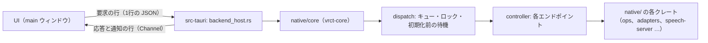

# 中核の統合と Python 同梱の終了（#285）

Python のサイドカーの中核（`mainloop.py`、`controller.py`、`config.py`）を Rust の `native/core`（vrct-core）へ移し、アプリのプロセスの中で動かす作業の記録です。2026-11-16 時点の状態を書きます。

## 構成



- UI は今までどおり `sidecarSession.js` でバックエンドと話します。`backendCommand.js` が、Python のサイドカーと Rust の中核のどちらかを、shell プラグインの `Command` と同じ形で渡します。
- 要求と応答の形式、状態コード、エラーの本体、ロックの規則は [IPC プロトコル](../spec/ipc-protocol.md) のままです。UI 側の変更は、この切り替えの部分だけです。
- 設定、ログ、モデルの保存先は Python のサイドカーと同じです。同じ `config.json` を読み書きします。

## 切り替え

アプリを環境変数 `VRCT_BACKEND=core` で起動したときだけ Rust の中核を使います。既定は Python のサイドカーです。0.4.0 の間は既定を切り替えず、中核は `VRCT_BACKEND=core` を指定したときだけの試用とします。Python から中核への切り替えは 0.5.0 で行います（2026-11-16 決定）。既定を切り替えるのは、下の「残っているエンドポイント」がなくなってからです。

## 統合テスト

`cargo test --locked --manifest-path native/core/Cargo.toml` で動きます。CI では `voice-tests.yml` の `core-integration`（ubuntu-latest と windows-latest）が実行します。モデル、音声デバイス、外部のネットワークは使いません。

| 試験 | 確かめること |
|---|---|
| `tests/lifecycle.rs` | 起動時の通知の順序と `/run/initialization_complete`、終了と設定の保存、watchdog、入力が閉じたときの終了、古い版の設定の移行と通知、保存の失敗と回復 |
| `tests/config_reference.rs` | Python が書いた設定ファイル 50 通りを Windows と Linux の規則で読み、Python と同じ内容を書き戻すこと（基準は Python を実際に動かして作る） |
| `tests/error_codes.rs` | エラーコードと本体の形が [エラーコード一覧](../spec/reference/error-codes.md) と一致すること |
| `tests/dispatch.rs` | 404、500、ロックの順序、20 秒と 30 秒で返す 423、停止の要求の即時処理、VR パネルの中継の制限 |
| `tests/endpoint_coverage.rs` | 実装したエンドポイントが仕様の一覧に載っていて、初期化前に待つかどうかと即時処理の区分が一致すること。残りが下の一覧と一致すること |
| `tests/speech_servers.rs` | speech.cpp サーバの設定、起動と停止、世代、自分で終わったサーバの報告、終了時の後片付け |
| `tests/downloads.rs` | モデル取得の同意とカタログの版、状態、取り消し、検証して公開すること、設定への適用とその拒否（`settings_changed`、`model_target_busy`）、ハードウェアの確認、終了時の停止 |
| `tests/telemetry.rs` | 通知に答えるまで何も送らないこと、答えの検査（`telemetry_notice_invalid`）、`VRCT_TELEMETRY=off`、送る内容の表示、エラーコードの送信、終了後に送らないこと |
| `tests/adapters_servers.rs` | WebSocket サーバとトークン（101 と 403）、ホスト・ポート・証明書の変更と巻き戻し、OBS のページとトークン、起動時の再開と失敗の通知、`WEBSOCKET_*` と `OBS_BROWSER_SOURCE_*` のエラーコード |
| `tests/settings_endpoints.rs` | 動いていない機能の設定を読み書きするエンドポイント（翻訳・音声認識のキーの取得と削除、URL の変更とキーの入れ直し、OCR とオーバーレイの設定、古い Whisper の重み）。拒否したときのエラーコードと戻す値、`config.json` への保存、キーがログに出ないこと |
| `tests/adapters_osc.rs` | OSC の送り先の検査、入力中の表示の送信、VRChat のミュートとの同期、OSCQuery を失ったときの順序、VRChat の有無、終了後に何も変えないこと |
| `tests/audio_devices.rs` | 音声デバイスの一覧と選択肢、名前・ID・ホストでの選択と拒否したときに戻す値、Auto Select が OS の既定に従うこと、抜き差しで一覧が変わり選択が既定へ移ること、通知の順序、保存、Python が MME などで保存した選択、起動時の一覧、動いている録音を移すときの受け渡し、仮想マイクの案内と確認（見つけ方、テスト音、ミュート中の拒否、止めること）。デバイスはメモリの中の偽物 |

Python の `src-python/test/test_native_core_reference.py` は、Python 側の設定の規則が変わったのに基準データを作り直していないとき失敗します。

## Python の試験の棚卸し

`tests/` の Python の試験（関数 1,353 件）を、「新しい接続面で再カバーするもの」とそれ以外に分けました。

| 区分 | 内容 | 扱い |
|---|---|---|
| A | サイドカーを動くアプリとして試すもの（エンドポイント、設定の移行、起動と終了、モデル取得、エラーコード） | `native/core/tests/` で再カバーする |
| A-u | 移植先のクレートがまだ無いサイドカーの処理（リアルタイム音声認識のセッション、speech.cpp の ASR クライアント、声質変換の入力の切り替え） | 移植するときに一緒に再カバーする |
| B | 移植済みのクレートの単体の振る舞い | 各クレートの試験と同等性の試験がすでに持つ |
| C | ビルド、配布、開発用の道具、ブラウザや GUI の試験 | バックエンドの言語に関係なく残す |
| D | Python と一緒に消えるもの（PyInstaller、Seed-VC、CTranslate2、Python の実行環境の準備） | コードと一緒に引退させる |
| E | 実機やモデルが要るもの | headless の CI では動かさない |

区分 A のうち、再カバーが済んだもの:

| Python の試験 | 再カバーした試験 |
|---|---|
| `tests/voice/test_runtime_paths.py`（設定の保存先）、`tests/platform/test_runtime_settings.py` | `lifecycle.rs`、`config_reference.rs` |
| `tests/voice/test_quick_chat_config.py`、`test_vc_settings.py`、`test_realtime_settings.py`（設定の移行） | `config_reference.rs` |
| `tests/platform/test_native_backend.py`（初期化の完了、終了、設定が次の起動に残ること） | `lifecycle.rs` |
| `tests/voice/test_priority_cancel.py`（停止の要求がキューを飛ばすこと） | `dispatch.rs` |
| `tests/voice/test_speech_server_controls.py`、`test_speech_server_end_owner.py`（サーバの部分） | `speech_servers.rs` |
| `tests/voice/test_model_download_controller.py`、`test_model_download_policy.py` | `downloads.rs` |
| `tests/voice/test_telemetry_client.py`（エンドポイントの部分） | `telemetry.rs` |
| `tests/voice/test_security_regressions.py`（WebSocket と OBS の部分）と `src-python/test/` の WebSocket・OBS・OSC の試験 | `adapters_servers.rs`、`adapters_osc.rs` |
| `src-python/test/test_old_whisper_weights.py` | `settings_endpoints.rs`、`src/controller/files.rs` の単体の試験 |
| `src-python/test/test_controller_vr_panel_opacity.py`、`test_credential_commits.py` と `test_controller_transcription_api_endpoints.py`（キーの削除と URL の変更の部分） | `settings_endpoints.rs` |
| `tests/voice/test_virtual_mic_controller.py`、`src-python/test/test_controller_audio.py`（Auto Select と終了時の停止の部分）、`test_config_saved_device_selection.py` | `audio_devices.rs` |

残りの区分 A（TTS、声質変換、リアルタイム音声認識、メッセージの送信）は、それぞれの機能をつなぐときに再カバーします。

## 切り替え前の基準値

0.5.0 で Python の同梱をやめたときに比べるための値です。2026-11-16 に計りました。

### 計り方

`tools/measure_backend_startup.py` が、展開した Windows の配布物を相手にサイズと起動時間を計ります。中核の起動は `native/core/examples/startup_time.rs` で計ります。アプリと同じ `Environment` で `Backend::start` を呼び、`/run/initialization_complete` までの時間を返します。

```sh
cargo build --release --locked --manifest-path native/core/Cargo.toml --example startup_time
python tools/measure_backend_startup.py --package <展開した配布物> \
    --core-example native/core/target/release/examples/startup_time.exe \
    --work <空のフォルダ> --runs 5 --zip <VRCT-VOX.zip>
```

- 対象は release/0.4.0（e4b9bcfb）の CI が作った CPU 版の `VRCT-VOX.zip` です。
- 起動時間は、バックエンドを起動してから `/run/initialization_complete` が届くまでです。サイドカーは `vrct-vox-sidecar.exe` を子プロセスとして起動した時点から計ります。中核はアプリと同じくプロセスの中で起動します。アプリの窓や WebView の起動は含みません。
- 設定は空のフォルダから始め、起動時に外へ出る処理を止めます（モデルの自動取得、更新の確認、利用状況の送信、VRChat への OSC）。何も取得していません。
- それぞれ 5 回続けて起動しました。サイドカーを先に計り、1 回目はほかより遅いので分けて書きます。展開した直後なので、ディスクのキャッシュが完全に冷えた起動ではありません。
- 計った環境は Windows 11、Intel Core i7-1255U、ノート PC です。ほかの PC での速さを示す値ではありません。

### 配布物のサイズ

展開した `VRCT-VOX.zip` は 1,115.3 MB です（zip のままでは 408.7 MB）。1 MB は 10^6 バイトです。

| 部分 | サイズ | 切り替えたあと |
|---|---:|---|
| `vrct-vox.exe`（アプリと中核） | 22.0 MB | 残る |
| speech.cpp（`_internal/build`） | 49.3 MB | 残る（置き場所は「判断が要ること」の 7） |
| `vrct-vox-sidecar.exe` | 28.0 MB | なくなる |
| Python の実行環境とライブラリ | 408.3 MB | なくなる |
| Sudachi の辞書（`*.dic`、かな・ローマ字の変換用） | 576.9 MB | Python と一緒になくなる。Rust で同じ変換をするときの辞書は未決 |
| 同梱のモデル（`_internal` の `*.onnx`） | 1.2 MB | Python と一緒になくなる |
| フォント（`*.ttf`） | 29.6 MB | Python と一緒になくなる。オーバーレイを Rust で描くときに要るかは未決 |

Python の実行環境とライブラリの中で大きいのは `cv2`（100.6 MB）、`ctranslate2`（63.7 MB）、`transformers`（42.7 MB）、`onnxruntime`（39.3 MB）、`numpy.libs`（38.2 MB）、`PIL`（13.5 MB）です。初回に取得するモデル（翻訳の重みなど）は配布物に入っていないので、この表に含めていません。

### 起動から初期化の完了まで

| バックエンド | 1 回目 | 2〜5 回目の中央値 | 最小〜最大 |
|---|---:|---:|---:|
| Python のサイドカー | 11.83 秒 | 7.95 秒 | 7.89〜11.83 秒 |
| 中核（`VRCT_BACKEND=core`） | 1.02 秒 | 0.74 秒 | 0.62〜1.02 秒 |

中核の値は、計った時点の接続の状態での値です。その時点の中核は、まだ音声デバイスの列挙と選択をしていませんでした。いまは起動時に行います（計り直していません）。サイドカーではこれが 3.48 秒かかっていました（`startup_timing.log` の `select_audio_devices`）。そのほかの段階はモジュールの読み込み（約 2.5 秒）と設定の一覧の収集（1.15 秒）です。収集のうち 0.99 秒は speech.cpp の機器の確認で、これは中核も同じく行い、同じ一覧を返しました。初期化の一覧の項目は、サイドカーが 183、中核が 160 です。機能をつなぐと中核の値は増えるので、0.5.0 では同じ方法で計り直して比べます。

## 往復の試験について

Issue のコメントは、音声認識・翻訳・TTS・声質変換・OCR の往復を統合テストで確かめるよう求めています。この PR の時点では、どれもまだ中核につながっていません。往復の試験は、次の形で用意する予定です。どれも headless の CI で動き、モデルを使いません。

- 翻訳: ローカル翻訳は偽のエンジン、オンラインのプロバイダは 127.0.0.1 の偽のサーバを相手に、`/run/send_message_box` から OSC・WebSocket・履歴までを確かめる
- TTS と音声認識: speech.cpp の偽のサーバ（`tests/fixture/fake_speech.rs` を広げる）を相手に、合成の要求と再生への受け渡し、認識結果の通知までを確かめる
- 声質変換: `vrct-rvc-worker` の代わりの小さな実行ファイルを相手に、起動と停止、失敗の扱いを確かめる
- OCR: 撮影を差し替えて画像を与え、偽の認識エンジンを相手に通知までを確かめる

## 残っているエンドポイント

次のエンドポイントは、まだ Rust の中核にありません。要求すると 404 を返します。`tests/endpoint_coverage.rs` がこの一覧と実装を照らし合わせます。

機能がまだ中核で動いていなくても、設定を読む・書く・消すだけのエンドポイントはつないであります。Python も値を保存してから動いている機能へ渡していました。機能が動いていなければ渡す処理は何もしません。中核では保存までを行い、機能はつないだときに保存した値を読みます。サービスに問い合わせるもの（キーの保存、モデルの選択、ローカルサーバのモデルの一覧）と、機能を動かすもの（オン、開始、状態）は残してあります。

残りの理由は次のとおりです。

| 領域 | 残っている理由 |
|---|---|
| 翻訳のプロバイダ | キーとモデルをサービスで確かめるクライアントが Rust にない（#277）。`/set/enable/translation` は翻訳の流れ（ONNX の翻訳とメッセージの送信）を、`/set/data/selected_ctranslate2_weight_type` は「判断が要ること」の 4 を待つ |
| 音声認識 | リアルタイムの音声認識、録音と音量の確認、クラウドの認識のクライアントが Rust にない（#278、`asr-capture` は空） |
| TTS・声質変換・音声の経路 | 合成から再生までの流れと音声の経路がまだ中核にない。出力先の一覧は音声デバイスの領域が渡す（`AudioDevices::outputs`）。声質変換の実行環境の準備は「判断が要ること」の 6 を待つ |
| OCR | `ocr-runtime` を中核に入れると ONNX Runtime をアプリに同梱することになる（「判断が要ること」の 7 と 13） |
| オーバーレイと VR パネル | VR のオーバーレイの描画が Rust にない（#282） |
| メッセージの送信 | 翻訳・音字変換・OSC・履歴をつなぐ流れが Rust にない |
| 更新 | 更新の取得と入れ替えを Rust のどこで行うかが決まっていない（自己更新の作業と一緒に決める） |

<!-- remaining-endpoints:begin -->
84 件。

- 翻訳のプロバイダ（#277）と翻字（25 件）: `/get/data/connected_lmstudio`、`/get/data/connected_ollama`、`/get/data/selectable_lmstudio_model_list`、`/get/data/selectable_ollama_model_list`、`/run/lmstudio_connection`、`/run/ollama_connection`、`/set/data/deepl_auth_key`、`/set/data/gemini_auth_key`、`/set/data/groq_auth_key`、`/set/data/lmstudio_url`、`/set/data/openai_auth_key`、`/set/data/openai_compatible_auth_key`、`/set/data/openai_compatible_auth_key_and_url`、`/set/data/openrouter_auth_key`、`/set/data/plamo_auth_key`、`/set/data/selected_ctranslate2_weight_type`、`/set/data/selected_gemini_model`、`/set/data/selected_groq_model`、`/set/data/selected_lmstudio_model`、`/set/data/selected_ollama_model`、`/set/data/selected_openai_compatible_model`、`/set/data/selected_openai_model`、`/set/data/selected_openrouter_model`、`/set/data/selected_plamo_model`、`/set/enable/translation`
- 音声認識（#278）とクラウドの認識（20 件）: `/get/data/realtime_asr_endpoints`、`/get/data/realtime_asr_models`、`/get/data/realtime_asr_settings`、`/get/data/realtime_asr_state`、`/run/start_realtime_asr`、`/run/stop_realtime_asr`、`/set/data/custom_whisper_auth_key`、`/set/data/custom_whisper_auth_key_and_url`、`/set/data/deepgram_auth_key`、`/set/data/groq_whisper_auth_key`、`/set/data/openai_whisper_auth_key`、`/set/data/realtime_asr_settings`、`/set/disable/check_mic_threshold`、`/set/disable/check_speaker_threshold`、`/set/disable/transcription_receive`、`/set/disable/transcription_send`、`/set/enable/check_mic_threshold`、`/set/enable/check_speaker_threshold`、`/set/enable/transcription_receive`、`/set/enable/transcription_send`
- TTS・声質変換・音声の経路（21 件）: `/get/data/direct_voice_sources`、`/get/data/direct_voice_state`、`/get/data/io_flow`、`/get/data/tts_engine_voices`、`/get/data/tts_model_options`、`/get/data/vc_runtime_catalog`、`/get/data/vc_runtime_state`、`/get/data/voice_output_devices`、`/get/data/voice_route`、`/get/data/voice_status`、`/run/cancel_vc_runtime_setup`、`/run/disable_tts`、`/run/enable_tts`、`/run/mute_voice`、`/run/resume_voice`、`/run/start_direct_voice`、`/run/start_vc_runtime_setup`、`/run/stop_direct_voice`、`/run/stop_voice`、`/set/data/direct_voice_settings`、`/set/data/voice_settings`
- OCR（5 件）: `/get/data/ocr_capture_status`、`/get/data/ocr_model_readiness`、`/get/data/ocr_readiness`、`/set/data/ocr_source_language`、`/set/enable/ocr_capture`
- オーバーレイと VR パネル（#282）（9 件）: `/run/send_text_overlay`、`/run/vr_panel_layout_rendered`、`/run/vr_panel_recall_log`、`/run/vr_panel_tooltip`、`/run/vr_panel_windows`、`/set/data/overlay_vr_panel_anchor`、`/set/enable/overlay_large_log`、`/set/enable/overlay_small_log`、`/set/enable/overlay_vr_panel`
- メッセージの送信と記録（1 件）: `/run/send_message_box`
- 更新とその他（3 件）: `/get/data/available_releases`、`/run/update_cuda_software`、`/run/update_software`
<!-- remaining-endpoints:end -->

次のエンドポイントは Python のバックエンドと一緒に引退させます。Rust の中核にはつなぎません。

<!-- retired-endpoints:begin -->
- 旧 CTranslate2 の重みの取得（1 件）: `/run/download_ctranslate2_weight`。起動時の自動取得と、カタログの `legacy_models` も移しません。
<!-- retired-endpoints:end -->

## 判断が要ること

PR の残課題と同じものです。決まったら、この節を更新します。

1. **移植されていない機能の扱い**。#277（翻訳・翻字のプロバイダ）、#278（音声認識の流れとクラウドの認識）、#282（オーバーレイの Phase 2〜4）の Rust 版がまだありません。Python 同梱を終えるには、これらも移す必要があります。#285 の中で進めるか、各 Issue で先に進めるかを決めてください。
2. **既定の切り替えの時期（決定済み、2026-11-16）**。0.4.0 の間は既定を切り替えず、中核は `VRCT_BACKEND=core` を指定したときだけの試用とします。Python から中核への切り替えは 0.5.0 で行います。`src-python/` と PyInstaller の工程を消すのも、その切り替えと一緒です。旧 CTranslate2 の重みを消す処理（5）も、そのとき `CORE_IS_DEFAULT` を有効にするまで動きません。
3. **使えないエンジンの選択とキー（決定済み、2026-11-16）**。Rust にまだ無いエンジンは、起動時の確認に失敗したものとして Python と同じに扱います。LM Studio、OpenAI 互換、Ollama、Groq・OpenAI・カスタムの Whisper、Deepgram は、モデルの一覧と選択を消します（Deepgram は言語の表も）。ほかのエンジンの選択は残します。API キーは、Python と同じく残します。Python は「確認の失敗は、キーが拒まれたのか通信できないだけなのかを区別できない」ため、起動時にキーを消しません。オーナーの決定の文面は「キーも消す」と読めるので、キーの扱いは PR で確認を求めています。
4. **ONNX 翻訳での計算デバイスと計算型**。設定の `SELECTED_TRANSLATION_COMPUTE_DEVICE` と `SELECTED_TRANSLATION_COMPUTE_TYPE` は CTranslate2 の考え方のままです。中核は CPU だけを、CTranslate2 と同じ計算型の一覧で示します。ONNX（CPU と DirectML）でこの設定をどう読み替えるか。
5. **旧 CTranslate2 の重み（決定済み、2026-11-16: 消す）**。`/run/download_ctranslate2_weight`、起動時の自動取得、カタログの `legacy_models` は中核に移さず、引退させます。重みのフォルダ（`<データ>/weights/ctranslate2/` の、Python が作った 7 つの名前）は、中核が既定のバックエンドになったときに、起動の後で消します（`src-tauri/src/backend_host.rs` の `CORE_IS_DEFAULT`）。Python のサイドカーが既定の間と、開発用に `VRCT_BACKEND=core` で動かしたときは消さないので、サイドカーのローカル翻訳は今まで通り動きます。リンクやジャンクションはたどらず、ほかのファイルには触れません。利用者に知らせず消すかどうかは PR で確認を求めています（古い Whisper の重みは、利用者が設定画面で頼んだときだけ消していました）。
6. **声質変換の実行環境の準備**。`/get/data/vc_runtime_*` と `/run/*_vc_runtime_setup`（Python の実行環境を用意するもの）は、RVC が Rust の worker になった今も要るか。
7. **配布物のレイアウト**。中核は speech.cpp を `_internal/build/speechcpp`（PyInstaller の資源フォルダ）で探します。Python を同梱しなくなった後の置き場所を決める必要があります。
8. **起動時の一覧に入れるもの**。Python と同じく `/get/data/speech_server_devices` を `/run/initialization_complete` に入れています。同梱の speech.cpp では子プロセスを起動するため、起動が最大で十数秒遅れることがあります。除外の一覧に足すか。
9. **ログの違い**。ステータス 348 のログ行を UI へ送りません（UI は捨てていました）。`process.log` の行は JSON で書きます。
10. **`serde_json` の機能**。中核は Python の辞書と同じ順序を保つため `preserve_order` を使い、tts クレートは `arbitrary_precision` を使います。どちらもアプリ全体の `serde_json` に及びます。src-tauri の試験は通っています。
11. **受け入れ条件の計測**。「起動時間と配布サイズが現行より改善している」の切り替え前の値は「切り替え前の基準値」に書きました。Python 同梱をやめた段階で、同じ方法で計り直して比べます。
12. **音声デバイスの未決事項**（`native/audio-routing/README.md`）。音声デバイスは中核につなぎました。決まっていない点は、Python の見え方に近い形で実装してあります。どれも変えやすい形です。
    - **Windows のマイクのホスト**。中核は `Windows WASAPI` のホストだけを並べます。PortAudio は同じマイクを MME、DirectSound、WASAPI、WDM-KS の各ホストに並べ、既定のマイクを MME から取っていました。案は (1) WASAPI だけのまま（ホストの選択欄は1つになる）、(2) ほかのホストの名前も並べて WASAPI のデバイスを開く、です。影響は選択欄の見た目と、ホストを選び分けていた利用者です。
    - **ほかのホストで保存したマイクの選択**。いまは起動時に WASAPI の同じデバイスへ移して保存し直します（`selection::migrate_mic`）。保存した ID にエンドポイント ID があればそれで探し、なければ（ID が空か PortAudio の番号だけの ID）名前で探します。MME は名前を 31 文字で切るので前方一致も認めます。1台に決まらなければ移しません。その場合は監視の最初の更新で、Python と同じく既定のマイクへ移ります。案は (1) このまま移す、(2) 移さず既定のマイクにする（Python で保存したホストが消えたときと同じ）、です。(2) では MME などで選んでいた利用者の選択が、中核での最初の起動で既定に戻ります。移したあとで Python のサイドカーに戻しても、Python は WASAPI の選択として読めます。
    - **保存したスピーカーの ID**。中核は PyAudioWPatch の WASAPI の番号 2 を付けて `speaker:2:<エンドポイント ID>` とします。実機の設定と一致するかは確かめていません。別の番号で保存されていたときは、エンドポイント ID が同じ行へ移します（`selection::migrate_speaker`）。案は (1) このまま、(2) 実機の設定で番号を確かめてから移す処理を外す、です。
    - **ほかのホストで保存した出力**（TTS の出力先）。`AudioDevices::outputs` は README のとおり、同じ名前の WASAPI の出力が1つあるあいだ一覧に残し、その出力を開きます。TTS をつなぐときに決めます。
    - **Linux の PipeWire への依存**。`vrct-audio-routing` に `pipewire` 機能を作り、中核では既定で無効、`src-tauri` では有効にしました。中核の試験（`core-integration`）は PipeWire の開発ファイルなしで動きます。機能が無効のとき Linux ではデバイスが何も並びません。アプリの Linux のビルドには `libpipewire-0.3` の開発ファイルと libclang が要ります。`build-linux.yml` は `libpipewire-0.3-dev` をすでに入れていて、`libclang-dev` も足しました（`linux-build-pipeline.md` の手順も同じ）。ただしこの変更のあと Linux でのビルドはまだ通していません。実行時は `libpipewire-0.3.so.0` に動的にリンクします。配布物は libpipewire を同梱していますが（`tools/linux_packages.py`）、本体の実行ファイルからそれが見つかるかは確かめていません。案は (1) このまま（アプリは常にリンクする）、(2) 実行時に読み込む形にして PipeWire のない環境でも起動できるようにする、です。
    - **仮想マイクの確認の録音側**。Python は PortAudio でケーブルの録音側をその形式のまま開き、全チャンネルのピークを見ていました。中核は WASAPI に 48 kHz モノラルへ変換させて読みます。聞こえたとする境（-30 dBFS）は同じです。実機では確かめていません。
13. **ONNX Runtime の同梱**。OCR（`ocr-runtime`）とローカル翻訳（`translate-onnx`）は `ort` で ONNX Runtime を使います。中核に入れると、ONNX Runtime の取得（`download-binaries`）と DLL・共有ライブラリの置き場所が配布物の形に入ります（7 と一緒に決める）。
14. **設定だけをつないだエンドポイント**。機能が動いていない間も、設定を保存するエンドポイントは 200 を返します（「残っているエンドポイント」の前の説明）。機能を動かすエンドポイントは 404 のままなので、たとえば VR のオーバーレイは中核ではオフにはできてもオンにはできません。この分け方でよいか。
15. **フォルダを開く操作の Linux での動き**。Python は Windows の `explorer` だけを起動していたので、Linux では失敗していました。中核は Linux で `xdg-open` を使います。
