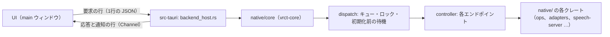

# 中核の統合と Python 同梱の終了（#285）

Python のサイドカーの中核（`mainloop.py`、`controller.py`、`config.py`）を Rust の `native/core`（vrct-core）へ移し、アプリのプロセスの中で動かす作業の記録です。2026-11-16 時点の状態を書きます。0.5.0 から中核がただ一つのバックエンドで、配布物に Python は入りません。

## 構成



- UI は今までどおり `sidecarSession.js` でバックエンドと話します。`backendCommand.js` が中核を、Python のサイドカーが使っていた shell プラグインの `Command` と同じ形で渡します。shell プラグインはアプリから外しました。
- 要求と応答の形式、状態コード、エラーの本体、ロックの規則は [IPC プロトコル](../spec/ipc-protocol.md) のままです。UI 側の変更は、この切り替えの部分だけです。
- 設定、ログ、モデルの保存先は Python のサイドカーと同じです。同じ `config.json` を読み書きします。
- 配布物に同梱するファイル（speech.cpp、補助プログラム、ライセンス文）は `_internal` にあり、中核は `native/core/src/resources.rs` で探します（「判断が要ること」の 5）。

## 切り替え

0.5.0 で Rust の中核を既定にし、Python のサイドカーを配布物から外しました（2026-11-16 決定）。0.4.0 の間は、中核は `VRCT_BACKEND=core` を指定したときだけの試用でした。

- `src-tauri/src/backend_host.rs` の `CORE_IS_DEFAULT` は `true` です。UI はいつも中核を起動します（`backend_kind` と `VRCT_BACKEND` はなくなりました）。
- `tauri.conf.json` に `externalBin` はなく、capability に shell の権限もありません。`vrct-vox-sidecar` の実行ファイルは配布物に入りません。
- 開発のときに Python のサイドカーへ戻す抜け道（`VRCT_BACKEND=python`）は作りませんでした（「判断が要ること」の 21）。
- 起動の後で、Python が取得した CTranslate2 の重みを消します（「判断が要ること」の「決まったこと」。ローカル翻訳への影響は 1）。
- `src-python/` とその試験は、移植の仕様として残していました。2026-11-20 に消しました（27）。一緒に片付けたものは「Python の削除に伴うもの」にあります。

## 統合テスト

`cargo test --locked --manifest-path native/core/Cargo.toml` で動きます。CI では `voice-tests.yml` の `core-integration`（ubuntu-latest と windows-latest）が実行します。モデル、音声デバイス、外部のネットワークは使いません。

| 試験 | 確かめること |
|---|---|
| `tests/lifecycle.rs` | 起動時の通知の順序と `/run/initialization_complete`、終了と設定の保存、watchdog、入力が閉じたときの終了、古い版の設定の移行と通知（Whisper から speech.cpp への移行の知らせを閉じるまで出すこと）、保存の失敗と回復 |
| `tests/config_reference.rs` | Python が書いた設定ファイル 50 通りを Windows と Linux の規則で読み、Python と同じ内容を書き戻すこと（基準は Python を実際に動かして作る） |
| `tests/error_codes.rs` | エラーコードと本体の形が [エラーコード一覧](../spec/reference/error-codes.md) と一致すること。中核のソースが応答・通知・コードの表で使う大文字のコードが、すべて一覧にあること（Python も表の外で返していた `VOICE_SETTINGS_INVALID` を除く） |
| `tests/dispatch.rs` | 404、500、ロックの順序、20 秒と 30 秒で返す 423、停止の要求の即時処理、VR パネルの中継の制限 |
| `tests/endpoint_coverage.rs` | 実装したエンドポイントが仕様の一覧に載っていて、初期化前に待つかどうかと即時処理の区分が一致すること。仕様のエンドポイントがすべて実装されていること（引退させたものを除く） |
| `tests/speech_servers.rs` | speech.cpp サーバの設定、起動と停止、世代、自分で終わったサーバの報告、終了時の後片付け |
| `tests/downloads.rs` | モデル取得の同意とカタログの版、状態、取り消し、検証して公開すること、設定への適用とその拒否（`settings_changed`、`model_target_busy`）、ハードウェアの確認、終了時の停止 |
| `tests/telemetry.rs` | 通知に答えるまで何も送らないこと、答えの検査（`telemetry_notice_invalid`）、`VRCT_TELEMETRY=off`、送る内容の表示、エラーコードの送信、終了後に送らないこと |
| `tests/adapters_servers.rs` | WebSocket サーバとトークン（101 と 403）、ホスト・ポート・証明書の変更と巻き戻し、OBS のページとトークン、起動時の再開と失敗の通知、`WEBSOCKET_*` と `OBS_BROWSER_SOURCE_*` のエラーコード |
| `tests/settings_endpoints.rs` | 動いていない機能の設定を読み書きするエンドポイント（翻訳・音声認識のキーの取得と削除、URL の変更とキーの入れ直し、OCR とオーバーレイの設定、古い Whisper の重み）。拒否したときのエラーコードと戻す値、`config.json` への保存、キーがログに出ないこと |
| `tests/updates.rs` | 偽の更新の仕組み（`SoftwareUpdates`）で、リリースの一覧、起動時の確認（`CHECK_SOFTWARE_UPDATES` がオフなら尋ねずに「更新なし」）、更新の成功（何も通知しない）、署名の検証の失敗（`UPDATE_SOFTWARE_VERIFY`）、ダウンロードの失敗（`UPDATE_SOFTWARE_DOWNLOAD`）、種類と版の受け渡し。仕組みがないときの Python と同じ答え（一覧は空、「更新なし」、`UPDATE_SOFTWARE_DOWNLOAD`）。チャンネルでの絞り込みと版の選び方は `src-tauri/src/app_update.rs` の単体の試験 |
| `tests/adapters_osc.rs` | OSC の送り先の検査、入力中の表示の送信、VRChat のミュートとの同期、OSCQuery を失ったときの順序、VRChat の有無、終了後に何も変えないこと |
| `tests/engine_checks.rs` | 起動時の確認に失敗したエンジンの扱い（サーバからモデルを探すエンジンの選択を消し、API キーは残す） |
| `tests/translation.rs` | 翻訳のプロバイダのキーの確認と保存、モデルの一覧と選択、LM Studio と Ollama の接続と切断、Ollama の URL（LAN の規則、起動時の確認、規則に合わない保存値）、Google Cloud Translation のキー、Papago の Client ID と Secret、OpenAI 互換の URL とキー、起動時の確認、非商用の重みの同意、翻訳のオンとローカルのモデルの読み込み（足りない、読めない、VRAM 不足）。キーがログに出ないこと |
| `tests/messages.rs` | `/run/send_message_box` からチャットボックス（OSC）、WebSocket、会話のログまで。翻訳のオンとオフ、公式 API（Google Cloud Translation、Papago）での翻訳、翻訳後のみの送信、VRChat へ送らない設定、プロバイダの失敗と切り替え、読み、認識の結果の受け渡し（ワードフィルタ、繰り返し、OCR、話し相手）、オーバーレイと音声の口、会話の履歴。文章がログに出ないこと。VR のログに描くことは `vr_overlay.rs`、OCR の行が流れを通って UI に届くことは `ocr.rs`、リアルタイムのマイクの確定文が訳されて読み上げられることは `voice.rs` が確かめる |
| `tests/audio_devices.rs` | 音声デバイスの一覧と選択肢、名前・ID・ホストでの選択と拒否したときに戻す値、Auto Select が OS の既定に従うこと、抜き差しで一覧が変わり選択が既定へ移ること、通知の順序、保存、Python が MME などで保存した選択、起動時の一覧、動いている録音を移すときの受け渡し、仮想マイクの案内と確認（見つけ方、テスト音、ミュート中の拒否、止めること）。デバイスはメモリの中の偽物 |
| `tests/vr_overlay.rs` | 字幕のログと VR パネルのオンとオフ（SteamVR の有無、VR パネルを作れない環境、保存した設定での起動）、設定が動いているオーバーレイに届くこと、VR パネルのエンドポイントと中継、失敗の通知（`OVERLAY_RUNTIME_FAILED`）、送ったメッセージが動いている大きいログに描かれること、コントローラのホバーが `/run/vr_panel_pointer` で届き、トリガーが VR 画面のクリックになり、掴んで動かした位置が保存されること、字幕の書体の設定（`OVERLAY_FONT_NOT_FOUND`、戻す値、足りない言語）、終了。SteamVR と VR 画面は代わりのものを使う。コントローラの操作の細部（スクロール、画面の外で離すこと、拡大縮小の限度、角での大きさの変更と枠、操作バー、ホバーの吹き出し、ロック、コントローラを見失ったとき）は `native/vr-overlay/tests/interaction.rs` が確かめる |
| `tests/clipboard.rs` | 音声タイピングの貼り付け（#393）。SteamVR のシーンのゲームのウィンドウを前面に出して Ctrl+V を送ること（Windows と X11 の順序）、ゲームを貼り付けのたびに読み直すこと、SteamVR がない・つなげない・ゲームがない・Steam のゲームでない・前面に出せないときはコピーだけ行うこと、オーバーレイと OpenVR の接続を共有すること、文とゲームの名前をログに書かないこと。SteamVR とデスクトップは代わりのものを使う |
| `tests/ocr.rs` | チャットの読み取り。偽の画像と偽の認識器を使う。ディスクのファイルから見たモデルの準備、オンにできない理由（`OCR_DISABLED_*`）の通知、状態、動いている読み取りに設定が届くこと、言語の切り替えと巻き戻し、読んだ行をメッセージの流れへ渡し `/run/transcription_ocr_message` で UI に届くこと、オフと終了、モデルの読み込み中の終了、読んだ文字がログに出ないこと |
| `tests/transcription.rs` | 音声認識の録音（クラウドのエンジン）。マイクとスピーカーのスイッチ、エンジンやデバイスがないときの拒否と通知、認識した文が UI・チャットボックス・会話のログに届き `process.log` には出ないこと、44.1 kHz のスピーカーと Whisper の API（言語とセグメントの選別）、音量メーター、エンジンの失敗（`ASR_ERROR`）、開けないデバイス（`AUDIO_OPEN_ERROR`）と別のデバイスへの切り替え、読み取りの失敗（`AUDIO_READ_ERROR`）、抜いたデバイスから別のデバイスへ移ることと最後のデバイスを抜いたときの停止、ミュートの同期、認識のキーと URL の確認と戻す値、起動時のエンジンの確認、保存されていた Google の選択が未選択になること、エンジンでない値を断っても認識が続くこと、終了。デバイスは 44.1 kHz と 48 kHz の PCM をデバイスと同じ間隔で渡す偽物、エンジンは 127.0.0.1 の偽のサーバ |
| `tests/recognition_revocation.rs` | 認識した文を届ける前に止めたときの扱い。翻訳を待つ間にスイッチを切る、デバイスを失う、読み取りが失敗する、リアルタイムのセッションが自分で終わる、VRChat でミュートする（同期がオンのとき）と、UI、チャットボックス、会話のログのどこにも届かないこと。設定のための一時停止、デバイスの移動、リアルタイム認識への引き継ぎ、ミュートの間のスピーカーと打ったチャットは届くこと。翻訳は `FakeProviders` で止めておき、録音は偽物、認識は 127.0.0.1 の偽のサーバ、OSC は偽の接続 |
| `tests/transcription_engine.rs` | 音声認識のエンジンと言語。エンジンを変えたときにすべてのタブで聞き取れない言語を戻すこと（有効な訳す先を避ける、無効な訳す先に触れない、埋まっていれば戻さない）、言語の一覧の知らせ、Deepgram のモデルを変えたときの同じ扱い（Deepgram を選んでいる間だけ）とモデルの言語に絞った一覧、使えないエンジンとキーを消したエンジンの選択を残すこと、一覧にない値を `VALIDATION_CONFIG_VALUE_INVALID` で断ること。エンジンは 127.0.0.1 の偽のサーバ（Deepgram のモデルと言語は試験ごとに変える） |
| `tests/realtime_asr.rs` | リアルタイムの音声認識。設定の検査と保存、エンドポイントとモデルの一覧、メインのスイッチ（Linux と Windows の speech.cpp）で字幕（途中・確定・訳・結果）と確定した文がチャットボックスまで届くこと、設定画面からの開始と停止と録音からの引き継ぎ、スイッチが足りないものを `details.reason` で答えること、サーバが断ったときの失敗の通知、字幕が VR の大きいログに描かれることと描けなかったときの通知、マイクの確定文のフローパネルの記録が確定から測られること（24）、終了。speech.cpp はモデルの一覧と Realtime の WebSocket を返す 127.0.0.1 の偽のサーバ、SteamVR は代わりのもの |
| `tests/voice.rs` | TTS のスイッチ（止まっている理由ごとのコード、世代、内蔵サーバを自分で起動して止めること、設定画面から起動したサーバは止めないこと、サーバの停止で TTS が切れること）、音声の設定の検査と拒否したときの答え、入力したチャットを元の文と翻訳で読み上げること、マイクの確定文の読み上げと言語・翻訳の変更での取り消し、停止とミュートと再開、キューで待つ間の停止で古い世代を拒むこと、ミュートの保存と壊れた記録、Linux の管理された経路のゲート、出力先の一覧、モデルの選択肢とインストール済みエンジンの声、直接の音声（素通しと声質変換、世代、失敗、元の声に戻さないこと、変換を通した読み上げ）、声質変換の実行環境の準備（同意、版、手順ごとの失敗、worker の確認）、フローパネル、リアルタイムのマイクの確定文が訳されて読み上げられること、声を流しているケーブルを認識に使わせないこと（`realtime_endpoint_feedback`）、終了。出力とマイクはメモリの中の偽物、speech.cpp とエンジンはループバックの偽物、RVC の worker は `fake-rvc-worker` |

Python の `src-python/test/test_native_core_reference.py` は、Python 側の設定の規則が変わったのに基準データを作り直していないとき失敗します。

翻訳のプロバイダと読み（翻字）は中核の外の `native/translation` に Python との契約テストがあります（#277）。`tests/contract/providers.json` は、プロバイダごとの場面で Python のクライアントが送った要求（メソッド、URL、ヘッダー、本文、待ち時間）と返した結果、再試行の前の待ちの範囲です。`tests/contract/transliteration.json` は、文ごとの形態素と読み、かなごとのヘボン式です。どちらも Python から記録したもので、Rust の試験（`tests/contract.rs`、`tests/transliteration_contract.rs`）が同じ場面を動かして比べます。Python を消したあとは、このファイルが仕様として残ります。CI では `core-integration` が `native/translation` と `native/translate-onnx` の試験も流します。

## Python の試験の棚卸し

`tests/` の Python の試験（関数 1,353 件）を、「新しい接続面で再カバーするもの」とそれ以外に分けました。

| 区分 | 内容 | 扱い |
|---|---|---|
| A | サイドカーを動くアプリとして試すもの（エンドポイント、設定の移行、起動と終了、モデル取得、エラーコード） | `native/core/tests/` で再カバーする |
| A-u | 移植先のクレートがまだ無かったサイドカーの処理 | 移植と一緒に再カバーした（下の表） |
| B | 移植済みのクレートの単体の振る舞い | 各クレートの試験と同等性の試験がすでに持つ |
| C | ビルド、配布、開発用の道具、ブラウザや GUI の試験 | バックエンドの言語に関係なく残す |
| D | Python と一緒に消えるもの（PyInstaller、Seed-VC、CTranslate2、Python の実行環境の準備） | コードと一緒に引退させる |
| E | 実機やモデルが要るもの | headless の CI では動かさない |

区分 A のうち、再カバーが済んだもの:

| Python の試験 | 再カバーした試験 |
|---|---|
| `tests/voice/test_runtime_paths.py`（設定の保存先）、`tests/platform/test_runtime_settings.py` | `lifecycle.rs`、`config_reference.rs` |
| `tests/voice/test_quick_chat_config.py`、`test_vc_settings.py`、`test_realtime_settings.py`（設定の移行） | `config_reference.rs` |
| `tests/platform/test_native_backend.py`（初期化の完了、終了、設定が次の起動に残ること） | `lifecycle.rs` |
| `tests/voice/test_priority_cancel.py`（停止の要求がキューを飛ばすこと） | `dispatch.rs` |
| `tests/voice/test_speech_server_controls.py`、`test_speech_server_end_owner.py`（サーバの部分） | `speech_servers.rs` |
| `tests/voice/test_model_download_controller.py`、`test_model_download_policy.py` | `downloads.rs` |
| `tests/voice/test_telemetry_client.py`（エンドポイントの部分） | `telemetry.rs` |
| `tests/voice/test_security_regressions.py`（WebSocket と OBS の部分）と `src-python/test/` の WebSocket・OBS・OSC の試験 | `adapters_servers.rs`、`adapters_osc.rs` |
| `src-python/test/test_old_whisper_weights.py` | 0.6.0 で画面とエンドポイントを外した（#288）。`settings_endpoints.rs` は重みに触れず、エンドポイントが 404 になることを確かめる |
| `src-python/test/test_controller_vr_panel_opacity.py`、`test_credential_commits.py` と `test_controller_transcription_api_endpoints.py`（キーの削除と URL の変更の部分） | `settings_endpoints.rs` |
| `tests/voice/test_virtual_mic_controller.py`、`src-python/test/test_controller_audio.py`（Auto Select と終了時の停止の部分）、`test_config_saved_device_selection.py` | `audio_devices.rs` |
| `src-python/test/test_controller_ocr_enable.py`、`test_controller_ocr_readiness.py`、`test_controller_ocr_settings.py`、`test_model_stop_ocr_capture.py`、`test_ocr_language_and_shutdown.py`（中核の部分） | `ocr.rs`、`settings_endpoints.rs`。パイプラインそのものの振る舞いは `native/ocr-runtime` の試験が持つ |
| `src-python/test/test_controller_update_software_failure.py`、`test_controller_init_config_settings.py`（`available_releases` を起動時の一覧に入れない部分） | `updates.rs`、`lifecycle.rs` |
| `src-python/test/test_controller_transcription_api_endpoints.py`（キーの保存と拒否、URL とキーの組）、`test_controller_transcription_engine_status.py` | `transcription.rs`、`engine_checks.rs` |
| `src-python/test/test_model_transcript_wiring.py`、`test_model_api_transcription_wiring.py`、`test_model_energy_consumer.py`、`test_model_transcript_stop.py`、`test_device_capture_lifecycle.py`、`test_controller_vrc_mic_mute_sync_init.py`（認識の部分） | `transcription.rs` |
| `tests/voice/test_realtime_controls.py`、`test_realtime_toggles.py`、`test_realtime_settings.py`（移行以外）、`test_realtime_delivery.py`、`src-python/test/test_realtime_toggle_generation.py`、`test_realtime_legacy_handoff.py`、`test_realtime_delivery_outcomes.py` | `realtime_asr.rs` |
| 区分 A-u だった `tests/voice/test_realtime_session.py`、`test_realtime_events.py`、`test_realtime_audio.py`、`test_speechcpp_realtime.py`、`test_speechcpp_asr.py`、`test_asr_vocabulary.py`、`test_capture_packets.py` と、`src-python/test/test_transcription_recorder.py`、`test_transcription_transcriber.py`、`test_transcription_providers.py`、`test_transcription_openai_compatible.py`、`test_transcription_deepgram.py` | `realtime_asr.rs`、`transcription.rs` と `native/transcription` の単体の試験。`test_speechcpp_asr.py` と `test_speechcpp_realtime.py` の細部は次の行 |
| `tests/voice/test_speechcpp_asr.py`、`test_speechcpp_realtime.py`、`test_realtime_language.py`（3-3 で関数ごとに照らし直した分） | `native/transcription` の `speechcpp.rs` の単体の試験。言語の選択肢から検出するモデルを決めること（5 通り）、一覧から認識のモデルだけを取り検出のモデルの行を落とすこと、話者を分けるモデルを GPU のときだけ数えること（`CPU`、空、なし、数）、形の合わない一覧と JSON でない答えを断ること。`realtime/events.rs` の単体の試験。検出した言語を確定の文だけが持ち、形の合わないコードを捨てること。「auto」に検出するモデルが要ることは `realtime_asr.rs` の `a_switch_says_what_is_missing`。設定の応答が違うときの拒否、1 件目 120 秒と以後 15 秒の締め切り、止めたときに接続の待ちを切り上げることは、`realtime_asr.rs` と `realtime/session.rs` の試験で確かめる（81。2026-11-19 に足した）。REST の `transcribe()`（アプリは使っていない）、手動の commit と clear（中核は `server_vad` だけ）、実験用の `tools/speechcpp_asr_poc.py` の試験は Python と一緒に引退させる |
| `tests/voice/test_realtime_overlay.py`、`src-python/test/test_realtime_overlay_publication.py`、`test_overlay_lifecycle_publication.py` と `test_message_snapshot_and_sinks.py`（字幕の部分） | `native/vr-overlay` の `subtitle.rs` の単体の試験。途中の字幕は履歴の外で待って置き換わること、訳が同じ行を書き換え、そのあとの遅れた更新は何も変えないこと、名前空間ごとに待っている字幕を捨てて戻さないこと、ログから押し出された確定の文が訳として戻らないこと、見せられなかった更新を履歴から戻して後の描画にも出さないこと、待つ字幕は 16 件までで古いものから捨てること。`realtime_asr.rs` の `captions_are_drawn_on_the_large_vr_log_and_one_it_cannot_show_is_told`。字幕の状態ごとに大きいログを描き直し、SteamVR が画像を断ると `overlay_large` の `MESSAGE_OUTPUT_FAILED` を知らせ、確定の文はそのまま届くこと（79）。描いた画像の版の比較（`isCurrentLargeLog`）は、中核が描画と表示を 1 つのロックの中で行うので要らず、引退させる。字幕の言語を受け取ったときの設定で描くことは 80 |
| `tests/voice/test_capture_pipewire.py`、`test_capture_diagnostics.py` と `test_realtime_language.py`（既定のノード） | `native/transcription` の `endpoint_choice.rs` の単体の試験。既定の出力が VRCT のミックスなら設定した既定に替えること、VRCT のノードしかなければ `realtime_default_endpoint_feedback`、なければ `realtime_default_endpoint_missing`、既定の入力をメタデータの JSON の文字列から読むこと、VRCT のノードと NUL を含む名前や 512 バイトを超える名前を断ること。グラフを受け取るだけなので Windows でも動く。補助（`HelperCapture`）を動かす部分（雑音の多い標準エラー、5 秒の起動の締め切り、2 秒の止まり）は PipeWire の要る Linux の試験で、確かめていない（82）。作ってから始める 2 段の API の試験は Python と一緒に引退させる |
| `src-python/test/test_controller_message_pipeline.py`、`test_message_snapshot_and_sinks.py`（送信、翻訳、読み、出力の失敗の部分） | `messages.rs`、`src/controller/messages.rs` の単体の試験 |
| `src-python/test/test_controller_translation_enable.py`、`test_translation_providers.py` と `test_endpoints.py` の翻訳のキーとモデルの部分 | `translation.rs`、`native/translation` の試験 |
| `src-python/test/test_translation_llm_completion.py`、`test_translation_runtime_timeouts.py`、`test_translation_ollama_timeout.py` のモデルの一覧の待ち時間（プロバイダの要求、待ち時間、再試行とその前の待ち、長さで切れた応答、応答の文の取り出し） | `native/translation` の契約テスト（`tests/contract.rs`）。Python のクライアントから記録した要求と結果に Rust のプロバイダが一致すること。失敗の後のローカル翻訳への切り替えと通知は `translation.rs` と `messages.rs` |
| `src-python/test/test_translation_ctranslate2_license.py` の、UI の重みの一覧とライセンスの照合、M2M100 の言語コードの照合 | `src/controller/translation.rs` の単体の試験（中核の表と `src-ui/logics/ui_configs.ts` を照らす） |

| `src-python/test/test_controller_overlay_running.py`、`test_controller_vr_panel_toolbar.py`（固定先、ロック、ランチャーの手と初期化、自動で隠す設定）、`test_overlay_lifecycle_publication.py`（オンの失敗と切ったときの消去） | `vr_overlay.rs` |
| `src-python/test/test_overlay_steamvr_quit.py`、`test_overlay_shutdown_timeout.py`（SteamVR を待つこと、終了、つなぎ直し） | `vr_overlay.rs` と `native/vr-overlay` の `engine` の試験 |
| `src-python/test/test_overlay_fake_vr.py`（レーザーとポインタ、グリップで動かして保存）、`test_overlay_press_cancel.py`（画面の外で離すこと、離すまで押し直さないこと、追跡を失ったとき）、`test_overlay_grab_move.py` の操作の部分（掴んで離すと保存、拡大縮小、ロック、操作バー、掴んだ後のトリガー、クリックとスクロール） | `native/vr-overlay/tests/interaction.rs`、`vr_overlay.rs`。姿勢と並びの計算は `native/vr-overlay` の基準の試験（`reference_tests.rs`） |
| `src-python/test/test_clipboard_focus_and_paste.py`（コントローラから見た貼り付け）、`test_openvr_session.py`（オーバーレイとクリップボードの部分。OCR の部分は「判断が要ること」の 9） | `clipboard.rs`、`native/vr-overlay` の `shared` の試験、`native/adapters` の `tests/clipboard.rs` |
| `tests/voice/test_tts_toggle.py`、`test_tts_toggle_server.py`、`test_speech_server_end_owner.py`（TTS の部分）、`test_tts_model_options.py`（コントローラの部分） | `voice.rs` |
| `tests/voice/test_spoken_controls.py`、`test_io_flow_controller.py`、`src-python/test/test_voice_settings_patches.py` | `voice.rs` |
| `tests/voice/test_direct_voice_controller.py`、`test_managed_controller.py` | `voice.rs`。経路のゲートと保存は `native/audio-routing` の試験も持つ |
| `src-python/test/test_voice_route_monitor_mute.py` | `native/audio-routing` の `voice_route/tests.rs`。保存したミュートが始める前にモニターへ届くこと、再開はミュートの状態を保存し終えるまでモニターを開かないこと、保存できなければ開かないこと、保存したミュートの解除を補助なしで伝え、閉じるときにミュートすること |
| 声質変換とモニターの Python の試験（「0.6.0 の残りの移行」の 4 の表） | `native/voice-conversion` の単体の試験、`native/audio-routing` の試験、`voice.rs` |
| `tests/voice/test_external_speech_engines.py` | `voice.rs`（エンドポイントと TTS のスイッチ）、`native/tts/tests/engines.rs`（クライアント） |
| `tests/voice/test_vc_runtime_setup.py`（RVC の部分） | `voice.rs`、`native/voice-conversion` の単体の試験（版、アーカイブ、以前の実行環境の削除）。uv、Python、Seed-VC の部分は区分 D |
| `src-python/test/test_controller_typing.py`、`test_mainloop_typing_order.py` | `adapters_osc.rs`（アプリが付けた入力中の表示だけを消すこと）、`dispatch.rs`（止める要求が始める要求を追い越さないこと）。表示を消すのに失敗したときの答えは「判断が要ること」の 57 |
| `src-python/test/test_model_translate_fallback_no_wait.py`、`test_model_get_translate_unsupported_language.py`、`test_translation_unsupported_language.py`、`test_model_input_translate_parallel.py` | `translation.rs`。ローカルのモデルは 1 つの鍵で 1 文ずつ訳すので、同時に訳すことは外部のプロバイダで確かめる。ログの行の違いは 58。言語の表（Filipino と Tagalog など）は区分 B |
| `src-python/test/test_translation_history_destination.py` | `messages.rs`（同じエンジンを保存し直しても履歴が残ること、ほかのエンジンやタブへ移って戻ると履歴が始まり直すこと）。8 つのプロバイダで同じことを試す Python の形は移さない（履歴はどのプロバイダにも同じ道で渡る） |
| `src-python/test/test_conversation_logger.py` | `messages.rs`（オンの間だけ書くこと、オンにするたびに別のファイル）、`src/controller/messages.rs` の単体の試験 |
| `src-python/test/test_message_delivery_revocation.py`（終了とチャットボックスの順番の部分） | `messages.rs`（訳している間に終了したメッセージがどこにも届かないこと）、`src/controller/messages.rs` の単体の試験（送らなかったメッセージで順番が進まないこと）。ミュートの扱いは 55 と 56。認識の停止と無効化での取り消しは「0.6.0 の残りの移行」の 1 |
| `tests/voice/test_tts.py`、`test_scheduler.py`、`test_spoken_scheduler.py`、`test_tts_playback_ownership.py` | `native/tts` の `tests/client.rs`、`tests/scheduler.rs`、`tests/monitors.rs` と、`settings.rs`・`scheduler.rs` の単体の試験（区分 B。引数と確かめる値ごとに照らし合わせた）。中核を通した開始の遅れ、続けての発話、停止と設定の保存での割り込みは `voice.rs`。2026-11-19 に関数と parametrize の値ごとに照らし直し、本物の `MonitorTee` を機器を開く途中と 1 ブロックを流したあとで止める場合を `native/audio-routing` の `router/tests.rs` に足した。無音の出だしは Python と違う（63）。`StartExpiry` のスレッドが終わること、取り消しのあとに届いた古い `RequestTimer` の呼び出しは、差し込み口がないので試験していない |
| `tests/voice/test_tts_listener_failure.py`、`src-python/test/test_tts_listener_monitor.py` | `native/tts` の `tests/listener.rs` と `listener.rs` の単体の試験（区分 B）。中核が起動したサーバの走りを持ち主にすることは `src/controller/voice/mod.rs` の単体の試験と `voice.rs`。探りが毎秒 50 回であることそのものは確かめていない（20 ms の間隔はコードの定数）。2026-11-19 に照らし直し、`tests/listener.rs` に足した。表（Windows）が接続より先に決めることと、その答えで同じサーバへの 2 つの要求が終わること、最初の音声の締め切りを越えたヘッダで要求が終わり見張りにも探りにも入らないこと、探りがアドレスごとに 1 本であること（2 つの要求で 0.5 秒に約 25 回）、時間切れの接続は判断できないと扱うこと。表を読む途中で止めたときは、止める合図が最初から立っている場合だけを確かめている。低遅延の待機は見張りを使わない（63） |
| `src-python/test/test_message_delivery_revocation.py`（認識の部分） | `recognition_revocation.rs`。翻訳を待つ間にスイッチを切る、デバイスを失う、読み取りが失敗するときは届けない（マイクとスピーカー）。設定のための一時停止、デバイスの移動、リアルタイム認識への引き継ぎでは届ける。打ったチャットは影響を受けない。エンジンの失敗は読み取りの失敗と同じ経路（`recorder_failed`）で、翻訳を待つ間は認識のスレッドが次の発話を扱わないので（Python と同じ）、その時点では起きない。リアルタイムのセッションが自分で終わったとき（サーバが発話を終えない）も、翻訳を待つ確定文は届けない。VRChat のミュート（ミュートの同期がオン）は、翻訳を待つマイクの文（録音とリアルタイム）を届けず、スピーカーの文と打ったチャットは届ける。ミュートの間はリアルタイムのマイクの字幕も出さず、解いたあとに聞いた文は届ける。同期がオフならミュートはマイクの文に効かない。ミュートを解いたあとにミュートの前の文を届けるかは 55、確定文の音声の世代は 56 で、どちらも試験していない。引き継ぎで録音を止められなかったとき（`realtime_legacy_stop_failed`）の取り消しは、偽の録音では止まらない録音を作れないので試験していない。OCR の部分は 65 |
| `src-python/test/test_transcription_provider_regressions.py` | `native/transcription` の `providers.rs` の単体の試験（区分 B）。検出した言語の書き方の違い、知らない言語、1 つだけの言語、中国語と選んだ国、Deepgram の言語の検出、壊れた答えと無音、送信の締め切りと 3 回の試行。Google の部分は 14 と 46 |
| `src-python/test/test_model_transcription_wait.py`（締め切りの部分）、`test_vrct_transcription_integration.py` | `native/transcription` の `phrases.rs` の単体の試験。締め切りで終えた発話を送り直さないこと、新しいフレーズで締め切りが延びること、境目、VAD の区間で何も聞き取れなかったときに結果を残さないこと。止めたときに要求の結果を最大 15 秒待って捨てることは 15 の (1)（`native/core/tests/transcription.rs`）、待っている間に何度も目を覚ますことは 69 |
| `src-python/test/test_realtime_ingress_wait.py` | `native/transcription` の `realtime/session.rs` の単体の試験。200 ms か 20 枚を超えた音声と、250 ms より古い音声を断ること、止めたセッションが音声を受け取らず始め直せないこと。音声を送るまでの待ち方の違いは 67 |
| `src-python/test/test_controller_transcription_language_fallback.py`、`test_controller_update_transcription_engine.py`、`test_model_transcription_language_support.py` | `transcription_engine.rs`。エンジンを変えると、聞き取れない言語をすべてのタブで日本語、英語の順に戻すこと（有効な訳す先の言語は避け、無効な訳す先には触れない）、何もかも埋まっていれば戻さないこと、言語の一覧を UI に知らせ直すこと。全部の言語を聞けるエンジンでは言語に触れず、同じエンジンを選び直しても何も知らせないこと。Deepgram のモデルを変えたときは、Deepgram を選んでいる間だけ同じことをすること。言語の一覧がモデルの言語（`multi` はすべて）に絞られること。使えないエンジンとキーを消したエンジンの選択を残すこと。言語の表の `Whisper` の列をクラウドの Whisper が使うことは `transcription.rs`。端の扱いは 74 |
| `src-python/test/test_asr_engine_consent.py` | 選択を読み書きすることは `config_reference.rs` と `transcription.rs`（保存されていた Google）。エンジンでない値を断ることは `transcription_engine.rs` と `transcription.rs`（73）。エンジンがないときと使えないエンジンでスイッチが録音を始めないことは `transcription.rs`。使えないエンジンの選択を残すことは `transcription_engine.rs`。`AudioTranscriber` が黙って Google を使わないことの試験は Google の経路と一緒に引退させる（「決まったこと」の「Google の Web 音声認識」） |
| `src-python/test/test_local_asr_migration.py` | 0.6.0 で移行と知らせを外した（#288）。`lifecycle.rs` の `a_saved_whisper_choice_loads_as_none_without_a_notice` が、保存されていた Whisper の選択が未選択になること、サーバの選択を残すこと、外した設定と知らせのキーを書かず `MIC_AVG_LOGPROB` を残すこと、外したエンドポイント（知らせと古い重みのものを含む）が 404 になること、0.5 以前のために `LOCAL_ASR_MIGRATION` を 2 で書くことを確かめる。Python との違いは `config_reference.rs` の 6 つ目の意図した違い |
| `src-python/test/test_audio_vad.py`（31 件） | 区間を決める状態機械（しきい値、短すぎる区間を捨てること、無音での確定、前の余白、2 つのしきい値の間の扱い）は、13 の (c) で speech.cpp の検出（Realtime の `server_vad`）が持ちます。アプリの側は `native/transcription` の `server_vad.rs` の単体の試験です。サーバーが示した時刻で録音の音声を切ること、7 秒を超えた発話をそこで切って続けること、`reset` で途中の区間を捨ててサーバーの音声も消すこと、サーバーがないとき・VAD のモデルがないとき・セッションが途中で切れたときに音量の区切りへ移って理由を 1 回知らせること、セッションを開いている間に音量で切った区間を開けなかったときに残すこと。ステレオをまとめることとリサンプルは `pcm.rs` の単体の試験です。ONNX のモデルの確率（4 件）、確率のエンジンを戻すこと（2 件）、診断のコールバック（3 件。発話の診断は 15 の決定で `diagnostics.rs` に移し、話し始めと区間の終わりは `server_vad.rs` の試験で確かめる）、16 kHz に変えて区間に渡す部分（`VadRecognizerAdapter` の 3 件）の試験は Python と一緒に引退させます。止めたときの `flush`（5 件）は 68 です |
| `src-python/test/test_model_vad_recorder_selection.py` | `transcription_vad.rs`。スイッチがオフなら音量で切り、オンなら VAD で切ること、マイクのスイッチがスピーカーに効かないこと（逆も）、VAD の区間の最長が 7 秒であること |
| `tests/voice/test_speechcpp_realtime_vad_live.py`（区分 E） | 本物の speech.cpp で確かめる試験で、headless の CI では動かしません。3-4 では本物のサーバーに VAD だけのセッションを開いて区間を比べました（3 の「済んだこと（3-4）」） |


区分 A は上の表のとおり再カバーしました。音声認識の字幕を VR の大きいログに出す部分（`test_realtime_overlay*.py`）は、3-3 で中核と `native/vr-overlay` の試験に移しました。発話の診断のログ（`test_utterance_diagnostics.py`）は、15 の決定で `native/transcription` の `diagnostics.rs` と中核の試験に移しました（2026-11-19）。`src-python/test/test_pipewire_graph_readers.py` は声質変換と音声の経路（4）の試験です。

## 切り替え前の基準値

0.5.0 で Python の同梱をやめたときに比べるための値です。2026-11-16 に計りました。

### 計り方

`tools/measure_backend_startup.py` が、展開した Windows の配布物を相手にサイズと起動時間を計ります。中核の起動は `native/core/examples/startup_time.rs` で計ります。アプリと同じ `Environment` で `Backend::start` を呼び、`/run/initialization_complete` までの時間を返します。

`tools/measure_backend_startup.py` は、この基準値を計るための道具だったので消しました（#810）。下のコマンドは 2026-11-16 の手順の記録です。中核の起動時間は、今も `startup_time.rs` を単独で動かして計れます。

```sh
cargo build --release --locked --manifest-path native/core/Cargo.toml --example startup_time
python tools/measure_backend_startup.py --package <展開した配布物> \
    --core-example native/core/target/release/examples/startup_time.exe \
    --work <空のフォルダ> --runs 5 --zip <VRCT-VOX.zip>
```

- 対象は release/0.4.0（e4b9bcfb）の CI が作った CPU 版の `VRCT-VOX.zip` です。
- 起動時間は、バックエンドを起動してから `/run/initialization_complete` が届くまでです。サイドカーは `vrct-vox-sidecar.exe` を子プロセスとして起動した時点から計ります。中核はアプリと同じくプロセスの中で起動します。アプリの窓や WebView の起動は含みません。
- 設定は空のフォルダから始め、起動時に外へ出る処理を止めます（モデルの自動取得、更新の確認、利用状況の送信、VRChat への OSC）。何も取得していません。
- それぞれ 5 回続けて起動しました。サイドカーを先に計り、1 回目はほかより遅いので分けて書きます。展開した直後なので、ディスクのキャッシュが完全に冷えた起動ではありません。
- 計った環境は Windows 11、Intel Core i7-1255U、ノート PC です。ほかの PC での速さを示す値ではありません。

0.5.0 の配布物も同じコマンドで計ります。`vrct-vox-sidecar.exe` がない配布物では、サイドカーを起動せず中核だけを計ります。この場合は中核の 1 回目が冷えた起動になります。サイズは `vrct-vox.exe`、そばに置いた ONNX Runtime、speech.cpp、RVC の worker、ライセンス、フォント、`_internal` の残りに分けて出します。Python の実行環境のファイルが残っていたら警告を出します。アプリの本体は窓と WebView を開くので、この計測では起動しません。

### 配布物のサイズ

展開した `VRCT-VOX.zip` は 1,115.3 MB です（zip のままでは 408.7 MB）。1 MB は 10^6 バイトです。

| 部分 | サイズ | 切り替えたあと |
|---|---:|---|
| `vrct-vox.exe`（アプリと中核） | 22.0 MB | 残る |
| speech.cpp（`_internal/build`） | 49.3 MB | 残る（置き場所は「判断が要ること」の 5） |
| `vrct-vox-sidecar.exe` | 28.0 MB | なくなる |
| Python の実行環境とライブラリ | 408.3 MB | なくなる |
| Sudachi の辞書（`*.dic`、かな・ローマ字の変換用） | 576.9 MB | Python と一緒になくなる。中核は sudachi.rs で同じ辞書を読む。入れる版（full は 359.7 MB）は「判断が要ること」の 3 |
| 同梱のモデル（`_internal` の `*.onnx`） | 1.2 MB | Python と一緒になくなる |
| フォント（`*.ttf`） | 29.6 MB | Python と一緒になくなる。字幕は利用者の PC の書体を使う（「判断が要ること」の「決まったこと」） |

Python の実行環境とライブラリの中で大きいのは `cv2`（100.6 MB）、`ctranslate2`（63.7 MB）、`transformers`（42.7 MB）、`onnxruntime`（39.3 MB）、`numpy.libs`（38.2 MB）、`PIL`（13.5 MB）です。初回に取得するモデル（翻訳の重みなど）は配布物に入っていないので、この表に含めていません。

### 起動から初期化の完了まで

| バックエンド | 1 回目 | 2〜5 回目の中央値 | 最小〜最大 |
|---|---:|---:|---:|
| Python のサイドカー | 11.83 秒 | 7.95 秒 | 7.89〜11.83 秒 |
| 中核（`VRCT_BACKEND=core`） | 1.02 秒 | 0.74 秒 | 0.62〜1.02 秒 |

中核の値は、計った時点の接続の状態での値です。その時点の中核は、まだ音声デバイスの列挙と選択をしていませんでした。いまは起動時に行います（計り直していません）。サイドカーではこれが 3.48 秒かかっていました（`startup_timing.log` の `select_audio_devices`）。そのほかの段階はモジュールの読み込み（約 2.5 秒）と設定の一覧の収集（1.15 秒）です。収集のうち 0.99 秒は speech.cpp の機器の確認で、これは中核も同じく行い、同じ一覧を返しました。初期化の一覧の項目は、サイドカーが 183、中核が 160 です。機能をつなぐと中核の値は増えるので、0.5.0 では同じ方法で計り直して比べます。

## 切り替えた後の値（0.5.0 の候補）

2026-11-16 に、上と同じ道具と設定で計り直しました。

- 対象はこのブランチから手元で作った Windows の配布物です。`bat/build.bat`、`vite build`、`tauri build --no-bundle` の順に作り、`vrct-vox.exe` と `src-tauri/bin/_internal` を zip にしました。zip は PowerShell の `Compress-Archive` で作りました（`utils/zip.py` と同じ Deflate）。speech.cpp は固定した 0.11.0（`windows-x64-vulkan`）です。
- 計った環境は上と同じ Windows 11、Intel Core i7-1255U のノート PC です。5 回続けて起動しました。

| | 0.4.0（Python のサイドカー） | 0.5.0 の候補（中核） |
|---|---:|---:|
| 展開した配布物 | 1,115.3 MB | 77.1 MB |
| zip | 408.7 MB | 27.3 MB |
| 起動から初期化の完了まで（1 回目） | 11.83 秒 | 1.21 秒 |
| 同（2〜5 回目の中央値） | 7.95 秒 | 1.11 秒 |
| 同（最小〜最大） | 7.89〜11.83 秒 | 1.02〜1.43 秒 |

配布物の内訳は `vrct-vox.exe`（アプリと中核）24.8 MB、speech.cpp 47.3 MB、RVC の worker 2.0 MB、ライセンス文 3.1 MB です。ONNX Runtime、OpenVR のライブラリ、読みの辞書は入っていません（「判断が要ること」の 2、3、7）。これらを入れると大きくなります。ONNX Runtime（Windows で 17.3 MB）と OpenVR のライブラリ（0.8 MB）は、2026-11-17 に入れることが決まりました（#509）。書体は入れないことに決まりました（「決まったこと」の「字幕の書体」）。

中核の起動は、音声デバイスの列挙と選択（約 20 ms）と speech.cpp の機器の確認（約 1 秒）を含みます。初期化の一覧の項目はサイドカーが 183、中核が 184 です。speech.cpp の機器の確認は 0.4 と同じ 2 台の GPU を返しました。

この計測のときの `bat/build.bat` は、`build/speechcpp/speech.exe` があると取り直しませんでした。古い版が残っていると中核はハッシュが合わないとしてそれを使わず、機器の一覧が空になり、内蔵のサーバも起動しませんでした。いまは `speechcpp_bundle.py --replace` で、同じ版なら残し、別の版なら置き換えます（`build/` のほかのものには触れません）。

この計測は Windows の配布物だけです。0.5.0 の Linux の配布物は speech.cpp の CPU 版も入れるので（「判断が要ること」の「決まったこと」）、固定した 0.11.0 の ZIP の中身で比べると、CPU 版の実行ファイルの 9,965,440 バイト（ZIP の中の圧縮で 3,798,516 バイト）と通知の写し（約 47 KB）が増えます。Vulkan 版の実行ファイルは 52,174,848 バイトです。Linux の配布物そのものは、ここでは作っていません。
## 往復の試験

Issue のコメントは、音声認識・翻訳・TTS・声質変換・OCR の往復を統合テストで確かめるよう求めています。どれも headless の CI で動き、モデル、音声デバイス、外部のネットワークを使いません。

- 翻訳: ローカル翻訳は偽のエンジン、オンラインのプロバイダは 127.0.0.1 の偽のサーバを相手に、`/run/send_message_box` から OSC・WebSocket・会話のログ・履歴までを確かめます（`tests/translation.rs`、`tests/messages.rs`）。
- 音声認識: デバイスと同じ間隔で PCM を渡す偽の録音と、127.0.0.1 の偽の認識サーバ（クラウドのエンジンと speech.cpp の Realtime）を相手に、認識した文が UI・チャットボックス・会話のログに届くまでを確かめます（`tests/transcription.rs`、`tests/realtime_asr.rs`）。
- TTS: speech.cpp の偽のサーバ（`tests/common/fake_tts.rs` と、合成を返す `tests/fixture/fake_speech.rs`）を相手に、合成の要求から出力への書き込みまでを確かめます。リアルタイムのマイクの確定文が訳されて読み上げられるところまで通します（`tests/voice.rs`）。
- 声質変換: `vrct-rvc-worker` の代わりの小さな実行ファイル（`tests/fixture/fake_rvc_worker.rs`）を相手に、起動と停止、変換した音だけが出力に届くこと、失敗の扱いを確かめます（`tests/voice.rs`）。
- OCR: 撮影を差し替えて画像を与え、偽の認識エンジンを相手に、読んだ行がメッセージの流れを通って `/run/transcription_ocr_message` に届くまでを確かめます（`tests/ocr.rs`）。
- VR のオーバーレイ: 代わりの SteamVR を相手に、送ったメッセージが大きいログに描かれるまでを確かめます（`tests/vr_overlay.rs`）。

## 残っているエンドポイント

仕様のエンドポイントで、まだ Rust の中核にないものの一覧です。要求すると 404 を返します。`tests/endpoint_coverage.rs` がこの一覧と実装を照らし合わせます。

<!-- remaining-endpoints:begin -->
なし（0 件）。すべてのエンドポイントを中核につなぎました。
<!-- remaining-endpoints:end -->

次のエンドポイントは Python のバックエンドと一緒に引退させます。Rust の中核にはつなぎません。

<!-- retired-endpoints:begin -->
- 旧 CTranslate2 の重みの取得（1 件）: `/run/download_ctranslate2_weight`。起動時の自動取得と、カタログの `legacy_models` も移しません。
- faster-whisper の移行の画面（4 件。0.6.0、#288 の判断4）: 知らせの `/get/data/local_asr_notice` と `/set/disable/local_asr_notice`、古い Whisper の重みの `/get/data/old_whisper_weights` と `/run/delete_old_whisper_weights`。0.5 系の中核にはありました。設定の引き継ぎ（`LOCAL_ASR_MIGRATION` の段階 1 と 2）も外しました。
<!-- retired-endpoints:end -->

## Python の削除に伴うもの

**消しました（2026-11-20）**。4 領域の移植の PR（#731、#733、#740、#741、#742、#743、#744）がそろったので、`src-python/` を消しました。下の一覧のうち、何をどうしたか（移したもの、引退させたもの、残したもの）は次のとおりです。下の一覧そのものは、2026-11-16 に調べた時点の記録です。

- 先に移したもの: 仕様の一覧の Python の行は `tools/spec_python_baseline.json` に写し、`tools/spec_catalog.py` はそこから作ります（生成される表は同じ。中核のソースから作る形にはしていません）。2026-11-21 に、中核から作る形に替えました（#746 の判断 4。`native/core/tests/spec_catalog.rs` が `tools/spec_core_catalog.json` を書き、2 つの JSON は消しました）。`VERSION` の既定値は `package.json` から作ります。`utils/update_version.py` と候補の版の検査は `config.py` を読みません。OBS の再接続のスクリプトは `native/adapters/tests/fixtures/` に移しました。チャット読み取りのモデルの表は、中核の試験（`native/core/tests/downloads.rs`）でダウンロードのカタログと照らします。カタログの正本は `native/ops/src/downloads/catalog.rs` です（`AGENTS.md`、`NOTICE.md`、`CONTRIBUTING.md` を直しました）。
- 引退させた試験: `tests/voice` のうち Python のバックエンドを試すもの、`tests/platform` の実機の GUI の試験のうち Python のバックエンドの PipeWire の部品、読み上げの呼び出し、録音、取得と準備の仕組みを使うもの（23 本）、Seed-VC の試験です。中身のある部分は移しました。私用の PipeWire は `tools/private_pipewire.py`、画面の撮影の補助の読み手は `tests/voice/screen_frame.py`、LM Studio の偽物は `tests/platform/native_translation.py` にあります。OpenVR の関数表の照合は `tests/voice/test_openvr_fn_tables.py` に移しました。
- 引退させた道具: `voice_cli.py`、`voice_route.py`、`voice_acceptance.py`、`voice_b_poc.py`、`live_tts_acceptance.py`、`managed_vrchat_probe.py`、`native_frame_acceptance.py`、`source_bridge_acceptance.py`、`voice_route_acceptance.py`、`speechcpp_asr_poc.py`、`fetch_ocr_models.py`、`vrchat_voice_host.py`、`run_with_fake_vr.py`、`fake_vr_site/`、`windows_field/`、`chatbox_lab/` の `collect.py` と `label.py`、`whisper_eval/run_vrct_transcription_test.py`、`seedvc_artifacts.py`、`integrations/seed_vc/`、中核の基準データを作る道具（core、ops、ocr-runtime、vr-overlay）。`native_acceptance.py` は、Python に頼らない 3 つのグループ（appimage、ui、vrchat）だけを残しました。`translation_onnx/compare.py` は CTranslate2 の固定値を `tools/translation_onnx/ctranslate2_pins.py` に移して残しました。OpenVR の関数表を書く道具（`native/openvr-client/reference/dump_reference.py`）は pyopenvr だけを使うので残しました。
- CI と開発の道具: `voice-tests.yml` の `backend-windows` と `backend-linux` を外し、`headless` から `voice_cli.py` と `voice_route.py` を外しました（#732 の判断 2 の決定）。`headless` は道具、配布物、UI と、Linux の私用の PipeWire の試験を受け持ちます。`tools/dev.py` の `backend` のスコープ、`pyproject.toml` のアプリの依存と `cuda`、`linux-build`、`bat/install.bat`、`mise` の `setup:app`、`setup:backend`、`check:backend` をなくしました。`voice-test` のグループには `python-osc` と pyopenvr を足しました。
- 文書: 手順と決まりの文書は今の形に直しました。仕様と各クレートの README のうち、移した元を示す「Python のどのファイルか」の記述は、履歴として残しています。
- 残したもの: C の補助 `vrct-asr-capture`（#744 の判断 1）と `vrct-vc-worker`（判断 5）は、アプリが使わなくなりましたが、配布物から外すかが決まっていないので残しました（その後 #746 の判断 3 で外すと決まり、#809 で 2 つとも外しました）。どちらも Python の試験の一部を失いました。

以下は 2026-11-16 の一覧です。

翻訳と読み（#277）の分は 2026-11-18 に確かめました。`src-python/models/translation/` と `src-python/models/transliteration/` だけを消した状態で、中核の全試験、`native/translation` と `native/translate-onnx` の試験、`tools/spec_catalog.py --check` が通りました（402 件、失敗 0）。この 2 つのフォルダーを読む Python 以外のものは、開発用の `tools/translation_onnx/compare.py`（フォルダーがなければ照合を飛ばす）だけです。消すと失われる Python の確認のうち、UI の重みの一覧の照合と M2M100 の言語コードの照合は、中核の試験に移しました。

先に移さないとビルドが壊れるもの:

- ~~`native/ops/src/downloads/speechcpp.rs` が `include_str!` で読む `src-python/models/model_downloads/speechcpp_models.py` と `speechcpp_asr.py`~~。#278 で `native/ops/data/` の JSON に移した。`tools/build_linux.py` の `CRATE_INPUTS` と `build-linux.yml` の対象のパスも直した。
- ~~`tools/language_codes.py` が UI の言語タグ（`languageCodes.ts`）を作るのに読む `transcription_languages.py`~~ と、UI の試験 `cloudTranscription.test.js` が読む `mainloop.py` と `transcription_openai_compatible.py`。#278 で中核の言語の表（`native/core/data/transcription_languages.json`）、仕様のエンドポイントの一覧、中核の `COMPATIBLE_ENGINES` を読むように変えた。
- `native/adapters/tests/obs.rs` が動かす `src-python/test/obs_reconnect.mjs`。
- 版のそろえ方。`utils/update_version.py` は `src-python/config.py` に版を書き、`.github/actions/windows-package/action.yml` と `release.yml` の候補の検査はそれを読む。
- `tools/spec_catalog.py`。仕様の一覧（`docs/spec/reference/`）を `src-python/`（`mainloop.py`、`errors.py`、`config.py`）から作っている。中核の `routes.rs`、`errors/table.rs`、`config/schema.rs` から作るように変える。`native/core/tests/endpoint_coverage.rs` はこの一覧を読む。
- 製品のモデルのカタログの正本。`AGENTS.md`、`NOTICE.md`、`release-candidates.md` は `src-python/models/model_downloads/catalog.py` を指す。Rust のカタログ（`native/ops`）に書き換える。

一緒に引退させる試験と CI:

- `src-python/test/` の全部と、`src-python` を読み込む `tests/` の試験（`tests/voice` の大半、`tests/platform` の一部、`src-python/test/test_native_core_reference.py`）。区分 A は上の表のとおり中核の試験に移した分だけ再カバー済み。
- 翻訳と読みの契約を Python から記録する試験（`src-python/test/test_translation_contract.py`、`test_transliteration_contract.py`）。記録した `native/translation/tests/contract/` は残し、Rust の試験が使い続けます。以後、場面を足すときは記録を手で書きます。
- `voice-tests.yml` の `backend-windows` と `backend-linux`。`headless` の `check --scope voice` は残る試験だけにする。
- `tools/dev.py` の `backend` のスコープ、`LINT_PATHS` と `PLATFORM_BACKEND_TESTS` の `src-python` の部分、`pyproject.toml` のアプリの依存と `cuda` の extra（`uv.lock` も）、`linux-build` のグループ、`bat/install.bat` と `mise run setup:app`、`.venv`・`.venv_cuda`・`.venv_linux`。
- 中核の基準データを Python で作る道具（`native/core/reference/dump_reference.py`、`native/ocr-runtime/reference/`、`native/ops` の `python_reference.json` を作る手順）。データは残し、作り直す道具だけを引退させる。
- `src-python` を読み込む開発用の道具（`tools/voice_cli.py`、`voice_route.py`、`voice_acceptance.py`、`native_acceptance.py`、`vrchat_voice_host.py`、`live_tts_acceptance.py`、`windows_field/`、`fake_vr_site/`、`chatbox_lab/`、`translation_onnx/compare.py` など）。中核で同じことをする道具に置き換えるか引退させる。`live_tts_acceptance.py` のうち、本物の speech.cpp と出力で開始の遅れ、続けての発話、停止を測る部分は `native/core/examples/live_speech.rs` に移した（Windows で確かめた）。PipeWire のゲートで仮想マイクを録る Linux の部分も移した（`--route managed --private-pipewire`、Linux で確かめた）。VRChat の画面を使う部分は移していない（「0.6.0 の残りの移行」の 2）。
- `tests/voice/test_asr_capture_native.py` のうち、`tools/voice_acceptance.py` を通して `src-python` を読み込む 4 本（PipeWire の上で、補助の出力、識別子の誤りと読まれない出力、親の終了、既定の変更と同じ名前の作り直しを確かめるもの）。C の補助（`vrct-asr-capture`）は中核が使い続けるので、引退させずに置き場所を移す。ほかの C の補助の試験は `src-python` を読まないので、そのまま残る。
- `integrations/seed_vc/`（Python の Seed-VC。「判断が要ること」の 6）。
- `src-python/models/overlay/fonts/` の Noto Sans の 4 書体（29.6 MB）。中核は書体を同梱しないので使いません（「決まったこと」の「字幕の書体」）。
- `.github/CODEOWNERS` の例の `src-python/`。

文書:

- `src-python/docs/`、`docs/spec/` の各ページの `src-python` への参照（`contracts.md` の試験の場所など）、`native/*/README.md` の「Python のどこを置き換えたか」の記述（履歴として残すなら 0.4 のタグへのリンクにする）。
- `NOTICE.md` の Silero VAD（`src-python/models/transcription/silero_vad/`）と `licenses/silero-vad/`。Rust の音声認識は同梱の ONNX のモデルを使わず、speech.cpp が読む GGUF（モデル取得のカタログの `silero-vad`）を使うので（13 の (c)）、Python と一緒に引退させる。

## 0.6.0 の残りの移行

0.5.0 の時点で、仕様のエンドポイントはすべて中核にあり、配布物に Python は入っていません。残りの 4 領域（メッセージ送信、読み上げ、リアルタイム音声認識、声質変換）の「移行」とは、領域ごとに次の 3 つを終えることです（2026-11-18 に決めた順序と切り分け）。

- Python の試験を棚卸しして、残る振る舞いを中核の試験で確かめる（上の「Python の試験の棚卸し」の表に足す）。
- Python と違う振る舞いを見つけたら、直すか、「判断が要ること」に挙げる。挙動を変える変更は判断を待つ。
- その領域の `src-python` を消すのに先に要るもの（「Python の削除に伴うもの」）を移す。

`src-python` は 4 領域が終わってから、まとめて消します（27）。

### 順序

| 順 | 領域 | Issue | 残っていること | 先にする理由 |
|---|---|---|---|---|
| 1 | メッセージ送信 | #285 | 下の 1 | ほかの 3 領域は、認識した文や読み上げの口をこの流れに渡す。ここを先に固めると、後の領域の試験がこの流れを前提にできる |
| 2 | 読み上げ（TTS） | #279 | 下の 2 | サーバの管理は済んでいて、残りは合成の要求と順番の振る舞いだけ。メッセージ送信の音声の口に依る |
| 3 | 音声認識（リアルタイムと録音） | #278 | 下の 3 | 確定した文をメッセージ送信と読み上げへ渡すので、その 2 つの後にする |
| 4 | 声質変換 | #275（完了）の続き | 下の 4 | 残りが一番大きく、Linux の音声の経路の作業を含む。RVC は ADR-012 で管理された例外（ONNX Runtime）なので、speech.cpp へ移す作業は含めない |
| 最後 | `src-python` の削除 | #285 | 「Python の削除に伴うもの」 | 4 領域が終わってから |

### 1. メッセージ送信

棚卸しの表に載っていなかったメッセージ送信の Python の試験 8 本（入力中の表示、翻訳の切り替えと待ち方、同時に訳すこと、翻訳の履歴、会話のログ、取り消し）を中核と照らし合わせました（2026-11-18）。

- **済んだこと**: 上の表に足した行のとおり、中核にあって試験のなかった振る舞いを試験で確かめました。送らなかったメッセージでチャットボックスの順番が進み、先に受け付けたメッセージが落ちていたのを、Python と同じ動きに直しました。
- **決まったこと（2026-11-19）**: ミュートを解いたあとの取り消しは Python に合わせる（55）。リアルタイムの確定文の音声の世代（56）と、入力中の表示を消せなかったときの答え（57）はこのまま。ログの行にプロバイダの名前を書く（58）。チャットボックスの順番の直し（#581）は正式な動きにする。
- **決定の実装（2026-11-19）**:
  - **55**: ミュートの同期がオンで、VRChat がマイクを止める状態に変わったとき（ミュートか、状態がわからないとき）に、マイクの配達の世代を進めます（`controller/transcription.rs` の `wrap_services`。Python の `_applyMuteStatusLocked`）。ミュートの前に受け付けた文は、録音でもリアルタイムでも、ミュートを解いたあとに届きません。`recognition_revocation.rs` の 2 つのミュートの試験に、ミュートしてすぐ解く場合（Python の `resume=True` と `queued_finals_before_and_during_vrc_mute_stay_revoked_after_unmute`）と、解いたあとに聞いた文は届くことを足しました。直しを外すと 2 つとも落ちることを確かめました。
  - **58**: 翻訳のログの 2 つの行に、エンジンの名前を `provider` として付けます。プロバイダが失敗したとき（`Translation: the provider failed`。中の 1 回のやり直しを含めて 1 行）と、選んだエンジンが言語の組を持たずローカルのモデルも失敗したとき（`Translation: the engine lacks the language pair and the local model failed`。新しい行）です。プロバイダが失敗してローカルも組を持たないときの行にも付けました。文とキーは書きません。`messages.rs` の 2 つの試験（DeepL の失敗、Papago が直接訳せない日本語からドイツ語）で確かめます。行に付けるのはプロバイダの名前だけで、Python が付けていた言語は足しません（2026-11-20 の決定）。
  - **チャットボックスの順番**: #581 の直しのままです（`src/controller/messages.rs` の単体の試験）。
- **済んだこと（2026-11-19）**: #581 で残した試験（認識の途中で利用者が無効にしたとき、デバイスやエンジンが失敗したとき、リアルタイムへの引き継ぎのときに、届く前の文を取り消すこと）は、3-1 の `tests/recognition_revocation.rs` と、そのあとに足した試験で確かめました。スピーカーの一時停止、喪失、読み取りの失敗、リアルタイムのセッションが自分で終わったとき、VRChat のミュートの間に訳している文（録音とリアルタイム）、ミュートの間のリアルタイムの字幕、ミュートの同期がオフのときです。ミュートを解いたあとの扱いは 55 と 56 を待ちます。
- **確かめていないこと**: 引き継ぎで録音を止められなかったときの取り消し（`realtime_legacy_stop_failed`）と、各出力の直前にミュートを確かめ直すこと（Python の `test_every_legacy_publication_rechecks_epoch`）は、偽の録音と偽の出力では起こせないので、中核を通した試験にしていません。実装は `realtime_asr.rs` の `fail_start` と、`messages.rs` の `process_message_stamped` が出力ごとに呼ぶ `current` です。

### 2. 読み上げ

棚卸しの表に載っていなかった読み上げの Python の試験 6 本を、引数と確かめる値ごとに `native/tts` の試験と照らし合わせました（2026-11-18）。ほとんどは同じ名前で移植済みでした。

- **済んだこと**:
  - `native/tts` に足りなかった試験を足しました。Windows の TCP 表で待ち受けとみなす行（状態 0 で相手のない行、接続の行）、合成の途中のパニック（Python の任意の例外）、最後の購読の停止、探りの途中で来た要求が同じ監視に入ること、終わった発話のタイマーが締め切りを過ぎても次の発話を取り消さないこと。
  - 中核を通した試験を `voice.rs` に足しました。サーバが音声を送り終える前に読み上げが始まること、続けて送った文が 1 件ずつ最後まで順に読まれること、停止と設定の保存で読んでいる文が止まり、待っている文も捨てられ、スイッチはオンのままで次の文は読まれること。
  - **起動したサーバの走りを持ち主にする配線を移しました**（`src/controller/voice/mod.rs`）。中核は `SpeechServers::on_listener` を誰にもつないでいなかったので、自分で起動した speech.cpp も外部のサーバとして扱い、読み上げの間はそのポートへ 20 ms ごとに接続して確かめていました。Python（`runtime.py` の `listener_monitors.own`）と同じく、走りが終わったらそのサーバへの要求を `server_unavailable` で終え、ポートは探らないようにしました。
  - `native/tts` の試験はどの CI でも動いていなかったので、`voice-tests.yml` の `core-integration`（Linux と Windows）と `check --scope rust` に足しました。Windows では閉じたポートへの接続の拒否が 100 ms の探りでは返らないので、表が読めないときの接続の試験をその性質に合わせました。
  - **6 ファイルを照らし直しました**（2026-11-19）。`test_tts.py`、`test_scheduler.py`、`test_spoken_scheduler.py` は、parametrize の値まで覆われていました。`test_tts_playback_ownership.py`、`test_tts_listener_failure.py`、`test_tts_listener_monitor.py` は一部だけ覆われていたので、試験を足しました（上の表の 2 行）。足りない場合のうち、Windows の表と探りの数え方と最初の音声の締め切りは `native/tts/tests/listener.rs` に、本物の `MonitorTee` を止める場合は `native/audio-routing` の `router/tests.rs` に足しました。見つけた違いは 63 に書きました。
- **実機での確認**（#279 の受け入れ条件）: `native/core/examples/live_speech.rs` で、中核をアプリと同じく起動し、同梱の speech.cpp 0.11.0（Vulkan）と Irodori 866M Q8_0 で読み上げ、出力は無音の `Steam Streaming Speakers` にしました。2026-11-18、Windows 11 の PC（i7-1255U、RTX 3060 Ti を Thunderbolt でつなぎ `Vulkan1` を指定）で、ほかのプログラムが CPU を 80〜100% 使っている状態です。この PC での値で、一般の保証ではありません。
  - 開始の遅れ（文を受けてから最初に聞こえる書き込みまで）: 4 回の計測で 17 件、113〜1,268 ms。#556（出だしの無音を書かずに飛ばす）が入る前のコードでの値です。
  - 続けての発話: 約 1.5 秒の文 3 件は 3 回とも 3 件が順に読まれました。約 5 秒の文 3 件は、2 件目と 3 件目がキューで 5 秒を超えて待ち、読まれずに捨てられました（61）。
  - 停止: 要求への答えは 0.2〜0.6 ms、読み上げが止まるまで 5〜33 ms。待っていた文も捨て、スイッチはオンのまま、次の文は読まれました。
  - 途中で途切れること: 17 件中 2 件が、合成が実時間に追いつかず `output_underflow` で途中で止まりました。途中で打ち切った別の回にも 1 件ありました（62）。
  - サーバの終了: 読み上げの途中で中核が起動した speech.exe を強制終了すると、この PC ではプロセスが 15 秒たっても消えず（GPU の後始末と見ています）、その間はポートも開いたままでした。読み上げは HTTP の読み取りの締め切りで止まりました（2 回で 2.1 秒 `output_underflow` と 8.7 秒 `transport_error`）。Python もプロセスの終わりを待つ仕組みなので、同じ条件では同じです。CPU で動かすと合成が遅すぎて読み上げが成り立たず、この場合の確認はできませんでした。
- **Linux の管理された経路の実機での確認**（2026-11-19）: `live_speech.rs` に Linux の部分を足しました（`--route managed --private-pipewire`）。私用の PipeWire のデーモンを一時フォルダーで起動し、`config/pipewire/90-vrct-managed.conf` の管理された経路と WirePlumber の方針を載せます。利用者のグラフには触れません。中核は読み上げを `vrct.managed.tts` へ書き、仮想マイク（`vrct.managed.source`）を `pw-cat` で録って、音が届いた時刻と無音になった時刻を測ります。無音は Python の道具と同じく、2 秒続く無音の始まりで測ります。同梱の speech.cpp 0.11.0（Vulkan 版、自動の選択で NVIDIA GeForce RTX 4080 SUPER）と Irodori 866M F16、0.5.2 の Linux の配布物の `_internal` の補助プログラムを使いました。Linux（カーネル 6.18、PipeWire 1.6.11）で、5 回の計測の値です。計測した PC での値で、一般の保証ではありません。
  - **見つけた不具合**（#698 で直す）: この確認で、管理された経路の再開（仮想マイクのミュートを解くこと）が毎回失敗することを見つけました。ゲートの補助プログラムはミュートを解いていましたが、中核の PipeWire の観測（`native/audio-routing` の `pipewire/observer.rs`）がその変化を正しく読めず、経路が `managed_graph_unavailable` か `managed_endpoint_missing_or_invalid` でミュートし直していました。仮想マイクがミュートのままなので、読み上げは届きません。原因は 3 つです。(1) bind している間に消えた物（補助プログラム自身の短命なクライアント）へのサーバの答え（`-ENOENT` の「no global」と「unknown resource」）を接続の故障とみなし、観測を捨てていた。(2) props が変わっていないノードの info（ミュートの変化）で props を空にし、ノードの名前を失っていた。(3) 変化のあとに購読で届く Props は別の index（初めの 0 に対して 31）で来るので、古いミュートと新しいミュートが並んで残っていた。どれも `pw-dump`（Python の読み方）では起きません。デスクトップのグラフでも私用のグラフでも同じく失敗しました。0.5.2 も同じコードですが、0.5.2 の配布物そのもので再開を試してはいません。振る舞いを変える直しなので、試験の再カバーとは別の PR（#698）にしました。下の値は、#698 の直しを当てた中核で測ったものです。直しがない develop では、`--route managed` は初めの再開で止まります。
  - 開始の遅れ: 文を受けてから最初に聞こえる書き込みまで 32〜373 ms（中央値 227 ms、15 件）。仮想マイクに音が届くまで 67〜411 ms（中央値 280 ms）。要求への答えは 0.3 ms 以下でした。
  - 続けての発話: Windows と同じ 2 つの文で測りました。短い文 3 件は 5 回とも 3 件が読まれました。長めの文 3 件は、5 回のうち 4 回で 2 件が、1 回で 1 件が、キューで 5 秒を超えて待ち捨てられました（61。Windows と同じ傾向）。
  - 停止: 要求への答えは 0.1 ms、読み上げが止まるまで 8〜11 ms、仮想マイクが無音になるまで 30〜71 ms。待っていた文も捨て、スイッチはオンのまま、ゲートは開いたまま（停止はミュートではない）で、次の文は仮想マイクに届きました。
  - ミュート（ゲート）: 要求への答えは 0.1 ms、仮想マイクが無音になるまで 41〜63 ms。読んでいた文は取り消され、ミュートの間に送った文は読まれず、仮想マイクにも何も届きませんでした。再開のあとの文は届きました。
  - サーバの終了: 読み上げの途中で中核が起動した speech.cpp を強制終了すると、プロセスは 1.3 ms で消え、中核が走りの終わりを知るまで 62〜71 ms、読み上げが止まるまで 69〜81 ms、仮想マイクが無音になるまで 96〜144 ms（中央値 130 ms）でした。Python の道具の目安（p95 100 ms、最大 250 ms）のうち、最大は満たし、中央値は 100 ms を超えました。p95 を言うには 30 回の計測が要り、5 回では足りません。読み上げは誤り 1 件として数えられ、スイッチはオフになりました（サーバの停止で TTS が切れること）。止まったときの誤りのコードは状態に残っていませんでした。
- **決まったこと（2026-11-19）**: 打ち込んだチャットは待ちの上限を長くするか、前の発話の間は待ちに数えない（61 の (b)）。途切れは無音で埋めて続ける（62 の (c)）。63 は報告で、決めることはありません。
- **決定の実装（2026-11-19）**:
  - **61**: (b) のうち「前の発話の間は数えない」にしました。打ち込んだチャットは、作業スレッドがほかの発話を扱っていた時間（合成と再生）を待ちから除き、残りが 5 秒を超えたときだけ捨てます（`native/tts/src/scheduler.rs` の `Busy`）。続けて送った長めの文は、前の文がどれだけ長くても読まれます。何も話していないのに 5 秒以上待った文は、今までどおり捨てます。マイクの文は Python のとおり 5 秒のままです。`native/tts/tests/scheduler.rs` の `typed_chat_waiting_behind_a_long_utterance_does_not_expire_but_microphone_speech_does` で確かめます（直しを外すと落ちることを確かめた）。
  - **62**: Windows の読み上げの出力（`router.rs` の `open_output`）が、バッファが空になっても `output_underflow` で止めず、そこは WASAPI が無音を出し、次の音声を書いて続けるようにしました。Linux の PipeWire の出力は、もともと足りないところを無音で埋めていました。仮想マイクの確認のテスト音（`platform.rs`）は読み上げではないので、今までどおり途切れを失敗にします。Windows の実機の試験（`tests/wasapi_live.rs` の `speech_that_runs_dry_goes_on_after_silence`、既定では動かない）を足しましたが、Windows の実機では流していません。
- **残っていること**:
  - `live_tts_acceptance.py` の VRChat の画面での録音と再生（VRChat の中で相手に届くまで）。Windows と VRChat の画面が要るので、移していません。
  - Windows での確認のうち、この節の Linux の部分にあたるもの（停止とミュートで出力が無音になるまで）は Windows の実機で測っていません。Windows の経路にはゲートがなく、ミュートは出力に無音を書きます。
  - `native/tts` の時間に敏感な試験（50 ms の締め切りを使うもの）は、CPU が飽和した PC では Windows で落ちることがありました。CI の Windows で安定するかを見ます。
  - 1 の「残っている試験」（認識の途中の取り消し）は、3-1 と 2026-11-19 の追加で確かめました（1 を参照）。
  - 差し込み口がないので試験にしていないもの: `StartExpiry` のスレッドが取り消しで終わること（今の試験は token を見るだけ）、取り消しのあとに届いた古い `RequestTimer` の呼び出し、表を読む途中で止める合図が立つ場合、所有者を低遅延の待機の前に登録する順序（63 の (2)）。

### 3. 音声認識

対象は `src-python/models/transcription/` です。リアルタイム認識（speech.cpp）と、クラウドのエンジンを使う録音の両方を含みます。棚卸しの表に載っていなかった Python の試験は、ファイルで約 40、関数で約 400 ありました。これを中核と各クレートの試験と照らし合わせました（2026-11-18）。量が多いので、移行を次の 4 つに分けます。

| 区切り | 内容 |
|---|---|
| 3-1（この節） | `src-python` に頼る組み立てと試験をなくすこと、認識の途中の取り消し（1 から引き継いだもの）、エンジンの答えとフレーズとリアルタイムの受け口の単体の試験、実機での遅れの比較、見つけた違いのうち Python に合わせるもの |
| 3-2 | エンジンを変えたときの言語の切り替えと Deepgram の言語の一覧、ローカルの音声認識への移行の知らせ、使えないエンジンの値を断ること。中核を通した試験 |
| 3-3 | 字幕を VR の大きいログに出すこと（`test_realtime_overlay*.py`、`native/vr-overlay` の単体の試験と中核を通した試験）、speech.cpp のモデルの一覧と言語の検出の細部、Linux の既定の入力と出力の選び方（`vrct-asr-capture` の補助の部分） |
| 3-4 | VAD のエンジン（13 の (c)）と Silero VAD の試験、止めたときの区間（68） |

`src-python/models/transcription/` そのものは 27 のとおり 4 領域の後で `src-python` と一緒に消します（64 の決定）。それまでは Rust の実装と検証の比べる相手に使います。

- **済んだこと（3-1）**:
  - `native/ops` が `include_str!` で読んでいた speech.cpp のモデルのデータを `native/ops/data/` の JSON に移しました（`speechcpp_models.json` はツールが書く写し、`speechcpp_asr.json` は出す名前とライセンスの審査）。Python の `speechcpp_models.py` と `speechcpp_asr.py` も同じ JSON を読みます。UI の言語タグを作る `tools/language_codes.py` と UI の試験 `cloudTranscription.test.js` も、`src-python` ではなく中核のデータと仕様の一覧を読みます。これで `src-python/models/transcription/` を消しても、Rust、UI、ビルドの道具は動きます（64）。
  - 1 の「残っている試験」を `tests/recognition_revocation.rs` で確かめました。翻訳を待つ文は、スイッチを切る、デバイスを失う、読み取りが失敗するときは UI、チャットボックス、会話のログのどこにも届きません。設定のための一時停止、デバイスの移動、リアルタイム認識への引き継ぎでは届きます。リアルタイムのスイッチを切ったときの確定文も届きません。OCR の部分は 65 にあります。
  - `native/transcription` の単体の試験を足しました（上の表）。
  - **リアルタイムのマイクが音を渡さなくなったら止めるようにしました**（`realtime/session.rs`）。Python の Windows の録音（`capture_windows.py`）は開いてから 5 秒、最後の音声から 2 秒、何も届かないマイクを失敗として止めていました。中核の Windows の録音にはこれがなく、字幕が出ないまま何も知らせませんでした（66）。
  - **VAD の区間の最長を 7 秒にしました**（`vad::MAX_SPEECH_SECONDS`）。差し込み口は録音の区切りの秒数（既定は 3 秒）を渡していましたが、Python の VAD の経路は 7 秒で固定でした。3-1 の時点では VAD のエンジンがなかったので（13）、利用者から見える違いはありませんでした（68）。
  - 録音の経路のパラメータ（しきい値、自動しきい値、録音とフレーズの区切りの秒数、待つ結果の数、平均の対数確率、無音の確率、バッファの大きさ、フレーズの終わりと最短の長さ、前後の無音、自動しきい値の減衰と比、15 秒の上限、キューの大きさ、エンジンへの 16 kHz）の意味は Python と同じでした。違うのは VAD（13、68）と、音声の受け取り方の細部（67、72）です。
- **実機での確認（遅れ）**: #278 の「ストリーミング認識の遅延特性を現行より悪化させない」を確かめるため、`native/core/examples/live_asr.rs` で Python の `RealtimeSession`（このブランチの `src-python`）と中核を同じ条件で比べました。外で起動した speech.cpp（Qwen3-ASR 0.6B Q8_0 と Silero VAD v6.2、Vulkan）に、Windows の音声合成（Haruka）で作った日本語の 5 文（48 kHz の WAVE）を、デバイスと同じ間隔で流しました。各文のあとに 2.5 秒の無音を置きます。中核はリアルタイムのセッションだけの形と、アプリと同じく起動してメインのスイッチで認識する形の 2 つで計りました。Python を動かす比べ方の道具は計測のための一時的なもので、リポジトリには入れていません。2026-11-18、Windows 11、Intel Core i7-1255U のノート PC に RTX 3060 Ti を Thunderbolt でつないだもの（`Vulkan1`）で、同じ GPU で SteamVR が動いている状態です。ほかの PC での速さを示す値ではありません。値は 1 文ごとの中央値（括弧の中は 90 パーセンタイル）で、ほかのビルドを止めて 3 つを交互に計りました。
  | | Python のセッション | 中核のセッション | 中核（アプリと同じ） |
  |---|---:|---:|---:|
  | speech.cpp 0.10.0、3 回ずつ: 発話の終わりから確定まで | 810 ms（968） | 791 ms（944） | 785 ms（941） |
  | 同: 発話の始まりから最初の途中の字幕まで | 516 ms | 492 ms | 489 ms |
  | speech.cpp 0.11.0（同梱の版）、2 回ずつ: 発話の終わりから確定まで | 822 ms（1,036） | 802 ms（979） | 837 ms（1,073） |
  | 同: 発話の始まりから最初の途中の字幕まで | 519 ms | 507 ms | 537 ms |
  | 文字の誤り率（平均） | 0.025 | 0.025 | 0.025 |
  - 同じ形でも、回によって中央値が 50〜140 ms 違いました（サーバと GPU の側の揺れ）。3 つの違いはこの幅に収まり、中核が遅くなった様子はありませんでした。文ごとの中央値も 0.10.0 で 20 ms 以内でした。
  - 中核（アプリと同じ）では、翻訳をオフにしてチャットボックスまで計りました。確定の字幕とほぼ同時（0.10.0 で中央値 785 ms）に届きました。
  - 表は #556（発話を区切る無音のあとの余白を短くし、確定を早める）を取り込む前の中核の値です。develop を取り込んだあと、同じ条件で 0.11.0 を 2 回ずつ計り直しました。発話の終わりから確定までの中央値は、Python のセッションが 817 ms（976）、中核のセッションが 746 ms（901）、中核（アプリと同じ）が 733 ms（894）でした。文ごとの中央値でも、中核は Python より 64〜99 ms 早くなりました。
  - Python のセッションはほかのビルドを止めて計った 9 回のうち 5 回、始めてから約 62 秒で `input_overflow`（受け口に 200 ms を超える音声がたまる）で止まりました。止まる直前に 60 秒ごとの発話の診断の集計が出ていましたが、原因は確かめていません。表の Python の値は止まるまでに届いた文の値です。中核は 2 つの形とも 9 回すべて最後まで続きました。
- **済んだこと（3-2）**:
  - 棚卸しの表に載っていなかった `test_controller_transcription_language_fallback.py`、`test_controller_update_transcription_engine.py`、`test_model_transcription_language_support.py`、`test_asr_engine_consent.py`、`test_local_asr_migration.py` を、中核を通した試験で確かめました（`tests/transcription_engine.rs` と、`transcription.rs`、`lifecycle.rs` に足した試験。上の表）。偽の認識サーバの Deepgram は、試験ごとにモデルとその言語を変えられるようにしました。
  - **エンジンでない値を断るようにしました**（`/set/data/selected_transcription_engine`）。外した Whisper と Google、知らない名前、名前でない値は、仕様（`docs/spec/data-and-persistence.md`）のとおり 400 の `VALIDATION_CONFIG_VALUE_INVALID` で断り、`data` に今の選択を返します。中核はそれまで 200 で今の選択を返し、Python は設定の検査の例外で 500 を返していました。選択も、動いている認識も変わりません。UI はこのコードを受けると選択を読み直して知らせを出します（73）。
  - エンジンを変えたときの言語の切り替え、Deepgram の言語の一覧、移行の知らせの振る舞いは、Python と同じでした。端の扱いは 74 にあります。
- **済んだこと（3-3）**:
  - 棚卸しの表に載っていなかった `test_realtime_language.py`、`test_capture_pipewire.py`、`test_capture_diagnostics.py`、字幕の試験と、A-u の行にまとめていた `test_speechcpp_asr.py` と `test_speechcpp_realtime.py` を、関数ごとに照らし直しました（上の表の 4 行）。
  - **字幕を VR の大きいログに出せなかったことを知らせるようにしました**。Python は字幕の画像を SteamVR が断ると、確定の文の出力の失敗と同じく `/run/message_output_error`（`output` は `overlay_large`）で知らせました。中核は黙って履歴を戻すだけでした（79）。
  - **speech.cpp のモデルの一覧で JSON でない答えを断るようにしました**（`expected_json`）。Python と同じです。
  - **Linux で録るノードの選び方を、グラフを受け取る関数に分けました**（`native/transcription` の `endpoint_choice.rs`）。どの OS の CI でも試験できます。Python と同じく、NUL を含む名前と 512 バイトを超える名前も VRCT のノードと同じく断るようにしました。
  - 字幕を描く順序、モデルの一覧と言語の検出、既定のノードの選び方は、ほかは Python と同じでした。違いのうち直していないものは 82 です（80 と 81 は決定のあとで直しました）。
- **済んだこと（3-4）**:
  - **録音の VAD を speech.cpp の Silero VAD で動かすようにしました**（13 の (c)。`native/transcription` の `server_vad.rs`）。speech.cpp 0.11.0 には、検出のモデルだけで、流れてくる音声から区間を返す方法がありません。worker の手順は検出のモデルを断り、`speech vad` は WAVE のファイルしか読みません。そこで、リアルタイム字幕と同じサーバーに、文字起こしをしない Realtime のセッション（`transcription` は `null`、`turn_detection` は `server_vad`）を開き、`speech_started` と `speech_stopped` の時刻で録音の音声を切ります。しきい値 0.25、前の余白 160 ms、無音 768 ms は Python の VAD の経路の値です。7 秒を超えた発話はアプリの側で切って続けます。新しいランタイムも、配布物に入れるモデルもありません（ADR-012）。
  - サーバーを使えないときは、音量で区切り、理由を `/run/vad_unavailable`（400 の `VAD_UNAVAILABLE`、`details.reason`）で 1 回知らせます。スイッチは、サーバーの設定がそろっているとき（同梱なら認識モデルと VAD モデルのパス、外部ならループバックの URL）だけオンにでき、そろっていなければ理由を付けて断ります。設定やモデルの適用でそろったり外れたりすると、`/get/data/vad_available` を UI に送り直します。UI はリアルタイム字幕の案内を知らせに付け、設定の説明もこの形に書き直しました。仕様は `docs/spec/data-and-persistence.md` にあります。
  - 棚卸しの表に載っていなかった `test_audio_vad.py` と `test_model_vad_recorder_selection.py` を照らし合わせました（上の表）。
  - **本物のサーバーで比べました**（2026-11-19、Windows 11、speech.cpp 0.11.0、Qwen3-ASR 0.6B Q8_0 と Silero VAD v6.2 の GGUF、CPU）。Windows の音声合成で作った英語の 7.46 秒の音声（16 kHz、3 つの発話）を、デバイスと同じ速さで流しました。同じ値の `speech vad`（ファイルを読む）と Python の `VadSegmenter`（同梱の ONNX のモデル）とも比べました。
    | | 1 | 2 | 3 |
    |---|---:|---:|---:|
    | 中核（サーバーの VAD）: 区間の長さ | 0.992 s | 2.208 s | 2.752 s |
    | 同: 区間を渡した時点（音声の先頭から） | 1.640 s | 4.360 s | 7.600 s |
    | `speech vad`: 区間 | 0.000〜0.992 s | 1.504〜3.712 s | 4.192〜7.460 s |
    | Python: 区間の長さ | 1.568 s | 2.720 s | 3.232 s |
    | 同: 区間を渡した時点 | 1.600 s | 4.320 s | 7.560 s |
  - 1 と 2 は `speech vad` と同じ区間でした。3 は `speech vad` がファイルの終わり（7.460 s）で開いた区間を閉じたためで、中核は音声のあとの無音で話し終わりを見つけました。話し終わりから区間を渡すまでは、Python より 40 ms 遅くなりました（サーバーとの往復と 200 ms ずつ送る分）。Python の区間が約 0.5 秒長いのは、話し終わりのあとの無音を 768 ms すべて含めるためです（中核はサーバーの余白の 160 ms だけ）。話し終わりの位置は、3 つとも Python と 1 フレーム（32 ms）以内で同じでした。2 と 3 の始まりは、Python のほうが 0.1 秒ほど遅くなりました。Python では前の区間が無音を含めて終わるので、前の余白がその分だけ削られるためです。認識の結果までは比べていません（85）。値はこの環境とこの音声のもので、ほかの PC や声での値を示すものではありません。
  - 止めたときの区間（68）は、15 の (1) で中核が止めたあとの認識を捨てるので、入れていません。新しい判断は 83〜88 です。
- **済んだこと（2026-11-19）**:
  - **フローパネルのマイクの時刻を Python に合わせました**（24）。リアルタイムのマイクの確定文は、確定を受け取った時刻から測り、メッセージの流れが受け取るまでの待ちを「待ち」の段に出します（起点は「音声認識の確定から」）。読み上げの設定でマイクの確定文を読まないときも同じです。UI はこの起点と段をすでに持っていました。`realtime_asr.rs` の `the_main_switch_streams_the_microphone_and_its_final_goes_out` で確かめます。
  - 1〜3-4 で見つけた Python との違いを、下の「Python との違いの一覧」に 1 つの表にまとめました。
  - #278 のうち、字幕を VR の大きいログに出すこと（`test_realtime_overlay*.py`）は 3-3 で、`native/ops` が読んでいた `speechcpp_asr.py` と `speechcpp_models.py` の移動は 3-1 で済んでいます。どちらも 2026-11-19 の develop で確かめ直しました（`native/ops` の `include_str!` は `native/ops/data/` の JSON だけを読みます）。
- **決まったこと（2026-11-19）**: Python に合わせる（15、66、70）、変える（74、81、84、85、88）、試験を足す（82）、このまま（68、83、87）。66 は実装済みです。
- **決定の実装（2026-11-19）**:
  - **15**: Python に合わせました。
    - (1) 認識をオフにしたとき、録音を止めてから、エンジンへ送った要求が終わるのを最大 15 秒待ちます（`recorder.rs` の `Recorder::stop` と `STOP_WAIT`、Python の `TRANSCRIPT_STOP_JOIN_TIMEOUT`）。結果は今までどおり捨て、止め始めたあとは新しい要求を送りません。15 秒で終わらない要求は終わるまで覚えておき、その間はリアルタイムの認識がその音源を引き継げず、`realtime_legacy_stop_failed` になります（Python の `stop_for_handoff`）。Python は認識の結果を届ける処理（翻訳、チャットボックスなど）も同じスレッドで動かしていたので、それも待っていました。中核が待つのはエンジンへの要求だけです。オフにすると届ける途中の結果は取り消すので、待っても届かないためです。待つ秒数は `Services::recorder_stop_wait` で試験から変えられます。`transcription.rs` の `turning_recognition_off_waits_for_the_engine_and_drops_what_it_answers` と `a_request_that_outlasts_the_wait_keeps_realtime_off_that_source_until_it_ends` で確かめます。
    - (2) マイクの文字起こしだけをオンにしてマイクを開けるデバイスがないときは、`/run/error_device` を送りません。スピーカーの文字起こしと音量メーターは今までどおり送ります。`transcription.rs` の `a_switch_needs_an_engine_and_a_device` で確かめます。
    - (3) Windows で、録音の経路（デバイスを開く録音）は、ループバックが何も渡さない間を無音で埋めません。リアルタイムの経路は今までどおり埋めます（`wasapi/capture.rs` の `DeviceCapture::start` の `fill_silence`）。Windows の実機では確かめていません。
    - (4) クラウドの認識（Groq、OpenAI、Deepgram、インターネットの上のカスタムサーバー）の通信は、`HTTPS_PROXY`（小文字の名前が先。なければ `ALL_PROXY`）のプロキシを通します。`*_proxy` の環境変数がどれもないときは、Windows のインターネットの設定（`ProxyEnable`、`ProxyServer`、`ProxyOverride`）を読みます（Python の `urllib.request.getproxies`）。`NO_PROXY` と設定の例外にある宛先、ローカルと LAN の宛先は、プロキシを通しません。使えるのは HTTP のプロキシだけで、`CONNECT` で通し、プロキシの URL の利用者名とパスワードを Basic 認証で送ります。`https://` と SOCKS のプロキシは要求を失敗にします（Python は `https://` のプロキシも使えました）。設定は要求ごとに読み直します。翻訳は今までどおりプロキシを使いません（18）。`native/translation` の `proxy.rs` と `http::system_proxy`、中核の `Services::transcription_transport` です。インターネットの設定を読む部分は、Windows 向けの型の確認だけで、実機では確かめていません。
    - 発話の時間の診断（`utterance_diagnostics.py`）: `native/transcription` の `diagnostics.rs` に移しました。録音のキューと落とした数、VAD の話し始めと区間の終わり、VAD の経路のまとめ方、エンジンの呼び出し、メッセージ、リアルタイムの確定の待ちを数えます。音源ごとに、窓を開いてから 60 秒以上たった最初の出来事のとき、認識を止めたとき、15 秒を超えた要求が終わったとき、終了のときに、`[utterance-summary]` の 1 行を `process.log` に書きます。テキスト、音声、項目の ID は書きません。段が遅いとき（Python の `SLOW_MS`）、エンジンが何も聞き取れなかったとき、キューが落とし始めたときと落とし終えたときだけ、詳しい行をすぐに書きます。認識した発話のメッセージの `[latency]` の行も、Python と同じくこの扱いになり、遅いときだけ書きます（入力したチャットとチャットの読み取りは毎回）。Python と違うところは 2 つです。エンジンの行に、言語ごとの呼び出しの一覧（`calls=1/1 [English=nomatch(0ms)]`）を出していません。`Recognizer` が言語ごとの結果を返さないためです。VAD の待ち（`vad_wait_ms`）は、speech.cpp のサーバーが話し終わりを知らせたときに、話し終わりのあとに聞いていた音声の長さです（Python は Silero VAD の無音の起点から区間を閉じるまでを数えた）。`diagnostics.rs` の 7 件（Python の `test_utterance_diagnostics.py` の `DiagnosticsTests`）、`phrases.rs` と `server_vad.rs` の記録、`transcription.rs` と `realtime_asr.rs` の要約の試験で確かめます。
    - `output_progress`: リアルタイムの確定がチャットボックスへ届いたら、そのあとで 2 秒の期限が切れても、取り消されても、結果を「届けた」とします。チャットボックスへ送っている間は、外から結果を決めません（`realtime/delivery.rs` の `Output`）。Python はすべての出力をこの形で包んでいましたが、「届けた」にするのはチャットボックスだけでした。中核はチャットボックスの送信だけを包み、ほかの出力は今までどおり送る前に確かめます。`realtime_asr.rs` の `a_final_that_reached_the_chatbox_is_delivered_though_it_expires_after` で確かめます。
  - **70**: 録音の受け渡し（`capture::OnAudio`）に、渡す音声の最初の標本を録ってからの経過を足しました。Linux の補助（`vrct-asr-capture`）の録音は、パケットの印（`CLOCK_MONOTONIC`）と今の時刻の差を渡し、リアルタイムのセッションはそこから音声を聞いた時刻を戻して、250 ms の古さを数えます（`realtime/session.rs` の `heard_at`）。PipeWire とパイプでの遅れも数えるので、受け取るまでに遅れた音声は Python と同じく断ります。ほかの録音（Windows、偽物）は、受け取った時点のままです。Linux の実機の PipeWire では確かめていません（偽の補助では、100 ms 前の印のパケットが 100 ms 以上前の音声として届くことを確かめた）。
  - **82**: 補助を起動して読む部分を `HelperCapture::spawn` に分け（`open` はグラフを確かめてからこれを呼ぶ）、偽の補助（`fake-asr-capture`、アプリには入らない）で試験を足しました（`native/transcription/tests/helper_capture.rs`、Linux の CI で動く）。Python の `test_capture_diagnostics.py` と同じく、雑音の混じった、分かれて届く標準エラーの決まったコード、何も出さない補助の起動の締め切り（5 秒）、音声が途切れたときの締め切り（2 秒）と、続けて届く無音では止まらないことを確かめます。あわせて、音声のあとの補助の終わりと決まったコード、70 の経過を確かめます。最初の音声の前に補助が失敗したときは、中核は開始の失敗だけを返し、`on_error` は呼びません（Python は両方。セッションの答えは同じ）。補助がコードを書いてすぐ終わると、コードと出力の終わりのどちらが先に届くかは決まっていません（72）。
  - **74**: (b) Deepgram のモデルの言語がわからないとき（キーがない、起動時に確かめられなかった、キーを消した）は、どの言語も聞けるとして、表のすべての言語を一覧に出します（`controller/languages.rs` の `transcription_supports`）。Deepgram を選んだままキーを消したときは、一覧を知らせ直します。(c) モデルが聞ける言語がどれも有効な訳す先に使われていて残した自分の言語は、一覧に足します（`language_and_country_list`）。ほかの言語を選び直すと、一覧から外れます。`transcription_engine.rs` の 2 つの試験を決定に合わせて書き換えました。
  - **81**: 決定の (b) は #693 で入っていました（「判断が要ること」の 81 の下の項目）。一覧の要求と、セッションの接続、ハンドシェイク、設定の応答の待ちは、止める要求で終わります。締め切りは `Services::realtime_limits` と `realtime::Options::limits` で試験から変えられ、`realtime_asr.rs` に試験があります。2026-11-19 の記録で「実装は残っている」と書いたのは誤りでした。
  - **84**: 録音の VAD が同梱のサーバーを使うとき、サーバーが動いていなくてリアルタイムの設定の `start_server` がオンなら、VAD のセッションを開くときに起動して準備ができるまで待ちます（`realtime_asr.rs` の `vad_server_url` と、リアルタイムのスイッチと共通にした `ensure_asr_server`）。待つのは VAD のセッションを開くスレッドで、その間の録音の音声は今までどおり持っておき、開けたらサーバーへ送ります。起動したサーバーは、リアルタイムのスイッチが起動したものと同じく持ち主を記録します。VAD を使う録音（`VadUser` で数える）もリアルタイムも使わなくなったら止めます。`start_server` がオフのときは、今までどおり `speech_server_not_ready` を知らせて音量で区切ります。`transcription_vad.rs` の `a_recording_with_the_vad_starts_the_bundled_server_when_the_settings_let_it` で、同梱のサーバーの偽物（`fake-speech-core`）を使って確かめます。
  - **85**: VAD のモデルを載せて起動するサーバー（ASR + VAD）に `--min-speech-duration-ms 64` を渡します（`native/speech-server` の `server.rs` の `arguments`、`MIN_SPEECH_MS`）。リアルタイム字幕と録音の VAD の両方に効きます。入れる前にリアルタイム字幕への影響を確かめました（2026-11-19、Linux、speech.cpp 0.11.0 の Vulkan 版、NVIDIA GeForce RTX 4080 SUPER、Qwen3-ASR 0.6B Q8_0 と Silero VAD v6.2。`live_asr.rs` のセッションの形で、speech.cpp の読み上げで作った日本語の音声を 3 回ずつ）。通常の文 5 件の確定までの遅れ（中央値 499 ms と 506 ms）、文字の誤り率、確定が 2 つに分かれる数は、既定の 250 ms とほぼ同じでした。短い相づち 3 件は、250 ms では 9 回中 6 回しか認識されず（話した長さが 138 ms の 1 件は一度も認識されなかった）、64 ms では 9 回すべて認識されました。0.1 秒の雑音と 0.06 秒の大きなクリックは、どちらでも確定しませんでした。計測した環境での値で、一般の保証ではありません。ほかのモデル、本物のマイクの雑音、話者を分けるモデルを載せたサーバーでは確かめていません。
  - **88**: VAD のスイッチを入れるとき、リアルタイムの設定が外部のサーバーなら、その URL のホストとポートに 1 秒の締め切りで TCP 接続を試し、つながらなければ `VAD_UNAVAILABLE`（理由 `realtime_models_unavailable`、保存値を添える）で断ります（`realtime_asr.rs` の `vad_server_unreachable`、`settings.rs` の `vad_switch`）。理由の文言は UI にもともとありました（リアルタイムのスイッチの「ASR サーバーから応答がありません」）。同梱のサーバーは録音を始めるときに起動するか知らせるので（84）、確かめません。`transcription_vad.rs` の `an_external_server_that_does_not_answer_cannot_turn_a_switch_on` で確かめます。
  - **Linux の録音を移した（2026-11-20、#733 の判断 2）**: リアルタイムの認識の Linux の録音は、補助（`vrct-asr-capture`）を起動せず、声質変換と同じ `vrct-audio-routing` の PipeWire の録音（`pipewire/capture.rs` の `PipeWireCapture`）で読みます（`native/transcription` の `linux.rs`）。マイクはソースのノードから、スピーカーはシンクのモニター（`stream.capture.sink`）から、48 kHz モノラルで録ります。補助と同じところは次のとおりです。開く前にグラフで端点を確かめ、選んだときのノードでなければ `asr_capture_endpoint_changed` で断ります。最初の音声を 5 秒待ち、その前の失敗は開始の失敗として返し、`on_error` は呼びません（#727 で決まった動き）。最初の音声のあとは、2 秒の途切れ（`asr_capture_stalled`）、ストリームの終わり、受け手が音声を断ったこと（`asr_capture_consumer_closed`）を 1 回だけ知らせます（`capture.rs` の `start_until_audio`）。違うところは 2 つです。音声の時刻は、補助の印ではなく受け取った時点から数えます（Windows と同じ。PipeWire の量子のぶん、約 10 ms 新しく数える）。補助が持っていた時計とバッファの細かい確かめ（`asr_capture_clock_*`、`stale_buffer`、`unexpected_link` など）はありません。補助を動かす Rust のコード（`helper.rs`）、偽の補助（`fake-asr-capture`）とその試験は外しました。試験は、`capture.rs` の単体の試験（偽の録音で、最初の音声の待ち、開始の失敗、締め切り、受け手が断ったとき）と、`native/transcription/tests/pipewire_capture_private.rs`（私用の PipeWire で、端点の一覧、マイクとスピーカーのモニターの録音、ノードの違いを断ること、ノードを失ったら 1 回知らせること。Linux の CI の `headless` のジョブで動かす）です。C の補助そのものは、Python の試験が使うので残しています。
- **判断を待つこと**: 67。報告だけのものは 69、72、73、79、86。71 は仕様の確認です（75〜78 は翻訳の項目）。
- **残っていること**: Linux の実機での確認（本物のマイクから字幕まで）。`native/core/examples/live_asr.rs` は WAVE を偽の録音で流すので、録音の部分を通りません。録音そのものは、2026-11-20 から私用の PipeWire の試験（`pipewire_capture_private.rs`）で確かめています。

#### Python との違いの一覧（音声認識、2026-11-19）

番号は「判断が要ること」の番号です。「直した」は Python に合わせたもの、「判断待ち」は案を挙げて決定を待つもの、「報告」は利用者から見える違いがない想定か、仕様どおりで決めることのないものです。

| 番号 | 違い | 扱い |
|---|---|---|
| 13 | VAD のエンジン。Python は同梱の Silero VAD（ONNX）、中核は speech.cpp のサーバーの VAD（Realtime の `server_vad`） | 決定（(c)）、3-4 で実装 |
| 15 | 認識をオフにしたときに途中の結果を待たない、マイクがないときの知らせ、ループバックの無音、プロキシ、移していない診断のログ | 決定（2026-11-19: Python に合わせ、診断と `output_progress` も移す）。直した（2026-11-19。Windows の (3) とインターネットの設定のプロキシは実機で確かめていない） |
| 24 | フローパネルのマイクの時刻 | 直した（2026-11-19） |
| 64 | `src-python/models/transcription/` を消す時期 | 決定（4 領域の後で `src-python` ごと） |
| 65 | OCR の取り消しの見張りで世代を読み直していたこと | 決定、直した |
| 66 | リアルタイムのマイクが音を渡さなくなったら止めること | 直した。決定（2026-11-19: 採用） |
| 67 | リアルタイムの音声の送り方（10 ms の待ち） | 判断待ち（遅れは Python と同じ幅） |
| 68 | VAD の区間の最長と、止めたときの区間 | 最長は直した。止めたときの区間は決定（2026-11-19: このまま） |
| 69 | 録音の経路が待つ間に目を覚ますこと | 報告 |
| 70 | Linux のリアルタイム認識で古い音声を判断する時刻 | 決定（2026-11-19: Python に合わせる）、直した |
| 71 | 保存したキーをサービスが断るエンジンを選んだとき | 仕様どおり（#457）、確認のため |
| 72 | 内部の形（印、変換、締め切り、答えの欄、言語コード、補助の失敗の順） | 報告 |
| 73 | エンジンでない値を選ぼうとしたときの答え | 報告（仕様に合わせた） |
| 74 | Deepgram の言語の端の扱い | 決定（2026-11-19: (b) と (c)）、直した |
| 79 | 字幕を VR の大きいログに出せなかったときの知らせ | 報告（Python に合わせた） |
| 80 | 字幕と確定の文に使う設定を読む時点 | 決定、直した |
| 81 | speech.cpp への接続と一覧を待つ間の停止 | 決定（(b)）、#693 で直した |
| 82 | Linux の補助を動かす部分の試験と細部 | 決定（2026-11-19: Linux の CI で偽の補助の試験）、試験を足した |
| 83〜88 | VAD のための認識モデルとサーバー、区間の違い、試験の置き場所、音量への切り替え、既定の URL | 決定（2026-11-19: 83 と 87 はこのまま、84 は (b)、85 は (c)、88 は (b)）。84、85、88 は直した。86 は報告 |

### 4. 声質変換

対象は、声質変換、モニター、管理された経路の Python の試験 18 ファイルです（`tests/voice/test_vc_*.py`、`test_monitor_vc.py`、`test_monitor_output.py`、`test_audio_router.py`、`test_managed_route.py`、`test_rvc_integration.py`、`test_spoken_route_native.py`、`test_native_vc_collection.py`、`test_voice_route_watch.py`、`test_voice_route_cli.py`、`src-python/test/test_voice_route_monitor_mute.py`）。関数ごとに、引数と確かめる値を `native/voice-conversion`、`native/audio-routing`、`native/tts`、中核の試験と照らし合わせました（2026-11-19）。RVC は ADR-012 の管理された例外（ONNX Runtime）なので、speech.cpp へ移す作業は含めません。

- **済んだこと**:
  - 中核を通した試験を `voice.rs` に足しました。変換した声がモニターにも同じブロックで届き、モニターがオフなら何も開かないこと。ミュートでモニターが止まり、変換は続くこと。再開でモニターに戻ること。答えない worker は `vc_block_expired` か `vc_worker_stalled` で止まり、マイクの音を出さないこと。無音だけを答える worker は変換を確かめたことにならないこと。CPU で変換するときに状態がそれを示すこと。読み上げのモニターがオフなら何も開かないこと。
  - `native/voice-conversion` の単体の試験を足しました。プロトコルでは、worker が始められない理由の 7 つのコードだけを信じること、`ready` の固定の形（セッション、エンジン、版、標本化周波数、チャンネル、プロファイル、遅れの範囲、ブロック、余分な項目）、ブロックに答えない出力を断ること、無音は 0 であること、未来と古すぎるブロック、途中で切れた枠と形の誤りです。変換の過程（`process.rs`）では、発話がマイクを部分ごとに置き換え、発話の中の隙間は無音でマイクにならないこと、待てる発話は 2 秒までであること、マイクをセッションのブロックに切ること、セッションは 1 回だけで失敗はそのコードで終わること、`rvc_options` の不正な値 22 通り、起動の前に worker、モデル、インデックス、実行環境を確かめることです。子プロセス（`child.rs`）では、起動したスレッドが終わると worker が終わること（Linux）、止めるときは先に SIGTERM、聞かなければ SIGKILL で終わらせることです。
  - `native/audio-routing` の経路の試験に、`test_voice_route_monitor_mute.py` の 3 本を移しました（上の棚卸しの表）。
- **照らし合わせた結果**:

  | Python の試験 | 中核とクレートの試験 | 扱い |
  |---|---|---|
  | `test_vc_protocol.py` | `protocol.rs` の単体の試験 | 再カバーした。worker の標準入力の扱いは Python の worker のもの |
  | `test_vc_isolated.py`、`test_vc_worker_native.py` | `process.rs`、`child.rs` の単体の試験 | 再カバーした。制御の相手を断る 9 通りと router の入口は Python の router のもの（12） |
  | `test_vc_speech_through.py` | `process.rs` の単体の試験、`voice.rs`（変換を通した読み上げ） | 再カバーした。不正なチャンクの扱いは違う（90）。管理された経路でも同じ `process.rs` を通る（11 でつないだ。管理された経路で読み上げを通す試験はない） |
  | `test_vc_monitor_mute.py`、`test_monitor_vc.py` | `voice.rs`、`process.rs` | 変換したブロック、オフ、ミュートと再開は再カバーした。管理された経路の 7 本（コントローラの 3 本と Linux の 4 本）は、11 でつないだあと `voice.rs` の Linux の試験に移した。モニターが VC の入力と同じブロックを受けること、ミュートとゲートの失敗でモニターだけが止まり変換は続くこと、外部の経路では変換もゲートも動かないこと、モニターを開けなくても変換が止まらないことです。2026-11-20 の決定で残りも移した。再開をゲートが確かめるまでモニターを閉じたままにし、読み上げと変換のスイッチを保つこと（`a_resume_waits_for_the_gate_and_keeps_tts_and_the_conversion_on`）、モニターの切断と詰まり（`unplugged`、`stalled`。`a_monitor_that_fails_or_stalls_never_stops_a_linux_conversion`）、Linux でモニターがオフのとき何も開かないこと。制御パイプの失敗は 12 |
  | `test_monitor_output.py`、`test_audio_router.py` | `native/audio-routing` の `router/tests.rs`、`native/tts/tests/monitors.rs`、`voice.rs` | 再カバー済み（オフのときは今回足した）。Windows と PipeWire の本物の出力は区分 E（`wasapi_live.rs`、`pipewire_live.rs`） |
  | `test_managed_route.py`、`test_voice_route_monitor_mute.py` | `voice_route/tests.rs` | 再カバー済み（モニターのミュートは今回足した） |
  | `test_rvc_integration.py` | `process.rs`、`worker.rs` の単体の試験、`voice.rs` | 不正な値、起動前の確認、止まる worker、無音、CPU を再カバーした。以前の版が保存した Seed-VC を RVC へ移す形は 10 で判断を待っている |
  | `test_vc_settings.py` | `config_reference.rs`、`voice_settings.rs`、`voice.rs` | 再カバー済み |
  | `test_vc_router_protocol.py`、`test_vc_router_worker.py` | なし | router のプロセスは中核にない（12） |
  | `test_spoken_route_native.py` | `pipewire/gate.rs` の単体の試験（偽の補助）、`native/audio-routing/tests/voice_gate_private.rs`（私用の PipeWire と本物の補助、89） | 補助が自分で断る 2 本は再カバーした（2026-11-19）。音を流す 3 本目（直接の声を抑えている間も読み上げが聞こえ、再開が要ること）は、2026-11-20 の決定で `native/audio-routing/tests/direct_suppression_private.rs` に移した |
  | `test_native_vc_collection.py`、`test_voice_route_watch.py`、`test_voice_route_cli.py` | なし | Python の試験の集め方と `tools/voice_route.py` の道具。道具と一緒に引退させる |
  | `test_seedvc_*.py` | なし | 区分 D。`test_seedvc_live.py` の汎用の部分（止めること、片付けの失敗、無音、捕捉の失敗のコード）は上の試験が持つ |
- **Seed-VC の引退**: `integrations/seed_vc/` は Python の実行環境の準備（`src-python/models/voice_conversion/runtime_setup.py`）と Python の試験、`tests/devtools/test_toolchain_pins.py` が読んでいます。いま消すと `check --scope voice` が壊れるので、`src-python` と一緒に消します（「Python の削除に伴うもの」）。中核は Seed-VC を選ばせず、保存値を RVC に移します（10）。
- **決まったこと（2026-11-19）**: Seed-VC の保存値の移し方は今の形（10 の (1)）、router のプロセスは分け直さない（12）、Linux の管理された経路の変換をつなぐ（11 の (a)）、C の補助の試験を私用の PipeWire の Rust の試験に移す（89 の (b)）。90 は報告です。`vrct-vc-worker` を配布物から外すことは 5 にあります。
- **決定の実装（2026-11-19）**:
  - **11**: Linux の管理された経路で声質変換が動くようにしました。
    - `native/audio-routing` に PipeWire の録音を足しました（`pipewire/capture.rs` の `PipeWireCapture`）。アプリのプロセスの中の PipeWire のストリームで、出力（`pipewire/output.rs`）と同じ作りです。グラフで識別子（クッキーとシリアル）を確かめた入力のシリアルだけを録り、別の入力へ移らず、つなぎ直しません。48 kHz、モノラル、s16le で渡します。失敗は補助（`vrct-asr-capture`）と同じコードで 1 回だけ知らせます。最初の音声が 5 秒来ないときは `asr_capture_start_timeout`、そのあと 2 秒途切れたときは `asr_capture_stalled`、ストリームが終わったときは `asr_capture_stream_disconnected`、入力が選んだときのノードでないときは `asr_capture_endpoint_changed` です。
    - 管理された経路の変換の口（`managed_vc.rs` の `ManagedVcDevices`、Linux の実装は `PipeWireVcDevices`）は、Python の `_PipeWireRoute` と同じです。入力が選んだときのノードのままなら管理された VC の入力（`vrct.managed.vc`）に結び付け、変換した声をその識別子に結び付けた出力へ書きます。変換の間はグラフを見続け、ブロックごとに結び付きを確かめます。
    - `native/voice-conversion` の `ManagedRoute` が、これを使う `VcRoute` です。ミュートは OS のゲートに任せて無音を書かず、worker を待てるブロックは 1 つ、worker の準備を待つのは 60 秒、ブロックの古さの上限は 160 ms です（Python と同じ値）。中核は Linux で変換を始めるとこれを使います。PipeWire の機能なしでビルドしたときは、今までどおり `vc_start_failed` になります。
    - 録音の時刻の付け方を直しました。PipeWire は、20 ms の部分を 1 回に 2 つ以上まとめて渡すことがあります（量子が 1024 フレームのとき）。これまでは、届いた時刻の 20 ms 前を部分の始まりとしていました。そのため、まとめて届いたブロックの終わりが未来の時刻になり、`vc_block_expired` で止まりました。いまは、届いた音声の最後の標本を届いた時刻とし、部分ごとにさかのぼって時刻を付けます。Windows の経路にも効き、部分の始まりは今までより最大 20 ms 早くなります（期限は 1 秒なので、止まる場面は変わりません）。Windows にも効くままにすると決まりました（2026-11-20）。
    - 録音の失敗は、変換の層でも Python（`_capture_failed`）と同じく、録音の決まったコード（`asr_capture_*`、`windows_route.rs` の `CAPTURE_CODES`）のまま見せます。`asr_capture_failed` と、録音が知らないコードだけを `vc_capture_failed` にします（`process.rs` の `capture_failure`）。設定の画面には `asr_capture_start_timeout` などの説明がもともとあります。それまでの中核は、`vc_` で始まらないコードをすべて `vc_capture_failed` にまとめていました（2026-11-20 の決定で直した。Windows の機器の経路も同じ）。
    - 試験: `native/audio-routing/tests/managed_vc_private.rs`（私用の PipeWire、Linux の CI の `headless` のジョブで動かす）で、結び付け、別のノードや管理された経路のマイク自身を断ること、録音が 48 kHz モノラルで音を聞くこと、出力が VC の入力につながること、マイクがなくなると 1 回だけ知らせることを確かめます。中核の `voice.rs` の Linux の 3 本で、変換が VC の入力に届き、ミュートで無音を書かないこと、モニターとゲートの扱い（上の表）を偽の口で確かめます。`native/core/tests/voice_managed_live.rs` は、私用の PipeWire の仮想のマイクから偽の worker を通して VC の入力まで、本物の PipeWire で通します（`--features pipewire` が要るので CI では動かさない）。`voice-conversion` の `process.rs` に、まとめて届いた部分の時刻の試験を足しました。
    - 音声認識の録音も、2026-11-20 の決定（#733 の判断 2）でこの録音に移しました（「0.6.0 の残りの移行」の 3 の「Linux の録音を移した」）。
  - **89**: `native/audio-routing/tests/voice_gate_private.rs` に、私用の PipeWire（管理された経路の設定を入れた `pipewire` と、WirePlumber の `policy` のプロファイル）を一時フォルダに立てて、本物の `vrct-voice-gate` を使う試験を足しました。補助は試験の中で `cc` と libpipewire でビルドします（`tools/build_voice_gate.py` と同じ引数）。Python の `test_spoken_route_native.py` の 2 本にあたります。VC の入力は、自分のクッキーとシリアルと `vc` の指定のときだけミュートを変え、違うクッキー、違うシリアル、読み上げの入力を指したときは補助が断ること。再開（`guard-direct`）は、VC の入力が期待したノードで期待した状態のときだけ本線を開くことです。私用の PipeWire の立て方は `tests/private_graph/mod.rs` にまとめ、`native/core/examples/live_speech.rs --private-pipewire` と同じ形です。PipeWire に接続する前に環境変数で私用の PipeWire を指すので、試験は 1 本にまとめています。既定では動かさず（`#[ignore]`）、Linux の CI の `headless` のジョブが `cargo test --test voice_gate_private -- --ignored` で動かします。このジョブは、Python の試験のために固定した版の PipeWire と WirePlumber をすでに用意しています。音を流す 3 本目は、2026-11-20 の決定で `tests/direct_suppression_private.rs` に移しました。私用の PipeWire で、VC の入力に 440 Hz、読み上げの入力に 880 Hz を流し、管理されたマイクを録って 20 ms ごとに音の有無を見ます（Python の `ToneObservation` と同じ窓としきい値）。直接の声を抑えている間は読み上げだけが聞こえ、抑えないときは両方が聞こえること、方針を変えると再開まで無音になること、VC の入力のミュートを外から変えると経路がミュートに戻って無音になることを確かめます。 CI のジョブはこのままにし、`src-python` を消す PR で組み直します（2026-11-20 の決定）。組み直しは「Python の削除に伴うもの」にあります。
- **残っていること**: `native/audio-routing` の試験は、89 と 11 の私用の PipeWire の 2 本（Linux の `headless` のジョブ）のほかは、どの CI でも動いていません（`check --scope rust` だけ）。README のとおり、Windows ではまだ動かしたことがありません。

## 翻訳の棚卸し

翻訳には上流の VRCT から引き継いだものが多く残っています。2026-11-16 に、Python（`src-python/models/translation/`、`controller.py`、`model.py`、`config.py`、`models/builtin_model_pins.py`）、中核（`controller/translation.rs`、`translation_onnx.rs`、`languages.rs`、`legacy_weights.rs`、`config/schema.rs`）、`native/translation`、`native/translate-onnx`、`tools/translation_onnx/`、UI と `locales/` を調べました。中核へ移すときは、古いものをそのまま移さない方針です。扱いの「消す」は利用者から見えないものか、どのビルドでも動かなかったものだけを実際に消し、ほかは「判断が要ること」の番号に回しました。

| もの | どこに | いまの状態 | 扱い |
|---|---|---|---|
| Google・Bing・Papago の Web 翻訳 | 上流の `translator_engines`（配布しない）、`translation_translator.py` の分岐とタイムアウト、言語の表の列、UI の `translator_status`、仕様のタイムアウトの記述 | どのビルドでも動かない。中核は「使えない」と示していた | **消した**（遺産）。エンジンの一覧と UI の選択肢と仕様から外した。言語の表の列は残す（17、利用者から見える）。各社の公式 API（Google Cloud Translation、Papago）は別のもので、`Google_Cloud_API` と `Papago_API` として足した（32） |
| CTranslate2 での推論 | `translation_translator.py` の `changeCTranslate2Model`、`translateCTranslate2` | Python と一緒に配布物から消えた | **置き換えた**。`native/translate-onnx`（「決まったこと」） |
| transformers のトークナイザと遅い読み込み | `translation_utils.py` の `loadTransformers`、`UNLOADED`、`CTranslate2TokenizerLoadError` | Python だけ | **消える**。中核に移さない |
| `native/translate-onnx`、中核の機能 `onnx-translation`、`controller/translation_onnx.rs`、`tools/translation_onnx/` | Rust と道具 | 既定でオン。アプリでも有効。モデルは 2026-11-19 に公開した（1） | **使う**（「決まったこと」） |
| ローカル翻訳の継ぎ目 `LocalTranslation`（`Services::local_translation`） | 中核 | 偽のエンジンで試験済み | **残す** |
| CTranslate2 の重みの取得（`/run/download_ctranslate2_weight`、起動時の自動取得、カタログの `legacy_models`、`LEGACY_MODEL_DOWNLOAD_CONSENTS`） | Python | 引退させた | **置き換えた**。モデル取得のカタログの対象 `translation`（項目はモデルの公開待ち、1） |
| 取得の通知（`download_progress_ctranslate2_weight`、`downloaded_ctranslate2_weight`、`error_ctranslate2_weight`）、`WEIGHT_CTRANSLATE2_DOWNLOAD`、`dispatch.rs` の `request_error_result` | 中核の `RUN_MAPPING` とエラーの表 | `downloaded_ctranslate2_weight` だけを、カタログから取得したときに送る | 残りは**消せる**（41） |
| UI の重みの取得（設定の翻訳のダウンロードのボタン、`LegacyModelDownloadDialog`、`TranslationSetupController`、`legacyModelConsent.js`、起動時の取得の表示） | UI と `locales/` | 行き止まりを直した。共通の取得の画面を出すか、未公開と自分のモデルの置き場所を示す | **置き換えた**（29） |
| 重みの固定（版、サイズ、SHA-256）と確認の記録（`.weight_verified.json`） | `builtin_model_pins.py`、`legacy_model_downloads.py` | 中核にない | **消える**。カタログが置き換える |
| 旧フォルダ名（`m2m100_418M`、`m2m100_12b`）の付け替え | `translation_utils.py` の `backwardCompatibleRenameWeightsDir` | 中核に移していない | **消える**。移さない |
| 旧 CTranslate2 の重みを消す処理 | `legacy_weights.rs`、`Services::retire_legacy_translation_weights`、`tests/legacy_weights.rs` | 0.5.0 で有効 | 決まったこと |
| 重みの選択と非商用の同意（`CTRANSLATE2_WEIGHT_TYPE`、`SELECTABLE_CTRANSLATE2_WEIGHT_TYPE_LIST`・`_DICT`、`CTRANSLATE2_LICENSE_NOTICE_SHOWN`、`WEIGHT_CTRANSLATE2_LICENSE_CONSENT_REQUIRED`、`WEIGHT_CTRANSLATE2_NON_COMMERCIAL_NOTICE`）とエンジンの ID `CTranslate2` | 中核と UI | 移した | **残す**。設定と IPC の契約なので名前は変えない。同じ値で ONNX のモデルを選び、翻訳のカタログで足したモデルは `user:<ID>` として一覧に足す（39。`custom:<フォルダ名>` は #597 で外した） |
| NLLB を既定にしていた古い設定の知らせ | `config.py`、中核の `notify_after_start` | 移した | **残す** |
| 計算デバイスと計算型（`SELECTED_TRANSLATION_COMPUTE_DEVICE`・`_TYPE`、`SELECTABLE_COMPUTE_DEVICE_LIST`、UI の ComputeDevice） | 中核と UI | 中核の一覧は CPU と、読み込んだ ONNX Runtime の GPU の実行プロバイダ | **残して読み替えた**（「決まったこと」） |
| `getBestComputeType`（`auto` の解き方）と CUDA の機器の一覧 | `utils.py` | 中核は実行プロバイダから一覧を作る | **消える** |
| GPU のメモリー不足（`detectVRAMError`、`LocalError::OutOfMemory`、`TRANSLATION_VRAM_*`、4 つの通知、UI の処理と文言） | Python、中核、UI | GPU の実行プロバイダで起こりうる | **残す**（「決まったこと」、30） |
| CUDA 版の配布物（CTranslate2 のための `_internal/nvidia`） | 配布 | 中身は標準版と同じだった | やめた（20、#288） |
| オンラインのプロバイダ（DeepL、Plamo、Gemini、OpenAI、Groq、OpenRouter、LM Studio、Ollama、OpenAI 互換）、プロンプト、履歴、モデル一覧の短い保持、タイムアウト | `native/translation`（プロバイダごとの型と共通のトレイト）、`controller/translation.rs` | 中核のクライアントに移した。利用者のキーで中核から呼ぶ。Ollama の URL を足した。Python のクライアントとの契約テストで、送る要求と結果が同じであることを確かめた（2026-11-18） | **残す**（31 で決定）。プロキシは 18 |
| ローカル翻訳の言語の表（重みごとの表） | `translation_languages.json` | 移した | **残す**。自分で用意したモデルは自分の表か、同じアーキテクチャの表から作る（39） |
| 失敗したときローカル翻訳へ切り替える動き（`changeToCTranslate2Process`） | 中核の `fall_back_to_local` | 移した | **残す**。ローカル翻訳がない間は元の文で送る |

## 判断が要ること

PR の残課題と同じものです。決まったら、この節を更新します。番号は 2026-11-16 に振り直しました（それまでの番号は各領域の作業で重なっていました）。

### 決まったこと

- **既定の切り替え（2026-11-16）**。0.4.0 の間は既定を切り替えず、中核は `VRCT_BACKEND=core` を指定したときだけの試用でした。0.5.0 で中核を既定にし（`CORE_IS_DEFAULT`）、PyInstaller の工程と配布物のサイドカーをなくしました。
- **移植の範囲（2026-11-16）**。#277（翻訳・翻字のプロバイダ）、#278（音声認識）、#279（TTS）、#281（OCR）、#282（オーバーレイ）の残りを #285 の中で移しました。エンドポイントは全件が中核にあります。移していない振る舞いは下の 11、15 にあります。VR パネルのコントローラ操作は移しました（実機での確認は 8）。
- **使えないエンジンの選択（2026-11-16）**。起動時の確認に失敗したエンジンは Python と同じに扱います。LM Studio、OpenAI 互換、Ollama、Groq・OpenAI・カスタムの Whisper、Deepgram は、モデルの一覧と選択を消します（Deepgram は言語の表も）。ほかのエンジンの選択は残します。翻訳と音声認識のプロバイダは Rust に移り、起動時に Python と同じ確認をします。キーの扱いは 25 です。
- **旧 CTranslate2 の重み（2026-11-16: 消す）**。`/run/download_ctranslate2_weight`、起動時の自動取得、カタログの `legacy_models` は中核に移さず、引退させました。重みのフォルダ（`<データ>/weights/ctranslate2/` の、Python が作った 7 つの名前）は起動の後で消します（`CORE_IS_DEFAULT`、0.5.0 で有効）。リンクやジャンクションはたどらず、ほかのファイルには触れません。ローカル翻訳との関係は 1、知らせ方は 26 です。
- **翻訳のプロバイダ（2026-11-16: 全部残す、#277）**。DeepL、PLaMo、Gemini、OpenAI、Groq、OpenRouter、LM Studio、Ollama、OpenAI 互換をすべて中核に残します。振る舞いは Python と同じです（キーとモデルの確認、起動時の確認、プロンプトと履歴、待ち時間、1 回の再試行、長さで切れた答えを訳せなかったとする扱い）。形はゼロコスト抽象化です（2026-11-16 に訂正。その前の「ゼロ抽象」、つまり共通の層を作らずに各プロバイダを別々に書くという指示は誤りで、取り下げました）。共通の振る舞いはトレイトの既定のメソッドと関連定数に 1 回だけ書き、各プロバイダは `native/translation/src/providers/` の 1 ファイルずつの単位構造体で、そのプロバイダだけの部分を持ちます。トレイトは `Api`（確認、モデルの一覧、翻訳、待ち時間と再試行）と、OpenAI 形式のチャットの `/models` と `/chat/completions` を共有する `ChatCompletions` です。トレイトはジェネリクスの境界としてだけ使い、静的ディスパッチ（単相化）で呼びます。翻訳の経路に `dyn` や関数ポインタの表はありません。設定のエンジンの名前から型への変換は `Provider::call` の 1 つの `match` だけで、中核の `controller/translation.rs`（`Translators::check`、`models`、`translate`）はそれを呼ぶだけです。Python と違うのは、プロキシ（18）のほかに 1 点です。OpenAI 互換のエンドポイントがこの PC か LAN にあるときは、LM Studio と同じ待ち時間（読み取り 120 秒）にして再試行しません（Python はクラウドと同じ 30 秒と 1 回の再試行）。本物のサービスでの確認は出す前に人の手で行います（38）。
    - **契約テスト（2026-11-18）**。Python のクライアントが実際に送った要求と返した結果を、通信を差し替えて場面ごとに記録し（`native/translation/tests/contract/`）、Rust のプロバイダが同じであることを確かめるようにしました。このとき見つかった差は Python に合わせました。Gemini に生成の設定（`temperature` 0.7、候補 1 つ、空の `safetySettings`）を送ること、Gemini の待ち時間（接続も 30 秒）、Gemini のモデルの一覧のページの指定、再試行する状態コードと再試行の前の待ち（SDK ごとの規則。`docs/spec/cross-cutting.md`）、DeepL の `show_billed_characters`、Ollama の空の `options` と `tools` です。長さで切れた答えの判定（`incomplete_details`）は Python と同じく OpenAI と OpenAI 互換の Responses API の答えだけで見ます。Chat Completions の答えでは見ません。
    - **Responses API（2026-11-18）**。Python の LangChain は、名前が `gpt-5-pro`、`gpt-5.2-pro`、`gpt-5.4-pro`、`gpt-5.5-pro`、`gpt-5.6-sol` で始まるか `codex` を含むモデルを Responses API（`POST /responses`）で呼んでいました。中核は Chat Completions だけを使っていたので、こうしたモデルは断られてローカル翻訳に回っていました。OpenAI 形式のチャットのプロバイダは同じ規則で Responses API を使います（59）。
- **ローカルと LAN の LLM（2026-11-16）**。LM Studio（`LMSTUDIO_URL`）、Ollama（`OLLAMA_URL`）、OpenAI 互換（`OPENAI_COMPATIBLE_URL` とキー）に、この PC か LAN のアドレスを指定できます。Ollama の URL は中核で足しました。Python は常に `http://localhost:11434` を使っていたので、既定値はそれにしています。保存のしかたは LM Studio と同じで、そのアドレスでサーバが答えてモデルがあるときだけ保存します（`/set/data/ollama_url`、`CONNECTION_OLLAMA_URL_INVALID`）。平文の HTTP は、この PC と LAN にだけ使えます（`vrct_translation::http::is_local_host`。設定の検査 `net_policy` も同じ関数を使います）。
    - この PC: `localhost`、127.0.0.0/8、::1。
    - LAN: 10.0.0.0/8、172.16.0.0/12、192.168.0.0/16、リンクローカル（169.254.0.0/16、fe80::/10）、IPv6 のユニークローカル（fc00::/7）、`.local` の名前（mDNS。英数字とハイフンのラベル）。
    - 名前（`localhost` と `.local`）は、接続するときに引いたアドレスがこの範囲にあるかをもう一度確かめます。範囲の外へ向く名前には平文で送りません。
    - これ以外（公開のアドレス、100.64.0.0/10 の CGNAT や Tailscale、ほかの名前）は HTTPS が要ります（36）。
    - URL にユーザー情報、フラグメント、バックスラッシュ、ポート 0、秘密に見えるクエリの名前は使えません（Python と同じ）。手で書き換えた設定ファイルの規則に合わない URL は、読み込むときに空にして UI に知らせます（Ollama も同じ）。
- **Web 翻訳と公式の翻訳 API（2026-11-16）**。上流の Web 翻訳（Google、Bing、Papago）は、上流のモジュールが公式の VRCT でしか配れずどのビルドでも動かなかったので、翻訳エンジンの一覧から外しました（中核の `languages::RETIRED_WEB_TRANSLATORS`、UI の `translator_status`、仕様のタイムアウトの記述）。言語の表（`translation_languages.json`）の列は Python の表のまま残します。Google などが保存されていたタブは、読み込むときにそのタブの前の値（既定は CTranslate2）になります。代わりに、各社の公式の API を利用者のキーで中核から呼びます。
    - **Google Cloud Translation（Basic、v2）**。エンジン `Google_Cloud_API`。API キーは `x-goog-api-key` のヘッダーで送り、URL には入れません。キーは `GET /language/translate/v2/languages` で確かめ（何も訳さない）、訳すときは `POST /language/translate/v2` に `format: "text"` で送ります。言語のコードは Google の列と同じです（Cloud Translation の一覧にすべてあります）。2 つの API の列は、Python の表（`translation_languages.json`）を変えずに `languages.rs` が DeepL の後に足します。v3（Advanced）はサービスアカウントか OAuth が要るので使いません。参照: [translate](https://docs.cloud.google.com/translate/docs/reference/rest/v2/translate)、[languages](https://docs.cloud.google.com/translate/docs/reference/rest/v2/languages)、[API キーの渡し方](https://docs.cloud.google.com/docs/authentication/api-keys-use)、[言語の一覧](https://docs.cloud.google.com/translate/docs/languages)。
    - **NAVER Cloud Platform の Papago Translation**。エンジン `Papago_API`。Client ID（`PAPAGO_CLIENT_ID`）と Client Secret（`AUTH_KEYS` の `Papago_API`）の 2 つの値を `X-NCP-APIGW-API-KEY-ID` と `X-NCP-APIGW-API-KEY` のヘッダーで送ります。先に Client ID を保存し、Secret はその ID と一緒に確かめます。Secret を保存している間は ID を変えられません（`CREDENTIAL_REENTRY_REQUIRED`、OpenAI 互換の URL と同じ形）。キーの確認は空の文で要求を送ります。認証が通らないとゲートウェイが 401 か 429 を返し、通れば Papago が空の文を 400 と `N2MT…` のコードで断るので、何も訳さずに確かめられます（本物のサービスでは確かめていません。37）。言語は韓国語、英語、日本語、中国語（簡体・繁体）、ベトナム語、タイ語、インドネシア語、フランス語、スペイン語、ロシア語、ドイツ語、イタリア語です（Web 翻訳の列にあったヒンディー語とポルトガル語はありません）。直接訳せる組は限られます（韓国語とすべて、英語と日本語・中国語・ベトナム語・タイ語・インドネシア語・フランス語・スペイン語・ロシア語・ドイツ語、日本語と中国語・ベトナム語・タイ語・インドネシア語・フランス語、簡体と繁体）。ほかの組は送らずに「訳せない」とし、ほかのエンジンと同じく代わりの翻訳に回します。1 回に 5,000 字までです。参照: [Translation](https://api.ncloud-docs.com/docs/en/ai-naver-papagonmt-translation)、[概要とエラーコード](https://api.ncloud-docs.com/docs/en/ai-naver-papagonmt)、[ゲートウェイのエラー](https://api.ncloud-docs.com/docs/en/common-naverapi-naverapi)。
    - 共通: 待ち時間は DeepL と同じ（接続 5 秒、読み取り 10 秒）です。再試行は OpenAI の SDK の規則で、通信の失敗と 408・409・429・5xx のときに 1 回です（`docs/spec/cross-cutting.md`）。キーと文はログに出しません（Client ID も伏せます。`log.rs` の `client_id`）。新しいエラーコードは `AUTH_GOOGLE_CLOUD_INVALID`、`AUTH_GOOGLE_CLOUD_FAILED`、`AUTH_PAPAGO_INVALID`、`AUTH_PAPAGO_FAILED`、`CONNECTION_OLLAMA_URL_INVALID` です。料金と無料枠は各社の契約によるもので、利用者が自分のキーで契約します。クライアントは自前のコードなので、ライセンスの台帳に載せるものはありません。
    - Python になかったエンドポイント、エラーコード、設定キーは、仕様の一覧（`docs/spec/reference/`）を作る `tools/spec_catalog.py` が `tools/spec_core_additions.json` から表の末尾に足していました（備考は「中核のみ」。2026-11-21 から、一覧は全部中核から作ります）。
- **読みの解析器（2026-11-16: sudachi.rs）**。読み（ひらがな・ローマ字）の形態素解析は、Python の SudachiPy の中身にあたる sudachi.rs（Apache-2.0）で、Python と同じ分割モード C と SudachiDict を使います。152 文で比べ、SudachiDict full では Python とすべて同じ読みになりました。lindera と vibrato（IPADIC、NAIST-JDIC、UniDic）は 17〜88 文で読みが違ったので外しました。比較の表と外した理由は 3 にあります。sudachi.rs は crates.io にないので、git の依存としてタグ v0.6.11 のコミットに固定しました（`native/translation` の機能 `sudachi`）。配布物に入れる辞書の版は 3 で決めます。
- **ローカル翻訳のエンジン（2026-11-16: ONNX Runtime）**。1 の (a) の `native/translate-onnx` にしました。旧 CTranslate2 の重みは引退のままです。オーナーの決定は次のとおりで、どれも中核とアプリにつなぎました。比較の表は 1、実行プロバイダと量子化の表は `native/translate-onnx/README.md` にあります。
    - **CPU と、AMD・NVIDIA・Intel の GPU**。実行プロバイダは CPU、DirectML（Windows。3社の GPU）、CUDA（NVIDIA）、OpenVINO（Intel）、MIGraphX（Linux の AMD）、WebGPU を扱います。ROCm は ONNX Runtime から消えたので扱わず、TensorRT は入力の形ごとにエンジンを作るので一覧に出しません。どれがあるかは読み込んだ ONNX Runtime のライブラリで決まり、設定の計算デバイスの一覧（`SELECTABLE_COMPUTE_DEVICE_LIST`）に `device` を `directml`、`cuda` などとして出します（CPU は今までどおり `cpu`）。設定の名前と IPC の契約は変えていません。選んだ実行プロバイダが始められないときは CPU で動かし、ログと通知で知らせます（40）。
    - **選べる量子化**。float32、float16、int8、int4 の4つの形を `export.py` で作れるようにし（実際に作って計ったのは int8 と float32）、設定の計算型（`SELECTED_TRANSLATION_COMPUTE_TYPE`）を形に読み替えます（`auto` は CPU なら int8、GPU なら float16 を先に選ぶ。`int8_float32` は int8。`int4` を CPU と CUDA の一覧に足した）。
    - **自分で用意したモデル**。翻訳のカタログの「自分のモデルを追加」で、M2M100 か NLLB のフォルダを指定して足します（#413）。検査して重みの一覧と言語の表に足します。以前の `<データ>/translation-models/<フォルダ名>/` に置く形は #597 で外しました（39）。
    - **同意のフロー（33 の方針）**。翻訳のモデルも共通のモデル取得のカタログ（`native/ops`、対象 `translation`）から、提供元、ライセンス、容量、SHA-256 を見せて同意を得てから取得します。2026-11-19 に M2M100 418M と NLLB-200 distilled 600M の int8 を公開し、カタログに載せました（1）。設定の画面の行き止まりは直しました（29）。
    - **ビルド**。中核の機能 `onnx-translation` を既定でオンにし、アプリでも有効にしました。ONNX Runtime は OCR と同じく実行時に読み込むので（`load-dynamic`）、ビルドで何も取得もリンクもしません。試験はモデルなしで動く形です（Windows で通しました。Linux ではまだ動かしていません）。アプリの実行ファイルが増えるのは `tokenizers` などの分で、単体のコマンド（`vrct-translate`、release）で 4.4 MB が上限の目安です。どの ONNX Runtime のライブラリを配るかは 2 です。
- **Google の Web 音声認識（2026-11-16: 外す）**。Python は `speech_recognition` が持つ汎用のキー（Chromium のもの）で、Google の非公式の Web 音声認識の窓口に FLAC の音声を送っていました。中核の `vrct-transcription` も同じキーと要求を自分のコードに持っていました。このキーはシークレットスキャンで汎用のキーとして検出されました。オーナーは本物の秘密ではないことを確かめています。それでも窓口は公式のものではなく、キーもほかのアプリのために発行されたものではありません（43 のウェブ翻訳と同じ種類の問題です）。ローカルの speech.cpp と公式のクラウド API（Groq、OpenAI、カスタムの Whisper、Deepgram）が残るので、この経路は要りません。キーの定数、要求を組み立てるコード、`Engine::Google`、`Endpoints::google`、Google だけが使っていた FLAC の書き出しを消しました。エンジンの一覧からも外し（中核の `languages::RETIRED_GOOGLE_ENGINE`）、UI の選択肢と、同意の画面の Google のボタンと説明（`google_notice`）も消しました。言語の表（`transcription_languages.json`）の `Google` の列は Python の表のまま残します。地域つきの言語コードとして、検出した言語の照合、Deepgram の言語、リアルタイム認識の言語、UI の言語タグに使っているためです。利用者から見える影響と、保存されていた Google の選択の扱いは 46 です。
- **字幕の書体（2026-11-16: 同梱しない）**。Python が同梱していた Noto Sans の JP・KR・SC・TC（29.6 MB）は Python と一緒に引退させ、字幕は利用者の PC の書体を使います（6 の (a)）。アプリの `fonts` と `_internal/fonts` も探しません。
    - 設定 `OVERLAY_FONT_FAMILY`（空は自動）で、PC の書体から 1 つ選べます。VR の設定の「字幕の書体」で、一覧はデザインのフォントと同じ（font-kit）です。`/get/data/overlay_font_family` と `/set/data/overlay_font_family` で読み書きし、入っていない書体は `OVERLAY_FONT_NOT_FOUND` で断って前の値を返します。形の悪い名前（空白だけ、256 文字を超える、制御文字）は `VALIDATION_CONFIG_VALUE_INVALID` です。保存した書体があとで消えても設定は残し、自動の書体で描きます。
    - 選んだ書体にない文字は、言語ごとの標準の書体に回します。Windows は日本語が Yu Gothic UI、Meiryo、韓国語が Malgun Gothic、簡体字が Microsoft YaHei、繁体字が Microsoft JhengHei、ラテン文字が Segoe UI です。Linux は Noto Sans CJK の JP・KR・SC・TC、Noto Sans、DejaVu Sans です（`native/vr-overlay/src/fonts.rs`）。そこにもなければ、その文字を持つ書体を探します。中核は書体のファイルの `name` 表だけを読んで名前の一覧を作ります（この PC で 167 の書体名を 83 ms）。新しい依存はありません。
    - 日本語・韓国語・中国語（簡体字・繁体字）を描ける書体がないとき（CJK の書体がない Linux など）、VR の設定の説明に足りない言語を出します（`/get/data/overlay_font_missing_languages`。起動時の一覧には入れません）。
    - 書体のライセンスは配布物に関係しなくなりました。残りは 6 にあります。
- **VR パネルのコントローラ操作（2026-11-16: Rust に移す）**。Python の `overlay.py` の `updateGrab` とその周りを `native/vr-overlay` の `engine/input.rs` に移し、Python と同じ振る舞いにしました。
    - レーザーは各コントローラの先端（render model の `tip`）から 12 度上に出し、SteamVR の `ComputeOverlayIntersection` で当たりを調べます。字幕の透明な所と VR 画面の領域の外は当たりにしません。
    - VR 画面ではトリガーが左クリック、スティックの上下がスクロールです。入力はアプリのプロセスの中から VR 画面に送ります。Windows は Python と同じく WebView2 の `Chrome_RenderWidgetHostHWND` へ `PostMessageW`（OS のカーソルは動かしません）、Linux は `input.sock` へ 1 行ずつです（`PanelSurface::pointer`）。指している位置は `/run/vr_panel_pointer` で UI に知らせ、メイン画面が VR 画面へ中継してホバーを出します。押したまま外れたら画面の外で離します。
    - グリップで掴んで動かし、離した位置を保存します（字幕のログもランチャーも同じ）。掴んだままトリガーで拡大縮小、スティックの上下で遠ざける・近づける、ログの角で大きさを変える（新しい大きさで描くまで枠を出す）、ログの下の操作バー、ホバーの吹き出し、ロックしたログは掴めないこと、コントローラを見失ったら最後の位置で離すこと、も移しました。
    - 偽の SteamVR（`runtime::fake::FakeVr`）にコントローラの姿勢とボタンを足し、`native/vr-overlay/tests/interaction.rs` と `native/core/tests/vr_overlay.rs` で試験します。実機での確認は 8 にあります。
- **GPU のメモリー不足の経路（2026-11-16: 残す）**。GPU の実行プロバイダを使うので、`TRANSLATION_VRAM_*`、`TRANSLATION_DISABLED_VRAM`、4つの通知、UI の処理と文言を残しました（30）。
- **speech.cpp の同梱と置き場所（2026-11-16、5）**。オーナーの決定は次のとおりです。speech.cpp はアプリに同梱し、実行時には取得しません。Windows は公式の Windows 版が Vulkan 版だけなので、Vulkan 版だけを入れます。Linux は CPU 版と Vulkan 版を同じ配布物に入れます。推論に CPU と GPU のどちらを使うかは、利用者が設定で選びます。置き場所は今の `_internal` のままにしました（5 の (a)）。
    - **レイアウト**。ビルドごとにフォルダを分け、それぞれが自分の `bundle.json`（固定のハッシュで確かめる）と通知一式を持ちます。

      | フォルダ | Windows | Linux |
      |---|---|---|
      | `_internal/build/speechcpp/` | Vulkan 版（`windows-x64-vulkan`） | Vulkan 版（`linux-x64-vulkan`） |
      | `_internal/build/speechcpp-cpu/` | なし | CPU 版（`linux-x64-cpu`） |

      AppImage では `usr/lib/vrct-vox/_internal/` の下、開発の checkout では `build/` の下です。中核は 2 つのフォルダを `resources::locate` で探し（`controller::speech::BUNDLES`）、起動のたびに確かめて、`bundle.json` の variant の末尾でどちらのビルドかを決めます。フォルダの名前では決めないので、開発の checkout で `build/speechcpp` に CPU 版だけを置いても動きます。`tools/app_resources.py` が Linux では両方を必須にし、Windows では Vulkan 版だけを入れます。
    - **選び方**（`native/speech-server/src/builds.rs`）。保存する設定の形（`auto`、`cpu`、`gpu`、`VulkanN`）は変えていません。

      | 設定 | Linux（2 つのビルド） | Windows（1 つのビルド） |
      |---|---|---|
      | `cpu` | CPU 版を `--device cpu` で | Vulkan 版を `--device cpu` で（speech.cpp 0.11.0 の `serve --help` が示す CPU の指定） |
      | `gpu` | Vulkan 版。GPU は今までどおり選ぶ | 同じ |
      | `VulkanN` | Vulkan 版をその名前で | 同じ |
      | `auto` | 下の確かめ方で Vulkan 版か CPU 版 | 今までどおり |

    - **「自動」の確かめ方（Linux）**。サーバーを起動するたびに、Vulkan 版の `speech devices --json` を実行します（15 秒まで）。終了コード 0 で一覧の JSON が読め、計算に使える GPU（ソフトウェアのラスタライザーと Direct3D 12 の対応層は除く）があれば、Vulkan 版でその GPU を使います。一覧が読めても GPU がなければ、CPU 版で動かします。`libvulkan.so.1` がないと動的ローダーが終了コード 127 で止めるので、一覧は読めません。このときも CPU 版で動かし、サーバーの状態（`/get/data/speech_server_state`）にその回だけ `notice: "speech_server_cpu_fallback"` を付けます。UI はサーバーの状態の下にこの知らせを出します。GPU を選んでいて Vulkan 版が起動しないときは CPU 版に移さず失敗にし、Linux の動的ローダーの文から `speech_server_vulkan_missing` を返します（Windows の `vulkan-1.dll` がないときと同じコード）。
    - **機器の一覧**。`/get/data/speech_server_devices` の `devices` は今までどおり GPU の行だけです（Python と同じ）。CPU はどの環境でも UI の選択肢にあり、何で動くかを `cpu_build`（`separate`: CPU 版、Linux。`shared`: Vulkan 版で、Windows。`missing`）で、GPU の選択肢が起動できるかを `gpu_build`（`ready`、`unavailable`: 同梱しているがこの PC で起動しない、`missing`）で足しました。モデル取得の機器の確認（`default_speech_binary`）は、2 つのビルドがあるとき Vulkan 版の一覧が読めればそれを、読めなければ CPU 版を使います。その確かめに `speech devices --json` を 1 回多く実行します。
    - **配布物**。Linux はアーキテクチャごとに 1 つになり、名前は `VRCT-VOX-<version>-linux-x64-release.*`（tar.gz、AppImage、deb、rpm）です。`build-manifest.json` は `"variant": "linux-x64"` と `speech_builds` を記録します。deb と rpm は Vulkan ローダーを推奨にしました（48）。大きさは「切り替えた後の値」の最後にあります。
- **録音の VAD（2026-11-19: speech.cpp の Silero VAD）**。13 の (c) です。ADR-012 の上流優先の方針に従い、speech.cpp が取得する Silero VAD の GGUF を、リアルタイム字幕と同じサーバーで使います。アプリは新しいランタイムもモデルも持ちません。入れ方は 3 の「済んだこと（3-4）」、残る判断は 83〜88 にあります。
- **`src-python/models/transcription/` を消す時期（2026-11-19）**。64 の (a) です。4 領域がそろってから `src-python` ごと消し、それまでは Rust の実装と検証の比べる相手に使います。
- **残りの移行の判断（2026-11-19）**。各項目の行末に決定を書きました。要点は次のとおりです。
    - Python に合わせる: 15（音声認識の違い (1)〜(4)、発話の時間の診断、`output_progress`）、55（ミュートでマイクの配達を取り消す）、66（音を渡さないマイクを止める。実装済み）、70（Linux の補助の印から受け取った時刻を戻す）。
    - 動きを変える: 58（ログにプロバイダの名前）、61（打ち込んだチャットの待ちの上限を長くするか、前の発話の間は数えない）、62（途切れを無音で埋めて続ける）、74（言語の一覧）、81（一覧の要求の取り消しと、試験から変えられる締め切り）、84（VAD のために同梱のサーバーを起動する）、85（同梱のサーバーの最短の発話を 64 ms）、88（外部のサーバーへつながるかをスイッチで確かめる）、11（Linux の声質変換）。
    - 試験を足す: 82（Linux の CI で偽の補助）、89（私用の PipeWire で C のゲートの補助）。
    - このままにする: 10、12、56、57、68、83、87。
    - チャットボックスの順番（#581）: 0.4 の動きに戻した直し（送らなかったメッセージで順番が進まない）を正式な動きとします。#581 で実装済みです。
    - 実装と試験の状態は、「0.6.0 の残りの移行」の各領域の節に書きます。`src-python` は、この決定の実装がそろってから消します（27、64）。

### 決めてほしいこと

1. **ローカル翻訳の残り**。エンジンは ONNX Runtime（`native/translate-onnx`）に決まりました（「決まったこと」）。中核とアプリでつなぎ、偽のモデルの試験も入れました。残っているのは次のとおりです。
    - **モデルの公開**。`export.py` で作ったフォルダを公開し、モデル取得のカタログ（`native/ops` の `catalog.rs`、対象 `translation`）に載せるまで、利用者は組み込みのモデルを取得できません。公開は外部への操作なので、保守担当者が確かめてから行います。載せるには、公開先のリポジトリと固定したコミット、各ファイルの大きさと SHA-256、元のモデルのライセンスのリンク、`notice` に `translation`、ID に `<モデル>-onnx-<形>`（小文字、`_` と `.` は `-`。`m2m100-418m-onnx-int8`）を書き、`CATALOG_VERSION` を上げます。NLLB（CC-BY-NC-4.0）は既定にしません。どのモデルとどの形を公開するか（少なくとも M2M100 418M の int8、GPU 用に float16 か）を決めてください。418M の int8 は約 506 MB です。
      2026-11-18（#277）に道具をそろえました。`tools/translation_onnx/publish.py` が、モデルカードを付けた公開用のフォルダを作り（`stage`）、保守担当者のトークンで上げ（`upload`）、公開した版のファイルを `manifest.json` と照らし合わせてカタログの項目を書きます（`catalog --write`）。項目は `catalog.rs` のコードではなく `native/ops/data/translation_models.json` に置くようにしたので、載せるのはデータの変更だけです。手順は [ローカル翻訳の GPU と公開の準備](local-translation-gpu-2026-11-18.md) にあります。公開先のリポジトリの持ち主と名前、公開するモデルと形は決まっていません（78）。
      2026-11-19（#687）に、M2M100 418M の int8（`kein5/m2m100_418M-onnx-int8`、505,722,914 バイト。既定）と NLLB-200 distilled 600M の int8（`kein5/nllb-200-distilled-600M-onnx-int8`、642,621,286 バイト。CC-BY-NC-4.0 で、同意を得てから取得する）を公開し、カタログに載せました（78）。公開した版と照合の結果は [licensing.md](licensing.md) の「公開したモデル（2026-11-19、#687）」にあります。
    - **CPU と GPU での計測**。形と実行プロバイダの組み合わせのうち、実際のモデルで計ったのは CPU の int8 と float32 だけです（34）。
    - **0.4 からの利用者**。旧 CTranslate2 の重みは消すので（「決まったこと」）、ローカル翻訳を使っていた利用者は、新しいモデルを取得し直すまでローカル翻訳を使えません。翻訳を有効にすると「モデルがない」と出て、取得の画面からカタログのモデルを同意して取得します（29）。2026-11-19 までは、モデルを公開していなかったので「まだ公開していない」と出していました。

    **エンジンを選んだときの比較（2026-11-16）**。アプリに組み込める OSS と `native/translate-onnx` を比べました。

    | 候補 | ライセンス（エンジン） | 配布の形 | ビルドへの影響 | 配布物の増え方 | モデル | 速さ（30 文、この PC） | Python との一致（30 文） |
    |---|---|---|---|---|---|---|---|
    | Python の CTranslate2 4.8.4（基準） | MIT。Intel MKL と oneDNN を含むホイール | 0.4 の配布物の Python の中 | ― | `ctranslate2` 63.7 MB | 既存の重み | ja→en 8.5〜12.2 秒、en→ja 10.2〜10.3 秒 | ― |
    | a. `native/translate-onnx`（`ort` と `tokenizers`） | 自前（MIT）。`ort` は MIT か Apache-2.0、ONNX Runtime は MIT、`tokenizers` は Apache-2.0 | 中核の機能 `onnx-translation`（既定はオフ）。ONNX Runtime の配り方は 2 で決める（OCR と共通） | C++ のビルドなし。`ort` の機能はアプリ全体で 1 つにまとまるので、2 を決めてから有効にする | ONNX Runtime（Python の配布物では 39.3 MB。DirectML を使うなら `DirectML.dll` 17.7 MB）は OCR と共有。クレート分は未計測 | 未公開。`export.py` で作って公開し、カタログに載せる必要がある（418M は 506 MB）。既存の CTranslate2 の重みは読めない | この PC では計れない（モデルを作るには元のモデルの取得が要る）。Linux（Ryzen 9 9900X）の比較では CTranslate2 の 1.05〜1.5 倍の時間 | 未計測。WMT20 の 800 文では CTranslate2 と同等（BLEU +0.14、訳文の完全一致 326 文） |
    | b. `ct2rs` 0.11.2 と oneDNN（機能 `dnnl`） | `ct2rs` と CTranslate2 は MIT、oneDNN は Apache-2.0、SentencePiece は Apache-2.0 | 実行ファイルに静的リンク | CTranslate2 と oneDNN を CMake でビルド（この PC で約 9 分）。Windows はアプリ全体を静的な CRT（`+crt-static`）でビルドする必要がある。MSBuild の生成器ではパスが 260 文字を超えて失敗することがある | 試験用のプログラムで 36.6 MB | 既存の CTranslate2 の重みをそのまま読む。取得は固定済みの公開リポジトリ（`builtin_model_pins.py`）から戻せる | ja→en 22.3〜23.4 秒、en→ja 27.8〜32.8 秒（Python の 1.8〜3.2 倍） | ja→en 26、en→ja 26。30 文とも終了トークンで終わる |
    | b'. `ct2rs` と ruy（既定の機能） | 同上。ruy は Apache-2.0 | 同上 | CMake で約 5 分。CRT とパスの問題は同じ | 5.6 MB | 同上 | ja→en 155.1 秒、en→ja 254.2 秒（Python の 13〜25 倍）。使えない | ja→en 24、en→ja 28 |
    | b''. `ct2rs` と Intel MKL（機能 `mkl`） | MKL は Intel の EULA（再配布できるが OSS ではない） | 静的リンク | Windows は `nuget.exe`、Linux は Intel のインストーラーをビルドのときに取得。x86 だけ | 未計測 | 同上 | 未計測（Python と同じ計算ライブラリ） | 未計測 |
    | c. candle（`candle-transformers` 0.11.1） | MIT か Apache-2.0。C++ なし | 実行ファイル | なし | 未計測 | M2M100 と NLLB の実装がない。Marian（Opus-MT、言語の組ごとのモデル、CC-BY-4.0）か MADLAD-400（Apache-2.0、3B 以上）になる。どれも新しい取得が要る | 未計測 | ― |
    | d. `fxtranslate` 0.5.0（Firefox の翻訳エンジンの Rust 版） | MPL-2.0 | 実行ファイル | C++ なし（`cc` で SIMD の部分だけ） | 未計測 | Firefox のモデル（英語との組ごと）。作者は自分で配り直すよう求めている。日本語と韓国語のように英語を含まない組は 2 回訳す | 未計測 | ― |
    | e. Bergamot（translateLocally、`marek_translate_locally`） | AGPL-3.0 | ― | ― | ― | ― | ― | 除外。AGPL はアプリ全体の配布条件に及ぶため |

    計測は Windows 11、Intel Core i7-1255U のノート PC で、ほかのビルドを止めて 1〜2 回ずつ行いました。モデルは手元の `m2m100_418M-ct2-int8`、スレッドは 4、計算型は int8 です。Python 側はアプリと同じ手順（`translateCTranslate2` と同じトークナイザ、ビーム 5、256 トークン、終了トークンの確認）です。Rust 側は同じ手順を `ct2rs-sys` と SentencePiece で書きました。文は VRChat の会話を想定した日本語 30 文と英語 30 文です。時間はモデルの読み込みを含みません（読み込みは Python が 1.6〜5.5 秒、`ct2rs` が 0.7〜2.5 秒）。違った訳はどれも言い換えの範囲でした（「少しゆっくり」と「もう少しゆっくり」、「かわいい」と「かわいいです」など）。Python も oneDNN 版も、計算ライブラリが違うと int8 の丸めが変わって訳が少し変わります。

    (a) を選んだ理由は、CPU で Python との差が小さく、C++ のビルドがなく、ONNX Runtime を OCR と共有でき、実行プロバイダで AMD、NVIDIA、Intel の GPU を使えることです。
2. **ONNX Runtime の配り方**。**2026-11-17 に決まりました（#509）**: 下の (a)、公式の CPU 版 1.31.0 を同梱します。置き場所は `vrct-vox.exe` の隣ではなく `_internal/onnxruntime` です。Linux の deb、rpm、AppImage でも中核が同じ方法で見つけられるからです（`native/core/src/shipped_libraries.rs`、`tools/runtime_libraries.py`）。`ORT_DYLIB_PATH` がなければ中核がこのファイルを既定にし、翻訳は OCR と同じ環境を使います（`ort` は 1 プロセスに環境を 1 つしか作れず、別々に作ると後の方が ONNX Runtime なしになっていました）。ライブラリの探し方、環境、ONNX Runtime の利用状況の送信を止めることは、`native/onnx-runtime`（`vrct-onnx-runtime`）の 1 か所にまとめました（#277。#288 の B 節の「#275 の `ort` 基盤との共通化」）。OCR、翻訳、声質変換のワーカーはここから環境を受け取り、自分では作りません。GPU の実行プロバイダは (c) の検討として残ります。以下は決める前の記録です。OCR（`ocr-runtime`）とローカル翻訳（`translate-onnx`）は、どちらも `ort`（2.0.0-rc.15）の `load-dynamic` で ONNX Runtime を実行時に読み込みます（「決まったこと」）。ビルドでは何も取得もリンクもしません。`ORT_DYLIB_PATH`、実行ファイルの隣の `onnxruntime.dll`（Linux は `libonnxruntime.so`）、名前だけでの検索の順で探し、プロセスで最初に読み込んだ1つを両方が使います。いまは何も配っていないので、ライブラリを手で置くか `ORT_DYLIB_PATH` を指定したときだけ動きます。翻訳の計算デバイスの一覧は、起動の時に実行ファイルの隣にライブラリがあればそれを読み込み、入っている実行プロバイダから作ります（`compute_devices()`。なければ CPU だけで、何も読み込みません）。決めてほしいのは、どのライブラリをどこから配るかです。

    | 案 | 置くもの（Windows x64） | 増える大きさ | 使える GPU | 気をつけること |
    |---|---|---|---|---|
    | (a) CPU 版を同梱 | 公式の `onnxruntime.dll` 1.31.0 | 17.3 MB（Linux の `libonnxruntime.so` は tgz で 11.4 MB） | なし | いちばん小さい。OCR が試験した版と同じ |
    | (b) DirectML 版を同梱（Windows） | NuGet の `onnxruntime.dll` 1.24.4 と `DirectML.dll` 1.15.4 | 35.8 MB | NVIDIA、AMD、Intel（DirectX 12） | DirectML は維持のみで、DirectML 版の ONNX Runtime は 1.24.4 で止まっている。OCR も同じ 1.24.4 を使うことになるので、OCR の結果を確かめ直す。`DirectML.dll` の再配布の条件を NOTICE に書く |
    | (c) 同意を得てから取得 | 声質変換の実行環境（`native/voice-conversion` の `runtime.rs`）と同じ仕組みで、CUDA 版（309.5 MB と NVIDIA のライブラリ 1 GB 前後）、OpenVINO 版（41.0 MB と OpenVINO のランタイム）、DirectML 版（NuGet の包みで 12.5 MB と、全アーキテクチャの入った DirectML の包み 202.3 MB）などを公式の配布元から取る | 配布物は増えない | 選んだもの | 取得したライブラリを読み込むには、探す場所に取得先のフォルダを足す（いまは `ORT_DYLIB_PATH` と実行ファイルの隣だけ）。読み込みはプロセスで1回なので、取得の後は起動し直す |
    | (d) Linux はシステムのもの | ディストリビューションの ONNX Runtime | 増えない | ビルドによる（MIGraphX は ROCm の入った環境） | 版をそろえられない |

    おすすめは、(a) を同梱して既定は CPU にし、GPU は (c) で選んだ人だけが取る形です。どの形でも、ONNX Runtime（MIT）を NOTICE とライセンス台帳に載せます（同梱するとき）。実行プロバイダごとの比べた表は `native/translate-onnx/README.md` にあります。

    (c) の具体的な案（DirectML 版を同意を得て取得する、NVIDIA では声質変換の GPU の実行環境にある CUDA 版の 1.31.0 を使う、CPU だけのまま）と、2026-11-18 にわかったこと（DirectML で翻訳のグラフが動くようになった）は、[ローカル翻訳の GPU と公開の準備](local-translation-gpu-2026-11-18.md) にあります（#277）。

    **GPU の扱いは 2026-11-19 に決まりました（(c)。PR #630 の決定の記録）**: 既定の配布は CPU 版のままで、GPU 用の ONNX Runtime は同梱しません。CUDA 版（NVIDIA のドライバーがあるとき）と DirectML 版（Windows だけ）を、利用者が同意してから取得できるようにしました。取得と確認は声質変換の実行環境と同じ仕組みです（`runtime.rs` の `onnx_cuda_runtime` と `onnx_directml_runtime`。設定フォルダーの `vc_runtimes/onnxruntime-cuda` と `vc_runtimes/onnxruntime-directml`）。CUDA 版のファイルは RVC の GPU 用の実行環境と同じなので、そちらを準備済みならそれを使います。中核は起動時に `config.json` の `SELECTED_TRANSLATION_COMPUTE_DEVICE.device` を読み、その版が準備済みなら同梱の CPU 版の代わりに読み込みます（`shipped_libraries.rs` の `use_libraries`。CUDA 版は NVIDIA のライブラリを、DirectML 版は `DirectML.dll` を先に読み込む）。読み込みはプロセスで 1 回なので、準備した版の処理デバイスは `restart_required` を付けて一覧に出し、選ぶと次の起動から使います。それまでは CPU で訳します。同梱の CPU 版と起動時に選んだ GPU 版は、一覧を作るために読み込みません。配布物の工程（`tools/runtime_libraries.py`、`distribution_policy.py`）は変えていません。
3. **読み（ひらがな・ローマ字）の辞書の版と配り方**。解析器は sudachi.rs に決めて、中核につなぎました（「決まったこと」）。中核は `_internal/build/sudachi/system.dic`（開発の checkout では `build/sudachi/system.dic`）を、読みを求める最初のメッセージで開きます。決まっていないのは、配布物に入れる SudachiDict の版と、それを配布物に入れる工程です。`tools/sudachi_dictionary.py fetch --edition <版>` が公式の配布（20250825）を取得し、大きさと SHA-256 を確かめて `build/sudachi` に置きます。`tools/app_resources.py` はそれがあれば `_internal` に収めます。CI とリリースの工程（`windows-package.yml`、`build-linux.yml`、`release.yml`）にはまだこの取得を入れていません。このままでは配布物に辞書がなく、読みは出ません。読みのスイッチを入れてもメッセージは読みなしで送り、`process.log` に理由を一度だけ書きます（Python は辞書を読めないと送信ごと失敗していました）。版が決まったら、取得を各工程に足し、`app_resources.py` の `required` に `build/sudachi/system.dic` を足します。

    | 版 | 辞書（展開） | zip（Deflate） | xz | Python の出力と違う文（152 文中） | 開いたあとの専用メモリーの増加 |
    |---|---:|---:|---:|---|---:|
    | full | 359.7 MB | 126.6 MB | 84.3 MB | 0 | 74.5 MB |
    | core | 217.2 MB | 72.1 MB | 45.1 MB | 5。どれも英字の語をカタカナで読まない（Quest、Discord、Unity、SDK、VOX） | 29.5 MB |
    | small | 122.9 MB | 41.8 MB | 23.8 MB | 13。英字の語のほか、日本語→にっぽんご、誕生日→たんじょうひ、月曜日→げつようひ、大人数→だいにんずう | 14.8 MB |

    0.5.0 の候補の配布物は展開して 77.1 MB、zip で 27.3 MB です（「切り替えた後の値」）。full を入れると展開で約 437 MB、zip で約 154 MB になります。0.4 の配布物の辞書（core と full で 576.9 MB）よりは小さくなります。案は次のとおりです。

    - (a) full。Python と同じ読みになります。
    - (b) core。英字で書いた語（ゲームやサービスの名前）がカタカナで読まれず、英字のまま出ます。
    - (c) small。(b) に加えて、よく使う語の読みも変わります。
    - (d) 配布物に入れず、同意を得てから取得する（モデルの取得と同じ画面とカタログ）。取得するまで読みは出ません。

    **解析器を選んだときの比較（2026-11-16）**。読みの質は、VRChat で打つような 152 文（会話、ゲームと VRChat の語、人名、数、かな・漢字・英字の混在、何・上がる・行う・日本橋・今日・一日などの読み分け）を、Python の `Transliterator.analyze`（SudachiPy 0.6.10、SudachiDict 20250825 full、分割モード C）と、各候補の解析に中核と同じ後処理（`vrct_translation::transliteration::analyze`）を通したものとで比べました。数は、ひらがなをつないだ文字列とローマ字をつないだ文字列が Python と違った文の数です。Python の出力そのものにも誤りがあります（何時→いつ、16 日→いちむいか、原神→はらかみ）。この比較は Python と同じかどうかだけを見ます。

    | 候補 | 違う文（ひらがな / ローマ字） | 大きさ | ライセンス | ビルドへの影響 | 読み込みとメモリー |
    |---|---|---|---|---|---|
    | sudachi.rs 0.6.11 と SudachiDict full（採用） | 0 / 0 | 実行ファイル +2.5 MB。辞書 359.7 MB を隣に置く | Apache-2.0。辞書の一部は UniDic の BSD-3-Clause | crates.io にない。git の依存（コミットを固定）。C の依存なし。ビルド中の取得は GitHub からのソースだけ | 0.07 秒、専用メモリー +74.5 MB（写像した辞書のページは別） |
    | 同 core | 5 / 5 | 辞書 217.2 MB | 同上 | 同上 | 0.03 秒、+29.5 MB |
    | 同 small | 13 / 13 | 辞書 122.9 MB | 同上 | 同上 | 0.01 秒、+14.8 MB |
    | lindera 6.2.0 の `embed-sudachidict`（SudachiDict 20260723 の small・core・notcore） | 17 / 15 | 実行ファイル +593.1 MB（埋め込みは圧縮しない） | lindera は MIT。辞書は上と同じ | ビルド中に lindera.dev から辞書を取得して作る（この PC で 2 分 23 秒） | 0.003 秒、+0.3 MB（辞書は実行ファイルの写像） |
    | lindera の `embed-ipadic` | 36 / 35 | 実行ファイル +48.0 MB | IPADIC は独自の許諾（再配布できるが表示が要る） | 同上（lindera.dev から取得） | 0.02 秒、+0.3 MB |
    | lindera の `embed-unidic`（unidic-mecab 2.1.2） | 88 / 77 | 実行ファイル +199.8 MB | BSD・GPL・LGPL から BSD を選ぶ | 同上 | 0.003 秒、+0.3 MB |
    | vibrato 0.5.3 と IPADIC 2.7.0 | 36 / 35 | 辞書 8.0 MB（zstd） | vibrato は MIT か Apache-2.0。IPADIC は上と同じ | 辞書は vibrato の公開した変換済みのファイル。C の依存なし（ruzstd で展開） | 0.52 秒、+62.9 MB（展開してメモリーに置く） |
    | vibrato と NAIST-JDIC 0.6.3b | 36 / 35 | 10.7 MB | BSD-3-Clause | 同上 | 0.68 秒、+103.0 MB |
    | vibrato と UniDic-cwj 3.1.1（compact） | 25 / 25 | 23.5 MB | BSD・GPL・LGPL から BSD | 同上 | 1.46 秒、+286.7 MB |
    | vibrato と unidic-mecab 2.1.2 | 88 / 77 | 34.6 MB | 同上 | 同上 | 2.14 秒、+227.2 MB |

    外した候補と理由:

    - **IPADIC と NAIST-JDIC**（lindera と vibrato）。ライセンスは問題ありません。数字を読まない（3時→3じ、1000円→1000えん）、英字の語を読まない、一人→いちにん、二人→ににん、何時→なにじ、明日→あした、離席→はなれせき、など、Python と違う読みが 152 文中 36 文ありました。
    - **unidic-mecab 2.1.2**（lindera の `embed-unidic` と vibrato）。文脈の中の仮名の読み（Sudachi の読みにあたる欄）がなく、語彙素の読みか長音の発音（トーキョー）しか取れません。88 文が違いました。
    - **UniDic-cwj 3.1.1**。BSD を選べばライセンスは問題ありません。英字の語の扱いは Sudachi に近いものの、数を一字ずつ読む（10分→てんぶん、100人→いちぜろにん）など 25 文が違い、メモリーも 287 MB 使います。
    - **lindera の SudachiDict**。辞書は同じ系統ですが、Sudachi の入力の正規化（全角英数、大文字）と、数字やカタカナをつなぐ処理がないので、英字と全角の語で 17 文が違いました。埋め込むと実行ファイルが 593 MB 増え、ビルドのたびに配布元ではない lindera.dev から辞書を取ります。
    - **sudachi.rs 0.7.0**。辞書の新しい形式（V1）だけを読み、SudachiDict 20250825（V0）を読めません。
    - **jpreprocess（OpenJTalk の辞書）と vaporetto**。jpreprocess は読み上げ用の発音（長音を「ー」にする）を出すので、Sudachi の読みとは体系が違います。vaporetto は分割だけで読みを持ちません。どちらも計っていません。

    計測はこの Windows 11 のノート PC（Intel Core i7-1255U）で、各候補を release でビルドした小さな実行ファイルを 1 回ずつ動かしました。辞書のファイルはディスクのキャッシュに載った状態なので、読み込みの時間は冷えた起動より短く出ます。メモリーは辞書を開いて 1 文を解析したあとの専用メモリー（Pagefile usage）の増加です。実行ファイルの増加は、何も入れない同じ実行ファイル（0.6 MB）との差です。アプリに入れたときの増加は、共有する依存（regex など）の分だけ小さくなります。1 MB は 10^6 バイトです。
4. **音声デバイスの未決事項**（`native/audio-routing/README.md`）。決まっていない点は、Python の見え方に近い形で実装してあります。どれも変えやすい形です。
    - **Windows のマイクのホスト**。中核は `Windows WASAPI` のホストだけを並べます。PortAudio は同じマイクを MME、DirectSound、WASAPI、WDM-KS の各ホストに並べ、既定のマイクを MME から取っていました。案は (1) WASAPI だけのまま（ホストの選択欄は1つになる）、(2) ほかのホストの名前も並べて WASAPI のデバイスを開く、です。影響は選択欄の見た目と、ホストを選び分けていた利用者です。
    - **ほかのホストで保存したマイクの選択**。いまは起動時に WASAPI の同じデバイスへ移して保存し直します（`selection::migrate_mic`）。保存した ID にエンドポイント ID があればそれで探し、なければ名前で探します。MME は名前を 31 文字で切るので前方一致も認めます。1台に決まらなければ移しません。その場合は監視の最初の更新で、Python と同じく既定のマイクへ移ります。案は (1) このまま移す、(2) 移さず既定のマイクにする、です。(2) では MME などで選んでいた利用者の選択が、最初の起動で既定に戻ります。
    - **保存したスピーカーの ID**。中核は PyAudioWPatch の WASAPI の番号 2 を付けて `speaker:2:<エンドポイント ID>` とします。実機の設定と一致するかは確かめていません。別の番号で保存されていたときは、エンドポイント ID が同じ行へ移します（`selection::migrate_speaker`）。案は (1) このまま、(2) 実機の設定で番号を確かめてから移す処理を外す、です。
    - **ほかのホストで保存した出力**（TTS の出力先）。`AudioDevices::outputs` は、同じ名前の WASAPI の出力が1つあるあいだ一覧に残し、その出力を開きます。中核の読み上げもこの一覧と開き方を使います。実機では確かめていません。
    - **Linux の PipeWire への依存**。`vrct-audio-routing` に `pipewire` 機能を作り、中核では既定で無効、`src-tauri` では有効にしました。中核の試験（`core-integration`）は PipeWire の開発ファイルなしで動きます。機能が無効のとき Linux ではデバイスが何も並びません。アプリの Linux のビルドには `libpipewire-0.3` の開発ファイルと libclang が要ります（`build-linux.yml` と `linux-build-pipeline.md` に足しました）。この変更のあと Linux でのビルドはまだ通していません。実行時は `libpipewire-0.3.so.0` に動的にリンクします。配布物の libpipewire が本体から見つかるかは確かめていません。案は (1) このまま（アプリは常にリンクする）、(2) 実行時に読み込む形にして PipeWire のない環境でも起動できるようにする、です。
    - **仮想マイクの確認の録音側**。Python は PortAudio でケーブルの録音側をその形式のまま開き、全チャンネルのピークを見ていました。中核は WASAPI に 48 kHz モノラルへ変換させて読みます。聞こえたとする境（-30 dBFS）は同じです。実機では確かめていません。
5. **配布物のレイアウト**。決まりました（2026-11-16: (a) `_internal` のまま）。speech.cpp の置き場所と、Linux の 2 つのビルドの選び方は「決まったこと」の「speech.cpp の同梱と置き場所」にあります。形は、PyInstaller の資源フォルダと同じ名前の `_internal` を残し、Python を抜いたものです。`tools/app_resources.py` が作り、中核は `native/core/src/resources.rs` の `locate(app_dir, "build/speechcpp")`（Linux の CPU 版は `"build/speechcpp-cpu"`）で探します。探す順は、開発用のビルドならチェックアウトの `build/`、実行ファイルの隣の `_internal`（Windows、Linux の tar.gz、deb と rpm の `/opt/vrct-vox`）、AppImage の `usr/lib/vrct-vox/_internal`、最後に実行ファイルの隣そのものです。名前を残した理由は、Windows のインストーラーの更新が `_internal` をフォルダごと置き換えるからです。0.4 から更新すると、古い Python の実行環境（約 1 GB）もそのとき消えます。選ばなかった (b) は `resources` などの名前に変える案でした（インストーラー、Linux の道具、`app_update.rs`、`portal_screencast.rs`、`ocr-runtime` の `_internal/ocr_onnx` を一緒に直し、古い `_internal` を消す処理を足す）。関係するもの:
    - Linux の録音の補助プログラム `vrct-asr-capture`（`native/asr-capture/main.c`）。中核は 2026-11-20 から起動せず、`vrct-audio-routing` の録音で PipeWire のノードを読みます（#733 の判断 2）。補助を使うのは Python の試験だけになったので、配布物（`tools/app_resources.py` の `LINUX_HELPERS`）から外せます。リアルタイムの音声認識が選べるエンドポイントの一覧は PipeWire のグラフから作るので、中核の `pipewire` 機能（アプリでは有効）が要ります。機能がないと一覧は空で `realtime_graph_unavailable` を返します。録音の経路（クラウドのエンジン）は Python と同じく Windows だけです。
    - `vrct-vc-worker` の helper。中核は RVC の worker を直接起動し、Linux では起動したスレッドが終わると kernel が worker を終わらせます（`PR_SET_PDEATHSIG`）。helper を使うのは Python（router、Seed-VC、speech.cpp）だけになったので、配布物（`tools/app_resources.py` の `LINUX_HELPERS`）から外せます。`vrct-voice-gate` と `vrct-source-bridge` は中核も使うので残ります。
6. **字幕の書体（残り）**。書体は同梱せず、利用者の PC の書体を使うことに決まりました（「決まったこと」の「字幕の書体」）。残っているのは次のとおりです。
    - 書体の一覧はアプリの一覧（font-kit）を使い、中核は書体の `name` 表の名前で探します。font-kit が見せて中核が見つけられない書体（Windows の既定のフォルダとユーザーのフォルダ、Linux の fontconfig の既定のフォルダの外にある書体）は、選ぶと `OVERLAY_FONT_NOT_FOUND` で断ります。fontconfig そのものは呼びません（依存を増やさないため）。実機で一覧と食い違う書体があれば、中核の探す場所を足すか、アプリから書体のファイルの場所を渡すかを決めてください。
    - CJK の書体がない Linux では、その文字は字幕に出ません（豆腐の四角も描きません）。設定の説明に足りない言語を出しますが、字幕そのものには印を出しません。字幕の中にも知らせを出すかを決めてください。
    - 書体と字形は Python（Noto Sans）と変わります。実機の VR で読みやすさを確かめていません。
7. **OpenVR のライブラリ（`openvr_api`）の配布**。**2026-11-17 に決まりました（#509）**: 0.4.x と同じ pyopenvr 2.12.1401 の wheel から、OpenVR SDK 2.12.14 の `libopenvr_api_64` を `_internal/openvr` に同梱します。ライセンスは Valve の同じ版のものと pyopenvr のものを `_internal/licenses/openvr` に置きます。中核は `VRCT_OPENVR_API` がなければこのファイルを、名前だけでの検索より先に試します（オーバーレイも OCR も）。以下は決める前の記録です。VR のオーバーレイとチャットの読み取り（VR の映像）は `openvr_api` を実行時に読み込みます（ビルドに SDK は要りません）。環境変数 `VRCT_OPENVR_API`、実行ファイルの隣、`_internal/openvr`、名前だけでの検索の順で探します。Python では pyopenvr がこれを同梱していました。いまは誰も置いていないので見つかりません。オーバーレイは SteamVR が動いているのにつなげなかったものとして `OVERLAY_RUNTIME_FAILED`（`reason: runtime`）を知らせて字幕と VR パネルをオフにし、チャットの読み取りはデスクトップのウィンドウを読みます（`available_sources` に `vr` が出ない）。`openvr_api.dll`（約 0.8 MB）と `libopenvr_api.so`（約 1.7 MB）を配布物に入れるかを決める必要があります。ライセンスは Valve の BSD-3-Clause で、入れるなら `NOTICE.md` とライセンス台帳に載せます。
8. **VR パネルの実機での確認（残り）**。コントローラの操作は Rust に移しました（「決まったこと」の「VR パネルのコントローラ操作」）。偽の SteamVR で試験していますが、実機の SteamVR では確かめていません。残っているのは次の 2 つです。
    - 新しく使う OpenVR の関数を、関数表の位置で呼んでいます（`IVRSystem_023` の `GetControllerState` 34 と `GetStringTrackedDeviceProperty` 27、`IVROverlay_028` の `ComputeOverlayIntersection` 53、`IVRRenderModels_006` の `GetComponentState` 14）。`VRControllerState_t` の大きさ（Windows 64 バイト、Linux 60 バイト）は `openvr_capi.h` と同じです。`GetControllerState` は 0.5.1 まで 33 と数え違えていて、33 番の `GetHiddenAreaMesh` を呼んでいました。コントローラーが有効なときにオーバーレイを使うと、アプリが SteamVR のクライアントの中で落ちていました（#610）。いまは位置を関数の名前と一緒に宣言し、試験で pyopenvr の関数表と照らし合わせています（`native/openvr-client/reference/dump_reference.py`）。実機で、レーザーが当たること、トリガーとグリップとスティックが読めること、先端の向き（Quest のコントローラで 37 度下）が取れることを確かめる必要があります。先端が取れないときは本体の向きで指します。
    - Linux では VR 画面の表示に GPU のテクスチャを使わず、`SetOverlayRaw` で渡しています（伸ばす枠も同じ）。Python のコメントには「`setOverlayRaw` は約 190 回で失敗が続く」とあります。Python は VR パネルに OpenGL のテクスチャを使い、`SetOverlayRaw` は字幕とポインタの印にだけ使っていました。ハードウェアなしでは確かめられないので、Linux の実機で、VR 画面を数分動かしても転送が失敗し続けないかを確かめてください。失敗が続くなら、Linux にも GPU のテクスチャ（Vulkan か OpenGL）を足す必要があります。Windows は Direct3D 11 のテクスチャです。
9. **OpenVR の接続の共有**。Python はオーバーレイ、クリップボード、チャットの読み取りの VR の映像で、OpenVR の接続を参照数で共有していました（`openvr_session.py`）。OpenVR の接続はプロセスに 1 つで、`VR_ShutdownInternal` は誰が呼んでも全員の接続を閉じるからです。中核では `vrct_vr_overlay::shared::SharedVr` が同じ役をします。`Services::vr` の既定はこれで包んだ OpenVR で、オーバーレイ（VR パネルのコントローラの操作を含む）と音声タイピングのクリップボード（#393）が使います。クリップボードは貼り付けのたびに接続を借りてシーンのアプリを読み、すぐ返します。オーバーレイが使っていれば同じ接続を使い、使っていなければ開いて閉じます（Python と同じ）。残りはチャットの読み取りの VR の映像で、いまも `ocr-runtime` が自分で接続して閉じます。オーバーレイかクリップボードが接続している間に閉じると、その接続も切れます。選択肢は (a) `ocr-runtime` の VR の撮影を `SharedVr` の接続に載せる（`Session` に撮影の関数を足す）、(b) このままにする、です。(b) のままでは、VR の映像を読む OCR とオーバーレイを同時に使うと、オーバーレイが切れてつなぎ直すことがあります。
10. **声質変換の実行環境の準備**。`/get/data/vc_runtime_*` と `/run/*_vc_runtime_setup` は 2 種類を用意していました。RVC は、同梱の Rust の worker（`vrct-rvc-worker`）が読み込む ONNX Runtime（NVIDIA の GPU があれば CUDA と cuDNN も）と 2 つのネットワークを、同意を得てから固定した配布元から取得します。Seed-VC は、uv で Python の環境を作ります。中核は RVC の準備を `native/voice-conversion`（`runtime.rs`）に移しました。取得するもの、大きさ、ハッシュ、手順、途中からの再開、`receipt.json` の版の文字列は Python と同じなので、Python で準備した実行環境はそのまま使えます。Seed-VC は Python と一緒になくなるので一覧に出しません。選べる形は (a) いまの形（RVC だけを同意を得て準備する）、(b) 準備の画面を引退させ、実行環境を配布物に同梱する（CUDA 版は 1.8 GB 前後になり、NVIDIA の許諾の確認が要る）、(c) エンドポイントは残し「準備は要らない」と答える（worker が読み込むものが無いので RVC が動かない）、です。(a) にしたので、Seed-VC は準備の一覧から消えます。Seed-VC を選ぶ口も閉じました（#391）。設定画面は Seed-VC を出さず、中核は `engine: "seed-vc"` の保存を 400 の `vc_engine_unavailable`（保存値を添える）で断り、直接の音声の既定のエンジンを `rvc` にしました。以前の版が保存した `seed-vc` は、読み込むときに `rvc` へ移します。ほかの項目は残すので、0.4 でも読めます。`mode` が `converted` だった利用者には、その起動のあいだ RVC のページで「Seed-VC は使えなくなったため RVC に切り替えた」と知らせます。変換は自動では始めません。RVC のモデルが未設定なら、RVC のスイッチは設定を求めます。決めてほしいのはこの移し方です。案は (1) いまの形（RVC へ移し、変換の選択は残し、RVC のページで知らせる）、(2) `mode` を `passthrough` に戻して変換をやめ、知らせる、(3) 起動時のお知らせ（ダイアログ）で選んでもらう、です。(1) は RVC のモデルを設定済みの利用者で、RVC のスイッチが Seed-VC の代わりに RVC で変換するようになります。知らせは RVC のページを開いたときだけ見えます。 **決定**（2026-11-19）: (1)。今の形（以前の版の `seed-vc` を読み込むときに `rvc` へ移し、変換の選択は残し、RVC のページで知らせる）のままにします。変えることはありません。
11. **Linux の声質変換（管理された経路）**。Python は Linux で、マイクを PipeWire から 20 ms ずつ録り、変換した声を管理された VC の入力（`vrct.managed.vc`）へ書いていました。`vrct-audio-routing` には PipeWire の録音がまだ無いので、中核の声質変換は出力デバイスへ書く経路（Windows）だけで動きます。Linux で変換を始めると `vc_start_failed` になります。素通し（`vrct-source-bridge`）、管理された経路のミュート（`vrct-voice-gate`）、TTS は Linux でも動きます。案は (a) PipeWire の録音を `audio-routing` に足してつなぐ（音声認識の `vrct-asr-capture` と同じ録音を使える）、(b) それまで Linux の声質変換を中核では出さない、です。いまは (b) と同じ状態です。`vrct_voice_conversion::process::VcRoute` を Linux 用に 1 つ書けばつながります。 **決定**（2026-11-19）: (a)。PipeWire の録音を `vrct-audio-routing` に足し、Linux の管理された経路の声質変換（`VcRoute` の Linux 版）をつなぎます。実装と試験は「0.6.0 の残りの移行」の4に書きます。 **注記**（2026-11-19）: 実装しました（「0.6.0 の残りの移行」の 4 の「決定の実装」）。
12. **声質変換の router プロセス**。Python は変換の持ち主（録音、worker との受け渡し、出力、モニター）を、ガベージコレクタと GIL から離すために別の Python プロセス（router）で動かしていました。中核ではアプリのプロセスのスレッドで動かします。worker（`vrct-rvc-worker`）は今までどおり別のプロセスです。ミュート、直接の声の抑制、変換を通した読み上げは、パイプの制御フレームではなく関数の呼び出しで届きます。プロセスを分け直すなら、持ち主を小さな実行ファイルにする必要があります。 **決定**（2026-11-19）: プロセスを分け直さず、今のまま（変換の持ち主はアプリのスレッド、worker は別のプロセス）にします。変えることはありません。
13. **音声認識の VAD（Silero VAD）**。Python は `MIC_ENABLE_VAD` と `SPEAKER_ENABLE_VAD` がオンのとき、同梱の Silero VAD（MIT、2 ファイルで 1.2 MB）を onnxruntime で動かしてフレーズを切っていました。このモデルは Python と一緒に配布物から消えます。録音の側は VAD を差し込める形にしました（#391）。`vrct_transcription::vad` の `VadEngine` を `Services::vad` に渡すと、スイッチがオンの録音はその区切りを使い、Python の VAD の経路と同じまとめ方（自然な区切りで確定、上限で切れた区間はつなぐ、前後に無音を足す）をします。この版のエンジンは `vad::bundled()` で、何も返しません。そのため利用者には次のように見えます。設定の「VAD（自動）」は選べず、理由を表示します。`/set/enable/*_vad_filter` は 400 の `VAD_UNAVAILABLE` を返します。以前の版で保存したオンの値は残し、録音は音量で切ります。画面は保存値がオンでも「自動」か「手動」を表示します。残っているのはエンジンの選択です。案は (a) モデルを実行ファイルの隣に置き、ONNX Runtime を実行時に読み込む（2 と、53 の推論ランタイムの選び方と一緒に決める）、(b) 同意を得てから取得する、(c) speech.cpp の ASR のプロファイルが取得する Silero VAD の GGUF を使う、(d) VAD のスイッチを引退させる、です。(a) から (c) は `bundled()` を差し替えるだけで済みます。影響は VAD をオンにしていた利用者で、決まるまでは長い連続発話の切れ方と静かな出だしの拾い方が音量の方式と同じになります。(c) について調べたこと（2026-11-18、speech.cpp 0.11.0 の `speech serve --help`）: サーバは検出（VAD）のモデルを、文字起こし（`/v1/audio/transcriptions` の `chunking_strategy`）と Realtime の `server_vad` の中でだけ使います。区間だけを返すエンドポイントはありません。クラウドのエンジンの録音で区切るには、文字起こしの要求に混ぜるか、speech.cpp の C API をプロセスの中で使う必要があります。サーバの VAD のしきい値と時間（`--threshold`、`--min-speech-duration-ms`、`--min-silence-duration-ms`、`--speech-pad-ms`、`--max-speech-duration-s`）は要求のオプションとして渡せます。**決定**（2026-11-19）: (c)。ADR-012 の上流優先の方針に従い、speech.cpp が取得する Silero VAD の GGUF を使います。#278 の 3-4 で、リアルタイム字幕のサーバーに文字起こしをしない Realtime のセッションを開く形で入れました（3 の「済んだこと（3-4）」）。上の「この版のエンジンは `vad::bundled()`」からあとの見え方は 3-4 の前のものです。今の見え方は `docs/spec/data-and-persistence.md` にあり、残る判断は 83〜88 です。
14. **Google の音声認識の鍵**。決まりました（2026-11-16: 外す）。「決まったこと」の「Google の Web 音声認識」にあります。利用者から見える影響は 46 です。
15. **音声認識の Python との違いと、移していないもの**。(1) 認識をオフにしたとき、Python は途中のエンジンへの要求が終わるのを最大 15 秒待ちました。中核は録音だけを止めてすぐに答え、途中の結果は捨てます。(2) マイクを開けるデバイスがないとき、Python はスピーカーと音量メーターでは `/run/error_device` を送り、マイクの文字起こしでは送っていませんでした。中核はどれでも送ります。(3) WASAPI のループバックが何も渡さない間は、録音の経路でも無音で埋めます（Python は Realtime の経路だけ）。(4) クラウドの認識の通信は 18 と同じくプロキシを使いません。移していないのは、発話の時間の診断（`utterance_diagnostics.py` の集計ログ）と、チャットボックスへ送った後に期限が切れた確定した文を「届けた」とする扱い（`output_progress`。メッセージの経路に口がない）です。 **決定**（2026-11-19）: Python に合わせます。(1)〜(4) を Python の動きにそろえ、移していない発話の時間の診断（`utterance_diagnostics.py`）と `output_progress` の扱いも移します。移せないものがあれば、その理由を記録します。実装と試験は「0.6.0 の残りの移行」の3に書きます。
16. **起動時の一覧に入れるもの**。Python と同じく `/get/data/speech_server_devices` を `/run/initialization_complete` に入れています。同梱の speech.cpp では子プロセスを起動するため、起動が最大で十数秒遅れることがあります。除外の一覧に足すか。
17. **Web 翻訳（Google、Bing、Papago）**。決まりました（2026-11-16）。「決まったこと」の「Web 翻訳と公式の翻訳 API」にあります。
18. **プロキシ**。Python はクラウドの翻訳と音声認識のプロバイダへの通信で `HTTP(S)_PROXY` を使っていました。中核（`native/translation` と `native/transcription`）はプロキシを使いません（`native/ops` と同じ）。プロキシの中から使っている人は、オンラインの翻訳と認識が使えなくなります。この PC と LAN のサーバ（LM Studio、Ollama、LAN の OpenAI 互換）は、Python でもプロキシを通していませんでした。2026-11-16 のプロバイダの決定（31、32）はプロキシに触れていないので、対応するかはまだ決まっていません。足すなら HTTP の送受信（`native/translation/src/http.rs`）の 1 か所で、すべてのプロバイダに効きます。 **注記**（2026-11-19）: 15 の (4) の決定で、音声認識のクラウドの通信はプロキシを使うようになりました（`native/translation` の `proxy.rs` と `http::system_proxy`）。翻訳に使うかは、まだ決まっていません。使うなら、中核の `Services::translation_transport` を `system_proxy` にします。
19. **チャットの読み取りのスレッドの優先度（Windows）**。`ocr-runtime` は Python の `background_priority.py` と同じく、モデルを読み込む間と最初の 2 回の読み取りの間にできたプロセスのスレッドを、すべて「通常より低い」優先度にします。ONNX Runtime のスレッドを VRChat や VR パネルより後に回すためです。Python ではサイドカーのプロセスの中だけの話でしたが、中核はアプリのプロセスで動くので、その間にアプリのほかの部分が作ったスレッドも下がります。ONNX Runtime のスレッドだけを下げる方法（スレッドを作るときのフック）に変えるかを決める必要があります。
20. **更新のエンドポイントと CUDA 版**。更新のエンドポイントは決まりました（2026-11-16 のオーナーの決定「リリースの一覧の取得とソフトウェアの更新も Rust に移す」）。CUDA 版は 2026-11-19 に (b) に決まり、やめました（#288。[Windows の配布物の一本化](single-package.md)の「CUDA 版をやめた」）。インストーラーは `/EDITION=gpu` を標準版に読み替え、アプリの更新は `/EDITION=` を渡しません。`/run/update_cuda_software` は IPC の契約として残し、`/run/update_software` と同じ動きです。UI は `/run/update_software` だけを呼びます。下は決める前の記録です。

    Python は自前の更新の仕組みを止めて出荷していました（`BUILTIN_UPDATER_ENABLED = False`）。中核は Tauri に依存できないので、更新の仕組みは今までどおり `Services::software_updates`（`SoftwareUpdates`）で受け取ります。アプリの `backend_host.rs` が `src-tauri/src/app_update.rs` の `CoreUpdates` を渡し、更新の画面（`app_update_*`）と同じコードを使います。入れ方の判定、チャンネル、GitHub のリリースの一覧と選び方（`installable`、`list_releases`）、確認、署名の検証、インストールです。リリースの一覧を読むのはアプリだけなので、`native/` のクレートには分けていません。ホストが渡さないとき（中核の試験）は今までの `Disabled` で、Python と同じ答えです。
    - `/get/data/available_releases`: GitHub のリリース（新しい 30 件）のうち、今の版のチャンネルが取るものを新しい順に返します。安定版は安定版だけ、ベータ版（版に `-beta`）は両方です。下書き、版でないタグ、`latest.json` がないもの、このリポジトリのダウンロードでないものは除きます。今の版と古い版も含めます（Python の版の選択と同じ）。形は Python と同じ `{tag, version, is_prerelease, published_at}` です。deb・rpm と開発用のビルドでは通信せずに空です。一覧を取れなければ空です。
    - 起動時の `/run/software_update_info`: `CHECK_SOFTWARE_UPDATES` がオンのときだけ updater で確かめ、`{is_update_available, new_version}` を送ります。オフなら通信せずに「更新なし」を送ります。Python は設定にかかわらず送っていましたが、仕組みが止めてあったので通信はしていませんでした。更新の画面も起動時に確かめるので、走っている確認の結果と、終わってから 30 秒以内の成功した結果は共有し、要求を 1 回にしています（`CHECK_REUSE`。失敗した後に確かめ直すと、また問い合わせます）。ZIP と tar.gz も新しい版を知らせます（更新の画面と同じ）。
    - `/run/update_software`: 今のチャンネルの最新版か、指定した版（上の一覧にある版。古い版も可）を取得し、署名を確かめて入れます。Windows はインストーラーに引き継いで終了し、Linux の AppImage は置き換えて再起動します。署名の検証の失敗は `UPDATE_SOFTWARE_VERIFY`、ほかの失敗は `UPDATE_SOFTWARE_DOWNLOAD` です。ほかの失敗には、取得できない、新しい版がない、指定した版が一覧にない、アプリの中で入れ替えられないコピー（ZIP、tar.gz、書き込めない AppImage、deb・rpm、開発用のビルド）、更新の画面が確認か更新の最中、を含みます。どちらも今の版のまま動き続けます。IPC に進み具合の通知はないので送りません（44）。
    - `/run/update_cuda_software`: `/run/update_software` と同じ動きです。Python はこのエンドポイントで GPU 版に切り替えていましたが、0.5.0 の中身は同じなので、最も控えめな形にしました。0.5 の間はエディションをそのコピーの入れ方のまま変えず（`_internal/nvidia` がある CUDA 版のインストールだけ `/EDITION=gpu`）、#288 からはエディションを渡しません。
    - UI: エラー画面の「今すぐ更新」（`AppErrorBoundary.jsx`）は、起動時の確認で新しい版があり、そのコピーをアプリの中で入れ替えられる（`app_update_info` の `mode` が `install`）ときだけ出します。押すと今までどおり上の 2 つのどちらかを呼びます。設定の更新の画面は今までどおり `app_update_*` を使います。

    0.4 までの CUDA 版は、Python の CTranslate2 のために NVIDIA のライブラリ（`_internal/nvidia`）を同梱していました。0.5.0 の中身は標準版と同じです。インストーラーの GPU の選択（`/EDITION=gpu`）と、CUDA 版を入れた利用者の更新（`app_update.rs` が `/EDITION=gpu` を渡す。中核の `/run/update_software` と `/run/update_cuda_software` も同じ）が `VRCT-VOX_cuda.zip` を取りに行くので、同じ中身を同じ名前で作り続けています（`npm run release-cuda`、`release.yml` の `build-cuda`）。`_internal/nvidia` がなくなるので、一度 0.5.0 に更新した CUDA 版は次から標準版として更新します。選択肢は (a) このまま作り続ける、(b) CUDA 版をやめ、インストーラーの GPU の選択を消して `gpu` を標準版に読み替える、です。(b) はリリースの時間と容量を半分にできます。どちらでも中核とアプリのコードは変わりません。(b) にするなら、エラー画面が計算デバイスでエンドポイントを選び分けている部分と `/run/update_cuda_software` を引退させられます。逆に Python のように `/run/update_cuda_software` で GPU 版へ切り替えるなら、`CoreUpdates::install` で `edition` を `/EDITION=` に渡す 1 か所の変更です（その場合 (a) が前提です）。
21. **開発用に Python のサイドカーへ戻す抜け道**。作りませんでした。`externalBin` を残すと、開発用のビルドでも `src-tauri/bin` にサイドカーの実行ファイルが要り（tauri-build が確かめます）、shell の権限も残ります。Python の振る舞いと比べたいときは、0.4.x の配布物か、そのタグの checkout を使います。`src-python/` を消すまでは、Python の試験（`check --scope backend`）でも比べられます。
22. **AppImage で中核が起動するプログラムの環境**。AppImage の `AppRun` は GUI のために `LD_LIBRARY_PATH`（`usr/lib` を先頭に）や GTK・GIO の変数を変えます。0.4 までは、サイドカーを起動するスクリプトが元の環境（`VRCT_APPIMAGE_HOST_*`）に戻してから Python と補助プログラムを動かしていました。0.5.0 では中核がアプリのプロセスの中にあるので、speech.cpp、RVC の worker、補助プログラム、`xdg-open` が GUI の環境を受け継ぎます。AppImage が同梱したライブラリを先に読み、起動に失敗するおそれがあります。直し方は、子プロセスを起動するところ（`native/speech-server`、`native/audio-routing` の `ProcessEnv`、フォルダを開く処理、RVC の worker、`vrct-asr-capture`、`portal_screencast.rs`）で、`VRCT_APPIMAGE_HOST_*` から元の値を戻す共通の関数を使うことです。今は `portal_screencast.rs` が `LD_LIBRARY_PATH` だけを戻しています。実機の AppImage で確かめていません。
23. **フォルダを開く操作の Linux での動き**。Python は Windows の `explorer` だけを起動していたので、Linux では失敗していました。中核は Linux で `xdg-open` を使います。
24. **フローパネルのマイクの時刻**。**直しました**（2026-11-19。下の本文はその前の状態です。今の動きは 3 の「済んだこと（2026-11-19）」にあります）。Python はリアルタイム認識の確定を受け取った時刻（`received_ns`）から測り、待ち時間を `wait` として出していました。中核のメッセージの流れは認識の時間（`asr_ms`）か受け取った時刻から測ります。マイクの読み上げには確定の時刻を渡していますが（`TranscriptUpdate::received_ns`）、フローパネルの記録にはまだ渡していません。マイクがオンかどうかは `ENABLE_TRANSCRIPTION_SEND` と、リアルタイム認識を求めているか（`Core::set_realtime_mic_probe`）で決めます。
25. **起動時の確認に失敗したエンジンの API キー**。キーは Python と同じく残します。Python は「確認の失敗は、キーが拒まれたのか通信できないだけなのかを区別できない」ため、起動時にキーを消しませんでした。オーナーの決定の文面は「キーも消す」と読めるので、確認を求めています。
26. **旧 CTranslate2 の重みを知らせずに消すか**。古い Whisper の重みは、利用者が設定画面で頼んだときだけ消していました。CTranslate2 の重みは知らせずに消します。知らせるか、頼まれたときだけ消すかを決めてください（1 の「消すのを遅らせるか」と一緒に）。
27. **`src-python/` を消す時期**。配布物からは外しましたが、ソースと試験は移植の仕様として残しています。消すときに一緒に片付けるものは「Python の削除に伴うもの」にあります。**決定**: 0.6.0 で中核への移行が終わったときに消します。0.5.0 の間は比較の相手として残します。**実施**（2026-11-20）: 4 領域の移植がそろったので消しました（「Python の削除に伴うもの」）。
28. **Python と違う内部の形（報告）**。ステータス 348 のログ行を UI へ送りません（UI は捨てていました）。`process.log` の行は JSON で書きます。中核は Python の辞書と同じ順序を保つため `serde_json` の `preserve_order` を使い、tts クレートは `arbitrary_precision` を使います。どちらもアプリ全体の `serde_json` に及びます。src-tauri の試験は通っています。
29. **翻訳のモデルを取得する画面（残り）**。行き止まりは直しました（「決まったこと」）。設定の「翻訳」のダウンロードのボタンと、起動時の「翻訳のモデルがない」の案内（`TranslationSetupController`）は、同じ確認（`LegacyModelDownloadDialog`）を開きます。中核のカタログに対象 `translation` の項目があれば、その中で共通のモデル取得の画面（`ModelDownloads`。提供元、ライセンス、容量、版、SHA-256 を見せ、同意を得てから取得し、適用する）を出します。項目がないときは、「まだ公開していない」ことと、自分のモデルは翻訳のカタログの「自分のモデルを追加」で足せることを示し、閉じるボタンだけを出します。#597 までは自分のモデルを置くフォルダ（`translation_models_folder`。中核がカタログの答えに足した欄）を示していました。この欄は外しました。2026-11-19 に M2M100 418M と NLLB-200 distilled 600M の int8 の項目を載せたので（1）、出荷するカタログでは取得の画面を出します。
    - **翻訳のページのモデルの一覧（#565）**。一覧は残し、使えるか取得できる行だけを並べます（`src-ui/logics/translation/localModelList.ts`）。並ぶのは、取得済みの組み込みの重み、利用者のモデル（`user:`。#597 までは `custom:` も）、カタログに項目がある組み込みの重みです。重みに項目があるかは、その重みの ID（`<モデル>-onnx-<形>`。中核の `translation_onnx::catalog_id` と同じ）で決めます（`translationDownloadable`）。ほかの重みの項目では決めません。選んでいる重みは、取得できなくても「まだ取得できません」を付けて残し、見出しの行が指す行をなくしません。ほかの組み込みの重みで、取得済みでなく取得もできないものは並べません。カタログが届くまでは、取得できるかわからない行を並べず、印も付けません。組み込みの重みを1つも取得できず、選んでいる重みも使えないときは、`models_unavailable` で下の「詳細設定」の外部翻訳APIとローカルLLMを案内します。見出しと説明から「CTranslate2」を外しました（「翻訳モデル」）。設定の名前と値（`CTRANSLATE2_WEIGHT_TYPE` など）とロケールのキーは変えていません。NLLB を選ぶときの確認も同じです。
    - **確認の画面の絞り込み**。重みの行から開いた確認は、その重みの項目（量子化の形ごと）だけを出します。カタログにその重みの項目がないとき（カタログが届く前に開いたときなど）は、対象 `translation` の項目をすべて出します。メイン画面の案内も同じ判定で、選んでいる重みの項目がなければ取得を案内せず、翻訳エンジンの一覧を開きます。
    - 残っているのは、モデルを公開した後の見え方（項目の名前、容量の表示）を実際の項目で確かめることです。一覧の行の名前はいまも重みの ID（`m2m100_418M-ct2-int8`）で、容量の欄は静的な値（`ui_configs.ts`）です。一覧を残すか、翻訳のカタログの欄（#413）で選ぶ形に移すかは、#565 の判断項目です。
30. **GPU のメモリー不足（残り）**。経路は残すことに決まりました（「決まったこと」）。`translate-onnx` は ONNX Runtime のエラーの文面（`out of memory`、`E_OUTOFMEMORY`、`0x8007000E`、`failed to allocate` など）から `translation_out_of_memory` を作り、中核は Python と同じ `LocalError::OutOfMemory` として `TRANSLATION_VRAM_*` と4つの通知を出します。残っているのは、実際の GPU（DirectML、CUDA）でメモリーを使い切ったときに、この文面で見分けられるかを確かめることです。見分けられないと、ふつうの読み込みの失敗（`TRANSLATION_MODEL_LOAD_FAILED`）か翻訳の失敗として扱われます。
31. **外部のプロバイダとローカル LLM を全部残すか（#277）**。決まりました（2026-11-16: 全部残す）。「決まったこと」の「翻訳のプロバイダ」にあります。
32. **公式の翻訳 API を足すか**。決まりました（2026-11-16: Google Cloud Translation と Papago を足す）。「決まったこと」の「Web 翻訳と公式の翻訳 API」にあります。Azure AI Translator と Amazon Translate は足していません（36）。
33. **翻訳のモデルのカタログの項目（残り）**。同意の流れは保つことに決まり、中核のカタログで扱えるようにしました（「決まったこと」）。項目を載せるのに要るものは 1 の「モデルの公開」にあります。載せた後に確かめることは、ダウンロードの確認の文面（`model_downloads.notice_translation`）と、適用したときに重みの一覧が「取得済み」に変わること（`/run/downloaded_ctranslate2_weight`）です。後者は偽のカタログで試験しました（`tests/translation_models.rs`）。2026-11-19 に 2 つの項目を載せました（1）。NLLB の項目は自分の確認の文面（`model_downloads.notice_translation_nllb_600m`。CC-BY-NC-4.0、取得に要る空き容量、翻訳中のメモリー）を使います。実際の項目での画面の見え方は、まだ確かめていません。
34. **ローカル翻訳の速さと使う機器（残り）**。実行プロバイダと量子化の形を選べるようにしました（「決まったこと」。表は `native/translate-onnx/README.md`）。残っているのは計測です。
    - 実際のモデルで計ったのは CPU の int8 と float32 だけです（Linux の Ryzen 9 9900X と、この Windows のノート PC）。DirectML、CUDA、OpenVINO、MIGraphX、WebGPU と、float16 と int4 は、複数の PC で速さと訳の質（`compare.py`）を計ってから、既定の選び方（`auto` の順番）を決めます。ある PC での値を一般の保証にはしません。
    - 2026-11-18（#277）: DirectML で翻訳のグラフが動かなかった原因を 2 つ直し、乱数の小さなモデル（`tools/translation_onnx/tiny.py`）の 4 つの形すべてが、Intel と NVIDIA の GPU で CPU と同じ訳の ID を出すことを確かめました（[ローカル翻訳の GPU と公開の準備](local-translation-gpu-2026-11-18.md)）。どの PC でも、`tiny.py` と `tests/real.rs` の `a_device_decodes_as_the_cpu_does` で同じことを確かめられます。実際のモデルでの速さと訳の質、CUDA、OpenVINO、AMD の GPU、Linux はまだです。
    - CPU のスレッド数はいまも 4 です。音声認識や TTS（speech.cpp）と CPU を取り合うので、決め方は計測と一緒に決めます。
    - GPU では speech.cpp や RVC の worker と同じ GPU を取り合います。
35. **API キーの置き場所と、ほかの秘密の値**。方針（2026-11-16）は「API キーをアプリのほかの秘密の値と同じ場所と仕組みに置き、平文の `config.json` に置かない」です。調べると、アプリには秘密の値の仕組みがまだありませんでした。API キー（`AUTH_KEYS`、`TRANSCRIPTION_AUTH_KEYS`）、WebSocket のトークン（`WEBSOCKET_AUTH_TOKEN`。OBS のページにも入る）、Linux の画面共有の再開トークン（`OCR_PORTAL_RESTORE_TOKEN`）は、どれも `config.json` に平文でした。Tauri 側、`native/ops`、UI は秘密の値を持ちません（UI は API キーを画面の状態に持つだけで、ブラウザーの保存領域には書きません）。利用状況の通知の送信キーは公開の値で、PC を見分ける番号はありません。WebSocket の TLS は鍵のファイルのパスを持つだけです。また Python は `config.json` を 0600 で書いていましたが、中核は権限を付けずに書いていました（Linux で 0644 になる）。これは直しました。
    合わせる仕組みがないので、いちばん後戻りしやすい形にしました。API キーだけを `config.json` から出し、同じフォルダの `secrets.json` に置きます（Windows は DPAPI で暗号化、Linux は 0600）。新しい依存はありません（`windows-sys` の機能を 1 つ足しただけ）。保存先は `Services::secret_store` の差し替えなので、ほかの方式にするときは `SecretStore` を 1 つ実装するだけで済み、移行も同じ道（`secrets.json` から新しい保存先へ）で書けます。仕様は `docs/spec/data-and-persistence.md` の「APIキーの保存先」にあります。決めてほしいのは次の 3 つです。
    - **保存先の方式**。(a) いまの `secrets.json`（Windows は DPAPI、Linux は 0600）のまま。依存も OS の機能も増えず、AppImage でも同じに動きます。Linux では同じユーザーで動くほかのプログラムから読めます。(b) OS の資格情報の保管庫。Windows は資格情報マネージャー（`windows-sys` の `CredWriteW` で足り、依存は増えません。1 件 2,560 バイトまで）。Linux は Secret Service（GNOME Keyring、KWallet）で、D-Bus の依存（`keyring` か `secret-service`、`zbus`。どれも MIT か Apache-2.0）が中核に増えます。Secret Service のない環境（ウィンドウマネージャーだけのデスクトップ、鍵束がロックされたまま、SSH 越し）では、いまの `secrets.json` に戻す形になります。AppImage は D-Bus のライブラリを中に持たずに済みます（`zbus` は Rust だけで書かれています）。案は (a) を 0.5.0 に残し、(b) は Linux の利用者の声を見てから、です。**ADR へ移しました**（2026-11-18）: この判断は [ADR-013](../adr/adr-013-secret-store.md) に移し、(b) の OS の資格情報の保管庫へ移すと決めました。実施は Issue #575 です。Secret Service のない環境での扱い、移した後の `secrets.json` の扱い、保管庫の障害の扱い、読めない `secrets.json` の扱いは、Issue #575 の実施で決め、ADR-013 の「実施で決めたこと」に書きました。
    - **ほかの秘密の値も移すか**。WebSocket のトークンと画面共有の再開トークンは `config.json` に残しました。移すなら `SECRET_SETTINGS` に名前を足すだけです。ただし、利用者が `config.json` からトークンを読んで外部のツールに設定していた場合は、その手順が変わります。案は、WebSocket のトークンも移して、設定画面の表示とコピーだけで足りるようにする、です。
    - **前の版に戻したとき**。0.4 以前に戻すと `config.json` にキーがないので、入れ直しが要ります。0.5.0 のリリースノートに書くかどうかです。案は、書く、です。
36. **LAN の範囲と、足さなかった公式 API**。`.local` の名前（mDNS）を平文の HTTP の範囲に入れました。それまでの仕様（`data-and-persistence.md`）は「LAN のホスト名を DNS で解決して HTTP を許可しない」としていました。名前を引いた先が範囲の外なら送らない確認を足したので、名前が公開のアドレスへ向いても平文では送りません。戻すなら `http.rs` の `is_mdns_name` の分岐を消すだけです。残すかを確かめてください。平文の HTTP を許す範囲に 100.64.0.0/10（CGNAT。Tailscale などの VPN の既定の範囲）を入れていません。インターネットの事業者の共有アドレスでもあるためです。Tailscale の先のサーバは、`.local` の名前か LAN のアドレス、または HTTPS で指定します。入れるかを決めてください。また、32 の候補のうち Azure AI Translator（キーとリージョン）と Amazon Translate（SigV4 の署名）は足していません。足すかどうかは別に決めます。
37. **Papago の Client ID の保存先**。Client ID は Secret と組で使う認証の値なので、API キーと同じく鍵の保管場所（35）に置き、`config.json` には書きません（設定の名前は `PAPAGO_CLIENT_ID` のまま、`SECRET_SETTINGS` に足しました）。Client ID を秘密ではない識別子として `config.json` に戻すこともできます（`SECRET_SETTINGS` から外す 1 行）。ログでは Client ID も伏せています。
38. **公式 API と LLM の本物のサービスでの確認**。Google Cloud Translation と Papago は、公式の文書（2026-11-16 に確認）に合わせて書き、127.0.0.1 の偽のサーバで試験しました。本物のサービスと本物のキーでは確かめていません。とくに Papago のキーの確認（空の文に対する 400 と `N2MT` のコード）と、Google のキーの確認に使う言語の一覧が課金されないかは、出す前に人の手で確かめる必要があります。ほかのプロバイダ（31）も同じです。
39. **自分で用意した翻訳のモデル**。`<データ>/translation-models/<フォルダ名>/` に `export.py` と同じ形のフォルダを置くと、起動の時に検査して一覧に `custom:<フォルダ名>` として出します（要件と断る理由の表は `native/translate-onnx/README.md`）。決めたのは最も控えめな形で、変えやすくしてあります。決めてほしいことは次のとおりです。
    - 置いたモデルは起動し直すまで一覧に出ません。設定の画面から読み直すボタンを足すか。
    - ライセンスは利用者が確かめるものとし、アプリは表示も確認もしません（重みの行に「自分で追加したモデル。ライセンスは自分で確認」と出すだけ）。`manifest.json` の `license` を表示するか、非商用のライセンスなら NLLB と同じ確認を出すか。
    - 計算型は使わず、フォルダの形のまま動かします。GPU を選んでいて、その形が GPU に合わないときは CPU で動かして知らせます。
    - 起動の時はファイルの大きさだけを確かめ、SHA-256 は読み込むときに確かめます（大きなモデルで起動を遅らせないため）。
    - 2026-11-18（#277）: 手元で学習し直した M2M100 や NLLB（transformers の形のフォルダ）を、`export.py NAME --source <フォルダ> --family m2m100|nllb --license <ライセンス>` でこのフォルダの形にできるようにしました。ライセンスは渡したものをそのまま `manifest.json` に書きます。
40. **計算デバイスから CPU への切り替えの知らせ**。選んだ実行プロバイダが始められず CPU で動かすとき、翻訳を有効にした時に `process.log` に理由を書き、通知 `/run/translation_compute_device_fallback`（`{requested, used, variant, reason}`。状態 200）で UI に知らせます。UI は警告の通知を出します（`common_warning.translation_device_fallback`）。エラーコードにはしませんでした。エラーコードの表（`docs/spec/reference/error-codes.md`）と IPC の一覧はまだ Python から作っているためで、この通知は仕様の一覧に載っていません（カタログの欄 `translation_models_folder` は #597 で外しました）。翻訳が有効なまま重みや言語を変えて読み込み直したときは、ログには書きますが UI には知らせません。仕様の一覧を中核から作るようにするとき、一緒に載せます。
41. **使わなくなった CTranslate2 の取得の残り**。(a) に決まったので、`/run/download_progress_ctranslate2_weight`、`/run/error_ctranslate2_weight`、`WEIGHT_CTRANSLATE2_DOWNLOAD`、`dispatch.rs` の `request_error_result`、UI の `legacyModelConsent.js` の取得の部分は使われません（`/run/downloaded_ctranslate2_weight` はカタログから取得したときに使います）。仕様と Python の試験に関わるので、この作業では消していません。`src-python/` を消すとき（27）に一緒に片付けるか決めてください。
42. **OCR と翻訳で ONNX Runtime を共有すること**。1つのプロセスで読み込めるライブラリは1つなので、GPU 用のライブラリ（2 の (b) や (c)）を置くと、OCR もそれを使います。OCR は CPU の実行プロバイダを明示しているので動き方は変わりませんが、版が変わると（DirectML 版は 1.24.4）、OCR の結果を確かめ直す必要があります。読み込みは起動の後で最初に使ったときに1回なので、取得したライブラリに替えるには起動し直します。
    - 2026-11-19（2 の (c)）: 翻訳の処理デバイスに DirectML を選んで起動し直すと、OCR も DirectML 版の 1.24.4 で動きます。[推論ランタイムの比較](inference-runtime-comparison.md) の計測では、1.31.0 との出力の差は最大 3.4e-6 でした。1 スレッドの検出は 349 ms から 626 ms に遅くなりました（同じノート PC での値）。CUDA 版は 1.31.0 なので版は変わりません。
43. **Google と Papago のウェブ翻訳を Rust で作り直すか**。調べた結果は [ウェブ翻訳の調査](web-translators-research.md) にあります（2026-11-16。実装はしていません）。
    - **前提**。今のウェブ翻訳が使えないのは、上流のモジュール（`translator_engines`。その前は GPL-3.0 の `translators`）のライセンスのためです。どちらのコードも見ずに作る（クリーンルーム）なら、著作権の問題は避けられます。サービスの規約の問題は別に残ります。
    - **技術的な可否**。どちらも HTTP だけで作れ、配布物はほとんど増えません。Google の非公式の窓口は 4 つあり、2026-09 にも `client=gtx` が 429 と CAPTCHA のページで止まり、各クライアントが別の窓口に逃げて直しました。Papago はサイトの JavaScript に埋め込まれた鍵で HMAC-MD5 の署名を作る形で、壊れてから直るまで約 11 か月かかった例と、2026-09 に 404 を理由に外したアプリがあります。今動くかは確かめていません（要求は送っていません）。
    - **規約面のリスク**。Google の今の利用規約（2026-07-30 から）は、robots.txt のような機械が読む指示に反した自動の取得、保護の仕組みの迂回、リバースエンジニアリングを禁じています。`translate.google.com` の robots.txt は `/translate_a` を `Disallow` にしています。NAVER の規約は原文を取得できず、二次資料ではマクロやボットによる自動の収集を事前の許可なく禁じています。遮断は IP 単位で起きることがあり、同じ回線のほかの人を巻き込むおそれがあります。利用者の同意を取っても、サービスとの関係は変わりません。法的な判断はしていません。
    - **保守の持続可能性**。年に 1 回以上の修理が要る前提です。直すにはアプリの更新が要り、遮断を避ける修理を重ねるほど規約の面で悪くなります。
    - **選択肢**。(A) 作らない（公式 API、DeepL と LLM、ローカル翻訳だけ）、(B) 既定はオフで、警告と同意のあとにだけ使う形で作る、(B') B を Google だけにする（Papago だけが訳せる言語はない）、(C) 公式 API だけ（A と同じ。公式の Papago はすでに入れた）。調べた範囲の案は A か C です。どれを選ぶかは 14（Google の音声認識の公開キー。外すことに決まりました）と同じ考え方でそろえる必要があります。
44. **エラー画面からの更新の経路と進み具合**。エラー画面の「今すぐ更新」は中核の `/run/update_software` を呼び（#288 までは計算デバイスによって `/run/update_cuda_software`）、設定の更新の画面は `app_update_install` を呼びます。中では同じ updater ですが、中核の経路には進み具合の通知がなく、エラー画面はアプリが終わるまで「更新中」のままです（失敗すれば `UPDATE_SOFTWARE_*` の通知で戻ります）。選択肢は (a) このまま、(b) 進み具合の通知を IPC に足す（新しいエンドポイントになるので仕様の一覧に「中核のみ」として載せる）、(c) エラー画面も `useAppUpdate` の確認と `app_update_install` に替え、中核の 3 つのエンドポイントは UI から使わなくする、です。(c) では起動時の `/run/software_update_info` も UI が読まなくなります。
45. **版を指定した更新で古い版へ戻すこと**。`/run/update_software` に版を渡すと、一覧にある版なら古い版でも入れます（Python の版の選択と同じ。updater の `version_comparator` で、その版だけを取る）。いまの UI は版を渡しません。0.5.0 から 0.4 以前に戻すと、Python のサイドカーの版に戻り、API キーは入れ直しになります（35 の「前の版に戻したとき」）。また `latest.json` のない版（updater より前のリリース）は一覧に出ないので選べません。選択肢は (a) このまま古い版も許す、(b) 今より新しい版だけにする（`list_releases` と `find_release` で今の版以下を除く）、です。
46. **Google の音声認識をなくしたことの利用者への影響**。キーと経路を外すことは決まりました（「決まったこと」の「Google の Web 音声認識」）。利用者から見える扱いはここで確かめてください。
    - **なくなるもの**。API キーなしで使えた Google のエンジンと、初めて文字起こしをオンにしたときの選択画面の「Google で文字起こしを始める」とその説明（音声が Google に送られること）です。選択画面には、ローカル（speech.cpp）と、クラウドのエンジンを選ぶためにエンジンの設定を開くボタンが残ります。設定と VR パネルのエンジンの選択肢からも Google が消えます。
    - **保存されていた Google の選択**。0.4 までの `config.json` の `SELECTED_TRANSCRIPTION_ENGINE: "Google"` は、読み込むときに未選択（`null`）になります。初めて起動したときと同じで、Windows で文字起こしをオンにすると録音を開かずに `TRANSCRIPTION_ENGINE_NOT_SELECTED` を返し、UI が選択画面を出します。ほかのエンジンへ勝手に切り替えたり、音声を送ったりはしません。設定ファイルは次に保存するときに `null` になります。Linux のメインのスイッチ（リアルタイム認識）はこの選択を使わないので、何も変わりません。
    - **代わり**。ローカル（speech.cpp）と、利用者のキーで使う公式のクラウド API（Groq、OpenAI、カスタムの Whisper サーバー、Deepgram）です。Google Cloud Speech-to-Text を利用者のキーで使う形は今後の候補です（実装していません）。
    - **選択肢**。(a) いまの形（未選択に戻し、オンにしたときに選び直してもらう。Whisper を外したときと違って移行先を決めない）、(b) speech.cpp に移す（Whisper を外したときの移行と同じ形。モデルの取得が要るので、オンにしたときにモデルの案内が出る）、(c) (a) に加えて、起動時に一度だけ「Google のエンジンはなくなった」と知らせる（`LOCAL_ASR_NOTICE_PENDING` のような通知と文言を足す）。どれでもリリースノートで知らせる必要があります。
47. **Windows の「CPU」と Vulkan のライブラリ**。Windows は公式の Vulkan 版だけを同梱するので、「CPU」もその Vulkan 版を `--device cpu` で動かします。この実行ファイルは起動するときに `vulkan-1.dll` を読み込むので、GPU ドライバーのない PC（GPU を渡していない仮想マシンなど）では CPU を選んでも起動できず、`speech_server_vulkan_missing` になります。選択肢は (a) このまま（設定の説明に「vulkan-1.dll が要る」と書いた）、(b) speech.cpp の CPU 版を自分でビルドして同梱する（上流に Windows の CPU 版はない。ビルドの工程、ハッシュの固定、ライセンスの確認が増える）、(c) Khronos の Vulkan ローダー（`vulkan-1.dll`、Apache-2.0）を同梱する（ドライバーのない PC でも CPU で動くが、システムのローダーより古いものを読む恐れがある）、です。プラットフォームによる見え方の違いは次のとおりにしました。どちらも選択肢は同じ（自動、CPU、GPU、GPU の名前）で、説明だけが違います。Windows は「CPU は同じ speech.cpp をプロセッサーで動かす。vulkan-1.dll が要る」、Linux は「CPU は Vulkan を使わない CPU 版で動く。自動も GPU を使えないときはこれで動く」です。
48. **Linux のパッケージの Vulkan ローダー**。deb と rpm で、Vulkan ローダー（`libvulkan1`、`vulkan-loader`）を必須から推奨に移しました（Mesa の Vulkan ドライバーは前から推奨）。推奨にすると、CPU だけで使う PC や最小構成にも余計なものを入れずに入ります。apt と dnf は既定で推奨も入れるので、多くの環境では今までどおりローダーも入ります。`--no-install-recommends` や `install_weak_deps=False` で入れたときはローダーがなく、GPU の選択肢は起動できません（設定の画面が知らせ、「自動」は CPU 版で動き、その知らせも出ます）。必須に戻すと GPU を使う人には確実ですが、CPU だけの人にもローダーを入れさせます。tar.gz と AppImage は依存を宣言しないので、どちらにしてもローダーがなければ CPU 版で動きます。`tools/ci/check_linux_package.sh` は推奨なしで入れて CPU 版が起動すること、ローダーを入れると Vulkan 版が起動することを確かめます。
49. **「自動」で Vulkan 版を選んだ後の失敗と、使えない GPU の選択肢**。「自動」は一覧で GPU が見えれば Vulkan 版で起動します。そのあとでモデルの読み込みや最初の計算が GPU で失敗したとき（`speech_server_device_failed`、`speech_server_out_of_memory`）は、Python と同じく失敗を見せ、CPU 版で起動し直しません。自動で CPU 版に移すか決めてください（移すと、GPU で動かしたつもりの人が遅さの理由に気づきにくくなります）。また、Vulkan 版が起動しない PC でも GPU の選択肢は選べるままにしました（保存した値を黙って変えないため。起動すると失敗し、理由を出します）。選べないように灰色にするかも決めてください。
50. **Linux の配布物の名前**。CPU 版と Vulkan 版を 1 つに入れたので、名前を `VRCT-VOX-<version>-linux-x64-release.*` にしました（0.4 までは `linux-x64-vulkan-release` か `linux-x64-cpu-release`）。`tools/release_candidate.py` は新しい名前だけを受け付けます。アプリ内の更新は `*.AppImage` を探すので名前には依存しません。サイトの導入ガイド（`site/en/guide/install.md`、`site/ja/guide/install.md`）は古い名前の例のままです。サイトの変更は試験の後に出す方針なので、この作業では直していません。名前の付け方（`linux-x64` のままか、`linux-x64-all` などにするか）とサイトを直す時期を決めてください。
51. **音声タイピングの貼り付け先の選び方（#393）**。Python は SteamVR の起動を見つけたときに一度だけ、登録済みのアプリの一覧から最初の `steam.app.*` の名前を読みました。この時点ではゲームがまだ動いていないことが多く、入れてある別のゲームや SteamVR 自身（`steam.app.250820`）の名前を拾うこともありました。中核は貼り付けのたびに、SteamVR のシーンのアプリ（`GetCurrentSceneProcessId` から `GetApplicationKeyByProcessId`）の名前を読みます。キーが `steam.app.*` のものだけを使う点と、その名前でウィンドウを探す点（Windows はタイトルの部分一致、次にプロセス名。Linux は X11 のタイトル、クラス、プロセス名）は Python と同じです。決めてほしいことは 2 つあります。(1) 名前ではなくシーンのアプリのプロセス ID でウィンドウを探すか。名前の部分一致では、タイトルに「VRChat」を含むブラウザなどの窓が先に見つかると、そこへ貼り付けます（Python も同じ）。(2) Steam 以外のアプリ（キーが `steam.app.` で始まらないもの）も貼り付け先にするか。キーの送り方は Python と同じ `keybd_event` で、`SendInput` には変えていません。
52. **#394 の直し方で決めたこと**。どれも Python に近いか、取り消しやすい形にしました。
    - **音声認識のエンジンを替えたとき**。Python は経路（従来の録音とリアルタイム）が変わるときだけ、動いていたスイッチをオフにしていました。中核は、Windows で従来の録音のまま別のエンジンへ替えたときも、動いていた文字起こしのスイッチをオフにします。前のエンジンへ送り続けないためです。もう一度オンにすると新しいエンジンで始まります。もう一つの案は、オフにせずに新しいエンジンで録音を始め直すことです。始め直しは、キーのないエンジンなどで失敗してオフになることがあります。
    - **起動時に OSC の送り先を開けないとき**。Python は起動できませんでした。中核は送り先のアドレスを `127.0.0.1` に戻して保存し、送信と受信をそこで始めます。UI には既存の `VALIDATION_CANNOT_SET_IP` を `/set/data/osc_ip_address` の 400 通知で送ります。もう一つの案は、保存した値はそのままにして、この起動の間だけ `127.0.0.1` を使うことです。手で書き換えた値を残せますが、画面の値と実際の送り先が食い違います。
    - **`AUTO_DOWNLOAD_MODELS` のスイッチ**。起動時の自動取得は引退済みです（「決まったこと」の「旧 CTranslate2 の重み」と、残っているエンドポイントの節）。そのため中核に読ませるのではなく、設定の翻訳のページからスイッチと説明文（`en.yml` と `ja.yml`）を消しました。設定のキー、`/get/data/auto_download_models` などの 3 つのエンドポイント、UI の受け口（`ui_config_setter.ts` の `AutoDownloadModels`）は、IPC と設定の互換のために残しています。0.4 で「オン」にしていた利用者には何も起きません。新しいモデルの取得は、同意の画面からの明示の取得だけです。
    - **複数の翻訳先のスレッドが異常終了したとき**。Python はメモリー不足でない例外を投げ直し、そのメッセージは処理されませんでした。中核は、その翻訳先を訳せなかったものとして原文で送ります。報告は既存の翻訳の失敗と同じ経路で、`TRANSLATION_ENGINE_LIMIT` を送り、選んでいたエンジンを使えない状態にしてローカル翻訳へ切り替えます（`fall_back_to_local`）。翻訳はオンのままです。もう一つの案は、エンジンを切り替えずに失敗だけを知らせることです。異常終了はエンジンの通信の失敗ではなく中核の不具合なので、切り替えは行き過ぎかもしれません。ただしそのためには新しいエラーコードか、文言の違う通知が要ります。
53. **推論ランタイムの選び方（OCR、ローカル翻訳、VAD）**。OCR とローカル翻訳は、いま `ort`（ONNX Runtime）で動かしています。その前提で、ほかの推論ランタイムと比べました（2026-11-17。[推論ランタイムの比較](inference-runtime-comparison.md)）。比べたのは `tract`、`rten`、`candle`、`burn`（ONNX を Rust のコードにして、GPU は wgpu で使う）です。使ったのは本物の OCR のモデル、Silero VAD v5、本物と同じ構造の小さな乱数の M2M100 です。速さはこの PC での値で、ほかの PC での速さを示すものではありません。
    - **動くかどうか**:
      - `ort`: すべてのモデルとすべての量子化の形が動き、CPU で一番速い結果でした。
      - `tract`: OCR と VAD は動きましたが、翻訳はどの形も動きませんでした。
      - `rten`: すべて動きましたが、int8 の出力が ONNX Runtime と大きくずれました。
      - `candle`: VAD しか動きませんでした。
      - `burn`: float32 の翻訳を両方の GPU（NVIDIA と Intel）で動かせましたが、int8 と int4 は取り込めませんでした。また、モデルをビルドのときにコードにするので、利用者が置くモデルを実行時に読めません。
    - **見つかった不具合**（どちらも直していません）:
      - **DirectML**: ONNX Runtime の DirectML 版では、いまの翻訳のグラフが動きません。`graphs.py` の `Reshape`（`allowzero=1`）で失敗し、直してもキャッシュ付きのステップの値が壊れます。DirectML で翻訳を動かすには、グラフの直しと検証が要ります（34 と 39 の DirectML の行は、この不具合のため今は動きません）。**2026-11-18 に直しました（#277）**。`Reshape` は `allowzero=0` で書き出し、キャッシュ付きのステップは要素のない出力を求めないようにしました。理由と確かめたことは 34 にあります。2026-11-18 より前に書き出したフォルダは `allowzero=1` のままなので、DirectML では動きません。
      - **float16 の書き出し**: `export.py --variant float16` は、変換したあとのノードの順序が崩れて書き出せません。並べ直しを足せば直る見込みです。**2026-11-18 に直しました（#277）**。変換のあとでノードを並べ直します（`graphs.sort_nodes`）。
    - **自前のランタイム**: VAD だけなら現実的です（数百行）。OCR と翻訳を ONNX Runtime の速さで書くのは、現実的ではありません。
    - **選択肢**:
      - (A) すべて ort のまま
      - (B) OCR と翻訳は ort、VAD は tract か burn か自前（VAD を ONNX Runtime から切り離して決められる。13）
      - (C) OCR と VAD は tract か rten、翻訳は ort
      - (D) すべて tract（翻訳が動かないので選べない）
      - (E) すべて burn（量子化と、実行時のモデルの読み込みを作り直す）
    - **影響が一番小さい案**: (A) です。全モデルが動くのは (A) だけです。決めるときは、2（ONNX Runtime の配り方）と 13（VAD）と一緒に決めてください。
    - **VAD（2026-11-19）**: 13 が (c) に決まり、VAD は speech.cpp の中で動くようになりました。この項目で決めるのは OCR と翻訳のランタイムだけです。(B) と (C) の VAD の部分は選ぶ必要がなくなりました。
54. **自分のモデルを足す 2 つの仕組み**。develop に入った #407（自分のモデルを登録する。`user_models.json`）は、speech.cpp のモデル（日本語・多言語の TTS、音声認識、VAD、話者の分離）と RVC のモデルを、ファイルの場所を指定して登録します。#384 のローカル翻訳の自分のモデル（39）は、`<データ>/translation-models/<フォルダ名>/` にフォルダごと置いて、起動時に見つける形でした（#413 で翻訳のカタログに足す形ができ、#597 で置く形を外しました）。対象が重ならないので、どちらも今のまま動きます（#384 に develop を取り込むときに、取得したモデルを設定へ当てる共通の処理 `apply_model_paths` に、翻訳の対象とカタログの id を渡すように合わせました）。利用者から見ると、モデルによって足し方が違います。案は (a) このまま 2 つの形を残す、(b) 翻訳のモデルも #407 の登録の形（マニフェストのあるフォルダを登録する）に寄せる、(c) #407 の側にもフォルダを置くだけの形を足す、です。
55. **VRChat のミュートを解いたあとの取り消し**。Python は VRChat でミュートになるたびにマイクの配達の世代を進めました（`model.py` の `MuteSelf`）。ミュートの前に受け付けた文は、ミュートを解いたあとも届きません。中核にはこの世代がなく、ミュートの状態をその時点で見ます（`mic_held_back`）。そのため、翻訳を待つ間にミュートしてすぐ解くと、ミュートの前に話した文がチャットボックス、WebSocket、会話のログ、読み上げへ届きます。リアルタイムの確定文で、ミュートの前にキューに入ったものも同じです（ミュートの間に入ったものは取り消します）。0.5.0 はこの動きで出ています。案は (a) Python に合わせ、ミュートになったときにマイクの配達を取り消す（`Transcription::revoke(Mic)`）、(b) このままにする、です。(a) はミュートを「それまでの発言も出さない」という意味で守る方向で、利用者が意図しない送信を防ぎます。決まったら `messages.rs` と `realtime_asr.rs` に、ミュートしてから解く試験を足します。 **決定**（2026-11-19）: (a)。Python に合わせ、VRChat でミュートになったとき（ミュートの同期がオン）にマイクの配達を取り消します。ミュートの前に受け付けた文は、解いたあとも届きません。ミュートしてから解く試験を足します。実装と試験は「0.6.0 の残りの移行」の1に書きます。
56. **リアルタイムの確定文の音声の世代を取る時点**。Python は確定文がセッションの受け口に入った時点で、読み上げの設定の世代を記録しました。中核は配達の列から取り出して受け付けた時点で記録します（`realtime_asr.rs` の `mic_voice_snapshot`）。受け口で待つ間に読み上げを止めたり設定を変えたりすると、Python では読み上げませんが、中核では読み上げることがあります。案は (a) 受け取った時点で記録するよう Python に合わせる、(b) このままにして差を記録する、です。 **決定**（2026-11-19）: (b)。このままにして差を記録します。中核は、確定文を配達の列から取り出して受け付けた時点で、読み上げの設定の世代を記録します。
57. **入力中の表示を消せなかったときの答え**。VRChat への送信をオフにしたとき、入力中の表示を消す OSC の送信が失敗すると、Python は例外を投げて 500 を返しました（設定はオフのまま）。中核は `process.log` に書いて 200（`false`）を返します。表示はアプリが付けたものとして残し、次に止める要求で消し直すのはどちらも同じです。中核は、表示を消せなかったことを UI に伝えません。このままにするか、Python と同じく 500 を返すかを決めてください。 **決定**（2026-11-19）: このままにします。中核は `process.log` に書いて 200（`false`）を返します。
58. **翻訳のログの行**。Python はプロバイダが失敗したとき、ログにプロバイダの名前を書きました。中核は「Translation: the provider failed」とだけ書きます。また、選んだエンジンが言語の組を持たず、ローカルのモデルも失敗したとき、Python は一度ログに書きましたが、中核は書きません。どちらも文やキーは含みません。名前を足すかを決めてください（プロバイダの名前は利用者のデータではありません）。 **決定**（2026-11-19）: プロバイダの名前をログに書きます。プロバイダが失敗したときの行と、選んだエンジンが言語の組を持たずローカルのモデルも失敗したときの行の両方です。文とキーは書きません。実装と試験は「0.6.0 の残りの移行」の1に書きます。
59. **Responses API に回すモデルの決め方**（#277）。Python と同じくモデルの名前だけで決めます（`native/translation/src/providers/chat.rs` の `responses_only`）。名前の一覧は langchain-openai 1.8.0 のものを写したので、OpenAI が Responses API だけのモデルを新しく出したら、手で足す必要があります。規則は名前だけを見るので、OpenRouter、LM Studio、OpenAI 互換で名前に `codex` を含むモデルも、Python と同じく `/responses` に送ります。案は (a) このまま Python と同じにする、(b) OpenAI と OpenAI 互換だけにする、(c) Chat Completions が断ったときに Responses API で試し直す、です。(c) は一覧を手で足さなくてよくなりますが、断られるたびに要求が 1 回増えます。
60. **Gemini の生成の設定**（#277）。Python は LangChain の既定の `temperature` 0.7 で訳していたので、中核も同じ値を送るようにしました。それまでの中核は何も送らず、モデルの既定（Gemini 2.5 は 1.0）で訳していました。0.7 のままにするか、設定で選べるようにするか、ほかの LLM のプロバイダ（既定ではどれも `temperature` を送らない）とそろえるかを決めてください。
61. **待ちが 5 秒を超えた読み上げの破棄**（#279）。Python と同じく、キューで 5 秒を超えて待った発話は読まずに捨てます（`expired`。容量は 4 件）。この決まりは打ち込んだチャットにもかかります。実機では、約 5 秒の文を 3 件続けて送ると 2 件目と 3 件目が捨てられ、約 1.5 秒の文なら 3 件とも読まれました（「0.6.0 の残りの移行」の 2）。#279 の「連続発話が現行と同等」は満たしますが、長めの文を続けて送ると後の文が黙って消えます。案は (a) このままにする（遅れて届く音声を出さない）、(b) チャットは待ちの上限を長くするか、前の発話が話している間は数えない、(c) 捨てたことを UI に出す、です。 **決定**（2026-11-19）: (b)。打ち込んだチャットは、待ちの上限を長くするか、前の発話が話している間は待ちに数えないようにします。実装と試験は「0.6.0 の残りの移行」の2に書きます。
62. **読み上げの途中で出力が途切れたとき**（#279）。Python（PortAudio の `exception_on_underflow`）と同じく、読み上げの出力でバッファが空になると、その発話を `output_underflow` で止めます。CPU が飽和した PC では合成が実時間に追いつかず、17 件中 2 件が途中で止まりました。案は (a) このままにする、(b) 出だしにためる量を増やす（開始の遅れが延びる）、(c) 途切れを無音で埋めて続ける（相手には途切れた音声が届く）、です。 **決定**（2026-11-19）: (c)。出力のバッファが空になったら、無音で埋めて読み上げを続けます。実装と試験は「0.6.0 の残りの移行」の2に書きます。
63. **Python と違う内部の形（読み上げ、報告）**（#279）。利用者から見える違いはない想定です。Windows の TCP 表で待ち受けとみなす行（Python は状態が LISTEN か、psutil の NONE で相手のアドレスがない行。中核は状態 2 か、1〜12 以外で相手のポートが 0 の行）。最初の音声までの締め切りを、ヘッダの読み取りにもかけること（Python はヘッダを少しずつ送るサーバで締め切りを越えることがありました）。`X-Sample-Rate` は ASCII の数字だけを読むこと（Python の `int()` は `48_000` なども読みました）。モニターを閉じるのを状態のロックの外で行うこと。2026-11-19 に 6 ファイルを照らし直して、次の 3 つも見つけました。(1) speech.cpp の出力の出だしで、振幅 64 以下のほぼ無音を最大 1 秒捨て、最後の 20 ms だけ残します（#556、`native/tts/src/onset.rs`）。Python は無音もそのまま書いていました（`test_spoken_scheduler.py` の `silent_pcm_does_not_disable_start_deadline`）。最初の音が出るまで出力の機器も開きません。開始の遅れを縮めるための意図した違いです。(2) 低遅延の待機（standby）は speech-server 自身の HTTP で合成し、1 回の要求を 2 秒で打ち切ります（`native/speech-server/src/standby.rs`）。Python は読み上げと同じ経路で合成したので、所有するサーバが終わると見張りがすぐ取り消しました。中核ではサーバの走りの後片付けが止めます。所有者を待機の前に登録する順序（Python の `runtime_registers_owner_before_standby`）を確かめる Rust の試験はありません。(3) 所有するサーバの終わりは、プロセスの終了を待たずに走りの終わり（`on_listener(None)`）で知らせます。利用者がサーバを止めたときは子プロセスを終わらせる前に要求が取り消され、子プロセスが不意に終わったときは最大 50 ms ほど遅れます（出力の読み残しを待つと最大 500 ms）。
64. **`src-python/models/transcription/` を消す時期**（#278）。#278 の受け入れ条件は「対象モジュールの Python 実装を削除しても機能が完結する」です。このモジュールは Python のバックエンド全体（`model.py`、`controller.py`、`config.py`、`errors.py`、声質変換と翻訳と音声の経路の一部）が読み込むので、これだけを消すと Python のバックエンドが起動しなくなります。比べる相手（27）と、`check --scope backend` と `check --scope voice` の試験の大半も動かなくなります。そこで #278 では消さず、Python のバックエンドの外がこのモジュールに頼らないようにしました（3 の「済んだこと」）。残っている参照は Python のバックエンドの中と、Python を読み込む開発用の道具（「Python の削除に伴うもの」）だけです。案は (a) 27 のとおり 4 領域の後で `src-python` と一緒に消す、(b) 声質変換を待たずに Python のバックエンドごと消す、(c) 音声認識の部分だけを Python のバックエンドから外して消す（Python の録音と認識の経路を書き換える作業が要り、比べる相手としての Python は音声認識を失う）、です。いまは (a) の形です。**決定**（2026-11-19）: (a)。4 領域がそろってから `src-python` ごと消します。3-4 でも消さず、それまでは Rust の実装と検証の比べる相手に使います。
65. **OCR の取り消しの見張り**（#278）。**2026-11-19 に決まりました: 直す**。Python は OCR の行を受け取った時点で OCR の世代を 1 回だけ読み、その値で届けてよいかを判断しました（`controller.py` の `ocrMessage`）。中核は受け取った時点で世代を確かめたあと、届ける見張りを作るときにもう一度世代を読んでいました。その間に OCR をオフにしてすぐオンにすると、オフの前に読んだ行が新しい世代として届くことがありました。
    - **OCR**。今は `ocr_message` が読んだ世代で見張りを作り（`controller/ocr.rs` の `ocr_guard`）、届け方（`OcrDelivery`）にその見張りを渡します。既定の届け方（`pipeline_delivery`）は世代を読み直さず、渡された見張りでメッセージの流れを見張ります。Python と同じです。`tests/ocr.rs` の 2 つの試験で確かめます。オフの前に読んだ行の見張りがオンに戻しても偽のままであることと、届け方が渡された見張りを使うことです（世代を読み直す前の作りでは、後者が落ちることを確かめました）。
    - **マイクとスピーカー**。録音の版を確かめてから見張りを作るまでに、同じ形の隙間がありました（`controller/transcription.rs` の `on_recorder_event`）。見張りを先に作ってから版を確かめる順にしました。オフにする経路は版か見張りの世代を進めるので、間にオフとオンが入っても、版の確認で落ちるか見張りが偽になります。設定画面のための一時停止（`settings_pause`）は、今までどおり届ける途中の文を取り消しません。この順の入れ替えを試験で起こす方法はなく、録音まわりの試験が今までどおり通ることだけを確かめています。
66. **リアルタイムのマイクが音を渡さなくなったとき**（#278）。Python の Windows の録音は開いてから 5 秒、最後の音声から 2 秒、何も届かないマイクを失敗として止めました（`capture_windows.py` の `_START_TIMEOUT_S` と `_STALL_NS`。Linux の補助も同じ）。中核の Windows の録音にはこれがなく、壊れたマイクでは字幕が出ないまま何も知らせませんでした。#278 でセッションが同じ秒数で止めるようにしました（`realtime/session.rs`、`realtime_asr.rs` の試験）。スイッチは `TRANSCRIPTION_SEND_NOT_READY`（`details.reason` は `realtime_capture_failed`）でオフになります。スピーカーのループバックは鳴っていない間は何も渡さないので、対象はマイクだけです。Python に合わせる直しですが、0.5.0 の動きを変えるので判断の対象として挙げます。 **決定**（2026-11-19）: 採用します。Python に合わせた直し（音を渡さなくなったマイクのセッションを止め、`TRANSCRIPTION_SEND_NOT_READY` で知らせる）を正式な動きとします。
67. **リアルタイムの音声の送り方の違い**（#278）。Python は受け口に音声が入るとすぐに送り、サーバのイベントは別のタスクで読みました。中核は 1 つのスレッドで、受け口の音声を送ったあと、サーバのイベントを最大 10 ms 待ちます。その間に届いた音声は次の回まで受け口で待ちます。Windows の録音も、Python はドライバの呼び出しで受け取り、中核は 10 ms ごとに読みます。どちらも 1 枚（20 ms）あたり 0〜10 ms の遅れになりえます。実機で比べると、発話の終わりから確定までの中央値は Python と同じ幅に収まり、中核が遅くなった様子はありませんでした。#556 を取り込んだあとは中核のほうが早くなりました（3 の「実機での確認」）。そのため #278 では送り方を変えていません。案は (a) このままにする、(b) 音声が届いたらイベントの待ちを切り上げるようにする（スレッドを分けるか、待ちを短くする）、です。
68. **VAD の区間の最長と、止めたときの区間**（#278）。Python の VAD の経路は話し続ける発話を 7 秒で切り、録音を止めたときは話している途中の区間も最後の区間として認識に回しました（`flush`）。中核の差し込み口は最長に録音の区切りの秒数（既定 3 秒）を渡し、止めたときの区間を持っていませんでした。#278 で最長を 7 秒に固定しました（`vad::MAX_SPEECH_SECONDS`）。止めたときの区間は、3-4 で VAD のエンジン（13）を入れたあとも入れていません。中核は認識をオフにしたとき途中の結果を捨てるので（15 の (1)）、止めたときに区間を作っても受け取る先がありません。録音の版を確かめるので、止めたあとの区間は捨てられます。VAD をオンにした録音では、止める直前の話し途中の発話が認識されません（Python は止めたときの区間も認識に回しました）。案は (a) このままにする（音量の区切りでオフにしたときと同じ）、(b) 15 の (1) を変えて、止めたときの区間を認識してから止める、です。 **決定**（2026-11-19）: (a)。このままにします。VAD をオンにした録音で、止める直前の話し途中の発話は認識しません。
69. **録音の経路が待つ間に目を覚ますこと（報告）**（#278）。Python の録音は、仕事がない間は次の音声かフレーズの締め切りまで眠りました。中核の聞き取りのスレッドは 100 ms ごと、文字起こしのスレッドは 200 ms ごとに目を覚まして確かめます（`recorder.rs`）。目を覚ましても設定を読まず、エンジンも呼びません。止める要求は待たずに答えます（15 の (1)）。利用者から見える違いはない想定です。 **注記**（2026-11-19）: 15 の (1) の実装で、止める要求はエンジンへの要求を最大 15 秒待つようになりました。
70. **Linux のリアルタイム認識で古い音声を判断する時刻**（#278）。Python は補助（`vrct-asr-capture`）が PipeWire の時刻で付けた印から、音声が 250 ms より古いかを判断しました。中核は補助から受け取った時点で印を付け直します（`helper.rs`、`realtime/session.rs`）。そのため PipeWire と補助のパイプでの遅れは数えず、受け取るまでに遅れた音声も送ります。Python では失敗として止まった遅れでも、中核では字幕が遅れて出続けることがあります。補助の印（`CLOCK_MONOTONIC`）と今の時刻の差から受け取った時刻を戻せば Python と同じになりますが、Linux の実機では確かめていません。直すかを決めてください。 **決定**（2026-11-19）: Python に合わせます。補助の印（`CLOCK_MONOTONIC`）と今の時刻の差から、受け取った時刻を戻します。Linux の実機で確かめられない範囲は、その PR に書きます。実装と試験は「0.6.0 の残りの移行」の3に書きます。
71. **保存したキーをサービスが断るエンジンを選んだとき**（#278）。Python は選んだエンジンをそのまま選び、スイッチを入れたときに失敗を知らせました。中核は選ぶ前にキーを確かめ、断られたら前のエンジンのままにして、そのエンジンを一覧から外します（#457。`docs/spec/cross-cutting.md` に書いてある仕様）。仕様としては決まっていますが、この一覧に載っていなかったので確認のために挙げます。
72. **Python と違う内部の形（音声認識、報告）**（#278）。利用者から見える違いはない想定です。Windows のリアルタイムの音声の印から 20 ms を引かないこと（Python は時計の刻みのために引きました）。24 kHz への変換が soxr の HQ ではなく窓付きの sinc であること（遅れは約 0.7 ms）。音声を送る締め切りが残りの 250 ms ではなく 1 秒で固定であること。Whisper の API の答えで区間の欄が欠けていたら、Python は例外にし、中核はその区間を捨てること。Deepgram の言語コードから地域を除いた部分（`ja-JP` の `ja`）を取るとき、中核の言語の表の側は `_` でも区切ること（`controller/languages.rs`）。古い Whisper の重みの読み取りと削除の失敗を、中核は 500 で答えず、消せなかった数として 200 で答えること（UI はどちらにも対応しています）。Linux の補助が失敗したとき、標準エラーに書いた決まったコードと、出力が閉じたことを示すコードのどちらが先に届くかが決まっていないこと（どちらもセッションでは `realtime_capture_failed` になります）。
73. **エンジンでない値を選ぼうとしたときの答え（報告）**（#278）。`/set/data/selected_transcription_engine` は、一覧にない値（外した Whisper と Google、知らない名前、名前でない値）を 400 の `VALIDATION_CONFIG_VALUE_INVALID` で断るようにしました。仕様（`docs/spec/data-and-persistence.md`）に合わせた直しです。それまでの中核は 200 で今の選択を返し、Python は設定の検査の例外で 500 を返していました。UI の選択肢には一覧のエンジンしか出ないので、ふだんの操作では起きません。UI はこのコードを受けると選択を読み直し、「設定の値が正しくない」という知らせを出します。IPC の答えが変わるので挙げます。
74. **Deepgram の言語の端の扱い**（#278）。どちらも Python と同じで、変えていません。(1) Deepgram のモデルが聞ける言語がどれも訳す先で使われていると、聞けない言語をそのまま残します。その言語は言語の一覧にないので、UI の一覧には出ないまま選ばれています。(2) Deepgram を選んだままキーを消したときや、Deepgram が選ばれているのに起動時に確かめられなかったとき（キーがない、サービスに届かない）は、モデルとその言語がわからないので言語の一覧が空になります。モデルの言語は設定に保存しないので、起動のたびに確かめ直すまでわかりません。キーを消したときは一覧の知らせも送りません。案は (a) このままにする、(b) モデルの言語がわからないときは表のすべての言語を出す、(c) (1) では残した言語を一覧に足す、です。 **決定**（2026-11-19）: (b) と (c) の両方。モデルの言語がわからないときは表のすべての言語を出し、(1) で残した言語は一覧に足します。実装と試験は「0.6.0 の残りの移行」の3に書きます。
75. **DirectML の int8 と int4**（#277）。乱数の小さなモデルでは、int8 と int4 も DirectML で CPU と同じ訳の ID になりました（[ローカル翻訳の GPU と公開の準備](local-translation-gpu-2026-11-18.md)）。`accelerate.rs` の表（`support`）は、この 2 つを DirectML の計算型の一覧に出しません。量子化の演算子を DirectML が持たないと、ONNX Runtime はその演算を黙って CPU で動かすためで、どの演算が GPU で動いたかと速さは確かめていません。表は変えていません。案は (a) このまま出さない、(b) 実際のモデルで速さを計ってから出す、です。**決まりました（2026-11-19）**: DirectML の計算型の一覧に int8 と int4 を足しました（`support` は `Untested`）。ONNX Runtime のプロファイルで数えると、小さなモデルのどの形でも、CPU で動いたのは形の計算（`Concat` と `Squeeze`）だけで、量子化の演算も DirectML で動いていました。`auto` は DirectML でも float の形を先に選び、float の形がないときに int4、int8 を選びます。実際のモデルでの速さは計っていません（34）。
76. **GPU で読み込めても翻訳で失敗するフォルダ**（#277）。CPU への切り替えは、実行プロバイダでモデルを読み込めなかったときだけです（`accelerate::open_with_fallback`）。2026-11-18 より前に `export.py` で作ったフォルダ（`Reshape` が `allowzero=1`）は、DirectML で読み込みは通り、最初の翻訳で失敗します。この場合は CPU に切り替わらず、翻訳の失敗になります。今回の 2 つ目の不具合のように、失敗せずに値がおかしくなる場合もありました。案は (a) このまま（公開するフォルダは新しい書き出しで作る）、(b) GPU で読み込んだあとに短い入力で一度訳し、失敗するか値が有限でなければ CPU で読み込み直して知らせる（40 と同じ通知）、です。(b) は読み込みが少し遅くなります。
    - **決まりました（2026-11-19）: (b)**。`translate-onnx` の `Translator::load` が、CPU 以外で読み込んだあとに、言語のトークンと終了のトークンの原文でエンコーダ、デコーダの最初のステップ、キャッシュ付きのステップを 1 回ずつ通します。失敗したとき、または出力が有限でないか絶対値が float16 の最大（65504）を超えたときは、CPU で読み込み直し、40 と同じ通知の `reason` に `translation_provider_check_failed` を入れます（メモリー不足は `translation_out_of_memory` のまま）。乱数の小さなモデルの `allowzero=1` のフォルダは、Intel と NVIDIA の GPU の DirectML で CPU に切り替わり、新しいフォルダは 4 つの形とも切り替わらずに GPU で動きました（`tests/real.rs`）。値を CPU と比べないので、有限で大きすぎない誤った値は見つけられません。
77. **NLLB 3.3B の英語へ訳す方向**（#277、#288 の未決事項）。2026-11-15 の比較で英語へ訳す 4 方向の BLEU が CTranslate2 より 1.12〜1.90 低かった件は、確かめていません。元のモデルの取得（17 GB を超える）と書き出し（50 GB を超えるメモリー）が要るためです。確かめるなら、文の数を増やすか、量子化の方式を変えて比べます。手順は [ローカル翻訳の GPU と公開の準備](local-translation-gpu-2026-11-18.md) にあります。
    - **決まりました（2026-11-20）: 閉じます**。英語と日本語の間の 2 方向は確かめました。独→英、露→英、中→英の 3 方向は確かめていません。
    - WMT20 の全文（英→日 1,000 文、日→英 993 文）で、ONNX 版から CTranslate2 版を引いた BLEU の差は、英→日が −0.06（95% 区間 −0.43〜+0.32）、日→英が −0.09（−0.45〜+0.27）でした。どちらの区間も 0 をまたぐので、ONNX 版のほうが低いとは言えません。2026-11-15 に 50 文で見えた日→英の −1.90 は、再現しませんでした。
    - 3.3B は公開しません（78 のまま）。結果は `tools/translation_onnx/README.md` の「英語と日本語の確認（2026-11-20）」にあります。
78. **公開するモデルと NLLB の扱い**（#277、#288 の未決事項）。決めてほしいことは次のとおりです。
    - 公開するモデルと形。少なくとも M2M100 418M の int8（約 506 MB）。GPU 用に float16 を足すか（1 の「モデルの公開」）。
    - 公開先のリポジトリの持ち主と名前（モデルと形ごとに 1 つのリポジトリにするか）。
    - NLLB を公開するか。CC-BY-NC-4.0 は、作者、ライセンス、変更したことを示せば写しを配れますが、営利を主な目的とする使い方には使えません。公開するなら `publish.py stage` のモデルカードにそれを書きます。今の方針（既定にせず、選ぶときに非商用のライセンスを示して同意を得る）は変えていません。
    - **決まりました（2026-11-19）**。NLLB-200 は CC-BY-NC-4.0 とサイズを見せて同意を得る形で公開し、既定は M2M100 のままにします。NLLB は distilled 600M の int8 だけを先に公開し、1.3B は別の作業で足し、3.3B は今は公開しません。M2M100 418M の int8 も公開します。リポジトリは `kein5/m2m100_418M-onnx-int8` と `kein5/nllb-200-distilled-600M-onnx-int8` で、どちらもモデルと形ごとに 1 つです。GPU 用の float16 は公開していません。公開の結果は 1 の「モデルの公開」にあります（#687）。
    - NLLB を差し替えるか。商用でも使えて今の形で動くのは M2M100 だけです。MADLAD-400（Apache-2.0）と SMaLL-100（MIT）は、`native/translate-onnx` に形の対応を足す必要があります。翻訳向けの LLM は、今のプロバイダ（Ollama、LM Studio、OpenAI 互換）で使えます。候補とライセンスは [licensing.md](licensing.md) の「ローカル翻訳のモデルの候補とNLLBの扱い」にあります。
79. **字幕を VR の大きいログに出せなかったときの知らせ（報告）**（#278）。Python は字幕を出す処理を確定の文の出力と同じ包み（`_runMessageSink("overlay_large")`）で動かし、SteamVR が画像を断ると `/run/message_output_error` に `MESSAGE_OUTPUT_FAILED`（`id` は `名前空間:項目`、`source` は `mic` か `speaker`、`output` は `overlay_large`）を送りました。中核は履歴を戻すだけで何も送っていなかったので、Python に合わせました。チャットのメッセージを出せなかったときと同じ知らせです。字幕の行（`/run/realtime_caption`）と確定の文の届け先は変わらず、認識も止まりません。利用者に見える知らせが増えるので挙げます。
80. **字幕と確定の文に使う設定を読む時点**（#278）。**2026-11-19 に決まりました**: 発話ごとに設定をひとまとめに控え、字幕と翻訳と VR のログのすべてで同じ控えを使います。中核に入れました。
    - リアルタイムの確定の文は、受け取った時点で設定とチャットボックスの順番を控えます（`messages::Admitted`。Python の `admit` の `MessageSnapshot.capture` と `chatbox_order.admit()` と同じ時点）。翻訳を待つ間に設定を変えても、その文の翻訳、チャットボックス、UI、WebSocket、会話のログ、読み上げ、VR の大きいログの確定と訳つきの字幕は、控えた値を使います。途中の字幕は届くたびにその時点で控えます。
    - VR のログは「訳だけ表示」（`OVERLAY_SHOW_ONLY_TRANSLATED_MESSAGES`）を描く時点で読み直さず、メッセージが控えた値で描きます。従来の認識、入力したチャット、OCR も同じです。
    - チャットボックスの順番は受け取った順になりました。確定の文が前の文の翻訳を待つ間に打ったチャットは先に送られ、あとから訳し終えた古い確定の文はそれを上書きしません（`superseded` として送らない）。
    - 試験は `native/core/tests/realtime_asr.rs` の 2 本（待つ間に言語を変える、待つ間にチャットを打つ）と、字幕の組み立ての単体の試験（`realtime_asr.rs`、`overlay.rs`）です。この 2 本は控えを使わずに処理の時点で読み直す形に戻すと落ちます。
    - それまでの中核は、メッセージの流れは翻訳を始める時点で、VR の字幕は描く時点で設定を読んでいました。文を受け取ってから訳し終えるまでに言語を変えると、VR のログで訳の行が落ちたり、別の言語の名前が付いたりすることがありました（訳は翻訳を始めた時点の言語で作り、字幕の言語の名前は描く時点の設定から付けたため）。検討した案は (a) このままにする、(b) Python と同じく受け取った時点で控えた設定を、メッセージの流れと字幕の両方に渡す、でした。
    - デスクトップの字幕（UI が描く）は表示している行に今の「訳だけ表示」を当てはめます。行ごとの控えを持たないので変えていません。そろえるなら、UI に届くメッセージに控えた値を載せる変更が要ります。
81. **speech.cpp への接続と一覧を待つ間の停止、試していない締め切り**（#278）。Python はモデルの一覧の要求と接続を 0.5 秒以内に取り消せました。中核の一覧の要求（`speechcpp::survey`）は取り消せず、接続と読み取りのそれぞれで最大 5 秒待ちます。リアルタイムの認識を止めてすぐに始め直すと、前のセッションの片付けの待ち（3 秒）を越えて `realtime_previous_owner_busy` になることがあります。セッションの準備（接続 2 秒、設定の応答 2 秒）も、止める要求を準備のあとで見ます。サーバが返す設定の応答が違うときの拒否（`configuration_rejected`）、1 件目 120 秒と以後 15 秒の締め切り、切断と大きすぎるイベントでの失敗は、実装は Python と同じですが、試験がありません（締め切りの秒数を試験から変えられないため）。案は (a) このままにする、(b) 一覧の要求を取り消せるようにし、締め切りを試験から変えられるようにして試験を足す、です。上流には 2026-11-19 に Issue を出しました（[nyosegawa/speech.cpp#224](https://github.com/nyosegawa/speech.cpp/issues/224)）。頼んだのは、途中の一覧の要求を取り消せるようにすること、一覧の要求に短く変えられる締め切りを設けること、接続が切れたらすぐに前のセッションの持ち主を放すこと、のどれかです。 **決定**（2026-11-19）: (b)。一覧の要求を取り消せるようにし、締め切りを試験から変えられるようにして、試験を足します。実装と試験は「0.6.0 の残りの移行」の3に書きます。
    - **決まりました（2026-11-19）: (b)**。上流の Issue は、待っているのは中核の側で speech.cpp に直すところはない、という説明を付けて 2026-11-19 に閉じました。speech.cpp 0.11.0 の `GET /v1/models` は推論の終わりを待たずに答え（Linux の CPU 版に Qwen3-ASR 0.6B を読み込み、推論中と Realtime のクライアントが切れた直後に計って 1.4 ms 以内）、5 秒は中核が一覧の要求に渡す締め切りでした。止めてすぐに始め直して `realtime_previous_owner_busy` になるのは、speech.cpp が答えないとき（起動や終了の途中など）に、セッションのスレッドが止める要求を見ない待ちの中にいる場合です。中核を次のように直しました。
    - 止める要求（`Session::request_stop`）は、セッションの WebSocket の接続、ハンドシェイク、設定の応答の待ちを終えます。HTTP の送信（`vrct_translation::http`）に取り消し（`Cancel`）を足し、一覧の要求にも使います。読み取りは 20 ms ずつ区切り、その間に取り消しを確かめます。読み上げの HTTP（`native/tts/src/http.rs`）と同じ作りで、別のスレッドからソケットを `shutdown` しても、待っている受信を Winsock が起こすとは限らないためです。標準ライブラリには途中でやめられる接続がないので、接続は別のスレッドで行います。取り消すとそのスレッドを残して戻り、残ったスレッドは接続の締め切りで終わります。つながっていれば、その時点で閉じます。
    - スイッチと設定画面の開始が取る一覧の要求は、ソースの世代に結んだ取り消しを持ちます。止める、設定を変える、終了するなどで世代が進むと要求が終わり、開始は `realtime_stale_start` で答えます。設定画面のモデルの一覧（`/get/data/realtime_asr_models`）はソースの世代を持たないので、取り消しません。Python もここは取り消しませんでした。
    - セッションは一覧を取り直しません。開始の準備（`realtime_asr.rs` の `prepare_realtime`）が取った一覧から、モデル（`speechcpp::Model`）と GPU の話者分離があるかを `realtime::Options` で渡し、セッションのスレッドは WebSocket だけを待ちます。Python の `_preflight` はセッションのスレッドで一覧を取ったので、この点は Python と違います。一覧を取ってから接続するまでにサーバーのモデルが替わったときは、speech.cpp が `/v1/realtime?model=` を断るか、設定の応答の検査（`configuration_rejected`）で分かります。
    - 設定画面の開始（`/run/start_realtime_asr`）も、セッションを置く前に一覧を取ります。サーバーが答えないとき、保存したモデルが一覧にないとき、そのモデルが言語に対応しないときは、開始の答え（409 の `realtime_models_unavailable`、`realtime_model_unavailable`、`realtime_language_*`）で返します。それまでの中核と Python は、セッションを始めたあとにセッションの失敗として状態の `error_code` に出しました。
    - 締め切りは `Services::realtime_limits`（一覧の各段 5 秒、前のセッションの片付けの待ち 3 秒）と `realtime::Options::limits`（準備 2 秒、1 件目 120 秒、以後 15 秒）にまとめ、試験から変えられるようにしました。値と、締め切りを段ごとに数える形は変えていません。値を短くするか、一覧の締め切りを Python と同じく全体で数えるかは決めていません。
    - 試験は `native/core/tests/realtime_asr.rs` に足しました。答えない偽のサーバーでスイッチを入れて切って入れ直しても `realtime_previous_owner_busy` にならないこと、一覧を待つ開始が止める要求で終わること、設定の応答の食い違い、1 件目と以後の締め切り、切断と 1 MiB を超えるイベントです。セッションと HTTP の単体の試験（`session.rs`、`speechcpp.rs`、`http.rs`）は、取り消しから 100 ms 以内に戻ることを確かめます。Windows の実機では確かめていません（20 ms ずつの読み取り、接続のスレッド、閉じたループバックのポートへの接続の取り消し）。
82. **Linux の補助を動かす部分の試験と細部（報告）**（#278）。補助（`vrct-asr-capture`）を起動して読む部分（`helper.rs` の `HelperCapture`）は、PipeWire の要る Linux でしか動かず、試験がありません（Python の `test_capture_diagnostics.py` は偽の補助で確かめていました）。細部の違いは 2 つです。最初の音声の前に補助が失敗すると、中核は開始の失敗だけを返し、失敗の知らせ（`on_error`）は呼びません（Python は両方。セッションの答えは同じ）。標準エラーに UTF-8 でないバイトが来ると、そこで読むのをやめます（決まったコードは ASCII なので、読み落とすのはそのあとのコードだけです）。72 の最後の項目（コードと出力の終わりのどちらが先か）も同じ部分です。Linux の CI で偽の補助を使う試験を足すかを決めてください。 **決定**（2026-11-19）: 試験を足します。Linux の CI で、偽の補助を使う試験にします。実装と試験は「0.6.0 の残りの移行」の3に書きます。
83. **VAD のために認識モデルを読み込むこと**（#278）。speech.cpp 0.11.0 の Realtime は、認識のモデルを読み込んでいないサーバーではセッションを開けません（404）。そのため、クラウドのエンジン（Groq、OpenAI、Deepgram など）で認識していても、VAD を使うには認識モデルを読み込んだ ASR サーバーを動かす必要があります。Qwen3-ASR 0.6B なら、そのメモリーを VAD のためだけに使います。検出のモデルだけで区間を返す方法は、speech.cpp にありません（worker の手順は検出のモデルを断り、`speech vad` はファイルしか読まず 1 回に約 1 秒かかり、区間を流して返す C API はライブラリとして配られていません）。案は (a) このままにする、(b) 検出のモデルだけで開ける Realtime のセッションか、標準入力から読む `speech vad` を speech.cpp に提案する（ADR-012 の上流優先。上流への連絡は指示があるときだけ行うので、まだ連絡していません）、です。 **決定**（2026-11-19）: (a)。このままにします。VAD を使うには、認識モデルを読み込んだ ASR サーバーが要ります。
84. **VAD のために同梱のサーバーを起動しないこと**（#278）。リアルタイム字幕は、設定（`start_server`）がオンなら、スイッチを入れたときに同梱のサーバーを起動します。録音の VAD は起動せず、サーバーが止まっていれば音量で区切って `speech_server_not_ready` を知らせます。設定の「VAD（自動）」の説明に、先に起動しておくことを書きました。起動すると認識モデルを読み込むので（83）、利用者が頼んでいないメモリーと時間を使うためです。案は (a) このままにする、(b) リアルタイム字幕と同じく `start_server` に従って起動する、です。 **決定**（2026-11-19）: (b)。リアルタイム字幕と同じく、`start_server` がオンなら録音の VAD のために同梱のサーバーを起動します。実装と試験は「0.6.0 の残りの移行」の3に書きます。
85. **サーバーの VAD と Python の VAD の違い**（#278）。しきい値、前の余白、無音の長さは Python と同じ値を送ります。違いは次のとおりです。(1) 最短の発話は、サーバーの起動時の値（`--min-speech-duration-ms`。既定 250 ms）で決まります。Python は 64 ms でした。Realtime のセッションでは変えられず、同梱のサーバーの起動の値を変えるとリアルタイム字幕にも効きます。短い相づちが認識に回らなくなることがあります。(2) 区間の終わりはサーバーの余白（160 ms）までで、Python は話し終わりのあとの無音（768 ms）をすべて含めました。認識に送る音声が約 0.6 秒短くなります。(3) 区間を渡すのが、本物のサーバーで Python より約 40 ms 遅くなりました。(4) サーバーは 10 秒を超えた発話を自分でも切ります。アプリが 7 秒で先に切るので、ふつうは影響しません。区間の位置は本物のサーバーで Python と比べましたが（3 の「済んだこと（3-4）」）、認識の結果の違いは比べていません。案は (a) このままにする、(b) (2) を Python に合わせ、区間の終わりを話し終わりの判定の時点まで延ばす、(c) 同梱のサーバーの最短の発話を 64 ms にする（字幕への影響を確かめてから）、です。 **決定**（2026-11-19）: (c)。同梱のサーバーの最短の発話を 64 ms にします。リアルタイム字幕への影響を確かめてから入れます。実装と試験は「0.6.0 の残りの移行」の3に書きます。
86. **VAD のエンジンの試験の置き場所（報告）**（#278）。区間を決める状態機械は speech.cpp にあるので、Python の `test_audio_vad.py` の状態機械の試験（しきい値、短い区間、余白、2 つのしきい値の間）に当たる試験はアプリにありません。中核の試験は偽のサーバー（`tests/common/fake_asr.rs`。音量で区間を返す）で、アプリの側の扱い（切る時刻、最長、知らせ、音量への切り替え）を確かめます。本物のサーバーでは、上の比較のように手で確かめました。案は (a) このままにする、(b) 本物のサーバーで区間を比べる試験を、区分 E（`tests/voice/test_speechcpp_realtime_vad_live.py` と同じく、モデルがあるときだけ動く）として足す、です。
87. **サーバーを使えないときの音量の区切りのまとめ方**（#278）。設定がそろわないうちは VAD を使わず、スイッチがオフのときと同じに音量で区切ってまとめます。設定がそろっていて録音を始めたあとにサーバーを使えないと分かったとき（動いていない、セッションが切れた）は、音量で区切りますが、まとめ方は VAD の経路のままです。`PHRASE_TIMEOUT` でフレーズをつながず、音量で切れた区間ごとに 1 つの発話として認識します（区切りの秒数は録音の区切りとフレーズの区切りの短いほう）。Python は VAD のモデルが動かないと認識を止めたので（`VAD_INFERENCE_ERROR`）、同じ場面がありません。案は (a) このままにする、(b) 音量に切り替えたら、まとめ方もスイッチがオフのときと同じにする、です。 **決定**（2026-11-19）: (a)。このままにします。録音を始めたあとにサーバーを使えないとわかったときは、音量で区切り、まとめ方は VAD の経路のままです。
88. **外部のサーバーの既定の URL で VAD を選べること**（#278）。新しい設定のリアルタイム字幕は外部のサーバー（`http://127.0.0.1:8080`）なので、何も動いていなくても `/get/data/vad_available` は `true` で、VAD を選べます。録音を始めると、Windows では接続が断られるまで約 2 秒かかり、その間は音量で区切った区間を持っておき、`speech_server_not_ready` を知らせてから認識に回します。スイッチを入れるときにサーバーへつながるかは確かめていません（UI を待たせないため）。案は (a) このままにする、(b) スイッチを入れるときに外部のサーバーへつながるかを確かめ、つながらなければ断る、です。 **決定**（2026-11-19）: (b)。スイッチを入れるときに外部のサーバーへつながるかを確かめ、つながらなければ断ります。実装と試験は「0.6.0 の残りの移行」の3に書きます。
89. **C のゲートの補助が自分で断ることの試験**（#275 の続き）。中核は Linux の管理された経路のミュートと再開に、C の補助（`vrct-voice-gate`）を使い続けます。補助が識別子の誤りや読めないノードを自分で断ることは、Python の `test_spoken_route_native.py`（私用の PipeWire と本物の補助）だけが確かめていました。中核の試験（`pipewire/gate.rs`）は偽の補助で引数と確認を確かめます。案は (a) Python と一緒に引退させ、`native/core/examples/live_speech.rs --private-pipewire` で手で確かめる、(b) 私用の PipeWire を立てる Rust の試験（既定では動かさないか、Linux の CI だけ）に移す、です。 **決定**（2026-11-19）: (b)。私用の PipeWire を立てる Rust の試験に移します。実装と試験は「0.6.0 の残りの移行」の4に書きます。
90. **変換を通す発話のチャンク（報告）**（#275 の続き）。Python は 80 ms に揃わないチャンクを `ValueError` で断りました。中核は 80 ms ずつに詰め直し、最後の奇数の 1 バイトを捨てます（`process.rs` の `speak`）。発話は合成した音声で、利用者から見える違いはない想定です。
