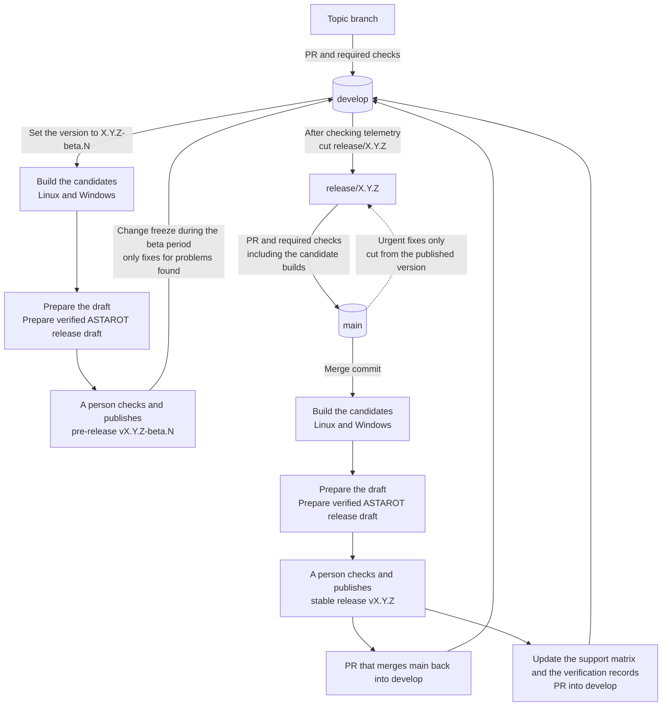
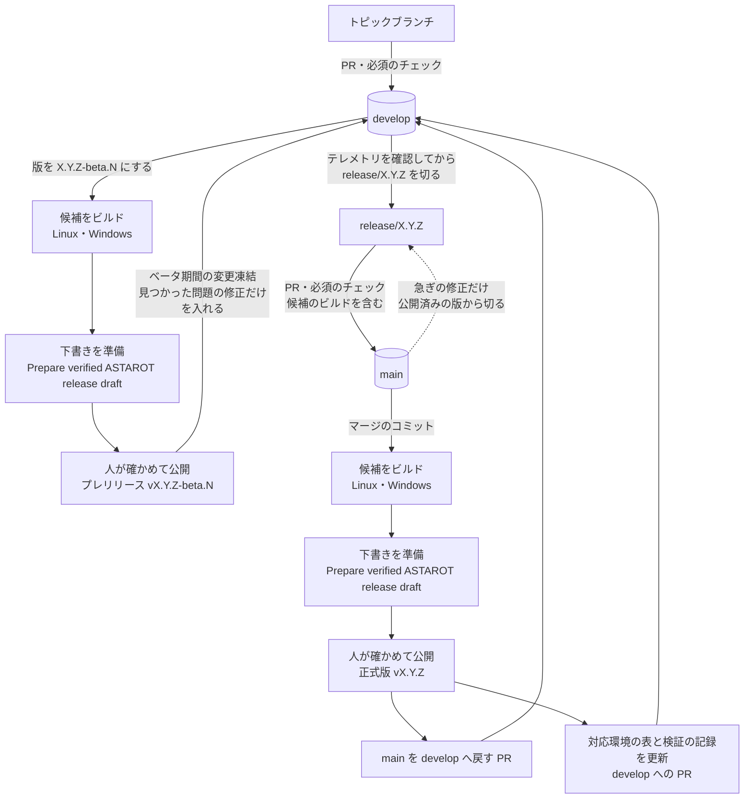

# ASTAROT release candidates and release drafts

[日本語版](#astarotの配布候補とリリース下書き日本語版)

Building release candidates and publishing them are separate steps. The first published version was `v0.1.0-beta.1` on 2026-10-31 (a pre-release from develop). The Linux and Windows candidates are built from the same commit on the same branch, and after their checks pass they are put together in a draft on GitHub Releases. The maintainer reviews the draft and publishes it.

## Overall flow



Betas are built from `develop`. From the time the first beta of a version is published as a pre-release until the stable release is published, the only changes that may be merged into `develop` are fixes for problems found in the betas ([Change freeze during the beta period](#change-freeze-during-the-beta-period)). A stable release is built from the merge commit of `release/X.Y.Z`, a branch cut from `develop` and merged into `main` through a PR. `release/X.Y.Z` is cut from `main` only to fix a published version urgently ([Urgent fixes to a published version](#urgent-fixes-to-a-published-version)). For betas and stable releases alike, a person checks the tag name, the release notes and the behavior on a real PC before publishing. For a stable release, they also check that the beta period's telemetry shows no notable rise in errors ([Check the beta period's telemetry before publishing](#check-the-beta-periods-telemetry-before-publishing)). The steps for each stage are in the sections below.

When you change the release flow, update this diagram in the same PR. The diagram of the contribution flow is in [CONTRIBUTING.md](../../CONTRIBUTING.md#pull-requests).

## Branches and channels

| Branch | Channel | Version format | GitHub Releases |
|---|---|---|---|
| `main` | Stable | `X.Y.Z` (for example `0.1.0`) | A normal release, shown as the latest |
| `develop` | Beta | `X.Y.Z-beta.N` (for example `0.2.0-beta.1`) | A pre-release, not made the latest |

If the branch and the version format do not match, no draft is made. The app also decides its release channel from the `-beta` in the version. A stable release is made by cutting a `release/X.Y.Z` branch from develop, changing only the version to `X.Y.Z` (`utils/update_version.py`) and merging it into main through a PR. The main branch is protected and changes only through a PR that passes the required checks. Merging the PR into main starts building the candidates and preparing the draft automatically ([Make the draft](#make-the-draft)). Publishing opens a PR that merges main back into develop automatically ([After publishing](#after-publishing)). After merging that PR, move develop on to the next `-beta.N`. To fix a published version urgently, cut the branch from main as the next section describes.

### Change freeze during the beta period

From the time the first beta (`X.Y.Z-beta.1`) of a version (`X.Y.Z`) is published as a pre-release until that stable release (`X.Y.Z`) is published, the only changes that may be merged into `develop` are fixes for problems found in the betas. The rule keeps the difference between what the betas checked and the stable release small, and keeps unverified changes out of the stable release.

- The fixes that count are fixes for bugs found while checking the betas or in telemetry, fixes to building or packaging the release files, and corrections to known issues or wording.
- Work on new features, and on improvements and refactoring unrelated to that stable release, may go on in topic branches and PRs. Their merge into `develop` waits until the stable release is published and the PR that merges `main` back into `develop` is merged.
- After a fix goes in, publish the next beta (`X.Y.Z-beta.(N+1)`) to check it when needed.
- The freeze ends when the stable release is published, [the PR that merges main back into develop](#after-publishing) is merged and `develop` moves on to the next version's `-beta.1`.

### Urgent fixes to a published version

These are the steps for when a published version has a bug to fix urgently and develop already holds work for the next version. Cutting `release/X.Y.Z` from develop would bring in the next version's changes as well, so cut it from `main` at the published version. 0.5.2 was prepared with these steps (#617).

1. Merge the fix into develop through a PR as usual.
2. Cut `release/X.Y.Z` from `main` at the published version.
3. Bring in only the fix and the changes needed to build from the state of `main`. Take the commits of the develop PRs with `git cherry-pick -x`, leaving out the merges that brought develop into the PR branches. For 0.5.2, ONNX Runtime's downloads from GitHub could no longer be fetched, and building the release files from `main` as it was failed at the download step. So besides the fix for #610 (#613), #609, which switched the ONNX Runtime download source to NuGet, was brought in. Check with `git diff` that the files brought in match the result merged on develop, and write the PRs brought in and the reasons in the release PR.
4. The version bump and the release notes are the same as for a normal stable release (step 1 of [Build the candidates](#build-the-candidates), [release notes format](../release-notes/README.md)). The `CHANGELOG.md` section is made from the commits since the previous stable release's tag, so only the commits brought in appear. If you add commits after the version bump, rewrite the section with `python tools/changelog.py write --force`.
5. Merge the PR into `main` with a merge commit. The `CHANGELOG.md` section links to the commits on `release/X.Y.Z`, so with a squash or rebase merge the link targets do not end up in `main`.
6. You may build candidates on `release/X.Y.Z` to check them. Only candidates from `main` and `develop` can become a draft ([Make the draft](#make-the-draft)), so the real candidates are built on `main` after the merge. The merge starts building the candidates on `main` and preparing the draft automatically.
7. Publishing opens a PR that merges `main` back into develop automatically ([After publishing](#after-publishing)). develop already holds the same fix as a different commit, so the same change appears twice in the history. If develop's version is still the published version, the merge sets develop's version to the version these steps released (`X.Y.Z`). Then move develop on to the next `-beta.N`. If develop had already moved on to the next `-beta.N`, the version lines conflict; keep develop's version.

## Build the candidates

1. Set the version in `package.json` to the format of the branch you release from, and run `npm run update-version` to carry it into `src-tauri/tauri.conf.json`, `pyproject.toml` and `uv.lock`. The same command regenerates the spec list that shows the version (`docs/spec/reference/config-keys.md`).
   For a stable release only, then run `npm run changelog` to write this version's section in `CHANGELOG.md`. Commit it together with the version change as `chore(release): version X.Y.Z`. The grouping and the steps are in [CONTRIBUTING.md](../../CONTRIBUTING.md#changelog-and-releases).
   For a stable release, merging the `release/X.Y.Z` PR into `main` runs steps 2 to 4 below and [Make the draft](#make-the-draft) automatically. For a beta, or when the automatic run stopped and you continue by hand, go on from step 2.
2. Run "VRCT-VOX Linux candidate (no publication)" in GitHub Actions by hand on `main` (stable) or `develop` (beta). From 0.5.0 it builds one candidate that holds both the CPU and the Vulkan builds of speech.cpp, so there is nothing to choose. The file names are `ASTAROT-<version>-linux-x64-release` followed by `.tar.gz`, `.AppImage`, `.deb` or `.rpm` (`VRCT-VOX-<version>-…` up to 0.6.x, and `linux-x64-vulkan` or `linux-x64-cpu` up to 0.4).
3. Run "Validate VRCT-VOX distribution" by hand on the same commit to build the Windows candidate. This workflow also runs on PRs into main, but only the result of a manual run can be used for a draft.
4. When both runs succeed, note their run IDs. Candidates are kept for 7 days.

A candidate is stored only after its checks pass: on Linux, the GUI tests of the relocated archive and of the AppImage; on Windows, the check for files that must not be distributed inside the ZIP and the NSIS installer. The Linux candidate has four files: tar.gz, AppImage, deb and rpm (eight for 0.7.x, with their copies under the names used up to 0.6.x; see "Copies under the old names" below). The deb and rpm put the same files as the tar.gz under `/opt/astarot` (`tools/linux_packages.py`). They are checked by installing each with its own package manager, without recommended packages, into Ubuntu 24.04, Debian 13 and Fedora 44 containers pinned by digest (`tools/ci/check_linux_package.sh`). The check confirms that the main executable's libraries resolve, that the bundled speech engine starts and that removal leaves nothing behind. From 0.5.0 the backend is inside the main executable, and nothing else is started separately. Whether the window displays is not checked. Each candidate's `candidate-manifest.json` records the repository, commit, version, file names, sizes and SHA-256. `SHA256SUMS` and a `.sha256` for each release file are included too. The installer's `.sha256` is saved as 64 ASCII characters with no newline.

For the Windows candidate, the build job makes `ASTAROT.zip` (`VRCT-VOX.zip` up to 0.6.x) and the installer. Up to 0.5 it also made a CUDA ZIP (`VRCT-VOX_cuda.zip`), but from 0.5.0 its contents were the same, so #288 dropped it ([One Windows package](single-package.md)). The installer has the ZIP's SHA-256 built in (`src-tauri/nsis/package-hashes.nsh`, written by `tools/installer_package_hashes.py` and not committed). The installer checks a ZIP of its own version against this built-in hash. Even if both the ZIP and its `.sha256` are replaced on the release page, it does not unpack that ZIP. When `/VERSION` installs another version, and in an installer built without the hash, it checks against the `.sha256` next to the ZIP as before. When a version is installed with `/VERSION`, that version is also written as the version shown in the list of apps (`DisplayVersion` in the registry). The page that compares with an existing installation also compares against the version about to be installed, not the installer's own version. The candidate job checks that the built-in hash matches the ZIP it stores.

On a manual run, build provenance is attached to every file of the candidate before it is stored (GitHub Artifact Attestations, `actions/attest-build-provenance`; SEC-04 of the second security audit). The provenance holds the file's SHA-256 and the workflow, commit, branch and run that made it, and GitHub signs it with Sigstore. The repository is public, so the signature is also recorded in Sigstore's public transparency log. With SHA-256 files alone, anyone who can replace a release asset can replace the checksum along with it. Provenance lets you check, independently of the release, whether a file was made by this repository's candidate workflow. Only the candidate jobs get the permissions for attaching provenance (`id-token` and `attestations`). PR runs attach no provenance.

## Limits of candidate builds

A successful candidate build does not mean that everything about the release files has been checked. Candidates have the limits below; for details, read the page each item links to. Write what could not be checked before publishing in the known issues of the release notes ([release notes format](../release-notes/README.md)).

### Handling candidates

- Candidates are not published files. Only candidates built by a manual run can become a draft. The result of "Validate VRCT-VOX distribution" run on a PR into main cannot be used ([Build the candidates](#build-the-candidates)).
- Candidates are kept for 7 days. After that, build them again.
- The Linux and Windows candidates are built from the same commit on the same branch. If the branch moves to a new commit, build both again ([Make the draft](#make-the-draft)).
- The candidate build neither downloads nor bundles speech.cpp or RVC models. If OCR weights or Mia2026 material are in the release files, the checks stop the build. The Linux check looks at paths and file types, so it cannot recognize weights under a changed name ([Linux build](linux-build-pipeline.md#acceptance-and-exclusions), [AppImage](appimage.md#acceptance-and-limits)).

### Signatures and verification

- The Windows installer has no code signing signature. SmartScreen shows a warning the first time it runs ([Platform constraints](platform-constraints.md#1-コード署名), [README](../readmes/README.ja.md)).
- `.sha256`, `SHA256SUMS` and `candidate-manifest.json` are for checking that files did not change in transfer. They are not a digital signature or proof that the code is safe ([Local verification](#local-verification)).
- Build provenance is attached only to candidates from manual runs. PR runs get none.
- The updater signatures are added by the job that makes the draft; candidates do not have them. If `TAURI_SIGNING_PRIVATE_KEY` is missing or does not match the app's public key, no draft is made ([Updater signatures and latest.json](#updater-signatures-and-latestjson)).

### What the build does not check

| Target | What the build checks | What it does not check |
|---|---|---|
| Linux tar.gz and AppImage | Starting from the extracted form, drawing, shutdown and using the settings screen (Xvfb) | Starting through FUSE, real audio, the managed audio route. Speech recognition, features that use models, VRChat ([Check on a Linux desktop before publishing](#check-on-a-linux-desktop-before-publishing)) |
| Linux deb and rpm | In Ubuntu 24.04, Debian 13 and Fedora 44 containers: the libraries resolve, the bundled speech engine starts and removal leaves nothing behind | The window display |
| Windows ZIP and installer | Files that must not be distributed, size, SHA-256, the files in `_internal` | The window, features that use models, TTS and RVC on a real PC ([Start the Windows package before publishing](#start-the-windows-package-before-publishing)) |
| Windows update and installation | Not checked by the candidate build. A separate workflow, `installer-update-tests.yml` (manual runs and PRs that change NSIS), checks replacement, restoring after a failure and recovery from an interruption with a light dummy payload | The real release payload, real audio processing ([WebView2 on Windows and network access during installation](#webview2-on-windows-and-network-access-during-installation)) |
| Downloading the WebView2 Runtime | None | The bootstrapper's version and SHA-256 are not pinned. Any extra endpoints, what it sends and running it on Windows are not verified |
| VR | None | The fake SteamVR (`FakeVr`) is used only by the core tests (`core-integration` in `voice-tests.yml`) and is not connected to the VR in the release files |

### Environments it runs on

- The Linux release files are built on GitHub-hosted Ubuntu 24.04. Other distributions need to be checked separately. Even with the AppImage, the user's system needs the kernel and glibc, the GPU drivers, PipeWire and the audio command-line tools. The bundled audio helper needs Linux 6.9 or later ([AppImage](appimage.md#acceptance-and-limits)).
- On Linux desktops, only KDE Plasma (Wayland) has been checked. The VR UI on Linux and chat reading from the headset view have been checked only with a test stand-in for SteamVR ([README](../readmes/README.ja.md)).
- The Linux release files are for x64 ([README](../readmes/README.ja.md)).
- Checking the licenses of GTK, WebKit and the dependencies included statically at run time, and checking the licenses and the software bill of materials (SBOM) of the native, frontend and Rust parts, are conditions to finish before publishing. The build does not check them ([AppImage](appimage.md#acceptance-and-limits)).

### Features

- The 0.5.0 app cannot use Seed-VC. The core refuses it with `vc_engine_unavailable` ([Core integration](core-integration.md)).
- Only the installer and AppImage versions can update from inside the app. The ZIP and tar.gz versions only announce a new version. The deb and rpm are updated through the package manager ([README](../readmes/README.ja.md)).
- The app does not read the draft's `latest.json` until the draft is published ([Updater signatures and latest.json](#updater-signatures-and-latestjson)).

## Make the draft

For a stable release, merging the `release/X.Y.Z` PR into `main` makes "Start ASTAROT release draft" (`release-draft-auto.yml`, `tools/release_automation.py`) do the following in order.

1. For Linux and for Windows, it looks for a successful candidate from a manual run at the merge commit. If there is a successful run made within the last 6 days, it uses it; if one is in progress, it waits for it to finish. If there is neither, it starts the candidate workflow on `main` in the same way as a manual run. Because it is the same as a manual run, the candidates get build provenance.
2. When both candidates succeed, it starts "Prepare verified ASTAROT release draft" with their run IDs and waits for it to finish.

The verification stays in "Prepare verified ASTAROT release draft" as before (described in the second half of this section). If any candidate fails or does not finish within 5 hours, it stops there and makes no draft. If `main` has moved past the merge commit before the candidates start, it starts nothing, because the candidates would be for a different commit. If preparing the draft has already succeeded for the same commit, it does not make a second one. The progress and links to each run appear in the job summary (Summary).

If the automatic run stops, fix the cause and run "Start ASTAROT release draft" by hand on `main`. It repeats the same steps and reuses the candidates that succeeded. A beta's draft can be prepared with the same steps by running this workflow by hand on `develop`.

To go on by hand, run "Prepare verified ASTAROT release draft" by hand on the same commit of the same branch and give it the Linux and Windows run IDs. If the branch has moved to another commit, build the candidates again at that commit.

This workflow accepts only successful manual builds, and checks the source repository, workflow, branch and commit, and that the branch matches the version format. For the downloaded candidates it also compares the version, the set of files, the sizes and SHA-256, and exits on any difference. It then checks the provenance of every file with `gh attestation verify`: that the signer is that platform's candidate workflow, that the commit and branch are the draft's, and that the files were built on a GitHub runner. If any of these cannot be confirmed, it makes no draft. It does not run any downloaded code.

It makes a draft for `v<version>`. If a tag with that name already exists, it stops, even when the target commit is the same; choose a new version. A failed tag lookup stops it too, and it never overwrites an existing release or publishes on its own. For a stable release, the draft's description is made from this version's section of `CHANGELOG.md` (without the section, no draft is made). For a beta, it is made from the commits since the previous tag. The automation goes as far as making the draft and does not publish. Before publishing, check that the draft's tag name is `v<version>` and that its target commit is the commit the candidates were built from (steps in [Rewrite the tag name just before publishing](#rewrite-the-tag-name-just-before-publishing)). Publishing creates that tag, and a release tag cannot be moved afterwards. Next, replace the body with the notes in `docs/release-notes/<version>.md` (the format from 0.5.0 is in [release notes format](../release-notes/README.md)), and check installing on Windows, updating from an older version and uninstalling before you publish. A successful build alone does not confirm that TTS and RVC work on a real Windows PC. The steps for that check are in [Using the voice features on Windows](local-setup-windows.md).

The Windows setup is copied to `ASTAROT_setup.exe` when the candidate is built. Keep the name `ASTAROT.zip`, which the installer downloads, unchanged as well. In-app updates use `ASTAROT_setup.exe` and the AppImage (`ASTAROT-<version>-linux-x64-release.AppImage`; see the next section).

### Copies under the old names

From 0.7.0 the release file names start with `ASTAROT`; up to 0.6.x they started with `VRCT-VOX` (2.10 of ADR-014). To keep links posted elsewhere, such as `releases/latest/download/VRCT-VOX_setup.exe`, working, 0.7.x releases carry every release file together with a copy under its name up to 0.6.x (`VRCT-VOX.zip`, `VRCT-VOX_setup.exe`, `VRCT-VOX-<version>-linux-x64-release.*`).

- The copies are made when the candidate is built (`tools/release_candidate.py stage`). Their contents are the same as the original files, they have their own `.sha256`, lines in `SHA256SUMS` and entries in `candidate-manifest.json`, and they get build provenance too. The candidate check confirms that both the new names and the copies are present and that each copy's contents are the same as the original file.
- How long the copies are carried is set in one place, `LEGACY_COPIES_UNTIL` in `tools/release_candidate.py`. It is now versions before 0.8.0 (the 0.8.0 betas are not included).
- The copies get no signature, and `latest.json` points only to the new names.
- The download list on the user site does not show a copy when the file under the new name exists (`site/theme/lib/releases.mjs`).

## Updater signatures and latest.json

For in-app updates (#330, [App updates](../spec/external-interfaces.md#アプリの更新)), the job that makes the draft adds Tauri updater signatures to the `ASTAROT_setup.exe` and AppImage verified above (not to the copies under the old names). This signature is separate from code signing and is verified with the public key built into the app (`plugins.updater.pubkey` in `src-tauri/tauri.conf.json`, key ID `1178836E5C9F510B`).

- The private key is the repository secret `TAURI_SIGNING_PRIVATE_KEY` (the contents of the key file), and its password is `TAURI_SIGNING_PRIVATE_KEY_PASSWORD` (empty if the key has no password). Only one step reads the secrets: the step that signs and makes `latest.json` (`tests/voice/test_security_regressions.py` checks this). Candidate builds and PR runs do not read them.
- The signature is made with `tauri signer sign --app-version <version>`, which puts the version in the signature. The app does not install an update whose signed version differs from the version in `latest.json` (`requireSignedVersion`).
- `tools/updater_manifest.py` checks each signature's key ID and version, verifies the Ed25519 signature with `cryptography`, and then adds `latest.json` to the draft. The `.sig` files go into `latest.json`, so they are not left in the draft. If `TAURI_SIGNING_PRIVATE_KEY` is not set, or does not match the app's public key, no draft is made.
- The stable channel reads `latest.json` from the "latest" release. The beta channel reads `beta/latest.json` on the `updater-channels` branch, through the Worker's `/beta/latest.json`. Neither is read until the draft is published.
- When a release is published, "Point the ASTAROT beta update channel" (`update-channels.yml`) writes the `latest.json` of the newest published version (betas and stable releases alike) to `beta/latest.json` on `updater-channels`. If a fix for an older line is published while a newer beta exists, the file stays as it is. It writes only this one file on this branch, and writes nothing if the contents are the same (#466).
- If the branch does not exist yet, run this workflow once by hand to create it. The Worker forwards `/beta/latest.json` to `https://raw.githubusercontent.com/kein5/astarot/updater-channels/beta/latest.json` (the Worker is outside this repository, and the maintainer sets it up). If the Worker does not forward yet, or the branch does not exist, apps on the beta channel read the stable `latest.json`.

To change keys, release a version that carries the new public key in the app, signed with the old key, and switch to signing with the new key once that version has reached users. If the private key is lost, earlier versions can no longer update from inside the app. Keep the private key and its password in a safe place apart from the secrets as well.

The app starts the installer with `/P /UPDATE /R /ARGS …` (apps up to 0.5 also pass `/EDITION=cpu` or `/EDITION=gpu`, which the installer does not read; #288). In this case it skips the language page, does not write `installer_language.txt` (so the app's language setting does not change) and does not recreate the shortcuts. Downloading the ZIP, checking the hash, the staged replacement and restoring after a failure are the same as in a normal installation. The silent tests in `installer-update-tests.yml` include an update with `/UPDATE`.

## Start the Windows package before publishing

The candidate build checks the package contents (files that must not be distributed, size, SHA-256) and that the files needed in `_internal` are present (`tools/app_resources.py check`). Up to 0.4 it started the packaged Python backend with `--self-check`. From 0.5.0 the backend is inside the app's executable (`astarot.exe` from 0.7.0, `vrct-vox.exe` up to 0.6.x), so what you start and check is the app itself. The build does not check the window or anything that uses models.

In the Windows packages up to 0.1.0-beta.7, local translation could never be turned on. Inside the PyInstaller archive, Transformers could not list its own folder and could not build the tokenizer. This does not happen in a development build, so the problem stayed unknown until someone started the package and pressed "Translation". A development build reads its bundled resources from `build/` in the checkout, so files missing from the package's `_internal` are likewise invisible during development. Before publishing, unpack the draft's `ASTAROT.zip` (`VRCT-VOX.zip` up to 0.6.x) into a working folder and start it. This leaves the installed ASTAROT untouched.

```powershell
# Download the draft's package, check its SHA-256 and unpack it into a working folder
$d = "build\release-check\<version>"
# VRCT-VOX.zip for versions up to 0.6.x
gh release download v<version> -R kein5/astarot -p "ASTAROT.zip" -p "ASTAROT.zip.sha256" -D "$d\dl"
(Get-FileHash "$d\dl\ASTAROT.zip" -Algorithm SHA256).Hash.ToLower() -eq (Get-Content "$d\dl\ASTAROT.zip.sha256" -Raw).Trim()
New-Item -ItemType Directory -Force "$d\app", "$d\state", "$d\webview" | Out-Null
tar -xf "$d\dl\ASTAROT.zip" -C "$d\app"

# Start with the settings and the WebView2 data in separate working folders (both absolute paths)
$env:ASTAROT_CONFIG_DIR = (Resolve-Path "$d\state").Path
$env:WEBVIEW2_USER_DATA_FOLDER = (Resolve-Path "$d\webview").Path
# vrct-vox.exe for versions up to 0.6.x
& "$d\app\astarot.exe"
```

- With `ASTAROT_CONFIG_DIR` set (`VRCT_CONFIG_DIR` for versions up to 0.5.x), the settings and logs go into that folder, and the app starts separately even while the installed app is running. Models and `telemetry_state.json` go inside the unpacked `app` folder.
- In versions before the fix for #442, when the OSC destination is the PC running ASTAROT (the default), the backend opens a port for mDNS, and Windows Firewall asks about the executable in its new location. To look without that prompt, write `"OSC_IP_ADDRESS": "127.0.0.2"` and `"SEND_MESSAGE_TO_VRC": false` into `state\config.json` before starting. Versions with the fix show no prompt. If one appears, note which exe it is about and report it.
- Choosing "Send" in the usage data notice sends one event to the real receiving server. To look without sending, set `ASTAROT_TELEMETRY` to `off` (`VRCT_TELEMETRY` for versions up to 0.5.x).
- Check at least the following. The app starts and shows its version. Pressing the download under Settings → Translation opens the download confirmation, and once you agree and the download finishes, translation turns on and translations appear (the translation models were published on 2026-11-19; earlier versions show that they are not published yet and the folder for placing a model you prepared yourself). Each page of Settings opens. After closing, no process the app started (the speech.cpp server or the RVC worker) is left. `state\logs\error.log` has not been created. Up to 0.1.0, each press of "Translation" without a translation model left one log entry (`MissingCTranslate2Tokenizer`). Having no model yet is normal on the first start, so it is now not logged and not counted in the usage data error reports.
- The check is made on the Windows 11 PC at hand. On 2026-11-18 it was decided not to add a check on the generally available Windows 11 to the pre-release checks (#516). When the check is made on an Insider Preview build, write its build number in the record. The support matrix also says that the generally available Windows 11 has not been checked.
- Note what you checked and what you did not, together with the version, the OS and its build, and the package (installer or ZIP). After publishing, add them to [the support matrix and the verification records](#update-the-support-matrix-after-publishing).

## Check on a Linux desktop before publishing

The candidate build checks automatically that the AppImage starts, draws and lets you use the settings screen. Tests that use VRChat need VRChat and the OCR models, so CI does not run them. Tests outside CI go stale unnoticed after the screens change. For 0.1.0-beta.6, it turned out just before publishing that the helper code no longer matched the current screens, and the version was published with part of it unchecked. Running the tests again afterwards found a bug: the speech recognition server, stopped in the settings screen, started again when the screen closed. Before publishing, run the draft's AppImage on a Linux desktop.

```bash
# Download the draft's AppImage and check its SHA-256
mkdir -p ~/.cache/vrct-vox-release-check/<version> && cd ~/.cache/vrct-vox-release-check/<version>
gh release download v<version> -R kein5/astarot -p '*.AppImage' -p 'SHA256SUMS-linux'
sha256sum -c --ignore-missing SHA256SUMS-linux
cd <repository>

# Tests that run with the app alone
python tools/native_acceptance.py --appimage <absolute path of the AppImage>

# Also include the round trip through VRChat
python tools/native_acceptance.py --appimage <absolute path of the AppImage> --vrchat
```

`tools/native_acceptance.py` starts pytest for each test group and shows how many tests passed, failed and were skipped. The results are in `build/native-acceptance/summary.json`, and each group's log is `<group>/pytest.log` in the same folder. The tests open the real app on screen. Give the location of `tauri-driver` 2.1.0 with `--driver` or `ASTAROT_TEST_DRIVER`.

| Group | What it checks | What it needs |
|---|---|---|
| `appimage` | Starting through FUSE and by extraction, drawing, shutdown, using the settings screen, mute after a restart | AppImage |
| `ui` | The main screen and the settings screen (display scale 100% and 150%) | `xwininfo` (for the test of the desktop subtitle window; the `xorg-xwininfo` package on CachyOS and Arch Linux, `x11-utils` on Ubuntu and Debian) |
| `vrchat` | A sentence typed in the app appears in a real VRChat chatbox bubble and can be read back with chat reading | `--vrchat`, the OCR models |
| `vrchat-voice` | One typed sentence appears in a real VRChat bubble and is heard exactly once through the managed virtual microphone. Mute stops only the voice, and after the app exits the microphone is silent (#746) | `--vrchat`, the OCR models, a prepared managed route, `pw-record` |
| `quick_chat` | The Quick Chat hotkey brings up the input window above a fullscreen window and gives it focus without bringing back the main window. The text being written is kept and goes once each to translation, OSC and text to speech. Actions from other windows are refused. On Wayland, it shows that the shortcut is registered through the desktop portal, and the button opens the window | KDE (X11 or XWayland), `xdotool` and `xprop`, `python3` with GTK. The one Wayland case runs only with a development build on a Wayland desktop |

`--vrchat` starts two VRChat clients in the chatbox lab, in a private instance that exists only on the PC running the tests, runs the round-trip tests and then exits. The VRChat account is the one already signed in on that PC.

Up to 0.5 there were also the groups `voice`, `tts-model`, `asr`, `downloads`, `rvc`, `seed-vc`, `vrchat-voice` and `vr-ui`, and `--fetch-models` and `--fetch-runtimes` to download models and runtimes. They used parts of the Python backend (the PipeWire gate, the TTS calls, recording, and the download and setup machinery) to play and listen to the app's audio through a test-only PipeWire graph, so 0.6.0 removed them together with the backend (#285). `vrchat-voice` was rebuilt so that the core drives the route (#746). There are now no tests that check TTS quality, speech recognition or RVC on a real PC. TTS and latency can be measured with the core's examples (`native/core/examples/live_speech.rs`, `pipeline_latency.rs`).

What is checked on a real PC was decided on 2026-11-18 (#516).

- Of the packages, the AppImage is checked. The deb and rpm get only the container install tests, and the tar.gz only the start test on a virtual display (both in `build-linux.yml`); they are not checked on a real PC.
- The desktop is checked on a real PC. The record states the distribution and its version, the desktop environment and the display protocol (Wayland or X11).
- For VR, the tests that use the fake SteamVR (`FakeVr`) are enough, without a real headset or SteamVR. The `core-integration` job in `voice-tests.yml` runs them ([What CI checks](platform-verification.md#ci-が確かめていること)).

Write which tests you ran and which you did not under `## 🐞 既知の問題` (known issues) in the release notes. Note the results together with the version, distribution, desktop environment and package. After publishing, add them to [the support matrix and the verification records](#update-the-support-matrix-after-publishing).

If a control could not be operated, look at `blocked-<action>.json` in the test output folder. It records what was covering the control and which dialogs were open.

## Check the beta period's telemetry before publishing

A condition for publishing a stable release (`X.Y.Z`) is to compare the errors during the beta period (`X.Y.Z-beta.N`) with the previous stable release and confirm that there is no notable rise. The purpose is to find failures that depend on the environment, which manual checks on real PCs alone cannot catch, before they spread with the stable release. A hotfix cut from `main` without a beta has no beta period before it, so this check is skipped and the trend after publishing is checked instead.

The check uses the read-only view of ASTAROT's telemetry receiver (`vrct-vox-telemetry`, Cloudflare Workers). The maintainer manages the receiver and the view outside this repository. The reference for the format of the events the app sends and the conditions for sending them is [Usage data notices](../spec/external-interfaces.md#利用状況の通知) and [Consent and sending data outside](../spec/cross-cutting.md#同意と外部への送信).

- Two events are used: `app_started` (once a day, by UTC) and `error` (once a day per `error_code`, by UTC).
- The fields used for counting and narrowing down are `app_version`, `event`, `error_code`, `os`, `os_version` and the time received (UTC).

Compare in this order.

1. Line up the versions and periods to compare. Filter by `app_version` for the betas of the line being published (the beta period that includes the newest `X.Y.Z-beta.N`) and for the previous stable release (a period of similar length, or the most recent period in which it ran stably).
2. Compare the overall error rate. For each version, compute the number of `error` events against the number of `app_started` events (the total over the period and the daily trend), and check for a notable rise compared with the previous stable release. When the betas have few `app_started` events, the rate swings widely, so look at the counts themselves as well.
3. Compare the breakdown by `error_code`. List each code's count and its rate against `app_started`, and check for new codes that the previous stable release did not have, and for a sudden rise in particular codes such as those for startup, updates, the speech server or model downloads.
4. If a code has risen, narrow it down by environment. Split by `os` (`Windows`, `Linux`, `Other`) and `os_version` to see whether it is concentrated on a particular OS or version.
5. Judge the result and record it. If you find a notable rise or new errors with no explanation, hold the stable release and check again with the next beta (`X.Y.Z-beta.(N+1)`), which fixes the cause. Once you have confirmed that there is no rise, or that it is within what known issues or spec changes explain, write the versions and periods compared, the date of the check and the main results in the record of pre-release checks.

Telemetry arrives only from installations where the user agreed in the notice screen, and the same `error_code` occurring many times on the same day (UTC) counts as one. A failed send is not sent again. So treat the counts as a rough measure of the daily scale of occurrence on installations that agreed, not as the number of all users or the total number of errors. When the betas have a small base, decide on publishing together with the real-PC checks on Windows and Linux and the reports on the betas.

## Rewrite the tag name just before publishing

While a release is a draft, its tag does not exist yet; publishing creates the tag from the draft's `tag_name` and `target_commitish`. Do not use the values the workflow put there as they are: overwrite them with the version and the commit the candidates were built from, then read them back to check. `<id>` is the draft release's ID (look it up with `gh api 'repos/{owner}/{repo}/releases?per_page=10' --jq '.[] | select(.draft) | {id, tag_name}'`).

```bash
git ls-remote --tags origin v<version>   # must print nothing
gh api -X PATCH repos/{owner}/{repo}/releases/<id> \
  -f tag_name=v<version> -f target_commitish=<40-character SHA of the commit the candidates were built from>
gh api repos/{owner}/{repo}/releases/<id> \
  --jq '{tag_name, target_commitish, draft, prerelease, name}'
```

In what you read back, check that `tag_name` is `v<version>`, that `target_commitish` is the commit the candidates were built from and that `draft` is `true`. `prerelease` is `false` for a stable release and `true` for a beta. If a tag with the same name already exists, do not publish.

The maintainer publishes. When publishing through the API, state whether the release becomes the latest with the string `make_latest`. Pass `-F draft=false -f make_latest=true` for a stable release, or `-F draft=false -f make_latest=false` for a beta, in the same PATCH.

## Check after publishing

After publishing, check these four points.

1. The tag's commit is the commit the candidates were built from.

   ```bash
   gh api repos/{owner}/{repo}/releases/tags/v<version> \
     --jq '{tag_name, draft, prerelease, target_commitish, published_at}'
   git fetch origin --tags && git rev-parse 'v<version>^{commit}'
   ```

2. The latest-release setting (`make_latest`) took effect. `gh api repos/{owner}/{repo}/releases/latest --jq .tag_name` gives `v<version>` for a stable release, and stays at the previous stable release for a beta. If it does not, PATCH `make_latest` again.
3. The update-check Worker returns the new `latest.json`. Stable apps read the Worker listed in `plugins.updater.endpoints` in `src-tauri/tauri.conf.json`, and the Worker redirects with a 302 to `latest.json` in `releases/latest` ([App updates](../spec/external-interfaces.md#アプリの更新)). It shows `<version>` for a stable release, and the previous stable release's version for a beta.

   ```bash
   url=$(jq -r '.plugins.updater.endpoints[0]' src-tauri/tauri.conf.json)
   curl -sI "$url" | grep -i '^location'
   curl -sL "$url" | jq -r .version
   ```

4. The number and names of the assets match the candidates. The release assets are the assets listed in each candidate's `candidate-<platform>.json` and their `.sha256`, the `candidate-<platform>.json` and `SHA256SUMS-<platform>` of each platform, and `latest.json` (`tools/prepare_release.py` and `prepare-release.yml`). The expected count is "2 × (the sum of the `assets` counts of the two candidates) + 5".

   ```bash
   d=$(mktemp -d)
   gh release download v<version> -p 'candidate-*.json' -D "$d"
   gh api repos/{owner}/{repo}/releases/tags/v<version> --jq '[.assets[].name]' > "$d/published.json"
   jq -s --slurpfile pub "$d/published.json" '
     ([.[] | .assets[].name | ., . + ".sha256"]
      + [.[] | "candidate-\(.platform).json", "SHA256SUMS-\(.platform)"]
      + ["latest.json"]) as $want
     | {want: ($want | length), published: ($pub[0] | length),
        missing: ($want - $pub[0]), extra: ($pub[0] - $want)}' "$d"/candidate-*.json
   ```

   Check that `want` and `published` are equal and that `missing` and `extra` are empty. If the count differs from the previous version, check whether added or removed release files (dropped or renamed ones) explain it. If the draft step changes how the assets are put together, update this expression too.

## Update the support matrix after publishing

After publishing a stable release, bring the user-facing [Platform support](../../site/en/guide/support.md) page and its Japanese version ([対応環境と検証の範囲](../../site/ja/guide/support.md)), and the [platform verification records](platform-verification.md) behind them, up to the published version (#516). The same goes for hotfix versions. The guide site is published from develop, so make the update a PR into develop and merge it after the version is published. Merging it before publishing would show users the contents of a version that is not out yet.

1. Add this version's record to "Records on real PCs" in the evidence list. Write what you noted in the pre-release checks on [Windows](#start-the-windows-package-before-publishing) and [Linux](#check-on-a-linux-desktop-before-publishing) in the columns for the version, the OS and its version, the package, what was checked and what was not, and link to the source of the record (a PR or issue comment). Do not write anything that identifies the PC's owner. For a version not checked on a real PC, say so.
2. Compare "What CI checks" in the evidence list with this version's workflows. If the jobs, the runners or what they check have changed, update it.
3. Update the Japanese and English pages in the same way.
   - Set the opening "This page describes X.Y.Z (date)" to the published version and date. Set the target version in the evidence list to the same version.
   - Compare the rows of "Systems and packages" with this version's release files.
   - In the real-PC columns, change to "checked on this version" only the cells that have a record added in step 1. Cells with only an earlier version's record keep that version as written. Cells with no record stay "Not verified".
   - Match the OS note of the Windows real-PC record (the Insider Preview build number) to the record from step 1.
4. Run `tests/voice/test_support_matrix.py` with `python tools/dev.py check --scope voice`, and run `npm run build` and the Pages workflow's checks in `site/`. The test checks only the release file names, the OS and version of the containers that test the deb and rpm, and the shape of the Japanese and English tables. The contents of the feature cells are compared with the records from step 1 in the PR review.
5. In the PR's "Platforms / 対応環境" section, write the cells you changed and the records you based them on.

When a beta is published, the user-facing pages do not change, because they show the scope of the stable release. When a beta is checked on a real PC, add it only to "Records on real PCs" in the evidence list (as with the 0.5.0-beta.5 record).

## After publishing

When a stable release is published, "Open ASTAROT back-merge pull request" (`release-back-merge.yml`, `tools/release_automation.py`) opens a PR that merges `main` back into `develop`. It creates the branch `chore/merge-main-back-X.Y.Z` at the commit of the release tag and opens a PR from it into `develop` titled `chore(release): merge main (X.Y.Z) back into develop`. When a beta is published, it does nothing. It also does nothing when `develop` already contains that commit or the same PR is already open. If a branch with the same name exists, it uses it as it is instead of creating it again.

It does not merge automatically. If there is a conflict, resolve it on that branch and merge with a merge commit. After merging, move develop on to the next `-beta.N`.

This PR is opened with the GitHub Actions token, so the PR workflows do not start on it automatically. To run the required checks, close the PR and reopen it, or push the commit that resolves the conflict. Starting the checks automatically as well would need other credentials, such as a GitHub App token. Only the draft signing step reads secrets ([Updater signatures and latest.json](#updater-signatures-and-latestjson)), so this mechanism does not use them.

If "Allow GitHub Actions to create and approve pull requests" (Settings → Actions → General → Workflow permissions) is off in the repository settings, the job cannot open the PR. It then fails after creating the branch and puts a link for opening the PR in the job summary. When a person opens the PR from that link, the checks start too.

## Stop delivery when a problem is found

When a serious bug is found in a published version, stop delivering it to users who have not updated yet by pointing delivery back at the last safe version, and release the fix as a new patch version (`X.Y.(Z+1)`) (decision of 2026-11-24).

- Published releases and tags are not deleted or moved.
- Do not build a mechanism that automatically moves users who already updated to the faulty version back to the previous version (automatic downgrade). A normal update through the Tauri updater only considers versions newer than the current one, so even with delivery pointed back at the previous version, installations that already updated wait for the fix (`X.Y.(Z+1)`).
- For the time being there is no staged rollout (delivery to a percentage of users). Releases rely on the change freeze during the beta period, the pre-release checks on real PCs and in telemetry, and this stop of delivery followed by releasing the fix (roll forward).

Stop delivery in this order.

1. Point stable delivery and the official site's download back at the last safe stable version (`v<previous>`). PATCHing the previous version's release on GitHub Releases with `make_latest` set to `"true"` switches the stable Worker (`/latest.json`, a 302 redirect to `releases/latest`) and the official site's download button (which refers to `releases/latest`) to the previous version.

   ```bash
   prev_id=$(gh api repos/{owner}/{repo}/releases/tags/v<previous> --jq .id)
   gh api -X PATCH "repos/{owner}/{repo}/releases/$prev_id" -f make_latest=true
   ```

   Once it takes effect, check that `gh api repos/{owner}/{repo}/releases/latest --jq .tag_name` and the Worker check commands in step 3 of [Check after publishing](#check-after-publishing) return `<previous>`. The official site's download button caches its result per tab for up to 15 minutes (`sessionStorage`), so the old result may remain right after the switch.

2. To stop delivery on the beta channel as well, replace `beta/latest.json` on the `updater-channels` branch with the previous version's `latest.json`. `update-channels.yml` (`tools/update_channels.py`) picks the newest published release automatically, so while the faulty version stays published, `beta/latest.json` does not go back by itself.

   ```bash
   d=$(mktemp -d)
   gh release download v<previous> -R kein5/astarot -p latest.json -D "$d"
   ```

   Overwrite `beta/latest.json` on the `updater-channels` branch with the downloaded `latest.json`, commit and push. Once it takes effect, check that `curl -sL https://vrct-vox-updates.kei9d09.workers.dev/beta/latest.json | jq -r .version` returns `<previous>`. Publishing any other release makes `update-channels.yml` rewrite it with the newest version's `latest.json` again, so continue by releasing the fix in step 4.

3. At the top of the faulty version's release notes, add what the problem is, that delivery has been pointed back at the previous version, and guidance for users who already updated (workarounds and plans for the fix). Published releases are not deleted, so the faulty version stays in the GitHub Releases list and in the app's list of versions (`/get/data/available_releases`). The deb and rpm are managed by the package manager and do not use in-app updates. Tell their users through the release notes.

4. After the fix (or a revert of the change that caused the problem) is in `develop`, release a new patch version (`X.Y.(Z+1)`) from `main` with the steps in [Urgent fixes to a published version](#urgent-fixes-to-a-published-version) and publish it. Publishing the new version moves `releases/latest` and `beta/latest.json` on `updater-channels` on to the fix, and users who had already updated to the faulty version also get the fix through in-app updates.

## WebView2 on Windows and network access during installation

The current build leaves out `bundle.windows.webviewInstallMode` in `src-tauri/tauri.conf.json`, so it uses Tauri's default `downloadBootstrapper` (`silent: true`). This behavior was confirmed with the local `@tauri-apps/cli/config.schema.json` and the build settings. This time, the mode was not changed.

If the NSIS installer finds no WebView2 Runtime version in the HKLM or HKCU registry, it downloads the bootstrapper from Microsoft at `https://go.microsoft.com/fwlink/p/?LinkId=2124703` and runs it. The bootstrapper also connects to Microsoft and downloads the WebView2 Runtime. Microsoft and the redirect targets receive the IP address and the details of the requests. A build that chooses `embedBootstrapper` still bundles a program that downloads online, so the network access at run time remains. If an existing Runtime is detected, this download and run are skipped.

This network access is part of installing on Windows and is separate from model downloads, which need consent. In-app updates start this installer too, so they make the same network access. The current template does not pin the bootstrapper's version or SHA-256, and has no signature check of the app's own and no time limit on running it. The extra endpoints the bootstrapper actually uses, what it sends and running it on Windows are not verified. In the pre-release check on a real Windows PC, check both with and without the Runtime installed.

The app itself is downloaded from GitHub Releases and unpacked after its SHA-256 is checked: against the built-in hash for the installer's own version, or against the `.sha256` next to the ZIP for another version ([Build the candidates](#build-the-candidates)). The curl HEAD request that reads the package size is limited to 10 seconds for connecting and 30 seconds for each whole attempt. It retries at most 2 times, and retries may only start within 30 seconds. The last attempt may run past that period, but the 30-second limit applies to it as well. If the size cannot be read, the installer goes on to the existing single-stream download. Downloading the SHA-256 file is limited to 30 seconds, and the transfer of large archives has a separate watchdog.

Only one installer runs at a time in a user's session. It first creates a named mutex (`Local\ASTAROT-setup`). If the mutex already exists, it reports that another installer is running and exits with exit code 2 without touching files, the registry, `$INSTDIR\.upd` or `%TEMP%`. In silent mode (`/S`) the report goes to the console that started it; otherwise (including `/P`) it is shown as a message. The reason is that if an app update (`/P /UPDATE /R`) and an installer the user opened overlap, both empty `$INSTDIR\.upd` when they start, which breaks the replacement of the one that started first. Windows closes the mutex when the installer ends, so a run that stopped partway does not block the next one. The uninstaller does not take this mutex, because the installer sometimes starts the uninstaller and waits for it.

Downloaded files (the ZIP, its `.sha256`, the parts of a parallel download and the WebView2 bootstrapper) go in a folder made for each run (`package` in NSIS's `$PLUGINSDIR`, which is created inside `%TEMP%` for each run and deleted when the run ends). Files with the same names in `%TEMP%` (from other programs, or from installers of earlier versions that do not have this folder) are neither read nor deleted. Resuming a download partway (`/RESUME`) happens only between retries within the same run. The only file placed in `%TEMP%` itself is `ASTAROT.zip.bad` (`VRCT-VOX.zip.bad` when a version up to 0.6.x is installed with `/VERSION`), which is kept for diagnosis when unpacking could not complete.

In a Windows update, the old version is not removed before the download, even when the default "Uninstall before installing" is chosen. The new version is unpacked into `$INSTDIR\.upd\new`, and after tar's success, the executable and the `_internal` folder are confirmed, the installer checks once more that the app is not running. New installations and `/S` and `/P` runs use the same staged replacement. "Uninstall" for the same version is an explicit removal, so it runs on the spot as before.

When the installer and uninstaller look for a running app, they look for the main executable (`astarot.exe` from 0.7.0 and `vrct-vox.exe` up to 0.6.x) and for `vrct-vox-sidecar.exe`. The 0.5.0 release files have no sidecar, but an old sidecar may be running when updating from a version up to 0.4. If `vrct-vox.exe` is killed, the sidecar stays for 1 to 2 minutes until its own watchdog stops it, its executable cannot be deleted, and it may rewrite `config.json` when it exits, so the sidecar is stopped too. The new package has no sidecar, so a leftover `vrct-vox-sidecar.exe` is deleted after the replacement and on removal. In the same way, a main executable whose name is not in the package (`vrct-vox.exe` when updating from a version up to 0.6.x) is deleted after the replacement and after the shortcuts are re-pointed ([Name of the main executable](../spec/data-and-persistence.md#本体の実行ファイルの名前)).

tar receives its arguments in the ANSI code page, so if a user name or another part of a path has characters outside it, tar cannot open the archive or the destination given as paths in its arguments. The working directory is not an argument and is handled as Unicode. So the working directory of tar is set to `$INSTDIR\.upd\new`, the archive is moved from the per-run folder to `$INSTDIR\.upd` next to it, and tar gets an ASCII-only relative path (`..\ASTAROT.zip`). This does not depend on 8.3 names, so it works the same on volumes without 8.3 names. An archive that failed to unpack is moved back to the per-run folder and used for downloading again and for saving the `.bad` file. If `$TEMP` and the install location are on different drives, this move copies the archive, which takes time. The space check of the install drive also adds the size of the archive.

During replacement, `.upd\committing` is left in place and each item of the old app is moved aside into `.upd\old`. Newly added items are recorded in `.upd\add`. `_internal` is replaced as a whole folder, so dependency files that only the old version had do not remain. When updating from a version up to 0.4, the Python runtime (about 1 GB) is also removed at this point. `config.json`, `weights`, `logs`, `telemetry_state.json` and the user's logs are kept as they are. The old version and the unpacked new version exist at the same time, so the space check looks at the free space needed on top of the existing files.

If the replacement fails, the added items are moved to `.upd\discard` and the old files that were moved aside are put back. The next run also checks the marker and first rolls back an interrupted replacement. If some file cannot be restored, the installer keeps the old files and the marker, shows where they are and stops. In that case, close the app in use and run the installer again; do not delete `.upd` by hand. If deleting the working folder fails after the restore completes, the next run can delete what is left. On a failed transfer or a retry, the installer stops the package's network transfer, waits for it to end and then deletes the temporary files. The `.bad` archive from a final unpacking failure is kept for diagnosis.

When migrating from WiX, the old uninstaller runs after verification and unpacking. When updating an older NSIS installation in the same location, the old uninstaller does not run. When moving to another location, the old version is removed after the new version is in place, and the registry is updated after that. A failure to remove the old version is treated as a warning. The marker that the file replacement has completed is removed before the old version in the other location is removed and before the registry is updated. This is so that, even if the marker cannot be removed, the installer stops in a state where the old version can be restored.

If "Delete the application data" is chosen when uninstalling, all app data in the install location is deleted: `config.json` and the files beside it (lock, backup and temporary files), `secrets.json`, `user_models.json`, `translation_catalog.json`, `voice_mute_state.json`, `telemetry_state.json`, `downloaded_models`, `vc_runtimes`, the logs and `weights`. The reference list is in [Data and persistence](../spec/data-and-persistence.md#windowsのアンインストールで消すもの). The API keys of this installation in Credential Manager (the `store_id` entry in `secrets.json`; `ASTAROT/<id>/` and 0.6.0's `VRCT-VOX/<id>/`) are deleted too, and keys of other folders are not touched. If the keys cannot all be deleted, `secrets.json` is kept so that they can be deleted later. `translation-models` placed by the user and exported `exports` are kept. This option is not selected by default, and without it all of these are kept. A GUI step in `installer-update-tests.yml` checks with the real Credential Manager that uninstalling with this option deletes only the app data and this installation's API keys, and that without it both are kept.

The regression tests run in [installer-update-tests.yml](../../.github/workflows/installer-update-tests.yml), on manual runs and on PRs that change NSIS, the test scripts or the workflow itself. Only inside the Windows job's checkout, the download source is rewritten to a local HTTP server, and the real NSIS installer downloads and unpacks a light dummy payload. The silent tests check file replacement on success and that user data is kept, installation into a folder whose name has characters outside the ANSI code page, matching paths and hashes on each failure, rollback, recovery from an interruption, and switching to a single connection when a Range request fails. They also start a second installer while the first is stopped partway through its download, and check that the second exits with exit code 2 without changing the install location, the registry or `%TEMP%` and without network access, and that the first then succeeds. Every run checks that the downloaded files are in the per-run folder and do not remain afterwards, and that other files with the same names in `%TEMP%` are left unchanged. To check only the real tar without building an installer, use `python tests/installer/windows_update_scenarios.py --mode tar`. The GUI's default selection, and that a second installer with a window shows a message and exits with exit code 2, are checked in a separate step that uses pywinauto. This is not a test of real audio processing or of the release payload.

## Local verification

```bash
python tools/release_candidate.py verify path/to/candidate \
  --platform linux --commit <40-character commit SHA> --version 0.1.0
python tools/dev.py check --scope voice
```

This hash check confirms that the recorded candidate did not change in transfer. It is not a digital signature or a certification that the code is safe. A GitHub artifact digest mismatch is only a warning, so this check is made to fail on it separately. [GitHub's documentation](https://docs.github.com/en/actions/tutorials/store-and-share-data#validating-artifacts)

---

# ASTAROTの配布候補とリリース下書き（日本語版）

配布候補の作成と公開を分けています。最初の公開版は2026-10-31の`v0.1.0-beta.1`（developからのプレリリース）です。Linux・Windowsの候補を同じブランチの同じコミットから作り、検査後にGitHub Releasesの下書きへまとめます。公開は保守担当者が下書きを確認して行います。

## 全体の流れ



ベータ版は`develop`から作ります。ある版の最初のベータをプレリリースとして公開してから正式版を公開するまでのあいだ、`develop`へマージしてよいのはベータ版で見つかった問題の修正だけです（[ベータ期間の変更凍結](#ベータ期間の変更凍結)）。正式版は`develop`から切った`release/X.Y.Z`をPRで`main`へ統合し、そのマージのコミットから作ります。公開済みの版を急いで直すときだけ、`release/X.Y.Z`を`main`から切ります（[公開済みの版を急いで直す](#公開済みの版を急いで直す)）。ベータ版も正式版も、公開の前にタグ名、リリースノート、実機での動きを人が確かめます。正式版ではこれに加えて、ベータ期間のテレメトリに目立ったエラーの増加がないことも確かめます（[公開前にベータ期間のテレメトリを確かめる](#公開前にベータ期間のテレメトリを確かめる)）。各段の手順はこの下の節にあります。

リリースの流れを変えたときは、この図も同じPRで直します。参加の流れの図は[CONTRIBUTING.md](../../CONTRIBUTING.md#pull-requests)にあります。

## ブランチとチャンネル

| ブランチ | チャンネル | 版の形式 | GitHub Releases |
|---|---|---|---|
| `main` | 正式版 | `X.Y.Z`（例: `0.1.0`） | 通常のリリース。最新版として表示 |
| `develop` | ベータ版 | `X.Y.Z-beta.N`（例: `0.2.0-beta.1`） | プレリリース。最新版にはしない |

ブランチと版の形式が一致しない場合、下書きは作成しません。アプリ内のリリースチャンネル判定も版の`-beta`で行います。正式版は、developから`release/X.Y.Z`ブランチを切って版だけを`X.Y.Z`に変え（`utils/update_version.py`）、mainへのPRで統合してから作成します。mainは保護されていて、必須チェックに通ったPRでしか変更できません。PRをmainへマージすると、候補の作成と下書きの準備が自動で始まります（[下書きを作る](#下書きを作る)）。公開すると、mainをdevelopへ戻すPRが自動で開きます（[公開したあと](#公開したあと)）。そのPRをマージしてから、developを次の`-beta.N`へ進めます。公開済みの版を急いで直すときは、次の節のとおりmainから切ります。

### ベータ期間の変更凍結

ある版（`X.Y.Z`）の最初のベータ版（`X.Y.Z-beta.1`）をプレリリースとして公開してから、その正式版（`X.Y.Z`）を公開するまでのあいだ、`develop`へマージしてよいのはベータ版で見つかった問題の修正だけです。ベータ版で確かめた中身と正式版の差を小さく保ち、検証していない変更が正式版へ混ざるのを防ぐための決まりです。

- 対象に含める修正は、ベータ版の動作確認やテレメトリで見つかった不具合の修正、配布物のビルドやパッケージの修正、既知の問題や文言の訂正です。
- 新しい機能や、その正式版に関係のない改善とリファクタリングは、トピックブランチでの作業やPRの作成を進めて構いません。ただし`develop`へのマージは、正式版を公開して`main`を`develop`へ戻すPRを統合するまで待ちます。
- 修正を入れたときは、必要に応じて次のベータ版（`X.Y.Z-beta.(N+1)`）を出して確かめます。
- 凍結は、正式版を公開して[mainをdevelopへ戻すPR](#公開したあと)を統合し、`develop`を次の版の`-beta.1`へ進めた時点で解きます。

### 公開済みの版を急いで直す

公開済みの版に急いで直す不具合があり、developにはすでに次の版の作業が入っているときの手順です。developから`release/X.Y.Z`を切ると次の版の変更まで入るので、公開済みの版の`main`から切ります。0.5.2はこの手順で準備しました（#617）。

1. 修正は通常どおりdevelopへのPRでマージします。
2. 公開済みの版の`main`から`release/X.Y.Z`を切ります。
3. 取り込むのは、その修正と、`main`の状態でビルドするのに要る変更だけです。developのPRのコミットを`git cherry-pick -x`で取り込み、PRのブランチにdevelopを取り込んだマージは除きます。0.5.2では、ONNX RuntimeのGitHubの配布が取得できなくなって`main`のままでは配布物のビルドが取得の段で失敗したため、#610の修正（#613）のほかに、ONNX Runtimeの取得元をNuGetに切り替えた#609を取り込みました。取り込んだファイルがdevelopでマージした結果と同じかを`git diff`で確かめ、取り込んだPRと理由をリリースのPRに書きます。
4. 版上げとリリースノートは通常の正式版と同じです（[候補を作る](#候補を作る)の1、[リリースノートの書式](../release-notes/README.md)）。`CHANGELOG.md`の節は前の正式版のタグからのコミットで作るので、取り込んだコミットだけが載ります。版上げのあとにコミットを足したときは、`python tools/changelog.py write --force`で節を書き直します。
5. `main`へのPRはマージコミットで統合します。`CHANGELOG.md`の節は`release/X.Y.Z`のコミットにリンクしているので、squashやrebaseで統合するとリンク先が`main`に入りません。
6. 候補は検証のために`release/X.Y.Z`で作って構いません。下書きを作れるのは`main`と`develop`の候補だけなので（[下書きを作る](#下書きを作る)）、正式な候補はマージしたあとに`main`で作ります。マージすると`main`での候補の作成と下書きの準備が自動で始まります。
7. 公開すると、`main`をdevelopへ戻すPRが自動で開きます（[公開したあと](#公開したあと)）。developにも同じ修正が別のコミットとして入っているので、履歴には同じ変更が2回出ます。developの版が公開済みの版のままなら、統合でdevelopの版はこの手順で出した版（`X.Y.Z`）になります。そのあとdevelopを次の`-beta.N`へ進めます。developを先に次の`-beta.N`へ進めていたときは版の行が衝突するので、developの版を残します。

## 候補を作る

1. `package.json`の版をリリースするブランチの形式にし、`npm run update-version`で`src-tauri/tauri.conf.json`、`pyproject.toml`、`uv.lock`へ反映します。版が載る仕様の一覧（`docs/spec/reference/config-keys.md`）も同じコマンドで作り直します。
   正式版のときだけ、続けて`npm run changelog`で`CHANGELOG.md`にこの版の節を書きます。版の変更と一緒に`chore(release): version X.Y.Z`でコミットします。分類と手順は[CONTRIBUTING.md](../../CONTRIBUTING.md#changelog-and-releases)にあります。
   正式版では`release/X.Y.Z`のPRを`main`へマージすると、次の2〜4と[下書きを作る](#下書きを作る)が自動で進みます。ベータ版のときと、自動の実行が止まって手で続けるときは、2から進めます。
2. GitHub Actionsの「VRCT-VOX Linux candidate (no publication)」を`main`（正式版）または`develop`（ベータ版）で手動実行します。0.5.0からはspeech.cppのCPU版とVulkan版を両方入れた候補を1つ作るので、選ぶものはありません。ファイル名は`ASTAROT-<version>-linux-x64-release`に`.tar.gz`、`.AppImage`、`.deb`、`.rpm`を付けたものです（0.6.xまでは`VRCT-VOX-<version>-…`、0.4までは`linux-x64-vulkan`か`linux-x64-cpu`）。
3. 「Validate VRCT-VOX distribution」を同じコミットで手動実行し、Windows候補を作ります。このワークフローはmain宛てのPRでも動きますが、下書きに使えるのは手動実行の結果だけです。
4. 両方の実行が成功したら、run IDを控えます。候補の保存期間は7日です。

Linuxでは再配置したアーカイブとAppImageのGUI試験、WindowsではZIP・NSIS内の配布禁止ファイル検査が成功した後に、候補を保存します。Linuxの候補は、tar.gz、AppImage、deb、rpmの4つです（0.7.xは、その0.6.xまでの名前の写しを合わせて8つ。下の「旧名の写し」）。debとrpmはtar.gzと同じファイルを`/opt/astarot`に入れるもので（`tools/linux_packages.py`）、ダイジェストで固定したUbuntu 24.04、Debian 13、Fedora 44のコンテナに、それぞれのパッケージマネージャーで推奨パッケージなしに入れて確かめます（`tools/ci/check_linux_package.sh`）。確かめるのは、メインの実行ファイルのライブラリがそろうこと、同梱の音声エンジンが起動すること、削除で何も残らないことです。0.5.0からバックエンドはメインの実行ファイルの中にあり、別に起動するものはありません。画面の表示は確かめません。各候補の`candidate-manifest.json`にはリポジトリ、コミット、版、ファイル名、容量、SHA-256を記録します。`SHA256SUMS`と、各配布物の`.sha256`も同梱します。インストーラー用の`.sha256`は改行なしの64 ASCII文字で保存します。

Windowsの候補は、ビルドのジョブで`ASTAROT.zip`とインストーラーを作ります（0.6.xまでは`VRCT-VOX.zip`）。0.5まではCUDA版のZIP（`VRCT-VOX_cuda.zip`）も作っていましたが、0.5.0から中身が同じだったので、#288でやめました（[Windowsの配布物の一本化](single-package.md)）。インストーラーにはZIPのSHA-256を組み込みます（`tools/installer_package_hashes.py`が書く`src-tauri/nsis/package-hashes.nsh`。コミットしません）。インストーラーは自分と同じ版のZIPを、この組み込みのハッシュで照合します。リリースのページでZIPと`.sha256`を一緒に差し替えられても、そのZIPは展開しません。`/VERSION`で別の版を入れるときと、ハッシュを組み込まずに作ったインストーラーでは、従来どおりZIPの隣の`.sha256`で照合します。`/VERSION`で入れたときは、アプリの一覧に出す版（レジストリの`DisplayVersion`）にもその版を書きます。既存のインストールと比べるページも、インストーラー自身の版ではなく、これから入れる版で比べます。候補のジョブは、組み込んだハッシュと保存するZIPが一致するかを確かめます。

手動実行のときは、保存する前に候補の全ファイルへビルドの来歴を付けます（GitHub Artifact Attestations、`actions/attest-build-provenance`。第2回セキュリティ監査 SEC-04）。来歴には、ファイルのSHA-256、作ったワークフロー、コミット、ブランチ、実行が入り、GitHubがSigstoreで署名します。このリポジトリは公開しているので、署名はSigstoreの公開の透明性ログにも記録されます。SHA-256のファイルだけでは、リリースの資産を差し替えられる人がチェックサムも一緒に差し替えられます。来歴があれば、ファイルがこのリポジトリの候補のワークフローで作られたかを、リリースとは別に確かめられます。来歴を付ける権限（`id-token`と`attestations`）は、候補のジョブにだけ与えます。PRの実行では来歴を付けません。

## 候補ビルドの制限

候補のビルドが成功しても、配布物のすべてを確かめたことにはなりません。候補には次の制限があります。詳しくは各項目の参照先を読んでください。公開する前に確かめられなかったことは、リリースノートの「既知の問題」に書きます（[リリースノートの書式](../release-notes/README.md)）。

### 候補の扱い

- 候補は公開物ではありません。下書きを作れるのは、手動実行で作った候補だけです。main宛てのPRで動いた「Validate VRCT-VOX distribution」の結果は使えません（[候補を作る](#候補を作る)）。
- 候補の保存期間は7日です。過ぎたら作り直します。
- LinuxとWindowsの候補は、同じブランチの同じコミットから作ります。コミットが進んだら、両方を作り直します（[下書きを作る](#下書きを作る)）。
- 候補のビルドはspeech.cppとRVCのモデルを取得も同梱もしません。OCRの重みとMia2026の素材は、配布物に入っていると検査で止まります。Linuxの検査はパスとファイルの種類で調べるもので、名前を変えた重みは見分けられません（[Linuxのビルド](linux-build-pipeline.md#acceptance-and-exclusions)、[AppImage](appimage.md#acceptance-and-limits)）。

### 署名と照合

- Windowsのインストーラーには、コードサイニングの署名がありません。初めて起動するとSmartScreenの警告が出ます（[プラットフォームの制約](platform-constraints.md#1-コード署名)、[README](../readmes/README.ja.md)）。
- `.sha256`、`SHA256SUMS`、`candidate-manifest.json`は、転送の途中でファイルが変わっていないことを確かめるためのものです。電子署名やコードの安全性の証明ではありません（[ローカル検査](#ローカル検査)）。
- ビルドの来歴は手動実行の候補にだけ付きます。PRの実行には付きません。
- updaterの署名を付けるのは、下書きを作るジョブです。候補には付いていません。`TAURI_SIGNING_PRIVATE_KEY`がないとき、またはアプリの公開鍵と合わないときは、下書きを作りません（[updaterの署名とlatest.json](#updaterの署名とlatestjson)）。

### ビルドで確かめないこと

| 対象 | ビルドで確かめること | 確かめないこと |
|---|---|---|
| Linuxのtar.gzとAppImage | 展開した形での起動、描画、終了、設定画面の操作（Xvfb） | FUSEでの起動、実際の音声、管理対象の音声経路。音声認識、モデルを使う機能、VRChat（[公開前にLinuxのデスクトップで確かめる](#公開前にlinuxのデスクトップで確かめる)） |
| Linuxのdebとrpm | Ubuntu 24.04、Debian 13、Fedora 44のコンテナで、ライブラリがそろうこと、同梱の音声エンジンが起動すること、削除で何も残らないこと | 画面の表示 |
| WindowsのZIPとインストーラー | 配布してはいけないファイル、容量、SHA-256、`_internal`のファイル | 画面、モデルを使う機能、TTSとRVCの実機での動作（[公開前にWindowsのパッケージを起動して確かめる](#公開前にwindowsのパッケージを起動して確かめる)） |
| Windowsの更新とインストール | 候補のビルドでは確かめません。別のワークフロー`installer-update-tests.yml`（手動実行と、NSISを変えるPR）が、軽いダミーのペイロードで置き換え、失敗時の復元、中断からの復旧を確かめます | 実際の配布用ペイロード、実際の音声処理（[WindowsのWebView2とインストール時の通信](#windowsのwebview2とインストール時の通信)） |
| WebView2 Runtimeの取得 | なし | ブートストラッパーの版とSHA-256は固定していません。追加の接続先、送る内容、Windowsでの実行は未検証です |
| VR | なし | 偽のSteamVR（`FakeVr`）は中核の試験（`voice-tests.yml`の`core-integration`）だけが使い、配布物のVRにはつながりません |

### 動く環境

- Linuxの配布物は、GitHubがホストするUbuntu 24.04で作ります。ほかのディストリビューションは別に確かめる必要があります。カーネルとglibc、GPUのドライバー、PipeWire、音声のコマンドラインツールは、AppImageでも利用者の環境に要ります。同梱の音声補助はLinux 6.9以降が必要です（[AppImage](appimage.md#acceptance-and-limits)）。
- Linuxのデスクトップでの動作確認はKDE Plasma（Wayland）だけです。LinuxのVR UIと、ヘッドセットの画面のチャット読み取りは、SteamVRの代わりになる試験用の仕組みでだけ確かめています（[README](../readmes/README.ja.md)）。
- Linuxの配布物はx64向けです（[README](../readmes/README.ja.md)）。
- GTK、WebKit、実行時に静的に入る依存のライセンスの確認と、ネイティブ、フロントエンド、Rustのライセンスと部品表（SBOM）の確認は、公開の前に済ませる条件です。ビルドは確かめません（[AppImage](appimage.md#acceptance-and-limits)）。

### 機能

- 0.5.0のアプリはSeed-VCを使えません。中核が`vc_engine_unavailable`で断ります（[中核の統合](core-integration.md)）。
- アプリの中で更新できるのは、インストーラー版とAppImage版です。ZIP版とtar.gz版は新しい版を知らせるだけです。debとrpmはパッケージマネージャーで更新します（[README](../readmes/README.ja.md)）。
- 下書きの`latest.json`は公開するまでアプリから読まれません（[updaterの署名とlatest.json](#updaterの署名とlatestjson)）。

## 下書きを作る

正式版では`release/X.Y.Z`のPRを`main`へマージすると、「Start ASTAROT release draft」（`release-draft-auto.yml`、`tools/release_automation.py`）が次を順に進めます。

1. マージのコミットで成功した手動実行の候補を、LinuxとWindowsのそれぞれで探します。作成から6日以内の成功した実行があればそれを使い、実行中のものがあれば終わるまで待ちます。どちらもなければ、候補のワークフローを`main`で手動実行と同じ形で始めます。手動実行と同じなので、候補にはビルドの来歴が付きます。
2. 両方の候補が成功したら、そのrun IDで「Prepare verified ASTAROT release draft」を始め、終わるまで待ちます。

照合はこれまでどおり「Prepare verified ASTAROT release draft」の側で行います（中身はこの節の後半）。候補が1つでも失敗するか、5時間で終わらなければ、そこで止まって下書きを作りません。候補を始める前に`main`がマージのコミットから進んでいたら、別のコミットの候補ができてしまうので何も始めません。同じコミットで下書きの準備がすでに成功していれば、二重には作りません。経過と各実行へのリンクはジョブの概要（Summary）に出ます。

自動の実行が止まったときは、原因を直してから「Start ASTAROT release draft」を`main`で手動実行します。同じ手順をやり直し、成功した候補はそのまま使います。ベータ版の下書きもこのワークフローを`develop`で手動実行すれば同じ手順で準備できます。

手で進めるときは、「Prepare verified ASTAROT release draft」を同じブランチの同じコミットで手動実行し、Linux・Windowsのrun IDを指定します。別のコミットへ進んだ場合は、そのコミットで候補を作り直してください。

この処理は成功した手動ビルドだけを受け付け、元のリポジトリ、ワークフロー、ブランチ、コミット、ブランチと版の形式の対応を確認します。取得した候補についても版・ファイル集合・容量・SHA-256を照合し、差異があれば終了します。続けて全ファイルの来歴を`gh attestation verify`で確かめます。署名したのがそのプラットフォームの候補のワークフローであること、コミットとブランチが下書きのものと同じこと、GitHubのランナーで作ったことです。1つでも確かめられなければ下書きを作りません。ダウンロードしたコードは実行しません。

作成するのは`v<version>`の下書きです。既存の同名タグがある場合は、対象コミットが同じでも停止します。新しい版を選んでください。タグ照会の失敗も続行せず、既存リリースの上書きや自動公開は行いません。下書きの説明は、正式版なら`CHANGELOG.md`のこの版の節から作ります（節がなければ下書きを作りません）。ベータ版なら前のタグからのコミットから作ります。自動の処理は下書きを作るところまでで、公開はしません。公開する前に、下書きのタグ名が`v<version>`であることと、対象のコミットが候補を作ったコミットであることを確かめます（手順は[公開の直前にタグ名を書き直す](#公開の直前にタグ名を書き直す)）。公開するとそのタグができ、リリースのタグはあとから動かせません。続けて本文を`docs/release-notes/<version>.md`のノート（0.5.0からの書式は[リリースノートの書式](../release-notes/README.md)）に差し替え、Windowsのインストール・旧版からの更新・アンインストールを確認してから公開してください。ビルド成功だけではWindowsのTTS/RVC実機動作まで確認したことになりません。確認の手順は[Windowsの音声機能](local-setup-windows.md)にあります。

Windowsのsetupは、候補を作る際に`ASTAROT_setup.exe`へコピーします。インストーラーが取得する`ASTAROT.zip`の名前も維持してください。アプリ内の更新は`ASTAROT_setup.exe`とAppImage（`ASTAROT-<version>-linux-x64-release.AppImage`）を使います（次の節）。

### 旧名の写し

0.7.0から配布物の名前は`ASTAROT`で始まり、0.6.xまでは`VRCT-VOX`でした（ADR-014の2.10）。0.7.xのリリースは、外に貼られた`releases/latest/download/VRCT-VOX_setup.exe`のようなリンクを生かすために、どの配布物も0.6.xまでの名前の写しと一緒に載せます（`VRCT-VOX.zip`、`VRCT-VOX_setup.exe`、`VRCT-VOX-<version>-linux-x64-release.*`）。

- 写しは候補を作るとき（`tools/release_candidate.py stage`）に作ります。中身は元のファイルと同じで、`.sha256`と`SHA256SUMS`の行と`candidate-manifest.json`の項目を持ち、ビルドの来歴も付きます。候補の検査は、新しい名前と写しがそろい、写しの中身が元のファイルと同じことを確かめます。
- 写しを載せる期間は`tools/release_candidate.py`の`LEGACY_COPIES_UNTIL`の1か所で決めます。いまは0.8.0より前の版（0.8.0のベータ版を含まない）です。
- 写しには署名を付けず、`latest.json`は新しい名前だけを指します。
- 利用者向けのサイトのダウンロードの一覧は、新しい名前のファイルがある写しを出しません（`site/theme/lib/releases.mjs`）。

## updaterの署名とlatest.json

アプリ内の更新（#330、[アプリの更新](../spec/external-interfaces.md#アプリの更新)）のために、下書きを作るジョブは、上で検証した`ASTAROT_setup.exe`とAppImageに、Tauriのupdaterの署名を付けます（旧名の写しには付けません）。この署名はコードサイニングとは別のもので、アプリに組み込んだ公開鍵（`src-tauri/tauri.conf.json`の`plugins.updater.pubkey`、鍵ID `1178836E5C9F510B`）で検証します。

- 秘密鍵はリポジトリのSecretsの`TAURI_SIGNING_PRIVATE_KEY`（鍵ファイルの中身）、パスワードは`TAURI_SIGNING_PRIVATE_KEY_PASSWORD`（鍵にパスワードがなければ空）です。Secretsを読むのは、署名と`latest.json`の作成をする1つの手順だけです（`tests/voice/test_security_regressions.py`で確かめます）。候補のビルドとPRの実行では読みません。
- 署名は`tauri signer sign --app-version <version>`で作り、署名に版を含めます。アプリは署名の版と`latest.json`の版が一致しないものを入れません（`requireSignedVersion`）。
- `tools/updater_manifest.py`が、各署名の鍵IDと版を確かめ、`cryptography`でEd25519の署名を検証してから、`latest.json`を下書きに加えます。`.sig`ファイルは`latest.json`に入るので、下書きには残しません。`TAURI_SIGNING_PRIVATE_KEY`が設定されていないとき、またはアプリの公開鍵と合わないときは、下書きを作りません。
- 安定版のチャンネルは「latest」のリリースの`latest.json`を読みます。ベータ版のチャンネルは、Workerの`/beta/latest.json`から、ブランチ`updater-channels`の`beta/latest.json`を読みます。どちらも、下書きを公開するまでは読まれません。
- リリースを公開すると、「Point the ASTAROT beta update channel」（`update-channels.yml`）が、公開済みのリリースのうち最も新しい版（ベータ版と安定版の両方）の`latest.json`を`updater-channels`の`beta/latest.json`に書きます。古い系統の修正版を公開しても、それより新しいベータ版があればそのままです。書き込むのはこのブランチの1つのファイルだけで、同じ内容なら何も書きません（#466）。
- このブランチがまだないときは、このワークフローを手で1回実行して作ります。Workerの`/beta/latest.json`は`https://raw.githubusercontent.com/kein5/astarot/updater-channels/beta/latest.json`へ転送します（Workerはこのリポジトリの外にあり、保守担当者が設定します）。Workerがまだ転送しないか、ブランチがないときは、ベータ版のチャンネルのアプリは安定版の`latest.json`を読みます。

鍵を替えるときは、新しい公開鍵をアプリに入れた版を古い鍵で署名して出し、その版が行き渡ってから新しい鍵での署名に切り替えます。秘密鍵をなくすと、それまでの版はアプリ内で更新できなくなります。秘密鍵とパスワードは、Secretsとは別の安全な場所にも保管してください。

インストーラーはアプリから`/P /UPDATE /R /ARGS …`で起動されます（0.5までのアプリは`/EDITION=cpu`か`/EDITION=gpu`も渡しますが、インストーラーは読みません。#288）。この場合は言語のページを飛ばし、`installer_language.txt`を書かず（アプリの言語の設定を変えない）、ショートカットを作り直しません。ZIPの取得、ハッシュの照合、段階的な置き換え、失敗したときの復元は、通常のインストールと同じです。`installer-update-tests.yml`のサイレント試験に、`/UPDATE`付きの更新を含めています。

## 公開前にWindowsのパッケージを起動して確かめる

候補のビルドはパッケージの中身（配布してはいけないファイル、容量、SHA-256）と、`_internal`に必要なファイルがそろっていること（`tools/app_resources.py check`）を検査します。0.4までは、パッケージしたPythonのバックエンドを`--self-check`で起動していました。0.5.0からバックエンドはアプリの実行ファイル（0.7.0から`astarot.exe`、0.6.xまでは`vrct-vox.exe`）の中にあるので、起動して確かめるのはアプリそのものです。画面と、モデルを使う動作はビルドでは確かめません。

0.1.0-beta.7までのWindowsのパッケージでは、ローカル翻訳を一度もオンにできませんでした。PyInstallerのアーカイブの中ではTransformersが自分のフォルダーの一覧を読めず、tokenizerを組み立てられなかったためです。開発用のビルドでは起きないので、パッケージを起動して「翻訳」を押すまで分かりませんでした。開発用のビルドは同梱の資源をチェックアウトの`build/`から読むので、パッケージの`_internal`の不足も同じく開発中には見えません。公開の前に、下書きの`ASTAROT.zip`（0.6.xまでは`VRCT-VOX.zip`）を作業用のフォルダーへ展開して起動してください。インストール済みのASTAROTには触れません。

```powershell
# 下書きのパッケージを取得し、SHA-256を確かめて、作業用のフォルダーへ展開する
$d = "build\release-check\<version>"
# 0.6.xまでの版はVRCT-VOX.zip
gh release download v<version> -R kein5/astarot -p "ASTAROT.zip" -p "ASTAROT.zip.sha256" -D "$d\dl"
(Get-FileHash "$d\dl\ASTAROT.zip" -Algorithm SHA256).Hash.ToLower() -eq (Get-Content "$d\dl\ASTAROT.zip.sha256" -Raw).Trim()
New-Item -ItemType Directory -Force "$d\app", "$d\state", "$d\webview" | Out-Null
tar -xf "$d\dl\ASTAROT.zip" -C "$d\app"

# 設定とWebView2のデータを作業用のフォルダーへ分けて起動する（どちらも絶対パス）
$env:ASTAROT_CONFIG_DIR = (Resolve-Path "$d\state").Path
$env:WEBVIEW2_USER_DATA_FOLDER = (Resolve-Path "$d\webview").Path
# 0.6.xまでの版はvrct-vox.exe
& "$d\app\astarot.exe"
```

- `ASTAROT_CONFIG_DIR`を指定すると（0.5.xまでの版は`VRCT_CONFIG_DIR`）、設定とログがそのフォルダーに入り、インストール済みのアプリが動いていても別に起動します。モデルと`telemetry_state.json`は展開した`app`フォルダーの中に入ります。
- #442の修正より前の版では、OSCの送信先がこのPC（既定）だと、バックエンドがmDNSのためにポートを開き、新しい場所の実行ファイルにはWindowsのファイアウォールの確認が出ます。確認を出さずに見るときは、`state\config.json`に`"OSC_IP_ADDRESS": "127.0.0.2"`と`"SEND_MESSAGE_TO_VRC": false`を書いてから起動します。修正を含む版では確認は出ません。出たときは、どのexeについての確認かを控えて報告します。
- 利用状況のお知らせで「送信する」を選ぶと、実際の受信サーバーへ1件送ります。送らずに見るときは`ASTAROT_TELEMETRY`に`off`を入れます（0.5.xまでの版は`VRCT_TELEMETRY`）。
- 少なくとも次を確かめます。起動して版が表示されること。設定の「翻訳」のダウンロードを押すと、取得の確認画面が開き、同意して取得が終わると翻訳がオンになって訳文が出ること（翻訳のモデルは2026-11-19に公開しました。それより前の版では、未公開であることと自分で用意したモデルを置くフォルダが出ます）。設定の各ページが開くこと。閉じると、アプリが起動したプロセス（speech.cppのサーバーやRVCのワーカー）が残らないこと。`state\logs\error.log`ができていないこと。0.1.0までは、翻訳モデルがない状態で「翻訳」を押すたびに記録（`MissingCTranslate2Tokenizer`）が1件残りました。モデルがまだないのは最初の起動では当たり前の状態なので、いまは記録せず、利用状況のエラーの通知にも数えません。
- 確かめるのは手元のWindows 11です。一般向けに配信されているWindows 11で確かめる手順は、リリースの前の確認に加えないと2026-11-18に決めました（#516）。Insider Preview版で確かめたときは、そのビルドの番号を記録に書きます。対応環境の表にも、一般向けのWindows 11では確かめていないと書いてあります。
- 確かめたことと確かめなかったことを、版、OSとそのビルド、配布形式（インストーラーかZIPか）と一緒に控えます。公開したあと、[対応環境の表と検証の記録](#公開したあとに対応環境の表を更新する)に足します。

## 公開前にLinuxのデスクトップで確かめる

候補のビルドは、AppImageの起動、描画、設定画面の操作までを自動で確かめます。VRChatを使う試験はVRChatとOCRのモデルが要るので、CIでは実行しません。CIに含まれない試験は、画面を変えたあとに気づかないまま古くなります。0.1.0-beta.6では、公開の直前に補助コードが今の画面と合っていないことが分かり、一部を確かめないまま公開しました。その後に流し直すと、設定画面で音声認識サーバーを止めても、閉じると再開する不具合が見つかっています。公開の前に、下書きのAppImageをLinuxのデスクトップで実行してください。

```bash
# 下書きのAppImageを取得し、SHA-256を確かめる
mkdir -p ~/.cache/vrct-vox-release-check/<version> && cd ~/.cache/vrct-vox-release-check/<version>
gh release download v<version> -R kein5/astarot -p '*.AppImage' -p 'SHA256SUMS-linux'
sha256sum -c --ignore-missing SHA256SUMS-linux
cd <リポジトリ>

# アプリだけで動く試験
python tools/native_acceptance.py --appimage <AppImageの絶対パス>

# VRChatの往復も含める
python tools/native_acceptance.py --appimage <AppImageの絶対パス> --vrchat
```

`tools/native_acceptance.py`は、試験のグループごとにpytestを起動し、成功、失敗、スキップの件数を表示します。結果は`build/native-acceptance/summary.json`、各グループのログは同じフォルダーの`<グループ>/pytest.log`です。試験は実際のアプリを画面に開きます。`tauri-driver` 2.1.0の場所は`--driver`か`ASTAROT_TEST_DRIVER`で指定します。

| グループ | 確かめること | 要るもの |
|---|---|---|
| `appimage` | FUSEと展開の両方式での起動、描画、終了、設定画面の操作、再起動後のミュート | AppImage |
| `ui` | 基本画面と設定画面（表示倍率100%と150%） | `xwininfo`（デスクトップの字幕の窓の試験。CachyOSとArch Linuxでは `xorg-xwininfo`、UbuntuとDebianでは `x11-utils` のパッケージ） |
| `vrchat` | アプリで入力した文が実際のVRChatの吹き出しに出て、チャット読み取りで読み戻せること | `--vrchat`、OCRのモデル |
| `vrchat-voice` | 入力した1つの文が、実際のVRChatの吹き出しに出て、管理対象の仮想マイクで1回だけ聞こえること。ミュートで声だけが止まり、アプリを終了したあとはマイクが無音になること（#746） | `--vrchat`、OCRのモデル、準備済みの管理対象の経路、`pw-record` |
| `quick_chat` | Quick Chatのショートカットで、入力の窓が全画面の窓の上に出てフォーカスを取り、メインの窓を戻さないこと。下書きを保ち、翻訳、OSC、読み上げへ1回ずつ流れること。ほかの窓からの操作を断ること。Waylandではショートカットをデスクトップのポータルで登録すると示し、ボタンで開けること | KDE（X11かXWayland）、`xdotool`と`xprop`、GTKの入った`python3`。Waylandの1件は、Waylandのデスクトップで開発用のビルドを使うときだけ流れる |

`--vrchat`は、チャットボックスのラボのVRChatを2つ、このPCの中だけの非公開のインスタンスで起動し、往復の試験を流してから終了します。VRChatのアカウントは、このPCでサインイン済みのものです。

0.5までは、ほかに`voice`、`tts-model`、`asr`、`downloads`、`rvc`、`seed-vc`、`vrchat-voice`、`vr-ui`のグループと、モデルと実行環境を取得する`--fetch-models`、`--fetch-runtimes`がありました。これらは試験専用のPipeWireグラフでアプリの音声を流したり聞いたりするのに、Pythonのバックエンドの部品（PipeWireのゲート、読み上げの呼び出し、録音、取得と準備の仕組み）を使っていたので、0.6.0でバックエンドと一緒に消しました（#285）。`vrchat-voice`は、中核が経路を動かす形で作り直しました（#746）。読み上げの品質、音声認識、RVCを実機で確かめる試験は、今はありません。読み上げと遅延は、中核の例（`native/core/examples/live_speech.rs`、`pipeline_latency.rs`）で測れます。

実機で確かめる範囲は2026-11-18に決めました（#516）。

- 配布形式はAppImageで確かめます。debとrpmはコンテナに入れる試験、tar.gzは仮想の画面で起動する試験（どちらも`build-linux.yml`）だけで、実機では確かめません。
- デスクトップは実機で確かめます。記録には、ディストリビューションとその版、デスクトップ環境、表示の方式（WaylandかX11か）を書きます。
- VRは実際のヘッドセットとSteamVRを使わず、偽のSteamVR（`FakeVr`）を使う試験で足ります。この試験は`voice-tests.yml`の`core-integration`のジョブが流します（[CIが確かめていること](platform-verification.md#ci-が確かめていること)）。

実行した試験と実行しなかった試験を、リリースノートの`## 🐞 既知の問題`に書いてください。結果は、版、ディストリビューション、デスクトップ環境、配布形式と一緒に控えます。公開したあと、[対応環境の表と検証の記録](#公開したあとに対応環境の表を更新する)に足します。

操作できなかった部品があるときは、試験の出力先の`blocked-<操作>.json`を見てください。何が覆っていたかと、開いていたダイアログを記録してあります。

## 公開前にベータ期間のテレメトリを確かめる

正式版（`X.Y.Z`）を公開する条件として、ベータ期間（`X.Y.Z-beta.N`）のエラーの発生状況を前の正式版と比べ、目立った増加がないことを確かめます。実機の手動確認だけでは拾えない環境依存の失敗を、正式版へ広げる前に見つけるためです。ベータ版を出さずに`main`から切るホットフィックスでは事前のベータ期間がないため、この確認は省き、公開したあとの推移を確かめます。

確認先はASTAROTのテレメトリ受信基盤（`vrct-vox-telemetry`、Cloudflare Workers）の読み取り用のビューです。受信基盤とビューはこのリポジトリの外で保守担当者が管理しています。アプリが送るイベントの形式と送信の条件は[利用状況の通知](../spec/external-interfaces.md#利用状況の通知)と[同意と外部への送信](../spec/cross-cutting.md#同意と外部への送信)が正本です。

- 確認に使うイベントは、`app_started`（1日1回、UTC基準）と`error`（`error_code`ごとに1日1回、UTC基準）の2種類です。
- 集計と切り分けに使う項目は、`app_version`、`event`、`error_code`、`os`、`os_version`、受信した時刻（UTC）です。

次の順で比べます。

1. 比較する版と期間をそろえます。公開する系統のベータ版（最新の`X.Y.Z-beta.N`を含むベータ期間）と、前の正式版（同じ程度の期間または直近の安定して動いていた期間）を`app_version`で絞り込みます。
2. 全体のエラーの割合を比べます。それぞれの版で、`app_started`の件数に対する`error`の件数（期間全体の合計と日別の推移）を出し、前の正式版と比べて目立った増加がないか確かめます。ベータ版の`app_started`が少ないときは割合が大きくぶれるため、件数そのものもあわせて見ます。
3. `error_code`ごとの内訳を比べます。コードごとに件数と`app_started`に対する割合を並べ、前の正式版になかった新しいコードの発生や、起動、更新、音声サーバー、モデル取得などの特定のコードの急増がないか確かめます。
4. 増えているコードがあれば環境別に切り分けます。`os`（`Windows`、`Linux`、`Other`）と`os_version`ごとに分けて、特定のOSや版に偏っていないかを調べます。
5. 結果を判定して控えます。目立った増加や説明のつかない新しいエラーが見つかったときは正式版の公開を止め、原因を直した次のベータ版（`X.Y.Z-beta.(N+1)`）で確かめ直します。増加がないこと、または既知の問題や仕様の変更で説明がつく範囲であることを確かめたら、比べた版と期間、確認した日付、主な結果を公開前の確認の記録に残します。

テレメトリは利用者がお知らせの画面で同意した環境からだけ届き、同じ日（UTC）に同じ`error_code`が何度も起きても1件にまとまります。送信に失敗しても再送されません。そのため件数は全利用者数や総エラー回数ではなく、同意した環境での日別の発生規模を示す目安として扱います。ベータ版の母数が小さいときは、WindowsとLinuxの実機確認やベータ版への報告とあわせて公開を判断します。

## 公開の直前にタグ名を書き直す

下書きのあいだはタグがまだなく、公開したときに下書きの`tag_name`と`target_commitish`からタグができます。ワークフローが入れた値をそのまま使わず、版と候補を作ったコミットを書いて上書きし、読み直して確かめます。`<id>`は下書きのリリースのIDです（`gh api 'repos/{owner}/{repo}/releases?per_page=10' --jq '.[] | select(.draft) | {id, tag_name}'`で引けます）。

```bash
git ls-remote --tags origin v<version>   # 何も出ないこと
gh api -X PATCH repos/{owner}/{repo}/releases/<id> \
  -f tag_name=v<version> -f target_commitish=<候補を作ったコミットの40桁のSHA>
gh api repos/{owner}/{repo}/releases/<id> \
  --jq '{tag_name, target_commitish, draft, prerelease, name}'
```

読み直した結果で、`tag_name`が`v<version>`、`target_commitish`が候補を作ったコミット、`draft`が`true`であることを確かめます。`prerelease`は正式版で`false`、ベータ版で`true`です。同じ名前のタグがすでにあったら公開しません。

公開は保守担当者が行います。APIで公開するときは、最新版にするかを`make_latest`の文字列で明示します。正式版は`-F draft=false -f make_latest=true`、ベータ版は`-F draft=false -f make_latest=false`を同じPATCHに渡します。

## 公開してから確かめる

公開したら、次の4つを確かめます。

1. タグのコミットが候補を作ったコミットと同じこと。

   ```bash
   gh api repos/{owner}/{repo}/releases/tags/v<version> \
     --jq '{tag_name, draft, prerelease, target_commitish, published_at}'
   git fetch origin --tags && git rev-parse 'v<version>^{commit}'
   ```

2. 最新版の指定（`make_latest`）が効いていること。`gh api repos/{owner}/{repo}/releases/latest --jq .tag_name`が、正式版なら`v<version>`、ベータ版なら前の正式版のままです。違うときは`make_latest`をPATCHし直します。
3. 更新確認のWorkerが新しい`latest.json`を返すこと。安定版のアプリは`src-tauri/tauri.conf.json`の`plugins.updater.endpoints`にあるWorkerを読み、Workerは`releases/latest`の`latest.json`へ302で転送します（[アプリの更新](../spec/external-interfaces.md#アプリの更新)）。正式版なら`<version>`、ベータ版なら前の正式版の版が出ます。

   ```bash
   url=$(jq -r '.plugins.updater.endpoints[0]' src-tauri/tauri.conf.json)
   curl -sI "$url" | grep -i '^location'
   curl -sL "$url" | jq -r .version
   ```

4. 資産の件数と名前が候補と合うこと。リリースの資産は、各候補の`candidate-<platform>.json`にある資産とその`.sha256`、プラットフォームごとの`candidate-<platform>.json`と`SHA256SUMS-<platform>`、`latest.json`です（`tools/prepare_release.py`と`prepare-release.yml`）。期待する件数は「2 ×（2つの候補の`assets`の数の合計）+ 5」です。

   ```bash
   d=$(mktemp -d)
   gh release download v<version> -p 'candidate-*.json' -D "$d"
   gh api repos/{owner}/{repo}/releases/tags/v<version> --jq '[.assets[].name]' > "$d/published.json"
   jq -s --slurpfile pub "$d/published.json" '
     ([.[] | .assets[].name | ., . + ".sha256"]
      + [.[] | "candidate-\(.platform).json", "SHA256SUMS-\(.platform)"]
      + ["latest.json"]) as $want
     | {want: ($want | length), published: ($pub[0] | length),
        missing: ($want - $pub[0]), extra: ($pub[0] - $want)}' "$d"/candidate-*.json
   ```

   `want`と`published`が同じで、`missing`と`extra`が空であることを確かめます。前の版と件数が違うときは、配布物の増減（なくした配布物、名前を変えた配布物）で説明がつくかを確かめます。下書きを作る手順が資産の組み方を変えたら、この式も直します。

## 公開したあとに対応環境の表を更新する

正式版を公開したら、利用者向けの[対応環境と検証の範囲](../../site/ja/guide/support.md)（英語は[Platform support](../../site/en/guide/support.md)）と、その根拠の[対応環境の検証の記録](platform-verification.md)を、公開した版に合わせて更新します（#516）。ホットフィックスの版も同じです。ガイドのサイトはdevelopから公開されるので、更新はdevelopへのPRにし、版を公開したあとにマージします。公開の前にマージすると、まだ出していない版の内容を利用者に見せることになります。

1. 根拠の一覧の「実機の記録」に、この版の記録を足します。[Windows](#公開前にwindowsのパッケージを起動して確かめる)と[Linux](#公開前にlinuxのデスクトップで確かめる)の公開前の確認で控えたことを、版、OSとその版、配布形式、確かめたこと、確かめなかったことの列に書き、記録の出典（PRやIssueのコメント）へリンクします。PCの持ち主が分かる情報は書きません。実機で確かめなかった版では、そのことを書きます。
2. 根拠の一覧の「CIが確かめていること」を、この版のワークフローと見比べます。ジョブ、ランナー、確かめることが変わっていれば直します。
3. 日本語と英語のページを同じように直します。
   - 冒頭の「X.Y.Zの時点の内容です（日付）」を、公開した版と日付にします。根拠の一覧の「対象の版」も同じ版にします。
   - 「OSと配布形式」の行を、この版の配布物と見比べます。
   - 実機の欄は、1で足した記録がある欄だけを、この版で確かめたと書き換えます。前の版の記録しかない欄は、その版を書いたまま残します。記録のない欄は「未検証」のままです。
   - Windowsの実機の記録のOSの注記（Insider Preview版のビルドの番号）を、1の記録に合わせます。
4. `python tools/dev.py check --scope voice`で`tests/voice/test_support_matrix.py`を流し、`site/`で`npm run build`とPagesのワークフローの検査を流します。この試験が確かめるのは、配布物の名前、debとrpmを試すコンテナのOSと版、日英の表の形だけです。機能の欄の中身は、PRのレビューで1の記録と見比べます。
5. PRの「Platforms / 対応環境」に、変えた欄と、根拠にした記録を書きます。

ベータ版を公開したときは、利用者向けのページは変えません。ページは正式版の範囲を示すためです。ベータ版を実機で確かめたときは、根拠の一覧の「実機の記録」にだけ足します（0.5.0-beta.5の記録と同じ扱いです）。

## 公開したあと

正式版のリリースを公開すると、「Open ASTAROT back-merge pull request」（`release-back-merge.yml`、`tools/release_automation.py`）が`main`を`develop`へ戻すPRを開きます。リリースのタグのコミットに`chore/merge-main-back-X.Y.Z`のブランチを作り、そこから`develop`へのPRを`chore(release): merge main (X.Y.Z) back into develop`の題で開きます。ベータ版を公開したときは何もしません。`develop`がすでにそのコミットを含むときと、同じPRがすでに開いているときも、何もしません。同じ名前のブランチがあれば、作り直さずにそのまま使います。

自動ではマージしません。競合したらそのブランチの上で解き、マージコミットで統合します。マージしたら、developを次の`-beta.N`へ進めます。

このPRはGitHub Actionsのトークンで開くので、PRに対するワークフローは自動では始まりません。必須のチェックを動かすには、PRを一度閉じて開き直すか、競合を解いたコミットをpushします。チェックまで自動で始めるには、GitHub Appのトークンのような別の認証が要ります。Secretsを読むのは下書きの署名の手順だけにしているので（[updaterの署名とlatest.json](#updaterの署名とlatestjson)）、この仕組みには入れていません。

リポジトリの設定で「Allow GitHub Actions to create and approve pull requests」（Settings → Actions → General → Workflow permissions）がオフのときは、ジョブがPRを開けません。そのときはブランチを作ったところで失敗し、PRを開くためのリンクをジョブの概要に出します。そのリンクから人がPRを開けば、チェックも始まります。

## 問題が見つかったときに配信を止める

公開した版で重大な不具合が見つかったときは、未更新の利用者への配信を直前の安全な版へ戻して止め、修正版を新しいパッチ版（`X.Y.(Z+1)`）として出し直します（2026-11-24の決定）。

- 公開済みのリリースとタグは消したり動かしたりしません。
- すでに問題のある版へ更新した利用者を自動で前の版へ戻す仕組み（自動ダウングレード）は作りません。Tauriのupdaterの通常更新は現在より新しい版だけを候補にするため、配信先を前の版へ戻しても、すでに更新した環境では修正版（`X.Y.(Z+1)`）を待つ形になります。
- 段階公開（割合配信）の仕組みは当面設けず、ベータ期間の変更凍結、公開前の実機とテレメトリの確認、およびこの配信停止と修正版の出し直し（ロールフォワード）で運用します。

配信の停止は次の順で進めます。

1. 安定版の配信先と公式サイトのダウンロード先を直前の安全な安定版（`v<前版>`）へ戻します。GitHub Releasesで前版のリリースに`make_latest`を`"true"`でPATCHすると、安定版のWorker（`/latest.json`、`releases/latest`への302転送）と公式サイトのダウンロードボタン（`releases/latest`を参照）が前版へ切り替わります。

   ```bash
   prev_id=$(gh api repos/{owner}/{repo}/releases/tags/v<前版> --jq .id)
   gh api -X PATCH "repos/{owner}/{repo}/releases/$prev_id" -f make_latest=true
   ```

   反映後、`gh api repos/{owner}/{repo}/releases/latest --jq .tag_name`と、[公開してから確かめる](#公開してから確かめる)の3のWorker確認コマンドで`<前版>`が返ることを確かめます。公式サイトのダウンロードボタンはタブごとに最大15分のキャッシュ（`sessionStorage`）を持つため、切り替え直後は前の結果が残ることがあります。

2. ベータチャンネルへの配信も止めるときは、ブランチ`updater-channels`の`beta/latest.json`を前版の`latest.json`で置き換えます。`update-channels.yml`（`tools/update_channels.py`）は公開済みのリリースのうち最も新しい版を自動で選ぶため、問題のある版が公開済みのまま残ると`beta/latest.json`は自動では戻りません。

   ```bash
   d=$(mktemp -d)
   gh release download v<前版> -R kein5/astarot -p latest.json -D "$d"
   ```

   取得した`latest.json`で`updater-channels`ブランチの`beta/latest.json`を上書きしてコミットし、pushします。反映後、`curl -sL https://vrct-vox-updates.kei9d09.workers.dev/beta/latest.json | jq -r .version`で`<前版>`が返ることを確かめます。次に別のリリースを公開すると`update-channels.yml`が再び最新版の`latest.json`で書き直すため、4の修正版を出して進めます。

3. 問題のある版のリリースノートの先頭に、見つかった問題の内容、配信を前版へ戻していること、すでに更新した利用者向けの案内（回避策や修正版の予定）を書き足します。公開済みのリリースは消さないため、GitHub Releasesの一覧とアプリ内のバージョン一覧（`/get/data/available_releases`）には問題のある版が残ります。debとrpmはパッケージマネージャー管理のためアプリ内更新を使いません。案内はリリースノートで知らせます。

4. 修正（または問題となった変更の取り消し）を`develop`へ入れたあと、[公開済みの版を急いで直す](#公開済みの版を急いで直す)の手順で新しいパッチ版（`X.Y.(Z+1)`）を`main`から出して公開します。新しい版を公開すると`releases/latest`と`updater-channels`の`beta/latest.json`が修正版へ進み、すでに問題のある版へ更新していた利用者もアプリ内更新で修正版を受け取れます。

## WindowsのWebView2とインストール時の通信

現在のビルドでは、`src-tauri/tauri.conf.json`の`bundle.windows.webviewInstallMode`を省略しているため、Tauriの既定の`downloadBootstrapper`（`silent: true`）を使います。ローカルの`@tauri-apps/cli/config.schema.json`とビルド設定で確認した動作です。今回、このモードは変更していません。

NSISインストーラーは、HKLMとHKCUのレジストリにWebView2 Runtimeのバージョンが見つからない場合、Microsoftの`https://go.microsoft.com/fwlink/p/?LinkId=2124703`からブートストラッパーを取得して実行します。ブートストラッパーもMicrosoftへ接続し、WebView2 Runtimeを取得します。Microsoftとリダイレクト先にはIPアドレスや要求の情報が伝わります。`embedBootstrapper`を選ぶビルドでも、同梱するのはオンライン取得用のプログラムなので、実行時の通信は残ります。既存Runtimeを検出した場合、この取得・実行は省きます。

この経路はWindowsへのインストール時の通信で、同意が必要なモデル取得とは別です。アプリ内の更新もこのインストーラーを起動するので、同じ通信をします。現在のテンプレートでは、ブートストラッパーの版・SHA-256を固定せず、アプリ独自の署名検証や実行時間の上限も設けていません。ブートストラッパーが実際に使う追加の接続先と送信内容、Windowsでの実行は未検証です。公開前のWindows実機検証では、Runtimeがある場合とない場合の両方を確認してください。

アプリ本体はGitHub Releasesから取得し、SHA-256を照合してから展開します。インストーラーと同じ版なら組み込みのハッシュで、別の版ならZIPの隣の`.sha256`で照合します（[候補を作る](#候補を作る)）。パッケージ容量を調べるcurlのHEAD要求には、接続10秒・1試行全体30秒の上限を設けています。再試行は最大2回で、開始できる期間も30秒に制限しています。最後の試行はその期間を越えて続く場合がありますが、その試行にも30秒の上限が適用されます。容量を取得できない場合は、既存の1ストリームでの取得に進みます。SHA-256ファイルの取得上限は30秒で、大きなアーカイブの転送には別の監視処理があります。

インストーラーは、利用者のセッションで同時に1つだけ動きます。最初に名前付きのミューテックス（`Local\ASTAROT-setup`）を作り、すでにあれば、ほかのインストーラーが動いていることを知らせて、ファイル、レジストリ、`$INSTDIR\.upd`、`%TEMP%`のどれにも触れずに終了コード2で終わります。知らせは、サイレント（`/S`）なら起動したコンソールに書き、それ以外（`/P`を含む）ならメッセージで出します。アプリの更新（`/P /UPDATE /R`）と利用者が開いたインストーラーが重なると、どちらも開始時に`$INSTDIR\.upd`を空にするので、先に動いている方の置き換えを壊すためです。ミューテックスはインストーラーが終わるとWindowsが閉じるので、途中で止まった実行が次の実行を妨げることはありません。アンインストーラーはこのミューテックスを取りません。インストーラーがアンインストーラーを起動して待つ場面があるためです。

取得するファイル（ZIP、その`.sha256`、並列の取得の部分、WebView2のブートストラッパー）は、実行ごとに作るフォルダー（NSISの`$PLUGINSDIR`の`package`。`%TEMP%`の中に実行ごとに作られ、終わるときに消えます）に置きます。`%TEMP%`にある同じ名前のファイル（ほかのプログラムや、このフォルダーを持たない以前の版のインストーラーのもの）は読まず、消しません。途中から続けて取得する（`/RESUME`）のは、同じ実行の中の再試行の間だけです。`%TEMP%`そのものに置くのは、最後まで展開できなかったときに診断用に残す`ASTAROT.zip.bad`（0.6.xまでの版を`/VERSION`で入れたときは`VRCT-VOX.zip.bad`）だけです。

Windowsの更新では、既定の「アンインストールしてからインストール」を選んでも、取得前に旧版を削除しません。`$INSTDIR\.upd\new`へ展開し、tarの成功、実行ファイル、`_internal`フォルダーを確認してから、アプリが動いていないかをもう一度調べます。新規インストールと、`/S`・`/P`でも同じ段階的な置き換えを使います。同じ版の「アプリをアンインストール」は、明示的な削除操作なので従来どおりその場で実行します。

インストーラーとアンインストーラーは、動いているアプリを調べるときに、本体（0.7.0からの`astarot.exe`と0.6.xまでの`vrct-vox.exe`）と`vrct-vox-sidecar.exe`を探します。0.5.0の配布物にサイドカーはありませんが、0.4までの版から更新するときに古いサイドカーが動いていることがあります。`vrct-vox.exe`を強制終了するとサイドカーは自分の監視が止めるまで1〜2分残り、実行ファイルを消せず、終了時に`config.json`を書き直すことがあるため、サイドカーも終了させます。新しいパッケージにはサイドカーがないので、置き換えの後と削除のときに、残った`vrct-vox-sidecar.exe`を消します。同じように、パッケージにない名前の本体（0.6.xまでの版から更新したときの`vrct-vox.exe`）は、置き換えとショートカットの付け替えの後に消します（[本体の実行ファイルの名前](../spec/data-and-persistence.md#本体の実行ファイルの名前)）。

tarは引数をANSIコードページで受け取るので、ユーザー名などにその外の文字があると、引数に書いたパスのアーカイブも展開先も開けません。作業ディレクトリは引数ではなく、Unicodeのまま扱われます。そこでtarの作業ディレクトリを`$INSTDIR\.upd\new`にし、実行ごとのフォルダーのアーカイブを隣の`$INSTDIR\.upd`へ移してから、ASCIIだけの相対パス（`..\ASTAROT.zip`）を渡します。8.3形式の名前には依存しないので、8.3形式の名前がないボリュームでも同じように動きます。展開に失敗したアーカイブは実行ごとのフォルダーへ戻し、再取得と`.bad`の保存に使います。`$TEMP`とインストール先が別のドライブなら、この移動でアーカイブをコピーするので、その時間がかかります。インストール先のドライブの容量検査にもアーカイブの分を足しています。

置き換え中は`.upd\committing`を残し、旧アプリの各項目を`.upd\old`へ退避します。新しく追加する項目は`.upd\add`に記録します。`_internal`はフォルダーごと置き換えるため、旧版だけの依存ファイルは残りません。0.4までの版から更新すると、Pythonの実行環境（約1 GB）もこのとき消えます。`config.json`、`weights`、`logs`、`telemetry_state.json`、利用者のログはそのまま保持します。旧版と展開済みの新版が同時に存在するため、容量の検査は既存ファイルに加えて必要になる空き容量を調べます。

置き換えに失敗したら追加分を`.upd\discard`へ移し、退避した旧ファイルを戻します。次回の実行時にもマーカーを調べ、中断した置き換えを先に戻します。復元できないファイルがあれば、旧ファイルとマーカーを削除せず、保存場所を表示して停止します。この場合は使用中のアプリを閉じて再実行し、`.upd`を手動で削除しないでください。復元が完了した後の作業フォルダーの削除に失敗しても、次回に残りを削除できます。転送の失敗・再試行では、パッケージの通信を停止し、終了を待ってから一時ファイルを削除します。最終的な展開失敗時の`.bad`アーカイブは診断用に残します。

WiXからの移行では検証・展開の後に旧アンインストーラーを実行します。NSISの旧版と同じ場所に更新する場合、旧アンインストーラーは実行しません。別の場所への移行では、新版の配置が成功してから旧版を削除し、その後にレジストリを更新します。旧版の削除失敗は警告として扱います。ファイルの置き換えが完了したマーカーは、別の場所の旧版削除やレジストリ更新より前に消します。マーカーを消せない場合でも、旧版を戻せる状態で停止するためです。

アンインストールでアプリのデータの削除（「アプリケーションデータを削除する」）を選んだ場合は、インストール先にあるアプリのデータをすべて消します。`config.json`とその隣に置くファイル（ロック、退避ファイル、一時ファイル）、`secrets.json`、`user_models.json`、`translation_catalog.json`、`voice_mute_state.json`、`telemetry_state.json`、`downloaded_models`、`vc_runtimes`、ログ、`weights`が当たり、一覧の正本は[データと保存](../spec/data-and-persistence.md#windowsのアンインストールで消すもの)です。資格情報マネージャーにあるこのインストールのAPIキー（`secrets.json`の`store_id`の項目。`ASTAROT/<id>/`と0.6.0の`VRCT-VOX/<id>/`）も消し、ほかのフォルダーのキーには触れません。キーを消しきれなかったときは、あとで消し直せるように`secrets.json`を残します。利用者が置いた`translation-models`と、書き出した`exports`は残します。この項目は既定では選ばれておらず、選ばなければこれらは残ります。`installer-update-tests.yml`のGUIのステップが、この項目を選んだアンインストールでアプリのデータとこのインストールのAPIキーだけが消えること、選ばなければどちらも残ることを、本物の資格情報マネージャーで確かめます。

回帰試験は[installer-update-tests.yml](../../.github/workflows/installer-update-tests.yml)で実行します。手動実行と、NSIS・試験スクリプト・同ワークフローを変更するPRが対象です。Windowsジョブのcheckout内だけで取得先をローカルHTTPサーバーに書き換え、軽いダミーのペイロードを実際のNSISインストーラーで取得・展開します。サイレント試験では成功時のファイル置き換えと利用者データの保持、ANSIコードページの外の文字を含むフォルダーへのインストール、各失敗時のパス・ハッシュの一致、ロールバック、中断からの復旧、Range失敗時の単一接続への切り替えを調べます。取得の途中で止めたインストーラーがある間に2つ目を起動し、2つ目が終了コード2で終わってインストール先、レジストリ、`%TEMP%`を変えず、通信もしないこと、1つ目がそのまま成功することも調べます。どの実行でも、取得したファイルが実行ごとのフォルダーにあり、終わったあとに残らないこと、`%TEMP%`にある同じ名前のほかのファイルを変えないことを確かめます。インストーラーを作らずに実際のtarだけを確かめるときは、`python tests/installer/windows_update_scenarios.py --mode tar`を使います。GUIの既定選択と、画面のある2つ目のインストーラーがメッセージを出して終了コード2で終わることは、pywinautoを使う別ステップで確認します。これは実際の音声処理や配布用ペイロードの動作試験ではありません。

## ローカル検査

```bash
python tools/release_candidate.py verify path/to/candidate \
  --platform linux --commit <40桁のコミットSHA> --version 0.1.0
python tools/dev.py check --scope voice
```

このハッシュ照合は、記録した候補が転送中に変わっていないことを調べるものです。電子署名やコードの安全性認証ではありません。GitHubのartifactダイジェスト不一致は警告になるため、別途この検査で失敗させています。[GitHub公式の説明](https://docs.github.com/en/actions/tutorials/store-and-share-data#validating-artifacts)
