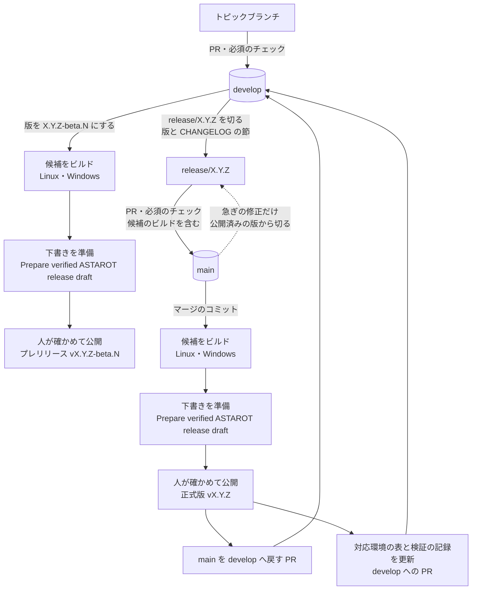

# ASTAROTの配布候補とリリース下書き

配布候補の作成と公開を分けています。最初の公開版は2026-10-31の`v0.1.0-beta.1`（developからのプレリリース）です。Linux・Windowsの候補を同じブランチの同じコミットから作り、検査後にGitHub Releasesの下書きへまとめます。公開は保守担当者が下書きを確認して行います。

## 全体の流れ



ベータ版は`develop`から作ります。正式版は`develop`から切った`release/X.Y.Z`をPRで`main`へ統合し、そのマージのコミットから作ります。公開済みの版を急いで直すときだけ、`release/X.Y.Z`を`main`から切ります（[公開済みの版を急いで直す](#公開済みの版を急いで直す)）。ベータ版も正式版も、公開の前にタグ名、リリースノート、実機での動きを人が確かめます。各段の手順はこの下の節にあります。

リリースの流れを変えたときは、この図も同じPRで直します。参加の流れの図は[CONTRIBUTING.md](../../CONTRIBUTING.md#pull-requests)にあります。

## ブランチとチャンネル

| ブランチ | チャンネル | 版の形式 | GitHub Releases |
|---|---|---|---|
| `main` | 正式版 | `X.Y.Z`（例: `0.1.0`） | 通常のリリース。最新版として表示 |
| `develop` | ベータ版 | `X.Y.Z-beta.N`（例: `0.2.0-beta.1`） | プレリリース。最新版にはしない |

ブランチと版の形式が一致しない場合、下書きは作成しません。アプリ内のリリースチャンネル判定も版の`-beta`で行います。正式版は、developから`release/X.Y.Z`ブランチを切って版だけを`X.Y.Z`に変え（`utils/update_version.py`）、mainへのPRで統合してから作成します。mainは保護されていて、必須チェックに通ったPRでしか変更できません。PRをmainへマージすると、候補の作成と下書きの準備が自動で始まります（[下書きを作る](#下書きを作る)）。公開すると、mainをdevelopへ戻すPRが自動で開きます（[公開したあと](#公開したあと)）。そのPRをマージしてから、developを次の`-beta.N`へ進めます。公開済みの版を急いで直すときは、次の節のとおりmainから切ります。

### 公開済みの版を急いで直す

公開済みの版に急いで直す不具合があり、developにはすでに次の版の作業が入っているときの手順です。developから`release/X.Y.Z`を切ると次の版の変更まで入るので、公開済みの版の`main`から切ります。0.5.2はこの手順で準備しました（#617）。

1. 修正は通常どおりdevelopへのPRでマージします。
2. 公開済みの版の`main`から`release/X.Y.Z`を切ります。
3. 取り込むのは、その修正と、`main`の状態でビルドするのに要る変更だけです。developのPRのコミットを`git cherry-pick -x`で取り込み、PRのブランチにdevelopを取り込んだマージは除きます。0.5.2では、ONNX RuntimeのGitHubの配布が取得できなくなって`main`のままでは配布物のビルドが取得の段で失敗したため、#610の修正（#613）のほかに、ONNX Runtimeの取得元をNuGetに切り替えた#609を取り込みました。取り込んだファイルがdevelopでマージした結果と同じかを`git diff`で確かめ、取り込んだPRと理由をリリースのPRに書きます。
4. 版上げとリリースノートは通常の正式版と同じです（[候補を作る](#候補を作る)の1、[リリースノートの書式](../release-notes/README.md)）。`CHANGELOG.md`の節は前の正式版のタグからのコミットで作るので、取り込んだコミットだけが載ります。版上げのあとにコミットを足したときは、`python tools/changelog.py write --force`で節を書き直します。
5. `main`へのPRはマージコミットで統合します。`CHANGELOG.md`の節は`release/X.Y.Z`のコミットにリンクしているので、squashやrebaseで統合するとリンク先が`main`に入りません。
6. 候補は検証のために`release/X.Y.Z`で作って構いません。下書きを作れるのは`main`と`develop`の候補だけなので（[下書きを作る](#下書きを作る)）、正式な候補はマージしたあとに`main`で作ります。マージすると`main`での候補の作成と下書きの準備が自動で始まります。
7. 公開すると、`main`をdevelopへ戻すPRが自動で開きます（[公開したあと](#公開したあと)）。developにも同じ修正が別のコミットとして入っているので、履歴には同じ変更が2回出ます。developの版が公開済みの版のままなら、統合でdevelopの版はこの手順で出した版（`X.Y.Z`）になります。そのあとdevelopを次の`-beta.N`へ進めます。developを先に次の`-beta.N`へ進めていたときは版の行が衝突するので、developの版を残します。

## 候補を作る

1. `package.json`の版をリリースするブランチの形式にし、`npm run update-version`で`src-tauri/tauri.conf.json`、`pyproject.toml`、`uv.lock`へ反映します。版が載る仕様の一覧（`docs/spec/reference/config-keys.md`）も同じコマンドで作り直します。
   正式版のときだけ、続けて`npm run changelog`で`CHANGELOG.md`にこの版の節を書きます。版の変更と一緒に`chore(release): version X.Y.Z`でコミットします。分類と手順は[CONTRIBUTING.md](../../CONTRIBUTING.md#changelog-and-releases)にあります。
   正式版では`release/X.Y.Z`のPRを`main`へマージすると、次の2〜4と[下書きを作る](#下書きを作る)が自動で進みます。ベータ版のときと、自動の実行が止まって手で続けるときは、2から進めます。
2. GitHub Actionsの「VRCT-VOX Linux candidate (no publication)」を`main`（正式版）または`develop`（ベータ版）で手動実行します。0.5.0からはspeech.cppのCPU版とVulkan版を両方入れた候補を1つ作るので、選ぶものはありません。ファイル名は`VRCT-VOX-<version>-linux-x64-release`に`.tar.gz`、`.AppImage`、`.deb`、`.rpm`を付けたものです（0.4までは`linux-x64-vulkan`か`linux-x64-cpu`）。
3. 「Validate VRCT-VOX distribution」を同じコミットで手動実行し、Windows候補を作ります。このワークフローはmain宛てのPRでも動きますが、下書きに使えるのは手動実行の結果だけです。
4. 両方の実行が成功したら、run IDを控えます。候補の保存期間は7日です。

Linuxでは再配置したアーカイブとAppImageのGUI試験、WindowsではZIP・NSIS内の配布禁止ファイル検査が成功した後に、候補を保存します。Linuxの候補は、tar.gz、AppImage、deb、rpmの4つです。debとrpmはtar.gzと同じファイルを`/opt/vrct-vox`に入れるもので（`tools/linux_packages.py`）、ダイジェストで固定したUbuntu 24.04、Debian 13、Fedora 44のコンテナに、それぞれのパッケージマネージャーで推奨パッケージなしに入れて確かめます（`tools/ci/check_linux_package.sh`）。確かめるのは、メインの実行ファイルのライブラリがそろうこと、同梱の音声エンジンが起動すること、削除で何も残らないことです。0.5.0からバックエンドはメインの実行ファイルの中にあり、別に起動するものはありません。画面の表示は確かめません。各候補の`candidate-manifest.json`にはリポジトリ、コミット、版、ファイル名、容量、SHA-256を記録します。`SHA256SUMS`と、各配布物の`.sha256`も同梱します。インストーラー用の`.sha256`は改行なしの64 ASCII文字で保存します。

Windowsの候補は、ビルドのジョブで`VRCT-VOX.zip`とインストーラーを作ります。0.5まではCUDA版のZIP（`VRCT-VOX_cuda.zip`）も作っていましたが、0.5.0から中身が同じだったので、#288でやめました（[Windowsの配布物の一本化](single-package.md)）。インストーラーにはZIPのSHA-256を組み込みます（`tools/installer_package_hashes.py`が書く`src-tauri/nsis/package-hashes.nsh`。コミットしません）。インストーラーは自分と同じ版のZIPを、この組み込みのハッシュで照合します。リリースのページでZIPと`.sha256`を一緒に差し替えられても、そのZIPは展開しません。`/VERSION`で別の版を入れるときと、ハッシュを組み込まずに作ったインストーラーでは、従来どおりZIPの隣の`.sha256`で照合します。候補のジョブは、組み込んだハッシュと保存するZIPが一致するかを確かめます。

手動実行のときは、保存する前に候補の全ファイルへビルドの来歴を付けます（GitHub Artifact Attestations、`actions/attest-build-provenance`。第2回セキュリティ監査 SEC-04）。来歴には、ファイルのSHA-256、作ったワークフロー、コミット、ブランチ、実行が入り、GitHubがSigstoreで署名します。このリポジトリは公開しているので、署名はSigstoreの公開の透明性ログにも記録されます。SHA-256のファイルだけでは、リリースの資産を差し替えられる人がチェックサムも一緒に差し替えられます。来歴があれば、ファイルがこのリポジトリの候補のワークフローで作られたかを、リリースとは別に確かめられます。来歴を付ける権限（`id-token`と`attestations`）は、候補のジョブにだけ与えます。PRの実行では来歴を付けません。

## 候補ビルドの制限

候補のビルドが成功しても、配布物のすべてを確かめたことにはなりません。候補には次の制限があります。詳しくは各項目の参照先を読んでください。公開する前に確かめられなかったことは、リリースノートの「既知の問題」に書きます（[リリースノートの書式](../release-notes/README.md)）。

### 候補の扱い

- 候補は公開物ではありません。下書きを作れるのは、手動実行で作った候補だけです。main宛てのPRで動いた「Validate VRCT-VOX distribution」の結果は使えません（[候補を作る](#候補を作る)）。
- 候補の保存期間は7日です。過ぎたら作り直します。
- LinuxとWindowsの候補は、同じブランチの同じコミットから作ります。コミットが進んだら、両方を作り直します（[下書きを作る](#下書きを作る)）。
- 候補のビルドはspeech.cppとRVCのモデルを取得も同梱もしません。OCRの重みとMia2026の素材は、配布物に入っていると検査で止まります。Linuxの検査はパスとファイルの種類で調べるもので、名前を変えた重みは見分けられません（[Linuxのビルド](linux-build-pipeline.md#acceptance-and-exclusions)、[AppImage](appimage.md#acceptance-and-limits)）。

### 署名と照合

- Windowsのインストーラーには、コードサイニングの署名がありません。初めて起動するとSmartScreenの警告が出ます（[プラットフォームの制約](platform-constraints.md#1-コード署名)、[README](../readmes/README.ja.md)）。
- `.sha256`、`SHA256SUMS`、`candidate-manifest.json`は、転送の途中でファイルが変わっていないことを確かめるためのものです。電子署名やコードの安全性の証明ではありません（[ローカル検査](#ローカル検査)）。
- ビルドの来歴は手動実行の候補にだけ付きます。PRの実行には付きません。
- updaterの署名を付けるのは、下書きを作るジョブです。候補には付いていません。`TAURI_SIGNING_PRIVATE_KEY`がないとき、またはアプリの公開鍵と合わないときは、下書きを作りません（[updaterの署名とlatest.json](#updaterの署名とlatestjson)）。

### ビルドで確かめないこと

| 対象 | ビルドで確かめること | 確かめないこと |
|---|---|---|
| Linuxのtar.gzとAppImage | 展開した形での起動、描画、終了、設定画面の操作（Xvfb） | FUSEでの起動、実際の音声、管理対象の音声経路。音声認識、モデルを使う機能、VRChat（[公開前にLinuxのデスクトップで確かめる](#公開前にlinuxのデスクトップで確かめる)） |
| Linuxのdebとrpm | Ubuntu 24.04、Debian 13、Fedora 44のコンテナで、ライブラリがそろうこと、同梱の音声エンジンが起動すること、削除で何も残らないこと | 画面の表示 |
| WindowsのZIPとインストーラー | 配布してはいけないファイル、容量、SHA-256、`_internal`のファイル | 画面、モデルを使う機能、TTSとRVCの実機での動作（[公開前にWindowsのパッケージを起動して確かめる](#公開前にwindowsのパッケージを起動して確かめる)） |
| Windowsの更新とインストール | 候補のビルドでは確かめません。別のワークフロー`installer-update-tests.yml`（手動実行と、NSISを変えるPR）が、軽いダミーのペイロードで置き換え、失敗時の復元、中断からの復旧を確かめます | 実際の配布用ペイロード、実際の音声処理（[WindowsのWebView2とインストール時の通信](#windowsのwebview2とインストール時の通信)） |
| WebView2 Runtimeの取得 | なし | ブートストラッパーの版とSHA-256は固定していません。追加の接続先、送る内容、Windowsでの実行は未検証です |
| VR | なし | 偽のSteamVRはPythonバックエンドにだけ差し込まれるため、0.5.0のアプリのVRにはつながりません。VR UIの試験は開発ビルドだけです |

### 動く環境

- Linuxの配布物は、GitHubがホストするUbuntu 24.04で作ります。ほかのディストリビューションは別に確かめる必要があります。カーネルとglibc、GPUのドライバー、PipeWire、音声のコマンドラインツールは、AppImageでも利用者の環境に要ります。同梱の音声補助はLinux 6.9以降が必要です（[AppImage](appimage.md#acceptance-and-limits)）。
- Linuxのデスクトップでの動作確認はKDE Plasma（Wayland）だけです。LinuxのVR UIと、ヘッドセットの画面のチャット読み取りは、SteamVRの代わりになる試験用の仕組みでだけ確かめています（[README](../readmes/README.ja.md)）。
- Linuxの配布物はx64向けです（[README](../readmes/README.ja.md)）。
- GTK、WebKit、実行時に静的に入る依存のライセンスの確認と、ネイティブ、フロントエンド、Rustのライセンスと部品表（SBOM）の確認は、公開の前に済ませる条件です。ビルドは確かめません（[AppImage](appimage.md#acceptance-and-limits)）。

### 機能

- 0.5.0のアプリはSeed-VCを使えません。中核が`vc_engine_unavailable`で断ります（[中核の統合](core-integration.md)）。
- アプリの中で更新できるのは、インストーラー版とAppImage版です。ZIP版とtar.gz版は新しい版を知らせるだけです。debとrpmはパッケージマネージャーで更新します（[README](../readmes/README.ja.md)）。
- 下書きの`latest.json`は公開するまでアプリから読まれません（[updaterの署名とlatest.json](#updaterの署名とlatestjson)）。

## 下書きを作る

正式版では`release/X.Y.Z`のPRを`main`へマージすると、「Start ASTAROT release draft」（`release-draft-auto.yml`、`tools/release_automation.py`）が次を順に進めます。

1. マージのコミットで成功した手動実行の候補を、LinuxとWindowsのそれぞれで探します。作成から6日以内の成功した実行があればそれを使い、実行中のものがあれば終わるまで待ちます。どちらもなければ、候補のワークフローを`main`で手動実行と同じ形で始めます。手動実行と同じなので、候補にはビルドの来歴が付きます。
2. 両方の候補が成功したら、そのrun IDで「Prepare verified ASTAROT release draft」を始め、終わるまで待ちます。

照合はこれまでどおり「Prepare verified ASTAROT release draft」の側で行います（中身はこの節の後半）。候補が1つでも失敗するか、5時間で終わらなければ、そこで止まって下書きを作りません。候補を始める前に`main`がマージのコミットから進んでいたら、別のコミットの候補ができてしまうので何も始めません。同じコミットで下書きの準備がすでに成功していれば、二重には作りません。経過と各実行へのリンクはジョブの概要（Summary）に出ます。

自動の実行が止まったときは、原因を直してから「Start ASTAROT release draft」を`main`で手動実行します。同じ手順をやり直し、成功した候補はそのまま使います。ベータ版の下書きもこのワークフローを`develop`で手動実行すれば同じ手順で準備できます。

手で進めるときは、「Prepare verified ASTAROT release draft」を同じブランチの同じコミットで手動実行し、Linux・Windowsのrun IDを指定します。別のコミットへ進んだ場合は、そのコミットで候補を作り直してください。

この処理は成功した手動ビルドだけを受け付け、元のリポジトリ、ワークフロー、ブランチ、コミット、ブランチと版の形式の対応を確認します。取得した候補についても版・ファイル集合・容量・SHA-256を照合し、差異があれば終了します。続けて全ファイルの来歴を`gh attestation verify`で確かめます。署名したのがそのプラットフォームの候補のワークフローであること、コミットとブランチが下書きのものと同じこと、GitHubのランナーで作ったことです。1つでも確かめられなければ下書きを作りません。ダウンロードしたコードは実行しません。

作成するのは`v<version>`の下書きです。既存の同名タグがある場合は、対象コミットが同じでも停止します。新しい版を選んでください。タグ照会の失敗も続行せず、既存リリースの上書きや自動公開は行いません。下書きの説明は、正式版なら`CHANGELOG.md`のこの版の節から作ります（節がなければ下書きを作りません）。ベータ版なら前のタグからのコミットから作ります。自動の処理は下書きを作るところまでで、公開はしません。公開する前に、下書きのタグ名が`v<version>`であることと、対象のコミットが候補を作ったコミットであることを確かめます（手順は[公開の直前にタグ名を書き直す](#公開の直前にタグ名を書き直す)）。公開するとそのタグができ、リリースのタグはあとから動かせません。続けて本文を`docs/release-notes/<version>.md`のノート（0.5.0からの書式は[リリースノートの書式](../release-notes/README.md)）に差し替え、Windowsのインストール・旧版からの更新・アンインストールを確認してから公開してください。ビルド成功だけではWindowsのTTS/RVC実機動作まで確認したことになりません。確認の手順は[Windowsの音声機能](local-setup-windows.md)にあります。

Windowsのsetupは、下書きへまとめる際に`VRCT-VOX_setup.exe`へコピーします。インストーラーが取得する`VRCT-VOX.zip`の名前も維持してください。アプリ内の更新は`VRCT-VOX_setup.exe`とAppImageを使います（次の節）。

## updaterの署名とlatest.json

アプリ内の更新（#330、[アプリの更新](../spec/external-interfaces.md#アプリの更新)）のために、下書きを作るジョブは、上で検証した`VRCT-VOX_setup.exe`とAppImageに、Tauriのupdaterの署名を付けます。この署名はコードサイニングとは別のもので、アプリに組み込んだ公開鍵（`src-tauri/tauri.conf.json`の`plugins.updater.pubkey`、鍵ID `1178836E5C9F510B`）で検証します。

- 秘密鍵はリポジトリのSecretsの`TAURI_SIGNING_PRIVATE_KEY`（鍵ファイルの中身）、パスワードは`TAURI_SIGNING_PRIVATE_KEY_PASSWORD`（鍵にパスワードがなければ空）です。Secretsを読むのは、署名と`latest.json`の作成をする1つの手順だけです（`tests/voice/test_security_regressions.py`で確かめます）。候補のビルドとPRの実行では読みません。
- 署名は`tauri signer sign --app-version <version>`で作り、署名に版を含めます。アプリは署名の版と`latest.json`の版が一致しないものを入れません（`requireSignedVersion`）。
- `tools/updater_manifest.py`が、各署名の鍵IDと版を確かめ、`cryptography`でEd25519の署名を検証してから、`latest.json`を下書きに加えます。`.sig`ファイルは`latest.json`に入るので、下書きには残しません。`TAURI_SIGNING_PRIVATE_KEY`が設定されていないとき、またはアプリの公開鍵と合わないときは、下書きを作りません。
- 安定版のチャンネルは「latest」のリリースの`latest.json`を読みます。ベータ版のチャンネルは、Workerの`/beta/latest.json`から、ブランチ`updater-channels`の`beta/latest.json`を読みます。どちらも、下書きを公開するまでは読まれません。
- リリースを公開すると、「Point the ASTAROT beta update channel」（`update-channels.yml`）が、公開済みのリリースのうち最も新しい版（ベータ版と安定版の両方）の`latest.json`を`updater-channels`の`beta/latest.json`に書きます。古い系統の修正版を公開しても、それより新しいベータ版があればそのままです。書き込むのはこのブランチの1つのファイルだけで、同じ内容なら何も書きません（#466）。
- このブランチがまだないときは、このワークフローを手で1回実行して作ります。Workerの`/beta/latest.json`は`https://raw.githubusercontent.com/kein5/astarot/updater-channels/beta/latest.json`へ転送します（Workerはこのリポジトリの外にあり、保守担当者が設定します）。Workerがまだ転送しないか、ブランチがないときは、ベータ版のチャンネルのアプリは安定版の`latest.json`を読みます。

鍵を替えるときは、新しい公開鍵をアプリに入れた版を古い鍵で署名して出し、その版が行き渡ってから新しい鍵での署名に切り替えます。秘密鍵をなくすと、それまでの版はアプリ内で更新できなくなります。秘密鍵とパスワードは、Secretsとは別の安全な場所にも保管してください。

インストーラーはアプリから`/P /UPDATE /R /ARGS …`と`/EDITION=cpu`または`/EDITION=gpu`で起動されます。この場合は言語とエディションのページを飛ばし、`installer_language.txt`を書かず（アプリの言語の設定を変えない）、ショートカットを作り直しません。ZIPの取得、ハッシュの照合、段階的な置き換え、失敗したときの復元は、通常のインストールと同じです。`installer-update-tests.yml`のサイレント試験に、`/UPDATE`付きの更新を含めています。

## 公開前にWindowsのパッケージを起動して確かめる

候補のビルドはパッケージの中身（配布してはいけないファイル、容量、SHA-256）と、`_internal`に必要なファイルがそろっていること（`tools/app_resources.py check`）を検査します。0.4までは、パッケージしたPythonのバックエンドを`--self-check`で起動していました。0.5.0からバックエンドは`vrct-vox.exe`の中にあるので、起動して確かめるのはアプリそのものです。画面と、モデルを使う動作はビルドでは確かめません。

0.1.0-beta.7までのWindowsのパッケージでは、ローカル翻訳を一度もオンにできませんでした。PyInstallerのアーカイブの中ではTransformersが自分のフォルダーの一覧を読めず、tokenizerを組み立てられなかったためです。開発用のビルドでは起きないので、パッケージを起動して「翻訳」を押すまで分かりませんでした。開発用のビルドは同梱の資源をチェックアウトの`build/`から読むので、パッケージの`_internal`の不足も同じく開発中には見えません。公開の前に、下書きの`VRCT-VOX.zip`を作業用のフォルダーへ展開して起動してください。インストール済みのASTAROTには触れません。

```powershell
# 下書きのパッケージを取得し、SHA-256を確かめて、作業用のフォルダーへ展開する
$d = "build\release-check\<version>"
gh release download v<version> -R kein5/astarot -p "VRCT-VOX.zip" -p "VRCT-VOX.zip.sha256" -D "$d\dl"
(Get-FileHash "$d\dl\VRCT-VOX.zip" -Algorithm SHA256).Hash.ToLower() -eq (Get-Content "$d\dl\VRCT-VOX.zip.sha256" -Raw).Trim()
New-Item -ItemType Directory -Force "$d\app", "$d\state", "$d\webview" | Out-Null
tar -xf "$d\dl\VRCT-VOX.zip" -C "$d\app"

# 設定とWebView2のデータを作業用のフォルダーへ分けて起動する（どちらも絶対パス）
$env:VRCT_CONFIG_DIR = (Resolve-Path "$d\state").Path
$env:WEBVIEW2_USER_DATA_FOLDER = (Resolve-Path "$d\webview").Path
& "$d\app\vrct-vox.exe"
```

- `VRCT_CONFIG_DIR`を指定すると、設定とログがそのフォルダーに入り、インストール済みのアプリが動いていても別に起動します。モデルと`telemetry_state.json`は展開した`app`フォルダーの中に入ります。
- #442の修正より前の版では、OSCの送信先がこのPC（既定）だと、バックエンドがmDNSのためにポートを開き、新しい場所の実行ファイルにはWindowsのファイアウォールの確認が出ます。確認を出さずに見るときは、`state\config.json`に`"OSC_IP_ADDRESS": "127.0.0.2"`と`"SEND_MESSAGE_TO_VRC": false`を書いてから起動します。修正を含む版では確認は出ません。出たときは、どのexeについての確認かを控えて報告します。
- 利用状況のお知らせで「送信する」を選ぶと、実際の受信サーバーへ1件送ります。送らずに見るときは`VRCT_TELEMETRY`に`off`を入れます。
- 少なくとも次を確かめます。起動して版が表示されること。設定の「翻訳」のダウンロードを押すと、取得の確認画面が開き、同意して取得が終わると翻訳がオンになって訳文が出ること（翻訳のモデルは2026-11-19に公開しました。それより前の版では、未公開であることと自分で用意したモデルを置くフォルダが出ます）。設定の各ページが開くこと。閉じると、アプリが起動したプロセス（speech.cppのサーバーやRVCのワーカー）が残らないこと。`state\logs\error.log`ができていないこと。0.1.0までは、翻訳モデルがない状態で「翻訳」を押すたびに記録（`MissingCTranslate2Tokenizer`）が1件残りました。モデルがまだないのは最初の起動では当たり前の状態なので、いまは記録せず、利用状況のエラーの通知にも数えません。
- 確かめるのは手元のWindows 11です。一般向けに配信されているWindows 11で確かめる手順は、リリースの前の確認に加えないと2026-11-18に決めました（#516）。Insider Preview版で確かめたときは、そのビルドの番号を記録に書きます。対応環境の表にも、一般向けのWindows 11では確かめていないと書いてあります。
- 確かめたことと確かめなかったことを、版、OSとそのビルド、配布形式（インストーラーかZIPか）と一緒に控えます。公開したあと、[対応環境の表と検証の記録](#公開したあとに対応環境の表を更新する)に足します。

## 公開前にLinuxのデスクトップで確かめる

候補のビルドは、AppImageの起動、描画、設定画面の操作までを自動で確かめます。VRChatを使う試験はVRChatとOCRのモデルが要るので、CIでは実行しません。CIに含まれない試験は、画面を変えたあとに気づかないまま古くなります。0.1.0-beta.6では、公開の直前に補助コードが今の画面と合っていないことが分かり、一部を確かめないまま公開しました。その後に流し直すと、設定画面で音声認識サーバーを止めても、閉じると再開する不具合が見つかっています。公開の前に、下書きのAppImageをLinuxのデスクトップで実行してください。

```bash
# 下書きのAppImageを取得し、SHA-256を確かめる
mkdir -p ~/.cache/vrct-vox-release-check/<version> && cd ~/.cache/vrct-vox-release-check/<version>
gh release download v<version> -R kein5/astarot -p '*.AppImage' -p 'SHA256SUMS-linux'
sha256sum -c --ignore-missing SHA256SUMS-linux
cd <リポジトリ>

# アプリだけで動く試験
python tools/native_acceptance.py --appimage <AppImageの絶対パス>

# VRChatの往復も含める
python tools/native_acceptance.py --appimage <AppImageの絶対パス> --vrchat
```

`tools/native_acceptance.py`は、試験のグループごとにpytestを起動し、成功、失敗、スキップの件数を表示します。結果は`build/native-acceptance/summary.json`、各グループのログは同じフォルダーの`<グループ>/pytest.log`です。試験は実際のアプリを画面に開きます。`tauri-driver` 2.1.0の場所は`--driver`か`ASTAROT_TEST_DRIVER`で指定します。

| グループ | 確かめること | 要るもの |
|---|---|---|
| `appimage` | FUSEと展開の両方式での起動、描画、終了、設定画面の操作。管理された経路のミュートと解除が画面と試験用のPipeWireグラフの両方で確定し、再起動のあともミュートで始まること（#838） | AppImage、`pipewire`、`wireplumber` 0.5 |
| `ui` | 基本画面と設定画面（表示倍率100%と150%）、設定画面の開閉の繰り返し、`appimage` と同じ管理された経路のミュートと解除 | `xwininfo`（デスクトップの字幕の窓の試験。CachyOSとArch Linuxでは `xorg-xwininfo`、UbuntuとDebianでは `x11-utils` のパッケージ） |
| `vrchat` | アプリで入力した文が実際のVRChatの吹き出しに出て、チャット読み取りで読み戻せること | `--vrchat`、OCRのモデル |
| `quick_chat` | Quick Chatのショートカットで、入力の窓が全画面の窓の上に出てフォーカスを取り、メインの窓を戻さないこと。下書きを保ち、翻訳、OSC、読み上げへ1回ずつ流れること。ほかの窓からの操作を断ること。Waylandではショートカットをデスクトップのポータルで登録すると示し、ボタンで開けること | KDE（X11かXWayland）、`xdotool`と`xprop`、GTKの入った`python3`。Waylandの1件は、Waylandのデスクトップで開発用のビルドを使うときだけ流れる |

`--vrchat`は、チャットボックスのラボのVRChatを2つ、このPCの中だけの非公開のインスタンスで起動し、往復の試験を流してから終了します。VRChatのアカウントは、このPCでサインイン済みのものです。

0.5までは、ほかに`voice`、`tts-model`、`asr`、`downloads`、`rvc`、`seed-vc`、`vrchat-voice`、`vr-ui`のグループと、モデルと実行環境を取得する`--fetch-models`、`--fetch-runtimes`がありました。これらは試験専用のPipeWireグラフでアプリの音声を流したり聞いたりするのに、Pythonのバックエンドの部品（PipeWireのゲート、読み上げの呼び出し、録音、取得と準備の仕組み）を使っていたので、0.6.0でバックエンドと一緒に消しました（#285）。音声経路のうち、管理された経路のミュートと解除は `appimage` と `ui` のグループが確かめます（試験はミュートの状態をアプリの外から `pw-dump` で読みます）。読み上げ、音声認識、RVCを実機で確かめる試験は、今はありません。読み上げと遅延は、中核の例（`native/core/examples/live_speech.rs`、`pipeline_latency.rs`）で測れます。

実機で確かめる範囲は2026-11-18に決めました（#516）。

- 配布形式はAppImageで確かめます。debとrpmはコンテナに入れる試験、tar.gzは仮想の画面で起動する試験（どちらも`build-linux.yml`）だけで、実機では確かめません。
- デスクトップは実機で確かめます。記録には、ディストリビューションとその版、デスクトップ環境、表示の方式（WaylandかX11か）を書きます。
- VRは実際のヘッドセットとSteamVRを使わず、偽のSteamVR（`FakeVr`）を使う試験で足ります。この試験は`voice-tests.yml`の`core-integration`のジョブが流します（[CIが確かめていること](platform-verification.md#ci-が確かめていること)）。

実行した試験と実行しなかった試験を、リリースノートの`## 🐞 既知の問題`に書いてください。結果は、版、ディストリビューション、デスクトップ環境、配布形式と一緒に控えます。公開したあと、[対応環境の表と検証の記録](#公開したあとに対応環境の表を更新する)に足します。

操作できなかった部品があるときは、試験の出力先の`blocked-<操作>.json`を見てください。何が覆っていたかと、開いていたダイアログを記録してあります。

## 公開の直前にタグ名を書き直す

下書きのあいだはタグがまだなく、公開したときに下書きの`tag_name`と`target_commitish`からタグができます。ワークフローが入れた値をそのまま使わず、版と候補を作ったコミットを書いて上書きし、読み直して確かめます。`<id>`は下書きのリリースのIDです（`gh api 'repos/{owner}/{repo}/releases?per_page=10' --jq '.[] | select(.draft) | {id, tag_name}'`で引けます）。

```bash
git ls-remote --tags origin v<version>   # 何も出ないこと
gh api -X PATCH repos/{owner}/{repo}/releases/<id> \
  -f tag_name=v<version> -f target_commitish=<候補を作ったコミットの40桁のSHA>
gh api repos/{owner}/{repo}/releases/<id> \
  --jq '{tag_name, target_commitish, draft, prerelease, name}'
```

読み直した結果で、`tag_name`が`v<version>`、`target_commitish`が候補を作ったコミット、`draft`が`true`であることを確かめます。`prerelease`は正式版で`false`、ベータ版で`true`です。同じ名前のタグがすでにあったら公開しません。

公開は保守担当者が行います。APIで公開するときは、最新版にするかを`make_latest`の文字列で明示します。正式版は`-F draft=false -f make_latest=true`、ベータ版は`-F draft=false -f make_latest=false`を同じPATCHに渡します。

## 公開してから確かめる

公開したら、次の4つを確かめます。

1. タグのコミットが候補を作ったコミットと同じこと。

   ```bash
   gh api repos/{owner}/{repo}/releases/tags/v<version> \
     --jq '{tag_name, draft, prerelease, target_commitish, published_at}'
   git fetch origin --tags && git rev-parse 'v<version>^{commit}'
   ```

2. 最新版の指定（`make_latest`）が効いていること。`gh api repos/{owner}/{repo}/releases/latest --jq .tag_name`が、正式版なら`v<version>`、ベータ版なら前の正式版のままです。違うときは`make_latest`をPATCHし直します。
3. 更新確認のWorkerが新しい`latest.json`を返すこと。安定版のアプリは`src-tauri/tauri.conf.json`の`plugins.updater.endpoints`にあるWorkerを読み、Workerは`releases/latest`の`latest.json`へ302で転送します（[アプリの更新](../spec/external-interfaces.md#アプリの更新)）。正式版なら`<version>`、ベータ版なら前の正式版の版が出ます。

   ```bash
   url=$(jq -r '.plugins.updater.endpoints[0]' src-tauri/tauri.conf.json)
   curl -sI "$url" | grep -i '^location'
   curl -sL "$url" | jq -r .version
   ```

4. 資産の件数と名前が候補と合うこと。リリースの資産は、各候補の`candidate-<platform>.json`にある資産とその`.sha256`、プラットフォームごとの`candidate-<platform>.json`と`SHA256SUMS-<platform>`、`latest.json`です（`tools/prepare_release.py`と`prepare-release.yml`）。期待する件数は「2 ×（2つの候補の`assets`の数の合計）+ 5」です。

   ```bash
   d=$(mktemp -d)
   gh release download v<version> -p 'candidate-*.json' -D "$d"
   gh api repos/{owner}/{repo}/releases/tags/v<version> --jq '[.assets[].name]' > "$d/published.json"
   jq -s --slurpfile pub "$d/published.json" '
     ([.[] | .assets[].name | ., . + ".sha256"]
      + [.[] | "candidate-\(.platform).json", "SHA256SUMS-\(.platform)"]
      + ["latest.json"]) as $want
     | {want: ($want | length), published: ($pub[0] | length),
        missing: ($want - $pub[0]), extra: ($pub[0] - $want)}' "$d"/candidate-*.json
   ```

   `want`と`published`が同じで、`missing`と`extra`が空であることを確かめます。前の版と件数が違うときは、配布物の増減（なくした配布物、名前を変えた配布物）で説明がつくかを確かめます。下書きを作る手順が資産の組み方を変えたら、この式も直します。

## 公開したあとに対応環境の表を更新する

正式版を公開したら、利用者向けの[対応環境と検証の範囲](../../site/ja/guide/support.md)（英語は[Platform support](../../site/en/guide/support.md)）と、その根拠の[対応環境の検証の記録](platform-verification.md)を、公開した版に合わせて更新します（#516）。ホットフィックスの版も同じです。ガイドのサイトはdevelopから公開されるので、更新はdevelopへのPRにし、版を公開したあとにマージします。公開の前にマージすると、まだ出していない版の内容を利用者に見せることになります。

1. 根拠の一覧の「実機の記録」に、この版の記録を足します。[Windows](#公開前にwindowsのパッケージを起動して確かめる)と[Linux](#公開前にlinuxのデスクトップで確かめる)の公開前の確認で控えたことを、版、OSとその版、配布形式、確かめたこと、確かめなかったことの列に書き、記録の出典（PRやIssueのコメント）へリンクします。PCの持ち主が分かる情報は書きません。実機で確かめなかった版では、そのことを書きます。
2. 根拠の一覧の「CIが確かめていること」を、この版のワークフローと見比べます。ジョブ、ランナー、確かめることが変わっていれば直します。
3. 日本語と英語のページを同じように直します。
   - 冒頭の「X.Y.Zの時点の内容です（日付）」を、公開した版と日付にします。根拠の一覧の「対象の版」も同じ版にします。
   - 「OSと配布形式」の行を、この版の配布物と見比べます。
   - 実機の欄は、1で足した記録がある欄だけを、この版で確かめたと書き換えます。前の版の記録しかない欄は、その版を書いたまま残します。記録のない欄は「未検証」のままです。
   - Windowsの実機の記録のOSの注記（Insider Preview版のビルドの番号）を、1の記録に合わせます。
4. `python tools/dev.py check --scope voice`で`tests/voice/test_support_matrix.py`を流し、`site/`で`npm run build`とPagesのワークフローの検査を流します。この試験が確かめるのは、配布物の名前、debとrpmを試すコンテナのOSと版、日英の表の形だけです。機能の欄の中身は、PRのレビューで1の記録と見比べます。
5. PRの「Platforms / 対応環境」に、変えた欄と、根拠にした記録を書きます。

ベータ版を公開したときは、利用者向けのページは変えません。ページは正式版の範囲を示すためです。ベータ版を実機で確かめたときは、根拠の一覧の「実機の記録」にだけ足します（0.5.0-beta.5の記録と同じ扱いです）。

## 公開したあと

正式版のリリースを公開すると、「Open ASTAROT back-merge pull request」（`release-back-merge.yml`、`tools/release_automation.py`）が`main`を`develop`へ戻すPRを開きます。リリースのタグのコミットに`chore/merge-main-back-X.Y.Z`のブランチを作り、そこから`develop`へのPRを`chore(release): merge main (X.Y.Z) back into develop`の題で開きます。ベータ版を公開したときは何もしません。`develop`がすでにそのコミットを含むときと、同じPRがすでに開いているときも、何もしません。同じ名前のブランチがあれば、作り直さずにそのまま使います。

自動ではマージしません。競合したらそのブランチの上で解き、マージコミットで統合します。マージしたら、developを次の`-beta.N`へ進めます。

このPRはGitHub Actionsのトークンで開くので、PRに対するワークフローは自動では始まりません。必須のチェックを動かすには、PRを一度閉じて開き直すか、競合を解いたコミットをpushします。チェックまで自動で始めるには、GitHub Appのトークンのような別の認証が要ります。Secretsを読むのは下書きの署名の手順だけにしているので（[updaterの署名とlatest.json](#updaterの署名とlatestjson)）、この仕組みには入れていません。

リポジトリの設定で「Allow GitHub Actions to create and approve pull requests」（Settings → Actions → General → Workflow permissions）がオフのときは、ジョブがPRを開けません。そのときはブランチを作ったところで失敗し、PRを開くためのリンクをジョブの概要に出します。そのリンクから人がPRを開けば、チェックも始まります。

## WindowsのWebView2とインストール時の通信

現在のビルドでは、`src-tauri/tauri.conf.json`の`bundle.windows.webviewInstallMode`を省略しているため、Tauriの既定の`downloadBootstrapper`（`silent: true`）を使います。ローカルの`@tauri-apps/cli/config.schema.json`とビルド設定で確認した動作です。今回、このモードは変更していません。

NSISインストーラーは、HKLMとHKCUのレジストリにWebView2 Runtimeのバージョンが見つからない場合、Microsoftの`https://go.microsoft.com/fwlink/p/?LinkId=2124703`からブートストラッパーを取得して実行します。ブートストラッパーもMicrosoftへ接続し、WebView2 Runtimeを取得します。Microsoftとリダイレクト先にはIPアドレスや要求の情報が伝わります。`embedBootstrapper`を選ぶビルドでも、同梱するのはオンライン取得用のプログラムなので、実行時の通信は残ります。既存Runtimeを検出した場合、この取得・実行は省きます。

この経路はWindowsへのインストール時の通信で、同意が必要なモデル取得とは別です。アプリ内の更新もこのインストーラーを起動するので、同じ通信をします。現在のテンプレートでは、ブートストラッパーの版・SHA-256を固定せず、アプリ独自の署名検証や実行時間の上限も設けていません。ブートストラッパーが実際に使う追加の接続先と送信内容、Windowsでの実行は未検証です。公開前のWindows実機検証では、Runtimeがある場合とない場合の両方を確認してください。

アプリ本体はGitHub Releasesから取得し、SHA-256を照合してから展開します。インストーラーと同じ版なら組み込みのハッシュで、別の版ならZIPの隣の`.sha256`で照合します（[候補を作る](#候補を作る)）。パッケージ容量を調べるcurlのHEAD要求には、接続10秒・1試行全体30秒の上限を設けています。再試行は最大2回で、開始できる期間も30秒に制限しています。最後の試行はその期間を越えて続く場合がありますが、その試行にも30秒の上限が適用されます。容量を取得できない場合は、既存の1ストリームでの取得に進みます。SHA-256ファイルの取得上限は30秒で、大きなアーカイブの転送には別の監視処理があります。

Windowsの更新では、既定の「アンインストールしてからインストール」を選んでも、取得前に旧版を削除しません。`$INSTDIR\.upd\new`へ展開し、tarの成功、実行ファイル、`_internal`フォルダーを確認してから、アプリが動いていないかをもう一度調べます。新規インストールと、`/S`・`/P`でも同じ段階的な置き換えを使います。同じ版の「アプリをアンインストール」は、明示的な削除操作なので従来どおりその場で実行します。

インストーラーとアンインストーラーは、動いているアプリを調べるときに`vrct-vox.exe`と`vrct-vox-sidecar.exe`の両方を探します。0.5.0の配布物にサイドカーはありませんが、0.4までの版から更新するときに古いサイドカーが動いていることがあります。`vrct-vox.exe`を強制終了するとサイドカーは自分の監視が止めるまで1〜2分残り、実行ファイルを消せず、終了時に`config.json`を書き直すことがあるため、サイドカーも終了させます。新しいパッケージにはサイドカーがないので、置き換えの後と削除のときに、残った`vrct-vox-sidecar.exe`を消します。

tarは引数をANSIコードページで受け取るので、ユーザー名などにその外の文字があると、引数に書いたパスのアーカイブも展開先も開けません。作業ディレクトリは引数ではなく、Unicodeのまま扱われます。そこでtarの作業ディレクトリを`$INSTDIR\.upd\new`にし、`$TEMP`のアーカイブを隣の`$INSTDIR\.upd`へ移してから、ASCIIだけの相対パス（`..\VRCT-VOX.zip`）を渡します。8.3形式の名前には依存しないので、8.3形式の名前がないボリュームでも同じように動きます。展開に失敗したアーカイブは`$TEMP`へ戻し、再取得と`.bad`の保存に使います。`$TEMP`とインストール先が別のドライブなら、この移動でアーカイブをコピーするので、その時間がかかります。インストール先のドライブの容量検査にもアーカイブの分を足しています。

置き換え中は`.upd\committing`を残し、旧アプリの各項目を`.upd\old`へ退避します。新しく追加する項目は`.upd\add`に記録します。`_internal`はフォルダーごと置き換えるため、旧版だけの依存ファイルは残りません。0.4までの版から更新すると、Pythonの実行環境（約1 GB）もこのとき消えます。`config.json`、`weights`、`logs`、`telemetry_state.json`、利用者のログはそのまま保持します。旧版と展開済みの新版が同時に存在するため、容量の検査は既存ファイルに加えて必要になる空き容量を調べます。

置き換えに失敗したら追加分を`.upd\discard`へ移し、退避した旧ファイルを戻します。次回の実行時にもマーカーを調べ、中断した置き換えを先に戻します。復元できないファイルがあれば、旧ファイルとマーカーを削除せず、保存場所を表示して停止します。この場合は使用中のアプリを閉じて再実行し、`.upd`を手動で削除しないでください。復元が完了した後の作業フォルダーの削除に失敗しても、次回に残りを削除できます。転送の失敗・再試行では、パッケージの通信を停止し、終了を待ってから一時ファイルを削除します。最終的な展開失敗時の`.bad`アーカイブは診断用に残します。

WiXからの移行では検証・展開の後に旧アンインストーラーを実行します。NSISの旧版と同じ場所に更新する場合、旧アンインストーラーは実行しません。別の場所への移行では、新版の配置が成功してから旧版を削除し、その後にレジストリを更新します。旧版の削除失敗は警告として扱います。ファイルの置き換えが完了したマーカーは、別の場所の旧版削除やレジストリ更新より前に消します。マーカーを消せない場合でも、旧版を戻せる状態で停止するためです。

アンインストールでアプリのデータの削除を選んだ場合は、`config.json`の隣に置くデータ（`config.json`、読めなかった設定の退避ファイル、`voice_mute_state.json`、`downloaded_models`、ログ、`weights`、`telemetry_state.json`）も消します。この項目は既定では選ばれておらず、選ばなければこれらは残ります。

回帰試験は[installer-update-tests.yml](../../.github/workflows/installer-update-tests.yml)で実行します。手動実行と、NSIS・試験スクリプト・同ワークフローを変更するPRが対象です。Windowsジョブのcheckout内だけで取得先をローカルHTTPサーバーに書き換え、軽いダミーのペイロードを実際のNSISインストーラーで取得・展開します。サイレント試験では成功時のファイル置き換えと利用者データの保持、ANSIコードページの外の文字を含むフォルダーへのインストール、各失敗時のパス・ハッシュの一致、ロールバック、中断からの復旧、Range失敗時の単一接続への切り替えを調べます。インストーラーを作らずに実際のtarだけを確かめるときは、`python tests/installer/windows_update_scenarios.py --mode tar`を使います。GUIの既定選択はpywinautoを使う別ステップで確認します。これは実際の音声処理や配布用ペイロードの動作試験ではありません。

## ローカル検査

```bash
python tools/release_candidate.py verify path/to/candidate \
  --platform linux --commit <40桁のコミットSHA> --version 0.1.0
python tools/dev.py check --scope voice
```

このハッシュ照合は、記録した候補が転送中に変わっていないことを調べるものです。電子署名やコードの安全性認証ではありません。GitHubのartifactダイジェスト不一致は警告になるため、別途この検査で失敗させています。[GitHub公式の説明](https://docs.github.com/en/actions/tutorials/store-and-share-data#validating-artifacts)
